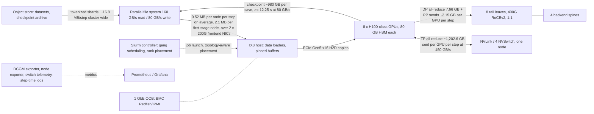
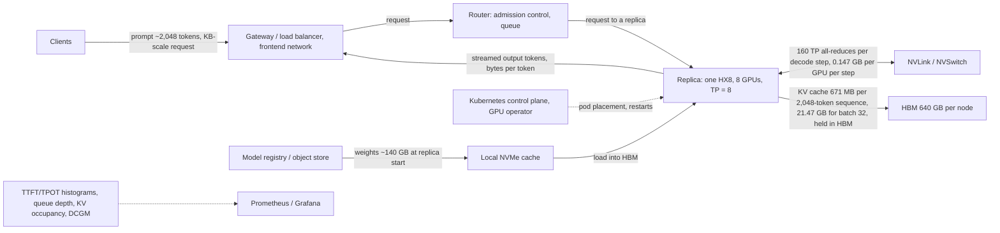

# 1.1 — Reference architectures: model answer

Sources: manuscript Sections 1.3 and 1.4 (Figures 1.1–1.4, Tables 1.3 and 1.4), Section 1.5 (Table 1.6
volumes) and Section 1.7 (checkpoint arithmetic). All volumes are `[MODELED]` from ORION
`[ILLUSTRATIVE]` parameters; vendor-class link rates are `[VENDOR-SPEC, 2026-10]`.

## (a) W-TRAIN on ORION (256 GPUs, TP 8 × PP 4 × DP 8)

Dominant data flow: tensor-parallel all-reduce inside the NVLink domain, ≈ 1,202.6 GB sent per GPU per
step (Table 1.6), 157× the data-parallel volume. The scale-out fabric carries only the DP all-reduce and
pipeline activations, ≈ 9.8 GB per GPU per step.

| Layer | Component | Dependency of W-TRAIN | First signal if it degrades |
|---|---|---|---|
| Compute | GPUs, HBM | 6.96 s of the 17.4 s step is compute at peak | `DCGM_FI_PROF_PIPE_TENSOR_ACTIVE` drops on some GPUs; clock-event reasons active |
| Scale-up | NVLink/NVSwitch | TP all-reduces, 2.67 s lower bound per step | Step time rises job-wide; NVLink replay/CRC counters; link `inactive` |
| Scale-out | Rail NICs, leaves, spines | DP all-reduce once per step plus PP point-to-point | NCCL all-reduce time rises; ECN marks, CNPs or PFC pauses on rail leaves |
| Frontend | 2 × 200G NICs, frontend leaves | Dataset reads and checkpoint writes | Data-loader wait at step start; frontend NIC errors or drops |
| Storage | PFS and object store | Checkpoints (980 GB) and shards | Checkpoint duration grows; PFS client latency |
| Orchestration | Slurm | Gang scheduling, rank-to-GPU placement, restart after failure | Jobs pending; wrong rank placement (TP spanning nodes, Section 1.11) |
| Observability | DCGM, node exporter, switch telemetry | Detecting stragglers and failures | Missing metrics, stale dashboards, step-time logs absent |

## (b) W-INFER on ORION (one replica = one HX8, TP = 8, BF16)

Dominant data flow: HBM reads, 20.18 GB per GPU per decode step (weights 17.5 GB + KV 2.68 GB), which
set the ≈ 6.02 ms memory bound (Section 1.9 Step 5). Per-request network bytes are small.

| Layer | Component | Dependency of W-INFER | First signal if it degrades |
|---|---|---|---|
| Compute | GPUs and HBM | Decode is HBM-bandwidth bound; prefill is compute bound | TPOT p95 rises on one replica; `DCGM_FI_PROF_DRAM_ACTIVE` changes |
| Scale-up | NVLink | 160 latency-bound all-reduces per decode step | TPOT gap on one replica; NVLink link state or replay counters |
| Scale-out | Backend RDMA | Not used at TP = 8 inside one node (needed only for multi-node or disaggregated serving) | None for this design: idle NIC counters are expected |
| Frontend | Gateway, frontend leaves | Every request and response | Connection errors, TTFT rising on all replicas together |
| Storage | Registry, NVMe cache | Weights at replica start or scale-out | Slow pod readiness during scale-up or restart |
| Orchestration | Kubernetes | Placement, health checks, rolling updates | Pods pending or crash-looping; uneven replica counts |
| Observability | Latency histograms, DCGM | SLO tracking (TTFT ≤ 800 ms, TPOT ≤ 50 ms p95) | Burn-rate alerts; missing histogram series |

## Failure domains

W-TRAIN is one synchronous computer: any GPU, NIC, NVLink, rail-leaf or node fault stops all 256 GPUs,
and the job rolls back to its last checkpoint. With the canonical node MTBF of 1,536 h, the 32-node job
is interrupted every ≈ 48 h `[MODELED]`. W-INFER fails per replica: losing one node loses eight GPUs
and the requests in flight on them (clients retry), and fleet capacity drops by 1/n (one of the eight
default-pool replicas = 12.5 %), while the other replicas keep serving. Training failure costs wall-clock progress;
inference failure costs capacity and latency headroom.

**Common wrong answers:** drawing TP traffic on the backend fabric; omitting the checkpoint path; making
the dataset the dominant training I/O for a text LLM (16.8 MB per step is negligible); forgetting the
OOB/BMC network or the observability layer; claiming inference needs the RDMA fabric at TP = 8.
