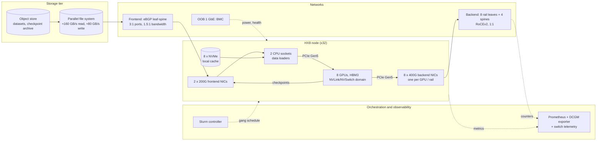
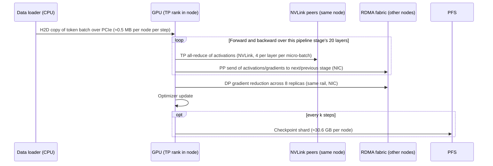
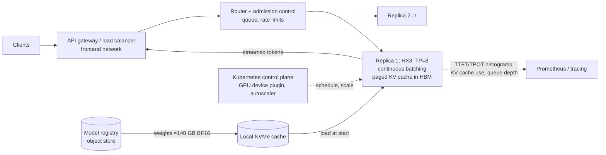
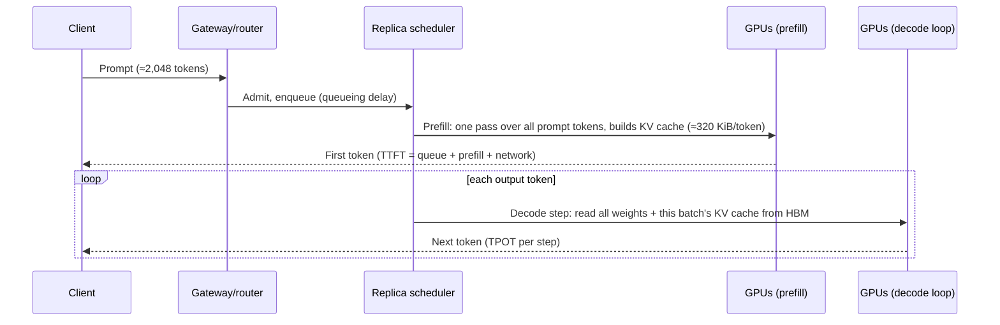

# Chapter 1 — The AI Infrastructure Landscape

> A 256-GPU training cluster and a 256-server web tier can occupy similar floor space, but they are
> different machines. The web tier is a pool of independent servers; a large training job turns the
> whole cluster into one synchronous computer that runs only as fast as its slowest GPU, NIC, link, or
> storage target. An inference fleet sits in between: thousands of independent requests, each served
> by a tightly coupled group of GPUs, judged on latency percentiles rather than averages. This chapter
> builds the mental model the rest of the book depends on. We separate training from inference,
> scale-up from scale-out, and compute-bound from memory-, communication-, and I/O-bound work, and we
> attach numbers to each distinction using ORION, the 256-GPU reference cluster that runs through every
> chapter. We finish with the employer and role landscape, so you can see which parts of this stack each
> kind of engineer owns, and with a lab in which you build a small model that classifies workloads
> from their resource profiles and catches the flawed data that real capacity reviews are full of.

## Learning objectives

After this chapter you will be able to:

1. **Explain** five ways an AI cluster differs from a conventional cloud fleet (coupling, bandwidth
   per server, traffic pattern, power density, failure semantics) and give a number for each on ORION.
2. **Draw** reference architectures for a training workload and an online-inference workload, and
   identify their compute, network, storage, orchestration, and observability dependencies.
3. **Calculate** per-step communication volume for tensor-parallel and data-parallel traffic and
   **decide** which belongs in the scale-up (NVLink) domain and which on the scale-out (RDMA) fabric.
4. **Classify** a workload as compute-, memory-, communication-, or I/O-bound from a resource profile,
   using lower-bound times against stated hardware ceilings, and **name** the telemetry that would
   confirm the classification.
5. **Diagnose** a cross-layer slowdown with the diagnostic loop, ranking hypotheses across compute,
   network, storage, and orchestration.
6. **Map** the employer groups and engineering roles in AI infrastructure to the skills in this book,
   and **build** a role-to-skill matrix with evidence for your own target role.

## Prerequisites and connections

You need Linux command-line literacy, basic Python, and IP networking fundamentals. No CUDA, RDMA, or
machine-learning background is assumed; this chapter introduces just enough of each to reason about
infrastructure, and points forward to where each topic is taught properly.

This chapter is the map for the book. Chapter 2 turns these architecture sketches into racks, ports,
power, and cooling; Chapter 3 goes inside one host. The scale-up/scale-out split of Section 1.5 is
developed in [Chapter 5](../../part-2-accelerated-compute/ch05-gpu-interconnects-host-topology/),
Chapters 7–10 (networking), and Chapters 11–13 (distributed training, NCCL, data movement). The
ceiling model of Section 1.6 becomes roofline analysis in Chapter 6 and cross-layer analysis in
Chapter 22. Inference returns in Chapter 15; failure and cost in Chapters 19 and 21; the role
landscape in Chapter 24. Capstone A (256-GPU training cluster) and Capstone D (LLM inference
platform) start from the reference architectures drawn here.

Acronyms: NIC (network interface card), HBM (high-bandwidth memory), RDMA (remote direct memory
access), RoCEv2 (RDMA over Converged Ethernet v2), IB (InfiniBand), NCCL (NVIDIA Collective
Communications Library), PCIe (PCI Express), NUMA (non-uniform memory access), TP/PP/DP
(tensor/pipeline/data parallelism), MoE (mixture of experts), KV (key/value), TTFT (time to first
token), TPOT (time per output token), SLO (service-level objective), MFU (model FLOP utilization), PFS
(parallel file system), DCGM (NVIDIA Data Center GPU Manager), BMC (baseboard management controller),
OOB (out-of-band), Xid (NVIDIA driver error event), MTBF (mean time between failures), IaC
(infrastructure as code), SRE (site reliability engineering).

## 1.1 Why AI infrastructure is different

Engineers arriving from stateless services, oversubscribed networks, and "fast enough" storage bring
sound instincts, but five of them break on an AI cluster. Each break has a mechanism and a number.

**1. Coupling: one job, one computer.** In a web fleet, server 17 being 10 % slow means 10 % of
requests are a little slower. In synchronous data-parallel training, every GPU must finish its share
of a step before gradients are combined and the next step starts. The step time is the *maximum* over
all ranks, not the mean. On ORION's reference training workload, W-TRAIN, the modeled step time is
17.4 s across 256 GPUs `[MODELED]` (docs/REFERENCE_CLUSTER.md). If one GPU runs 10 % slow because it is
thermally throttling, the whole 256-GPU job runs roughly 10 % slow: about 25.6 GPUs' worth of
capacity lost to one sick device. Tail behaviour, not average behaviour, sets throughput.

**2. Bandwidth per server.** A general-purpose cloud server commonly has 25–100 Gb/s of network
bandwidth `[ILLUSTRATIVE]`. An ORION `HX8` node has eight 400 Gb/s backend NICs (one per GPU) plus two
200 Gb/s frontend NICs: 3.2 Tb/s of backend bandwidth, which is 400 GB/s per direction, and another
400 Gb/s (50 GB/s) for storage and control. Inside the node, the eight GPUs are joined by NVLink at
450 GB/s per direction *per GPU* `[VENDOR-SPEC, 2026-10]`. The node is less a server than a small
supercomputer with a network port per accelerator.

**3. Traffic pattern.** Web traffic is many small, independent, north-south flows with high entropy,
which equal-cost multipath (ECMP) hashing spreads well. Training traffic is east-west, synchronized,
and dominated by a small number of very large, long-lived flows that start at the same instant (every
rank enters the all-reduce together). Low flow entropy defeats hash-based load balancing, and
synchronized bursts create incast. These properties drive the fabric choices in Chapters 7–9.

**4. Power density.** An ORION GPU rack holds four `HX8` nodes at about 10.2 kW maximum each, so
≈ 41 kW of IT load per rack `[ILLUSTRATIVE]`, against the 5–15 kW `[ILLUSTRATIVE]` that many
conventional enterprise racks were designed for. Newer rack-scale designs are higher still; Chapter 2
explains why any rack figure must be tied to a stated platform and configuration rather than quoted
as a universal number.

**5. Failure semantics.** When a web server dies, the load balancer removes it and capacity drops by
one server. When one GPU in a 256-GPU synchronous job hits an uncorrectable memory error, the
collective operations stall, the job typically fails, and all 256 GPUs roll back to the last
checkpoint. The blast radius of a component fault is the *job*, not the component. Section 1.7 turns
this into arithmetic.

| Property | Conventional cloud fleet | ORION training partition |
|---|---|---|
| Unit of work | Independent request | One synchronous step across 256 GPUs |
| Network per server | 25–100 Gb/s `[ILLUSTRATIVE]` | 8 × 400 Gb/s backend + 2 × 200 Gb/s frontend |
| Dominant traffic | North-south, many small flows | East-west collectives, few elephant flows, synchronized |
| Rack power | 5–15 kW `[ILLUSTRATIVE]` | ≈ 41 kW `[ILLUSTRATIVE]` |
| Effect of one slow component | Slightly slower average | Whole job slowed to that component's speed |
| Effect of one failed component | Capacity −1 server | Job stops; roll back to checkpoint |
| Primary efficiency metric | Requests/s per dollar, p99 latency | Goodput: useful training progress per GPU-hour |

*Table 1.1 — Conventional cloud vs. AI training cluster. Values `[ILLUSTRATIVE]` except where the ORION
reference specifies them.*

> **Key idea:** An AI training cluster is one computer whose speed is set by its slowest component and
> whose reliability is set by its least reliable component. Design and operations follow from that.

Inference sits between the two columns. Each request is independent, as in a web fleet, but each
model replica is a tightly coupled group of GPUs (eight on ORION for the 70B model in BF16), and the
service is judged on latency percentiles. A single replica with a degraded NVLink connection does
not stop the fleet, but it does put its share of requests into the p99 tail.

## 1.2 Training and inference: two workloads, two machines

The same model architecture produces very different infrastructure demands depending on whether you
are training it or serving it. Table 1.2 sets out the differences that matter to an infrastructure
engineer.

| Dimension | Training (W-TRAIN) | Online inference (W-INFER) |
|---|---|---|
| Lifetime | Days to months; one job | Continuous service; millions of requests |
| Coupling | All 256 GPUs synchronous each step | 8 GPUs per replica coupled; replicas independent |
| Dominant resource | Tensor-core compute (if communication is placed well) | HBM bandwidth during decode; compute during prefill |
| Network demand | Very high east-west collectives every step | Modest per replica; intra-replica collectives latency-sensitive |
| Storage demand | Dataset streaming (small for text); checkpoints of ≈ 980 GB | Model-weight loading (≈ 140 GB in BF16) at scale-out/cold start |
| Success metric | Time-to-train, MFU, goodput | TTFT and TPOT percentiles, tokens/s per GPU, availability |
| Scheduler | Batch: gang scheduling (Slurm on ORION) | Service: replicas and autoscaling (Kubernetes on ORION) |
| Failure handling | Checkpoint and restart the job | Drain the replica; retry the request elsewhere |

*Table 1.2 — Training vs. inference on ORION. Workload parameters from docs/REFERENCE_CLUSTER.md
`[MODELED]`/`[ILLUSTRATIVE]`.*

Training is a *throughput* problem with a *synchronization* constraint: you want the largest number of
useful floating-point operations per second across the whole cluster, and you lose whenever any part
of the cluster makes the rest wait. Inference is a *latency-under-load* problem with a *memory*
constraint: you want the most tokens per second per GPU that still keeps TTFT and TPOT inside their
SLOs, and the binding resource is usually how fast you can stream weights and KV cache out of HBM.

Inference has two phases with opposite characters. **Prefill** pushes the whole prompt through each
weight matrix at once and is compute-bound. **Decode** reads every weight from HBM to produce one token
per sequence and is memory-bound unless the batch is very large. Section 1.9 quantifies both.

## 1.3 Reference architecture: a training cluster

Figure 1.1 shows the training side of ORION as the layers an engineer must reason about. Read it from
the data's point of view: training samples come from the object store, are staged on the PFS or local
NVMe, are read by data-loader processes on the host CPUs, are copied across PCIe into GPU HBM, and are
then consumed by GPUs that talk to each other over NVLink inside a node and over the rail-optimized
RoCEv2 fabric between nodes. Checkpoints flow the other way.



*Figure 1.1 — ORION training reference architecture. Solid arrows are data paths; dotted arrows are
control and telemetry. Bandwidths are ORION `[ILLUSTRATIVE]` values.*

Every box in Figure 1.1 is a dependency of the training job, and each fails differently. Table 1.3 is
the dependency map a senior engineer carries in their head. Use it as the starting point for the first
outline-mandated exercise in `exercises.md`.

| Layer | ORION component | What the job needs from it | First signal when it degrades |
|---|---|---|---|
| Compute | 256 GPUs, HBM3, host CPUs | Sustained tensor throughput; no throttling or memory errors | Step-time rise on all ranks; Xid events; clock-event reasons |
| Scale-up network | NVLink/NVSwitch in each node | 450 GB/s per direction per GPU for tensor-parallel traffic | NVLink error/replay counters; TP-heavy phases slow |
| Scale-out network | 8 rails × 400G RoCEv2 | Line-rate collectives, no loss on the lossless class | Collective time up; ECN/CNP counts up; PFC pauses; NCCL timeouts |
| Storage | PFS, object store, local NVMe | Data-loader read rate; checkpoint write rate | GPUs idle at step start; checkpoint duration grows |
| Orchestration | Slurm | All 32 nodes at once (gang); correct rank-to-GPU mapping | Job pending; job placed on wrong topology; requeue loops |
| Observability | DCGM exporter, node exporter, switch telemetry | Per-GPU, per-NIC, per-port evidence at seconds granularity | Gaps in metrics exactly when you need them |

*Table 1.3 — Training dependencies on ORION.*

The flow within one training step is the heartbeat of the cluster. Figure 1.2 is the end-to-end
training-step data path at the level of detail this chapter needs; Chapters 11 and 13 refine it to
individual NCCL channels and PCIe transactions.



*Figure 1.2 — End-to-end training step for W-TRAIN (TP = 8, PP = 4, DP = 8). Volumes are derived in
Sections 1.5 and 1.9 `[MODELED]`.*

> **Pitfall:** Engineers new to training assume the dataset is the big I/O problem. For text
> pretraining it usually is not: W-TRAIN consumes about 4.19 million tokens per step, which at 4 bytes
> per token ID is ≈ 16.8 MB per step for the whole cluster `[MODELED]`. The big I/O event is the
> checkpoint, at ≈ 980 GB. Image, video, and multimodal training reverse this; there, the data loader
> can easily be the bottleneck (the lab's workload W07 is such a case).

## 1.4 Reference architecture: an online-inference service

Inference on ORION runs on Kubernetes. A request arrives through the frontend network, is
authenticated and routed, waits in a scheduler queue, joins a continuously formed batch on a model
replica, is prefilled, and then streams tokens back as decode proceeds. The model weights come from a
model registry in the object store and are cached on local NVMe so a replica can start quickly.



*Figure 1.3 — ORION online-inference reference architecture. One replica occupies one `HX8` node
(TP = 8, BF16); FP8 deployments can fit TP = 4 and two replicas per node.*

The request path, Figure 1.4, is the inference counterpart of Figure 1.2. Chapter 15 extends it to
disaggregated prefill/decode pools where the KV cache crosses the network.



*Figure 1.4 — End-to-end inference request on one W-INFER replica.*

| Layer | ORION component | What the service needs | First signal when it degrades |
|---|---|---|---|
| Compute | 8 GPUs per replica | Fast prefill; HBM bandwidth for decode | TTFT p95 up (prefill), TPOT p95 up (decode) |
| Scale-up network | NVLink within node | Low-latency TP all-reduce (≈ 160 small all-reduces per decode step) | TPOT up on one replica only |
| Scale-out network | Frontend 2 × 200G | Request/response streaming; weight loading | Connection errors; slow cold starts |
| Storage | Object store, local NVMe | Weight load at replica start (≈ 140 GB) | Autoscaling lag; replicas stuck "not ready" |
| Orchestration | Kubernetes | Whole-node placement, health checks, rollouts | Pods pending; replicas flapping |
| Observability | Request histograms, DCGM | TTFT, TPOT, queue depth, KV-cache occupancy | SLO burn-rate alerts |

*Table 1.4 — Inference dependencies on ORION.*

Weight loading deserves a number because it sets how fast you can add capacity. Reading 140 GB from
local NVMe at an assumed 30 GB/s achieved aggregate across eight drives takes 140 / 30 ≈ 4.7 s
`[MODELED, ILLUSTRATIVE throughput]`. Pulling the same 140 GB from the object store over the two
200 Gb/s frontend NICs, at an assumed 20 GB/s achieved (40 % of the 50 GB/s line rate), takes
140 / 20 = 7 s `[MODELED, ILLUSTRATIVE throughput]`, and much longer if fifty replicas start at once
and share the object store. Cold-start time is an infrastructure property, not a model property.

> **Production note:** A training failure costs work already done; an inference failure costs requests
> in flight and capacity until a replacement replica is loaded and warm.

## 1.5 Scale-up and scale-out

Every large AI system has two networks with very different properties, and the most important
placement decision in distributed AI is which traffic goes on which.

- **Scale-up** connects a small number of GPUs with very high bandwidth and low latency, often with
  memory semantics (a GPU can load and store directly to a peer's memory). On ORION this is NVLink 4th
  generation through four NVSwitch chips inside each `HX8`: eight GPUs, all-to-all, 450 GB/s per
  direction per GPU (900 GB/s total bidirectional) `[VENDOR-SPEC, 2026-10]`. The scale-up domain is
  one node.
- **Scale-out** connects many scale-up domains with an RDMA network. On ORION this is the
  rail-optimized 400 GbE RoCEv2 fabric: each GPU has its own 400 Gb/s NIC, i.e. 50 GB/s per direction
  of line rate. The scale-out domain is the whole cluster.

The ratio between them is the number to remember: 450 GB/s ÷ 50 GB/s = **9×** more bandwidth per GPU
inside the node than between nodes `[MODELED from VENDOR-SPEC-class values]`. Latency differs too:
a GPU-to-GPU transfer over NVLink completes in the low microseconds, while an RDMA message crossing a
NIC, a leaf switch, and a second NIC adds several microseconds and more variance `[ILLUSTRATIVE]`.

| Property | Scale-up (NVLink/NVSwitch) | Scale-out (RoCEv2 rails) |
|---|---|---|
| Bandwidth per GPU, per direction | 450 GB/s | 50 GB/s line rate (400 Gb/s) |
| Domain size on ORION | 8 GPUs (one node) | 256 GPUs (32 nodes) |
| Semantics | Load/store and copy engines; peer memory access | RDMA verbs (send/receive, read/write) over UDP/IP |
| Typical latency | Low µs `[ILLUSTRATIVE]` | Several µs plus switch queueing `[ILLUSTRATIVE]` |
| Failure domain | One node | Link, NIC, switch, or whole rail |
| Who operates it | Fleet/host engineers (Chapters 3, 5, 16) | Fabric engineers (Chapters 7–10) |

*Table 1.5 — Scale-up vs. scale-out on ORION. Bandwidths `[VENDOR-SPEC, 2026-10]` class; latencies
`[ILLUSTRATIVE]`.*

> **Vendor implementation note (NVIDIA / AMD / others):** The scale-up domain is growing. Rack-scale
> designs connect tens of GPUs in a single NVLink domain (for example, NVIDIA's GB200 NVL72 reference
> design describes 72 GPUs in one NVLink domain `[VENDOR-SPEC, 2026-10]`), and other vendors and
> industry groups pursue their own scale-up interconnects. The principle in this section is unchanged;
> only the size of the box called "scale-up" moves. Re-verify domain sizes and bandwidths against
> current vendor documentation.

### How much traffic, and where?

We can decide placement with arithmetic. Two facts are needed.

**Fact 1: the cost of an all-reduce.** In a bandwidth-optimal ring all-reduce over *p* participants,
each participant sends (and receives) 2(*p* − 1)/*p* × *S* bytes, where *S* is the size of the buffer
being reduced (Patarasuk and Yuan, 2009). For *p* = 8, the factor is 2 × 7/8 = 1.75. This is the per-GPU
lower bound for *endpoint* algorithms, in which the GPUs do the reduction themselves (ring, tree and
their variants). In-network reduction (NVLink SHARP, NVLS, inside an NVSwitch domain; SHARP in
InfiniBand switches) moves the arithmetic into the switch and cuts per-GPU traffic to ≈ *S*
(Chapter 12). We use the endpoint bound as a conservative ceiling.

**Fact 2: what each parallelism communicates.** W-TRAIN uses three kinds of parallelism
(Chapter 11 explains each in depth):

- *Tensor parallelism (TP = 8)* splits every weight matrix across the eight GPUs of a node. In the
  Megatron-LM scheme each transformer layer needs two all-reduces of the layer's activations in the
  forward pass and two in the backward pass. The activation buffer is tokens × hidden × 2 bytes (BF16).
- *Pipeline parallelism (PP = 4)* splits the 80 layers into four stages of 20 layers, one stage per
  node; stages exchange activations (forward) and activation gradients (backward) point to point.
- *Data parallelism (DP = 8)* runs eight replicas of the pipeline on different data and averages
  their gradients once per step with an all-reduce across the eight replicas.

Now the numbers. W-TRAIN processes 4,096 × 1,024 = 4,194,304 tokens per step. Each of the 8 data-
parallel replicas handles 4,194,304 / 8 = 524,288 tokens. Hidden size is 8,192.

*Tensor-parallel volume per GPU per step* `[MODELED]`:

```text
S_layer   = tokens_per_replica × hidden × 2 B
          = 524,288 × 8,192 × 2 B                 = 8.59 × 10^9 B  (8.59 GB per all-reduce, summed over micro-batches)
S_TP      = 4 all-reduces/layer × 20 layers/stage × 8.59 GB = 687.2 GB
sent/GPU  = 2(p−1)/p × S_TP = 1.75 × 687.2 GB    = 1,202.6 GB
```

*Data-parallel volume per GPU per step* `[MODELED]`. Each GPU holds 70 × 10⁹ / (TP 8 × PP 4) =
2.1875 × 10⁹ parameters, so its BF16 gradient shard is 2.1875 × 10⁹ × 2 B = 4.375 GB:

```text
sent/GPU  = 2(p−1)/p × S_DP = 1.75 × 4.375 GB    = 7.66 GB
```

*Pipeline volume per GPU per step* `[MODELED]`. A stage boundary carries 524,288 × 8,192 × 2 B =
8.59 GB of activations forward and the same in gradients backward; split across the eight TP ranks
(this ÷ 8 assumes Megatron-style sequence parallelism, which shards boundary activations across TP
ranks), each GPU sends 8.59 / 8 = 1.07 GB in each direction of the pipeline, so a middle-stage GPU sends
≈ 2.15 GB.

Now divide by the ceiling of each network:

| Traffic | Volume sent per GPU per step | On NVLink (450 GB/s) | On a 400G NIC (50 GB/s) |
|---|---|---|---|
| Tensor parallel (all-reduce) | 1,202.6 GB | 2.67 s | 24.1 s |
| Data parallel (all-reduce) | 7.66 GB | 0.017 s | 0.153 s |
| Pipeline (point-to-point) | ≈ 2.15 GB | — | 0.043 s |

*Table 1.6 — W-TRAIN communication lower bounds per step `[MODELED]`; peak line rate, perfect
efficiency, no overlap with compute assumed. Activation recomputation, which would add traffic, is
ignored.*

The decision is immediate. Tensor-parallel traffic is 157× the data-parallel traffic (1,202.6 / 7.66).
On NVLink it costs 2.67 s of a 17.4 s step; on the scale-out fabric it would cost at least 24.1 s,
*more than the entire modeled step*. That is why TP is confined to the scale-up domain, why the
largest practical TP degree equals the NVLink domain size, and why a scheduler or launcher mistake that
spreads a TP group across nodes is catastrophic rather than mildly harmful (Section 1.11 is exactly
that incident). Data-parallel traffic, by contrast, is small, happens once per step, and can overlap
with the backward pass, though only partly (≈ 70 ms window with PP; Chapter 11), so it is the natural tenant of the scale-out fabric.

> **Key idea:** Put the highest-volume, most frequent, least overlappable communication in the
> scale-up domain. On ORION, that is tensor parallelism; data and pipeline parallelism go on the rails.

### Why rails?

A useful consequence of this placement on ORION: a data-parallel group consists of the GPUs with the
same TP rank and pipeline stage in each replica. With one pipeline stage per node, those GPUs all have
the same *local* GPU index on their nodes, so they all sit on the same rail. Rail *r*'s leaf switch
connects NIC *r* of all 32 nodes, so DP traffic between same-index GPUs crosses exactly one switch and
never touches the spines `[MODELED from the ORION topology]`. This is why rail-optimized fabrics
exist; Chapters 5, 8, and 12 return to it, including NCCL's ability to forward traffic over NVLink to
the GPU whose NIC sits on the destination rail.

## 1.6 Characterizing a workload: compute, memory, communication, or I/O

Infrastructure decisions start with one question about a workload: *which resource sets its speed?*
We answer it with a ceiling model. For each resource, divide the work the workload must do by the peak
rate of that resource. The result is a lower bound on time: the workload cannot possibly run faster
than that, even with perfect software.

```text
T_compute  = FLOP per GPU          / peak FLOP/s per GPU      (989 TFLOP/s dense BF16)
T_memory   = HBM bytes per GPU     / HBM bandwidth            (3.35 TB/s)
T_scaleup  = NVLink bytes per GPU  / NVLink per direction     (450 GB/s)
T_scaleout = NIC bytes per GPU     / NIC line rate            (400 Gb/s = 50 GB/s)
T_io       = storage bytes per node / per-node storage share  (min(frontend NICs, PFS aggregate / nodes in the job))

T_lower_bound = max(T_compute, T_memory, T_scaleup, T_scaleout, T_io)
ceiling fraction = T_lower_bound / T_observed
```

*Equation block 1.1 — The ceiling model used throughout this chapter and its lab. Ceilings are ORION
`[VENDOR-SPEC, 2026-10]`-class peaks from docs/REFERENCE_CLUSTER.md.*

The resource with the largest lower bound is the **dominant bound**, and it names the class:
compute-bound, memory-bound, communication-bound (scale-up or scale-out), or I/O-bound. The **ceiling
fraction** says how close the observed time is to that bound. For a compute-bound training step it is
essentially the MFU. Three readings are worth memorizing:

- **Ceiling fraction between ≈ 0.3 and 0.9:** the classification is probably meaningful; the gap is
  ordinary inefficiency (kernel efficiency, imperfect overlap, synchronization).
- **Ceiling fraction well below ≈ 0.25:** no throughput ceiling explains the observed time. Something
  the model does not capture dominates: latency (many small operations), CPU launch overhead, queueing,
  synchronization waits, or stragglers. Do not tune bandwidth; look for serialization.
- **Ceiling fraction above 1.0:** physically impossible. The workload claims to have moved bytes or
  done FLOPs faster than the hardware's peak. The profile is wrong: a unit error, a counter that sums
  both directions, a double count, or a mislabeled field. Fix the data before drawing conclusions.

The 0.25 threshold is a teaching convention for this chapter's lab, not an industry standard; what
matters is the habit of asking whether the model explains the observed time at all.

### Arithmetic intensity and machine balance

A compact way to see compute versus memory is **arithmetic intensity**: FLOPs performed per byte moved
from memory. The hardware has a **machine balance**, the intensity at which compute and memory take
equal time:

```text
machine balance = 989 × 10^12 FLOP/s ÷ 3.35 × 10^12 B/s ≈ 295 FLOP/B   [MODELED]
```

A kernel or phase with intensity well above 295 FLOP/B is compute-bound on an `HX8` GPU; well below,
memory-bound. This is the roofline model (Williams, Waterman, and Patterson, 2009), which Chapter 6
develops properly. Here we need only one application: LLM decode.

In decode, each step does about 2 FLOPs per parameter per sequence in the batch, and must read every
parameter (2 bytes in BF16) once per step regardless of batch size. Ignoring the KV cache, intensity is
(2 × *B*) / 2 = *B* FLOP/B for batch size *B*. At batch 32 the intensity is 32 FLOP/B, about a tenth
of machine balance: decode is memory-bound by roughly 10×.

Bigger batches help, but the KV cache fights back. Each sequence in the batch adds its own KV cache to
the bytes read every step. For W-INFER at 2,048 tokens of context, one sequence's KV cache is
2,048 × 327,680 B = 671 MB `[MODELED]` (node-wide). With weights *W* = 140 GB and FLOPs per step of
140 GFLOP × *B*:

```text
intensity(B) = (140 × 10^9 × B) / (140 × 10^9 + 0.671 × 10^9 × B)   FLOP/B
B = 32   →  4.48 × 10^12 / 161.5 × 10^9  ≈  28 FLOP/B
B → ∞    →  140 / 0.671                  ≈ 209 FLOP/B  (< 295)
```

Even with an unlimited batch, decode at this context length cannot reach machine balance with a BF16
KV cache `[MODELED; attention FLOPs, ≈ 4 % at this context length, ignored]`. That single result
explains a large part of the LLM-serving literature: grouped-query attention, KV-cache quantization,
paged KV memory, and disaggregated decode pools are all attempts to move bytes rather than FLOPs.

### What confirms each class

A classification from a ceiling model is a hypothesis. Table 1.7 lists the evidence that confirms it;
you will meet each tool properly in later chapters.

| Class | Confirming evidence | Typical tools |
|---|---|---|
| Compute-bound | High tensor-pipe and SM activity; step time scales with FLOPs when you change model size or batch | DCGM profiling fields such as `DCGM_FI_PROF_PIPE_TENSOR_ACTIVE` and `DCGM_FI_PROF_SM_ACTIVE`; Nsight Systems |
| Memory-bound | High DRAM activity, low tensor activity; time scales with bytes (weights, KV cache) | `DCGM_FI_PROF_DRAM_ACTIVE`; Nsight Compute memory charts |
| Communication-bound | Collective kernels dominate the timeline; NVLink or NIC byte counters near ceiling; time scales with message size and participant count | NCCL logs, `nccl-tests` (`all_reduce_perf`), `DCGM_FI_PROF_NVLINK_TX_BYTES`, `ethtool -S`, RDMA counters |
| I/O-bound | GPUs idle at step start or during checkpoint; storage or frontend NIC throughput near ceiling | Data-loader timing, `iostat`, PFS client statistics, frontend NIC counters |

*Table 1.7 — Evidence that confirms a bound classification. Field and tool names `[VENDOR-SPEC, 2026-10]`;
verify against current DCGM and NCCL documentation.*

> **Pitfall:** "GPU utilization" as reported by `nvidia-smi` (and DCGM's `DCGM_FI_DEV_GPU_UTIL`) is the
> fraction of time *any* kernel was running, not how busy the tensor cores were. A GPU spinning inside
> an NCCL kernel waiting for a slow peer reports high utilization. Use SM activity and tensor-pipe
> activity for compute questions.

The max-of-bounds model assumes perfect overlap: everything except the dominant resource is hidden
behind it. The *sum* of the bounds is the opposite assumption, no overlap at all. Where the observed time falls
relative to the two tells you how well the software overlaps communication with computation (a theme
of Chapters 12 and 22); an observed time above even the sum means costs outside the model, such as
latency or stragglers, dominate.

## 1.7 Utilization, failure, and the economics of a coupled machine

Because an AI cluster is expensive and coupled, its operators think in **goodput**: the fraction of
paid-for accelerator time that turns into useful progress. Goodput is lost in four places: GPUs that
are idle (unscheduled, waiting on data, waiting on a straggler), GPUs that are busy but inefficient
(low MFU), work thrown away when a job fails (everything since the last checkpoint), and time spent
recovering (restart, reload, re-warm).

**What a point of goodput is worth.** Suppose ORION's fully loaded cost is $2.50 per GPU-hour
`[ILLUSTRATIVE]` (amortized hardware, power, facility, and staff; Chapter 21 builds a real model):

```text
annual cost = 256 GPUs × $2.50/GPU-h × 8,760 h = $5,606,400   [MODELED, ILLUSTRATIVE inputs]
1 % of goodput                                  ≈ $56,000 per year
```

An engineer who finds a 5 % step-time regression caused by a mis-set CPU frequency governor
(Chapter 3) or one throttling GPU has, in effect, recovered ≈ $280,000 a year on a cluster of this
modest size.

**How often things break.** The book's canonical assumption (docs/REFERENCE_CLUSTER.md) is that each
`HX8` node suffers a job-interrupting fault (GPU memory error, NIC or optic failure, kernel panic,
power-supply fault) once every 1,536 node-hours, about 64 days `[ILLUSTRATIVE]`. For a job spanning *n*
nodes with independent faults, the job-level mean time between interruptions is MTBF_node / *n*:

```text
ORION (32 nodes):     1,536 h / 32  = 48 h  ≈ every 2 days    [MODELED]
ORION-XL (512 nodes): 1,536 h / 512 = 3 h   ≈ 8 times a day   [MODELED]
```

At ORION-XL scale, failure is not an incident; it is weather. That is why Chapter 19 and Capstone G
treat detection, quarantine, and restart as routine automation rather than heroics.

**How often to checkpoint.** A classic first-order answer is Young's formula: the interval that
minimizes expected lost time is approximately √(2 × *C* × MTBF), where *C* is the time to write a
checkpoint (Young, 1974; refined by Daly, 2006). W-TRAIN's checkpoint is ≈ 980 GB; written
synchronously at the PFS's 80 GB/s aggregate write ceiling it takes at least 980 / 80 = 12.25 s
`[MODELED]`. For a whole-cluster job on ORION, with the canonical ≈ 15 min (900 s) restart:

```text
MTBF        = 48 h × 3,600 s/h = 172,800 s
interval    ≈ √(2 × 12.25 s × 172,800 s) = √(4,233,600 s²) ≈ 2,058 s ≈ 34 min ≈ 118 steps of 17.4 s
checkpoint  ≈ 12.25 s / 2,058 s                         ≈ 0.60 % of wall time
per failure ≈ 900 s restart + 2,058/2 ≈ 1,029 s rework  ≈ 1,929 s ≈ 32 min
failures    ≈ 1,929 s / 172,800 s                       ≈ 1.1 % of wall time
total       ≈ 0.6 % + 1.1 %                             ≈ 1.7 % ≈ $95k/year at $56k per point
```

Real checkpoints rarely reach the PFS peak, and asynchronous checkpointing changes the arithmetic
(Chapter 14). The point is that storage bandwidth, failure rate, and lost GPU-hours are one equation,
not three teams' separate concerns.

**Power is part of capacity.** ORION's 32 nodes at ≈ 10.2 kW maximum draw ≈ 326 kW of IT load before
networking, storage, and cooling `[MODELED, ILLUSTRATIVE node power]`. Whether a facility can deliver
and remove that, with headroom for the transient when 256 GPUs enter a compute phase together, is the
subject of Chapter 2.

## 1.8 The employer and role landscape

AI infrastructure work happens in four kinds of organizations, and the problems differ more by kind
than by company. Table 1.8 lists representative organizations from the course outline.

| Employer group | Representative organizations | Recurring engineering problems |
|---|---|---|
| Hyperscalers / cloud service providers | Meta, Microsoft Azure, AWS, Google Cloud, Oracle OCI | Network and compute architecture at very large scale; GPU fleet operations; reliability; capacity; automation |
| AI cloud / neocloud providers | CoreWeave, Lambda, Crusoe, Hut 8, Highrise AI, Together AI | Rapid cluster deployment; bare-metal lifecycle; tenant provisioning and isolation; utilization; network performance |
| Frontier AI labs | OpenAI, Anthropic, ByteDance/TikTok, xAI | Training-cluster scale; high-performance networking; distributed compute; inference at scale; reliability |
| Hardware and networking vendors | NVIDIA, Broadcom, Arista Networks, AMD, Cisco | GPU, NIC, and switch architecture; ASIC and buffer behaviour; optics; interoperability; validation |

*Table 1.8 — Employer groups and recurring problems. The organizations are representative examples of
each group, **not** a claim that any of them currently has an open role with a particular title.
Organization structures and hiring change frequently.*

> **Realism boundary:** Job postings are time-sensitive. A statement of the form "employers require X"
> should be backed by a dated, deduplicated register of postings: employer, exact title, job ID,
> location, seniority, URL, date checked, required and preferred skills, and active/archived status.
> This book makes no such census claim; it teaches capabilities that recur across the groups above.
> Reflection exercise R2 in [exercises.md](exercises.md) asks you to build a small register yourself.

Titles vary more than work does. "AI Network Engineer", "GPU Cluster Engineer", "HPC Systems
Engineer", "ML Infrastructure Engineer", and "Production Engineer, AI" can describe overlapping jobs.
The six pathways in Table 1.9 describe *emphasis*, not titles.

| Role pathway | Primary emphasis | Core chapters |
|---|---|---|
| AI Network Engineer | BGP, Ethernet, RoCEv2, InfiniBand, RDMA, congestion, optics, switch telemetry | 7, 8, 9, 10, 12 |
| GPU Compute / HPC Engineer | CUDA, GPU architecture, PCIe, NVLink/NVSwitch, NUMA, NCCL | 3, 4, 5, 6, 12, 13 |
| AI Cluster / Platform Engineer | Bare metal, fleet lifecycle, Kubernetes, Slurm, scheduling, tenants | 3, 16, 17, 19, 20 |
| AI Performance Engineer | Workload characterization, profiling, benchmarking, optimization | 6, 11, 12, 15, 22 |
| AI Infrastructure SRE / Operations | Observability, SLOs, incidents, remediation, safe change | 18, 19, 20, 21 |
| Network Hardware / Vendor Engineer | Switch ASICs, buffers, queues, optics, NICs, validation, interoperability | 9, 10, 13 |

*Table 1.9 — Role pathways (from the course outline) mapped to chapters.*

### A role-to-skill matrix

A role-to-skill matrix turns a vague goal ("I want to be a GPU cluster engineer") into a gap list.
Rate each skill domain 0–3: **0** not required; **1** awareness (can explain it and knows when to call a
specialist); **2** working (operates, configures, and troubleshoots it independently); **3** expert
(designs it, debugs novel failures, teaches others). Table 1.10 is the author's reference matrix for
the three roles the course outline asks you to compare. It is a judgment, not data; Exercise 1.3 asks
you to build your own and defend each cell with evidence.

| Skill domain | AI Network Engineer | GPU Cluster Engineer | AI Infrastructure SRE |
|---|:-:|:-:|:-:|
| AI data-center architecture, power, cooling | 2 | 2 | 1 |
| Linux host: CPU, memory, NUMA, PCIe, drivers | 1 | 3 | 2 |
| GPU architecture, CUDA execution, profiling | 1 | 2 | 1 |
| NVLink/NVSwitch, GPU↔NIC topology | 2 | 3 | 1 |
| L2/L3, BGP, ECMP, leaf-spine | 3 | 1 | 1 |
| RDMA, RoCEv2, InfiniBand, congestion control | 3 | 2 | 1 |
| Switches, optics, cabling, physical layer | 3 | 1 | 1 |
| NCCL and collective communication | 2 | 3 | 1 |
| Bare-metal provisioning, firmware lifecycle | 1 | 3 | 2 |
| Kubernetes and Slurm scheduling | 1 | 2 | 2 |
| Storage, data pipelines, checkpointing | 1 | 2 | 2 |
| Observability, SLOs, incident response | 2 | 2 | 3 |
| Automation (Python, IaC), safe change | 2 | 2 | 3 |
| Capacity and cost modeling | 1 | 2 | 2 |

*Table 1.10 — Reference role-to-skill matrix (0 not required, 1 awareness, 2 working, 3 expert).
Author judgment `[ILLUSTRATIVE]`, not a survey result.*

Every role has a 3 somewhere and none is 3 everywhere: teams are built from complementary depth. The
one row no role scores below 2 on is observability; whatever layer you own, you must produce and read
evidence, as the incident in Section 1.11 shows.

## 1.9 Worked example: characterizing W-TRAIN and W-INFER on ORION

Halcyon AI's capacity review asks a question before approving a second inference pool: "Is ORION's
training workload compute-bound, and is inference memory-bound, as the teams claim? Show the numbers."
We answer with the ceiling model of Section 1.6, using per-GPU ORION ceilings: 989 TFLOP/s BF16,
3.35 TB/s HBM, 450 GB/s NVLink per direction, 50 GB/s per NIC.

### Step 1 — W-TRAIN compute

```text
FLOP per step  = 6 × N × tokens = 6 × 70 × 10^9 × 4,194,304 = 1.762 × 10^18 FLOP
FLOP per GPU   = 1.762 × 10^18 / 256                       = 6.88 × 10^15 FLOP (≈ 6,875 TFLOP)
T_compute      = 6,875 TFLOP / 989 TFLOP/s                 = 6.95 s
```

The factor 6 is the standard approximation for forward plus backward of a dense transformer (2 FLOPs
per parameter per token forward, 4 backward); it ignores attention FLOPs and activation recomputation
`[MODELED]`.

### Step 2 — W-TRAIN memory

Each GPU holds 2.1875 × 10⁹ parameters (Section 1.5); its training state at 16 bytes per parameter is
35.0 GB, well within 80 GB of HBM. HBM *traffic* per step depends on kernel fusion and tiling and is
hard to derive from first principles; a profiler-style accounting for this configuration gives on the
order of 2.1 TB per GPU per step `[ILLUSTRATIVE]`:

```text
T_memory = 2,100 GB / 3,350 GB/s = 0.63 s
```

### Step 3 — W-TRAIN communication and I/O

From Table 1.6: T_scaleup = 1,202.6 GB / 450 GB/s = 2.67 s, and T_scaleout = (7.66 + 2.15) GB /
50 GB/s = 9.8 / 50 = 0.196 s. Dataset I/O is 16.8 MB per step, or 0.52 MB per node; the per-node
storage share is min(50 GB/s frontend, 160 GB/s / 32 nodes) = 5 GB/s, so T_io ≈ 0.0001 s.

### Step 4 — W-TRAIN verdict

| Resource | Lower bound (s) | Share of 17.4 s step |
|---|---:|---:|
| Compute | 6.95 | 40 % |
| Scale-up (NVLink, TP) | 2.67 | 15 % |
| Memory (HBM) | 0.63 | 3.6 % |
| Scale-out (NIC, DP + PP) | 0.196 | 1.1 % |
| I/O (dataset) | ≈ 0.0001 | ≈ 0 % |

*Table 1.11 — W-TRAIN lower bounds against ORION ceilings `[MODELED]`; HBM volume `[ILLUSTRATIVE]`.*

W-TRAIN is **compute-bound** with a ceiling fraction of 6.95 / 17.4 = 0.40: the 40 % MFU assumed in
the reference workload. The interesting line is the second: TP communication is 15 % of the step even
on NVLink, and in Megatron-style tensor parallelism much of it sits on the critical path rather than
overlapping compute. That is where a performance engineer would look for the next 10 % (Chapters 11
and 22). The scale-out fabric carries only ≈ 0.2 s of lower-bound traffic per step, which is why a
non-blocking fabric for this workload buys flexibility (any placement, MoE jobs, no hot spots) as much
as raw bandwidth.

### Step 5 — W-INFER decode (batch 32, mean context 2,048 tokens)

```text
Weights per GPU      = 140 GB / 8                          = 17.5 GB
KV cache, batch      = 32 × 2,048 × 327,680 B              = 21.47 GB  (node)
KV cache per GPU     = 21.47 GB / 8                        = 2.68 GB   (1 of 8 KV heads per GPU)
HBM bytes per step   = 17.5 + 2.68                         = 20.18 GB per GPU
T_memory             = 20.18 GB / 3,350 GB/s               = 6.02 ms
FLOP per step        = 2 × 70 × 10^9 × 32 / 8 GPUs          = 0.56 TFLOP per GPU
T_compute            = 0.56 TFLOP / 989 TFLOP/s            = 0.57 ms
TP all-reduce bytes  = 160 × (32 × 8,192 × 2 B) × 1.75     = 0.147 GB  →  T_scaleup = 0.33 ms
```

The 160 all-reduces are two per layer over 80 layers (decode has no backward pass). With an observed
decode step of ≈ 9.5 ms `[ILLUSTRATIVE]`, the workload is **memory-bound** with a ceiling fraction of
6.02 / 9.5 ≈ 0.63. Two more facts fall out:

- **In decode, the TP cost is latency, not bandwidth.** Each all-reduce moves only 32 × 8,192 × 2 B =
  524 KB, so 160 of them need just 0.33 ms of NVLink bandwidth; but at ≈ 10 µs of fixed cost each
  `[ILLUSTRATIVE]`, the step pays ≈ 1.6 ms. The ceiling model cannot see this; it hides in the gap
  between 6.02 ms and 9.5 ms. A batch-1 decode in eager mode (lab workload W16) has a ceiling fraction
  near 0.2 for the same reason, plus CPU kernel-launch overhead.
- **Throughput and capacity.** 32 tokens per 9.5 ms is ≈ 3,370 output tokens/s per replica, and
  TPOT ≈ 9.5 ms is far inside the 50 ms p95 SLO `[MODELED]`, so the operator can raise the batch until
  TPOT or KV capacity binds. KV capacity: 640 GB HBM − 140 GB weights = 500 GB; reserving ≈ 10 % for
  activations and fragmentation leaves ≈ 450 GB, or 450 / 0.671 ≈ 670 sequences at 2,048 tokens of
  context (335 at 4,096) `[MODELED]`.

### Step 6 — W-INFER prefill (one 2,048-token prompt)

```text
FLOP          = 2 × 70 × 10^9 × 2,048 = 2.87 × 10^14 → 35.8 TFLOP per GPU
T_compute     = 35.8 / 989 s          = 36.2 ms   (lab profile W03 adds ≈ 0.1 TFLOP of attention)
TP all-reduce = 160 × (2,048 × 8,192 × 2 B) × 1.75 = 9.40 GB → T_scaleup = 20.9 ms
```

Prefill is **compute-bound**; with an observed ≈ 75 ms `[ILLUSTRATIVE]` its ceiling fraction is
≈ 0.48. Against an 800 ms TTFT p95 SLO, prefill compute is a small part of the budget; under load,
queueing delay is what consumes it (Chapter 15).

### Step 7 — The one-page comparison

| | W-TRAIN step | W-INFER decode step |
|---|---|---|
| Dominant bound | Compute (6.95 s) | HBM bandwidth (6.02 ms) |
| Ceiling fraction | 0.40 | ≈ 0.63 |
| Next-largest cost | NVLink TP traffic (2.67 s) | Fixed latency of 160 small TP all-reduces (outside the model) |
| What would confirm it | High `DCGM_FI_PROF_PIPE_TENSOR_ACTIVE`; step time scales with FLOP | High `DCGM_FI_PROF_DRAM_ACTIVE`, low tensor activity; TPOT scales with weight + KV bytes |
| First lever | Overlap or reduce TP communication; kernel efficiency | Larger batch until TPOT/KV binds; FP8 weights halve the weight bytes |
| Infrastructure implication | NVLink domain size and health matter most; rails carry DP/PP | HBM capacity and bandwidth set cost per token; replicas need NVLink health more than fabric bandwidth |

*Table 1.12 — One-page workload comparison `[MODELED]`, with `[ILLUSTRATIVE]` observed times. The
lab's `comparison_markdown()` generates the same comparison from data.*

The answer to the capacity review is "yes, both claims hold, and here is the evidence that would
confirm them on hardware". Note what we did *not* claim: none of these numbers is a measurement. They
are lower bounds against vendor-class peaks. Chapter 6 shows how to measure the same quantities with
benchmark discipline.

## 1.10 Hands-on lab overview

The lab ([lab/README.md](lab/README.md), L1) implements the ceiling model of Section 1.6 over
eighteen flawed capacity-review profiles and generates the one-page comparison of Section 1.9; its
L2/L3 extension replaces them with profiles measured on GPU nodes.

## 1.11 Troubleshooting scenario: the job that doubled its step time

**Symptom.** Training Infra pages the on-call: job 48211, a 13B-parameter fine-tune on 32 GPUs (4
nodes; TP = 4, DP = 8; hidden 5,120; 40 layers; 1,048,576 tokens per step), failed when a node died.
The team's auto-resubmit tool submitted it again from its last checkpoint as job 48377, which runs
at half speed. All evidence below is `[ILLUSTRATIVE]`; log formats vary by
software version.

```text
[2026-10-14 09:12:03] step 1840 | step_time 6.41 s | tokens/s 163,600
[2026-10-14 13:47:55] slurmctld: node orion-n10 drained (Xid 79); job 48211 FAILED
[2026-10-14 13:49:02] autoresubmit: job 48211 resubmitted as 48377 (template train-tp.sbatch.j2)
[2026-10-14 14:02:10] step 1850 | step_time 13.12 s | tokens/s 79,900
```

We apply the diagnostic loop: observe, collect evidence, trace across layers, find the root cause,
make a safe change, validate.

**Evidence, first pass (five minutes, read-only).** Per-GPU DCGM averages over 60 s, before (48211) and
after (48377), and the backend NIC counters (rate of `tx_bytes_phy` from `ethtool -S`):

| Signal (per GPU or NIC, mean of 32) | Before | After |
|---|---:|---:|
| `DCGM_FI_DEV_GPU_UTIL` | 97 % | 96 % |
| `DCGM_FI_PROF_SM_ACTIVE` | 0.71 | 0.36 |
| `DCGM_FI_PROF_PIPE_TENSOR_ACTIVE` | 0.38 | 0.19 |
| `DCGM_FI_PROF_NVLINK_TX_BYTES` rate | 50.2 GB/s | 0.87 GB/s |
| Backend NIC TX rate | 1.78 GB/s | 24.6 GB/s |
| Per-rank compute time, max / median | 1.01 | 1.02 |
| Per-rank collective-wait time, min / median | 0.97 | 0.98 |

*Table 1.13 — Job 48211 (before) and 48377 (after) evidence `[ILLUSTRATIVE]`. Every rank of a
synchronous job has the same step time, so straggler detection compares compute time with collective
wait.*

GPU utilization is unchanged, the classic trap: the GPUs are "busy" running communication kernels
that wait on the network. SM and tensor activity halved. NVLink traffic collapsed while NIC traffic
rose fourteenfold. The slowdown is uniform across ranks.

**Hypotheses, ranked.**

1. *Orchestration → network:* the resubmitted job's ranks were mapped differently, putting tensor-parallel
   groups across nodes. Fits every row of Table 1.13.
2. *Straggler on the replacement node* (bad GPU, NIC, or optic). Weakened: a straggler's ranks have the
   longest compute and the *least* collective wait, because everyone else waits for them. Here compute
   max/median is 1.02, no rank's wait stands out, and the traffic *mix* changed, not just its speed.
3. *Fabric congestion from another tenant.* Rail-leaf ECN marks are up, but the job's own NIC volume
   explains them; other jobs' step times on the same leaves are normal.
4. *Thermal or power throttling.* `nvidia-smi -q -d PERFORMANCE` shows no active clock-event reasons
   on any of the four nodes.
5. *Storage.* No checkpoint in the window; data-loader wait is under 1 % of step time.

**Discriminating test.** Is the TP traffic on NVLink or on the NIC? Arithmetic predicts what each
answer should look like. TP traffic per GPU per step is 131,072 tokens × 5,120 × 2 B = 1.342 GB per
all-reduce; × 4 per layer × 40 layers = 214.7 GB; × 2(4 − 1)/4 = 1.5 gives 322 GB sent per GPU
`[MODELED]`. On NVLink that is 322 / 6.41 s ≈ 50 GB/s, matching "before". Over the NIC at 50 GB/s it
needs at least 6.44 s, which by itself accounts for the step growing from 6.41 s to 13.12 s at an
achieved ≈ 85 % of line rate: NIC-side TP time rises from 0 to ≈ 7.6 s, while ≈ 0.7 s of NVLink TP
time and ≈ 0.2 s of NIC-side DP time (DP now rides NVLink) disappear, net ≈ +6.7 s. The NIC rate
after, 322 / 13.12 ≈ 24.6 GB/s, matches the counter. The NCCL
initialization log (`NCCL_DEBUG=INFO`) confirms it directly:

```text
before: orion-n09:20871:21002 [0] NCCL INFO Channel 00/0 : 0[0] -> 1[1] via P2P/IPC
after:  orion-n09:31544:31690 [0] NCCL INFO Channel 00/0 : 0[0] -> 1[0] [send] via NET/IB/0/GDRDMA
```

Rank 1 is now GPU 0 of a *different host*, reached through the NIC (NCCL reports RoCE devices as
`NET/IB`). The job's rank-map preamble, which prints `SLURM_PROCID`, `SLURM_LOCALID`, hostname, and
GPU index for every rank, shows ranks 0, 1, 2, 3 on four different hosts.

**Root cause.** A Slurm requeue would have rerun 48211's stored script unchanged, but the
auto-resubmit tool creates a *new* job and renders its batch script from a shared template. A
platform change on the previous day set `srun --distribution=cyclic` in that template to spread an
evaluation workload across hosts (`scontrol write batch_script 48377 -` shows the line; 48211's stored script does not have it). Cyclic
distribution places rank *r* on node *r* mod 4, so every TP group of four consecutive ranks spans all
four nodes, and every DP group lands inside one node: exactly the inverse of the intended placement.

**Safe change.** Cancel job 48377 and resubmit from the same checkpoint with block distribution (`srun --distribution=block`), and revert
the template change through the normal review process after testing it on the lab partition. Add a
preflight check to the training launcher that aborts if any TP group spans more than one host.

**Validation.** After 20 warm-up steps, five runs of 50 steps each: median step 6.43 s, p95 6.52 s,
spread across runs 1.4 % `[ILLUSTRATIVE]`; NVLink TX back to ≈ 50 GB/s per GPU, NIC TX ≈ 1.8 GB/s.
Lost goodput for the incident: 32 GPUs × ≈ 5 h at half speed ≈ 80 GPU-hours.

> **Key idea:** The "network problem" was an orchestration problem that the network made visible. A
> cross-layer engineer reads rank placement, NCCL transport selection, and NIC counters as one story.

## Trade-offs and design decisions

The landscape-level decisions every AI infrastructure team faces early are summarized below; later
chapters develop each.

| Decision | Option A | Option B | A wins when… | B wins when… |
|---|---|---|---|---|
| Scale-up domain size | 8-GPU node (ORION) | Rack-scale NVLink domain | Models fit TP ≤ 8; mixed workloads; simpler power/cooling | Very large TP or expert parallelism; inference of the largest models; facility supports high-density liquid cooling (Chapter 2) |
| Backend fabric | RoCEv2 Ethernet | InfiniBand | Team has Ethernet operations depth; multi-vendor sourcing; shared tooling with frontend | Mature lossless behaviour and adaptive routing out of the box; HPC-style operations (Chapters 8–9) |
| Training and inference | Shared cluster | Dedicated pools | Demand is bursty; good preemption and isolation (Chapter 17) | SLO-critical inference; noisy-neighbour risk; different node shapes |
| Ownership | Build and operate | Rent (cloud or neocloud) | Sustained high utilization; specialized needs; in-house expertise | Uncertain demand; speed to capacity; limited facility access (Chapter 21) |
| Fabric oversubscription | 1:1 non-blocking | Oversubscribed (e.g., 2:1) | Arbitrary placement; MoE all-to-all; multi-tenant | Strict topology-aware placement keeps traffic local; cost-constrained |

*Table 1.14 — Landscape trade-offs. Which option wins depends on stated workload assumptions; neither
column is generally better.*

## Production operations notes / runbook excerpt

**Runbook: "Training job slower than its baseline" — first 15 minutes (read-only).**

1. **Quantify the symptom.** Current versus baseline step time and tokens/s; when it changed; whether
   a requeue, deploy, firmware change, or placement change coincides. Page threshold `[ILLUSTRATIVE]`:
   sustained > 10 % regression over 30 minutes for jobs ≥ 64 GPUs.
2. **Uniform or straggler?** In a synchronous job every rank's step time is the same, so compare
   per-rank compute time with collective-wait time: the straggler has the longest compute and the
   *least* wait. Compute max/median > 1.1 `[ILLUSTRATIVE]` → node health (Xid events, ECC, clock-event
   reasons, NIC link flaps). Uniform → shared cause: placement, fabric, storage, or software.
3. **Compute signals.** SM and tensor-pipe activity, not GPU utilization. Clock-event reasons via
   `nvidia-smi -q -d PERFORMANCE`.
4. **Communication mix.** NVLink versus NIC byte rates per GPU against the job's baseline. A large
   shift between them means placement changed; check the rank map and NCCL transport lines.
5. **Fabric.** Rail-leaf ECN marks, PFC pause counts, discards, and link errors for the job's ports
   (Chapters 9–10). Compare with other jobs on the same leaves.
6. **Storage.** Data-loader wait fraction; checkpoint duration versus baseline.
7. **Escalate** with the evidence table to the owning team: Fleet (node), Fabric (network), Platform
   (scheduler/template), Training Infra (job config).

> **Safety:** Every step above is read-only. Do not drain nodes, change switch QoS, or alter shared
> scheduler templates during diagnosis; changes go through review and are tested on the lab partition
> first (Chapter 20).

## Realism boundaries

> **Realism boundary:** The ceiling model uses peak, vendor-class values, so every time it produces is
> a lower bound, not a prediction; real kernels, collectives, and storage reach a fraction of peak that
> must be measured. It assumes perfect overlap, ignores latency, contention, and stragglers, and treats
> storage as dedicated to one job. The lab runs at L1 on synthetic profiles: it teaches the reasoning,
> not the physics of NVLink, RDMA, or HBM. The role-to-skill matrix is the author's judgment; the
> employer table names representative organizations only. Measured claims require the L2/L3
> extensions, run with the benchmark discipline of docs/LAB_STANDARDS.md.

## Summary

- An AI training cluster is one synchronous computer, set by its slowest and least reliable
  component. Per-server bandwidth (3.2 Tb/s backend per `HX8`), east-west synchronized traffic, ≈ 41 kW
  racks and job-wide blast radius distinguish it from conventional cloud.
- Training is a throughput problem with a synchronization constraint; inference is a latency-under-load
  problem with a memory constraint. Prefill is compute-bound; decode is HBM-bound.
- Scale-up (NVLink, 8 GPUs) offers 9× the per-GPU bandwidth of scale-out (400G RoCEv2 rails) on ORION.
- W-TRAIN's tensor-parallel traffic (≈ 1,203 GB per GPU per step) is 157× its data-parallel traffic
  and would take ≥ 24 s per step over the NIC; TP belongs inside the NVLink domain.
- The ceiling model, T = max(work / peak) over compute, HBM, NVLink, NIC, and storage, classifies
  workloads; a ceiling fraction above 1 means the data is wrong, well below ≈ 0.25 means latency or
  overhead dominates.
- Machine balance on ORION is ≈ 295 FLOP/B; BF16 decode at 2k context cannot reach it at any batch size.
- Goodput economics: on a $5.6 M/year cluster `[ILLUSTRATIVE]`, 1 % is ≈ $56k/year. Job MTBF is
  MTBF_node / *n* (48 h on ORION with the canonical 1,536 h node MTBF); Young-interval checkpoints plus
  15-min restarts cost ≈ 1.7 % of wall time.
- Employer groups differ in the problems they emphasize; titles vary more than the work. Representative
  organizations are not claims about current openings.
- Cross-layer reading of evidence — rank placement, NCCL transports, NIC counters together — resolves
  incidents that look like a single layer's fault.

## Review questions

The full exercise set is in [exercises.md](exercises.md). Quick self-check:

1. Why is "GPU utilization 97 %" weak evidence that a training job is compute-bound?
2. A profile claims a GPU sent 40 GB through its 400 Gb/s NIC in 0.5 s. What do you conclude, and
   what are two likely data errors?
3. On ORION, why do data-parallel gradient all-reduces for W-TRAIN never cross a spine switch?

## Further reading

- **Shoeybi et al., "Megatron-LM: Training Multi-Billion Parameter Language Models Using Model
  Parallelism" (2019)** — the origin of the tensor-parallel scheme whose all-reduce pattern Section 1.5
  counts.
- **Narayanan et al., "Efficient Large-Scale Language Model Training on GPU Clusters Using Megatron-LM"
  (SC21, 2021)** — how TP, PP, and DP combine in practice, and why TP stays inside a node.
- **Rajbhandari et al., "ZeRO: Memory Optimizations Toward Training Trillion Parameter Models" (SC20,
  2020)** — the 16-bytes-per-parameter training-state accounting and how sharding changes it.
- **Williams, Waterman, and Patterson, "Roofline: An Insightful Visual Performance Model for Multicore
  Architectures" (Communications of the ACM, 2009)** — the formal basis of the ceiling model and
  machine balance.
- **Patarasuk and Yuan, "Bandwidth Optimal All-reduce Algorithms for Clusters of Workstations"
  (Journal of Parallel and Distributed Computing, 2009)** — the 2(*p* − 1)/*p* result used throughout.
- **Pope et al., "Efficiently Scaling Transformer Inference" (MLSys 2023)** — rigorous analysis of
  memory- versus compute-bound inference and partitioning choices.
- **Kwon et al., "Efficient Memory Management for Large Language Model Serving with PagedAttention"
  (SOSP 2023)** — why KV-cache memory, not FLOPs, limits serving throughput.
- **Barroso, Hölzle, and Ranganathan, *The Datacenter as a Computer*, 3rd ed. (Morgan & Claypool,
  2018)** — the warehouse-scale view of efficiency, failure, and cost that this chapter extends to AI.
- **Dean and Barroso, "The Tail at Scale" (Communications of the ACM, 2013)** — why the slowest
  component governs fan-out systems, the root of the coupling argument in Section 1.1.
- **Young, "A First Order Approximation to the Optimum Checkpoint Interval" (Communications of the ACM,
  1974), and Daly, "A Higher Order Estimate of the Optimum Checkpoint Interval for Restart Dumps"
  (Future Generation Computer Systems, 2006)** — the checkpoint-interval arithmetic of Section 1.7.
- **Gangidi et al., "RDMA over Ethernet for Distributed AI Training at Meta Scale" (ACM SIGCOMM
  2024)** — a production account of a RoCE fabric for training, previewing Chapters 7–9.
- **NVIDIA, NCCL and DCGM documentation (current versions)** — authoritative sources for the NCCL log
  lines and DCGM field names used here; verify against the version you run.
