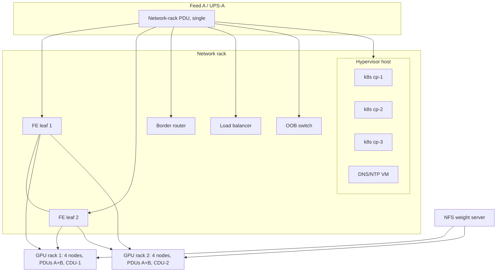

# 2.5 — VEGA: single points of failure

Method: manuscript Section 2.9 ("Failure domains and single points of failure"): a component is a SPOF if
its failure alone stops a service. Count redundancy *and* follow placement, power and cooling paths.
VEGA's design notes are `[ILLUSTRATIVE]`.

## 1 and 3. SPOF table

| SPOF | Service impact | Mitigation | Fix/accept, reason |
|---|---|---|---|
| Network rack's single PDU on feed A | Feed-A or PDU fault takes down both frontend leaves, the border router and the hypervisor: the whole service | Add a feed-B PDU and dual-cord every device | **Fix**: cheap, very high impact |
| Single border router | All ingress and egress lost | Second router, ECMP/BGP to the upstream | **Fix**: whole-service outage |
| Single hardware load balancer | Inference unreachable | Active/standby pair, or software LB on several nodes | **Fix**: whole-service outage |
| One NFS server for model weights | New pods cannot start; any restart during the outage fails | Replicate weights to object storage plus a local NVMe cache per node | **Fix**: turns every routine restart into an outage |
| Kubernetes control plane: 3 VMs on one hypervisor | Host failure loses etcd quorum: no scheduling, no self-healing | Spread the three control-plane nodes across racks and power feeds | **Fix**: costs only placement |
| DNS and NTP: one VM on the same host | Name resolution and time lost; TLS and log correlation degrade | Two or more resolvers and time sources on separate hosts | **Fix**: cheap |
| Single OOB switch | Remote management lost; running inference continues | Second switch or console-server fallback | **Accept** with an on-site spare: no direct service impact, short repair |
| One sidecar CDU per GPU rack | Loss of one CDU takes down a rack: 4 nodes, 50 % of capacity | Pump/fan N+1 inside the CDU if available; keep capacity headroom | **Accept** if the SLO tolerates 50 % capacity for the repair time; otherwise fix |

The frontend leaves themselves are *not* a SPOF (an MLAG pair with dual-homed nodes), and neither are the
GPU-rack PDUs (A and B from separate UPS systems). Their shared upstream power is the problem.

## 2. Failure-domain diagram

Every arrow out of `PDUN` and `HV` marks a shared fate: one fault there takes everything below it.

## 4. Placement SPOF

The **Kubernetes control plane**: three replicas is the right *count* for etcd quorum, but co-locating
them on one hypervisor (in one rack, on one single-feed PDU) makes the count irrelevant. One host
failure removes all three. The network rack's single-feed PDU is an equally valid answer: every device
behind it is "redundant" in number but shares one power path.

**Common wrong answers:** listing the MLAG leaf pair as a SPOF (it is redundant; its shared PDU is not);
proposing mitigations without saying what they cost or why they are worth it.
