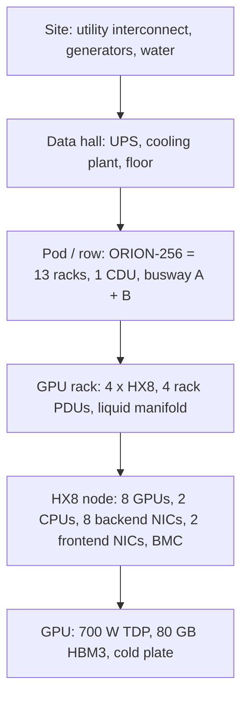
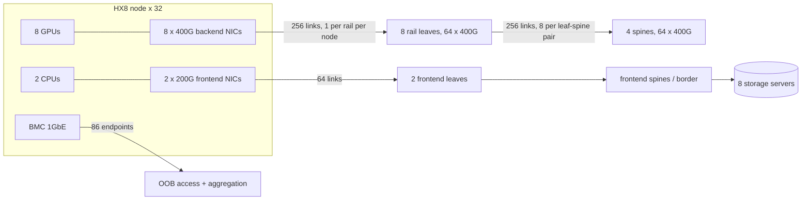
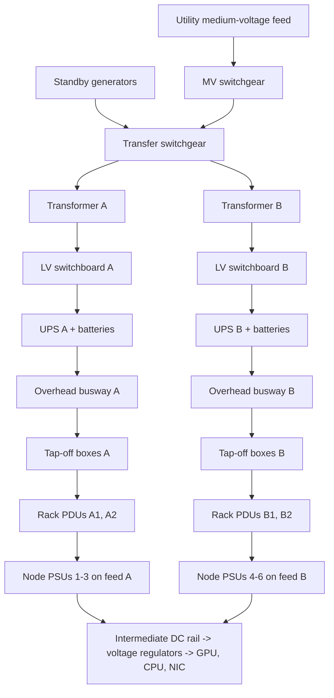
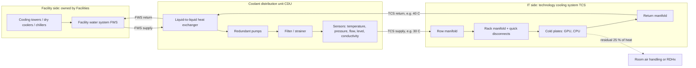
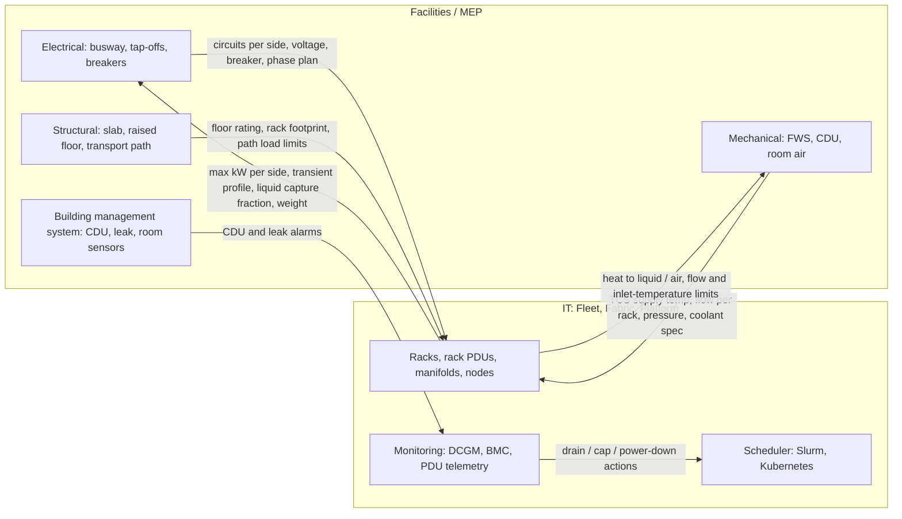
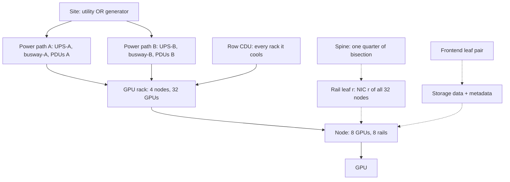

# Chapter 2 — Anatomy of an AI Data Center

> A 256-GPU cluster is not a pile of servers; it is a building-scale machine. Its throughput is set
> not only by GPUs and fabrics but by how many kilowatts a rack feed can deliver, how many litres per
> minute of coolant reach each cold plate, how much a floor tile can carry, and which single component
> can stop every job at once. This chapter takes the ORION reference cluster apart from the GPU to the
> utility feed: you will count what a cluster is made of, budget power and heat removal from stated
> assumptions, treat the facility envelope as an engineering constraint, and find the failure domains
> that decide how a cluster breaks. Every number comes with its assumptions, and every assumption is
> something you can later measure.

## Learning objectives

After this chapter you will be able to:

1. **Explain** the physical hierarchy of an AI data center and its three networks (backend,
   frontend, out-of-band).
2. **Calculate** a cluster bill of materials: servers, rack units, switches, ports, links,
   transceivers, and bisection bandwidth.
3. **Calculate** a rack power budget: three-phase circuit capacity, derating, power factor, transient
   margin, redundancy mode, and power-supply feed loss.
4. **Calculate** a heat-removal budget using `Q = ṁ · cp · ΔT` for both liquid and air, and convert
   it into coolant flow (L/min), airflow (CFM), and CDU loading.
5. **Diagnose** a facility-coupled performance problem (thermal or power throttling) using GPU,
   scheduler, and facility telemetry together.
6. **Design** an assumptions register and a facility/MEP handoff checklist for a high-density rack.
7. **Identify** single points of failure in a cluster design, including ones hidden in power paths,
   and propose mitigations with an explicit accept/fix decision.

## Prerequisites and connections

You need [Chapter 1](../ch01-ai-infrastructure-landscape/manuscript.md) (training versus inference,
scale-up versus scale-out) and basic electrical literacy (watts, volts, amps). Later chapters build
on this one: Chapters 3 and 5 zoom into the HX8 node; Chapters 7–10 design the fabrics and optics
counted in Section 2.4; Chapter 14 sizes the storage; Chapters 16 and 19 build on the failure domains
of Section 2.9; Chapter 21 extends power, cooling, and cost to fleet scale with workload/facility
coordination; and Capstone A (design a 256-GPU training cluster) uses every calculation here.

## 2.1 From a GPU to a building

An AI data center is a strict physical hierarchy, each level with its own limiting resource. (Terms
defined fully later: TDP, thermal design power; PSU, power-supply unit; PDU, power distribution unit;
UPS, uninterruptible power supply; CDU, coolant distribution unit; MEP, mechanical, electrical, and
plumbing; HBM, high-bandwidth memory.)

| Level | ORION instance | What usually limits it |
|---|---|---|
| GPU | H100-SXM-class, 700 W TDP | Power limit and junction temperature |
| Node | HX8: 8 GPUs, 2 CPUs, 10 NICs, ≈ 10.2 kW max | PSU capacity per feed; airflow or cold-plate flow |
| Rack | 4 × HX8 per GPU rack, ≈ 41 kW IT | Branch-circuit capacity and heat removal — *not* rack units |
| Row / pod | 8 GPU racks + 5 support racks = ORION-256 | CDU capacity, busway rating, cable reach to network racks |
| Hall | Several pods | UPS and cooling plant capacity; floor loading |
| Site | Several halls | Utility interconnection, generators, water |

*Table 2.1 — The physical hierarchy and its typical binding constraints `[ILLUSTRATIVE]`.*

Three properties set AI clusters apart from general-purpose cloud halls. **Density**: one ORION GPU
rack draws as much as several conventional enterprise racks, so the rack becomes the unit of
electrical and thermal design. **Synchronous coupling**: a 256-GPU training job advances at the speed
of its slowest GPU (Chapter 11), so one rack's coolant problem is the whole job's problem.
**Correlated load**: thousands of GPUs start and stop computing on the same step boundary, producing
power swings that conventional IT load does not.



*Figure 2.1 — The ORION physical hierarchy. Each arrow is a containment relationship and also a
failure-domain boundary.*

> **Key idea:** In an AI data center the rack is power- and cooling-limited, not space-limited. The
> question is never "how many servers fit in 48U?" but "how many kilowatts can this rack's feeds and
> coolant loop carry, with margin?"

## 2.2 The GPU server: where the watts go

ORION's node, `HX8`, is an 8-GPU server with an NVLink/NVSwitch baseboard (Chapter 5), two CPU
sockets, eight 400 Gb/s backend NICs (one per GPU, one per rail), two 200 Gb/s frontend NICs, eight
NVMe drives, and a baseboard management controller (BMC). Its maximum power is ≈ 10.2 kW and its
sustained draw under training is ≈ 8–9 kW (`docs/REFERENCE_CLUSTER.md`). Where does 10.2 kW come from?

| Subsystem | Assumed peak DC power | Notes |
|---|---|---|
| 8 × GPU at 700 W TDP | 5,600 W | Power limit, not a guarantee of draw |
| GPU baseboard: NVSwitch chips, retimers, voltage-regulator losses | 700 W | |
| 2 × CPU | 700 W | ≈ 350 W per socket |
| 2 TiB DDR5 (32 DIMMs) | 400 W | |
| 10 NICs including optics | 340 W | 8 backend + 2 frontend |
| 8 × NVMe U.2 | 200 W | |
| Fans (air-cooled variant, at maximum speed) | 1,350 W | Strongly non-linear in speed |
| BMC, boot devices, misc. | 300 W | |
| **Total DC load** | **9,590 W** | |
| AC input at 94 % PSU efficiency | 9,590 ÷ 0.94 = **10,202 W ≈ 10.2 kW** | |

*Table 2.2 — HX8 power breakdown `[ILLUSTRATIVE]`. The subsystem split is a teaching estimate that
reproduces ORION's 10.2 kW maximum; measure a real platform with the L2 lab extension.*

GPUs are 58 % of the DC load (5,600 ÷ 9,590), so GPU power policy dominates node power policy. Fans
are 14 % at full speed, which is why liquid cooling also reduces server power. The ≈ 0.6 kW between AC
input and DC load is heat dissipated in the PSUs, which the cooling system must also remove.

The power supplies matter as much as the load. HX8 has six hot-swappable power-supply units (PSUs)
of 3.0 kW each `[ILLUSTRATIVE]`, three on feed A and three on feed B. A PSU *failure* is easy: five
survivors provide 15 kW. A *feed* failure is not: three PSUs provide 3 × 3.0 = 9.0 kW, less than the
9.59 kW DC peak, so the node must shed power — by a hardware "power brake" that drops GPU clocks
sharply, or by a pre-configured cap. Decide and document this; do not discover it during a UPS
maintenance window.

> **Pitfall:** "Redundant PSUs" does not mean full power on one feed. Check per-feed capacity against
> peak load at worst-case input voltage and inlet temperature.

## 2.3 Racks, rows, and the ORION floor plan

ORION occupies 13 racks: 8 GPU racks of 4 HX8 nodes, 2 network racks for the 12 backend switches and
frontend leaves, 2 storage racks for 8 storage servers, and 1 management rack (OOB aggregation,
Slurm and Kubernetes control planes, provisioning). We assume 48U EIA-310 racks, 600 mm wide and
1,200 mm deep (0.72 m² footprint) `[ILLUSTRATIVE]`.

```text
 GPU rack-01 (front view, 48U, 600 x 1200 mm)        rear: vertical PDUs and manifold
 ┌───────────────────────────────┐ U48                  ┌──────────────────────────────┐
 │ fiber cassettes / patch (2U)  │ U47-48               │ PDU A1  PDU A2 │ PDU B1 PDU B2│
 │ OOB access switch 1GbE (1U)   │ U46                  │ (415 V 3-ph,   │ (415 V 3-ph, │
 │ blank / cable mgmt (13U)      │ U33-45               │  60 A each)    │  60 A each)  │
 │ HX8 node 4  (8U)  orion-n04   │ U25-32               │                              │
 │ HX8 node 3  (8U)  orion-n03   │ U17-24               │ TCS supply manifold (blue)   │
 │ HX8 node 2  (8U)  orion-n02   │ U09-16               │ TCS return manifold (red)    │
 │ HX8 node 1  (8U)  orion-n01   │ U01-08               │ leak rope + drip tray (floor)│
 └───────────────────────────────┘ U01                  └──────────────────────────────┘
 Heaviest equipment low (stability); 13U deliberately empty: the rack is power-limited.
```

*Figure 2.2 — ORION GPU rack elevation `[ILLUSTRATIVE]`. Four 8U nodes use 32U; adding a fifth node
would fit physically, but at 51.2 kW the row's CDU and the floor rating would be exceeded (Sections
2.7–2.8).*

The 13 empty rack units are what a power-limited rack looks like; filling them needs more coolant
flow, CDU capacity, and floor capacity — facility changes with lead times of months.

The rail-optimized backend (Chapter 7) shapes the layout. Every node connects to all eight rail
leaves, which live in the network racks, so all 256 host links leave the GPU rack. Distance then
decides between copper direct-attach cables (only a few metres at 400G) and optics (Chapter 10), which
is why the network racks sit mid-row: `rack-01..rack-04 | NET-1 NET-2 | rack-05..rack-08`, with storage and
management at the row ends.

## 2.4 The three networks and their bill of materials

An AI cluster runs three physically separate networks, and confusing them is the first mistake new
engineers make:

| Network | ORION design | Carries | If it fails |
|---|---|---|---|
| Backend (compute) fabric | Rail-optimized 400 GbE RoCEv2, 8 rail leaves + 4 spines, 1:1 | GPU-to-GPU collectives (NCCL), KV-cache transfer | Distributed jobs hang or slow; single-node work continues |
| Frontend / storage fabric | 2 × 200 GbE per node to a pair of frontend leaves, eBGP leaf-spine; 3:1 by ports, 1.5:1 by bandwidth | Storage I/O, dataset loading, checkpoints, inference ingress, control traffic | Jobs stall on I/O; inference becomes unreachable |
| Out-of-band (OOB) management | 1 GbE to every BMC, switch management port, and PDU | Redfish/IPMI, console, firmware updates, power control | No remote recovery; running work continues |

*Table 2.3 — ORION's three networks `[ILLUSTRATIVE]`.*

(RoCEv2: RDMA over Converged Ethernet v2; RDMA: remote direct memory access; NCCL: NVIDIA Collective
Communications Library; eBGP: external Border Gateway Protocol; IPMI: Intelligent Platform Management
Interface. Later chapters develop them; here we only count.)



*Figure 2.3 — ORION's three networks and their link counts. Backend links never touch the frontend;
storage traffic never touches the backend.*

### Counting the backend

Every count follows from the design intent: 32 nodes, 8 rails, 64-port leaves with 32 down and 32
up, 4 spines of 64 ports.

- Host-to-leaf links = nodes × rails = 32 × 8 = **256**.
- Leaf-to-spine links = leaves × uplinks per leaf = 8 × 32 = **256** (8 uplinks from each leaf to each
  of 4 spines; each spine receives 8 leaves × 8 = 64 links, exactly its port count).
- Total backend links = 256 + 256 = **512**.
- Switch ports in use = 8 × 64 + 4 × 64 = 512 + 256 = **768**.
- Transceivers if every link end is a single-port 400G optic = 2 × 512 = **1,024** (256 at the NICs,
  768 at the switches). If switches use two-port 2 × 400G modules, the switch side needs 768 ÷ 2 =
  384 modules, for 256 + 384 = 640 modules in total.

Optics are a significant share of fabric cost and power and among the most frequently replaced
parts (Chapter 10). A BOM that says "512 links" without "1,024 link ends, N optics of type T" is not a
BOM.

### Bandwidth: injection and bisection

Injection bandwidth is what all endpoints can push at once: 256 NICs × 400 Gb/s = **102.4 Tb/s**.
Bisection bandwidth is the capacity across the worst-case cut that splits the endpoints into two equal
halves. In a non-blocking (1:1) Clos, every leaf has as much uplink as downlink capacity, so the
bisection equals half the injection bandwidth in each direction: 128 NICs × 400 Gb/s = **51.2 Tb/s per
direction** = 6.4 TB/s per direction `[MODELED]`. A leaf built with 24 uplinks instead of 32 would
make its rail 32 : 24 = 1.33 : 1 oversubscribed, giving cross-spine traffic on that rail at most 75 %
of the others' bandwidth — and because collectives run at the pace of the slowest rail, the whole job
would feel it (Chapter 12).

Do not confuse the 51.2 Tb/s *bisection* with a switch's capacity. Each ORION leaf and spine uses
64 × 400G = **25.6 Tb/s** of switching capacity. That is either a 25.6 Tb/s-class ASIC, or a 51.2 Tb/s-class
ASIC with 64 × 800G cages each running one 400G port, which leaves headroom for an 800G refresh.

### Frontend and OOB

The frontend has 32 × 2 = 64 node ports at 200 Gb/s (12.8 Tb/s). Each frontend leaf has 48 × 200G
host ports and 16 × 400G uplinks: 3:1 by port count but **1.5:1 by bandwidth** (9.6 : 6.4 Tb/s) when
fully populated. With ORION's 32 hosts per leaf it is 1:1 (6.4 : 6.4 Tb/s), so all 12.8 Tb/s can
leave the pod. The OOB network has 86 endpoints: 32 BMCs + 12 backend switches
+ 2 frontend leaves + 8 storage-server BMCs + 32 GPU-rack PDUs. Each rack's small OOB access switch
uplinks to one aggregation switch, `oob-sw-1` — a stacked pair with a single control plane.

## 2.5 The power chain

Power reaches a GPU through a chain of conversions and distribution stages, each with its own
rating, redundancy, and failure behaviour. Reading that chain is the first facility skill an AI
infrastructure engineer needs.



*Figure 2.4 — Power one-line concept for an ORION GPU rack: 2N distribution from the transfer
switchgear down `[ILLUSTRATIVE]`. Upstream of that point (utility feed, MV switchgear, generators,
transfer switchgear) the paths are shared, so 2N rack feeds do not protect against a site-level
fault. A real one-line diagram adds breaker ratings, protective-device coordination,
metering points, and grounding; it is owned by the electrical engineer of record.*

From the top: the **utility** interconnection caps the site's demand — often the hardest and slowest
constraint on cluster size. **Generators** carry the load during utility outages after a start-up
delay of seconds, and **transfer switchgear** moves load between sources. The **UPS** (uninterruptible
power supply) bridges that gap from batteries or flywheels and conditions the power; a
double-conversion UPS rectifies and re-inverts continuously, while higher-efficiency modes bypass the
inverter part of the time and must be checked against AI load transients (Section 2.6). Overhead
**busway** with **tap-off boxes** feeds each rack, so re-sizing a rack feed is a tap-off change rather
than a new cable run. **Rack PDUs** (power distribution units) carry per-phase and often per-outlet
metering on the OOB network — the last place you can measure rack power directly. Some rack
architectures, such as the Open Compute Project's Open Rack designs, replace per-server PSUs with rack
**power shelves** feeding a 48–54 V DC busbar; the arithmetic below is unchanged, but the redundancy
unit becomes the shelf. Server **PSUs** and on-board voltage regulators finish the conversion to the
silicon's sub-1 V rails.

### Three-phase circuit arithmetic

A three-phase branch circuit's apparent power is

`S = √3 × V_LL × I`

with line-to-line voltage `V_LL` and breaker rating `I`. ORION's GPU racks use 415 V, 60 A
circuits `[ILLUSTRATIVE]`:

`S = 1.732 × 415 V × 60 A = 43,128 VA ≈ 43.1 kVA`

Two adjustments turn a breaker rating into usable power:

1. **Continuous-load derating.** In North America, NFPA 70 (the National Electrical Code) sizes
   circuits for continuous loads at 125 % of the load — equivalently, loading to at most 80 % of
   rating. Breakers and assemblies listed as 100 %-rated may carry continuous load at their full
   rating. Other jurisdictions differ; the electrical engineer of record decides. We use 0.80.
2. **Power factor.** Real power = apparent power × power factor. Server PSUs with active
   power-factor correction run near unity at high load; we assume 0.95 to stay conservative.

`P_usable = 43.13 kVA × 0.80 × 0.95 = 32.78 kW per circuit`

With two circuits per side, one side can deliver 2 × 32.78 = **65.55 kW** `[MODELED]`.

### Redundancy modes

| Mode | What it means | Usable vs. installed capacity | Survives | Typical use |
|---|---|---|---|---|
| N | Exactly enough capacity, no spare | 100 % | Nothing | Lab, non-critical overflow |
| N+1 | One spare module in a shared system | N/(N+1), e.g. 75 % for 3+1 | One module, not the shared path | UPS modules, pumps, chillers |
| 2N | Two independent A/B paths, each carrying the full load | 50 % | Loss or maintenance of a whole path | Rack feeds for critical IT |
| Distributed ("4-to-make-3") or block redundant with catcher | Load spread over N+1 independent systems, or N blocks plus a reserve that takes over a failed block through transfer switches | N/(N+1), e.g. 75 % | One system or block | Large halls |

*Table 2.4 — Electrical redundancy modes. The Uptime Institute's Tier Standard: Topology and
ANSI/TIA-942 define formal facility tiers built from these concepts; use the primary documents for
definitions rather than summaries.*

With 2N rack feeds, **each side must carry the entire rack** when the other is lost, so the per-side
capacity — 65.55 kW for ORION — bounds the rack. Calling it "131 kW capable" designs a rack that trips
a breaker the first time a UPS goes down for maintenance.

### The ORION rack budget

Take the design load at maximum power, never at sustained power, and add a transient margin:

- Rack IT maximum = 4 nodes × 10.2 kW + 0.2 kW (OOB access switch, PDU electronics) = **41.0 kW**.
- Transient margin 10 % `[ILLUSTRATIVE]`: 41.0 × 1.10 = **45.1 kW** design load per side.
- Headroom per side = 65.55 − 45.1 = **20.45 kW** (31 % of the side's usable capacity).

The 10 % margin is an assumption, not a rule; it must come from vendor guidance on peak and transient
power, from measurement, and from the breakers' trip curves. Two planning errors are common: sizing
at *sustained* power (34.2 kW instead of 41.0 kW under-sizes the load by (41.0 − 34.2) ÷ 41.0 =
16.6 %), and one circuit per side (32.78 kW available against 45.1 kW needed).

Phase balance matters too: a breaker protects each phase, so a badly corded rack hits its limit on one
phase before the circuit's nominal kVA. Check per-phase current after every node swap.

> **Production note:** Rack PDU telemetry is the cheapest power instrument you will own. Collect it at
> 10–60 s resolution alongside GPU telemetry so the two can be correlated (Chapter 18).

## 2.6 Dynamic power: TDP, transients, and power capping

**TDP (thermal design power)** is the sustained power the cooling must remove and, for data-center
GPUs, the default power limit — neither the instantaneous maximum nor the typical draw. GPU power
varies on three timescales, each landing on a different part of the power chain:

| Timescale | Behaviour | What absorbs it |
|---|---|---|
| Microseconds to milliseconds | Short current excursions above the power limit as kernels start | Board capacitors, voltage regulators, PSU hold-up |
| Tens of milliseconds to seconds | Synchronised swings at training-step boundaries: compute phase high, exposed communication or data-loading phase low | PSUs, rack PDUs and breakers (trip curves), UPS |
| Seconds to minutes | Job starts and ends, checkpoints, failures that stop all ranks at once | UPS, generators (step-load acceptance), utility interconnection |

*Table 2.5 — GPU power dynamics by timescale `[ILLUSTRATIVE]`.*

The middle row surprises facility teams: in synchronous training all GPUs compute, then all
communicate, and unless communication is fully overlapped (Chapter 11) they drop power together.
Meta's Llama 3 report (2024) describes data-center-wide power fluctuations on the order of tens of
megawatts as thousands of GPUs pause and resume together, and the 2025 paper *Power Stabilization for
AI Training Datacenters* (believed to be Choukse et al., arXiv:2508.14318; citation details not
independently verified) analyses these oscillations and their interaction with the grid.

A worked illustration for ORION `[ILLUSTRATIVE]`: assume each GPU draws ≈ 700 W in the compute phase
and ≈ 300 W in an exposed communication phase. The per-node swing is 8 × (700 − 300) W = 3.2 kW of
DC load, or 3.2 ÷ 0.94 ≈ 3.4 kW at the AC input; across 32 nodes it is 32 × 3.40 kW ≈ **109 kW AC**,
repeated every training step (≈ 17 s for W-TRAIN), with edges lasting tens of milliseconds. That is
109 ÷ 382 ≈ 28 % of ORION's AC IT maximum (Section 2.10). At ORION's scale it is a UPS and breaker
question. At ORION-XL's 512 nodes the same arithmetic gives 512 × 3.40 kW ≈ 1.74 MW AC — a generator
and utility question.

**Implications for job scheduling.** These swings are a scheduling input, not only a facility one.
Four practices keep them inside the envelope. First, *power-aware placement*: the scheduler should not
put two full-power jobs on the same rack's feeds when their combined design load would exceed the
per-side budget. Rack peak is set by node maximum power whatever the job mix, so ORION today needs no
rack-level placement rule: even five nodes (5 × 10.2 + 0.2 = 51.2 kW, 56.3 kW with margin) fit 65.55
kW per side; six (61.4 kW, 67.5 kW with margin) would not. The rule matters at row and UPS level when
those are sized at sustained rather than maximum power. Second, *staggered starts*: when a large job
starts or restarts, ramp it in groups of nodes over tens of seconds rather than stepping every GPU at
once. A full ORION restart steps the GPU-node load by at most 32 × 10.2 = 326 kW minus the nodes' idle
draw (the 382 kW IT total includes non-GPU racks). With the canonical 48 h job MTBF, that step recurs
about every two days. Third, a *feed-loss partition state*: when Facilities announces maintenance on
feed A or B, the affected racks move to a capped partition (GPU power limit low enough that one feed's
PSUs carry the node). Running jobs are checkpointed and resumed under the cap rather than left to the
hardware power brake. Fourth, *checkpoint and evaluation phases* drop load abruptly, so the facility
team should know the job calendar. Chapter 17 implements these as scheduler features and Chapter 21
prices them.

Each stage reacts differently. **Breakers** have inverse-time trip curves, so short excursions are
harmless but a design sitting near its continuous rating with frequent excursions above it is not.
**UPS** systems in high-efficiency modes transfer to double conversion when disturbed, and their
behaviour under repetitive load steps needs vendor confirmation. **Generators** accept load in steps
and can be destabilised by oscillation near their governor's response frequency. **Utilities** may
impose contractual ramp-rate limits on large loads.

### Power capping

A power cap trades a little performance for a lot of predictability. The levers, from the most
local to the broadest:

```bash
# GPU level (root required; limits reset on driver reload unless re-applied at boot)
nvidia-smi -q -d POWER                      # draw plus current/default/min/max power limit
sudo nvidia-smi -i 0 -pl 550                # set GPU 0's power limit to 550 W (within min/max)
sudo nvidia-smi -lgc 1410,1410              # lock SM clocks instead (-rgc resets)

# Fleet level through a DCGM group (verify option names for your DCGM version)
dcgmi config --set -P 550 -g <group-id>

# Server level through the BMC (DCMI power limiting; behaviour is platform-specific)
ipmitool dcmi power reading
ipmitool dcmi power set_limit limit 9000
ipmitool dcmi power activate
```

Redfish exposes server power and limits in two generations of schema. The older
`/redfish/v1/Chassis/<id>/Power` (`PowerControl` → `PowerLimit`) and `/Thermal` resources are
deprecated since DMTF release 2020.4 but still common on deployed BMCs. Their replacements are
`PowerSubsystem`, `ThermalSubsystem`, `EnvironmentMetrics` (for example `PowerWatts` and
`PowerLimitWatts`) and `Controls`. Check what your BMC implements before automating.
`[VENDOR-SPEC, 2026-10 — verify against current NVIDIA, DMTF, and BMC vendor documentation]`

The performance cost of a cap depends on the workload and must be measured: memory-bound phases
(inference decode, element-wise kernels) often lose little under a moderate cap, dense matrix
multiplies lose more. Exercise 2.8 (L2) sweeps the limit from 700 W to 400 W and plots throughput per
watt.

> **Safety:** Changing power limits on shared or production GPUs changes other people's jobs. Do
> power-cap experiments only on a dedicated lab server with the owner's approval, and restore the
> default limit afterwards (`nvidia-smi -q -d POWER` shows it).

### Throttling: how power and heat show up as clocks

When a GPU hits a limit it reduces clocks, and it tells you why: `nvidia-smi -q -d PERFORMANCE` lists
the active *clock event reasons* (called "clocks throttle reasons" in older drivers); Listing 2.2 in
Section 2.12 shows representative output. Read them as a decision table. **SW Power Cap** means the
GPU is at its configured power limit — expected under heavy load, a problem only if the limit is
lower than intended. **SW Thermal Slowdown**
means the driver is reducing clocks to hold temperature at its target. **HW Thermal Slowdown** and
**HW Power Brake Slowdown** are hardware-asserted and more severe; power brake is typically driven by
the platform, for example on PSU or feed loss. **Sync Boost** means the GPU is held to the clocks of
other GPUs in a sync-boost group. DCGM (NVIDIA Data Center GPU Manager) exposes the same information
as a bitmask field (`DCGM_FI_DEV_CLOCK_THROTTLE_REASONS` in many releases; newer releases rename
"throttle" to "event", so check your version's field list) and as cumulative violation-time counters
such as `DCGM_FI_DEV_POWER_VIOLATION` and `DCGM_FI_DEV_THERMAL_VIOLATION`. These count microseconds
since the driver started, so take the difference between two samples to get violation time in a
window.

> **Key idea:** Facility constraints reach the workload as clock reductions. A training job that
> slows without any software change, on a subset of nodes, at certain times of day, is a
> facility-coupling suspect until proven otherwise.

## 2.7 Cooling: moving heat out of the building

Every watt delivered becomes heat that must leave the building. For any coolant the governing
relation is the sensible-heat equation:

`Q = ṁ × cp × ΔT`

where `Q` is heat flow (kW), `ṁ` is mass flow (kg/s), `cp` is specific heat capacity (kJ/(kg·K)), and
`ΔT` is the temperature rise of the fluid (K). Rearranged for the flow you must supply,
`ṁ = Q ÷ (cp × ΔT)`, and the volumetric flow is `V̇ = ṁ ÷ ρ` for density `ρ`.

| Fluid (assumption) | cp, kJ/(kg·K) | ρ | Note |
|---|---|---|---|
| Air near 25–35 °C, sea level | 1.006 | 1.20 kg/m³ | Varies with temperature, altitude, humidity |
| Water near 30–40 °C | 4.18 | 0.997 kg/L | Standard properties |
| PG25 (25 % propylene glycol by volume) near 30–40 °C | 3.90 | 1.02 kg/L | Approximate; use the supplier's datasheet at operating temperature |

*Table 2.6 — Fluid properties used in this chapter `[ILLUSTRATIVE]`. Per unit volume and per kelvin,
water carries 4.18 × 997 ÷ (1.006 × 1.20) ≈ 3,450 times more heat than air.*

### Air cooling and its ceiling

Fully air-cooled, an ORION rack must reject 41.0 kW. With a 15 K air temperature rise from front
inlet to rear exhaust `[ILLUSTRATIVE]`:

`ṁ = 41.0 ÷ (1.006 × 15) = 2.717 kg/s`
`V̇ = 2.717 ÷ 1.20 = 2.264 m³/s = 2.264 × 2,118.88 = 4,798 CFM`

(CFM is cubic feet per minute; 1 m³/s = 2,118.88 CFM.) The servers' fans can move that — it is where
Table 2.2's 1,350 W of fan power goes — but the room must deliver that much cold air to the rack face
without recirculation. Containment and rear-door heat exchangers (RDHx, a liquid-cooled coil on the
rack door) extend air cooling; ASHRAE's thermal guidelines bound equipment inlet temperatures (the
*recommended* envelope for common air-cooled classes is 18–27 °C). The practical air-cooling ceiling
is a property of a specific hall, not a universal number; ask the facility's engineer.

### Direct-to-chip liquid cooling

In direct-to-chip liquid cooling (DLC), coolant flows through cold plates on the GPUs and CPUs (and
sometimes memory, NICs, and regulators); everything else still heats the air. The share going to
liquid is the **liquid capture fraction**, roughly 70 % to over 90 % depending on what is cold-plated
`[ILLUSTRATIVE]`.

`docs/REFERENCE_CLUSTER.md` does not fix ORION's cooling method. For this chapter we assume ORION's
GPU racks use a DLC variant of HX8 with GPU and CPU cold plates capturing **75 %** of node heat, and
we conservatively keep the air-cooled 10.2 kW node maximum (a DLC server's fans draw less power;
Exercise 2.6 asks you to quantify the effect).



*Figure 2.5 — Thermal and cooling block diagram for ORION's GPU row `[ILLUSTRATIVE]`. The facility
water system (FWS) and the technology cooling system (TCS) are separate loops, joined only through the
CDU's heat exchanger.*

The separation is deliberate: the large, shared **FWS** is not clean enough for cold-plate channels,
so a small, filtered, chemically controlled **TCS** (ASHRAE's term for the secondary loop) serves the
IT equipment. The **CDU** joins them with a heat exchanger, redundant pumps, filtration, make-up, and
sensors. Liquid-to-liquid CDUs (in-row or in-rack) are the norm for dense rows; **liquid-to-air** CDUs
reject TCS heat into room air, letting a hall without facility water host a few liquid-cooled racks.

The CDU's **approach temperature** is the difference between the TCS supply temperature it delivers
and the FWS supply temperature it receives: FWS at 27 °C might yield TCS at about 30 °C with a 3 K
approach `[ILLUSTRATIVE]`. This is how facility conditions propagate to GPUs. When the facility water
warms on a hot afternoon, the TCS supply follows, and every cold plate runs warmer. ASHRAE's
liquid-cooling classes (W17, W27, W32, W40, W45, and W+) label facility-water supply-temperature
envelopes; warmer classes allow more hours without mechanical chilling but leave less thermal margin
at the chip.

### Worked coolant-flow arithmetic for one ORION rack

Heat to liquid at rack maximum: `Q_liquid = 0.75 × 41.0 kW = 30.75 kW`. Design TCS ΔT (return minus
supply) is 10 K `[ILLUSTRATIVE]`.

With PG25 (`cp` = 3.90 kJ/(kg·K), `ρ` = 1.02 kg/L):

`ṁ = 30.75 ÷ (3.90 × 10) = 0.7885 kg/s`
`V̇ = 0.7885 ÷ 1.02 = 0.7730 L/s = 0.7730 × 60 = 46.4 L/min`

With water (`cp` = 4.18, `ρ` = 0.997):

`ṁ = 30.75 ÷ (4.18 × 10) = 0.7356 kg/s`
`V̇ = 0.7356 ÷ 0.997 × 60 = 44.3 L/min`

The glycol mixture needs about 5 % more flow (46.38 ÷ 44.27 = 1.048) because of its lower specific
heat, and in practice more pump power, because it is also more viscous. Glycol is chosen for freeze
protection and biological control, not for thermal performance.

Halving ΔT doubles flow (92.8 L/min at 5 K), and flow is not free: in turbulent flow, pressure drop
rises roughly with flow squared and pump power with pressure drop × flow, so doubling flow costs about
4× the pressure drop and 8× the pump power `[MODELED, square-law approximation]`. Designers therefore
prefer a larger ΔT, bounded by the vendor's maximum cold-plate inlet temperature.

Per GPU: 700 W at ΔT = 10 K needs `0.700 ÷ (3.90 × 10) = 0.01795 kg/s` = `0.01795 ÷ 1.02 × 60 =
1.06 L/min` of PG25. The vendor's minimum flow per cold plate must be met at the worst manifold
position, not on average.

Residual air: `Q_air = 41.0 − 30.75 = 10.25 kW`, which at ΔT = 15 K needs
`10.25 ÷ (1.006 × 1.20 × 15) = 0.566 m³/s = 1,199 CFM` — a quarter of the all-air figure and within
reach of a conventional hall.

CDU loading: 8 GPU racks × 30.75 kW = **246 kW** on a single 300 kW CDU = **82 %**. The CDU has
capacity; it does not have redundancy at the unit level. Section 2.9 returns to that.

### Coolant quality, leaks, and serviceability

A liquid-cooled row is a plumbing system that must run for years with few maintenance windows.
**Coolant chemistry** (inhibitors, biocide, pH, conductivity, compatible wetted materials) stays
within the cold-plate vendor's specification and is sampled periodically; topping up with the wrong
fluid is a real incident cause. **Filtration** at the CDU, and often at each rack inlet, uses the
vendor's mesh size, with differential-pressure monitoring so that a clogging strainer is visible
before it starves a rack (Section 2.12). **Leak detection** — rope sensors under manifolds and in drip
trays, CDU level and pressure monitoring, automatic isolation valves — comes with a response plan
(which valves close, which nodes power down, who is paged) rehearsed before commissioning.
**Serviceability** means dripless quick disconnects at every node, isolation valves per rack, and a
node-replacement procedure that does not drain the row.

> **Safety:** Coolant loops are pressurised and may be hot. Work on manifolds, quick disconnects, or
> CDUs is done by trained facilities staff under their procedures. IT engineers drain workloads from
> and power down the affected nodes first, and never reseat a liquid-cooled node outside the facility
> procedure.

Immersion cooling (servers submerged in dielectric fluid) is outside ORION's scope; Table 2.11
compares it with DLC.

## 2.8 Facility interfaces: MEP, floor loading, commissioning, ownership

**MEP** — mechanical, electrical, and plumbing — is the facility engineering discipline that owns
everything in Sections 2.5 and 2.7 up to the rack. The interface between MEP and IT is where AI
cluster projects lose the most schedule, because each side assumes the other has checked something.



*Figure 2.6 — Facility interface diagram for an ORION GPU row. Arrows into IT are constraints; arrows
into Facilities are requirements. Every arrow is a line in the handoff checklist (Exercise 2.9).*

### Floor loading

A populated liquid-cooled GPU rack is heavy. ORION's estimate `[ILLUSTRATIVE]`: 4 × HX8 at ≈ 135 kg
(540 kg) + rack frame 170 kg + manifolds and coolant 60 kg + PDUs, switch, and cabling 50 kg =
**820 kg**, over a 0.6 m × 1.2 m = 0.72 m² footprint:

`820 kg ÷ 0.72 m² = 1,139 kg/m²` (× 9.81 m/s² ÷ 1,000 = 11.2 kN/m²)

Against a floor rated at 1,200 kg/m² `[ILLUSTRATIVE]` that is a 5 % margin — tight: a 1,000 kg rack
(1,389 kg/m²) would not fit. Three further checks matter:

- **Concentrated loads.** Four feet carry 820 ÷ 4 = 205 kg each; raised-floor tiles have separate
  concentrated- and rolling-load ratings.
- **Transport path.** Integrated racks must cross the dock, ramps, lifts, and tiles on the way in;
  each has its own static and rolling load limits.
- **Basis.** Over the rack plus half of each adjacent 1.2 m aisle (0.6 m × 2.4 m = 1.44 m²) the same
  rack averages 820 ÷ 1.44 = 569 kg/m². Ask which basis the floor rating uses; never mix them.

### Commissioning

Commissioning is commonly organised in levels, from factory witness tests through installation and
functional tests to an integrated systems test (IST) with load banks emulating IT load. Liquid
cooling adds flushing, pressure testing, flow balancing, coolant baselines, and leak-detection tests.
AI clusters need one more step that load banks cannot provide: a **workload burn-in** with
synchronised load steps while Facilities watches breakers, UPS, and CDU — the first meeting of
Section 2.6's transients with the real building.

### Ownership boundaries

| Interface item | Facilities | Fleet | Fabric | Platform | Training/Inference |
|---|---|---|---|---|---|
| Busway, tap-offs, breakers | Owns | Informed | — | — | — |
| Rack PDUs (hardware, firmware, telemetry) | Owns electrical | Consumes telemetry | — | — | — |
| CDU, FWS, setpoints, coolant chemistry | Owns | Informed | — | — | — |
| Node PSUs, cold plates in nodes, GPU power limits | Consulted | Owns | — | Consulted | Informed |
| Drain/quarantine on facility alarms | Triggers | Executes | — | Owns automation | Informed |
| Power-capping policy for feed loss or demand response | Co-owns | Co-owns | — | Implements | Consulted |

*Table 2.7 — Ownership boundaries between Halcyon's teams for an ORION row `[ILLUSTRATIVE]`.*

> **Pitfall:** The most dangerous cell in Table 2.7 is the empty one. If nobody owns "what the
> scheduler does when a CDU alarms", the answer during the incident is "nothing".

## 2.9 Capacity, utilization, failure domains, and cost

### The capacity model

A capacity model answers "what can this cluster do, and what limits it first?" For ORION it has five
lines — accelerators and memory, fabric, storage, power and cooling, and time — each computed in
Section 2.10 and in the lab. Two deserve comment. W-TRAIN's 1.12 TB training state, sharded by tensor
and pipeline parallelism over TP × PP = 8 × 4 = 32 GPUs per data-parallel replica, is 35 GB per GPU of
80 GB, leaving room for activations (Chapter 11). And the 980 GB checkpoint takes at least 980 ÷ 80
GB/s = 12.25 s at the storage system's full aggregate write rate — a lower bound that, as Chapter 14
shows, real checkpoints rarely reach. Time is capacity too: 256 GPUs × 8,760 h = 2,242,560 GPU-hours
per year, or 1,906,176 allocated GPU-hours at an 85 % allocation target `[ILLUSTRATIVE]`.

### Four kinds of utilization

"Utilization" means at least four different things, and they multiply:

| Term | Definition | ORION example |
|---|---|---|
| Allocation | GPU-hours allocated to jobs ÷ GPU-hours available | 85 % `[ILLUSTRATIVE]` target |
| Activity | Fraction of time the GPU is executing kernels (what `nvidia-smi` "GPU-Util" approximates) | Often high even when inefficient |
| MFU (model FLOPs utilization) | Useful model FLOP/s ÷ peak FLOP/s | 40 % assumed for W-TRAIN `[ILLUSTRATIVE]` |
| Goodput | Fraction of allocated time that becomes durable training progress (after failures, restarts, lost work) | 90 % `[ILLUSTRATIVE]` |

*Table 2.8 — Utilization terms. Chapter 6 develops MFU; Chapter 19 develops goodput.*

Multiplying, 0.85 × 0.40 × 0.90 = 0.306: only about 31 % of peak BF16 (bfloat16) capability becomes
durable training progress `[MODELED]`. Failures alone do not explain a 10 % goodput loss. With the
canonical 48 h job MTBF and 15 min restart (`docs/REFERENCE_CLUSTER.md`), each failure costs 0.25 h
of restart plus ≈ 0.5 h of lost work (half of an ≈ 1 h checkpoint interval): (0.25 + 0.5) ÷ 48 = 1.56 % (a deliberately coarse ≈ 1 h interval; Chapter 1's Young interval of ≈ 34 min gives ≈ 1.7 % including checkpoint overhead)
`[MODELED]`. The rest of the illustrative 10 % comes from stragglers, hangs that
are slow to detect, data-pipeline stalls, evaluation pauses, software crashes outside the hardware
MTBF, and jobs running on degraded nodes (Chapter 19).

### Failure domains and single points of failure

A **failure domain** is the set of things that fail together when one component fails; a **single
point of failure (SPOF)** is a component whose failure alone stops a service. Every ORION component
has a blast radius:



*Figure 2.7 — ORION failure domains. Solid arrows: power and cooling containment; dotted arrows:
network and service dependencies. A component's blast radius is everything downstream of it.*

| Component | Blast radius | Effect on a full-scale W-TRAIN job | Typical mitigation |
|---|---|---|---|
| GPU or node | 1–8 GPUs | Job fails. ORION-256 has no spares: wait for repair, or restart at DP = 7 | Recommended design: a spare pool; fast quarantine (Chapter 19) |
| GPU rack (both feeds, or manifold isolation) | 32 GPUs | Job fails. ORION-256 has none to replace it: wait for repair, or restart at DP = 7 (a rack = 4 nodes = one DP replica) | Recommended design: ≥ 4 spare nodes spread across racks |
| Rail leaf | Rail *r* on all 256 GPUs | Full-scale job fails | On-site spare switch, pre-staged config |
| Spine | 25 % of bisection | Job continues, degraded, after ECMP (equal-cost multipath) reconvergence | N+1 spines (ORION: 3 of 4 suffice) |
| One power path (A or B) | None — *if* every load is truly fed from both | None | 2N, verified by cord audit |
| Row CDU | Every rack it cools | Cluster-wide outage if there is one CDU | N+1 CDUs on a shared manifold |
| Storage metadata service | All I/O | Jobs stall; checkpoints fail | Replicated metadata service |
| Scheduler controller | New and requeued jobs | Running jobs usually continue | Backup controller |
| OOB aggregation | Remote management | Running work continues; recovery is blind | Independent second path, console fallback |

*Table 2.9 — ORION failure domains and blast radius `[ILLUSTRATIVE]`.*

The row that hides the trap is "None — *if* every load is truly fed from both". A dual-homed pair of
switches whose PSUs are both corded to the same PDU turns a 2N electrical system into a SPOF that
appears on neither the electrical drawing nor the network diagram. Such dependencies are found only
by modeling the whole system and failing each component in turn — which is exactly what the lab's
`find_spofs` does.

### Cost

Total cost of ownership (TCO) is capital expense plus operating expense. Accelerator servers usually
dominate capital, so utilization is the first lever. Energy is the line this chapter can compute:
Section 2.10 gives ORION's annual energy at sustained load using PUE (power usage effectiveness: total
facility power ÷ IT power, ISO/IEC 30134-2). Chapter 21 builds the full TCO model.

## 2.10 Worked example: does ORION fit the offered row?

Halcyon has been offered a colocation row with this envelope `[ILLUSTRATIVE]`: 415 V three-phase
60 A circuits, two per side per rack, A/B from independent UPS systems; one 300 kW CDU supplying PG25
at 30 °C with a 10 K design ΔT; room air removing up to 12 kW per rack at a 15 K rise; a floor rated
1,200 kg/m² over the footprint; PUE 1.25. Does ORION fit, and what must change? Every number below is
`[MODELED]` from stated assumptions.

**Steps 1–3 — Space, fabric, bandwidth.** Power sets 4 nodes per rack, so ⌈32 ÷ 4⌉ = 8 GPU racks of
32U each (256U of nodes), plus 5 support racks: **13 racks**. From Section 2.4: 512 backend links,
768 switch ports, **1,024** single-port transceivers (or **640** with twin-port switch optics), 64
frontend ports, **86** OOB endpoints, and **51.2 Tb/s** bisection per direction.

**Step 4 — Rack power.** Maximum 4 × 10.2 + 0.2 = 41.0 kW; design per side 41.0 × 1.10 = 45.1 kW
against 2 × 32.78 = 65.55 kW usable: headroom **20.45 kW per side** ✓.

**Step 5 — Feed loss at the node.** Surviving PSUs on one feed: 3 × 3.0 kW = 9.0 kW of DC output
against a 9.59 kW DC peak load ✗. Decision: pre-configure a feed-loss power policy. To keep the DC
load at or below 95 % of 9.0 kW = 8.55 kW, the node must shed 9.59 − 8.55 = 1.04 kW; spread across 8
GPUs that is 1.04 ÷ 8 = 0.13 kW, so a **570 W GPU power limit** (700 − 130) on feed loss.
Alternatively, specify a PSU configuration whose per-feed capacity exceeds peak load.

**Steps 6–7 — Cooling and floor.** From Section 2.7: **46.4 L/min** of PG25 and **1,199 CFM** of air
per rack (10.25 kW, inside the room's 12 kW ✓); CDU at 246 ÷ 300 = **82 %** ✓ for capacity, ✗ for
redundancy. Floor **1,139 kg/m²** of 1,200 ✓, with a 5 % margin that makes any heavier configuration
a structural review.

**Step 8 — Pod power.** IT maximum: GPU racks 8 × 41.0 = 328.0 kW; network 2 × 16.0 = 32.0 kW; storage
2 × 9.0 = 18.0 kW; management 4.0 kW; total **382.0 kW**. Facility demand at PUE 1.25:
382.0 × 1.25 = **477.5 kW**.

**Step 9 — Energy.** Sustained GPU rack 4 × 8.5 + 0.2 = 34.2 kW; 8 × 34.2 = 273.6 kW; other racks
conservatively at their maximum, 54.0 kW; total 327.6 kW. Annual energy 327.6 × 1.25 × 8,760 ÷ 1,000 =
**3,587 MWh**; at $0.08/kWh, **$287k per year**.

**Step 10 — Capacity.** HBM 256 × 80 = 20,480 GB; training state 35 GB per GPU; storage read
160 ÷ 256 = 0.625 GB/s per GPU; checkpoint write ≥ 12.25 s.

| Check | Value | Limit | Verdict |
|---|---|---|---|
| Rack design load per side | 45.1 kW | 65.55 kW usable | ✓ 20.45 kW headroom |
| Node feed-loss capacity | 9.0 kW per feed | 9.59 kW DC peak | ✗ needs 570 W feed-loss cap or PSU change |
| Coolant per rack | 46.4 L/min | CDU and manifold design flow | ✓ confirm with CDU vendor curve |
| Residual air per rack | 10.25 kW | 12 kW | ✓ |
| CDU load | 246 kW (82 %) | 300 kW, single unit | ✓ capacity, ✗ redundancy |
| Floor load | 1,139 kg/m² | 1,200 kg/m² | ✓ tight |
| Pod facility demand | 477.5 kW | Row allocation (ask) | Confirm with Facilities |

*Table 2.10 — ORION fit assessment `[MODELED]`.*

Verdict: ORION fits, with two required changes (a feed-loss power policy and CDU redundancy) and one
watch item (floor margin). A good capacity answer always has that shape: verdict, binding
constraints, forced decisions.

## 2.11 Hands-on lab overview

The [Chapter 2 lab](lab/README.md) (L1) turns Sections 2.2–2.10 into a Python capacity, BOM, power and
SPOF model built from partly flawed input sheets; L2/L3 extensions replace assumptions with
measurements.

## 2.12 Troubleshooting scenario: the afternoon slowdown

**Symptom.** Training Infra reports that W-TRAIN, running on all 32 ORION nodes, has a step time of
about 17.4 s in the morning but about 19.6 s between roughly 13:00 and 17:00, every day for the last
four days. No software, driver, or NCCL configuration changed. The on-call SRE opens a SEV3.

**Step 1 — Collect evidence.** A synchronous job runs at the speed of its slowest rank, so first ask
whether all ranks are slow or a few are. DCGM data aggregated by rack at 15:00:

```text
rack     nodes           sm_clock_mhz(median)  gpu_temp_c(max)  power_w(median)  thermal_violation_s(last 1h)
rack-01  orion-n[01-04]  1755                  71               655              0
rack-02  orion-n[05-08]  1755                  72               652              0
rack-03  orion-n[09-12]  1755                  70               657              0
rack-04  orion-n[13-16]  1740                  74               650              0
rack-05  orion-n[17-20]  1755                  72               654              0
rack-06  orion-n[21-24]  1485                  87               560              1980
rack-07  orion-n[25-28]  1755                  71               656              0
rack-08  orion-n[29-32]  1755                  73               651              0
```

*Listing 2.1 — Per-rack GPU telemetry at 15:00 `[ILLUSTRATIVE]`. Only rack-06 is hot, slow, and
accumulating thermal-violation time; the listing converts the cumulative microsecond counter into
seconds within the last hour.*

The step time rose 19.6 ÷ 17.4 = 1.126 (12.6 %). rack-06's clocks are 1,485 ÷ 1,755 = 0.846 of the
others: a 15.4 % clock loss on 4 of 32 nodes becomes a whole-job slowdown, slightly smaller because
not all of the step is compute-bound.

**Step 2 — Rank hypotheses.**

| # | Hypothesis (prior) | Fits "afternoon only, one rack"? |
|---|---|---|
| H1 | Cooling deficit on rack-06 plus warmer afternoon coolant (high) | Yes: temperature and time-of-day pattern |
| H2 | PDU or feed problem forcing power braking or a cap (medium) | Partly: one rack, but why afternoon? |
| H3 | Fabric congestion or link errors making rack-06 a straggler (low) | No: clocks and temperatures would be normal |
| H4 | Data-loader imbalance on those ranks (low) | No: would not raise temperature |

**Step 3 — Discriminating tests.** On one rack-06 node (read-only commands):

```text
$ nvidia-smi -q -d PERFORMANCE -i 0 | grep -A9 "Clocks Event Reasons"
    Clocks Event Reasons
        Idle                              : Not Active
        Applications Clocks Setting       : Not Active
        SW Power Cap                      : Not Active
        HW Slowdown                       : Not Active
            HW Thermal Slowdown           : Not Active
            HW Power Brake Slowdown       : Not Active
        Sync Boost                        : Not Active
        SW Thermal Slowdown               : Active
        Display Clock Setting             : Not Active

$ nvidia-smi -q -d TEMPERATURE -i 0
    Temperature
        GPU Current Temp                  : 87 C
        GPU Shutdown Temp                 : 92 C
        GPU Slowdown Temp                 : 89 C
        GPU Max Operating Temp            : 87 C
```

*Listing 2.2 — Clock event reasons and temperature thresholds on orion-n21 `[ILLUSTRATIVE]`. Threshold
values are platform-specific; field names vary by driver branch.*

`SW Thermal Slowdown: Active` with power brake and power cap inactive removes H2: the GPUs draw *less*
than their limit (560 W median) because temperature limits their clocks, and the PDUs show healthy
feeds and no breaker events. H3 and H4 do not predict heat. H1 remains; Facilities pulls telemetry:

```text
time   tcs_supply_c  fws_supply_c  rack     flow_lpm  tcs_return_c  strainer_dp_bar
09:00  30.1          27.0          rack-05  46.1      38.4          0.21
09:00  30.1          27.0          rack-06  31.2      42.6          0.88
15:00  33.4          30.3          rack-05  46.0      41.7          0.21
15:00  33.4          30.3          rack-06  31.0      45.9          0.90
```

*Listing 2.3 — CDU and rack-manifold telemetry `[ILLUSTRATIVE]`.*

Two things are now visible. The TCS supply rises 3.3 K in the afternoon for *every* rack as the
facility water warms — within specification and harmless at full flow. And rack-06's flow is 31.0 L/min
against 46.0 for its neighbour, with four times the strainer differential pressure. Check the physics:
at sustained load the rack sends about 0.75 × 34.2 = 25.65 kW to liquid. At 31.0 L/min of PG25, `ṁ` =
31.0 × 1.02 ÷ 60 = 0.527 kg/s, so ΔT = 25.65 ÷ (0.527 × 3.90) = 12.5 K, and return = 33.4 + 12.5 =
45.9 °C — exactly what the sensor reads. rack-05 at 46.0 L/min: `ṁ` = 0.782 kg/s, ΔT = 25.65 ÷ (0.782 ×
3.90) = 8.4 K, return 41.8 °C (sensor 41.7 °C). The model and the evidence agree.

**Step 4 — Root cause.** A partially clogged inlet strainer on rack-06's manifold cuts flow by a third,
so its cold plates run warmer all day: below the slowdown target in the morning, over it once the TCS
supply rises 3.3 K. A node swap in rack-06 five days ago disconnected manifold hoses — the likely
debris source. The low flow and strainer ΔP are *proven* by measurement; the node swap as cause is
*probable* until the strainer contents are inspected.

**Step 5 — Safe change.** Fleet drains the four nodes, which stops new placement but does **not**
move the running job:

```bash
scontrol update NodeName=orion-n[21-24] State=DRAIN Reason="SEV3 rack-06 coolant strainer service"
```

ORION-256 has no spare nodes, so after the next checkpoint Training Infra stops the job and requeues it
for when the nodes return; shrinking to DP = 7 (−12.5 %) would cost two restarts for a short repair.
Facilities isolates the manifold under their procedure,
cleans the strainer, photographs the debris, samples the coolant, and restores flow. The nodes pass
acceptance; the requeued job restarts (≈ 15 min, ≈ 64 GPU-hours `[MODELED]`).

**Step 6 — Validate with repeatable measurements.** Over the next three afternoons `[ILLUSTRATIVE]`: rack-06 flow
46.3 L/min, strainer ΔP 0.22 bar, return 41.8 °C at 15:00, GPU maximum 73 °C, zero thermal-violation
seconds; median step time 17.4 s and p95 17.7 s from 13:00 to 17:00, matching the morning baseline.
The postmortem adds two items: a rack-flow alert at < 85 % of design flow (< 39.4 L/min), and a
post-maintenance flow check in the node-swap runbook (Chapter 16).

> **Key idea:** Warmer afternoon coolant was within specification and the low flow was invisible in
> the morning; only together did they cross a GPU threshold. Cross-layer faults usually look like
> this: two tolerable conditions consuming the same margin.

## Trade-offs and design decisions

| Cooling option | Practical density | Facility water | Fan power | Main risks |
|---|---|---|---|---|
| Air with containment | Lowest; hall-specific | No | Highest | Hot spots, recirculation, inlet limits |
| Rear-door heat exchanger | Moderate | Yes (to doors) | High | Door-coil leaks; still fan-limited |
| DLC, liquid-to-air CDU | Moderate, few racks | No | Lower | Room air must absorb the CDU's heat |
| DLC, liquid-to-liquid CDU | High | Yes | Lower | Leaks, coolant quality, CDU as SPOF |
| Single-phase immersion | Highest | Yes | None | Hardware compatibility, fluid handling |

*Table 2.11 — Cooling options `[ILLUSTRATIVE, qualitative]`. "Practical density" depends on the
specific hall and platform; no row is a universal rating.*

| Decision | Option A | Option B | Choose A when | Choose B when |
|---|---|---|---|---|
| Rack feed redundancy | 2N A/B feeds | N+1 / block redundant with catcher | Concurrent maintainability per rack is required; moderate scale | Very large halls where 50 % stranded capacity is too costly and transfer behaviour is proven |
| Peak handling | Size circuits for max + margin | Power-cap and over-subscribe circuits | Margin is cheap; workload unknown | Facility power is the binding constraint and capping is automated and tested |
| CDU topology | One large CDU per row | N+1 CDUs on a shared manifold | Pilot rows, short-lived | Production rows; any row whose loss stops a job |

*Table 2.12 — Electrical and mechanical trade-offs.*

## Production operations notes / runbook excerpt

**Runbook: GPU row facility signals (ORION).** Thresholds are `[ILLUSTRATIVE]`, derived from Section
2.10; tune them to measured baselines.

| Signal | Threshold | Severity | Safe action | Escalate to |
|---|---|---|---|---|
| Rack total load, feed A + feed B (PDU) | > 52 kW for 5 min (an operational alert margin of 80 % on the 65.55 kW one side must carry alone; 65.55 kW already includes the NEC 80 % continuous-load derating) | SEV3 | Stop new placement on the rack; the rack would not survive a feed loss with margin | Facilities + Fleet |
| Feed share of rack load | Either feed outside 40–60 % of the rack total for 15 min | SEV4 | Check for mis-corded or failed PSUs before the next feed maintenance | Fleet |
| Any feed or breaker trip on a GPU rack | Event | SEV2 | Confirm feed-loss power policy applied; drain if nodes are braking | Facilities (lead), Fleet |
| GPU `HW Power Brake Slowdown` active | Any GPU, > 1 min | SEV2 | Check PDU feeds; if no feed loss, quarantine the node (PSU fault) | Fleet |
| GPU thermal slowdown | ≥ 2 GPUs in one rack, > 10 min | SEV3 | Correlate with rack flow and CDU supply; drain if rising | Facilities, Training Infra |
| Rack TCS flow, or ΔT at load | < 85 % of design (< 39.4 L/min), or ΔT > 12 K | SEV3 | Facilities inspects strainer/QDs; prepare drain | Facilities |
| CDU TCS supply | > design + 5 K for 15 min, or above the GPU cold-plate inlet limit | SEV3 | Watch GPU temperatures; consider workload power cap per approved policy | Facilities, Platform |
| Leak detection alarm | Any | SEV2 | Facilities follows isolation procedure; Fleet drains and powers down affected nodes on request | Facilities (lead) |

Draining is the IT team's universal safe action: `scontrol update NodeName=<nodes> State=DRAIN
Reason="<ticket>"` in Slurm, `kubectl cordon <node>` followed by `kubectl drain <node>
--ignore-daemonsets` in Kubernetes (Chapter 17). Valves, setpoints, breakers, and PDUs belong to
Facilities; IT engineers do not operate them, even in an emergency, unless the facility procedure
explicitly assigns them that step.

## Realism boundaries

> **Realism boundary:** Every power, cooling, and structural number in this chapter and its lab is
> `[MODELED]` or `[ILLUSTRATIVE]`. A laptop model cannot show PSU behaviour on feed loss, breaker trip
> curves under synchronised transients, UPS mode transfers, CDU control-loop dynamics, cold-plate
> thermal resistance, or how a specific GPU's clocks respond to coolant temperature. Real designs need
> the platform vendor's site-preparation guide, the electrical engineer of record's one-line and
> protection study, CDU performance curves, the coolant datasheet, and a structural assessment. Rack
> power figures for any real platform — including the ≈ 120 kW-class rack-scale designs some vendors
> publish — must be tied to that vendor's dated reference design, never treated as a universal
> standard.

## Summary

- Each level of the GPU-to-site hierarchy has its own binding constraint; GPU racks are power- and
  cooling-limited, not space-limited.
- Backend, frontend, and OOB networks differ in purpose, BOM, and failure effect. ORION's backend:
  512 links, 768 switch ports, 1,024 link ends, 51.2 Tb/s bisection per direction.
- Usable circuit power is `√3 × V × I × derate × PF`; with 2N feeds, one side must carry the whole
  rack. ORION's rack needs 45.1 kW per side (max + 10 % transient margin) and has 65.55 kW.
- Plan at maximum power, never sustained, and check per-feed PSU capacity against peak load.
- Synchronised training creates repetitive power swings (≈ 102 kW per step for ORION, ≈ 1.6 MW for
  ORION-XL `[ILLUSTRATIVE]`); power capping is the main lever, and its cost must be measured.
- `Q = ṁ · cp · ΔT` sizes both air and liquid cooling: 41.0 kW all-air needs ≈ 4,800 CFM; 30.75 kW to
  PG25 at ΔT 10 K needs 46.4 L/min.
- Facility water temperature reaches GPU clocks through the CDU's approach temperature; thermal margin
  is shared across layers, and floor loading and ownership boundaries are engineering inputs too.
- Dependency modeling finds SPOFs that no single sheet shows, such as frontend leaves single-fed from
  one PDU in an otherwise 2N design.

## Review questions

The full exercise set is in [exercises.md](exercises.md). Quick self-check:

1. A rack has two 415 V, 60 A three-phase circuits on each of feeds A and B. Why is its usable
   capacity about 65.6 kW and not 131 kW?
2. Your rack's coolant flow drops from 46 to 35 L/min at constant heat load. By how much does the
   coolant ΔT rise, and why might the GPUs throttle only in the afternoon?
3. Why does a node with six 3.0 kW PSUs split across two feeds still need a power policy for feed loss?

*(Answers: 1 — each side must carry the whole rack alone: 2 × 43.1 kVA × 0.80 × 0.95. 2 — ΔT scales
inversely with flow, 10 K × 46 ÷ 35 = 13.1 K; warmer afternoon facility water uses up the remaining
margin. 3 — one feed leaves three PSUs, 9.0 kW, below the 9.59 kW DC peak.)*

## Further reading

- **ASHRAE TC 9.9, *Thermal Guidelines for Data Processing Environments*, 5th ed. (2021).** The
  source of air-cooling classes and inlet envelopes.
- **ASHRAE TC 9.9, *Liquid Cooling Guidelines for Datacom Equipment Centers*, 2nd ed. (2014), and the
  TC 9.9 white paper *Emergence and Expansion of Liquid Cooling in Mainstream Data Centers* (2021).**
  Define the FWS/TCS vocabulary and the W-classes used in this chapter.
- **Open Compute Project, Open Rack V3 base specification and Advanced Cooling Solutions documents.**
  Primary references for power shelves, busbars, cold plates, and CDUs in open hardware.
- **Uptime Institute, *Tier Standard: Topology*.** The authoritative definition of facility tiers.
- **NFPA 70, *National Electrical Code*, incl. Article 645.** Basis of the North American
  continuous-load rule used here; other jurisdictions differ.
- **L. A. Barroso, U. Hölzle, P. Ranganathan, *The Datacenter as a Computer*, 3rd ed. (2018).** The
  classic systems view of warehouse-scale power, cooling, and TCO.
- **NVIDIA, DGX H100/H200 user guide and DGX SuperPOD reference architecture documents (site and
  facility requirements sections).** An example of the vendor site-preparation material every real
  design must be checked against `[VENDOR-SPEC — verify the current edition]`.
- **Meta, *The Llama 3 Herd of Models* (2024).** Reports training-scale reliability and the
  data-center power fluctuations caused by synchronised GPU load.
- **Microsoft, OpenAI, and NVIDIA authors, *Power Stabilization for AI Training Datacenters* (2025).**
  Analyses training power oscillations and mitigations across GPU, rack, and facility.
