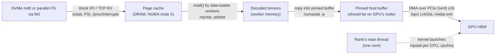
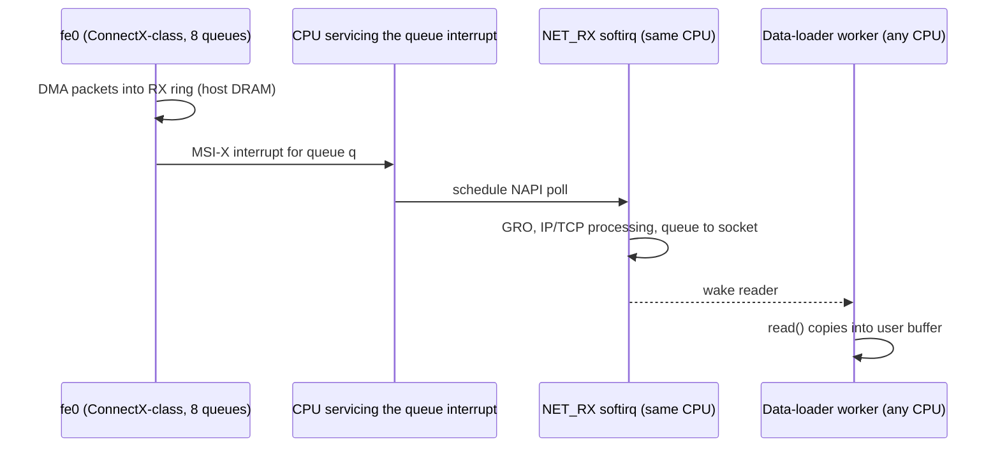

# Chapter 3 — Linux, Host Systems, and Performance Diagnostics

> A GPU server is still a Linux computer. Before a single CUDA kernel runs, the host has to read
> training data from disk or the network, place it in the right memory, copy it across PCI Express (PCIe), launch
> work on eight GPUs, service interrupts from ten network interface cards (NICs), and write checkpoints without stalling. When any
> of those steps is slow on one node, synchronous training makes the *whole cluster* wait for it. This
> chapter teaches you to see an `HX8` node the way the kernel sees it — sockets, non-uniform memory access (NUMA) nodes, PCIe
> links, interrupt vectors, block devices — and to find the host-side bottleneck from evidence rather
> than intuition. You will learn which numbers lie (since-boot averages, diluted `%iowait`, idle PCIe
> downshift), which ones a senior engineer checks first, and how to build a safe, read-only collector
> that turns a ten-minute manual inspection into a repeatable, fleet-wide triage.

## Learning objectives

After this chapter you will be able to:

1. **Explain** how Linux scheduling, memory placement, block I/O, and interrupt handling map onto the
   NUMA and PCIe topology of a two-socket, eight-GPU server.
2. **Build** a host inventory with `lscpu`, `numactl`, `free`, `lspci`, `ip`, and `ethtool`, and
   **interpret** every field you record.
3. **Diagnose** CPU, memory, NUMA, storage, interrupt, and PCIe constraints from `vmstat`, `iostat`,
   `mpstat`, `/proc/interrupts`, `numastat`, and kernel-log evidence.
4. **Calculate** the bandwidth and cluster-level cost of a degraded PCIe link, NUMA-remote placement,
   and a single straggler node on ORION.
5. **Distinguish** benign signals from faults: since-boot averages, diluted `%iowait`, NVMe `%util`,
   idle PCIe link downshift, and isolated corrected errors.
6. **Design** a read-only diagnostic collector that degrades gracefully without root or on non-Linux
   platforms, and an analyzer that compares hosts against a baseline.
7. **Apply** the diagnostic loop to a "CPU utilization is low but throughput is poor" case and
   **validate** the fix with repeatable measurements.

## Prerequisites and connections

You need Linux command-line fluency and the vocabulary of [Chapter 1](../ch01-ai-infrastructure-landscape/manuscript.md)
(training vs inference, scale-up vs scale-out) and the `HX8` node and rack layout from
[Chapter 2](../ch02-anatomy-of-an-ai-data-center/manuscript.md). No CUDA or remote direct memory access (RDMA) knowledge is assumed.

This chapter is the host-side foundation for the rest of the book. [Chapter 5](../../part-2-accelerated-compute/ch05-gpu-interconnects-host-topology/manuscript.md)
builds on the PCIe and NUMA material to map GPUs to NICs and rails;
[Chapter 6](../../part-2-accelerated-compute/ch06-gpu-performance-engineering/manuscript.md) reuses the
measurement discipline; [Chapter 14](../../part-4-distributed-ai/ch14-storage-pipelines-checkpointing/manuscript.md)
extends the storage path; [Chapter 16](../../part-5-production-operations/ch16-bare-metal-fleet-lifecycle/manuscript.md)
turns this chapter's collector into a node-acceptance gate; and
[Chapters 18](../../part-5-production-operations/ch18-observability-slos-incident-response/manuscript.md)
and [19](../../part-5-production-operations/ch19-reliability-security-multitenancy/manuscript.md)
use its kernel-log taxonomy (PCIe Advanced Error Reporting, AER; memory Error Detection and Correction, EDAC; GPU Xid codes) for fault isolation. The lab is Progressive Lab 1 and
feeds Capstones A, E, F and G in [`capstones/`](../../../capstones/).

---

## 3.1 Why the host still matters in a GPU cluster

It is tempting to treat the CPU side of a GPU server as plumbing. The GPUs hold 640 GB of high-bandwidth memory (HBM) and
deliver almost 8 PFLOP/s of dense BF16 between them `[VENDOR-SPEC, 2026-10]`; the two CPUs look like a rounding error. But the
host owns every step that is *not* a GPU kernel:

| Host responsibility | Resource it consumes | What breaks when it is slow |
|---|---|---|
| Read and decode input data | Storage (NVM Express, NVMe), page cache, CPU cores, DRAM bandwidth | GPUs wait for batches (input-bound) |
| Stage data into pinned buffers and copy host→device | DRAM on the right NUMA node, PCIe | Copy time grows; overlap fails |
| Launch kernels and run the framework's Python | One fast core per rank | GPU idle gaps between kernels |
| Drive NICs (frontend TCP, RDMA setup, completions) | Interrupt vectors, softirq cycles | Storage and control traffic stalls |
| Write checkpoints | PCIe (device→host), DRAM, NVMe, frontend network | Long pauses or failed saves |
| Report health (drivers, EDAC, AER, Xid) | Kernel log, baseboard management controller (BMC) | Faults go unnoticed until a job dies |

The reason a single host matters so much is **synchronous execution**. In W-TRAIN on ORION (tensor, pipeline and data parallelism TP = 8,
PP = 4, DP = 8; see `docs/REFERENCE_CLUSTER.md`) every optimizer step ends with collectives that need
every rank. If one node's ranks arrive late, 255 other GPUs idle until they do. The modeled step time
at 40 % model FLOPs utilization (MFU) is 17.4 s `[MODELED]`; if one `HX8` adds 2.6 s, the *job* runs at 20.0 s per step and the
cluster loses

```text
lost fraction  = 2.6 s / 20.0 s                       = 0.13
lost GPU-hours = 256 GPUs × 24 h/day × 0.13           ≈ 799 GPU-hours per day   [MODELED]
```

One misconfigured host costs the output of roughly 33 GPUs, and nothing on the GPU dashboards says
"host": the straggler shows up as *lower utilization everywhere*.

> **Key idea:** In synchronous distributed training, host problems do not stay local. The slowest
> node sets the pace, so host diagnostics are a cluster-throughput activity, not a per-server chore.

## 3.2 The HX8 host as Linux sees it

### Sockets, cores, threads, and NUMA nodes

Each `HX8` has two 56-core sockets with two simultaneous-multithreading (SMT) threads per core: 224 logical CPUs. Each socket
has its own memory controllers and 1 TiB of DDR5, and BIOS presents one NUMA node per socket (NUMA-per-socket 1, NPS1;
no sub-NUMA clustering). Linux numbers logical CPUs so that the first hardware thread of every core
comes first: on ORION, socket 0 owns CPUs 0–55 *and* their SMT siblings 112–167; socket 1 owns 56–111
and 168–223. Scripts that assume "the first half of the CPUs is socket 0" are wrong on this machine,
which is why you always read the mapping instead of guessing it.

```text
$ lscpu                                                    # [ILLUSTRATIVE] HX8 output (excerpt)
CPU(s):                          224
On-line CPU(s) list:             0-223
Model name:                      Intel(R) Xeon(R) Platinum 8480+
Thread(s) per core:              2
Core(s) per socket:              56
Socket(s):                       2
CPU max MHz:                     3800.0000
CPU min MHz:                     800.0000
L3 cache:                        210 MiB (2 instances)
NUMA node(s):                    2
NUMA node0 CPU(s):               0-55,112-167
NUMA node1 CPU(s):               56-111,168-223

$ numactl --hardware                                       # [ILLUSTRATIVE]
available: 2 nodes (0-1)
node 0 cpus: 0 1 2 ... 55 112 113 ... 167
node 0 size: 1031868 MB
node 0 free: 845121 MB
node 1 cpus: 56 57 ... 111 168 ... 223
node 1 size: 1032151 MB
node 1 free: 889402 MB
node distances:
node   0   1
  0:  10  21
  1:  21  10
```

Three things deserve a senior engineer's attention. First, **node sizes**: each should be about 1 TiB
(`numactl` prints "MB" but means MiB). A node noticeably smaller than its peer means a memory module (DIMM) or channel
was mapped out at power-on self-test (POST) — a hardware fault that the OS will happily boot around. Second, the **distance
matrix** is the firmware's System Locality Information Table (SLIT): 10 means local and 21 means
"about 2.1× the local cost". It is a hint written by the BIOS vendor, not a measurement; measure real
local and remote latency and bandwidth with a tool such as Intel Memory Latency Checker
(`mlc --latency_matrix`, `mlc --bandwidth_matrix`) when it matters. Third, **CPU lists per node** are
what you will feed to `numactl --cpunodebind` and to scheduler topology settings.

The memory-bandwidth asymmetry is large. With eight DDR5-4800 channels per socket the theoretical
local bandwidth is

```text
8 channels × 4800 MT/s × 8 B/transfer = 307.2 GB/s per socket    [MODELED from DDR5-4800 spec]
```

Remote accesses travel over the inter-socket links (Ultra Path Interconnect, UPI-class) and typically see higher latency and a
fraction of the local bandwidth — on the order of 1.5–2× the latency `[ILLUSTRATIVE]`. The exact ratio
is platform- and BIOS-dependent, which is exactly why you measure it once per platform and record it in
the baseline.

### The PCIe tree

Every high-bandwidth device in an `HX8` hangs off a PCIe root port on one of the two sockets: four PCIe
switches each carry two GPUs and their two rail NICs, while each socket also hosts a frontend NIC and
four NVMe drives (Figure R.1 in the reference cluster). Linux names each function by its **BDF**
(bus:device.function, with an optional 4-digit domain: `0000:5d:00.0`), records its NUMA node in sysfs,
and exposes the negotiated link in its PCI Express capability.

```text
             ┌──────────────────────── Socket 0 / NUMA 0 ────────────────────────┐
             │  CPUs 0-55,112-167   DDR5 1 TiB (8 channels)   root ports         │
             └──┬──────────────┬──────────────┬──────────────┬─────────────┬──────┘
                │              │              │              │             │
           PCIe SW0        PCIe SW1      fe0 4c:00.0    NVMe 0e–11:00.0  BMC VGA 03:00.0
          ├GPU0 18:00.0   ├GPU2 3a:00.0   (200G, x16 G4)   (4 × x4 Gen4)    (x1)
          ├NIC0 19:00.0   ├NIC2 3b:00.0
          ├GPU1 2a:00.0   ├GPU3 5d:00.0
          └NIC1 29:00.0   └NIC3 5c:00.0          ◄── UPI-class inter-socket links ──►
             ┌──────────────────────── Socket 1 / NUMA 1 ────────────────────────┐
             │  CPUs 56-111,168-223   DDR5 1 TiB          SW2: GPU4/5 NIC4/5      │
             │  fe1 cc:00.0   NVMe 8e–91:00.0             SW3: GPU6/7 NIC6/7      │
             └────────────────────────────────────────────────────────────────────┘
```

*Figure 3.1 — An `HX8` node as Linux enumerates it (BDFs `[ILLUSTRATIVE]`, used throughout this
chapter and its lab). Buses below `0x80` belong to socket 0. GPU i and rail NIC i share a PCIe switch.*

### The host data path for one input batch

Figure 3.2 traces a training input batch through the host. Every arrow is a place where the host can
become the bottleneck, and each has a tool that observes it.



*Figure 3.2 — Host-side data path for one input batch, annotated with the observation point for each
hop. If the page cache, worker memory, and pinned buffer live on the socket that does not own the
GPU, every byte crosses the inter-socket link twice before it reaches PCIe.*

## 3.3 Processes, threads, and CPU scheduling

### What the scheduler is telling you

Linux schedules *threads* (tasks) onto logical CPUs. The Completely Fair Scheduler (CFS; replaced by Earliest Eligible Virtual Deadline First, EEVDF, in
kernel 6.6 and later) tries to give runnable tasks equal shares and to keep tasks near their memory and
caches. You see its state through a handful of numbers:

- **`r`** (vmstat): runnable tasks — running plus waiting for a CPU. On a 224-CPU host, `r = 20` is
  idle; `r` persistently above the CPU count means CPU saturation.
- **`b`** (vmstat): tasks in uninterruptible sleep (state `D`), almost always waiting on I/O. On Linux
  the load average counts these too, which is why a host with a load average of 16 can be 90 % idle.
- **`cs`** and **`in`**: context switches and interrupts per second; useful as a *change* signal.
- **`us`, `sy`, `id`, `wa`, `st`**: user, system, idle, I/O-wait and steal percentages, averaged
  across *all* CPUs.

```text
$ vmstat 1 5                                               # [ILLUSTRATIVE]
procs -----------memory---------- ---swap-- -----io---- -system-- ------cpu-----
 r  b   swpd   free   buff  cache   si   so    bi    bo   in   cs us sy id wa st
 2  0      0 1594212352 412000 198000000 0    0  1830   950   12   21  3  1 96  0  0   ← since boot
 4 14      0 1594204192 412000 198000000 0    0 438770   311 244090 125943  4  2 87  7  0
 5 14      0 1594211024 412000 198000000 0    0 425171   749 184223 128085  4  0 90  6  0
```

> **Pitfall:** The first line of `vmstat` (and the first report of `iostat`) is the average *since
> boot*. On a node that has been up for three weeks it describes three weeks of mostly idle time. Always
> discard it; always sample for several intervals.

### Averages hide the saturated core

The single most important habit in host diagnosis is to look *per CPU*. A 224-CPU host can have one
core pinned at 100 % — a Python main thread, a softirq handler, a single-threaded decompressor — while
the all-CPU average reads

```text
1 core / 224 logical CPUs = 0.45 % of host CPU capacity
```

`mpstat -P ALL 1 5` prints one line per CPU; sort by `%idle` and read the top five. `pidstat -t -p
<pid> 1 5` breaks a process into threads, so you can see that the hot core belongs to, say, the rank's
main thread rather than its data-loader workers. On ORION, each training rank has one Python main
thread that launches GPU kernels; eight ranks per node therefore need **eight fast cores** — and that
is 3.6 % of the host.

### Affinity and isolation

You constrain where threads run with `taskset` (CPU mask for one process), `numactl --cpunodebind` and
`--membind` (CPU *and* memory policy at launch), cgroup `cpuset` controllers (what Kubernetes and Slurm
use), and kernel boot parameters such as `isolcpus`/`nohz_full` for dedicated cores. Training launchers
typically bind each rank to cores on the socket that owns its GPU; [Chapter 5](../../part-2-accelerated-compute/ch05-gpu-interconnects-host-topology/manuscript.md)
derives the mapping and [Chapter 17](../../part-5-production-operations/ch17-kubernetes-slurm-scheduling/manuscript.md)
shows how Slurm and Kubernetes enforce it. Read the effective affinity of a running process with
`taskset -cp <pid>`; read every thread's with `ps -L -o pid,tid,psr,comm -p <pid>` (the `psr` column
is the CPU the thread last ran on).

### Frequency, power states, and why "busy" is not "fast"

CPU utilization is a *time* measure: the fraction of wall-clock time a CPU was not idle. It says
nothing about how much work was done in that time. A core running at 800 MHz is "100 % busy" while
doing about a quarter of the work it would do at 3.0 GHz or more. Two Linux mechanisms set the
frequency:

- The **cpufreq driver** (`intel_pstate` or `amd-pstate` on modern servers; `acpi-cpufreq` when
  those are disabled) and its **governor**. With `intel_pstate` in active mode, the `powersave`
  governor still scales frequency dynamically with load (it is the default on many distributions).
  With `acpi-cpufreq`, `powersave` means *run at the minimum frequency*, full stop.
- **BIOS power profiles** and C-state limits, which can cap turbo or add wake-up latency regardless of
  the OS setting.

```text
$ cat /sys/devices/system/cpu/cpu0/cpufreq/scaling_driver /sys/devices/system/cpu/cpu0/cpufreq/scaling_governor
acpi-cpufreq
powersave
$ cpupower frequency-info | grep -E 'driver|current CPU frequency'      # [ILLUSTRATIVE]
  driver: acpi-cpufreq
  current CPU frequency: 800 MHz (asserted by call to hardware)
```

`turbostat` (root) reports the *achieved* busy frequency per core (`Bzy_MHz`), which is the number to
compare across nodes. High-performance computing (HPC) and AI fleets usually standardize on the `performance` governor and a fixed
BIOS power profile, and verify both at node acceptance (Chapter 16).

> **Production note:** Frequency problems arrive with hardware swaps and OS re-images. A motherboard
> replaced under return-merchandise authorization (RMA) comes back with factory BIOS defaults; a stale image may carry a kernel parameter
> such as `intel_pstate=disable`. Check frequency policy on every node returning to service.

## 3.4 Memory: page cache, NUMA placement, pinned buffers, and errors

### Reading `free` correctly

```text
$ free -m                                                  # [ILLUSTRATIVE]
               total        used        free      shared  buff/cache   available
Mem:         2064019      311171     1556848         512      196000     1733248
Swap:              0           0           0
```

`free -m` reports MiB. Total is a little below the 2,097,152 MiB installed because firmware and the
kernel reserve memory. "free" is memory doing nothing; **"available"** estimates what applications can
obtain without swapping (free plus reclaimable cache) and is the number to alert on. A large
`buff/cache` is healthy: it is the page cache holding dataset shards and checkpoint files. GPU training
nodes are commonly run without swap, so memory pressure ends in the out-of-memory (OOM) killer, not slowness — check
`journalctl -k | grep -i oom` when a rank "disappears".

### First touch and NUMA placement

Linux's default NUMA policy is **first touch**: a page is allocated on the node of the CPU that first
writes it. That is usually right — until a process allocates its buffers while running on one socket
and is later moved, or is launched with CPU affinity on one node and inherits memory a parent process
touched on the other. Automatic NUMA balancing (`/proc/sys/kernel/numa_balancing`) can migrate pages
toward the threads that use them, but it acts slowly and it is often disabled on HPC nodes.

`numastat -p <pid>` shows where a process's memory actually lives:

```text
$ numastat -p 48211                                        # [ILLUSTRATIVE]
Per-node process memory usage (in MBs) for PID 48211 (python3)
                          Node 0          Node 1           Total
                 --------------- --------------- ---------------
Heap                      324.18        29519.78        29843.96
Private                  1991.37       181335.82       183327.19
---------------- --------------- --------------- ---------------
Total                    2315.60       210855.60       213171.20
$ taskset -cp 48211
pid 48211's current affinity list: 0-55,112-167
```

The process runs only on node-0 CPUs but 210,855.6 / 213,171.2 = **98.9 %** of its memory is on node
1. Every load and store from those threads crosses the inter-socket link. For per-mapping detail, read
`/proc/<pid>/numa_maps`; for the system-wide view per node, `numastat -m`.

> **Pitfall:** NUMA-remote memory does **not** make CPU utilization drop. A core stalled on a remote
> cache miss is *busy* by the kernel's accounting. Remote placement lowers instructions per cycle (IPC), not
> utilization; confirm it with `perf stat -e cycles,instructions -p <pid> -- sleep 10` (lower IPC than
> on a well-placed peer) rather than with `top`.

### Pinned memory and the copy to the GPU

Host-to-device copies run at full PCIe speed only from **pinned** (page-locked) host memory, because
the GPU's direct-memory-access (DMA) engine needs physical addresses that will not move. Frameworks keep pools of pinned
buffers (PyTorch's `DataLoader(pin_memory=True)` is the familiar switch). Where those buffers live
matters: a pinned buffer on node 1 feeding GPU 0 on socket 0 makes every DMA read traverse the
inter-socket link before it reaches the GPU's PCIe switch. The penalty is platform-dependent — often a
noticeable fraction of the host-to-device (H2D) bandwidth and extra variance `[ILLUSTRATIVE]` — and Chapter 5 shows how
to measure it with a bandwidth test pinned to each node.

### Memory errors

Server DRAM is protected by error-correcting codes (ECC). **Corrected errors (CE)** are fixed transparently and logged by the
kernel's EDAC driver; **uncorrected errors (UE)** usually crash the process or the host. A rising CE
count on one DIMM is the classic predictor of a future UE, which is why fleets track CE *rate per
DIMM*, not just presence:

```text
[Wed Oct 14 06:00:00 2026] EDAC MC2: 1 CE memory read error on CPU_SrcID#1_MC#2_Chan#0_DIMM#0 (channel:0 slot:0 page:0x8f2d31 offset:0x0 grain:32 syndrome:0x0 - err_code:0x0000:0x009f)
```

*`[ILLUSTRATIVE]` EDAC line (format varies by platform driver).* The `rasdaemon` service records
these in a database you can query with `ras-mc-ctl --summary` and `ras-mc-ctl --errors`. A DIMM that
failed hard at POST does not log anything at runtime — it simply vanishes from the memory map, which
is why the node-size check in §3.2 matters.

## 3.5 Storage I/O on the host

Each `HX8` has eight local NVMe drives (four per socket) used as scratch, dataset cache, and checkpoint
staging, typically assembled into one software RAID 0 (`md`) array per socket so that a data loader on
socket 0 reads from socket-0 drives. Everything else — datasets, checkpoints — lives on the parallel file
system reached through the frontend NICs ([Chapter 14](../../part-4-distributed-ai/ch14-storage-pipelines-checkpointing/manuscript.md)).

### Reading `iostat -x`

```text
$ iostat -x 1 2                                            # [ILLUSTRATIVE] second (live) report, excerpt
avg-cpu:  %user   %nice %system %iowait  %steal   %idle
            3.10    0.00    1.10    6.90    0.00   88.90

Device       r/s     rkB/s  r_await rareq-sz   w/s  w_await  aqu-sz  %util
nvme2n1   830.00 106240.00     0.21   128.00  0.40     0.05    0.17  17.40
nvme3n1   830.00 106240.00    48.60   128.00  0.40     0.05   40.34  99.90
md0       830.00 424960.00    49.10   512.00  0.40     0.05   40.75 100.00
```

The columns a senior engineer reads first:

- **`r_await` / `w_await`** (ms): average time a request spent queued *and* being serviced. A healthy
  data-centre NVMe drive answers a 128 KiB read in a fraction of a millisecond at low queue depth;
  tens of milliseconds means queuing behind a sick or throttled device.
- **`aqu-sz`**: average queue depth (Little's law: arrival rate × time in system;
  830 req/s × 0.0486 s ≈ 40.3 for `nvme3n1`, against 0.17 for its healthy sibling).
- **`%util`**: the fraction of time the device had at least one request outstanding. For a spinning
  disk this approximated saturation. **For NVMe and RAID it does not**: an NVMe drive with many deep
  hardware queues can be "100 % utilized" at a fraction of its capability. Use `%util` only together
  with latency. An `md` array's `%util` comes from the md layer's own accounting (older kernels,
  or arrays with I/O statistics disabled, report 0), and it never tells you *which* member is slow:
  look at the member drives.

In the example, one RAID 0 member is about 230× slower than its siblings (48.6 ms vs 0.21 ms). Each
512 KiB array read is split into four 128 KiB member reads and completes only when the slowest member
answers, so the *array* inherits the slowest member's latency (49.1 ms on `md0`). One drive that is thermally throttling, failing, or stuck in error recovery can
take a whole socket's dataset cache down with it. Confirm with the drive's own health log
(`nvme smart-log /dev/nvme3`, read-only, root) and the kernel log for timeouts or controller resets.

### `%iowait` is a diluted signal

`%iowait` is *idle time during which at least one task was blocked on I/O*. It is not "time spent
doing I/O", and on a 224-CPU host it is diluted: each blocked task can account for at most one idle
CPU, so fifteen blocked tasks produce at most

```text
15 blocked tasks / 224 CPUs ≈ 6.7 % iowait
```

A reader who thinks "7 % iowait — fine" has missed that fifteen data-loader workers are stuck. The
undiluted signals are **`b` in `vmstat`** (how many tasks are blocked), per-device **`r_await`**, and
**pressure stall information** (PSI, kernels 4.20 and later): `cat /proc/pressure/io` reports the share
of wall time in which *some* (or *all*) non-idle tasks were stalled on I/O, for example
`some avg10=38.12 avg60=35.40 avg300=21.07 total=...` — a number that does not care how many CPUs
you have.

## 3.6 PCIe: link training, bandwidth, and errors

### How fast a link should be

A PCIe link is a set of lanes that train to a common **speed** (generation) and **width** at boot or
after a reset. Gen3 and later use 128b/130b encoding, so the raw per-direction bandwidth is

```text
BW_raw (GB/s, per direction) = speed (GT/s) × lanes × 128/130 ÷ 8

Gen5 x16: 32 × 16 × 128/130 ÷ 8 = 63.0 GB/s     (ORION GPU and rail NIC links)
Gen4 x16: 16 × 16 × 128/130 ÷ 8 = 31.5 GB/s     (ORION frontend NICs)
Gen4 x4 : 16 ×  4 × 128/130 ÷ 8 =  7.9 GB/s     (each ORION NVMe drive)
Gen3 x8 :  8 ×  8 × 128/130 ÷ 8 =  7.9 GB/s     (a badly degraded GPU link)
```

`[MODELED]` from the PCIe encoding. Achievable payload bandwidth is lower because of transaction-layer
packet headers, flow-control credits and DMA engine behaviour; ORION assumes 50–55 GB/s achievable on
Gen5 x16 `[ILLUSTRATIVE]`, about 80–87 % of raw. Links are full duplex: each figure applies
independently in each direction.

### Capability versus status

`lspci -vv` (as root) prints each device's PCI Express capability. **`LnkCap`** is what the device can
do; **`LnkSta`** is what the link trained to:

```text
$ sudo lspci -s 5d:00.0 -vv | grep -E 'LnkCap:|LnkSta:'    # [ILLUSTRATIVE]
		LnkCap:	Port #0, Speed 32GT/s, Width x16, ASPM not supported
		LnkSta:	Speed 8GT/s (downgraded), Width x8 (downgraded)
```

Recent pciutils annotate `(ok)` or `(downgraded)`; older versions print neither, so tools should compare
the numbers. Without root, `lspci -vv` prints `Capabilities: <access denied>` for exactly the part you
need — but the same information is world-readable in sysfs:

```text
$ cat /sys/bus/pci/devices/0000:5d:00.0/{current_link_speed,current_link_width,max_link_speed,max_link_width}
8.0 GT/s PCIe
8
32.0 GT/s PCIe
16
```

Three degradation patterns mean different things:

| Pattern | Typical causes | Verdict |
|---|---|---|
| **Width** below capability (x8 of x16) | Lanes failed to train: damaged or dirty connector, riser or cable fault, marginal signal integrity, occasionally a BIOS bifurcation error | Always a fault. Drain, reseat or replace, re-test. |
| **Speed** below capability under load | Signal-integrity problems causing fallback to a lower generation, a BIOS link-speed cap, retimer issues | Fault. Correlate with AER corrected errors. |
| **Speed** below capability *while idle* | Power management: many GPUs, including NVIDIA data-centre GPUs, lower link speed when idle and retrain on demand | Normal. Re-check under load before declaring a fault. |

The third row is the most common false alarm in fleet tooling. The GPU's own view is available without
root: `nvidia-smi --query-gpu=index,pci.bus_id,pcie.link.gen.current,pcie.link.gen.max,pcie.link.width.current,pcie.link.width.max,utilization.gpu --format=csv`.
If utilization is near zero and the generation is low but the width is full, wait for load.

> **Safety:** Do not "fix" link problems with `setpci` writes or by forcing link retraining on a
> production node. Those writes go straight to device configuration space and can hang the device or
> the host. Drain the node and follow the hardware runbook.

### Advanced Error Reporting (AER)

PCIe detects errors at every layer and reports them through AER. **Corrected** errors (receiver
errors, bad transaction- or data-link-layer packets, replay timer timeouts) are fixed by link-level retry and cost bandwidth and
latency; **uncorrected non-fatal** errors affect one transaction; **uncorrected fatal** errors make the
link itself unreliable and usually require a reset. The kernel logs them like this:

```text
pcieport 0000:5b:01.0: AER: Corrected error received: 0000:5d:00.0
nvidia 0000:5d:00.0: PCIe Bus Error: severity=Corrected, type=Physical Layer, (Receiver ID)
nvidia 0000:5d:00.0:   device [10de:2330] error status/mask=00000001/0000e000
nvidia 0000:5d:00.0:    [ 0] RxErr
```

*`[ILLUSTRATIVE]` AER sequence. The first line names the reporting port and the source device.*

Without root or kernel-log access, the same counts are in sysfs:
`/sys/bus/pci/devices/<BDF>/aer_dev_correctable`, `aer_dev_nonfatal` and `aer_dev_fatal` list per-type
counters since boot with a `TOTAL_ERR_*` line. They are world-readable, and the lab's collector records
them. Two or three corrected errors in a month on one device are background noise. Tens per hour on one BDF,
especially "Physical Layer / RxErr", point at the same signal-integrity problem that causes speed or
width downgrades. Count events per BDF per time window — one event per "error received" line, not per
detail line — and set thresholds on the rate. Chapter 19 extends this into a fault-isolation workflow
that correlates AER with GPU Xid events and NCCL timeouts.

## 3.7 Interrupts, softirqs, and the host network stack

### From packet to process

A modern NIC exposes many receive/transmit queue pairs, each with its own MSI-X (extended message-signalled
interrupt) vector. When
packets arrive, the NIC writes them into host memory and raises the queue's interrupt; the CPU that
handles it runs the network softirq (the kernel's NAPI polling loop), which processes a batch of packets and hands the
data to the receiving socket. Receive-side scaling (RSS) hashes flows across queues so that the work
spreads across cores.



*Figure 3.3 — Receive path for frontend (TCP) traffic such as parallel-file-system reads. If every
queue's interrupt is routed to the same CPU, all the softirq work for the NIC lands on that one core.*

The RDMA traffic on the eight rail NICs mostly bypasses this path: the NIC moves data directly between
registered memory (or GPU memory, with GPUDirect RDMA) and the wire, and the NVIDIA Collective Communications Library's (NCCL's) proxy threads
typically *poll* completion queues rather than wait for interrupts ([Chapter 8](../../part-3-networking/ch08-rdma-rocev2-infiniband/manuscript.md),
[Chapter 13](../../part-4-distributed-ai/ch13-gpu-data-movement/manuscript.md)). The frontend NICs,
however, carry storage and control traffic through the kernel TCP stack, and there interrupt placement
matters.

### Seeing interrupt placement

`/proc/interrupts` has one row per interrupt request line (IRQ) and one column per CPU — 224 columns on an `HX8` — so filter
rows and trim columns:

```text
$ grep -E 'mlx5_comp.*4c:00.0' /proc/interrupts | awk '{print $1, $2, $3, $(NF)}'   # [ILLUSTRATIVE]
196: 48210773 0 mlx5_comp0@pci:0000:4c:00.0
197: 51104882 0 mlx5_comp1@pci:0000:4c:00.0
...                                    (all eight fe0 queues counted on CPU0, zero elsewhere)
$ cat /proc/irq/196/smp_affinity_list
0
$ systemctl is-active irqbalance
inactive
```

The healthy pattern is each queue's count concentrated on a *different* CPU of the NIC's own NUMA
node. The fault patterns are all queues on one CPU (often CPU 0, the default before `irqbalance` or a
tuning profile runs) or on the *remote* socket. Confirm the cost with `mpstat -P ALL`: the CPU in
question shows a large `%soft`, and the `NET_RX` row of `/proc/softirqs` grows fastest in its column,
while the host average looks idle.

How much can one core take? The packet rate needed for 200 Gb/s is

```text
packets/s = 200e9 b/s ÷ 8 b/B ÷ (9000 + 38) B/frame ≈ 2.8 million packets/s    (MTU 9000)
packets/s = 200e9 b/s ÷ 8 b/B ÷ (1500 + 38) B/frame ≈ 16.3 million packets/s   (MTU 1500)
```

`[MODELED]`; 38 B is the Ethernet header, frame check sequence, preamble and inter-frame gap. Generic
receive offload (GRO) and interrupt coalescing mean the CPU handles far fewer interrupts than packets, but a single core typically runs out
of headroom somewhere in the low tens of Gb/s of TCP receive `[ILLUSTRATIVE]` — a fraction of one
frontend port. That is why maximum transmission unit (MTU) and queue spreading are first-class host settings for storage
throughput, and why an MTU mismatch (one interface left at 1500 after a NIC swap) is a performance bug
before it is a connectivity bug. On a RoCE rail a 1500-byte netdev MTU also caps the RDMA active MTU
at 1024 B (Chapter 8) ([Chapter 7](../../part-3-networking/ch07-ethernet-datacenter-network-foundations/manuscript.md)).

### Interface state, speed, and MTU

```text
$ ip link show rail3 | head -1                             # [ILLUSTRATIVE]
9: rail3: <BROADCAST,MULTICAST,UP,LOWER_UP> mtu 1500 qdisc mq state UP mode DEFAULT group default qlen 1000
$ ethtool rail5 | grep -E 'Speed|Link detected'
	Speed: 200000Mb/s
	Link detected: yes
$ ethtool -i rail5 | grep -E 'driver|firmware-version|bus-info'
driver: mlx5_core
firmware-version: 28.39.1002 (MT_0000000838)
bus-info: 0000:aa:00.0
```

On ORION every rail and frontend interface should report MTU 9000 (switch ports 9216) and its nominal
speed (400 000 Mb/s for rails, 200 000 Mb/s for frontend). ORION's interfaces are renamed by udev to
`rail0–7` and `fe0–1`; on a default install you would see predictable names such as `enp25s0np0`. A rail
that auto-negotiated to 200G is up and passing traffic, so connectivity checks pass, yet that rail now
carries half the bandwidth and every collective that uses it slows down. Read-only counters live in
`ip -s link show dev <iface>`, `ethtool -S <iface>` (driver-specific names) and, for RDMA devices,
`rdma link show` and `rdma statistic show`. Chapters 9 and 10 interpret them.

## 3.8 Drivers, firmware, and the kernel log

### Versions are part of the configuration

A GPU node runs a stack of version-coupled components: system BIOS/UEFI and BMC firmware, CPU
microcode, the kernel, the GPU driver and its fabric manager, NIC firmware and driver, NVMe firmware.
Each pairing is constrained by a vendor compatibility matrix `[VENDOR-SPEC, 2026-10 — verify against
current matrices]`. Collect versions on every snapshot:

| Component | Read-only command |
|---|---|
| Kernel | `uname -r` |
| BIOS | `cat /sys/class/dmi/id/bios_version` |
| CPU microcode | `grep -m1 microcode /proc/cpuinfo` |
| GPU driver | `nvidia-smi --query-gpu=driver_version --format=csv,noheader` |
| NIC driver and firmware | `ethtool -i <iface>` |
| Kernel module version | `modinfo -F version mlx5_core` (some in-tree modules report none) |
| NVMe firmware | `nvme list` (root) |

A fleet in which 31 nodes run NIC firmware X and one runs Y is a fleet with a latent incident.
[Chapter 16](../../part-5-production-operations/ch16-bare-metal-fleet-lifecycle/manuscript.md) turns
these into acceptance gates and drift detectors.

### Reading the kernel log

`dmesg -T` prints the kernel ring buffer with human-readable timestamps (which can drift after a
suspend; `journalctl -k -o short-precise` is reliable). Many distributions set `kernel.dmesg_restrict =
1`, so unprivileged users see `dmesg: read kernel buffer failed: Operation not permitted`; members of
the `adm` or `systemd-journal` groups can usually read `journalctl -k` instead. Containers without the
`CAP_SYSLOG` capability see the same refusal even as root. `journalctl -k -b -1` shows the *previous*
boot (only with persistent journald storage: `Storage=persistent` or an existing `/var/log/journal`) —
essential after an unexpected reboot, because the ring buffer did not survive it.

The hardware-health lines worth extracting automatically:

| Source | Pattern (abbreviated) | Meaning |
|---|---|---|
| PCIe AER | `AER: Corrected error received: <BDF>` | Link-level retry; the rate matters |
| PCIe AER | `AER: Uncorrected (Non-Fatal) error received` / `(Fatal)` | Transaction or link failure |
| Memory | `EDAC MCn: <k> CE ...` / `... UE ...` | Corrected / uncorrected DRAM error |
| CPU | `mce: [Hardware Error]` | Machine-check event; decode with `rasdaemon` |
| GPU | `NVRM: Xid (PCI:<BDF>): <code>, ...` | GPU driver-reported event; the code identifies the class |
| NIC | `mlx5_core <BDF> <iface>: Link down` | Link flap; correlate with switch logs |

NVIDIA's Xid documentation catalogues the codes `[VENDOR-SPEC, 2026-10]`: for example Xid 79 ("GPU has
fallen off the bus") and Xid 48 (double-bit ECC error) call for immediate drain, while Xid 63 records
a row-remapping event that takes effect only after a GPU reset (Xid 64 means recording it failed); track
these against the GPU's remapping capacity (`nvidia-smi -q -d ROW_REMAPPER`). Xid 94 (contained ECC
error) means drain when convenient, Xid 95 (uncontained) means drain now. The lab baseline treats Xids
48, 74, 79, 94, 95, 119, 120, 140 and 154 as drain-class `[VENDOR-SPEC, 2026-10]`; check the list
against the catalogue for your driver branch. Chapter 19 builds the full taxonomy.

## 3.9 The first ten minutes on a host

### The USE method, applied to an HX8

Brendan Gregg's USE method asks, for every resource, about **U**tilization, **S**aturation and
**E**rrors. It is a checklist that stops you from halting at the first anomaly you find.

| Resource | Utilization | Saturation | Errors |
|---|---|---|---|
| CPU (per core) | `mpstat -P ALL` busy %, `turbostat` Bzy_MHz | `vmstat r` vs CPU count; PSI `cpu` | `mce` in kernel log |
| Memory capacity | `free -m` used/available | swapping (`si`/`so`), OOM kills | EDAC CE/UE; node size vs baseline |
| Memory placement | `numastat -p`, `numastat -m` | low IPC in `perf stat` | — |
| Storage | `iostat -x` r/s, rkB/s | `r_await`, `aqu-sz`, `vmstat b`, PSI `io` | `nvme smart-log`, kernel I/O timeouts |
| PCIe | throughput counters (vendor tools, Chapter 5) | `LnkSta` below `LnkCap` | AER corrected/uncorrected |
| NIC (kernel path) | `ip -s link`, `sar -n DEV 1` | one core pegged in `%soft`, drops | `ethtool -S` error counters, link flaps |
| GPU (host view) | `nvidia-smi` utilization | idle gaps between kernels (Chapter 6) | Xid, ECC, row remapping |

### The "CPU is low but throughput is poor" pattern

This is the most common complaint a host engineer receives, and the most misleading. A low *average*
CPU utilization rules out almost nothing. Each mechanism below produces it, and each has a distinct
signature:

| Mechanism | Why the CPU average looks low | Discriminating evidence |
|---|---|---|
| Single-threaded bottleneck (Python main thread, one decompressor) | One saturated core is 0.45 % of 224 | `mpstat -P ALL`: one CPU near 100 % `%usr`; `pidstat -t` names the thread |
| Low clock frequency | Utilization measures time, not work done | cpufreq driver and governor; `turbostat` Bzy_MHz vs peers |
| Blocked on I/O | Blocked tasks are idle time; `%iowait` is diluted | `vmstat b`, `r_await`, PSI `io` |
| Interrupt/softirq concentration | One core pegged in `%soft` | `/proc/interrupts` per-CPU columns; `mpstat %soft` |
| Device-bound (GPU, PCIe) | The host waits on the device | `nvidia-smi` utilization; `LnkSta`; GPU timeline (Chapter 6) |
| Waiting on peers (collectives) | Ranks sit in barriers waiting for a straggler elsewhere | Per-rank step and collective timing; compare nodes |
| Lock contention or sleeping | Futex waits are idle time | `pidstat -w` voluntary switches; off-CPU profiling |

Note what is *not* in the table: NUMA-remote memory. It slows the work while keeping the CPU busy, so
it does not cause the pattern by itself — but it amplifies a single-threaded bottleneck, it is often
found in the same investigation, and it belongs on the hypothesis list. Rank hypotheses by how well
they explain the *magnitude* of the slowdown, not by how alarming they look.

## 3.10 Building a safe, repeatable collector

Running twenty commands by hand on one node is diagnosis; running them identically on 32 nodes and
comparing the results is *fleet* diagnosis. The lab's collector encodes six rules for any tool an
on-call engineer may run on a production host:

1. **Read-only by construction, default deny.** Each tool has a short list of exact read-only
   command forms (`ethtool -i <iface>`, `ip -s link show`, `taskset -cp <pid>`, ...). An argv runs only
   if it matches one, after `--opt=value` is split, and both the primary and the fallback are checked.
   Never use a deny-list of "dangerous" options: it misses setters nobody listed (`nvidia-smi -mig`,
   `-lmc`, `--power-limit=300`, `ethtool --set-priv-flags`).
2. **No shell, bounded time, stable output.** `subprocess.run([...])` with an argv list (no shell
   injection), a timeout per command, and `LC_ALL=C` so that number and date formats parse the same
   everywhere.
3. **Never escalate.** No `sudo`. If evidence needs root, record `denied` and say what is missing; use
   unprivileged alternatives (sysfs link state instead of `lspci -vv`; `journalctl -k` when `dmesg` is
   restricted).
4. **Every outcome is data.** Each section records argv, status (`ok`, `missing`, `denied`, `timeout`,
   `error`, `skipped`), return code, stdout, stderr and elapsed time. A missing tool is a finding, not
   an exception.
5. **Timestamped, self-describing output.** A UTC ISO-8601 timestamp, the hostname, whether it ran as
   root, a schema version, and the operator's note (job, symptom, PID).
6. **Two renderings.** JSON for the analyzer and the incident timeline; Markdown with an
   *evidence-gap summary first* for the human reading it at 03:00.

```python
def collect(plan, runner=run_command, platform=None, ...):
    linux = (platform or sys.platform).startswith("linux")
    for spec in plan:
        if not linux:
            res = CommandResult(list(spec.argv), "skipped", None, stderr=f"not supported on {platform}")
        elif not is_read_only(spec):
            res = CommandResult(list(spec.argv), "error", None, stderr="refused: not read-only")
        else:
            res = runner(spec.argv, spec.timeout_s)
            if spec.fallback and res.status in ("denied", "missing"):
                res = runner(spec.fallback, spec.timeout_s)      # e.g. dmesg -T -> journalctl -k
        report["sections"][spec.name] = res.to_dict()
```

*Listing 3.1 — The core of the lab's collector (simplified from the reference implementation). The
runner is injectable, which is how the lab tests degraded paths without touching a real host.*

The analyzer is the other half: parsers that turn tool text into numbers, and rules that compare those
numbers with a **baseline** (expected inventory, MTUs, speeds, governors) and **thresholds** (AER rate,
EDAC count, NUMA-remote fraction, IRQ concentration). Keeping both in a reviewed YAML file instead of in
code means the Fleet team can tighten a threshold through the normal change process
([Chapter 20](../../part-5-production-operations/ch20-automation-safe-change/manuscript.md)).

## 3.11 Worked example: what one degraded PCIe link costs ORION

**Situation.** Training Infra reports that W-TRAIN's step time has crept up, and their per-rank timers
show the data-parallel gradient all-reduce for *local rank 3* finishing last on every step. The
collector's snapshot of `orion-n07`, taken during steady-state training, contains:

```text
$ sudo lspci -s 5d:00.0 -vv | grep -E 'DevSta|LnkCap:|LnkSta:'     # [ILLUSTRATIVE]
		DevSta:	CorrErr+ NonFatalErr- FatalErr- UnsupReq- AuxPwr- TransPend-
		LnkCap:	Port #0, Speed 32GT/s, Width x16, ASPM not supported
		LnkSta:	Speed 8GT/s (downgraded), Width x8 (downgraded)
$ nvidia-smi --query-gpu=index,pcie.link.gen.current,pcie.link.width.current,utilization.gpu --format=csv
index, pcie.link.gen.current, pcie.link.width.current, utilization.gpu [%]
...
3, 3, 8, 97 %
$ journalctl -k --since "09:00" | grep -c 'AER: Corrected error received: 0000:5d:00.0'
37
```

GPU 3 (`5d:00.0`) is busy (97 %), so the low generation is not idle power management, and the width is
x8 of x16, which is never benign. The 37 corrected physical-layer errors in about fifteen minutes on
the same BDF corroborate a signal-integrity fault on that link.

**Step 1 — Bandwidth of the degraded link.** Using §3.6:

```text
healthy  Gen5 x16: 32 × 16 × 128/130 ÷ 8 = 63.0 GB/s raw per direction
degraded Gen3 x8 :  8 ×  8 × 128/130 ÷ 8 =  7.88 GB/s raw per direction   (8.0× less)
achievable at ≈ 82 % efficiency: 0.82 × 7.877 = 6.459 GB/s                       [MODELED]
```

The 82 % comes from ORION's own assumption: 50–55 GB/s achievable on 63.0 GB/s raw is 79–87 %, and the
same band holds for narrower Gen5 links (≈ 200–220 of 252 Gb/s on x8). We use a value inside the band
rather than an end of it.

**Step 2 — Which traffic crosses that link?** In ORION's rail-optimized design, GPU 3 sends and receives
its inter-node traffic through NIC 3 on the same PCIe switch, using GPUDirect RDMA (Chapter 13). The
GPU's own x8 Gen3 link to that switch is now narrower than the 400 Gb/s NIC (50 GB/s line rate), so
**rail 3's inter-node bandwidth for this GPU is capped by PCIe, not by the network.** Intra-node tensor
parallelism runs over NVLink and is unaffected.

**Step 3 — Size of the data-parallel all-reduce per GPU.** W-TRAIN uses TP = 8, PP = 4, DP = 8. Each
GPU holds

```text
parameters per GPU = 70e9 ÷ (TP 8 × PP 4)            = 2.1875e9 parameters
gradient bytes S   = 2.1875e9 × 2 B (BF16)           = 4.375 GB
ring all-reduce bytes sent per GPU = 2 × (n − 1)/n × S = 2 × 7/8 × 4.375 GB = 7.656 GB  (n = DP = 8)
```

**Step 4 — Time on a healthy and on the degraded rail.** Assume a healthy rail achieves 45 GB/s per
direction for this collective `[ILLUSTRATIVE]` (below the 50 GB/s line rate):

```text
healthy : 7.656 GB ÷ 45 GB/s     = 0.170 s
degraded: 7.656 GB ÷ 6.459 GB/s = 1.185 s
extra time on the critical path ≤ 1.185 − 0.170 = 1.015 s per step   [MODELED]
```

The ring for local rank 3 includes GPU 3 of every DP replica, so all eight replicas wait for it, and the
optimizer step waits for all rings. The bound is "≤" because frameworks overlap gradient all-reduce
with the backward pass. With pipeline parallelism, only the last micro-batch's backward pass can hide
the DP collective, a window of about 70 ms on W-TRAIN, so exposure is max(0, T_DP − 0.07 s) and the
bound is nearly tight.

**Step 5 — Cluster cost.**

```text
step time (upper bound) = 17.4 s + 1.015 s = 18.415 s
lost fraction           = 1.015 ÷ 18.415    = 0.0551  (5.5 %)
lost GPU-hours per day  = 256 × 24 h × 0.0551 ≈ 339 GPU-hours/day      [MODELED]
```

Checkpointing suffers too, but less: each GPU's share of the 980 GB checkpoint is 980 GB ÷ 256 =
3.83 GB, which leaves the GPU in 3.83 ÷ 50 ≈ 0.08 s on a healthy link and 3.83 ÷ 6.459 ≈ 0.59 s on the
degraded one `[MODELED]` — half a second per checkpoint, not per step.

**Step 6 — Decision and validation.** A link at x8 cannot be fixed in software. Draining the node in
the scheduler stops new placement but does not move the running job, and ORION-256 has **no spare
node**: W-TRAIN uses all 32. The options are therefore priced against each other:

```text
keep running degraded         : 339 ÷ 24                      ≈ 14.1 GPU-h per hour
restart at DP = 7 (224 GPUs)  : 256 × 12.5 %                  = 32 GPU-h per hour
                                + 64 GPU-h per restart (15 min × 256), twice (shrink, then grow back)
planned stop for the repair   : 64 GPU-h + 256 × T_repair
wait for the next unplanned restart (job MTBF 48 h): 48 h × 14.1 ≈ 677 GPU-h       [MODELED]
  (assumes GPU 3's repair fits inside that outage's own downtime)
```

Shrinking loses more every hour than the degraded link, and a 1,024-sequence global batch is not
divisible by 7, so DP = 7 would also need a batch or learning-rate change. **Do not shrink.** Keep the
job running, alert on escalation (uncorrected AER or an Xid forces the issue), and schedule a planned
stop at a checkpoint once the parts and technician are ready. That beats waiting for the next failure
whenever 64 + 256 × T_repair < 677 GPU-h, that is for repairs shorter than about 2.4 h. Fleet then
reseats or replaces GPU 3's board, riser or cable.
Return to service requires: `LnkSta` at 32 GT/s x16 *under load*, zero new AER corrected errors over a
soak period, and a single-node `all_reduce_perf` or bandwidth test whose result matches peer nodes
(Chapter 16). One more point matters here. NCCL may route around a slow PCIe path for some traffic
(through another GPU's NIC via NVLink, a feature called PXN), so the *observed* slowdown can
be smaller than the bound. That is not a reason to keep a degraded node in service. The width fault
tends to get worse, and the error retries add latency variance that the averages in Step 5 do not
show.

> **Key idea:** Turn every host finding into the unit the business cares about. "GPU 3 trained at x8"
> becomes "≤ 1 s per step, ≈ 339 GPU-hours per day", and the repair decision becomes arithmetic.

## 3.12 Hands-on lab overview

Progressive Lab 1 ([`lab/README.md`](lab/README.md), **L1**, no root) has you complete the read-only
collector of §3.10 and an analyzer that triages six `[SIMULATED]` ORION snapshots against the HX8
baseline. One snapshot is a reference node, four have planted faults, and one was captured without
root on idle GPUs. L2/L3 extensions run the collector on real hosts.

## 3.13 Troubleshooting scenario: the idle-looking straggler

The scenario follows the diagnostic loop: observe → collect evidence → trace the bottleneck → root
cause → safe change → validate. All evidence is `[ILLUSTRATIVE]`.

**Observe.** After Tuesday's maintenance window, W-TRAIN's median step time rose from its 17.4 s
baseline to 20.0 s. The site reliability engineering (SRE) dashboard shows no failed health checks; fabric dashboards show no congestion; GPU
utilization across the cluster dropped from about 96 % to about 85 %. Training Infra's per-rank timers
point at one node:

| Ranks | Node | Forward + backward (s) | Waiting in DP all-reduce (s) | Pipeline bubble, optimizer, other (s) | Step (s) |
|---|---|---|---|---|---|
| 0–239, 248–255 | all others | 15.1 | 2.8 (2.7–2.9) | 2.1 | 20.0 |
| 240–247 | `orion-n31` | 17.7 | 0.2 | 2.1 | 20.0 |

*Medians of 200 steps. Before the incident every node ran 15.1 + 0.2 + 2.1 = 17.4 s.*

The node that waits *least* in collectives is the culprit: everyone else is waiting for it. `orion-n31`
returned from a motherboard-tray RMA in the maintenance window.

**Collect evidence.** The on-call engineer runs the collector with the PID of local rank 0 and compares
against a peer, `orion-n30`:

```text
$ mpstat -P ALL 5 1 | awk '$1=="Average:" && ($2=="CPU" || $2=="all" || $3 > 90)'   # orion-n31 [ILLUSTRATIVE]
Average:     CPU    %usr   %nice    %sys %iowait    %irq   %soft  %steal  %guest  %gnice   %idle
Average:     all    3.71    0.00    0.38    0.00    0.00    0.02    0.00    0.00    0.00   95.89
Average:       0   98.40    0.00    1.20    0.00    0.00    0.00    0.00    0.00    0.00    0.40
Average:       8   98.10    0.00    1.50    0.00    0.00    0.00    0.00    0.00    0.00    0.40
  ... (six more CPUs, 16, 24, 56, 64, 72, 80, each above 97 % %usr)
$ nvidia-smi --query-gpu=index,utilization.gpu,power.draw --format=csv,noheader | head -2
0, 71 %, 455.20 W
1, 69 %, 448.91 W
$ vmstat 1 5 | tail -1
 9  0      0 1640012211 412000 197000000    0    0  1702   512 98000 51000  4  0 96  0  0
```

| Signal | `orion-n31` | Peer `orion-n30` |
|---|---|---|
| All-CPU busy | 4.1 % | 4.6 % |
| CPUs > 90 % busy | 8 (the rank main threads) | 0 (main threads at 35–45 %) |
| GPU utilization | 69–72 % | 96–98 % |
| `vmstat b`, `r_await` | 0, 0.15 ms | 0, 0.15 ms |
| `LnkSta` (all GPUs, under load) | 32 GT/s x16 | 32 GT/s x16 |
| Rail speed / MTU | 400 000 Mb/s / 9000 | same |
| `numastat -p` remote fraction | 1.1 % | 0.9 % |
| cpufreq driver / governor | `acpi-cpufreq` / `powersave` | `intel_pstate` / `performance` |
| `scaling_cur_freq` median | 800 000 kHz | 3 100 000 kHz |

**Trace the bottleneck: rank hypotheses, then discriminate.**

| # | Hypothesis | Prior (post-RMA) | Discriminating test | Result |
|---|---|---|---|---|
| H1 | GPU or PCIe degraded by the board swap | High | `LnkSta` under load; Xid/AER in kernel log | All links x16 Gen5; no AER, no Xid → **rejected** |
| H2 | Rail NIC speed, MTU or errors | Medium | `ethtool`, `ip link`, `ethtool -S` deltas; ranks' collective time | All nominal, and orion-n31 spends *less* time in collectives → **rejected** |
| H3 | Input pipeline or I/O | Medium | `vmstat b`, `iostat -x`, PSI `io` | Nothing blocked → **rejected** |
| H4 | Host CPU throughput on the launch path | Medium | Per-CPU busy, GPU utilization, frequency | 8 cores saturated, GPUs starved, 800 MHz → **supported** |
| H5 | NUMA-remote placement of rank memory | Low | `numastat -p` per rank | ≈ 1 % remote → **rejected** |

The rank main threads are saturated on eight cores while the GPUs wait for kernel launches: a
host-launch-bound straggler. Frequency explains the magnitude. Suppose that host-side work which took
about 1.5 s per step at 3.1 GHz, mostly overlapped with GPU work `[ILLUSTRATIVE]`. At 0.8 GHz it takes

```text
1.5 s × 3.1 GHz ÷ 0.8 GHz ≈ 5.8 s per step
```

`[MODELED]`. That is enough that about 2.6 s of it can no longer hide behind GPU execution. It matches
the observed 17.7 − 15.1 = 2.6 s.

**Root cause.**

```text
$ cat /proc/cmdline
BOOT_IMAGE=/vmlinuz-5.15.0-122-generic root=... intel_pstate=disable ...
$ cat /sys/class/dmi/id/bios_version
1.2.0          ← fleet golden is 2.4.1
```

The replacement tray shipped with factory BIOS (power profile "efficiency", old version). The node was
then re-imaged from a stale image whose kernel command line disabled `intel_pstate`, so the kernel fell
back to `acpi-cpufreq`, and whose tuning profile set the `powersave` governor. Under `acpi-cpufreq`,
`powersave` pins the minimum frequency. No
health check looked at frequency policy, so the node passed acceptance.

**Make a safe change.** Nothing is changed on a running training node by hand:

1. Drain the node: `scontrol update nodename=orion-n31 state=drain reason="post-RMA cpufreq/BIOS drift"`.
   Draining only stops new placement; the running job keeps its nodes, and ORION-256 has no spare.
   The straggler costs 799 ÷ 24 ≈ 33.3 GPU-h per hour, about the same as running at DP = 7
   (32 GPU-h per hour, plus two 64 GPU-h restarts and a batch change), so shrinking buys nothing.
   The fix is a re-provision of about 1.5 h `[ILLUSTRATIVE]`. A planned stop right after the next
   checkpoint (`scontrol requeue <jobid>` for a requeueable job, or the framework's stop/restart)
   costs 64 + 256 × 1.5 = 448 GPU-h. Waiting for the next unplanned restart would cost
   48 h × 33.3 ≈ 1,600 GPU-h, so stop now (Chapters 17 and 19).
2. Fleet re-applies the golden BIOS profile and the current image through the provisioning pipeline
   (Chapter 16), which removes the stale kernel parameter.
3. The node re-runs acceptance, now including frequency policy, `/proc/cmdline` and the BIOS version
   against the baseline.

**Validate with repeatable measurements.** On the node: driver `intel_pstate`, governor
`performance`, `turbostat --quiet --show CPU,Busy%,Bzy_MHz --interval 5` showing the rank cores at
≈ 3.0–3.1 GHz under load. Then a fixed 8-GPU single-node benchmark of 50 steps after 10 warm-up steps,
repeated three times: median step time within 2 % of `orion-n30`, with p95 reported. After the node
rejoined, the next 500 steps of the production job had a median of 17.4 s and a p95 of 17.7 s
`[ILLUSTRATIVE]`. That is back to the baseline, and 2.6 ÷ 20.0 = 13 % of cluster throughput
(≈ 799 GPU-hours/day `[MODELED]`) is recovered.

**Postmortem actions.** (1) Add cpufreq driver/governor, kernel command line and BIOS version to the
node-acceptance gate and to the collector baseline. (2) Alert when a node's rank main threads exceed
90 % busy while GPU utilization is below 80 % (a host-launch-bound signature). (3) Make the RMA return
path run the full provisioning pipeline, never a partial re-image.

## Trade-offs and design decisions

| Decision | Option A | Option B | Criteria that decide | When A wins / when B wins |
|---|---|---|---|---|
| CPU frequency policy | `performance` governor, fixed BIOS profile | Dynamic (`intel_pstate` `powersave`/`schedutil`) | Step-time variance, launch latency, idle power | A for synchronous training and latency-sensitive inference; B for mixed or bursty nodes where the power budget matters (Chapter 21) |
| IRQ placement | `irqbalance` daemon | Static per-NIC affinity profile (vendor script or config management) | Predictability, effort, NUMA correctness | A for general-purpose and frontend-only hosts; B when queues must stay on the NIC's local cores and must not move under load |
| NUMA policy for workers | Strict `--cpunodebind` + `--membind` per GPU socket | Default first-touch with automatic NUMA balancing | Bandwidth, OOM risk, operational simplicity | A when placement is deterministic and memory fits per socket; B for heterogeneous jobs where a strict bind could OOM one node while the other is free |
| Diagnostic collection | On-demand snapshot collector (this lab) | Continuous agents (node exporter, DCGM exporter; Chapter 18) | Depth, history, overhead, blast radius | A for deep, rare, incident-time evidence with raw tool output; B for trends, alerting and fleet dashboards. Production fleets run both |
| Privilege level | Collect as root | Collect unprivileged | Evidence completeness vs safety and auditability | Root for acceptance and incident forensics on drained nodes; unprivileged for routine on-call on live nodes, using the sysfs/journal fallbacks |
| Local dataset cache | RAID 0 across a socket's NVMe drives | Independent drives, sharded by the loader | Throughput vs fault blast radius | A for simple, fast sequential reads; B when one slow drive must not stall the whole socket |

## Production operations notes: runbook excerpt

**Runbook RB-HOST-03 — Suspected host straggler (excerpt)**

*Trigger:* per-rank timing shows one node's ranks finishing compute last for more than 20 consecutive
steps, **or** node GPU utilization > 15 points below the job median for 10 minutes, **or** an
analyzer finding of severity critical on a node in a running job.

| Step | Action (read-only unless stated) | Healthy signal | Escalate if |
|---|---|---|---|
| 1 | Run the collector with `--pid <local-rank-0 pid> --note "<job, symptom>"`; attach the JSON to the incident | Snapshot written; evidence gaps listed | Collector itself times out (possible host hang) → Fleet, SEV2 |
| 2 | Run the analyzer against the baseline *and* a peer node's snapshot | No critical findings | `PCIE_AER_UNCORRECTED`, `MEM_ECC_UNCORRECTED`, Xid 48/79/95 → drain now; Xid 94 → drain when convenient; `PCIE_WIDTH_DEGRADED` → price it (step 7); Fleet |
| 3 | Per-CPU view: `mpstat -P ALL 5 1`; per-thread: `pidstat -t -p <pid> 5 1` | No CPU > 90 % busy unless intended | Rank main threads > 90 % with GPU utilization < 80 % → check cpufreq, BIOS, `/proc/cmdline` |
| 4 | I/O: `vmstat 1 5` (ignore line 1), `iostat -x 1 3`, `cat /proc/pressure/io` | `b` ≤ 2; `r_await` < 1 ms; PSI io some avg10 < 5 | One member drive slow → Fleet (drive), consider cache bypass |
| 5 | NICs: `ip link`, `ethtool <iface>`, `/proc/interrupts` (spread), `ethtool -S` deltas over 60 s | MTU 9000; nominal speed; queues spread on local node | Speed/MTU wrong → Fabric + Fleet; IRQ concentration → Platform (config management) |
| 6 | NUMA: `numastat -p <pid>`, `taskset -cp <pid>` | Remote fraction < 25 % | 25–50 % → warning, ticket to Training Infra; > 50 % → critical, fix the launcher binding at the next restart |
| 7 | Decide | — | ORION-256 has no spare. Compare degraded loss × time-to-repair with a planned stop (64 GPU-h restart + 256 × repair hours) and with DP = 7 (32 GPU-h/h + two restarts + batch change). Drain stops new placement only; the job moves only through a checkpoint and a requeue or restart. Never reboot, retrain links, or change BIOS on a node with running ranks |

> **Safety:** Steps 1–6 are read-only. Every change (draining, re-imaging, BIOS, IRQ profile,
> governor) goes through the Fleet/Platform change process on a drained node (Chapter 20), with the
> collector snapshot as before-and-after evidence.

## Realism boundaries

- The lab's six snapshots are **simulated**: generated text imitating real tool output for an
  H100-class `HX8`. They teach parsing, severity reasoning and fault signatures. They do not show
  timing behaviour, transient faults, or the full variety of output formats across distributions and
  tool versions.
- All performance consequences in this chapter (PCIe bandwidth, all-reduce time, GPU-hours lost) are
  **modeled** from stated formulas and `[ILLUSTRATIVE]` efficiencies. A real degraded link's impact
  depends on overlap, NCCL's path selection and the workload; measure it with the L2/L3 extensions.
- The idle PCIe downshift, `dmesg_restrict` behaviour and cpufreq driver semantics are real behaviours
  that vary by platform, driver and distribution. Verify them on your own hardware before encoding them
  as alert rules.
- The collector has been executed on Linux (a container on a WSL2 kernel, as root and non-root) and on
  Windows. It has **not** yet been validated on a physical multi-GPU host; that is an outstanding
  release gate.
- Nothing in this chapter measures memory-bandwidth asymmetry, interrupt-handling capacity or NVMe
  latency on real hardware. Those numbers are platform-specific and belong in your baseline after you
  measure them.

## Summary

- One slow host slows a whole synchronous job: on ORION, a 2.6 s straggler costs ≈ 13 % of cluster
  throughput, about 799 GPU-hours per day `[MODELED]`.
- Read the topology rather than assuming it: on an `HX8`, socket 0 owns CPUs 0–55 *and* 112–167, and
  the BDF bus number tells you which socket owns a device.
- Discard since-boot samples (`vmstat` line 1, the first `iostat` report). Look per CPU, because one
  saturated core is 0.45 % of the host average.
- CPU utilization measures time, not work. Frequency policy (`acpi-cpufreq` + `powersave`) can make a
  busy core four times slower without changing any utilization graph.
- `%iowait` is diluted by CPU count and `%util` misleads on NVMe. Use `vmstat b`, `r_await`, `aqu-sz`
  and PSI.
- NUMA-remote memory keeps CPUs busy while lowering IPC. Find it with `numastat -p` and `perf stat`,
  not with `top`.
- PCIe *width* below capability is always a fault. *Speed* below capability on an idle GPU is usually
  power management, so re-check under load. Gen5 x16 is 63 GB/s raw per direction; Gen3 x8 is 7.9.
- Corrected errors (AER, EDAC) matter by rate per device, and uncorrected ones by presence. Xid codes
  identify the GPU event class.
- Interrupt placement and MTU decide how much kernel-path (frontend/storage) traffic a host can absorb.
  All queues on CPU 0 makes one core the bottleneck for a 200 Gb/s NIC.
- A diagnostic collector must be read-only by construction, never escalate privilege, record every
  outcome including gaps, and produce timestamped JSON and Markdown that can be compared across the
  fleet.
- "CPU low but throughput poor" has at least seven mechanisms. Rank hypotheses by how well they
  explain the magnitude, and discriminate with per-CPU, per-device and per-rank evidence.

## Review questions

The full exercise set, including the outline-mandated host inventory, the "CPU low but throughput
poor" analysis and the diagnostic script, is in [`exercises.md`](exercises.md). Quick self-checks:

1. A host reports `%iowait` of 6 % and a load average of 18 while its CPUs are 88 % idle. What two
   numbers would you look at next, and why is the `%iowait` value misleading on a 224-CPU host?
2. `lspci` shows a GPU at `Speed 2.5GT/s (downgraded), Width x16 (ok)`. What one additional piece of
   evidence decides whether this is a fault, and how do you obtain it without root?
3. Why does NUMA-remote memory placement rarely appear as "low CPU utilization", and which
   measurement would show its effect?

*(Answers: 1 — `vmstat b` and per-device `r_await` (also PSI io); each blocked task can idle at most one
of 224 CPUs, so 15 blocked tasks show as ≈ 6.7 %. 2 — whether the GPU is under load: `nvidia-smi
--query-gpu=utilization.gpu,pcie.link.gen.current --format=csv`, or re-check sysfs `current_link_speed`
while a workload runs. 3 — stalled cycles count as busy time. Compare IPC (`perf stat -e
cycles,instructions`) and throughput with a correctly placed peer.)*

## Further reading

- **Brendan Gregg, *Systems Performance: Enterprise and the Cloud*, 2nd ed., Addison-Wesley, 2020.**
  The definitive treatment of Linux performance methodology and tools, including USE, off-CPU
  analysis and the semantics of every counter used here.
- **Brendan Gregg, "The USE Method" (2012, article and checklist).** The one-page discipline behind
  §3.9's table; worth adapting into your own runbooks.
- **Linux kernel documentation: "PCI Express Advanced Error Reporting Driver Guide"
  (`Documentation/PCI/pcieaer-howto.rst`).** How the kernel classifies, logs and recovers from AER
  events.
- **Linux kernel documentation: "NUMA Memory Policy" (`Documentation/admin-guide/mm/numa_memory_policy.rst`).**
  The precise semantics of first touch, bind, preferred and interleave policies.
- **Linux kernel documentation: "Scaling in the Linux Networking Stack" (`Documentation/networking/scaling.rst`).**
  RSS, RPS, RFS and XPS explained by the people who wrote them; the background for §3.7.
- **Linux kernel documentation: "PSI — Pressure Stall Information" (`Documentation/accounting/psi.rst`).**
  Why PSI is a better saturation signal than `%iowait`.
- **Linux kernel documentation: "CPU Performance Scaling" and "intel_pstate CPU Performance Scaling
  Driver" (`Documentation/admin-guide/pm/`).** Exactly what each governor does under each driver.
- **PCI-SIG, *PCI Express Base Specification*, Revision 5.0 (2019).** The source for link training,
  encoding and AER error classes.
- **NVIDIA, "Xid Errors" (GPU deployment and management documentation).** The authoritative catalogue
  of Xid codes and recommended actions; re-check it for each driver branch.
