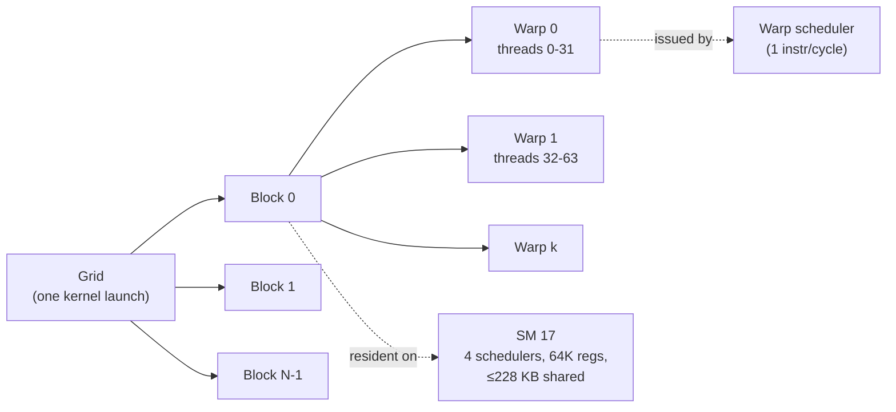

# Chapter 4 — GPU Architecture and CUDA Execution

> An AI cluster is bought for its GPUs, and most of the expensive mistakes in operating one come from
> misreading what a GPU is doing. A dashboard says "GPU utilization 97 %" while the job runs at half its
> expected speed; a training step slows by 30 % after an innocuous library upgrade; a kernel that "should"
> take 80 µs takes 280 µs. None of these can be diagnosed from the outside. This chapter gives the
> infrastructure engineer a working model of the GPU execution machine — streaming multiprocessors (SMs),
> warps, the memory hierarchy, kernels, streams and synchronization, occupancy and tensor cores — and the
> profiling skills to read a timeline the way a senior performance engineer does: find where the GPU is
> idle, why, and what that costs per step. The lab hands you a profiler capture of a training step on an
> ORION node with five planted problems and asks you to quantify each one.

## Learning objectives

After this chapter you will be able to:

1. **Explain** how a CUDA kernel launch becomes work on the GPU: grid → thread blocks → warps → SIMT
   instructions issued by SM warp schedulers, and why GPUs hide latency with parallelism rather than caches.
2. **Describe** the H100-class memory hierarchy (registers, shared memory/L1, L2, HBM, host memory over
   PCIe) with representative capacities and bandwidths, and **identify** which level a performance problem lives in.
3. **Trace** a vector-add or matrix-multiplication operation through host launch, host-to-device copy,
   kernel execution, device-to-host copy and synchronization, naming every point where the CPU or the GPU waits.
4. **Calculate** theoretical occupancy from block size, registers per thread and shared memory per block,
   name the limiter, and **judge** whether low occupancy is actually a problem for a given kernel.
5. **Diagnose** the classic timeline pathologies — launch-overhead-bound kernels, host-blocking
   pageable copies, unnecessary synchronizations, and latency-starved low-occupancy kernels — from a
   profiler trace, and **estimate** what each costs per step.
6. **Use** Nsight Systems, Nsight Compute, and the PyTorch profiler with correct, low-risk capture options,
   and **explain** why nvidia-smi "GPU-Util" is not a measure of SM efficiency.
7. **Explain** how batch size and data layout change GPU utilization and memory behaviour (wave
   quantization, tensor-core alignment, coalescing).

## Prerequisites and connections

You need the host fundamentals from [Chapter 3](../../part-1-foundations/ch03-linux-host-systems-diagnostics/manuscript.md):
processes and threads, NUMA, PCIe enumeration and `lspci`. No prior CUDA knowledge is assumed; code
snippets are labelled **L2** (they need a GPU to run) and are short enough to read without compiling.

This chapter is the base for the rest of Part II. [Chapter 5](../ch05-gpu-interconnects-host-topology/manuscript.md)
follows the bytes out of the GPU over PCIe, NVLink and NVSwitch to the NIC; [Chapter 6](../ch06-gpu-performance-engineering/manuscript.md)
turns the per-kernel view here into roofline analysis and statistically sound benchmarking. Later,
[Chapter 12](../../part-4-distributed-ai/ch12-collective-communication-nccl/manuscript.md) explains why NCCL
kernels occupy SMs and streams exactly like the kernels in this chapter, [Chapter 15](../../part-4-distributed-ai/ch15-llm-inference-serving/manuscript.md)
revisits launch overhead and CUDA Graphs for decode, [Chapter 18](../../part-5-production-operations/ch18-observability-slos-incident-response/manuscript.md)
builds DCGM dashboards on the metrics defined in Section 4.9, and [Chapter 22](../../part-5-production-operations/ch22-cross-layer-performance-engineering/manuscript.md)
uses the timeline-reading method across layers. The chapter's lab is the first half of
**Progressive Lab 4 (GPU baseline)**; [Capstone C](../../../capstones/) (distributed training performance
optimization) depends on it.

## 4.1 Why infrastructure engineers need the execution model

A CPU is a latency machine: a few powerful cores, deep out-of-order pipelines, branch predictors, and
large caches whose job is to make one thread's next instruction run as soon as possible. A GPU is a
throughput machine: an H100-class part keeps more than 270,000 threads resident at once (132 SMs × 2,048
threads `[VENDOR-SPEC, 2026-10]`) and makes progress by always having *some* warp ready to issue while
others wait hundreds of nanoseconds for memory.

That trade shapes every operational symptom you will see. A GPU is fast only while three conditions hold:

1. **It has work queued.** Every kernel is launched by a CPU thread. If the CPU cannot enqueue work faster
   than the GPU retires it, the GPU idles between kernels no matter how fast its SMs are.
2. **Its data is already in device memory.** Moving data across PCIe is about 60× slower than reading HBM
   (≈ 55 GB/s achievable per direction versus ≈ 3,350 GB/s `[VENDOR-SPEC, 2026-10]` for HBM3 on ORION's
   GPUs). Copies on the critical path are expensive; copies the GPU cannot overlap are worse.
3. **Each kernel exposes enough parallelism.** A kernel that launches four thread blocks on a 132-SM GPU
   uses 3 % of the machine while reporting the GPU as "busy".

When any condition fails, the timeline shows idle time or a kernel far below its hardware ceiling. The diagnostic loop (*observe a symptom →
collect evidence → trace the bottleneck → identify root cause → make a safe change → validate*) applies
directly: the profiler trace *is* the evidence, and the gap between "GPU busy" and "GPU doing useful
work at its roof" is the bottleneck.

> **Key idea:** GPU performance problems are almost always one of two things — the GPU waiting for the
> host (launches, copies, synchronization) or a kernel waiting for memory. Profiling is the act of
> deciding which, and by how much.

## 4.2 The H100-class GPU at a glance

ORION's HX8 nodes carry eight H100-SXM-class GPUs (see [REFERENCE_CLUSTER.md](../../../docs/REFERENCE_CLUSTER.md)).
Table 4.1 lists the architectural numbers this chapter uses. They match the NVIDIA H100 architecture
whitepaper and the CUDA C++ Programming Guide's compute capability 9.0 table; treat them as class values
and re-verify against current documentation for any specific SKU.

*Table 4.1 — H100-SXM-class GPU resources used in this chapter `[VENDOR-SPEC, 2026-10]`.*

| Resource | Value | Why it matters operationally |
|---|---|---|
| Streaming multiprocessors (SMs) | 132 | Unit of scheduling: a kernel with fewer than 132 blocks cannot fill the GPU |
| Sub-partitions per SM | 4, each with a warp scheduler, register-file slice and one tensor core | Up to 4 warp-instructions issued per SM per cycle |
| FP32 lanes per SM | 128 | Non-tensor FP32 peak ≈ 67 TFLOP/s |
| Tensor cores | 4 per SM (528 total), 4th generation | Dense BF16 peak ≈ 989 TFLOP/s (≈ 528 × 1,024 FLOP/clock × ≈ 1.83 GHz; verify); FP8 ≈ 1,979 TFLOP/s |
| Registers | 65,536 × 32-bit per SM (256 KB); max 255 per thread | Usually the first occupancy limiter |
| L1 / shared memory | 256 KB combined per SM; shared memory configurable up to 228 KB per SM (227 KB per block) | Software-managed scratchpad for tiles |
| Resident limits per SM | 2,048 threads = 64 warps; 32 thread blocks | Upper bounds for occupancy |
| L2 cache | 50 MB, shared by all SMs | Working sets below this can exceed HBM bandwidth |
| HBM3 | 80 GB, ≈ 3.35 TB/s | The roof for memory-bound kernels |
| Host link | PCIe Gen5 x16: 63 GB/s per direction theoretical | The roof for host↔device copies |
| GPU↔GPU | NVLink 4: 900 GB/s total, 450 GB/s per direction | Chapter 5 |

Three hardware ideas from Hopper matter for reading profiles even if you never write a kernel:

- **Warp-group matrix multiply (wgmma).** On Hopper, tensor-core instructions are issued by a *warp
  group* of four warps (128 threads) operating asynchronously on tiles held in shared memory. High-performance
  GEMM kernels are therefore organised around a few large, register-hungry warp groups per SM.
- **Tensor Memory Accelerator (TMA).** A copy engine inside each SM that moves multi-dimensional tiles
  between global and shared memory without consuming thread instructions. It is why modern GEMM and
  attention kernels can stay near peak with only one or two thread blocks per SM.
- **Thread block clusters.** Groups of blocks (up to 8 portably) co-scheduled on neighbouring SMs that
  can read each other's shared memory ("distributed shared memory").

The consequence for infrastructure engineers: the fastest kernels on this GPU often run at *low*
occupancy by design. We return to that in Section 4.7, because it is the most common misreading of
Nsight Compute output.

## 4.3 The execution model: grids, blocks, warps and SIMT

### Hierarchy

A **kernel** is a function that runs on the GPU. Launching it creates a **grid** of **thread blocks**
(also called cooperative thread arrays, CTAs); each block contains up to 1,024 threads. The hardware
assigns each block to one SM, where it stays until all its threads finish. Within an SM, threads are
executed in groups of 32 called **warps**. A warp executes one instruction at a time for all 32 threads —
single instruction, multiple threads (SIMT). If threads in a warp take different branches, the warp
executes both paths with inactive lanes masked off (**warp divergence**), wasting lanes.



*Figure 4.1 — Kernel launch hierarchy. Blocks are the unit of placement on SMs; warps are the unit of
instruction issue.*

### Latency hiding and why "occupancy" exists

Each SM sub-partition picks, every cycle, one warp whose next instruction has its operands ready, and
issues it. A warp waiting on a global-memory load is simply not eligible; the scheduler issues from
another warp. Throughput is preserved as long as there is enough independent work in flight. Little's
law makes "enough" precise:

> bytes in flight = latency × bandwidth

For HBM, take a loaded-latency of ≈ 600 ns `[ILLUSTRATIVE]` and the 3.35 TB/s roof:
3.35 × 10¹² B/s × 600 × 10⁻⁹ s ≈ 2.0 × 10⁶ B ≈ 2 MB in flight across the GPU, or
2.0 MB / 132 SMs ≈ 15 KB per SM `[MODELED]`. A warp loading one 4-byte value per thread has 128 B in flight
per load instruction, so an SM would need on the order of 120 such loads outstanding — from many warps,
or from fewer warps each issuing several independent loads (instruction-level parallelism). A memory-bound
kernel that keeps only 8 warps resident and issues one load at a time cannot reach the roof. That is the
mechanism behind the low-occupancy finding in this chapter's lab.

### A kernel you can read (L2)

The canonical first kernel, vector addition, shows the indexing idiom and the launch configuration:

```cpp
// vadd.cu — L2 (requires a CUDA GPU).  nvcc -O3 -arch=sm_90 -lineinfo vadd.cu -o vadd
#include <cstdio>
#include <cuda_runtime.h>

#define CHECK(x) do { cudaError_t e = (x); if (e != cudaSuccess) { \
    std::printf("%s:%d %s\n", __FILE__, __LINE__, cudaGetErrorString(e)); return 1; } } while (0)

__global__ void vadd(const float* __restrict__ a, const float* __restrict__ b,
                     float* __restrict__ c, size_t n) {
    size_t i = blockIdx.x * (size_t)blockDim.x + threadIdx.x;   // global thread index
    if (i < n) c[i] = a[i] + b[i];                               // one element per thread
}

int main() {
    const size_t n = 1 << 26;                 // 67,108,864 floats = 256 MiB per array
    const size_t bytes = n * sizeof(float);
    float *ha, *hb, *hc, *da, *db, *dc;
    CHECK(cudaMallocHost(&ha, bytes)); CHECK(cudaMallocHost(&hb, bytes)); CHECK(cudaMallocHost(&hc, bytes));
    CHECK(cudaMalloc(&da, bytes)); CHECK(cudaMalloc(&db, bytes)); CHECK(cudaMalloc(&dc, bytes));
    for (size_t i = 0; i < n; ++i) { ha[i] = 1.0f; hb[i] = 2.0f; }

    cudaStream_t s; CHECK(cudaStreamCreate(&s));
    cudaEvent_t t0, t1; CHECK(cudaEventCreate(&t0)); CHECK(cudaEventCreate(&t1));

    CHECK(cudaMemcpyAsync(da, ha, bytes, cudaMemcpyHostToDevice, s));   // (2) H2D
    CHECK(cudaMemcpyAsync(db, hb, bytes, cudaMemcpyHostToDevice, s));
    const int block = 256;
    const int grid = (int)((n + block - 1) / block);                   // 262,144 blocks
    CHECK(cudaEventRecord(t0, s));
    vadd<<<grid, block, 0, s>>>(da, db, dc, n);                         // (1) launch, (3) execute
    CHECK(cudaGetLastError());                                          // launch-configuration errors
    CHECK(cudaEventRecord(t1, s));
    CHECK(cudaMemcpyAsync(hc, dc, bytes, cudaMemcpyDeviceToHost, s));   // (4) D2H
    CHECK(cudaStreamSynchronize(s));                                    // (5) host waits here

    float ms = 0; CHECK(cudaEventElapsedTime(&ms, t0, t1));
    std::printf("kernel %.3f ms, %.0f GB/s effective\n", ms, 3.0 * bytes / (ms * 1e6));
    return 0;
}
```

Every number here can be predicted before running it. The kernel moves 3 × 256 MiB = 805 MB (two reads,
one write) and does one FLOP per 12 bytes, so it is memory-bound; at 90 % of the HBM roof it would take
805 × 10⁶ B / (0.90 × 3.35 × 10¹² B/s) ≈ 0.27 ms `[MODELED]`. The two host-to-device copies move 537 MB
over PCIe; at ≈ 52 GB/s pinned `[ILLUSTRATIVE]` they take ≈ 10.3 ms — **almost 40× the kernel time**. This
is the single most important intuition for vector-scale work: if data crosses PCIe once per use, PCIe is
the bottleneck, not the GPU. Real training keeps weights, activations and optimizer state resident in HBM
and only streams the input batch.

### Tracing the vector add end to end

Tracing a simple operation through every stage is one of this chapter's core exercises (Exercise 4.11). Figure 4.2
does that for the program above, marking where each side waits.

```mermaid
sequenceDiagram
    participant CPU as CPU thread
    participant DRV as CUDA driver / runtime
    participant CE as Copy engine (DMA)
    participant SM as SMs
    CPU->>DRV: cudaMemcpyAsync H2D (pinned) x2
    DRV->>CE: enqueue DMA descriptors on stream s
    Note over CPU: returns in ~5-10 µs (async)
    CPU->>DRV: cudaLaunchKernel vadd<<<262144,256>>>
    Note over CPU: returns in ~3-5 µs; kernel queued behind the copies
    CPU->>DRV: cudaMemcpyAsync D2H (pinned)
    CPU->>DRV: cudaStreamSynchronize(s)
    Note over CPU: CPU BLOCKS here until the stream drains
    CE-->>SM: H2D complete (~10 ms over PCIe Gen5)
    SM->>SM: vadd runs (~0.27 ms, HBM-bound)
    SM-->>CE: kernel complete, D2H starts
    CE-->>DRV: D2H complete (~5 ms)
    DRV-->>CPU: synchronize returns
```

*Figure 4.2 — Host↔device data path of a vector add: launch, H2D copy, kernel, D2H copy, synchronization.
Times are `[MODELED]` from Table 4.1 and the arithmetic above.*

Read the figure for its waits: the CPU waits once, at `cudaStreamSynchronize`; the SMs wait for the H2D
copy (stream order); the D2H copy waits for the kernel. If the host buffers were
*pageable* (ordinary `malloc` memory), the copy calls themselves would block the CPU (Section 4.6), and
the CPU could not have queued the kernel early.

## 4.4 The memory hierarchy

GPU code is fast when its data is close and slow when it is far. Table 4.2 gives representative numbers.

*Table 4.2 — Memory hierarchy of an H100-class GPU. Capacities `[VENDOR-SPEC, 2026-10]`; latencies and
per-SM bandwidths `[ILLUSTRATIVE]` (order-of-magnitude values from published microbenchmark studies;
they vary with access pattern, clock and generation).*

| Level | Capacity | Scope | Approx. latency | Aggregate bandwidth | Managed by |
|---|---|---|---|---|---|
| Registers | 256 KB per SM (33 MiB ≈ 34.6 MB total) | Thread | ~1 cycle | Tens of TB/s | Compiler |
| Shared memory / L1 | 256 KB per SM combined (≤ 228 KB shared) | Block (cluster with DSMEM) | ~30 cycles | ~30+ TB/s | Programmer (shared) / hardware (L1) |
| L2 cache | 50 MB | Whole GPU | ~200–300 cycles | ~10 TB/s class | Hardware |
| HBM3 (device memory) | 80 GB | Whole GPU | ~500–800 ns | 3.35 TB/s | Allocator (`cudaMalloc`, PyTorch caching allocator) |
| Peer GPU HBM over NVLink | 80 GB per peer | Node | ~1–2 µs | 450 GB/s per direction | Chapter 5 |
| Host DRAM over PCIe | 1 TiB per socket on HX8 | Node | ~1–2 µs | ≈ 50–55 GB/s per direction achievable | Pinned/pageable allocations |

Four access rules explain most memory-bound kernels you will meet:

1. **Coalescing.** A warp's 32 loads are served by as few 32-byte sectors as possible. Thirty-two
   consecutive 4-byte values occupy 128 B = four sectors — perfect. A stride of 2 doubles the sectors
   fetched for the same useful bytes; a stride of 32 fetches one sector per thread, so 87.5 % of the bytes
   moved are wasted (4 useful bytes of every 32). Row-major versus column-major access of the same tensor
   can therefore change a kernel's effective bandwidth by 8×.
2. **Reuse in shared memory.** Matrix multiplication reads each input element many times. Tiled kernels
   stage tiles in shared memory (via TMA on Hopper) so each HBM byte is used dozens or hundreds of times —
   this is what raises arithmetic intensity (Chapter 6) above the ridge point.
3. **Register pressure.** More registers per thread let the compiler keep more data and independent
   operations live, but fewer warps fit on the SM (Section 4.7). If a kernel needs more registers than
   allowed, the compiler *spills* to "local memory", which physically lives in HBM behind L1 — a silent
   bandwidth tax visible in Nsight Compute as local load/store traffic.
4. **L2 residency.** Working sets under 50 MB can be served largely from L2. A kernel that appears to
   exceed 3.35 TB/s "from DRAM" is usually hitting in L2 or has had its DRAM bytes miscounted — a trap
   Chapter 6's roofline lab plants deliberately.

## 4.5 Kernels and launches: the host–device contract

### What a launch costs

A launch is a CPU-side API call that writes a command into a queue (a "push buffer") that the GPU's front
end consumes. On current Linux drivers a `cudaLaunchKernel` call typically costs ≈ 2–5 µs of CPU time,
and the first instruction of a kernel launched into an idle stream begins several to tens of µs after the call starts (≈ 3–8 µs on a fast host with a warm driver)
`[ILLUSTRATIVE]`; both depend on the CPU, driver version, argument size and whether the launch is part of
a CUDA Graph. In PyTorch eager mode, every tensor operation adds several to tens of microseconds of Python and
dispatcher overhead on top of the CUDA call.

This sets a hard throughput limit. If the CPU needs *t*ₗ per launch and kernels run for *t*ₖ each, the
GPU is busy at most *t*ₖ / max(*t*ₖ, *t*ₗ) of the time. In the lab trace, the optimizer issues 600 kernels
per step whose median duration is 2.6 µs, while the CPU needs ≈ 9.3 µs per launch (4.8 µs API + ≈ 4.5 µs
Python) `[SIMULATED]`. Busy fraction during that phase is bounded by 2.6 / 9.3 ≈ 28 %; the lab measures
31.9 % (some kernels are larger fused Adam chunks).

### Asynchrony and the queue

Kernel launches and `cudaMemcpyAsync` calls with pinned memory return to the CPU before the GPU executes
them. A healthy training loop therefore runs the CPU *ahead* of the GPU, building a queue of pending work
— in the lab trace, the CPU finishes issuing the 85 forward kernels in 2.3 ms while the GPU needs ≈ 19.6 ms
to execute them. A queue is what absorbs Python jitter, garbage collection pauses and logging. Anything
that drains the queue — a synchronization — exposes the CPU's per-launch overhead directly to the GPU.

### Reducing launch overhead

Four techniques, in increasing order of engineering effort:

- **Fused or multi-tensor kernels.** PyTorch optimizers accept `foreach=True` (batches many tensors per
  kernel through a multi-tensor-apply pattern) and, for CUDA, `fused=True` (one fused kernel per
  parameter group) — check the current documentation for which optimizers support each.
- **Larger work per kernel.** Bigger batches or flattened parameter buffers reduce kernel count per byte.
- **CUDA Graphs.** Capture a sequence of launches once and replay it with one launch call. In PyTorch:

```python
# L2 — capture a static-shape step region in a CUDA Graph (PyTorch 2.x).
import torch
g = torch.cuda.CUDAGraph()
static_x = torch.randn(64, 4096, device="cuda")
model = torch.nn.Sequential(*[torch.nn.Linear(4096, 4096) for _ in range(8)]).cuda()
s = torch.cuda.Stream()
s.wait_stream(torch.cuda.current_stream())
with torch.cuda.stream(s):                 # warm up on a side stream before capture
    for _ in range(3):
        static_y = model(static_x)
torch.cuda.current_stream().wait_stream(s)
with torch.cuda.graph(g):                  # capture: launches are recorded, not executed
    static_y = model(static_x)
static_x.copy_(torch.randn(64, 4096, device="cuda"))
g.replay()                                 # one launch replays all recorded kernels
```

- **Compilation.** `torch.compile` fuses elementwise chains into fewer kernels; `mode="reduce-overhead"`
  additionally uses CUDA Graphs. Both require static or bucketed shapes to pay off.

> **Production note:** CUDA Graphs freeze memory addresses and shapes. Dynamic shapes, data-dependent
> control flow and host synchronization inside the captured region break capture or force re-capture.
> That is why graphs are near-universal for LLM decode (Chapter 15) and less common for training loops.

## 4.6 Streams, events, synchronization and pinned memory

### Streams and events

A **stream** is an in-order queue of GPU work. Operations in one stream execute in issue order;
operations in different streams may run concurrently, subject to hardware resources. **Events** are
markers recorded into a stream; another stream can wait on an event (a GPU-side dependency that does not
block the CPU), and the CPU can query or synchronize on it. Events are also the correct way to time GPU
work, because they timestamp on the GPU:

```python
# L2 — time GPU work with events instead of host timers + torch.cuda.synchronize().
start, end = torch.cuda.Event(enable_timing=True), torch.cuda.Event(enable_timing=True)
start.record()
y = model(x)
end.record()
# ... queue more work; read the time later, e.g. once per logging interval:
end.synchronize()
print(f"forward {start.elapsed_time(end):.2f} ms")   # milliseconds, measured on the GPU
```

The legacy **default stream** (stream 0) synchronizes with all other blocking streams in the process, so
work issued to it serializes against everything. Compiling with `nvcc --default-stream per-thread` gives
each host thread its own non-synchronizing default stream. PyTorch uses one current stream per device
(the default stream unless you set another) and exposes `torch.cuda.Stream`, `torch.cuda.stream(...)`,
`Stream.wait_stream` and `Tensor.record_stream` for side-stream work.

### Explicit and implicit synchronization

Explicit synchronization is easy to find: `cudaDeviceSynchronize`, `cudaStreamSynchronize`,
`cudaEventSynchronize`, `torch.cuda.synchronize()`. Implicit synchronization is what costs teams weeks.
In PyTorch, any operation that needs a GPU value on the CPU forces the CPU to wait for the stream:

| Code pattern | Why it synchronizes |
|---|---|
| `loss.item()`, `float(t)`, `t.tolist()`, `t.cpu()`, `print(t)` | Copies a device value to host memory and waits for it |
| `if (t > 0).any():` | Python branch needs the value |
| `x[mask]`, `torch.nonzero(t)`, `torch.unique(t)` | Output size is data-dependent; the CPU must learn it to allocate |
| `torch.tensor(..., device="cuda")` from a host list, `.cuda()` of pageable memory | Host-blocking copy from pageable memory |
| Some allocator paths (`cudaMalloc`/`cudaFree` when the caching allocator must grow or release) | Driver calls can synchronize the device |

PyTorch can report these for you: `torch.cuda.set_sync_debug_mode("warn")` emits a warning (with a stack
trace) for each synchronizing operation, and `"error"` raises. Use it in a development run, not in
production.

### Pinned versus pageable host memory

The copy engines perform DMA, which requires physical pages that cannot move — **page-locked (pinned)**
memory. When you copy from ordinary **pageable** memory, the driver first copies your data into an
internal pinned staging buffer with the CPU, chunk by chunk, then DMAs each chunk. Consequences:

- **Bandwidth** drops to what a CPU `memcpy` into the staging buffer can sustain while interleaving with
  DMA: often 10–25 GB/s on modern servers versus ≈ 50–55 GB/s pinned over PCIe Gen5 x16 `[ILLUSTRATIVE]`.
  The lab trace shows 9.3–12.2 GB/s pageable versus 47.9–48.2 GB/s pinned `[SIMULATED]`.
- **Host blocking.** Per the CUDA Runtime API documentation's description of memcpy behaviour, copies
  involving pageable memory may synchronize with the stream and do not return control to the host until
  the source has been staged (and, for device-to-pageable-host, until the copy completes). The CPU cannot
  run ahead to queue kernels.
- **No overlap.** Because the call blocks and serializes, a pageable copy cannot overlap compute the way
  a pinned `cudaMemcpyAsync` on a side stream can.

The fix is standard: allocate host buffers with `cudaMallocHost`/`cudaHostAlloc` (CUDA) or
`tensor.pin_memory()` / `DataLoader(pin_memory=True)` (PyTorch), copy with `non_blocking=True` on a side
stream, and make the compute stream wait on an event:

```python
# L2 — prefetch the next batch on a side stream from pinned memory.
copy_stream = torch.cuda.Stream()
def prefetch(cpu_batch):                       # cpu_batch tensors come from pinned memory
    with torch.cuda.stream(copy_stream):
        gpu_batch = {k: v.to("cuda", non_blocking=True) for k, v in cpu_batch.items()}
    return gpu_batch

nxt = prefetch(next(loader_iter))
for step in range(num_steps):
    torch.cuda.current_stream().wait_stream(copy_stream)   # GPU-side dependency, CPU not blocked
    batch = nxt
    for t in batch.values():
        t.record_stream(torch.cuda.current_stream())        # tell the allocator who uses it
    nxt = prefetch(next(loader_iter))                        # overlaps with this step's compute
    loss = train_step(batch)
```

### Copy engines and bidirectional overlap

DMA transfers are executed by dedicated **copy engines**, separate from the SMs. Data-center GPUs have
several, so an H2D copy, a D2H copy and kernels can all run at once, but only if they are in *different
streams* (operations in one stream serialize) and use pinned memory. A pipeline that prefetches batch
*n*+1 (H2D), computes batch *n*, and offloads results of batch *n*−1 (D2H) needs three streams to use
both PCIe directions concurrently; put the two copies in one "copy stream" and they serialize, halving
the achievable PCIe throughput. In Nsight Systems the copies appear on separate rows per stream, so
"two copies that never overlap" is visible at a glance.

> **Pitfall:** Pinning is not free. Pinned pages are taken out of the kernel's reclaimable pool; pinning
> tens of gigabytes per process on a node running eight ranks can starve the page cache or trigger the
> OOM killer. Pin a bounded, reused staging pool rather than every tensor.

## 4.7 Occupancy: calculating it, and knowing when it matters

**Occupancy** is the ratio of resident warps on an SM to the maximum (64 on Table 4.1's GPU).
*Theoretical* occupancy is what the launch configuration and resource usage allow; *achieved* occupancy
is what the profiler measures over the kernel's lifetime (lower when the grid is small, blocks finish
unevenly, or there is a tail).

### The calculation

For a kernel with *B* threads per block, *r* registers per thread and *S* bytes of shared memory per
block on the GPU of Table 4.1 `[MODELED — simplified occupancy-calculator rules; the CUDA occupancy API
is authoritative]`:

1. Warps per block *w* = ⌈*B* / 32⌉.
2. **Warp limit:** ⌊64 / *w*⌋ blocks.
3. **Register limit:** registers are allocated per warp in units of 256. Registers per warp
   = ⌈32*r* / 256⌉ × 256; warps that fit = ⌊65,536 / registers-per-warp⌋, rounded *down* to the warp
   allocation granularity of 4; blocks = ⌊warps / *w*⌋.
4. **Shared-memory limit:** ⌊233,472 / (*S* + 1,024)⌋ blocks (228 KB per SM, 1 KB reserved per block).
5. **Block limit:** 32.
6. Resident blocks = minimum of the four; occupancy = blocks × *w* / 64. The binding constraint is the
   **limiter**.

Three worked cases from the lab trace:

*Table 4.3 — Theoretical occupancy of three kernels in the lab trace `[MODELED]`.*

| Kernel | *B* | *r* | *S* | Warp limit | Register limit | Smem limit | Blocks | Occupancy | Limiter |
|---|---|---|---|---|---|---|---|---|---|
| `layernorm_bwd_fused_kernel` | 256 (8 warps) | 168 | 16 KB | 8 | ⌊⌊65,536/5,376⌋/8⌋ = ⌊12/8⌋ = 1 | ⌊233,472/17,408⌋ = 13 | 1 | 8/64 = 12.5 % | registers |
| BF16 GEMM (`sm90_xmma_gemm_…`) | 384 (12 warps) | 168 | 213,000 B | 5 | ⌊12/12⌋ = 1 | ⌊233,472/214,024⌋ = 1 | 1 | 12/64 = 18.75 % | registers (smem ties) |
| `vectorized_elementwise_kernel` | 256 (8 warps) | 32 | 0 | 8 | ⌊⌊65,536/1,024⌋/8⌋ = 8 | 228 | 8 | 64/64 = 100 % | warps |

For the layernorm kernel: 168 registers × 32 threads = 5,376 registers per warp, already a multiple of
256 (21 × 256). 65,536 / 5,376 = 12.19 → 12 warps fit, which is one 8-warp block with 4 warps' worth of
registers left unusable. Dropping to 128 registers per thread gives 4,096 per warp → 16 warps → 2 blocks →
25 % occupancy; 64 registers per thread gives 32 warps → 4 blocks → 50 %.

### When occupancy matters

Low occupancy is a problem **only** if the kernel is starved of latency hiding — that is, if it is
running far below its roof and the profiler shows warps stalled on memory with too few eligible warps.
Compare the two low-occupancy kernels in the lab:

- The **GEMM** runs at 18.75 % occupancy and achieves ≈ 62 % of the 989 TFLOP/s BF16 roof `[SIMULATED]`.
  Its two warp groups per block issue asynchronous tensor-core work fed by TMA; occupancy is low by
  design and raising it would cost tile size and data reuse. Leave it alone.
- The **layernorm backward** runs at 12.5 % occupancy and achieves 725 GB/s, ≈ 22 % of the 3.35 TB/s HBM
  roof, while moving 201 MB per call. It is memory-bound and latency-starved: eight warps per SM, each
  with about three 128-byte requests outstanding, keep 8 × 3.25 × 128 B ≈ 3.3 KB in flight against the
  ≈ 15 KB needed (Section 4.3), which bounds it near 3.3 / 15.2 ≈ 22 % of the roof (what it achieves).
  This one is worth fixing.

Vasily Volkov's "Better Performance at Lower Occupancy" (GTC 2010) is the classic argument: occupancy is
one way to buy latency hiding; instruction-level parallelism and asynchronous copies are others. The
rule a senior engineer applies: **look at occupancy only after you know the kernel is far from its roof.**

### Tools

- Compile-time resource usage: `nvcc -Xptxas -v` (or `--resource-usage`) prints registers, shared memory
  and spill bytes per kernel; `cuobjdump --dump-resource-usage app` reads them from a binary.
- Runtime: `cudaOccupancyMaxActiveBlocksPerMultiprocessor(&blocks, kernel, blockSize, dynamicSmem)`
  returns the theoretical resident-block count, and `cudaOccupancyMaxPotentialBlockSize` suggests a block size.
- Controls: `__launch_bounds__(maxThreadsPerBlock, minBlocksPerSM)` on the kernel, or the
  `-maxrregcount=N` compiler flag (process-wide and blunt), cap registers — at the risk of spills.
- Measured: Nsight Compute's *Occupancy* section reports theoretical and achieved occupancy and names
  the limiter; the *Launch Statistics* section shows registers and shared memory per block.

## 4.8 Tensor cores, precision, batch size and data layout

Tensor cores execute small dense matrix multiply-accumulate operations (D = A × B + C) on tiles, at an
order of magnitude more FLOP/s than the FP32 lanes: ≈ 989 dense BF16 TFLOP/s versus ≈ 67 FP32 TFLOP/s on
an H100-SXM-class GPU `[VENDOR-SPEC, 2026-10]`. Whether a model gets that speed depends on choices an
infrastructure engineer can see and influence.

**Precision.** BF16 and FP16 inputs use tensor cores with FP32 accumulation; FP8 doubles the peak again
on Hopper with scaling recipes (for example NVIDIA Transformer Engine). Plain FP32 matmuls in PyTorch use
TF32 tensor cores only if allowed (`torch.backends.cuda.matmul.allow_tf32 = True` or
`torch.set_float32_matmul_precision("high")`); otherwise they run on FP32 lanes at a fraction of the speed.
A job that "forgot" mixed precision shows tensor-pipe activity near zero in Nsight Compute or in the DCGM
tensor-active metric.

**Shape alignment.** Tensor-core kernels work on fixed tile shapes; dimensions that are multiples of 8
(FP16/BF16) or 16 (FP8) elements — better, of 64 or 128 — avoid padding and slow fallback paths. A vocabulary
of 50,257 tokens is a classic example: padding the embedding to 50,304 (a multiple of 64) is a well-known
speed-up because the output projection GEMM then tiles cleanly.

**Batch size and wave quantization.** A GEMM is split into output tiles; each tile is one block on one SM.
If the tile count is not a multiple of the SM count, the last "wave" runs partially empty. Worked example
`[MODELED]`, tile 128 × 256 on 132 SMs:

- Output 8,192 × 2,048 (8,192 tokens): tiles = (8,192/128) × (2,048/256) = 64 × 8 = 512. Waves =
  512 / 132 = 3.88 → 4 waves; efficiency = 3.88 / 4 = 97 %.
- Output 1,024 × 2,048 (batch cut to 1,024 tokens): tiles = 8 × 8 = 64. Waves = 64 / 132 = 0.48 → 1 wave;
  only 64 of 132 SMs do any work, efficiency 48 %, and nvidia-smi still reports the GPU 100 % "utilized".

Smaller batches also lower arithmetic intensity (fewer FLOPs per weight byte loaded), pushing GEMMs toward
the memory roof — the central effect behind LLM decode performance (Chapter 15) and the roofline in
Chapter 6. Larger batches raise activation memory linearly; past the point where activations no longer
fit, you trade memory for recomputation.

**Data layout.** Layout determines coalescing (Section 4.4) and whether kernels can use vectorized
128-bit loads. Non-contiguous tensors (after `transpose`/`permute`) either force a copy kernel
(`.contiguous()`) or a strided, slower kernel. For convolutional models, `channels_last` memory format
lets cuDNN use tensor-core kernels without layout transforms. The rule: know which dimension is innermost
in memory for each large tensor, and make it the one adjacent threads read.

## 4.9 What "GPU utilization" actually measures

The `utilization.gpu` value reported by `nvidia-smi` and NVML is defined in the nvidia-smi documentation as
the percent of time over the past sample period during which **one or more kernels was executing** on the
GPU. It is a duty cycle, not an efficiency. A single 4-block kernel occupying 3 % of the SMs, running
back-to-back, reads as 100 %. In the lab trace, "busy with any activity" is 88.8 % and "kernel running" is
78.6 % of the step; neither number says the large GEMMs achieve 62 % of peak or that the optimizer phase is
idle two-thirds of the time.

Better signals come from the profiling metrics exposed by NVIDIA's Data Center GPU Manager (DCGM), which
Chapter 18 builds dashboards on `[VENDOR-SPEC, 2026-10 — verify field names and IDs for your DCGM version]`:

| DCGM field | Meaning | Healthy training example |
|---|---|---|
| `DCGM_FI_PROF_GR_ENGINE_ACTIVE` | Fraction of time the graphics/compute engine is active (similar to GPU-Util) | > 0.95 |
| `DCGM_FI_PROF_SM_ACTIVE` | Fraction of time at least one warp is resident on an SM, averaged over SMs | > 0.80 |
| `DCGM_FI_PROF_SM_OCCUPANCY` | Resident warps relative to maximum, averaged over time and SMs | Kernel-dependent; 0.15–0.5 is common for GEMM-heavy jobs |
| `DCGM_FI_PROF_PIPE_TENSOR_ACTIVE` | Fraction of cycles the tensor pipe is active | 0.3–0.6 for well-tuned LLM training `[ILLUSTRATIVE]` |
| `DCGM_FI_PROF_DRAM_ACTIVE` | Fraction of cycles the memory interface is busy | High for memory-bound phases |
| `DCGM_FI_PROF_PCIE_TX_BYTES`, `DCGM_FI_PROF_PCIE_RX_BYTES` | PCIe traffic | Spikes at batch load and checkpoint |

The diagnostic pattern: **GPU-Util high but SM-active or tensor-active low** means small kernels, low
parallelism, or idle-but-"busy" periods; **all of them high but throughput low** means the kernels
themselves are inefficient (Chapter 6). Chapter 6 also explains model FLOPs utilization (MFU), the
end-to-end metric training teams report.

### Sharing a GPU: MIG, MPS and time-slicing

Utilization metrics change meaning when a GPU is shared `[VENDOR-SPEC, 2026-10 — verify per driver]`:

- **Multi-Instance GPU (MIG)** partitions an H100-class GPU into up to seven isolated instances, each with
  its own SMs, L2 slices and HBM bandwidth. Utilization and DCGM profiling metrics are then reported per
  instance; device-level GPU-Util says little about any single tenant, and a tenant's roof is its slice's
  bandwidth and SM count, not the whole GPU's.
- **Multi-Process Service (MPS)** lets kernels from several processes share SMs concurrently through one
  server context. GPU-Util and SM-active then aggregate over all clients (and are capped at 100 %): 100 %
  GPU-Util with four MPS clients says nothing about any one of them; attribute time per process with Nsight Systems or per-client
  accounting.
- **Time-slicing** (the default when several processes, or a Kubernetes device-plugin "shared" GPU,
  use one device without MPS) context-switches between processes. GPU-Util stays high while each process
  sees idle stretches when it is switched out, and step times become bimodal.

Before interpreting any utilization number, establish which sharing mode the GPU is in
(`nvidia-smi -q` shows MIG mode; the process list shows MPS server and clients).

## 4.10 Profiling tools and safe capture practice

### Nsight Systems: the timeline

Nsight Systems (`nsys`) records a system-wide timeline: CPU threads, OS runtime calls, CUDA API calls,
GPU kernels and memcpys per stream, NVTX ranges you annotate in code, and optionally NCCL, cuBLAS and
cuDNN ranges. It answers "where is time going and who is waiting for whom". Overhead is low enough
(a few percent `[ILLUSTRATIVE]`) to use on real training jobs if you limit the capture window.

```bash
# L2 — capture two steps of a PyTorch job, bounded by cudaProfilerStart/Stop in the code.
nsys profile -t cuda,nvtx,osrt -s none \
     --capture-range=cudaProfilerApi --capture-range-end=stop \
     -o step41 python train.py --profile-steps 41-42

# Summaries and a CSV export of the GPU trace (report names vary by nsys version; `nsys stats --help-reports`)
nsys stats --report cuda_gpu_kern_sum,cuda_api_sum,cuda_gpu_mem_time_sum step41.nsys-rep
nsys stats --report cuda_gpu_trace --format csv --output step41 step41.nsys-rep
```

In the training script, mark the window and the phases:

```python
# L2 — NVTX ranges and a bounded capture window.
import torch
for step, batch in enumerate(loader):
    if step == 41: torch.cuda.profiler.start()      # cudaProfilerStart
    torch.cuda.nvtx.range_push(f"train_step_{step}")
    torch.cuda.nvtx.range_push("forward"); loss = model(batch); torch.cuda.nvtx.range_pop()
    torch.cuda.nvtx.range_push("backward"); loss.backward(); torch.cuda.nvtx.range_pop()
    torch.cuda.nvtx.range_push("optimizer_step"); opt.step(); opt.zero_grad(set_to_none=True); torch.cuda.nvtx.range_pop()
    torch.cuda.synchronize()   # the job's step timer: the trailing cudaDeviceSynchronize seen in the lab trace
    torch.cuda.nvtx.range_pop()
    if step == 42: torch.cuda.profiler.stop(); break
```

Two facts make or break timeline analysis. First, **NVTX ranges are CPU-side**: in the lab trace the
CPU's `forward` range lasts 2.3 ms while the forward kernels take ≈ 19.6 ms on the GPU, because the CPU ran
ahead. Nsight Systems can project NVTX ranges onto the GPU timeline; when you export raw tables you must
do that join yourself, via correlation IDs. Second, **every GPU activity carries a correlation ID** linking
it to the API call that created it — the key that lets you ask "when was this kernel *submitted*?"

### Nsight Compute: one kernel at a time

Nsight Compute (`ncu`) profiles individual kernels with hardware counters. To collect many counters it
**replays** each profiled kernel multiple times and serializes launches, so it can slow an application by
orders of magnitude for the profiled kernels. Use it on a targeted kernel, on a development or canary node:

```bash
# L2 — profile 5 instances of the layernorm backward kernel, skipping warm-up launches.
ncu --set full -k regex:layernorm_bwd --launch-skip 20 --launch-count 5 -o ln_bwd python train.py
# Focused sections instead of the full set (faster):
ncu --section SpeedOfLight --section Occupancy --section LaunchStats -k regex:layernorm_bwd -c 5 python train.py
# Specific metrics (names are version-sensitive; list them with `ncu --query-metrics`):
ncu --metrics gpu__time_duration.sum,sm__warps_active.avg.pct_of_peak_sustained_active,dram__throughput.avg.pct_of_peak_sustained_elapsed \
    -k regex:layernorm_bwd -c 5 python train.py
```

The *SpeedOfLight* section reports compute (SM) and memory throughput as a percentage of peak — the same
"fraction of roof" this chapter's lab computes from FLOP and byte counters. The *Occupancy* section gives
theoretical versus achieved occupancy and the limiter.

### PyTorch profiler

For framework-level attribution (which Python op launched which kernel), `torch.profiler` records CPU
ops and CUDA kernels and exports a Chrome-trace JSON viewable in Perfetto or TensorBoard:

```python
# L2
from torch.profiler import profile, schedule, ProfilerActivity
with profile(activities=[ProfilerActivity.CPU, ProfilerActivity.CUDA],
             schedule=schedule(wait=1, warmup=2, active=2), record_shapes=True) as prof:
    for step, batch in zip(range(5), loader):
        train_step(batch); prof.step()
print(prof.key_averages().table(sort_by="cuda_time_total", row_limit=15))  # newer releases: "device_time_total" 
prof.export_chrome_trace("trace.json")
```

> **Safety:** Do not attach Nsight Compute or enable full-counter profiling on a production multi-node
> training job. Kernel replay stalls the rank, which stalls every collective, which can trip NCCL
> watchdog timeouts across the job. Profile a single-node reproduction or a canary, and coordinate with
> the job owner before profiling any shared node.

### Quick live views

`nvidia-smi dmon -s u` (duty cycles, Section 4.9's caveat), `nvidia-smi -q -d PERFORMANCE` (clock-event
reasons) and `dcgmi dmon` (DCGM fields) are triage tools: they tell you *whether* to capture a trace.

## 4.11 Reading a timeline: five pathologies

Table 4.4 is the field guide the lab teaches you to automate.

*Table 4.4 — Timeline signatures of five classic GPU pathologies (signatures `[ILLUSTRATIVE]`, drawn from the lab's `[SIMULATED]` trace).*

| Pathology | What the GPU row shows | What the CPU/API row shows | First confirming check | Typical fix |
|---|---|---|---|---|
| Launch-overhead-bound | A comb of very short kernels (< 10 µs) separated by gaps of similar length | CPU thread continuously inside `cudaLaunchKernel` / Python; no sync calls | Kernel duration vs launch interval; kernels with grids ≪ SM count | Fused/foreach kernels, CUDA Graphs, `torch.compile` |
| Host-blocking pageable copies | Long memcpy rows labelled pageable at 10–25 GB/s; no kernel running underneath | `cudaMemcpyAsync` calls lasting as long as the copy | Memory kind column; bandwidth vs ≈ 50 GB/s pinned | Pinned staging + `non_blocking` copy on a side stream |
| Unnecessary synchronization | GPU drains to idle, then a gap of 100 µs–ms before the next kernel | `cudaStreamSynchronize`/`cudaDeviceSynchronize` or pageable D2H returning just before the gap | Correlate gap start with sync return; `set_sync_debug_mode("warn")` | Remove `.item()`/prints in the hot loop; time with events; read metrics every N steps |
| Latency-starved kernel | One kernel family long relative to its bytes/FLOPs | Normal | ncu: low achieved occupancy, DRAM throughput ≪ peak, high "long scoreboard" stalls | Cut register use/block size, more ILP, or a better library kernel |
| Unified-memory page-fault migration | Kernels that are unexpectedly long and variable; "Unified Memory" HtoD/DtoH migration rows interleaved with them | Normal launches; no explicit memcpys | nsys with `--cuda-um-cpu-page-faults=true --cuda-um-gpu-page-faults=true` shows faults and migrated bytes | Prefetch (`cudaMemPrefetchAsync`), `cudaMemAdvise`, or explicit device allocations |

The decision rule that makes gap attribution rigorous uses correlation IDs. For each idle gap, find the
next GPU activity and look up the API call that submitted it:

- If that call **started well before the gap**, the work was queued and the GPU was waiting on a
  dependency (an event or another stream).
- If it started **after the gap began**, the GPU was starved by the host. If a host-blocking call (a
  synchronize, or a copy involving pageable memory) **returned during the gap**, the starvation was caused
  by a synchronization; otherwise the CPU simply could not launch fast enough.

This is exactly the classification `find_gaps` implements in the lab; the lab trace contains one
`dependency` gap (a host callback on a side stream) so you can see all three.

Two cautions when you read multi-GPU timelines. First, **communication kernels occupy SMs**: an NCCL
all-reduce overlapped with backward compute runs as ordinary kernels on its own stream, typically holding
a fixed number of thread blocks (channels) on a subset of SMs for its whole duration. Overlapped compute
kernels therefore see fewer SMs and run longer, and a compute kernel that "got slower" during overlap may
simply be sharing the GPU (`NCCL_MIN_NCHANNELS`/`NCCL_MAX_NCHANNELS` trade communication speed against
SMs, Chapter 12). Second, a GPU waiting inside an NCCL kernel for a slow peer looks *busy* to GPU-Util
and to a single-GPU trace; only the cross-rank view reveals the straggler.

## 4.12 Worked example: one training step on ORION, decomposed

**Situation.** Halcyon's Training Infra team runs a single-GPU fine-tuning job (a 12-layer, hidden-2,048
transformer with an image front end; 8,192 tokens per step) on GPU0 of an ORION HX8 node while a larger
job is being prepared. Step time is 85 ms; the team's estimate from FLOP counts was "about 60 ms".
nvidia-smi shows 90–100 % utilization. We follow the diagnostic loop using the lab's capture
(`lab/data/`, two steps, `[SIMULATED]`); every number below can be reproduced with the lab solution.

**Step 1 — Observe and bound the symptom.** The NVTX range `train_step_41` is pushed before the first
copy is issued and popped after the step's final `cudaDeviceSynchronize` returns, so it brackets all of
the step's GPU work: 1,085,574,931 − 1,000,000,000 = **85,574,931 ns = 85.57 ms**. The capture records
3.257 × 10¹³ FLOP of kernel work in the step (summing the per-kernel FLOP counters), so the achieved rate is

> 3.257 × 10¹³ FLOP / 0.08557 s = 3.81 × 10¹⁴ FLOP/s = 381 TFLOP/s → 381 / 989 = **38.5 % of the dense BF16 peak** `[SIMULATED]`.

**Step 2 — Collect evidence: where does the window go?** Merge all GPU activity intervals (kernels and
copies on both streams) and kernel intervals separately (`utilization()`):

| Quantity | Value (ns) | Share of 85,574,931 ns |
|---|---|---|
| Kernel running (union of kernel intervals) | 67,254,320 | **78.6 %** |
| Copy running, no kernel (busy-any − kernel) | 76,018,411 − 67,254,320 = 8,764,091 | 10.2 % |
| GPU completely idle (window − busy-any) | 85,574,931 − 76,018,411 = 9,556,520 | 11.2 % |

So GPU-Util-style "busy" is 88.8 %, kernels run 78.6 % of the time, and kernels in aggregate reach only
38.5 % of peak. Three separate losses are stacked: idle time, copy-only time, and inefficiency inside kernels.
Figure 4.3 is the annotated execution trace the rest of this example fills in.

```text
GPU time → 0 ms       8.8       28.9                        76.0           81.9  85.6
stream 7  |▒▒▒ H2D ▒▒▒|█ forward █|·|█ bwd L11 █|·|█ L10 █|·| … |█ L0 █|·|▌▐▌▐▌▐▌▐ optim ▌▐| ·
          pageable,    85 kernels  ↑ sync gaps (.item() in debug hook) × 12  600 tiny kernels,
          host-blocked GEMM-heavy  ↑ loss.item()                            launch-bound gaps
                       ↑ 0.31 ms dependency gap (layer 6: compute stream waits on a host callback)
stream 13                          |▓ pinned 64 MiB prefetch (overlapped) ▓|
CPU       [cudaMemcpyAsync blocks][launch fwd 2.3 ms][wait in .item()][launch][wait] … [launch ×600]
```

*Figure 4.3 — Annotated execution trace of `train_step_41` (schematic, not to scale; times `[SIMULATED]`).
█ kernels, ▒ pageable copy, ▓ pinned copy, · idle gap.*

**Step 3 — Trace the bottleneck: attribute idle time.** `find_gaps()` with a 2 µs threshold finds
616 gaps totalling 9.25 ms; the remaining 0.31 ms of idle time is sub-2 µs inter-kernel spacing and the
step's leading and trailing edges.

| Cause | Gaps | Idle time | Where |
|---|---|---|---|
| `host_sync` | 15 | 4.91 ms | 12 × debug hook `.item()` (4.67 ms, mean 0.39 ms each); 1 × `loss.item()` (0.17 ms); 2 × after blocking pageable copies (0.07 ms) |
| `launch_bound` | 600 | 4.02 ms | Optimizer: 600 kernels with median 2.6 µs runtime launched every ≈ 9.3 µs |
| `dependency` | 1 | 0.31 ms | Forward layer 6: queued kernels wait on an event recorded after a monitoring library's host callback (`cudaLaunchHostFunc`) on stream 13 |

Why 600 tiny kernels *and* 12 large `multi_tensor_apply_kernel<AdamFunctor>` launches? The large weight
matrices are already in a multi-tensor (foreach) group, so each launch updates many tensors at once. The
120 small tensors (LayerNorm weights, biases) were registered in a separate parameter group that falls
back to per-tensor elementwise ops, five kernels per tensor. The fix is to put them in the fused group.

**Step 4 — Attribute copy-only time.** `copy_table()` shows the per-step copies:

| Copy | Bytes | Duration | Bandwidth | Host memory | Overlapped with compute? |
|---|---|---|---|---|---|
| Image batch H2D | 100,663,296 | 8.258 ms | 100,663,296 B / 8,257,571 ns = 12.19 GB/s | pageable | No |
| Labels H2D | 4,194,304 | 0.442 ms | 9.50 GB/s | pageable | No |
| Distillation targets H2D (side stream) | 67,108,864 | 1.392 ms | 48.21 GB/s | pinned | Almost entirely (it starts 32 µs before the first backward kernel) |

Copy time in the window is 10.12 ms, of which 1.36 ms (13.4 %) overlaps kernels — all of it the pinned
copy. The pageable copies are 8.70 ms of pure serial time. Pinned copies on the same link achieve 4×
their bandwidth, which rules out a degraded PCIe link (Chapter 3's `lspci` check would confirm).

**Step 5 — Inside the kernels.** `kernel_summary()` ranks kernel families by time. The GEMMs (≈ 72 % of
kernel time) run at ≈ 62 % of the BF16 roof with 18.75 % occupancy — fine. `layernorm_bwd_fused_kernel`
takes 12 × 277.8 µs = 3.33 ms per step at 12.5 % occupancy (register-limited, Table 4.3) and moves
201,326,592 B per call:

> 201,326,592 B / (277.8 × 10⁻⁶ s) = 7.25 × 10¹¹ B/s = 725 GB/s → 725 / 3,350 = 21.6 % of the HBM roof.

A well-written layernorm backward reaches ≈ 80 % of HBM bandwidth `[ILLUSTRATIVE]`:
201,326,592 B / (0.80 × 3.35 × 10¹² B/s) = 75.1 µs, saving 277.8 − 75.1 = 202.7 µs per call, 2.43 ms per step.

**Step 6 — Root causes and modeled savings.** Each finding has a mechanism and a bounded saving
`[MODELED]` (upper bounds for step 41; they do not perfectly add because removing one gap can expose another):

| # | Root cause | Change | Saving per step |
|---|---|---|---|
| A | Image batch produced as pageable NumPy arrays and copied with `.cuda()` | Pinned staging pool + `non_blocking=True` copy on the side stream one step ahead; the new 104.9 MB copy at ≈ 48 GB/s takes 2.18 ms and hides under ≈ 45 ms of backward kernels | 8.70 + 0.07 = **8.77 ms** |
| B | Debug hook calling `grad.norm().item()` after every layer | Remove hook; accumulate norms on GPU, read every 100 steps | 4.67 ms idle + 12 × 52 µs reduce kernels = **5.30 ms** |
| C | Unfused optimizer over 120 small tensors × 5 ops | `foreach=True`/`fused=True` optimizer, or flatten small params | 4.02 ms gaps + 1.56 ms tiny kernels − ≈ 0.03 ms fused kernel = **5.55 ms** |
| D | Register-limited, latency-starved layernorm backward | Library kernel with lower register use, or `__launch_bounds__` tuning, re-measured with ncu | **2.43 ms** |
| E | Monitoring host callback on the compute stream's dependency chain | Record an event and poll it later instead of making the compute stream wait | **0.31 ms** |

The lab's `analyze()` reports slightly different savings because it uses a simpler, mechanical basis:
it averages both steps and counts only removed idle or copy time, never kernel time. Table 4.5
reconciles the two; quote the basis whenever you quote a saving.

*Table 4.5 — Reconciling the lab tool's savings with this worked example (ms per step, `[MODELED]`).*

| Finding | Lab `analyze()` (mean of 2 steps, idle/copy only) | Step 41, idle/copy only | Step 41, worked-example basis | What the worked example adds |
|---|---|---|---|---|
| PAGEABLE_H2D (A) | 8.85 | 8.70 | 8.77 | The 2 sync gaps after the blocking copies (0.07) |
| EXCESS_SYNC (B) | 4.84 | 4.91 | 5.30 | Hook gaps only (4.67) + hook reduce kernels (0.63); keeps `loss.item()`; the copy-adjacent gaps move to A |
| LAUNCH_BOUND (C) | 4.03 | 4.02 | 5.55 | Tiny-kernel time (1.56) minus one fused kernel (≈ 0.03) |
| LOW_OCCUPANCY (D) | 2.44 | 2.43 | 2.43 | — |
| STREAM_DEPENDENCY (E) | 0.31 | 0.31 | 0.31 | — |
| **Total** | 20.47 | 20.37 | **22.36** | |

Projected step: 85.57 − (8.77 + 5.30 + 5.55 + 2.43 + 0.31) = 85.57 − 22.36 = **63.2 ms**, an 85.57 / 63.21 =
1.35× speed-up `[MODELED]` (on the lab tool's basis, 85.57 − 20.47 ≈ 65.1 ms; expect 63–65 ms depending on basis), which matches the team's FLOP-based estimate. Achieved rate would rise to
3.257 × 10¹³ FLOP / 0.06321 s = 515 TFLOP/s = 52 % of peak — now limited by the GEMMs themselves, which is
where Chapter 6 picks up.

**Step 7 — Make a safe change and validate.** Apply the changes one at a time on a development node
(never edit a running production job), and for each: re-capture two steps with nsys to confirm the
mechanism (pinned copies on stream 13 overlapping backward; no `cudaStreamSynchronize` between layers;
one optimizer kernel family instead of 600 launches), then measure step time with the Chapter 6 protocol
— warm-up discarded, ≥ 5 runs of ≥ 200 steps, median and IQR, same clocks and software versions. Accept a
change only if its improvement exceeds the run-to-run noise floor.

> **Key idea:** The order of the fixes is set by evidence, not intuition. The low-occupancy kernel is the
> most "interesting" finding and the smallest; the pageable copy is the most boring and the largest.

## 4.13 Hands-on lab overview

The lab ([lab/README.md](lab/README.md)) is the analysis you just read, done by you with code. It is
**Level 1**: it runs on a laptop in about a second against a committed, seeded `[SIMULATED]` capture of
two training steps (`gpu_trace.csv`, `cuda_api_trace.csv`, `nvtx_ranges.csv`, `device.json`) whose
columns mirror an Nsight Systems CSV export joined with per-kernel Nsight Compute counters. You
implement interval arithmetic (busy fractions and copy/compute overlap), gap detection with cause
attribution through correlation IDs, a copy-bandwidth table, an occupancy calculator, a per-kernel
roof-fraction summary, and a findings report with estimated savings. `check.py` verifies each function
independently. The deliverable is the course outline's *annotated execution trace and short GPU performance
analysis*. The L2 extension gives the exact `nsys`/`ncu` commands to capture the same tables from your
own GPU job and run the same analysis on real data.

## 4.14 Troubleshooting scenario: "GPU at 100 %, throughput down 28 %"

**Symptom.** After a model-code change on Friday, a single-node (8-GPU) fine-tuning job on ORION node
`orion-n07` dropped from 1,840 to 1,325 samples/s — a 28 % regression. Grafana shows GPU utilization at
97–100 % on all eight GPUs, so the on-call Training Infra engineer's first instinct is "the GPUs are
saturated; the new model is just heavier". The change author insists the model FLOPs are unchanged.

**Evidence collected (diagnostic loop: collect before hypothesizing).**

```text
$ nvidia-smi -q -d PERFORMANCE -i 0          # [ILLUSTRATIVE], abridged
    Clocks Event Reasons
        Idle                              : Not Active
        Applications Clocks Setting       : Not Active
        SW Power Cap                      : Not Active
        HW Slowdown                       : Not Active
        SW Thermal Slowdown               : Not Active
        HW Thermal Slowdown               : Not Active

$ dcgmi dmon -e 1002,1004 -c 5               # SM_ACTIVE, PIPE_TENSOR_ACTIVE  [ILLUSTRATIVE]
#Entity   SMACT   TENSO
GPU 0     0.512   0.188
GPU 0     0.497   0.181
GPU 0     0.508   0.186
```

Last week's baseline dashboard showed SM active ≈ 0.78 and tensor active ≈ 0.31 for the same job
`[ILLUSTRATIVE]`. So GPU-Util is unchanged but SM activity fell by a third: the GPU is "busy" yet doing
less. (Older drivers label the section "Clocks Throttle Reasons"; DCGM field IDs should be checked with
`dcgmi profile --list` on your version.)

**Hypotheses, ranked by prior and cost to test.**

| # | Hypothesis | Predicts | Cheapest discriminating test |
|---|---|---|---|
| H1 | Thermal/power throttling | Lower SM clocks, clock-event reasons active | `nvidia-smi -q -d PERFORMANCE,CLOCK` — **ruled out** above |
| H2 | Data loader starvation (CPU-bound input) | Idle gaps at step start; loader workers at 100 % CPU | nsys: do gaps cluster at step boundaries? `pidstat` on workers |
| H3 | Degraded PCIe link after maintenance | Slow H2D on all copies, including pinned | `lspci -vvv -s <BDF> \| grep LnkSta` (Chapter 3) |
| H4 | New code introduced host synchronization or tiny kernels | Mid-step gaps after sync calls; many short kernels | nsys capture of two steps; `set_sync_debug_mode("warn")` on a dev copy |

**Discriminating tests.** A two-step nsys capture on GPU0 of a single-GPU reproduction (not the
production job) shows the forward pass interrupted 24 times per step by idle gaps of 150–300 µs, each
preceded by a `cudaStreamSynchronize` call originating from the same op:

```text
$ nsys stats --report cuda_api_sum repro.nsys-rep      # [ILLUSTRATIVE], abridged
 Time (%)  Total Time (ns)  Num Calls   Avg (ns)    Name
 --------  ---------------  ---------  ---------   ---------------------
     49.9        8,292,170      3,610      2,297   cudaLaunchKernel
     41.1        6,824,448         48    142,176   cudaStreamSynchronize
      ...
```

Copies are pinned and run at ≈ 49 GB/s (H3 ruled out); gaps are mid-forward, not at step boundaries
(H2 ruled out). Running the reproduction with `torch.cuda.set_sync_debug_mode("warn")` prints a warning
whose stack trace points at the new loss-masking line:

```python
loss = per_token_loss[attention_mask.bool()].mean()     # boolean indexing → nonzero() → host sync
```

Boolean-mask indexing has a data-dependent output size, so PyTorch must copy the count to the host
before allocating the result: one synchronization per micro-batch per loss term (24 per step).

**Root cause.** Implicit host synchronization introduced by boolean-mask indexing in the loss; each sync
drains the queue and exposes CPU launch latency for the next ≈ 200 µs.

**Fix (safe change).** Replace the gather with an arithmetic mask that keeps shapes static:

```python
m = attention_mask.to(per_token_loss.dtype)
loss = (per_token_loss * m).sum() / m.sum().clamp_min(1.0)   # no data-dependent shapes, no sync
```

Run the model's numerical regression test (loss curves over 200 steps within tolerance), and deploy at
the job's next checkpoint restart rather than restarting it mid-run.

**Validation.** On the dev node: 5 runs × 300 steps, first 50 discarded as warm-up, median throughput
1,832 samples/s (IQR 1,821–1,840) versus 1,329 (IQR 1,318–1,337) before `[ILLUSTRATIVE]`; the nsys capture
shows no `cudaStreamSynchronize` inside the forward range; DCGM SM active returns to ≈ 0.78. Add
`set_sync_debug_mode("warn")` to the team's CI smoke test so the next implicit sync is caught before it
ships.

> **Pitfall:** "GPU utilization is 100 %, so the GPU is the bottleneck" is the most common wrong
> conclusion in GPU operations. GPU-Util is a duty cycle; it stayed at ~100 % throughout this incident.

## Trade-offs and design decisions

*Table 4.6 — Techniques for removing host-side overhead (effects `[ILLUSTRATIVE]`; measure on your workload).*

| Technique | Typical gain on launch-bound phases | Engineering effort | Flexibility (dynamic shapes, control flow) | Memory cost | Debuggability | Wins when |
|---|---|---|---|---|---|---|
| Fused / foreach / multi-tensor kernels | High for optimizers and elementwise chains | Low (flag change) | Full | None | Good | Many small tensors; library support exists |
| `torch.compile` (default mode) | Medium–high (fusion) | Low–medium (compile time, graph breaks) | Good with bucketing | Low | Medium | Elementwise-heavy models, stable shapes |
| CUDA Graphs (direct or `reduce-overhead`) | Very high (one launch per graph) | Medium–high | Poor: static shapes and addresses | Static pools per graph | Hard (replayed opaque work) | Decode loops, small-batch inference, fixed-shape training regions |
| Larger batch / micro-batch | Medium (fewer launches per sample) | Low | Full | Activations grow linearly | Good | Memory headroom exists and convergence tolerates it |
| Custom fused CUDA kernel | Highest for the targeted op | High; ongoing maintenance | Full | None | Hard | Hot op, stable for months, no library equivalent |

The guidance: start at the top of the table and move down only when measurement shows the cheaper
option is insufficient. A custom kernel is a maintenance liability that outlives its author.

*Table 4.7 — Host-memory choices for input pipelines.*

| Choice | H2D bandwidth | Host blocking | Overlap with compute | Risk |
|---|---|---|---|---|
| Pageable + `.cuda()` | 10–25 GB/s `[ILLUSTRATIVE]` | Yes | No | Silent step-time tax |
| Pinned per batch (`pin_memory()` / `DataLoader(pin_memory=True)`) | ≈ 50 GB/s `[ILLUSTRATIVE]` | No (with `non_blocking=True`) | Yes, on a side stream | Pinning cost per call; pinned-memory growth |
| Reused pinned staging pool | ≈ 50 GB/s `[ILLUSTRATIVE]` | No | Yes | Code complexity; pool sizing |
| GPU-side decode/augmentation (DALI-class pipelines) | Moves compressed bytes only | No | Yes | Uses GPU SMs and memory; extra dependency |

## Production operations notes / runbook excerpt

**Runbook: "GPU job slower than its baseline" (single node; Training Infra on-call).**

*Signals and thresholds* `[ILLUSTRATIVE — calibrate per workload from your own baselines]`:

| Signal | Source | Investigate when |
|---|---|---|
| Step time / samples per second | Job metrics | > 5 % worse than the 7-day median for the same config |
| GPU-Util vs SM active | NVML / DCGM | GPU-Util > 90 % **and** SM active < 0.6 → host overhead or tiny kernels |
| Tensor active | DCGM | Drops > 30 % relative to baseline at equal step time → precision/shape regression |
| PCIe RX bytes per step | DCGM | Doubles without a data change → unintended host↔device copies |
| Clock-event reasons | `nvidia-smi -q -d PERFORMANCE`, DCGM `DCGM_FI_DEV_CLOCKS_EVENT_REASONS` | Thermal or hardware-slowdown reasons active for > 1 % of samples, or `sw_power_cap` (routine under heavy GEMMs) together with an SM clock below ≈ 95 % of peer GPUs |
| Xid events | `dmesg \| grep -i xid`, DCGM health | Any — hardware/driver path, not performance (Chapters 16, 19) |

*Procedure:*

1. Confirm the regression is real: compare against the baseline with the same software versions and
   input; check the job's change log (code, container image, driver).
2. Rule out the machine: clocks and clock-event reasons, `lspci` link state of the GPU, Xid/ECC events,
   other processes on the GPU (`nvidia-smi --query-compute-apps=pid,used_memory --format=csv`).
3. Reproduce on a development node with the same container. **Do not** profile the production
   multi-node job with ncu; nsys with a bounded `--capture-range` on one rank is acceptable only with the
   job owner's agreement.
4. Capture two steps with NVTX ranges; run the lab's analysis (busy fractions, gap causes, copy table,
   kernel table). Rank findings by modeled saving.
5. Change one thing at a time; validate with the Chapter 6 benchmark protocol; record before/after in
   the ticket with environment manifests.

*Escalation:* hardware signals (Xid, ECC, link degradation) go to Fleet (Chapter 16). Kernel-level
inefficiency in a library (cuBLAS, cuDNN, NCCL) goes to the framework/performance team with an ncu
report attached. Code-level regressions go back to the change author with the trace.

## Realism boundaries

> **Realism boundary:** The lab trace is generated by a discrete-event model of one CPU thread and two
> streams. It reproduces the *structure* of real Nsight Systems exports — correlation IDs, CPU-side NVTX
> ranges, copy memory kinds, launch configurations — and plausible magnitudes, but it does not capture:
> driver push-buffer back-pressure, GPU clock variation, L2 effects, PCIe contention from other GPUs or
> NICs on the same switch (Chapter 5), multi-process interference, or NCCL kernels sharing SMs. Occupancy
> here is *theoretical*; achieved occupancy needs ncu on real hardware. The FLOP and byte counters are
> attached by the generator rather than measured, so "fraction of roof" values are `[SIMULATED]`. To
> make any of the chapter's numbers `[MEASURED]`, run the L2 extension and record an environment manifest.

## Summary

- A GPU is a throughput machine that hides latency with thousands of resident threads; it is fast only
  while it has queued work, resident data, and enough parallelism per kernel.
- Grids are split into blocks placed on SMs and executed as 32-thread warps; divergence and uncoalesced
  access waste lanes and bytes.
- Memory is a hierarchy from registers (cycles) through shared memory, L2 and HBM (≈ 3.35 TB/s) to host
  memory over PCIe (≈ 50 GB/s); data that crosses PCIe per use is almost always the bottleneck.
- Launches cost microseconds of CPU time; kernels shorter than the launch interval make the GPU
  launch-bound. Fused kernels, `torch.compile` and CUDA Graphs are the remedies.
- Synchronization drains the GPU queue. Implicit syncs (`.item()`, boolean indexing, pageable copies) are
  the expensive ones because nobody sees them; `torch.cuda.set_sync_debug_mode` finds them.
- Pageable copies are slow, host-blocking and non-overlappable; pinned memory with `non_blocking` copies
  on a side stream fixes all three.
- Occupancy is computed from threads, registers and shared memory; it matters only for kernels far below
  their roof. Tensor-core kernels run at low occupancy by design.
- nvidia-smi GPU-Util is a duty cycle. Use DCGM SM-active, tensor-active and DRAM-active, and timelines,
  to judge efficiency.
- Nsight Systems answers "where does time go"; Nsight Compute answers "why is this kernel slow" — and
  must not be attached to production multi-node jobs.
- Rank fixes by modeled saving per step; validate each with repeatable measurements.

## Review questions

Full exercise set: [exercises.md](exercises.md). Quick self-check:

1. A kernel uses 96 registers per thread, 512 threads per block and no shared memory. What is its
   theoretical occupancy on an H100-class SM, and what limits it?
2. A trace shows a 300 µs idle gap whose next kernel's `cudaLaunchKernel` started 20 µs *after* the gap
   began, and a `cudaStreamSynchronize` returned 5 µs after the gap began. What caused the gap?
3. Why does nvidia-smi report 100 % utilization for a job whose optimizer runs 600 four-block kernels
   back-to-back?

*(Answers: 1 — 96 × 32 = 3,072 registers per warp (a multiple of 256) → ⌊65,536 / 3,072⌋ = 21 warps,
20 after the warp-allocation granularity of 4 → ⌊20 / 16⌋ = 1 block → 16 / 64 = 25 %, register-limited. 2 — host synchronization: the CPU blocked on the
sync, then had to issue new work. 3 — GPU-Util counts time during which any kernel is executing,
regardless of how many SMs it uses.)*

## Further reading

- NVIDIA, *CUDA C++ Programming Guide* (current edition) — the authoritative description of the
  execution model, streams, events, memory semantics and the compute-capability limits used in Table 4.1.
- NVIDIA, *CUDA Runtime API* reference, section on API synchronization behaviour — exactly when memcpy
  variants with pageable or pinned memory block the host.
- NVIDIA, *CUDA C++ Best Practices Guide* — coalescing, pinned memory, occupancy and overlap, with the
  vendor's own measurement advice.
- NVIDIA, *NVIDIA H100 Tensor Core GPU Architecture* whitepaper (2022) — SM organisation, tensor cores,
  TMA, thread block clusters and memory system of the GPU class ORION uses.
- NVIDIA, *Nsight Systems User Guide* and *Nsight Compute Kernel Profiling Guide* — capture options,
  report names, metric definitions and replay behaviour; check them for your installed versions.
- V. Volkov, "Better Performance at Lower Occupancy," GPU Technology Conference (2010) — the classic
  demonstration that latency hiding, not occupancy, is the goal.
- D. Kirk, W. Hwu and I. El Hajj, *Programming Massively Parallel Processors*, 4th ed. (Morgan Kaufmann,
  2022) — the standard textbook treatment of tiling, coalescing and occupancy.
- PyTorch documentation, "CUDA semantics" — streams, pinned memory, CUDA Graphs and synchronization
  behaviour as implemented by the framework most ORION jobs use.
