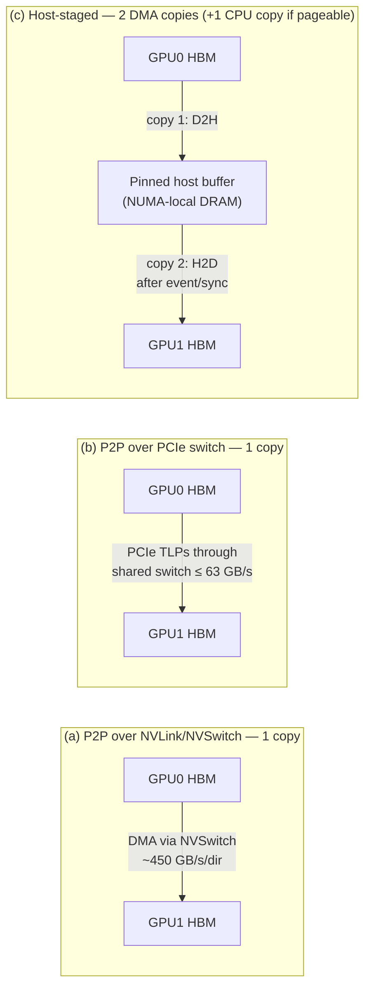
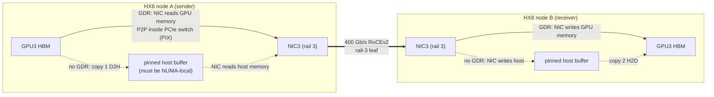

# Chapter 5 — GPU Interconnects and Host Topology

> Inside an 8-GPU server, bytes travel over three very different networks: NVLink and NVSwitch between
> GPUs, PCIe between GPUs, NICs, CPUs and storage, and the inter-socket link between the two CPUs. Which
> of those networks a byte crosses is decided by where cards sit in slots, how cables run to the fabric,
> how drivers and kernel options are configured, and how a job maps its ranks to GPUs and NICs. Get it
> right and each GPU drives its own 400 Gb/s NIC through one PCIe switch; get one card or one cable wrong
> and a large multi-node job runs at half speed with no error anywhere. This chapter teaches you to read a host's
> topology from raw tool output (`nvidia-smi topo -m`, `lstopo`, `lspci`, LLDP), to turn it into a
> machine-readable GPU→NIC/HCA mapping, to verify the GPUDirect RDMA path rather than assume it, and to
> reason about multi-rail placement as the joint problem it is — with a clearly labelled model of what
> misalignment costs a collective.

## Learning objectives

After this chapter you will be able to:

1. **Explain** the PCIe hierarchy (root complex, root ports, switches, endpoints, BDF addressing) and
   **calculate** per-direction bandwidth for a given generation and width.
2. **Compare** NVLink/NVSwitch peer-to-peer transfers with PCIe peer-to-peer and host-staged transfers,
   counting the copies and synchronization points in each.
3. **Interpret** `nvidia-smi topo -m` labels (X, NV#, PIX, PXB, PHB, NODE, SYS) and `lstopo`/hwloc output,
   and **identify** the GPU–NIC pairings with the shortest data path.
4. **Build** a machine-readable mapping from GPU UUID and PCIe BDF to NIC/HCA BDF, network device, NUMA
   node, physical slot and fabric rail, cross-checking independent sources.
5. **Validate** GPUDirect RDMA prerequisites — peer-memory mechanism, IOMMU and ACS configuration, and
   driver/firmware compatibility — and **demonstrate** that the path is active rather than assuming it.
6. **Design** a rank/GPU/NIC/rail placement as a joint placement problem and **model** aligned versus
   misaligned all-reduce bandwidth and run-to-run variance with stated assumptions.
7. **Plan** hardware validation of a placement with nccl-tests and NCCL's own topology output.

## Prerequisites and connections

You need [Chapter 3](../../part-1-foundations/ch03-linux-host-systems-diagnostics/manuscript.md) (NUMA,
`lspci`, `numactl`, sysfs) and [Chapter 4](../ch04-gpu-architecture-cuda-execution/manuscript.md)
(copies, pinned memory, streams). This chapter supplies the host half of the data path that
[Chapter 8](../../part-3-networking/ch08-rdma-rocev2-infiniband/manuscript.md) (RDMA and multi-rail
NICs), [Chapter 10](../../part-3-networking/ch10-switches-optics-physical-layer/manuscript.md) (cabling),
[Chapter 12](../../part-4-distributed-ai/ch12-collective-communication-nccl/manuscript.md) (NCCL topology
detection and rings) and [Chapter 13](../../part-4-distributed-ai/ch13-gpu-data-movement/manuscript.md)
(GPUDirect data movement in depth) build on. The mapping artifact you create here is consumed by node
acceptance in [Chapter 16](../../part-5-production-operations/ch16-bare-metal-fleet-lifecycle/manuscript.md),
topology-aware scheduling in [Chapter 17](../../part-5-production-operations/ch17-kubernetes-slurm-scheduling/manuscript.md),
and rank-to-hardware fault correlation in [Chapter 19](../../part-5-production-operations/ch19-reliability-security-multitenancy/manuscript.md)
and [Capstone G](../../../capstones/). [Capstone A](../../../capstones/) (256-GPU cluster design) requires
the host topology and validation checklist this chapter produces. It also extends Progressive Lab 1 (host
discovery) from Chapter 3 to GPUs and NICs.

## 5.1 Why topology is a performance and reliability problem

A collective such as all-reduce is a synchronized pipeline: every rank waits for its neighbours at every
step. Its speed is set by the **slowest** participating path, not the average. On ORION, a 256-GPU job
uses 256 GPU-to-NIC paths. If 255 of them traverse one PCIe switch (the HX8 design) and one crosses the
inter-socket link because a NIC was installed in the wrong slot, the job's all-reduce runs at the speed
of that one path, and its timing varies with whatever else happens to share the inter-socket link.

This is why the course outline's definitive-edition enhancement for this chapter insists that correct
GPU-to-NIC affinity is *not cosmetic*. PCIe root-complex crossings, socket-to-socket traffic and poorly
selected HCA rails reduce effective bandwidth and create latency variance that becomes visible in
collectives — usually as "the job got slower after maintenance" with no hardware alarm. Topology faults
are silent: links are up, drivers load, `ibstat` is happy, and NCCL simply picks the best path it can find.

Three kinds of topology fault recur in fleets:

1. **Placement faults** — a NIC or GPU in the wrong slot, riser or socket; a NIC negotiated at reduced PCIe
   width or speed.
2. **Wiring faults** — a cable from the right NIC to the wrong rail leaf (a swapped pair is the classic).
3. **Configuration faults** — the peer-memory module not loaded, PCIe Access Control Services (ACS)
   redirecting peer traffic, the IOMMU translating DMA, mis-ordered NIC lists or device masks in the job.

Each one is detectable from data you can collect in seconds. The rest of the chapter shows how.

## 5.2 PCIe: the host's packet network

### Hierarchy and addressing

PCI Express (PCIe) is a packet-switched, point-to-point network. The CPU contains a **root complex** with
several **root ports**; each root port is the top of a tree that can contain **switches** (one upstream
port, several downstream ports) and **endpoints** (GPUs, NICs, NVMe drives). Every function is addressed
by a **BDF** — bus:device.function, prefixed by a PCI domain: `0000:19:00.0`. BDFs are assigned at
enumeration, so they are stable for a given hardware layout and firmware, but they are *not* a physical
slot number; the slot is recorded separately (`PhySlot` in `lspci -vmm`, or `dmidecode -t slot`).

A PCIe **switch** is a set of bridges: one *upstream port* toward the CPU and several *downstream ports*,
each a point-to-point link to exactly one device or to the next switch. Two devices never share a
downstream port. On ORION's HX8 node (Figure R.1 in [REFERENCE_CLUSTER.md](../../../docs/REFERENCE_CLUSTER.md)),
each CPU socket has two PCIe switch complexes, and each carries two GPUs and their two rail NICs. In the
lab's captures a complex is two levels deep: a top switch whose two downstream ports each feed a *leaf*
switch, and each leaf switch has one downstream port for GPU *i* and one for NIC *i*. GPU *i* and NIC *i*
therefore share a single switch (the leaf); GPU *i* and NIC *i*±1 share only the complex, crossing two
switches. Frontend NICs and NVMe drives hang off separate root ports.

### Bandwidth by generation

*Table 5.1 — PCIe per-direction bandwidth after line encoding `[VENDOR-SPEC, 2026-10]` (PCI-SIG base specifications); achievable payload is lower because of packet headers and flow control.*

| Generation | Transfer rate per lane | Encoding | Per lane per direction | x16 per direction | Achievable x16 `[ILLUSTRATIVE]` |
|---|---|---|---|---|---|
| Gen3 | 8 GT/s | 128b/130b | 0.985 GB/s | 15.75 GB/s | ≈ 12–13 GB/s |
| Gen4 | 16 GT/s | 128b/130b | 1.97 GB/s | 31.5 GB/s | ≈ 25–27 GB/s |
| Gen5 | 32 GT/s | 128b/130b | 3.94 GB/s | 63.0 GB/s | ≈ 50–55 GB/s |

Arithmetic for Gen5 x16: 32 × 10⁹ transfers/s × 128/130 × 16 lanes / 8 bits per byte = 63.0 × 10⁹ B/s.
A 400 Gb/s NIC needs 400 / 8 = 50 GB/s of payload per direction, so it fits a Gen5 x16 link with little
headroom and does **not** fit a Gen5 x8 link (31.5 GB/s) — the scenario in Section 5.12.

```bash
# L2 — link state of one device (replace the BDF). LnkCap = capability, LnkSta = negotiated.
sudo lspci -vvv -s 0000:19:00.0 | grep -E 'LnkCap:|LnkSta:'
cat /sys/bus/pci/devices/0000:19:00.0/current_link_speed /sys/bus/pci/devices/0000:19:00.0/current_link_width
lspci -tv          # the PCIe tree: which devices share a switch
```

```text
# [ILLUSTRATIVE] healthy vs degraded
        LnkCap: Port #0, Speed 32GT/s, Width x16, ASPM not supported
        LnkSta: Speed 32GT/s, Width x16
        LnkSta: Speed 32GT/s (ok), Width x8 (downgraded)
```

### Peer-to-peer and Access Control Services

Endpoints can address each other's memory directly — **peer-to-peer (P2P)** DMA. A transaction from
GPU0 to NIC0 below the same switch is routed *inside the switch* and never touches the CPU. A transaction
between devices under different root ports must traverse the root complex; between sockets it must
cross the inter-socket link (UPI on Intel, xGMI/Infinity Fabric on AMD), where P2P throughput is often
lower and sometimes unsupported.

**Access Control Services (ACS)** is a PCIe capability that lets a switch port force requests upstream
(*Request Redirect*, *Completion Redirect*) so that the IOMMU can police them. Virtualization relies on it
to isolate devices assigned to different guests. On a bare-metal training node, ACS redirect on the
downstream switch ports above a GPU and its NIC turns a one-switch P2P path into a trip to the root complex and back,
costing bandwidth and adding latency variance. `lspci -vvv` shows the setting per port:

```text
# [ILLUSTRATIVE] ACS control on a switch downstream port
        ACSCtl: SrcValid+ TransBlk- ReqRedir+ CmpltRedir+ UpstreamFwd+ EgressCtrl- DirectTrans-   ← redirecting
        ACSCtl: SrcValid- TransBlk- ReqRedir- CmpltRedir- UpstreamFwd- EgressCtrl- DirectTrans-   ← P2P routed in-switch
```

> **Safety:** ACS and IOMMU settings are security controls. Disabling ACS redirect on a host that runs
> virtual machines or untrusted tenants can break isolation between devices. Change them only through
> the platform team's BIOS/kernel baseline for dedicated bare-metal training nodes, following the
> server and NIC vendors' guidance, never ad hoc with `setpci` on a production host.

## 5.3 NVLink and NVSwitch: the scale-up network

NVLink is NVIDIA's GPU-to-GPU link. On ORION's H100-class GPUs, each GPU has 18 fourth-generation NVLink
links; at 25 GB/s per direction per link that is 18 × 25 = 450 GB/s per direction, 900 GB/s total
`[VENDOR-SPEC, 2026-10]`. In the HGX 8-GPU board design, the links are spread across four NVSwitch
chips, so every GPU reaches every other GPU at full bandwidth in a single switch hop — a non-blocking
all-to-all *NVLink domain* of eight GPUs. That is why `nvidia-smi topo -m` shows `NV18` between every
GPU pair: a bonded set of 18 links.

Compare the numbers: 450 GB/s per direction GPU-to-GPU over NVLink versus ≈ 50–55 GB/s achievable over
PCIe Gen5 x16 and 50 GB/s through a 400 Gb/s NIC. The scale-up domain is about 9× faster than the
scale-out path, which is why tensor parallelism (the most communication-hungry parallelism) stays inside
the node on ORION (TP = 8) and only data/pipeline parallel traffic crosses the fabric (Chapter 11).

```bash
# L2 — NVLink state and P2P capability
nvidia-smi topo -m                 # NV# entries between GPUs
nvidia-smi nvlink --status -i 0    # per-link state and speed for GPU 0
nvidia-smi topo -p2p r             # P2P read capability matrix (OK / NS = not supported)
systemctl status nvidia-fabricmanager   # NVSwitch systems: Fabric Manager must be running
```

> **Vendor implementation note (NVIDIA):** On NVSwitch-based HGX systems the NVIDIA Fabric Manager
> service configures the NVSwitch routing at boot. If it is not running, or its version does not match
> the driver, CUDA applications may fail to initialize or NVLink P2P is unavailable. Treat a Fabric
> Manager failure as a node-acceptance blocker. Check the current HGX/DGX documentation for your
> platform's exact behaviour `[VENDOR-SPEC, 2026-10 — verify]`.

## 5.4 Data paths: GPU↔GPU and GPU↔NIC

### GPU to GPU inside a node

There are three ways to move a buffer from GPU0 to GPU1 on one host, and the differences are best
understood by counting copies and synchronization points.



*Figure 5.1 — GPU↔GPU data paths inside a node: NVLink P2P, PCIe P2P and host-staged transfer.*

- **(a) NVLink P2P.** `cudaMemcpyPeerAsync` (or a kernel that reads peer memory directly) moves the data
  once. One stream, no host involvement; completion is observed with an event.
- **(b) PCIe P2P.** Also one copy, but bounded by the slowest PCIe link on the path and by any root-complex
  or socket crossing.
- **(c) Host-staged.** When P2P is unavailable (no NVLink, P2P not supported across the root complex, ACS
  blocking, or software that does not use P2P), data goes GPU0 → host → GPU1: **copy 1** is a D2H DMA into
  a pinned buffer; then a **synchronization point** (an event recorded after copy 1 that the second
  stream waits on, or a host-side synchronize); then **copy 2**, an H2D DMA. If the staging buffer is
  pageable, the driver adds a **CPU copy** into its own pinned bounce buffer on each leg (Chapter 4), and
  each pageable leg also blocks the host thread. Host memory bandwidth is consumed twice per byte.

Worked numbers for 1 GiB = 1,073,741,824 B `[MODELED]`, using ≈ 370 GB/s achievable over NVLink and
≈ 52 GB/s per PCIe direction `[ILLUSTRATIVE]`:

- (a) 1,073,741,824 B / 370 × 10⁹ B/s = **2.9 ms**.
- (b) 1,073,741,824 / 52 × 10⁹ = **20.6 ms**.
- (c) unpipelined: 20.6 ms (D2H) + 20.6 ms (H2D) = **41.3 ms**; pipelined in chunks over two streams, it
  approaches 20.6 ms plus one chunk — but still 7× slower than (a) and it consumes 2 GiB of host-memory
  traffic and the PCIe uplink in both directions.

### GPU to NIC, and across the fabric

For inter-node collectives the critical path is GPU memory → NIC → fabric → NIC → GPU memory.



*Figure 5.2 — GPU↔NIC data path with GPUDirect RDMA (solid) and without it (dashed, host-staged). With
GDR, the only DMA is NIC↔GPU through the shared PCIe switch; without it, each side adds a GPU↔host copy,
host-memory traffic, and a synchronization between the GPU copy and the network operation.*

With **GPUDirect RDMA (GDR)**, the NIC's DMA engine reads from or writes to GPU memory directly. On HX8,
GPU *i* and NIC *i* share a PCIe switch, so that DMA never leaves the switch. Without GDR, the
communication library stages through pinned host memory: an extra copy per side, host-memory bandwidth,
CPU proxy-thread work, and a synchronization between the GPU copy and the network post. Effective
bandwidth typically drops substantially and variance rises (the lab's model uses an `[ILLUSTRATIVE]`
cap of 18 GB/s).

And if the NIC sits under the *other* socket, GDR traffic crosses the inter-socket link — or the library
may decline to use GDR at that distance (NCCL's `NCCL_NET_GDR_LEVEL` controls the maximum distance at
which it will) and fall back to host staging.

## 5.5 NUMA, CPU affinity and interrupts

Every PCIe device belongs to the NUMA node of the root complex it hangs from. Three things should be
local to a GPU and its NIC:

1. **Host memory** used for pinned staging buffers and the communication library's control structures
   — remote memory adds an inter-socket hop to every staged byte.
2. **CPU threads** that drive the device — the training process, NCCL's network proxy thread, data
   loader workers. A proxy thread on the remote socket adds latency to every network operation.
3. **Interrupts** from the NIC — remote IRQ handling adds cross-socket cache traffic.

```bash
# L2 — NUMA facts for a GPU and a NIC
numactl --hardware                                     # nodes, CPUs, memory per node
cat /sys/bus/pci/devices/0000:18:00.0/numa_node        # GPU0 → 0
cat /sys/class/net/enp25s0np0/device/numa_node         # rail-0 NIC → 0
readlink -f /sys/class/infiniband/mlx5_0/device        # HCA → its PCI device path (BDF)
grep mlx5 /proc/interrupts | head                      # NIC IRQs; affinity in /proc/irq/<n>/smp_affinity_list
numactl --cpunodebind=0 --membind=0 python train.py    # run a rank on GPU0's socket
```

`nvidia-smi topo -m` reports the **CPU Affinity** and **NUMA Affinity** of each GPU directly. Launchers
(Slurm's `--cpu-bind`, `torchrun` with a wrapper, Kubernetes' Topology Manager) must keep each rank's
CPU set inside its GPU's NUMA node. A common failure: a container started with a CPU set on socket 0 for
all eight ranks, so the four ranks on socket-1 GPUs drive their devices across UPI.

## 5.6 Topology discovery: reading the raw outputs

Section 20.4 of the course outline asks for a concrete topology-mapping procedure. This section is that
procedure; the lab automates it.

### 5.6.1 `nvidia-smi topo -m`

Here is the GPU part of the matrix from ORION node `orion-n01` (lab data; columns NIC0–NIC9 abridged to
the first six for width):

```text
        GPU0  GPU1  GPU2  GPU3  GPU4  ...  NIC0  NIC1  NIC2  NIC3  NIC4  NIC5 ...  CPU Affinity    NUMA Affinity  GPU NUMA ID
GPU0     X    NV18  NV18  NV18  NV18  ...  PHB   PIX   PXB   NODE  NODE  SYS  ...  0-55,112-167    0              N/A
GPU3    NV18  NV18  NV18   X    NV18  ...  NODE  NODE  NODE  PXB   PIX   SYS  ...  0-55,112-167    0              N/A
GPU4    NV18  NV18  NV18  NV18   X    ...  SYS   SYS   SYS   SYS   SYS   PHB  ...  56-111,168-223  1              N/A

NIC Legend:
  NIC0: mlx5_8
  NIC1: mlx5_0
  ...
```

*Figure 5.3 — Excerpt of `nvidia-smi topo -m` on an HX8 node `[ILLUSTRATIVE, lab data]`.*

*Table 5.2 — `nvidia-smi topo -m` labels (legend text as printed by the tool; implications `[ILLUSTRATIVE]`).*

| Label | Legend meaning | On HX8 | Implication for GPU↔NIC traffic |
|---|---|---|---|
| `X` | Self | Diagonal | — |
| `NV#` | Connection traversing a bonded set of # NVLinks | Every GPU pair: `NV18` | GPU↔GPU only; 450 GB/s per direction |
| `PIX` | Connection traversing at most a single PCIe bridge | GPU *i* ↔ its own NIC | Best: P2P inside the switch; full GDR bandwidth |
| `PXB` | Connection traversing multiple PCIe bridges (without traversing the PCIe Host Bridge) | GPU *i* ↔ the NIC under the other leaf switch of the same complex | Good: crosses more than one switch but stays below the root port |
| `PHB` | Connection traversing PCIe as well as a PCIe Host Bridge (typically the CPU) | GPU ↔ frontend NIC on the same host bridge | P2P through the root complex; platform-dependent throughput |
| `NODE` | Connection traversing PCIe as well as the interconnect between PCIe Host Bridges within a NUMA node | GPU ↔ NIC under the other switch on the same socket | Crosses host bridges inside the CPU; lower, more variable |
| `SYS` | Connection traversing PCIe as well as the SMP interconnect between NUMA nodes (e.g., QPI/UPI) | GPU ↔ any NIC on the other socket | Worst: crosses sockets; GDR may be slow or disabled |

How senior engineers read it:

- **Read GPU rows against NIC columns**, not GPU against GPU — on an NVSwitch system the GPU block is
  uniformly `NV18` and tells you only that NVLink is healthy.
- **Translate NIC columns through the legend.** nvidia-smi numbers NIC columns in PCI bus order, so the
  frontend NIC at bus `0d` is `NIC0` (`mlx5_8`) and the rail-0 NIC is `NIC1` (`mlx5_0`). `NICk` is *not*
  `mlx5_k`. ORION's golden image pins RDMA device names to rails (`mlx5_i` ↔ rail *i*, frontend `mlx5_8/9`)
  with udev naming rules, but a name is a label applied by software: it follows the card, not the cable.
  Rails come from cabling (Section 5.6.3).
- **Each GPU should have exactly one `PIX` compute NIC, and each compute NIC exactly one `PIX` GPU.** A GPU
  with no `PIX` NIC, or a NIC that is `PIX` to two GPUs, is a placement finding.
- **The matrix is a static classification, not a measurement.** `PIX` says the path is short; it says
  nothing about link width, ACS, or whether GDR is actually used.

### 5.6.2 `lstopo` and hwloc

The Portable Hardware Locality library (hwloc) builds a tree of packages, NUMA nodes, caches, cores and
I/O devices. Its `lstopo` tool prints it (`lstopo-no-graphics` for text; `lstopo host.svg` writes a
diagram). Abridged output for the first switch on `orion-n01`:

```text
Machine (2015GB total)
  Package L#0
    NUMANode L#0 (P#0 1007GB)
    HostBridge
      PCIBridge                              ← root port
        PCIBridge                            ← top switch: upstream port
          PCIBridge                          ← top switch: downstream port A
            PCIBridge                        ← leaf switch A: upstream port
              PCIBridge                      ← leaf A: downstream port (0000:17:00.0)
                PCI 18:00.0 (3D)
                  GPU(NVML) "nvml0"
              PCIBridge                      ← leaf A: downstream port (0000:17:01.0)
                PCI 19:00.0 (Ethernet)
                  Net "enp25s0np0"
                  OpenFabrics "mlx5_0"
          PCIBridge                          ← top switch: downstream port B
            PCIBridge                        ← leaf switch B: upstream port
              PCIBridge
                PCI 22:00.0 (3D)
                  GPU(NVML) "nvml1"
              PCIBridge
                PCI 23:00.0 (Ethernet)
                  Net "enp35s0np0"
                  OpenFabrics "mlx5_1"
      PCIBridge
        PCI 0d:00.0 (Ethernet)
          Net "enp13s0np0"
          OpenFabrics "mlx5_8"               ← frontend NIC, same host bridge, different root port
```

*Figure 5.4 — `lstopo-no-graphics --no-caches` excerpt for one PCIe switch complex of an HX8 node
`[ILLUSTRATIVE, lab data — simplified and annotated; real HGX boards show more bridges and functions]`.*

lstopo shows what the matrix only summarizes: *which* bridges two devices share. You can derive the
matrix labels from the tree — different packages → `SYS`; same package, different host bridges →
`NODE`; sharing only the host bridge → `PHB`; deepest common ancestor is one switch's upstream port, with
each device directly below one of its downstream ports → `PIX`; sharing bridges below the host bridge but
crossing more than one switch → `PXB`. The lab asks you to implement exactly
that derivation and to check it against `nvidia-smi` for every GPU–NIC pair. When the two disagree, one of
your assumptions about the platform is wrong — find out which before trusting either.

### 5.6.3 From raw outputs to a mapping artifact

The deliverable of host topology discovery is a **machine-readable mapping**, one row per GPU, that
operations, schedulers and incident responders can join against. The sources and the commands:

| Column | Source command `[L2]` | Notes |
|---|---|---|
| `gpu_index`, `gpu_uuid`, `gpu_bdf` | `nvidia-smi --query-gpu=index,uuid,pci.bus_id --format=csv` | UUID is the stable identity; index can change with `CUDA_VISIBLE_DEVICES` and device ordering |
| `gpu_numa` | `nvidia-smi topo -m` NUMA Affinity, or `/sys/bus/pci/devices/<BDF>/numa_node` | Cross-check both |
| `rail_nic` (HCA), `netdev` | `ibdev2netdev` (vendor utility) or `ls /sys/class/infiniband/<hca>/device/net/` | |
| `rail_nic_bdf` | `readlink -f /sys/class/infiniband/<hca>/device` | |
| `rail_nic_numa`, `rail_nic_slot` | `lspci -D -vmm` (`NUMANode`, `PhySlot`), or `dmidecode -t slot` | Slot ties the logical device to a physical card for the technician |
| `rail` | LLDP neighbour (`lldpcli show neighbors`), or the cabling database | Must agree with the cabling plan |
| `rail_relation`, `nearest_nic` | `nvidia-smi topo -m`; cross-checked with `lstopo` | |

Rows for two ORION nodes from the lab's output (columns abridged):

```text
host,gpu_index,gpu_bdf,gpu_numa,rail,rail_nic,rail_nic_bdf,rail_nic_numa,rail_nic_slot,rail_relation,nearest_nic,nearest_nic_rail,aligned
orion-n01,3,0000:42:00.0,0,3,mlx5_3,0000:43:00.0,0,4,PIX,mlx5_3,3,True
orion-n17,3,0000:42:00.0,0,3,mlx5_3,0000:86:00.0,1,11,SYS,mlx5_2,2,False
```

*Figure 5.5 — GPU→NIC mapping CSV rows for a healthy and a flawed node `[ILLUSTRATIVE, lab data]`.*

Store the mapping per node in your configuration database, regenerate it at node acceptance and after
every hardware service, and diff it against the golden layout for the platform. Chapter 19 uses exactly
this table to turn "rank 27 timed out" into "GPU3 on orion-n04, slot 4 NIC, rail 3, leaf port Ethernet4".

### 5.6.4 Cross-checking sources

No single tool is authoritative. `nvidia-smi` reports what the GPU driver believes, `lstopo` what the
kernel enumerated, `lspci` what firmware reported for slots, and LLDP what the switch at the other end of
the cable says. Disagreements are findings: an LLDP neighbour that differs from the cabling plan is a
wiring fault; a `PIX` pair whose NIC's NUMA node differs from the GPU's is a parsing error or a very
unusual platform; a NIC whose slot differs from the golden layout was moved during service.

## 5.7 GPUDirect RDMA prerequisites: verify, never assume

GPUDirect RDMA is a chain of conditions, any of which can silently fail while the software stack looks
installed. The course outline is explicit: *do not assume the feature is active merely because the
software stack is installed.* Check each link in the chain and then prove the path in use.

*Table 5.3 — GPUDirect RDMA prerequisite checklist `[VENDOR-SPEC, 2026-10 — re-verify every item against current NVIDIA GPU driver, NIC driver/firmware and platform documentation]`.*

| # | Prerequisite | Why | How to check `[L2]` |
|---|---|---|---|
| 1 | Platform supports PCIe P2P between GPU and NIC; ideally both under one PCIe switch | P2P through some root complexes is slow or unsupported; across sockets it is usually poor | `nvidia-smi topo -m` shows `PIX`/`PXB` for each GPU's NIC |
| 2 | A peer-memory mechanism is present: the `nvidia-peermem` kernel module shipped with the GPU driver (module name `nvidia_peermem`; legacy `nv_peer_mem`), **or** a DMA-BUF based path supported by the kernel, GPU driver and RDMA stack | The RDMA stack must be able to pin and map GPU memory for the NIC | `lsmod \| grep -E 'nvidia_peermem\|nv_peer_mem'`; for DMA-BUF, the vendor's stated kernel/driver/rdma-core minimums |
| 3 | GPU driver, CUDA, NCCL, NIC driver (OFED/DOCA-host or inbox rdma-core) and NIC firmware are a supported combination | GDR depends on all of them agreeing | Versions (`nvidia-smi`, `ofed_info -s`, `ethtool -i <netdev>` for firmware) against the vendor compatibility matrix |
| 4 | IOMMU configured as the vendor recommends for bare-metal GDR (commonly disabled or passthrough, `iommu=pt`) | Translated DMA can block or slow P2P | `cat /proc/cmdline`; `dmesg \| grep -i -E 'DMAR\|IOMMU'` |
| 5 | ACS request redirect disabled on the switch ports between GPU and NIC (bare metal) | Redirect forces P2P through the root complex | `lspci -vvv` ACSCtl lines on switch downstream ports |
| 5a | Locked-memory limit is unlimited for the job: shell (`ulimit -l`), Slurm (`PropagateResourceLimits`/`slurmd` service limits), container runtime (`--ulimit memlock=-1`) | RDMA registers (pins) buffers; a low limit makes memory registration fail or forces fallbacks | `ulimit -l` printed from inside the job step or container |
| 6 | The library actually uses GDR at runtime | Libraries fall back silently when a distance or capability check fails | `NCCL_DEBUG=INFO`: channel lines ending `/GDRDMA` (e.g. `via NET/IB/0/GDRDMA`); `ib_write_bw --use_cuda=<gpu>` from perftest |

NCCL's topology code also prints, at INFO level in many 2.18–2.28 releases (later builds may demote it
to TRACE), lines of the form `GPU Direct RDMA Enabled for GPU <id> / HCA <id> (distance X <= Y), read N`
or `GPU Direct RDMA Disabled for GPU <id> / HCA <id> (distance X > Y)`. They report only the **PCIe
distance check** against `NCCL_NET_GDR_LEVEL`; they do *not* prove that a peer-memory mechanism exists.
The `/GDRDMA` suffix on channel lines is the evidence that GDR is in use `[VENDOR-SPEC, 2026-10]`.

```bash
# L3 — prove GDR is used by NCCL on a two-node run, one rank per GPU (lines are version-sensitive)
mpirun -np 16 -N 8 -x NCCL_DEBUG=INFO -x NCCL_DEBUG_SUBSYS=INIT,NET \
       ./build/all_reduce_perf -b 1G -e 1G -g 1 2>&1 | grep -E 'GDRDMA|NET/IB'
#   (Slurm: srun -N 2 --ntasks-per-node=8 --gpus-per-task=1 ./build/all_reduce_perf -b 1G -e 1G -g 1)
# [ILLUSTRATIVE] what you want to see:
#   NCCL INFO NET/IB : Using [0]mlx5_0:1/RoCE [1]mlx5_1:1/RoCE ... [7]mlx5_7:1/RoCE
#   NCCL INFO Channel 00/0 : 0[0] -> 8[0] [send] via NET/IB/0/GDRDMA
# A channel line ending "via NET/IB/0" without "/GDRDMA" means the data is staged through host memory.
```

> **Vendor implementation note (NVIDIA / NVIDIA Networking):** The `nvidia-peermem` module ships with
> NVIDIA data-center drivers (it replaced the separately distributed `nv_peer_mem`) and must be loaded
> after the RDMA stack; with recent kernels and open GPU kernel modules, DMA-BUF can provide the same
> capability without it. Which mechanism your stack uses, and the exact version minimums, are
> release-specific — check the GPUDirect RDMA and NCCL documentation for your versions.

## 5.8 Multi-rail assignment as a joint placement problem

ORION's backend is **rail-optimized**: NIC *r* of every node connects to rail leaf *r*. Traffic between
GPU *r* on one node and GPU *r* on another stays on one leaf; traffic between different rails must climb
to the spines. NCCL builds its rings and trees so that, at each node boundary, GPU *r* talks to GPU *r*
of the next node over rail *r*. Whether that intent survives depends on *six* things being consistent:

1. **GPU locality** — which GPU each local rank uses (`CUDA_VISIBLE_DEVICES`, device ordering, scheduler
   GPU binding).
2. **NIC locality** — which NIC is PCIe-closest to that GPU (slots, risers, sockets).
3. **CPU affinity** — rank, proxy-thread and IRQ CPUs on the GPU's NUMA node.
4. **Rail balance** — exactly one GPU per rail per node; no NIC shared by two GPUs, none idle.
5. **Switch paths** — each NIC cabled to the leaf of its rail, so same-rail traffic stays one hop.
6. **Job rank mapping** — the communication library's rings and the job's parallel groups laid over
   ranks so that heavy traffic stays on NVLink or on a single rail.

These interact. Fixing one in isolation can make another worse — which is why the outline calls it a
*joint* placement problem. Figure 5.6 shows two rank/rail maps for one node.

```text
 Aligned (golden)                                Misaligned ("cross_socket": NIC list rotated by 4)
 local rank → GPU → NIC (rail) relation          local rank → GPU → NIC (rail) relation
   0 → GPU0 → mlx5_0 (rail 0)  PIX                 0 → GPU0 → mlx5_4 (rail 4)  SYS
   1 → GPU1 → mlx5_1 (rail 1)  PIX                 1 → GPU1 → mlx5_5 (rail 5)  SYS
   ...                                             ...
   4 → GPU4 → mlx5_4 (rail 4)  PIX                 4 → GPU4 → mlx5_0 (rail 0)  SYS
   7 → GPU7 → mlx5_7 (rail 7)  PIX                 7 → GPU7 → mlx5_3 (rail 3)  SYS
 every byte stays under one PCIe switch          every byte crosses the inter-socket link
```

*Figure 5.6 — Aligned versus misaligned rank/rail maps on an HX8 node. A per-rank wrapper that assigns
`NCCL_IB_HCA` from a rotated table, a stale `NCCL_TOPO_FILE` describing a different board, or a container
runtime that remaps GPU device nodes so that local rank *i* lands on a different physical GPU produces the
right-hand map with no error message. (The order of names in a single `NCCL_IB_HCA` list does not by itself
cause this: NCCL still pairs each GPU with its nearest listed NIC.)*

What the library does by default matters. NCCL discovers the PCIe topology from sysfs (or from an XML
file given by `NCCL_TOPO_FILE`; `NCCL_TOPO_DUMP_FILE` writes what it detected), and for each GPU picks the
closest NIC. On a healthy node this produces the aligned map. On a flawed node it produces the *best
available* map: on `orion-n17`, where the rail-3 NIC was installed in a socket-1 slot, GPU3's closest NIC
is GPU2's NIC, so two GPUs share one NIC and the rail-3 NIC is idle. Forcing alignment instead sends
GPU3's traffic across the sockets. There is also a third policy.

**PXN (PCIe × NVLink).** On rail-optimized systems NCCL keeps a channel's exit and entry on the same NIC
index (rail), so that traffic stays on one leaf switch. When the GPU at a node boundary is not local to
that rail's NIC, PXN lets it hand the data over NVLink to a peer GPU on the same node that *is* close to
the right NIC; that peer's proxy posts the network operation. The data path becomes GPU3 → NVLink →
GPU*k* → PCIe → rail-*r* NIC. PXN has an **eligibility rule**: NCCL uses it only through a peer GPU that is
NVLink-connected to the source *and* reaches the NIC at PXB distance or closer. This rule is separate from
the GDR distance gate (`NCCL_NET_GDR_LEVEL`). If the NIC is PHB or SYS from every GPU, PXN is never engaged
and NCCL falls back to its normal nearest-NIC choice. The related controls are `NCCL_PXN_DISABLE` (turn it
off), `NCCL_P2P_PXN_LEVEL` (which governs PXN for point-to-point and all-to-all traffic, not ring
collectives), and `NCCL_CROSS_NIC` (whether rings may exit and enter on different NIC indices, which sends
traffic through the spines) `[VENDOR-SPEC, 2026-10 — verify semantics and defaults for your release]`.
On `orion-n17` the misplaced `mlx5_3` sits on its own socket-1 root port, PHB, NODE or SYS from every GPU (best is PHB from GPU4/5), never ≤ PXB, so no peer is
eligible: PXN does nothing and the node behaves exactly as with the nearest-NIC policy. PXN is the right
tool when a rail NIC is healthy and PIX to *some* GPU but the ring's boundary GPU is a different one; it
also loads the proxy GPU's NVLink and PCIe paths. Here the right answer is to fix the node; the model in
the next section compares the policies.

```bash
# L2 — see what NCCL detected (output paths and verbosity are version-sensitive)
NCCL_TOPO_DUMP_FILE=/tmp/nccl_topo.xml NCCL_DEBUG=INFO NCCL_DEBUG_SUBSYS=INIT,GRAPH \
  ./build/all_reduce_perf -b 8 -e 8 -g 8 2>&1 | grep -E 'NET/IB|Channel|Ring' | head -40
```

## 5.9 A labelled model of aligned versus misaligned all-reduce

We want an estimate of what topology faults cost before we have hardware to measure on. The lab
implements the following `[MODELED]` estimate; every parameter is `[ILLUSTRATIVE]` and lives in
`lab/data/path_model.yaml` so it can be recalibrated from measurements.

**Structure.** NCCL-style ring all-reduce over *n* ranks with one ring per rail (*R* = 8). Each ring
carries 1/*R* of the *S*-byte buffer. A ring is a synchronous pipeline, so it runs at the bandwidth of its
slowest member's GPU→NIC path. NVLink hops inside the node and the non-blocking fabric are assumed not to
be the bottleneck.

> *t*ᵣ = 2(*n* − 1)/*n* × (*S*/*R*) / min over ring members (*b*ᵢ)  ·  *t* = maxᵣ *t*ᵣ + α  ·
> busbw = 2(*n* − 1)/*n* × *S* / *t*

**Path bandwidths.** Each rank's path bandwidth *b*ᵢ is drawn per iteration as
*b* = μ × max(0.2, 1 + *c*·*z*), *z* ~ N(0, 1), where μ and the coefficient of variation *c* depend on the
GPU–NIC relation, then adjusted for ACS redirect, host staging, and NIC sharing.

**The GDR distance gate.** NCCL uses GPUDirect RDMA only when the GPU↔NIC distance is within
`NCCL_NET_GDR_LEVEL`; recent releases default to about PXB `[VENDOR-SPEC, 2026-10 — verify per release]`.
A GPU driving a NIC at PHB, NODE or SYS distance is therefore **host-staged by default even when
peer memory works**. The model applies this gate (`gdr_max_relation: PXB`) and caps such paths at the
host-staged rate; scenario S4@SYS shows what `NCCL_NET_GDR_LEVEL=SYS` would change.

*Table 5.4 — Path-class parameters used by the model `[ILLUSTRATIVE]`; calibrate with nccl-tests before use.*

| Path class | μ (GB/s per direction) | *c* | Rationale |
|---|---|---|---|
| PIX | 48.0 | 0.02 | One switch; ≈ 96 % of 50 GB/s line rate (calibrated so a healthy multi-node job lands in the ≈ 350+ GB/s busbw range expected for 8 × 400G per node) |
| PXB | 45.0 | 0.03 | Crosses the switch complex's top switch |
| PHB | 40.0 | 0.06 | Through the root complex (GDR only if the gate allows PHB) |
| NODE | 36.0 | 0.08 | Between host bridges inside the CPU (gate permitting) |
| SYS | 24.0 | 0.18 | Inter-socket link (gate permitting); see note below |
| Beyond the GDR gate, or no peer memory | cap 18.0 | + 0.10 | Host-staged: extra copy, host memory, proxy-thread work |
| ACS redirect | × 0.70 | + 0.06 | P2P turned around at the root complex |
| NIC shared by *k* GPUs | ÷ *k* | — | Two rings through one 400 Gb/s port |

α = 0.2 ms per collective. *S* = 1 GiB, *n* = 128 (16 nodes × 8). The SYS value is not derived from the
inter-socket link's capacity: on a cross-socket map all four socket-0 GPUs send through socket-1 NICs and
vice versa, so 4 × 50 = 200 GB/s per direction crosses the link together with memory traffic. Whether that
fits depends on the platform's UPI/xGMI configuration, which the model does not represent — it only
assigns SYS a lower mean and a large variance.

**What the model ignores** (and therefore cannot show): inter-socket link contention (above); PCIe
uplink contention from storage or host traffic; spine congestion when traffic leaves its rail; NCCL
protocol and algorithm choice (LL/LL128/Simple, ring versus tree, NVLS); the NVLink and proxy-GPU load
that PXN adds; congestion control (Chapter 9); clock and power effects; and correlation between samples
(real slow paths stay slow for seconds, not one iteration).

## 5.10 Worked example: two flawed nodes in a 16-node job

**Situation.** `orion-n23` failed node acceptance on Monday (rail-4/5 cables swapped, peer-memory module
missing; Section 5.11's lab) and is drained, so it is not schedulable. On Tuesday Halcyon's Training Infra
team submits a 128-GPU fine-tuning job (16 nodes; TP = 8, PP = 2, DP = 8) to the 24-node training partition
(`orion-n01`–`n24`, see REFERENCE_CLUSTER.md). Slurm places it on 16 of the 23 available nodes, including
two returned from hardware service yesterday: `orion-n02` (motherboard replaced) and `orion-n17` (rail-3 NIC
replaced; `rack-05`). Their acceptance run had checked only GPU health. We follow the diagnostic loop from
raw captures (lab data, `[ILLUSTRATIVE]`) to a modeled job impact (`[MODELED]`).

**Step 1 — Observe.** The job's all-reduce bus bandwidth, logged by the framework, is ≈ 175 GB/s against
≈ 350 GB/s for the same configuration last week.

**Step 2 — Collect evidence from `orion-n17`.** The GPU3 row of `nvidia-smi topo -m`:

```text
GPU3   NV18 NV18 NV18  X   NV18 NV18 NV18 NV18  NODE NODE NODE PXB  SYS  SYS  SYS  SYS  SYS  SYS   0-55,112-167  0  N/A
NIC Legend:  NIC3: mlx5_2   NIC4: mlx5_3
```

GPU3 has **no `PIX` NIC**. Its closest compute NIC is `NIC3` = `mlx5_2` at `PXB`, which is GPU2's `PIX`
NIC. The rail-3 NIC by LLDP (`lldp.enp134s0np0.chassis.name=orion-be-leaf-r3`) is `mlx5_3`, at `SYS` from
GPU3 and `PHB` from GPU4/GPU5. In `lstopo`, `mlx5_3` (`PCI 86:00.0`) sits under Package L#1 on its own root
port; `lspci -vmm` gives `PhySlot: 11`, `NUMANode: 1`. The golden layout puts the rail-3 NIC in slot 4 under
GPU3's leaf switch. The replacement card went into slot 11 (a socket-1 riser). The mapping row is the
second line of Figure 5.5.

**Step 3 — Collect evidence from `orion-n02`.** Topology is golden (all eight GPUs `PIX` to their rail
NICs, LLDP correct). But `gdr_prereqs.txt` shows `ReqRedir+ CmpltRedir+` on all 16 downstream switch ports
above the GPUs and NICs, and a kernel command line with `intel_iommu=on` and no `iommu=pt`: the replacement
motherboard came with a virtualization-oriented BIOS profile. GPU↔NIC P2P now detours through the root
complex.

**Step 4 — Model the job.** First, deterministic arithmetic (all *c* = 0) to see the mechanism:

- Per-ring payload: *S*/*R* = 1,073,741,824 / 8 = 134,217,728 B. Ring factor 2(*n* − 1)/*n* = 2 × 127/128 = 1.98438.
- Healthy ring (PIX, 48 GB/s): *t* = 1.98438 × 134,217,728 B / 48 × 10⁹ B/s = 5.549 ms; plus α: 5.749 ms;
  busbw = 1.98438 × 1,073,741,824 / 5.749 × 10⁻³ s = **370.6 GB/s**.
- `orion-n02` alone (PIX with ACS: 48 × 0.70 = 33.6 GB/s): 7.927 ms → 8.127 ms → busbw **262.2 GB/s**. Every
  ring passes through `orion-n02`, so all eight rings slow down.
- `orion-n17`, NCCL's default nearest-NIC choice: rings 2 and 3 both use `mlx5_2`; ring 3's member there is
  PXB (inside the GDR gate) shared by two: 45 / 2 = 22.5 GB/s → 11.837 ms → 12.037 ms → busbw **177.0 GB/s**.
- `orion-n17`, forced rail alignment: GPU3 drives `mlx5_3` at SYS, beyond the PXB gate, so it is host-staged
  at 18 GB/s → 14.797 ms → 14.997 ms → busbw **142.1 GB/s**. (Only with `NCCL_NET_GDR_LEVEL=SYS` would it keep
  GDR at 24 GB/s → 188.6 GB/s.)

Then the stochastic model (200 iterations, seed 7), which adds the effect that matters most in practice:
variance, because each ring waits for its slowest member in *every* iteration.

*Table 5.5 — Modeled 1 GiB all-reduce on 16 HX8 nodes (128 ranks) `[MODELED; parameters ILLUSTRATIVE; GDR gate = PXB unless stated]`.*

| Scenario | Nodes and policy | Median (ms) | p99 (ms) | busbw (GB/s) | CV of iteration time |
|---|---|---|---|---|---|
| S1 | 16 × healthy, aligned | 6.05 | 6.17 | 352.3 | 0.008 |
| S2 | 16 × healthy, cross-socket map (all SYS → host-staged) | 52.25 | 74.18 | 40.8 | 0.269 |
| S3 | 14 × healthy + n02 + n17, nearest (NCCL default) | 12.07 | 12.85 | 176.6 | 0.027 |
| S4 | same nodes, forced rail alignment | 15.33 | 37.45 | 139.0 | 0.331 |
| S5 | same nodes, PXN policy — not eligible on n17 (no GPU ≤ PXB from `mlx5_3`), so identical to S3 | 12.07 | 12.85 | 176.6 | 0.027 |
| S4@SYS | S4 with `NCCL_NET_GDR_LEVEL=SYS` | 11.46 | 18.32 | 186.0 | 0.173 |

Read the table as an engineer:

- **S1 vs deterministic.** Variance alone costs 370.6 → 352.3 GB/s (5 %). The iteration waits for the
  slowest of 128 paths, which sits near μ(1 − 2.6*c*); with *c* = 0.02 that is ≈ 5 % below the mean.
- **S2.** A cross-socket map is not "a bit slower": SYS is beyond the default GDR gate, so every path is
  host-staged. Deterministically that is 18 GB/s per ring → 14.797 + 0.2 = **15.0 ms, ≈ 142 GB/s** (2.6× the
  healthy time). The stochastic 52 ms median (p99 74 ms) additionally assumes each of the 128 paths varies
  independently with *c* = 0.28 so that the slowest one dominates; that assumption is `[ILLUSTRATIVE]`, and
  with *c* = 0.10 the same min-of-128 logic would give roughly 20 ms. Treat the deterministic figure as the
  floor of the damage and the stochastic one as a sensitivity case: **misalignment converts mean bandwidth
  loss into tail latency**, by an amount that depends on how independent the slow paths really are.
- **S3 vs S4.** Two flawed nodes out of 16 cut job bandwidth by 1 − 176.6/352.3 = 50 %. With the default
  GDR gate, forcing rail alignment on `orion-n17` is *worse* than NCCL's default: it trades a shared PXB NIC
  (GDR on) for a host-staged SYS path, lowering the median (139 vs 177 GB/s) and widening p99 from 12.9 to
  37.5 ms; the CV rises 12× (0.331 / 0.027), a variance ratio of about 150. Only if the gate is raised to
  SYS does alignment win on median (S4@SYS, 186 GB/s), and even then its tail is worse than S3's. The result
  is sensitive to the host-staged cap: forced alignment beats sharing a PXB NIC (22.5 GB/s per ring) only if
  host staging sustains more than 22.5 GB/s, so measure that rate (L3) before relying on either conclusion.
- **S5.** PXN is not eligible on `orion-n17`: no GPU reaches the misplaced `mlx5_3` at PXB or closer, so NCCL
  falls back to the nearest NIC and S5 is identical to S3. PXN cannot repair a card in the wrong socket.
- **One node at a time.** Fixing `orion-n17` alone leaves `orion-n02` capping the job at ≈ 262 GB/s
  (deterministic); both must be repaired to return to ≈ 350 GB/s.

**Step 5 — Root cause and safe change.** `orion-n17`: replacement NIC in the wrong slot (slot 11, socket 1
instead of slot 4 under GPU3's switch). `orion-n02`: BIOS/kernel baseline drift (ACS redirect, IOMMU
translation). A drain does **not** move a running job; it only stops new placement. The plan:

1. `scontrol update nodename=orion-n02,orion-n17 state=drain reason="topology: ACS / NIC slot"` so nothing
   new lands on them.
2. Let the job reach its next checkpoint (or trigger one), then `scontrol requeue <jobid>`. A requeued job
   keeps its original specification; because both nodes are drained, the scheduler simply does not allocate
   them again. (To exclude nodes explicitly, set `scontrol update jobid=<jobid> ExcNodeList=orion-n02,orion-n17`
   while the job is pending.)
   The partition still has 24 − 3 = 21 healthy nodes ≥ 16, so the job keeps its DP = 8; no batch or
   learning-rate change is needed. The restart costs ≈ 900 s × 128 GPUs ≈ 32 GPU-hours, against a job losing
   ≈ 50 % of collective bandwidth for every remaining hour.
3. Had fewer than 16 healthy nodes remained (ORION has no spares outside its 32 nodes), the choice would be
   waiting for repair or restarting at reduced DP (DP = 7, 112 GPUs), which requires a global batch divisible
   by 7 or a batch/learning-rate adjustment. Compare lost throughput × time-to-repair against restart cost
   plus the shrink shortfall.
4. Open Fleet tickets with the mapping rows attached; re-apply the bare-metal BIOS profile on n02 and move
   the card on n17 in a maintenance window. Do **not** edit ACS with `setpci` on a live host.

**Step 6 — Validate.** Re-run node acceptance on both nodes: the mapping must match the golden layout
(eight `PIX` rows, LLDP rails 0–7 in order, no ACS redirect, peer memory loaded), followed by the L3
benchmark in the lab README (single-node and two-node `all_reduce_perf`, ≥ 5 runs, median and spread)
against the fleet baseline. Undrain only when their busbw is within the fleet's noise floor.

## 5.11 Hands-on lab overview

The lab ([lab/README.md](lab/README.md)) is **Level 1**: you get raw captures for four ORION hosts —
`nvidia-smi topo -m`, `lstopo`, the GPU inventory, `lspci -vmm`, `ibdev2netdev`, LLDP neighbours and a
GPUDirect-prerequisite dump — and write `topo_mapper.py` to parse them, derive PCIe relations from
`lstopo` and cross-check them with `nvidia-smi`, build the GPU→NIC/HCA mapping CSV, detect locality,
wiring and GPUDirect configuration faults, build aligned, nearest and cross-socket rank maps, and run the
Section 5.9 model. One host is clean; the others carry planted faults, and part of the task is not
raising false positives on the clean host. The **L3 extension** gives the real capture commands and an
nccl-tests procedure for measuring aligned versus misaligned maps on two or more nodes. Deliverables
match the outline: raw topology outputs, an annotated topology diagram, the mapping CSV, benchmark
methodology, results (measured if hardware is available, otherwise clearly modeled), locality
recommendations, a validation checklist, and a statement of limitations.

## 5.12 Troubleshooting scenario: "One node made the whole job slow after a NIC swap"

**Symptom.** After Fleet replaced the rail-5 NIC on `orion-n09`, a 64-GPU (8-node) job's step time rose 9 %
and its logged all-reduce busbw fell from ≈ 350 to ≈ 205 GB/s. No alerts fired; `ibstat` shows the port
`Active` at 400 Gb/s.

**Evidence (collect first).** On the job's nodes, an 8-node `all_reduce_perf` reproduces the drop. A
node-exclusion sweep (rerun with each node in turn swapped for an idle node from the same partition) recovers full bandwidth only when
`orion-n09` is excluded. On `orion-n09`:

```text
$ nvidia-smi topo -m | grep -E '^GPU5'           # [ILLUSTRATIVE]
GPU5  NV18 ... SYS SYS SYS SYS SYS PHB PXB PIX NODE NODE   56-111,168-223  1  N/A     ← topology golden
$ sudo lspci -vvv -s 0000:a3:00.0 | grep -E 'LnkCap:|LnkSta:'
        LnkCap: Port #0, Speed 32GT/s, Width x16, ASPM not supported
        LnkSta: Speed 32GT/s (ok), Width x8 (downgraded)
$ ib_write_bw -d mlx5_5 --use_cuda=5 --report_gbits <peer>   # vs a healthy peer, [ILLUSTRATIVE]
 #bytes     #iterations    BW peak[Gb/sec]    BW average[Gb/sec]
 8388608    5000           216.12             215.48
```

**Hypotheses, ranked.**

| # | Hypothesis | Predicts | Test | Result |
|---|---|---|---|---|
| H1 | NIC in wrong slot/socket | Non-`PIX` relation for GPU5 | `nvidia-smi topo -m`, `lspci -vmm` PhySlot | Ruled out: `PIX`, slot 6 |
| H2 | Cable to wrong rail / bad optic | LLDP mismatch; errors on switch port | `lldpcli show neighbors`; switch port FEC/error counters (Chapter 10) | Ruled out: rail-5 leaf, clean counters |
| H3 | GDR not in use | Channel lines without `/GDRDMA` | `NCCL_DEBUG=INFO` | Ruled out: `/GDRDMA` present |
| H4 | PCIe link degraded | `LnkSta` below `LnkCap`; NIC caps near 27 GB/s | `lspci -vvv`, sysfs `current_link_width` | **Confirmed: x8** |

**Root cause.** The replacement NIC trained at PCIe Gen5 **x8**: 31.5 GB/s per direction theoretical,
≈ 27 GB/s (≈ 215 Gb/s) achievable after packet overheads, against the 50 GB/s a 400 Gb/s port needs.
`ib_write_bw` with GPU memory measures ≈ 215 Gb/s ≈ 27 GB/s, consistent. Every ring through rail 5 on that
node runs at ≈ 27/48 = 56 % of the healthy rate; since the slowest ring sets the collective, the job's busbw
falls to roughly 8 × 27 ≈ 216 GB/s before variance, ≈ 205 GB/s observed `[ILLUSTRATIVE]`. Typical causes: card not fully seated, a riser with damaged lanes, or a
firmware/BIOS bifurcation setting on that slot.

**Fix.** Drain the node now (no new placements), then checkpoint and requeue the running job so it restarts
on other nodes; reseat the card (or move it to a known-good riser)
in a maintenance window, and check the slot's bifurcation setting against the golden BIOS profile.

**Validation.** `LnkSta` x16 at 32 GT/s; `ib_write_bw --use_cuda` ≥ the fleet acceptance threshold (for
example ≥ 370 Gb/s `[ILLUSTRATIVE]`); two-node and full-node `all_reduce_perf` within the fleet noise
floor; mapping CSV regenerated and diffed against golden. Then add `current_link_width` to the node
acceptance check — the gap that let this through.

> **Pitfall:** Link-layer health (`Active`, 400 Gb/s on `ibstat` or `ethtool`) says nothing about the
> host side of the NIC. A 400 Gb/s port behind a Gen5 x8 PCIe link is a ≈ 215 Gb/s NIC.

## Trade-offs and design decisions

*Table 5.6 — Options when a node fails the topology check (effects from Table 5.5 `[MODELED]`).*

| Option | Job bandwidth | Tail / variance | Operational cost | Risk | Choose when |
|---|---|---|---|---|---|
| Drain and repair | Full (node excluded) | Unchanged | One node of capacity until fixed | Low | Default for any blocker/major finding |
| Run with the library's nearest-NIC choice | Shared NIC halves the affected rail (S3: 177 GB/s) | Low variance | None now; debt later | Silent slowdown for every job on the node | Never for large synchronous jobs; acceptable for single-node work |
| Force rail alignment (per-rank `NCCL_IB_HCA`) | Worse with the default GDR gate (S4: 139 GB/s); better median only if `NCCL_NET_GDR_LEVEL=SYS` (186 GB/s) | Much wider tail | Per-job configuration | Configuration drift; hard to audit | Rarely; only with measured evidence on that platform |
| Rely on PXN | Restores rail alignment only if some peer GPU is ≤ PXB from the rail NIC; not eligible on n17 (falls back to nearest: 177 GB/s) | Unchanged | None (default in many releases) | Extra NVLink/PCIe load on proxy GPUs | Rail NIC healthy and local to some GPU, but not to the ring's boundary GPU |
| Exclude the affected GPU (7-GPU node) | Breaks TP = 8 layout | — | Scheduler complexity | Uneven parallel groups | Inference or single-node jobs only |
| Re-cable / re-slot during a maintenance window | Full | Unchanged | Technician time, planned drain | Handling risk | Always the end state |

*Table 5.7 — Intra-node transfer mechanisms (`[ILLUSTRATIVE]` bandwidths).*

| Mechanism | Copies | Host involvement | Bandwidth per direction | Use |
|---|---|---|---|---|
| NVLink/NVSwitch P2P | 1 | None | ≈ 370–450 GB/s | Default within an HGX node |
| PCIe P2P via shared switch | 1 | None | ≤ 63 GB/s (Gen5 x16) | Systems without NVLink; GPU↔NIC (GDR) |
| PCIe P2P via root complex / across sockets | 1 | None, but traverses CPU fabric | Platform-dependent, often much lower | Avoid for bulk data |
| Host-staged (pinned) | 2 DMA | Sync between legs | ≤ PCIe, consumes host memory bandwidth twice | Fallback only |
| Host-staged (pageable) | 2 DMA + CPU copies | Host blocked per leg | 10–25 GB/s | A bug |

## Production operations notes / runbook excerpt

**Runbook: node-acceptance topology gate (Fleet; runs after provisioning and after every hardware service).**

*Collect* (automated, < 1 minute): `nvidia-smi topo -m`, `nvidia-smi --query-gpu=index,uuid,pci.bus_id
--format=csv`, `lstopo-no-graphics --no-caches`, `lspci -D -vmm`, `lspci -vvv` (link and ACS lines),
`ibdev2netdev`, `lldpcli show neighbors -f keyvalue`, `/proc/cmdline`, `lsmod`, driver/OFED/firmware
versions. Store raw outputs with the node's serial number and timestamp.

*Evaluate* — fail the gate on any of:

| Check | Pass criterion (ORION HX8 golden layout) | Severity on failure |
|---|---|---|
| GPU→NIC relation | Each GPU has exactly one `PIX` compute NIC; each compute NIC is `PIX` to exactly one GPU | Major |
| Rail cabling | LLDP neighbour of GPU *i*'s `PIX` NIC is `orion-be-leaf-r{i}` | Blocker |
| PCIe link | `LnkSta` equals `LnkCap` (Gen5 x16) for every GPU and compute NIC | Major |
| NVLink / Fabric Manager | `NV18` between all GPU pairs; Fabric Manager active | Blocker |
| GPUDirect prerequisites | Peer-memory mechanism present; no ACS redirect on GPU/NIC switch ports; IOMMU per baseline | Major |
| Versions | Driver, CUDA, OFED/DOCA, NIC firmware equal the fleet baseline | Minor (block if outside the compatibility matrix) |
| Mapping diff | Mapping CSV identical to golden except UUIDs/serials | Major |

*Then* run the L2/L3 performance gate (single-node `all_reduce_perf` across 8 GPUs, `ib_write_bw
--use_cuda` per NIC pair, two-node `all_reduce_perf` against a reference node) and compare to fleet
baselines with ≥ 5 repetitions.

*Safe actions:* drain (`scontrol update ... state=drain reason=...` or `kubectl cordon` plus a taint), never
"fix forward" on a node holding a running job, attach mapping rows and raw outputs to the ticket.
*Escalation:* cabling faults → Fabric team (Chapter 10); slot/riser/link faults → Fleet hardware
(Chapter 16); BIOS/kernel baseline drift → Platform automation (Chapter 20).

## Realism boundaries

> **Realism boundary:** The lab's raw outputs are reconstructions of real tool formats for an
> H100-class 8-GPU server, abridged and simplified (for example, real HGX boards contain more PCIe
> bridges, NVSwitch functions and retimers, and `lspci -vmm` field availability depends on the pciutils
> version). The bandwidth figures are `[MODELED]` from `[ILLUSTRATIVE]` parameters, not measurements: the
> model cannot show spine congestion from cross-rail traffic, PCIe uplink contention, NCCL algorithm and
> protocol selection, congestion-control dynamics, or time-correlated slow paths. A laptop cannot verify
> P2P support, GDR activation, ACS behaviour or NVLink health. The lab's `gdr_prereqs.txt` is a sectioned
> summary, not raw tool output; `lab/capture/capture_topology.sh` produces the same sections on a real
> host. Only the L3 extension — real captures and nccl-tests on real nodes, with manifests — produces
> `[MEASURED]` evidence.

## Summary

- Collectives run at the speed of their slowest path; one misplaced NIC slows every rank of a job.
- PCIe is a packet network of root complexes, switches and endpoints addressed by BDF; Gen5 x16 gives
  63 GB/s per direction theoretical, just enough for one 400 Gb/s NIC — x8 is not.
- NVLink/NVSwitch gives every GPU pair 450 GB/s per direction inside an HGX node, about 9× the scale-out path.
- P2P moves data once; host-staged transfers add a second DMA, host-memory traffic and a sync point (and
  CPU copies if pageable).
- `nvidia-smi topo -m` labels rank path quality PIX < PXB < PHB < NODE < SYS; read GPU rows against NIC
  columns and translate NIC columns through the legend — HCA index ≠ rail.
- `lstopo` shows the bridges behind the labels; derive the labels from the tree and cross-check.
- Keep a machine-readable GPU UUID/BDF → NIC/HCA BDF, NUMA, slot, rail mapping per node; diff it against
  golden after every service.
- GPUDirect RDMA needs platform P2P, a peer-memory mechanism, compatible versions, appropriate IOMMU and
  ACS settings — and proof in the logs (`/GDRDMA`).
- Multi-rail placement couples GPU, NIC, CPU, rail, switch path and rank mapping; fixing one in isolation
  can worsen another.
- The model shows misalignment turning bandwidth loss into tail latency; two bad nodes in 16 cost ≈ 50 %
  of collective bandwidth `[MODELED]`. With NCCL's default GDR distance gate, forcing alignment through a
  distant NIC is worse than the default; PXN engages only when some peer GPU is ≤ PXB from the rail NIC. Drain,
  checkpoint and requeue (a drain does not move a running job), repair, and validate with nccl-tests.

## Review questions

Full exercise set: [exercises.md](exercises.md). Quick self-check:

1. In `nvidia-smi topo -m`, GPU6 shows `PIX` to two NIC columns and GPU7 shows none. What do you check next?
2. A host-staged GPU0→GPU1 transfer of 2 GiB uses pinned buffers and two streams. How many DMA copies, and
   what single synchronization point is required?
3. NCCL's log shows `via NET/IB/0` on every channel, with no `/GDRDMA`. Name two prerequisites to check first.

*(Answers: 1 — `lstopo`/`lspci -vmm` slots for the NICs, against the golden layout: a NIC is likely in GPU6's
switch instead of GPU7's. 2 — two DMA copies (D2H, H2D); the H2D leg must wait for the D2H leg, typically via
an event recorded on the first stream and waited on by the second. 3 — peer-memory module/DMA-BUF support and
ACS/IOMMU settings, or a GPU–NIC distance beyond `NCCL_NET_GDR_LEVEL`.)*

## Further reading

- PCI-SIG, *PCI Express Base Specification* (Revisions 4.0, 5.0) — link encoding, bandwidth, switches and
  Access Control Services from the source.
- NVIDIA, *GPUDirect RDMA* documentation (CUDA Toolkit documentation) — how peer memory works, platform
  requirements, and the `nvidia-peermem` and DMA-BUF mechanisms.
- NVIDIA, *nvidia-smi* documentation (`topo` subcommand) — authoritative legend for the topology matrix.
- F. Broquedis et al., "hwloc: A Generic Framework for Managing Hardware Affinities in HPC Applications,"
  PDP 2010, and the hwloc documentation — the model behind `lstopo` output.
- NVIDIA, *NCCL User Guide* — environment variables (`NCCL_IB_HCA`, `NCCL_NET_GDR_LEVEL`,
  `NCCL_TOPO_FILE`, `NCCL_TOPO_DUMP_FILE`, `NCCL_DEBUG`) and troubleshooting, version by version.
- NVIDIA, *nccl-tests* README (`PERFORMANCE.md`) — the definitions of algorithm and bus bandwidth used in
  this chapter's model and benchmarks.
- NVIDIA, *Fabric Manager User Guide* and *HGX/DGX H100 user guides* — NVSwitch configuration and the
  reference PCIe/NIC topology of the platform class ORION approximates.
- NVIDIA, *DGX SuperPOD reference architecture* (H100 generation) — a published rail-optimized fabric
  design with the same GPU-to-rail convention as ORION.
