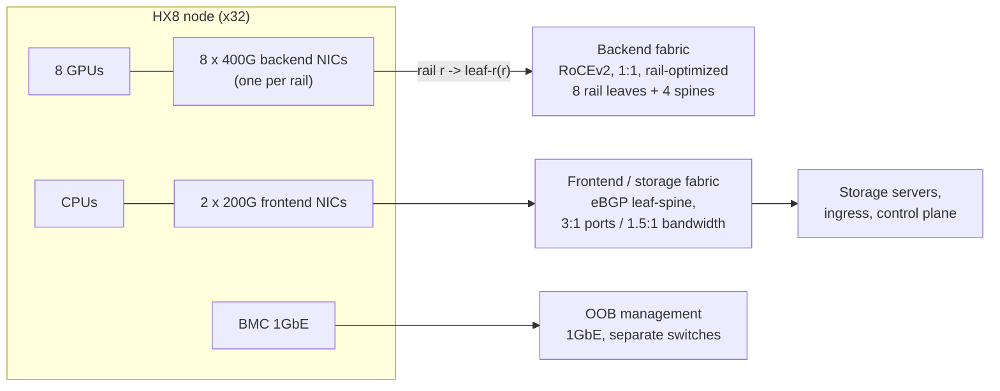
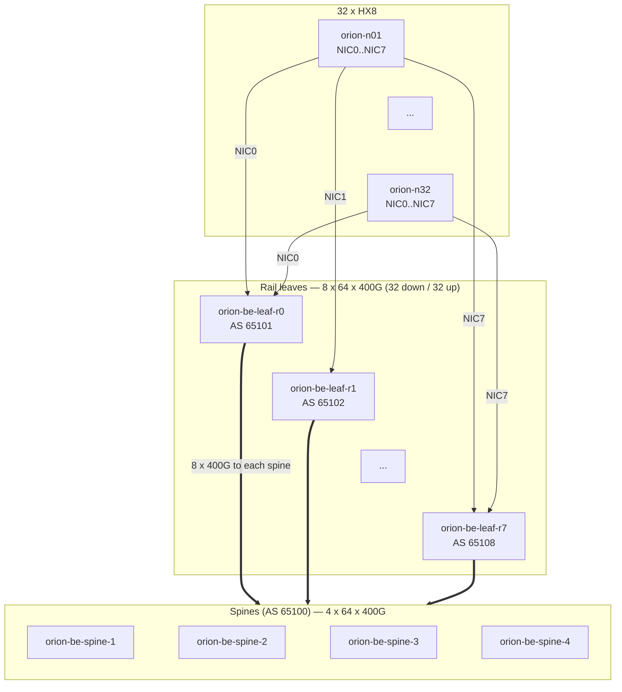

# Chapter 7 — Ethernet and Data-Center Network Foundations

> In a 256-GPU training job the slowest link sets the pace for every GPU. The network is built from
> ordinary data-center parts — Ethernet, IP subnets, BGP, equal-cost multipath (ECMP) hashing,
> leaf-spine topologies — but AI traffic stresses them as web traffic never does: a few enormous,
> synchronized, low-entropy flows instead of millions of small ones. This chapter sizes a two-tier
> Clos from switch radix, addresses it with /31s, routes it with RFC 7938-style eBGP, quantifies how
> ECMP spreads (and fails to spread) AI flows, and predicts what a link, spine, or leaf failure does
> to capacity. We then diagnose an MTU blackhole as an on-call engineer would, and you build a tool
> that sizes, addresses, and validates the ORION backend and catches the errors that cause outages.

## Learning objectives

After this chapter you will be able to:

1. **Explain** why AI back-end fabrics are routed to the host (L3 leaf-spine) rather than built as
   large Layer 2 domains, and what each design gives up.
2. **Design** an IPv4/IPv6 point-to-point addressing plan with /31 (or /127) links, loopbacks, and
   summarizable per-rail aggregates, and an RFC 7938 eBGP autonomous-system-number (ASN) plan.
3. **Calculate** leaf and spine counts, oversubscription, cabling, the maximum size of a two-tier Clos,
   and the frame sizes that a given IP MTU and RoCEv2 path MTU produce.
4. **Analyze** ECMP behaviour for low-entropy AI flows: 5-tuple hashing, collision probability, hash
   polarization, and resilient hashing.
5. **Predict** the capacity and convergence consequences of a link, spine, or leaf failure in a
   rail-optimized fabric, distinguishing raw uplink capacity from ECMP-aware capacity.
6. **Diagnose** MTU mismatches (including PMTUD blackholes), asymmetric routing, and incorrect route
   advertisements using a structured evidence checklist.
7. **Validate** a fabric intent dataset automatically, catching duplicate /31s, ASN collisions, MTU
   mismatches, missing ECMP `maximum-paths`, and asymmetric or bogus advertisements.

## Prerequisites and connections

You need IP networking literacy (subnets, routing tables, TCP/UDP) and the ORION reference cluster
from [Chapter 2](../../part-1-foundations/ch02-anatomy-of-an-ai-data-center/). The rail concept —
NIC *i* of every node on rail *i* — comes from
[Chapter 5](../../part-2-accelerated-compute/ch05-gpu-interconnects-host-topology/), and Linux
interface and routing tools from
[Chapter 3](../../part-1-foundations/ch03-linux-host-systems-diagnostics/).

This chapter is a prerequisite for: [Chapter 8](../ch08-rdma-rocev2-infiniband/) (RoCEv2 rides on
this routed fabric and inherits its MTU and ECMP behaviour);
[Chapter 9](../ch09-congestion-control-lossless-fabrics/) (the QoS classes introduced here become
lossless classes with PFC and ECN); [Chapter 10](../ch10-switches-optics-physical-layer/) (the cable
and transceiver counts computed here become a cabling schedule);
[Chapter 12](../../part-4-distributed-ai/ch12-collective-communication-nccl/) (NCCL ring and tree
traffic is what the fabric must carry); [Chapter 19](../../part-5-production-operations/ch19-reliability-security-multitenancy/)
(fault domains); [Chapter 20](../../part-5-production-operations/ch20-automation-safe-change/) (the
intent validator you build here belongs in a change pipeline); and
[Capstones A and B](../../../capstones/) (fabric design and network telemetry). The lab is
**Progressive Lab 2 — Fabric design** in the 14-week course (week 4).

---

## 7.1 What AI traffic does to a data-center network

A conventional data-center network carries traffic from a very large number of small, independent
flows: web requests, RPCs, database queries, replication. Statistical multiplexing works in its
favour — when a million flows are hashed across 32 links, the law of large numbers makes the links
nearly equally loaded, and no single flow matters.

AI training traffic inverts every one of those properties:

| Property | Web / enterprise traffic | AI training backend traffic |
|---|---|---|
| Flow count per NIC | Thousands | A handful (often 1–8 queue pairs per peer) |
| Flow size and duration | Mostly short (KB–MB) | Long-lived "elephants": GB per collective, for hours |
| Synchronization | Independent | All GPUs communicate in the same few milliseconds, every step |
| Sensitivity | Mean throughput | Tail: the slowest flow gates the collective |
| Header entropy | High (many ports and addresses) | Low (RoCEv2 UDP destination port is fixed at 4791) |
| Loss tolerance | TCP recovers gracefully | RDMA transports recover poorly; loss can stall a collective |

*Table 7.1 — Traffic properties that matter to fabric design [ILLUSTRATIVE, qualitative].*

Because a 256-GPU collective completes only when its slowest hop does, one mis-hashed or congested
link slows every GPU — which is why AI backends are non-blocking and rail-optimized.

### The three networks of ORION

ORION, like most GPU clusters, is really three networks with different jobs and different designs:



*Figure 7.1 — ORION's three networks. The backend carries collective traffic between GPUs; the
frontend carries storage, ingress, and control traffic; the out-of-band (OOB) network reaches every
baseboard management controller (BMC) even when the other two are down.*

Most of this chapter concerns the **backend** (also "compute" or "scale-out") fabric. The
**frontend** is a conventional oversubscribed eBGP leaf-spine where enterprise intuition still applies; Section
7.12's incident happens there. The **OOB** network is deliberately boring, because it is how you
recover the other two.

---

## 7.2 Ethernet and Layer 2: what we keep and what we route away

### Frames, MAC learning, and VLANs

An Ethernet frame carries a 14-byte header (destination MAC, source MAC, EtherType), an optional
4-byte IEEE 802.1Q tag (3-bit priority code point, PCP; 12-bit VLAN ID — 4,094 usable VLANs), the
payload, and a 4-byte frame check sequence (FCS). A switch learns source MACs per port and VLAN,
forwards known unicast to one port, and *floods* broadcast and unknown unicast across the VLAN.

Flooding makes large Layer 2 domains fragile: a bridged loop has no time-to-live to stop it, so the
Spanning Tree Protocol (STP) prevents loops by *blocking* redundant links — exactly the wrong trade in
a fabric built for bandwidth. Multi-chassis link aggregation (MLAG) and EVPN-VXLAN overlays restore
active-active forwarding at the cost of extra control-plane state.

### Why the AI backend is routed to the host

Every major AI backend design in production routes at the leaf: each host NIC port sits on its own
point-to-point IP subnet, and everything above the host is Layer 3. The reasons are mechanical:

1. **Every link is active.** IP routing with ECMP uses all equal-cost paths; nothing is blocked.
2. **Failure domains are small.** A misbehaving NIC cannot flood a VLAN; a broadcast storm cannot
   cross a routed boundary; an ARP table holds one entry per port.
3. **The control plane scales.** BGP was built for hundreds of thousands of prefixes; ORION's backend
   carries roughly a dozen.
4. **Behaviour is debuggable with IP tools.** `ip route get`, `traceroute`, and per-prefix BGP state
   explain every forwarding decision.

What we give up is Layer 2 adjacency (cross-rack VM migration, broadcast discovery). That matters on
some frontends, never on a GPU backend.

VLANs and VRFs do not disappear from an AI data center; they move to where segmentation matters more
than bandwidth. The frontend separates tenants, storage, and management traffic with VRFs (virtual
routing and forwarding instances — separate routing tables on shared switches), often carried in an
EVPN-VXLAN overlay so a tenant's network can span racks. Inference clusters exposed to customers use
the same mechanism for isolation ([Chapter 19](../../part-5-production-operations/ch19-reliability-security-multitenancy/)).
The OOB network commonly uses plain VLANs per rack. Only the RoCE backend stays a flat, single-tenant
routed fabric.

> **Key idea:** In an AI backend, Layer 2 exists only on each point-to-point link. Routing starts at
> the leaf port.

### How a routed host sees the fabric

On ORION each HX8 node has eight backend NICs, one per rail, and each NIC has a /31 to its rail leaf.
Because all eight NICs are in the same address family and the same 10.100.0.0/16 supernet, the host
needs *policy routing*: traffic sourced from rail *r*'s address must leave through rail *r*'s NIC.
A minimal host configuration for node 5, rail 3 looks like this (interface name illustrative):

```bash
# [ILLUSTRATIVE] node orion-n05, rail 3: leaf side 10.100.3.10, host side 10.100.3.11
ip addr add 10.100.3.11/31 dev ens3np0
ip route add 10.100.0.0/16 via 10.100.3.10 dev ens3np0 table 103
ip rule add from 10.100.3.11/32 table 103 priority 1003
ip route get 10.100.6.21 from 10.100.3.11      # confirm: "via 10.100.3.10 dev ens3np0 table 103"
```

RDMA binds to a specific device and source GID (global identifier — for RoCEv2, IP-derived), so
policy routing mainly governs kernel traffic: ARP, ping, TCP bootstrap. Get it wrong and you see the
classic "ping works on rail 0 but not rail 3", because replies leave through the wrong NIC.
[Chapter 8](../ch08-rdma-rocev2-infiniband/) covers GID selection.

---

## 7.3 Addressing: /31s, loopbacks, aggregates, and IPv6

### Point-to-point links: /31 and /127

A /30 spends four IPv4 addresses on a two-ended link (network, two hosts, broadcast). RFC 3021
(2000) allows /31 prefixes on point-to-point links, using both addresses as host addresses; RFC 6164
(2011) recommends /127 for IPv6 inter-router links. On ORION's 512 point-to-point links (256 host
links + 256 leaf-spine links) the arithmetic is:

- /31 plan: 512 links × 2 addresses = **1,024 addresses** `[MODELED]`
- /30 plan: 512 links × 4 addresses = **2,048 addresses** `[MODELED]`

Address space is not scarce in 10.0.0.0/8, so the real benefit of /31 is not conservation but
*regularity*: with /31s, address = base + 2 × index, so a link's addresses can be computed from its
position. Regular plans are what make automation and validation possible.

### The ORION plan

| Object | Rule | Example |
|---|---|---|
| Host link, rail *r*, node *n* | leaf `10.100.r.(2n)/31`, host `10.100.r.(2n+1)/31` | rail 3, node 5: leaf .10, host .11 |
| Rail aggregate | `10.100.r.0/24` originated by `orion-be-leaf-r<r>` | rail 3: `10.100.3.0/24` |
| Leaf-spine link (this chapter) | spine `10.101.s.(2·idx)/31`, leaf `10.101.s.(2·idx+1)/31`, idx = 8r + k | orion-be-leaf-r2 ↔ orion-be-spine-3, link k=1: idx 17 → spine .34, leaf .35 |
| Loopbacks | `10.255.0.0/24`: spines .1–.4, rail leaves .11–.18 | orion-be-leaf-r3 = 10.255.0.14 |

*Table 7.2 — ORION backend addressing. Node n is `orion-nNN` (01–32). The 10.101.s.0/24 leaf-spine
rule is defined here and adopted by the reference plan; each spine's 64 fabric links fit in one /24
(64 × 2 = 128 addresses).*

Two properties make this plan operable. **Every rail summarizes**: each leaf originates one /24 (its
32 host links use only .2–.65), so the backend routing table is 8 aggregates + 12 loopbacks +
connected links. **Every address encodes its location**: 10.100.3.11 in a capture is node 5's rail-3 NIC.

> **Pitfall:** The rail aggregate hides host-link failures: if node 5's rail-3 link is down, other
> leaves still route 10.100.3.11 to orion-be-leaf-r3, which drops it. That is correct (no other path exists),
> but such failures appear only in leaf interface state and job logs. Monitor host-facing ports directly.

### Loopbacks and router IDs

Each switch has a /32 loopback: BGP router ID and a telemetry target that survives link failures. A
loopback advertised to only some spines gives path-dependent reachability, so the lab treats it as an
asymmetric advertisement.

### IPv6 and unnumbered links

IPv6 adds two options. Point-to-point links use /127 (RFC 6164) or no global address at all:
every IPv6 interface has a link-local address (fe80::/10), and BGP can peer over link-local
addresses discovered from router advertisements. RFC 8950 (2020, obsoleting RFC 5549) lets BGP
advertise *IPv4* prefixes with an *IPv6* next hop, so a fabric can carry IPv4 host routes with no IPv4
addresses on fabric links at all — the "BGP unnumbered" pattern. FRRouting expresses it compactly:

```text
! [VENDOR EXAMPLE — FRRouting; verify syntax against your FRR version, 2026-10]
router bgp 65101
 neighbor swp33 interface remote-as external
```

Unnumbered fabrics eliminate duplicate-/31 errors; the cost is less informative `traceroute` output
and tooling that can no longer key on interface IPs. ORION uses numbered IPv4 links because they are
easier to teach and validate.

---

## 7.4 MTU, path MTU discovery, and blackholes

### What "MTU" means depends on who you ask

The maximum transmission unit (MTU) is the largest packet a link carries, but implementations
disagree about which bytes count. Linux `ip link set mtu 9000` sets the **IP MTU** (excluding Ethernet
header and FCS). On switches it varies by vendor `[VENDOR-SPEC, 2026-10]`: an EOS or NX-OS routed
interface `mtu` is also an IP MTU, while a Junos media MTU includes the Layer 2 header. ORION's
policy — 9216 on switch ports, 9000 on hosts — leaves headroom under any of these definitions; treat
"switch value ≥ host IP MTU + 22 B" as a conservative portable rule, not a universal fact.

| Layer | Bytes | Running total |
|---|---|---|
| IP packet at host IP MTU | 9,000 | 9,000 |
| + Ethernet header (dst, src, EtherType) | 14 | 9,014 |
| + 802.1Q tag (if tagged) | 4 | 9,018 |
| + FCS | 4 | 9,022 |

*Table 7.3 — On-the-wire frame size for a 9000-byte IP MTU [MODELED]. Any switch port in the path
must accept at least 9,022-byte frames for tagged traffic; 9216 leaves 194 bytes of margin.*

> **Vendor implementation note (`[VENDOR-SPEC, 2026-10]` — verify):** Some NOSes cap the
> routed-interface IP MTU slightly below 9216 (for example 9214); SONiC's port table commonly defaults
> to 9100 and is raised to 9216 in AI fabrics. Normalize every platform's value to one definition
> before comparing the two ends of a link (the lab uses "switch port MTU, 9216 on fabric links").

### RoCEv2 frames and the RDMA path MTU

RDMA does not use the IP MTU directly. InfiniBand-derived transports choose a *path MTU* from a fixed
set — 256, 512, 1,024, 2,048, or 4,096 bytes of payload — and a RoCEv2 device selects the largest of
those that fits under its netdev IP MTU. With a 9000-byte host MTU the active MTU is 4,096; with a
1500-byte MTU it falls to 1,024 (`ibv_devinfo` reports both `max_mtu` and `active_mtu`). The frame
for a full 4,096-byte RoCEv2 payload is:

```text
+----------+--------+-------+------+-------------+---------------------+-------+-----+
| Ethernet | IPv4   | UDP   | BTH  | (RETH 16 B, | payload             | ICRC  | FCS |
| 14 B     | 20 B   | 8 B   | 12 B |  first pkt) | 4,096 B             | 4 B   | 4 B |
+----------+--------+-------+------+-------------+---------------------+-------+-----+
 UDP destination port 4791 (fixed); UDP source port chosen per queue pair (the only entropy)
 IP packet = 20 + 8 + 12 + 4,096 + 4 = 4,140 B (4,156 B with RETH)
 Frame    = 14 + 4,140 + 4 = 4,158 B (4,174 B with RETH)
```

*Figure 7.2 — RoCEv2 frame layout at path MTU 4096 [MODELED]. BTH = InfiniBand base transport
header; RETH = RDMA extended transport header (on the first packet of an RDMA WRITE); ICRC =
invariant CRC.*

So the 9000-byte host MTU does not carry RoCE frames (they are ~4.2 KB) — it lets the device *select*
4,096. And any link that cannot pass a 4,174-byte frame breaks RDMA for exactly the flows hashed onto it.

### Path MTU discovery and why it fails in fabrics

A router that cannot forward a DF-marked IPv4 packet within its egress MTU drops it and returns ICMP
"fragmentation needed" (type 3, code 4) with the next-hop MTU (IPv6: ICMPv6 "Packet Too Big"). The
sender lowers its path MTU for that destination — path MTU discovery (PMTUD, RFC 1191; RFC 8201 for
IPv6). Linux shows the learned value in the route cache:

```text
$ ip route get 10.10.20.15                       # [ILLUSTRATIVE]
10.10.20.15 via 10.10.0.26 dev ens9f0 src 10.10.0.27 uid 0
    cache expires 587sec mtu 1500
```

PMTUD fails in three ways, each producing a **blackhole** — small packets succeed, large ones vanish:

1. **ICMP is filtered** by an ACL or firewall.
2. **ICMP is rate-limited.** Switches generate ICMP in the CPU, behind control-plane policing, so
   under load most "fragmentation needed" messages are never sent.
3. **The drop happens at ingress.** If the *receiving* port's maximum frame size is smaller than the
   frame — an MTU mismatch between the two ends of one link — the MAC discards it as oversize
   ("giant") before any routing decision. No ICMP is ever sent.

Case 3 is the signature of an MTU *mismatch*, typically after maintenance resets one end of a link to
a factory default. TCP connects (the SYN is small; each side advertises a maximum segment size, MSS,
from *its own* MTU), BGP stays up, LLDP is happy — and bulk transfers stall.

> **Pitfall:** "BGP is Established" proves nothing about MTU: each TCP endpoint honours its *peer's*
> MSS, so the control plane converges perfectly across a 9216/1500 mismatch while large data frames
> blackhole.

Packetization-layer PMTUD (PLPMTUD, RFC 4821 and RFC 8899; Linux `net.ipv4.tcp_mtu_probing`) probes
with real packets instead of relying on ICMP. It helps TCP survive blackholes but does nothing for
RDMA. The only robust policy is **one MTU per link class, validated end to end across many ECMP
paths, with mismatches treated as blockers** (Section 7.12 shows the sweep).

### Verifying MTU from a host

```bash
# Largest IPv4 ICMP payload for a 9000-byte IP MTU: 9000 - 20 (IPv4) - 8 (ICMP) = 8972 bytes.
ping -M do -s 8972 -c 3 10.100.6.21     # -M do sets DF: fails loudly instead of fragmenting
tracepath -n 10.100.6.21                # reports the path MTU hop by hop (UDP probes)
ip -d link show ens3np0 | grep -o 'mtu [0-9]*'
```

`ping` exercises essentially one ECMP path per source/destination pair: ICMP has no port numbers, so
most switches hash it on addresses and protocol alone. A clean ping proves that one path is good, not
that the fabric is.

---

## 7.5 Routing the fabric: eBGP in the data center

### Why BGP, and why external BGP

A fabric routing protocol must install every equal-cost path, converge predictably, keep failure
blast radius small, and be easy to automate. OSPF and IS-IS flood link-state across the whole area,
so one flapping link triggers recomputation everywhere. RFC 7938, *Use of
BGP for Routing in Large-Scale Data Centers* (Lapukhov, Premji, Mitchell, 2016), documents the design
most large operators converged on: **external BGP (eBGP) on every link, ASNs assigned by tier
position, no IGP.** BGP is path-vector: each advertisement carries the list of ASNs it crossed (the
AS_PATH), and routers choose by policy and AS_PATH length. Sessions run over the connected /31, so no
other protocol is needed for next-hop reachability.

### ASN design

RFC 7938's ASN plan, applied to ORION:

| Tier | ASN rule | ORION |
|---|---|---|
| Spines | One shared ASN for all spines | 65100 |
| Leaves | Unique ASN per leaf | `orion-be-leaf-r<r>` = 65101 + r (65101–65108) |
| Range | Private ASNs: 64512–65534 (2-byte), 4200000000–4294967294 (4-byte), RFC 6996 | 2-byte private |

*Table 7.4 — ORION backend ASN plan.*

Why *share* the spine ASN? If orion-be-leaf-r0 re-advertises a route learned from orion-be-spine-1 (AS_PATH
`65100 65104`) to orion-be-spine-2, orion-be-spine-2 sees its own ASN and drops it. Every "valley" path (spine → leaf →
spine) is blocked by construction, which also prevents *path hunting* — exploring ever-longer
alternatives after a withdrawal. Why *unique* leaf ASNs? Two leaves sharing an ASN drop each other's
routes as loops. That is the lab's `ASN_COLLISION`: with orion-be-leaf-r6 and orion-be-leaf-r7 both in 65107, rails 6
and 7 each silently lose reachability to the other's prefixes while every session shows `Established`. (Reusing leaf
ASNs with `allowas-in` is a deliberate design choice, never an accident to tolerate.)

### What each switch advertises

Advertise the minimum. A leaf originates its rail aggregate and its loopback; a spine originates its
loopback and re-advertises what it learns. Inbound prefix filters on the spines — "from orion-be-leaf-r3,
accept only 10.100.3.0/24 and 10.255.0.14/32" — turn a leaf misconfiguration into a rejected
advertisement instead of a fabric-wide blackhole. Without such filters, an **incorrect
advertisement** propagates instantly. Two flavours occur in practice:

- **Wrong origin:** orion-be-leaf-r1 originates 10.100.6.0/24 (rail 6's prefix), perhaps from a copy-pasted
  configuration. Spines now hold two paths for rail 6 with equal AS_PATH length (`65102` vs `65107`).
  Depending on multipath settings, some or all rail-6-bound traffic is delivered to orion-be-leaf-r1, which
  has no such hosts and drops it.
- **More-specific leak:** a leaf advertises a /26 or a host /32 that overlaps another leaf's /24.
  Longest-prefix match beats every policy knob: the more specific wins everywhere, regardless of
  AS_PATH.

### Multipath: `maximum-paths` and AS_PATH relaxation

By default BGP installs **one** best path. For ECMP you must enable multipath and set
`maximum-paths` at least as large as the number of equal-cost next hops. On ORION each leaf has 32
uplinks (4 spines × 8 parallel links), each its own eBGP session, so for a remote rail prefix a leaf
receives 32 paths with an identical AS_PATH (`65100 650xx`). With `maximum-paths 4` the leaf installs
four of them: cross-rail traffic from that leaf is squeezed onto 4 of 32 uplinks — **12.5 % of its
uplink capacity** — while every session, every interface, and every route looks healthy. That is the
lab's `ECMP_MAXPATHS` finding, and it is one of the most common "fabric is fine but slow" root causes.

Multipath normally requires identical AS_PATHs; "multipath relax" knobs accept equal-length paths
through different neighbor ASNs. ORION's leaves do not need it (every path is via 65100).

### Configuration, three ways

The same leaf in three dialects. Each is a **vendor example**: syntax drifts between releases, so
verify against your platform's current documentation.

```text
! [VENDOR EXAMPLE — FRRouting (also the BGP daemon inside SONiC), 2026-10]
! orion-be-leaf-r3: ASN 65104, loopback 10.255.0.14
router bgp 65104
 bgp router-id 10.255.0.14
 no bgp ebgp-requires-policy
 neighbor SPINES peer-group
 neighbor SPINES remote-as 65100
 neighbor SPINES bfd
 neighbor SPINES timers 3 9
 neighbor SPINES advertisement-interval 0
 ! orion-be-spine-1, link k=0 (idx 24 -> .48/.49), then k=1
 neighbor 10.101.1.48 peer-group SPINES
 neighbor 10.101.1.50 peer-group SPINES
 ! ... 30 more neighbors, one per uplink ...
 address-family ipv4 unicast
  network 10.255.0.14/32
  aggregate-address 10.100.3.0/24 summary-only
  ! route-map HOST-LINKS (not shown): prefix-list 10.100.3.0/25 le 31 (host /31s span .2-.65)
  redistribute connected route-map HOST-LINKS
  maximum-paths 64
 exit-address-family
```

```text
! [VENDOR EXAMPLE — Arista EOS-style, 2026-10; peer-group keyword spelling varies by release]
interface Ethernet33/1
   description orion-be-leaf-r3 -> orion-be-spine-1 Ethernet25/1
   no switchport
   mtu 9214
   ip address 10.101.1.49/31
!
router bgp 65104
   router-id 10.255.0.14
   maximum-paths 64 ecmp 64
   neighbor SPINES peer group
   neighbor SPINES remote-as 65100
   neighbor SPINES bfd
   neighbor 10.101.1.48 peer group SPINES
   network 10.255.0.14/32
   aggregate-address 10.100.3.0/24 summary-only
```

SONiC `config_db.json` fragment `[VENDOR EXAMPLE, 2026-10]` (BGP itself runs in FRR underneath):

```json
{
  "PORT":      { "Ethernet256": { "admin_status": "up", "mtu": "9216", "speed": "400000" } },
  "INTERFACE": { "Ethernet256": {}, "Ethernet256|10.101.1.49/31": {} },
  "BGP_NEIGHBOR": { "10.101.1.48": { "asn": "65100", "name": "orion-be-spine-1", "local_addr": "10.101.1.49" } }
}
```

*Listing 7.1 — The same orion-be-leaf-r3 uplink in FRRouting, EOS-style, and SONiC form. Port names differ by
platform (Ethernet33 in the lab's normalized naming); the addressing is identical.*

The lines that break fabrics are `maximum-paths`, the MTU (one per platform definition), and
`no bgp ebgp-requires-policy`: recent FRR releases refuse eBGP routes without explicit policy (RFC
8212). The line disables that safety for brevity; production configurations attach real route-maps,
which is where the prefix filters above live. One more trap `[VENDOR-SPEC, 2026-10]`: in FRR,
`maximum-paths 64` is silently capped by the build-time `MULTIPATH_NUM` (often 16) and by zebra's
`-e` option. Configuration that says 64 does not prove 32 paths are installed. Count the next hops
in `show ip route 10.100.6.0/24` (or the FIB) after every build or upgrade.

---

## 7.6 ECMP: how traffic is actually spread

### Per-flow hashing

A switch with several equal-cost next hops for a destination picks one per packet by hashing header
fields — classically the **5-tuple** (source IP, destination IP, IP protocol, source port, destination
port) — and taking the result modulo the number of next hops (or indexing a table of ECMP members).
Hashing per *flow* rather than per packet keeps each flow on one path, so packets arrive in order.
That matters doubly for RDMA: RoCEv2 reliable connections have historically treated out-of-order
arrival as loss and retransmitted (go-back-N), so reordering costs throughput directly.

The cost of per-flow hashing is that **ECMP balances flows, not bytes**. If the flows are many and
small, the result is close to even. If the flows are few and huge, it is a lottery.

### The low-entropy problem, quantified

RoCEv2 fixes the UDP destination port at 4791. The IP addresses identify the two NICs. The only
varying field is the UDP source port, which the NIC chooses per queue pair (QP). An NCCL connection
between two GPUs typically uses a small number of QPs, so a NIC may present only a handful of flows to
the fabric. Consider eight 400 Gb/s flows, each hashed independently and uniformly onto one of eight
equal-cost 400 Gb/s links:

- P(all eight on distinct links) = 8! / 8⁸ = 40,320 / 16,777,216 ≈ **0.24 %** `[MODELED]`
- Expected number of links used = 8 × (1 − (7/8)⁸) = 8 × (1 − 0.344) ≈ **5.25** `[MODELED]`
- Distribution of the most-loaded link (200,000 random trials, seed 1): 2 flows 49.9 %, 3 flows
  40.9 %, ≥ 4 flows 8.9 % `[SIMULATED — models hashing only, not congestion control or queueing]`

So in 99.8 % of cases some flows run at ≤ 200 Gb/s, and in about half at ≤ 133 Gb/s. Because a
collective finishes with its slowest flow, this toy collective typically runs at well under half of
line rate — with zero loss and every link healthy. For 32 flows on 32 links: 20.4 links used on
average (63.8 %), and a link with ≥ 3 flows in about 97 % of trials `[SIMULATED]`.

> **Key idea:** ECMP's guarantee is statistical. AI collectives present too few flows for statistics
> to help, so fabric design must either keep traffic off multi-path segments (rail alignment) or add
> entropy and smarter load balancing.

### Hash polarization

Polarization happens when successive tiers use correlated hash decisions, so the second tier sees only
part of the hash space. A concrete ORION-shaped example: suppose a leaf numbers its 32 uplinks so
that uplink *i* (0–31) goes to `orion-be-spine-(i mod 4 + 1)`, and picks uplink *h mod 32* for a flow
with hash *h*. Spine *s* then receives only flows with *h mod 4 = s − 1*. If it picks among its 8 links
(k = 0–7) to the destination leaf with the *same* function *h mod 8*, then for `orion-be-spine-1`
*h mod 8 ∈ {0, 4}*: it uses **2 of its 8 links** toward each destination leaf and leaves 6 idle.
Production ASICs avoid this with per-switch hash seeds and differently chosen field sets; the lesson
for operators is to make sure seeds actually differ (some platforms derive them from the MAC address
or a configuration knob) and to *measure* link utilization spread rather than assume it.

### Resilient hashing

When an ECMP member fails, a naive modulo hash switches from *h mod 32* to *h mod 31* and only about
1/32 ≈ 3.1 % of flows keep their member `[MODELED]` — for RDMA, a burst of reordering and
retransmission on nearly *every* flow. **Resilient** hashing reassigns only the failed member's
buckets, so only that ~1/32 of flows moves. Most ASICs support it; it is often not the default.

### Beyond 5-tuple ECMP

Mitigations beyond 5-tuple ECMP (`[VENDOR-SPEC, 2026-10]`; verify):

- **More flows:** `NCCL_IB_QPS_PER_CONNECTION` (default 1) spreads a connection over more QPs.
- **Transport-field hashing:** some ASICs hash on RoCEv2 BTH fields such as the destination QP.
- **Adaptive routing / flowlets:** per-flowlet or per-packet egress choice by queue occupancy, with
  NICs that tolerate reordering — most effective, least portable.
- **Rail alignment** (Section 7.7): keep traffic on one hop so ECMP is never consulted.

---

## 7.7 Leaf-spine and Clos arithmetic

### The folded Clos

A two-tier leaf-spine fabric is a *folded Clos* network: every leaf connects to every spine, every
leaf-to-leaf path is exactly two hops (leaf → spine → leaf), and all such paths are equal cost. Its
size is set by switch **radix** (port count at the chosen speed). With radix *k* and a non-blocking
leaf (half the ports down, half up):

- Each leaf has *k*/2 downlinks and *k*/2 uplinks.
- A spine has *k* ports, so at most *k* leaves (one link to each).
- Maximum endpoints = *k* leaves × *k*/2 downlinks = **k²/2**.
- A three-tier Clos (leaf, spine, super-spine) of the same radix reaches **k³/4**.

| Radix *k* (at 400G) | Two-tier max endpoints (k²/2) | Three-tier max endpoints (k³/4) |
|---|---|---|
| 64 | 2,048 | 65,536 |
| 128 | 8,192 | 524,288 |

*Table 7.5 — Clos size limits for a non-blocking fabric [MODELED].*

A 51.2 Tb/s ASIC offers 64 × 800G or, with breakout, 128 × 400G. ORION's reference switches expose 64 ×
400G (25.6 Tb/s in use), ample for 256 GPUs; breaking the same silicon out to 128 × 400G quadruples the
two-tier ceiling to 8,192. That is ORION-XL's (4,096 GPUs) decision: radix 64 cannot hold it in two
tiers, radix 128 can (64 leaves, 32 spines, 2 links per pair — computed in the lab).

### Oversubscription

Oversubscription is downlink capacity divided by uplink capacity: a 64-port leaf at 3:1 has 48 down
and 16 up. If every downlink sends off-leaf at line rate, a 3:1 leaf delivers a third. That is
economical for web traffic, whose peaks rarely coincide, and costly for a backend where every GPU
sends at once. ORION's backend is 1:1. Its frontend leaves are 3:1 by port count but 1.5:1 by
bandwidth (200G hosts, 400G uplinks): always state which ratio you mean.

### Rail-optimized topology

In a *rail-optimized* fabric, NIC *r* of every node connects to the leaf (or leaf group) for rail *r*.
On ORION, 32 nodes × 1 NIC per rail = 32 downlinks — exactly one 1:1 leaf — so each rail is a single
leaf and **every same-rail transfer is one switch hop.**



*Figure 7.3 — ORION-256 backend, rail-optimized two-tier Clos. Each of the 8 leaves serves one rail
across all 32 nodes; each leaf has 8 parallel links to each of 4 spines (32 uplinks).*

Collective libraries connect GPU *g* on one node to GPU *g* on another, and GPU *g* sits next to NIC
*g* ([Chapter 5](../../part-2-accelerated-compute/ch05-gpu-interconnects-host-topology/)), so
same-rail traffic enters and leaves the *same* leaf and never meets an ECMP decision. For cross-rail
peers, NCCL's PXN mechanism first moves data over NVLink to the local GPU on the destination's rail
(`[VENDOR-SPEC, 2026-10]`; see `NCCL_PXN_DISABLE` and
[Chapter 12](../../part-4-distributed-ai/ch12-collective-communication-nccl/)).

ORION's spines therefore carry only *cross-rail* traffic: misaligned rank maps, PXN disabled, some
all-to-all patterns. ORION still builds them 1:1 because such traffic, when it happens, is synchronized
and line-rate. At ORION-XL scale a rail spans many leaves, so same-rail traffic crosses the spines and
ECMP moves from edge case to main path.

> **Production note:** A rail-optimized fabric changes the meaning of "a leaf failed." In a
> conventional design, a leaf failure takes out the servers in one rack. In ORION, `orion-be-leaf-r3` failing
> removes NIC 3 from **all 32 nodes** at once. Every job spanning more than one node loses a rail
> simultaneously.

### Cabling arithmetic

Every downlink and every uplink is a cable with two ends:

- Host cables = 256; fabric cables = 8 leaves × 32 uplinks = 256; total **512 cables**.
- If every cable is optical with a pluggable transceiver at each end: 512 × 2 = **1,024 transceivers**
  `[MODELED]` (before spares; [Chapter 10](../ch10-switches-optics-physical-layer/) turns these into a
  cabling schedule and spares plan, and decides where copper or active cables can replace optics).

---

## 7.8 QoS basics for an AI fabric

Quality of service (QoS) on a fabric is three decisions: **classify** a packet (which traffic class
is it?), **queue** it (which egress queue and buffer pool?), and **schedule** it (when does that queue
transmit relative to others?).

Routed fabrics classify on the 6-bit Differentiated Services Code Point (DSCP), which survives
routing, rather than the 802.1p PCP, which exists only on tagged links. DSCP maps to one of
(typically) eight traffic classes, each with an egress queue. Schedulers combine **strict priority**
(right for small control traffic; it can starve everything else) and weighted variants such as
deficit weighted round robin (DWRR).

ORION's backend classes `[ILLUSTRATIVE]`:

| Traffic | DSCP | Traffic class | Treatment |
|---|---|---|---|
| RoCEv2 data | 26 | 3 | Lossless (PFC on priority 3), ECN marking, DWRR weight dominant |
| Congestion notification packets (CNP) | 48 | 6 | Strict priority, small |
| Everything else (BGP, BFD, management, TCP) | other | 0 | Lossy, best effort |

*Table 7.6 — ORION backend QoS classes [ILLUSTRATIVE].*

The mechanisms — priority flow control (PFC), explicit congestion notification (ECN), DCQCN — belong
to [Chapter 9](../ch09-congestion-control-lossless-fabrics/). Two rules matter now. **Trust**: switches
must trust DSCP on host-facing ports, or they remark everything to class 0 and the lossless class
carries nothing. **Consistency**: the DSCP→class map, lossless priority, and buffers must match on
every switch in the path, or the lossless class becomes lossy at that hop. Both are intent-validation
rules; you specify them in the lab's stretch task (Exercise 7.L).

> **Pitfall:** BGP and BFD packets must never queue behind congested data. Confirm that locally
> generated control traffic uses a protected queue; dropped BFD turns congestion into a routing outage.

---

## 7.9 Failure behaviour and convergence

### The failure-detection ladder

A fabric reacts to a failure only after something *detects* it. In order of speed:

| Detection mechanism | Typical time to detect | Catches | Notes |
|---|---|---|---|
| Loss of signal / link down | ≈ 1–50 ms, plus any configured link-down debounce | Fiber cut, optic or port death | Fastest; ASIC can remove the ECMP member in hardware |
| BFD (RFC 5880/5881), 300 ms × 3 | ≈ 0.9 s | Link up but not forwarding; peer control plane dead | Runs on the same /31; one session per BGP neighbor |
| BGP hold timer, 3 s / 9 s | ≤ 9 s | Same, without BFD | DC-tuned timers |
| BGP hold timer, protocol-default | ≈ 90–180 s | Same | Implementation defaults; unacceptable for AI fabrics |

*Table 7.7 — Failure detection in an eBGP fabric [ILLUSTRATIVE; timers are configuration choices,
debounce and hardware behaviour are `VENDOR-SPEC`].*

*Gray* failures — a link that is up but dropping frames, a unidirectional fiber, a wedged forwarding
path — keep link state "up", so only BFD's end-to-end liveness check sees them. After detection,
routes are withdrawn and each switch reprograms its forwarding table (FIB); with no valley paths this
spans one or two hops and is typically sub-second `[ILLUSTRATIVE]`.

### Link failure

Take one of the eight links between orion-be-leaf-r0 and orion-be-spine-1. Both ends remove it from their ECMP groups
and drop its BGP session; orion-be-leaf-r0 has 31 uplinks. **Nothing else changes**: orion-be-spine-1 still has seven
paths to orion-be-leaf-r0 and keeps advertising its prefix, so every other leaf still sends a quarter of its
rail-0 traffic via orion-be-spine-1 — which must deliver it over seven links, each at 8/7 ≈ 114 % of its fair
share. The narrowest bundle limits ECMP-aware capacity:

- Raw uplink capacity of orion-be-leaf-r0: 31 × 400 Gb/s = **12.4 Tb/s** (−3.1 %) `[MODELED]`
- ECMP-aware ingress capacity: 4 spines × min(7, 8, 8, 8) links × 400 Gb/s = **11.2 Tb/s**
  (−12.5 %) `[MODELED]`

One dead link in 32 costs one eighth of the ingress capacity because unweighted ECMP cannot steer
traffic away from the weakened spine. Weighted (unequal-cost) multipath, which some platforms
support by carrying link-bandwidth information in BGP, recovers the difference.

### Spine failure

If orion-be-spine-2 fails, every leaf loses 8 of its 32 uplinks and every leaf pair loses one quarter of its
paths: raw and ECMP-aware capacity per leaf both fall to 24 × 400 Gb/s = **9.6 Tb/s (−25 %)**, and
spine-layer bisection falls from 51.2 to **38.4 Tb/s** `[MODELED]`. Same-rail traffic — the bulk of
ORION's backend load — is unaffected because it never touches a spine. With four spines, a single
spine is a 25 % fault domain for cross-rail capacity; with eight spines it would be 12.5 %, at the
cost of fewer parallel links per pair. This is the first quantitative argument for "more, smaller
spines."

### Leaf failure

If orion-be-leaf-r3 fails, the fabric reconverges quickly (spines withdraw 10.100.3.0/24), but every node has
lost one of its eight NICs. NCCL communicators using rail 3 break; the job typically errors out or
hangs until a timeout and must be restarted
([Chapter 19](../../part-5-production-operations/ch19-reliability-security-multitenancy/)). Bisection
falls to 38.4 Tb/s, but the relevant fact is that **one leaf is a cluster-wide fault domain**.

### Planned maintenance: drain before you touch

Unplanned failures cost a little traffic during detection. Planned work should cost none:

1. **Drain**: make the device unattractive while it still forwards — prepend its AS_PATH, or tag its
   routes with the GRACEFUL_SHUTDOWN community (RFC 8326) so neighbors lower its local preference.
2. **Verify** traffic has moved off (interface counters near zero).
3. **Work**, then **undrain** and verify again.

> **Safety:** Every failure and drain exercise in this book targets a dedicated lab fabric, a
> container topology, or a model. Do not shut links, restart BGP, or change MTU on a shared or
> production fabric to "see what happens."

---

## 7.10 Worked example: design, address, and stress-test the ORION-256 backend

**Problem.** Halcyon AI's Fabric team must sign off the ORION-256 backend before optics are ordered:
32 HX8 nodes × 8 × 400 Gb/s NICs, 64-port 400G switches, non-blocking. Produce counts and cabling,
addressing and BGP plan, MTU budget, failure capacity, and the fabric's share of the W-TRAIN step.
All numbers are `[MODELED]` from the stated formulas.

**Step 1 — Endpoints and leaf geometry.**
Endpoints = 32 nodes × 8 NICs = **256** at 400 Gb/s.
Downlinks per leaf at 1:1 = 64 × 1 / (1 + 1) = **32**; uplinks = 64 − 32 = **32**.
Leaves = ⌈256 / 32⌉ = **8** — one per rail, because each rail has exactly 32 NICs.

**Step 2 — Spines.**
Total uplinks = 8 leaves × 32 = 256. Spines = 256 uplinks / 64 ports = **4**.
Links per leaf-spine pair = 32 uplinks / 4 spines = **8**. Check spine ports: 8 leaves × 8 links = 64 ✓.
Two-tier ceiling at radix 64: 64²/2 = 2,048 endpoints; ORION uses 12.5 % of it.

**Step 3 — Capacity.**
Leaf downlink capacity = 32 × 400 Gb/s = 12,800 Gb/s = **12.8 Tb/s** (= 1.6 TB/s).
Leaf uplink capacity = 32 × 400 Gb/s = **12.8 Tb/s** → oversubscription 12.8 / 12.8 = **1:1**.
Spine-layer bisection (worst split of 8 leaves into 4 + 4): each spine can carry
min(4 × 8, 4 × 8) = 32 links across the cut; 4 spines × 32 × 400 Gb/s = **51.2 Tb/s per direction**.

**Step 4 — Cabling.** Host cables 256 + fabric cables 256 = **512**; at two transceivers per optical
cable, **1,024** transceivers before spares.

**Step 5 — Addressing and BGP.**
/31 links = 256 host + 256 fabric = 512 → 1,024 addresses. Leaf-spine block per spine = 8 leaves × 8
links × 2 addresses = 128 addresses, inside 10.101.s.0/24.
eBGP sessions = one per fabric link = **256**; per leaf 32; per spine 8 × 8 = 64. BFD sessions = 256.
A leaf receives each remote rail /24 over 32 sessions, all with AS_PATH `65100 650xx` → leaf
`maximum-paths` ≥ **32**; a spine receives each leaf's /24 over 8 sessions → spine `maximum-paths` ≥ **8**.
Spot check — orion-be-leaf-r2 ↔ orion-be-spine-3, link k = 1: idx = 8 × 2 + 1 = 17; spine side 10.101.3.(2 × 17) =
10.101.3.34/31, leaf side 10.101.3.35/31; leaf port Ethernet(33 + (3 − 1) × 8 + 1) = Ethernet50;
spine port Ethernet(1 + 17) = Ethernet18.

**Step 6 — MTU budget.**
Host IP MTU 9000 → tagged frame 9000 + 14 + 4 + 4 = 9,022 B ≤ 9216 ✓ (194 B margin).
RoCEv2 at path MTU 4096 → largest frame 4,174 B (with RETH) ✓.
Host ping test payload for DF probing: 9000 − 20 − 8 = **8,972 B**.

**Step 7 — Failure cases.** Using the formulas from Section 7.9 (ECMP-aware ingress =
usable spines × narrowest bundle × 400 Gb/s; bisection = worst 4/4 split):

| Scenario | Leaf uplink (raw) | ECMP-aware ingress to affected leaf | Spine-layer bisection | Blast radius |
|---|---|---|---|---|
| Baseline | 12.8 Tb/s | 12.8 Tb/s | 51.2 Tb/s | — |
| 1 of 8 links orion-be-leaf-r0↔orion-be-spine-1 down | 31 × 0.4 = 12.4 Tb/s | 4 × 7 × 0.4 = 11.2 Tb/s | (31 + 32 + 32 + 32) × 0.4 = 50.8 Tb/s | Cross-rail traffic to/from rail 0 |
| orion-be-spine-2 down | 24 × 0.4 = 9.6 Tb/s | 3 × 8 × 0.4 = 9.6 Tb/s | 3 × 32 × 0.4 = 38.4 Tb/s | All cross-rail traffic, −25 % |
| orion-be-leaf-r3 down | 0 | 0 | 3 × 8 = 24 links per spine × 4 × 0.4 = 38.4 Tb/s | Rail 3 on all 32 nodes |
| orion-be-leaf-r5 prefix not advertised to orion-be-spine-4 | 12.8 Tb/s | 3 × 8 × 0.4 = 9.6 Tb/s | 51.2 Tb/s (links intact) | Traffic *to* rail 5 only: asymmetric |

*Table 7.8 — ORION backend capacity under failure [MODELED; one direction; assumes uniform demand and
unweighted ECMP].*

(Leaf-r3 row: the worst split puts the dead leaf with three healthy ones, so each spine carries
min(24, 32) = 24 links across the cut.)

**Step 8 — What the fabric means for W-TRAIN.** With TP = 8 inside each node, PP = 4, and DP = 8,
each GPU holds 70 × 10⁹ / (8 × 4) = 2.19 × 10⁹ parameters, so its BF16 gradient shard is
2.19 × 10⁹ × 2 B = **4.375 GB**. A ring all-reduce over the 8 data-parallel peers sends
2 × (8 − 1)/8 × 4.375 GB = **7.66 GB** per GPU per step. At 400 Gb/s = 50 GB/s line rate that takes
7.66 / 50 = **0.153 s**, against a modeled step of 17.4 s — about **0.9 %** of the step, and usually
overlapped with backward compute.

GPU *g*'s data-parallel peers are GPU *g* on other nodes — **all on rail g** — so this ring never
touches a spine. Misaligned across the spines with three flows hashed onto one link, it would take
≈ 3 × 0.153 = 0.46 s (2.6 % of the step) and might no longer hide under compute. The real fabric
question is what happens to traffic that is *not* overlapped — pipeline activations, MoE all-to-all
([Chapter 11](../../part-4-distributed-ai/ch11-distributed-training-architecture/),
[Chapter 12](../../part-4-distributed-ai/ch12-collective-communication-nccl/)).

**Sign-off summary.** 8 leaves, 4 spines, 8 links per pair, 512 cables, 1,024 transceivers, 256
eBGP + BFD sessions, `maximum-paths` ≥ 32 at leaves and ≥ 8 at spines, 9216/9000/4096 MTU tiers.
Largest single-failure exposure: a spine (−25 % cross-rail) and a leaf (one rail on every node).

---

## 7.11 Hands-on lab overview — Progressive Lab 2: fabric design and validation

The lab ([lab/README.md](lab/README.md)) turns Section 7.10 into a tool and points it at a broken
fabric. Tier **L1**: standard-library Python, under a second. You implement five functions in
`lab/starter/fabric_lab.py`:

1. `size_two_tier` — leaf, spine, cable, and transceiver counts from radix and oversubscription, for
   ORION, the frontend pair (3:1 ports, 1.5:1 bandwidth), and the ORION-XL radix question.
2. `build_addressing_plan` — all 512 /31s, with ports, for the ORION backend.
3. `build_bgp_neighbors` — the 256-session eBGP neighbor table.
4. `validate_intent` — static analysis of a supplied *fabric intent* dataset with planted errors of
   the kinds in this chapter, plus legal configurations a careless validator flags as false positives.
5. `fabric_capacity` — raw, ECMP-aware, and bisection capacity under link, spine, leaf, and
   advertisement failures.

`python lab/check.py` reports 19 checks as PASS/FAIL/TODO. The deliverable adds a topology diagram,
routing-policy summary, and failure-convergence analysis. L2/L3 extensions measure convergence in an
FRRouting container fabric and validate MTU and ECMP spread on a dedicated physical lab.

---

## 7.12 Troubleshooting scenario: the checkpoint that hangs on different nodes after every restart

This incident happens on ORION's **frontend** fabric, where checkpoints travel over TCP to the
storage servers. All evidence is `[ILLUSTRATIVE]`. Frontend topology for the scenario: each node's
two 200 GbE ports are routed /31s, port 0 (`ens9f0`) to `orion-fe-leaf-01` and port 1 to `orion-fe-leaf-02`; each
frontend leaf has 48 downlink ports and 16 × 400G uplinks, 8 to each of two frontend spines
(`orion-fe-spine-1`, `orion-fe-spine-2`); storage servers `st-01`…`st-08` sit behind their own leaf
pair. Each frontend leaf is 3:1 by port count but **1.5:1 by bandwidth** (48 × 200G = 9.6 Tb/s down
vs 16 × 400G = 6.4 Tb/s up), and 1:1 as populated (32 hosts × 200G = 6.4 Tb/s) — lab task T1b.

### Symptom

A SEV3 ticket from Training Infra: "Since Tuesday, every W-TRAIN checkpoint save has hung on a
handful of nodes (5–9) until the 600 s storage-client timeout; the job then restarts from the
previous checkpoint. The hung nodes are different after every restart. Baseline save is ~55 s.
Restores also feel slower. NCCL and step time are normal." Nothing in the backend fabric alarms.
Every frontend BGP session is `Established`.

### Collect evidence (diagnostic loop, step 2)

**E1 — Change history.** Monday's maintenance window: `orion-fe-spine-2` line card 2 replaced (RMA). The
change record says "ports restored from saved configuration, all BGP sessions up, no errors."

**E2 — Which flows fail?** Storage-client logs on the hung nodes show timeouts to *specific*
storage servers, not all of them. The client keeps long-lived TCP connections that are re-established
(with new source ports) when the job restarts — and the failing (node, server) pairs change at every
restart. A fault that moves when only the source port changes follows something that varies per
connection: a strong pointer to ECMP path selection.

**E3 — The ping that lies.**

```text
orion-n07$ ping -M do -s 8972 -c 3 10.10.20.13
PING 10.10.20.13 (10.10.20.13) 8972(9000) bytes of data.
8980 bytes from 10.10.20.13: icmp_seq=1 ttl=61 time=0.081 ms
...
3 packets transmitted, 3 received, 0% packet loss
```

Full-size ping works. A junior engineer closes the MTU hypothesis; a senior one notes that this
proves one path.

**E4 — A path sweep.** Vary the TCP source port so that each connection hashes independently, and
send full-size segments:

```bash
# [ILLUSTRATIVE] iperf3 server already running on st-03 (10.10.20.13) port 5201.
# -B pins the source to ens9f0 (10.10.0.27), so every probe leaves via orion-fe-leaf-01.
for p in $(seq 40001 40064); do
  bps=$(timeout 15 iperf3 -c 10.10.20.13 -B 10.10.0.27 --cport "$p" -t 2 -J 2>/dev/null \
        | jq '.end.sum_received.bits_per_second // 0')
  echo "$p ${bps:-0}"
done | awk '$2 < 1e9 {print "STALL sport", $1} END {print NR, "connections tested"}'
```

```text
STALL sport 40009
STALL sport 40026
STALL sport 40047
STALL sport 40058
64 connections tested
```

Four of 64 connections connected and then moved (almost) no data: 4/64 is **consistent with ≈ 1/16**,
the share of flows one of `orion-fe-leaf-01`'s 16 uplinks receives (binomial expectation 4 ± 1.9, so
anything from 2 to 6 would fit equally well).

**E5 — The counters.** While the sweep runs, the Fabric engineer polls error counters on all 16
uplinks of `orion-fe-leaf-01` and their spine-side peers. One port moves:

```text
orion-fe-spine-2# show interfaces Ethernet17/1 counters errors       [ILLUSTRATIVE, generic NOS output]
Port        FCS   Align  Symbol   Rx-Err   Runts   Giants
Et17/1        0       0       0     1,284       0    1,284
orion-fe-spine-2# show interfaces Ethernet17/1 | include MTU
  IP MTU 1500 bytes
```

**E6 — The other direction.** On storage server `st-03`, the kernel has learned a reduced path MTU
toward one of the affected nodes:

```text
st-03$ ip route get 10.10.0.27
10.10.0.27 via 10.10.20.1 dev ens9f0 src 10.10.20.13 uid 0
    cache expires 412sec mtu 1500
```

### Hypotheses, ranked (step 3)

| # | Hypothesis | Prior | Fits | Does not fit |
|---|---|---|---|---|
| H1 | MTU mismatch on one ECMP member | High (post-maintenance, size-dependent) | E2 flow-dependence, E4 1/16, E5 giants, E6 PMTU 1500 | E3 (explained: one path) |
| H2 | Asymmetric routing through a stateful device or strict uRPF | Medium (writes fail, reads slow — looks directional) | Directional symptoms | Frontend has no stateful device in path; asymmetric ECMP is normal and would not depend on segment size |
| H3 | Incorrect route advertisement for a storage prefix | Low | — | Would break *all* flows to a prefix, regardless of port and size; spines show the expected origin AS |
| H4 | Physical errors on the new line card | Medium | Started after RMA | FCS/symbol counters are zero; loss would hit small packets too |

### Discriminating tests and root cause (steps 3–4)

- Re-run the sweep with `iperf3 -M 1400` (MSS clamped below 1500): **0 of 64 stall.** Size-dependent
  → H1 confirmed, H3 and H4 refuted.
- `show bgp ipv4 unicast 10.10.20.0/24` on both spines shows the expected origin AS and next hops →
  H3 refuted.
- The giant counter on `orion-fe-spine-2 Et17/1` increments only while failing connections are
  active (each retransmits many oversize segments) and is flat otherwise; the `orion-fe-leaf-01` side
  of the same link is MTU 9216.

**Root cause:** during the RMA, `Ethernet17/1` on `orion-fe-spine-2` came up in a different port mode, its
saved configuration did not apply, and it reverted to the default MTU: 9216 on the leaf side, 1500 on
the spine side. **Leaf→spine** (checkpoint *writes*): 9 KB frames exceed the spine port's maximum
frame size and are discarded as giants at ingress — no ICMP — so 1/16 of write connections blackhole.
**Spine→leaf** (*reads*): the spine's egress MTU check drops the packet and sends ICMP "fragmentation
needed" (rate-limited, but enough gets through), so storage servers learn a 1500-byte path MTU and
reads merely slow down. One fault, two directional symptoms — which is why H2 looked plausible.

### Safe change and validation (steps 5–6)

1. Peer-reviewed change. Drain the link (shut its BGP session so `orion-fe-leaf-01` removes it from ECMP;
   1/16 of one leaf's uplinks — acceptable).
2. Set the port MTU to the fabric standard; confirm both ends; full-size DF ping across the /31;
   re-enable the session.
3. Validate: 256-port sweep with **0 stalls**; giant counters flat for 24 h; `ip route flush cache` on
   storage servers and no `mtu 1500` entries return; five consecutive saves at p50 54 s, max 61 s
   `[ILLUSTRATIVE]`.
4. Prevent: an `MTU_MISMATCH` rule (your lab) in the change pipeline, a path-MTU sweep in the RMA
   runbook, and an alert on any giant/oversize increment on fabric ports.

### Evidence checklist: MTU mismatch vs asymmetric routing vs incorrect advertisement

Use this table as a structured checklist whenever "some traffic fails":

| Evidence (how to collect) | MTU mismatch predicts | Asymmetric routing predicts | Incorrect advertisement predicts |
|---|---|---|---|
| Size dependence (`ping -M do -s 8972` vs `-s 1472`; `iperf3 -M 1400`) | Large fails, small works | Size-independent | Size-independent |
| Flow dependence (vary source port: `iperf3 --cport`, `ip route get ... ipproto tcp sport N`) | 1/N of flows (one ECMP member) | Depends on which flows cross the stateful/uRPF device | All flows to the affected prefix |
| Interface counters (giants/oversize, Rx errors) | Increment on one port | Clean | Clean |
| Host PMTU cache (`ip route get <dst>`) | `mtu 1500` entries in one direction | Normal | Normal |
| Packet capture at both ends (`tcpdump -ni <if> host <peer>`) | SYN/ACK fine; full-size segments retransmitted | SYN-ACK or replies missing at the stateful device; uRPF drop counters | Packets never reach the intended host |
| Path trace each way (`traceroute -T -p <port>`, from both ends) | Path normal | Forward ≠ reverse (normal in ECMP — significant only with stateful devices) | Trace ends at the wrong leaf |
| BGP view (`show bgp ipv4 unicast <prefix>`) | Normal | Normal | Unexpected origin AS, extra or more-specific prefix |
| Change history | MTU, RMA, port re-provisioning | ACL/firewall/uRPF or path-preference change | Config push on the originating device; missing prefix filter |

*Table 7.9 — Evidence checklist for three classic routed-fabric faults.*

> **Key idea:** In an ECMP fabric, "intermittent" usually means "one path in N." Test many paths by
> varying the 5-tuple before you conclude anything from one probe.

---

## Trade-offs and design decisions

| Decision | Option A | Option B | Choose A when | Choose B when |
|---|---|---|---|---|
| Backend L2 vs L3 | L3 to the host (/31 per NIC) | L2 domain (VLAN, MLAG/EVPN) | Always for RoCE backends: all links active, small failure domains | Legacy apps need L2 adjacency (frontends, not backends) |
| Routing protocol | eBGP per link (RFC 7938) | OSPF/IS-IS underlay (+ iBGP/EVPN) | Large fabrics, automation-first, minimal shared state | Small fabrics with an existing IGP practice; EVPN overlays |
| Fabric link addressing | Numbered /31 | Unnumbered (IPv6 link-local, RFC 8950) | Teams rely on per-link IPs in tooling and traces | Large fabrics: no per-link address plan, no duplicate-/31 class of error |
| Parallel leaf-spine links | Separate eBGP session per link | LAG per leaf-spine pair (one session) | Simple ECMP, per-link failure visibility | Fewer sessions; needs micro-BFD (RFC 7130) for member liveness; two-stage hashing |
| Topology | Rail-optimized | Rack-local (ToR per rack) | Multi-GPU-per-node training: same-rail traffic is one hop | Inference or mixed fleets with little inter-node collective traffic; simpler cabling |
| Oversubscription | 1:1 | 2:1 – 3:1 | Backend collectives (synchronized, line-rate) | Frontend and storage, where peaks rarely coincide |
| Spine count | Few (4 × 8 links) | More (8 × 4 links) | Fewer sessions and boxes | Smaller fault domain per spine (12.5 % vs 25 %) |
| Load balancing | Static 5-tuple ECMP (+ resilient hash) | Adaptive routing / flowlet / packet spraying | Portability, simple operations | Low-entropy RDMA across multi-path tiers (ORION-XL), with NIC support |

*Table 7.10 — Fabric design trade-offs.*

---

## Production operations notes / runbook excerpt

**Runbook: Backend fabric — routing, ECMP, and MTU signals** `[thresholds ILLUSTRATIVE]`

| Signal | Threshold | First checks | Safe action | Escalate when |
|---|---|---|---|---|
| BGP session down (leaf-spine) | Any | Interface state, BFD state, optical levels (Chapter 10), recent changes | None needed for one link: ECMP absorbs it; confirm the remaining paths | > 1 session per leaf, or a whole spine |
| ECMP group width below intent | Installed next hops < expected (32 at leaf, 8 at spine) | First: next-hop count in `show ip route <prefix>`; then `maximum-paths`, FRR `MULTIPATH_NUM`/zebra `-e` cap, per-session received prefixes | Fix via change process; drain-free | Persistent after config fix (FIB/hardware limit) |
| Giant/oversize counter > 0 on fabric port | Any increment | MTU on both ends of the link; recent RMA/re-provisioning | Drain link, correct MTU, validate with path sweep | Mismatch found on > 1 link (template drift) |
| Uplink utilization spread | Max/min uplink utilization > 1.5 over 5 min under load | Hash seeds, polarization, flow count per NIC, resilient hash | Report; adjust hashing in a lab first | Persistent spread on a production collective workload |
| Unexpected prefix or origin AS | Any | Inbound prefix filters, origin device config diff | Withdraw via change; add/repair filter | Any hijack of a rail aggregate |
| BFD flaps | > 3 in 10 min on one session | Optics/FEC (Chapter 10), CPU load, CoPP drops | Drain the link; do not relax timers fabric-wide | Flaps on many sessions simultaneously |

Standing rules: drain before planned work; one change at a time; intent validation and a path
sweep on every change; never test failure behaviour in production.

---

## Realism boundaries

> **Realism boundary:** The lab and this chapter's capacity numbers are **models**: uniform demand,
> fair per-flow sharing, unweighted ECMP; no queueing, buffers, congestion control, PFC, real ASIC
> hash functions, FIB programming delay, or BGP timer interactions. Convergence times are
> illustrative, not measured. Intent validation proves an intent is consistent — not that devices
> match it (Chapter 20) or that the physical layer is healthy (Chapter 10). Real ECMP spread, NOS MTU
> semantics, and failover timing must be measured on a lab fabric (L2/L3 extensions) with a recorded
> environment manifest.

---

## Summary

- AI backend traffic is few, huge, synchronized, low-entropy flows; design for the worst path.
- Backends are routed to the host: a /31 per NIC, every link active, small failure domains.
- Regular addressing (/31 index arithmetic, per-rail aggregates) makes plans computable and
  validation automatic.
- MTU must be consistent per link class: 9216 switch / 9000 host / 4096 RoCE path MTU on ORION.
  Mismatches blackhole large frames silently while BGP stays up; one probe tests one ECMP path.
- RFC 7938 eBGP: shared spine ASN (blocks valley paths and path hunting), unique leaf ASNs (shared
  leaf ASNs silently drop each other's routes), minimal advertisements with inbound prefix filters.
- `maximum-paths` must cover every equal-cost path (≥ 32 at an ORION leaf).
- ECMP balances flows, not bytes: eight flows on eight links collide 99.8 % of the time. Mitigate
  with rail alignment, more QPs, resilient hashing, adaptive routing.
- Two-tier Clos limits are k²/2 endpoints; ORION-XL needs a 128-port radix or a third tier.
- One link down costs 3 % of raw uplink but 12.5 % of ECMP-aware ingress; a spine costs 25 %; a
  rail leaf removes one NIC from every node.
- Drain before maintenance, detect gray failures with BFD, and validate every change with an intent
  check plus a multi-path sweep.

## Review questions

Full exercise set: [exercises.md](exercises.md). Quick self-check:

1. Why can BGP sessions stay `Established` across a link with a 9216/1500 MTU mismatch?
2. A leaf with 32 equal-cost uplinks has `maximum-paths 8`. What fraction of its cross-rail uplink
   capacity can it use, and what would you see in its routing table?
3. Why does a single spine failure leave same-rail traffic on ORION untouched?

## Further reading

- **RFC 7938**, *Use of BGP for Routing in Large-Scale Data Centers*, Lapukhov, Premji, Mitchell
  (IETF, 2016), https://www.rfc-editor.org/rfc/rfc7938 — the canonical design rationale for eBGP
  fabrics, ASN plans, and path hunting.
- **RFC 3021** (2000) and **RFC 6164** (2011) — /31 and /127 point-to-point addressing.
- **RFC 8950** (2020), *Advertising IPv4 NLRI with an IPv6 Next Hop* — the basis of unnumbered BGP
  fabrics.
- **RFC 1191, RFC 8201, RFC 4821, RFC 8899** — PMTUD and its packetization-layer alternatives; the
  precise reasons blackholes happen.
- **RFC 5880 / RFC 5881** (BFD) and **RFC 7130** (BFD on LAG members) — failure detection semantics
  and timer arithmetic.
- **RFC 8326**, *Graceful BGP Session Shutdown* (2018) — the standard way to drain a BGP speaker.
- **RFC 2992**, *Analysis of an Equal-Cost Multi-Path Algorithm*, Hopps (2000) — why hash-threshold
  ECMP disrupts flows when members change.
- C. Clos, "A Study of Non-Blocking Switching Networks," *Bell System Technical Journal* (1953) — the
  origin of the topology every fabric in this book uses.
- M. Al-Fares, A. Loukissas, A. Vahdat, "A Scalable, Commodity Data Center Network Architecture,"
  SIGCOMM 2008 — the fat-tree arithmetic (k³/4) behind modern leaf-spine designs.

- A. Gangidi et al., "RDMA over Ethernet for Distributed AI Training at Meta Scale," SIGCOMM 2024 —
  rail-optimized RoCE fabrics and their low-entropy ECMP problems, from production.
- NVIDIA, *NCCL User Guide — Environment Variables* (current version) — authoritative, and
  version-sensitive, list of NCCL knobs such as QP counts and PXN.
