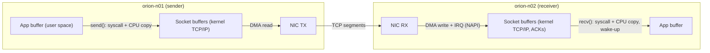
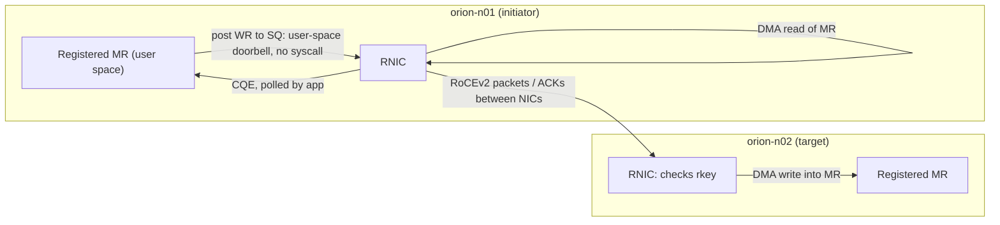

# 8.10 — Draw the TCP and RDMA data paths (model answer)

Relies on manuscript Section 8.1 ("Why RDMA: the cost of moving a byte through a kernel", Figures 8.1
and 8.2) and Section 8.2 (verbs, completions). Counts are per 1 MiB message. A 1 MiB TCP send is many
segments, but copies are counted as *passes over the data*. The counts are qualitative
`[ILLUSTRATIVE]` and depend on configuration (interrupt moderation, blocking mode).

## Diagrams

Kernel involvement on the RDMA side happens only at setup (open device, register MR, create QP). The
remote CPU is not involved at all for a WRITE.

## Count table

| Per 1 MiB message | TCP sender | TCP receiver | RDMA WRITE initiator | RDMA WRITE target |
|---|---|---|---|---|
| CPU copies | 1 (user → socket buffers) | 1 (socket buffers → user) | 0 | 0 |
| DMA transfers | 1 (NIC reads skbs) | 1 (NIC writes RX ring) | 1 (NIC reads MR) | 1 (NIC writes MR) |
| System calls | ≥ 1 `send()` (often several for 1 MiB) | ≥ 1 `recv()` / `epoll_wait()` | 0 (doorbell from user space) | 0 |
| Interrupts | TX-completion IRQs (moderated) | RX IRQs (moderated, NAPI) | 0 if the CQ is polled (1 if armed for events) | 0 |
| Context switches | 0–1 (blocking send when the buffer is full) | 0–1 (waking a blocked receiver) | 0 | 0 |
| Kernel on the data path | TCP/IP, segmentation, buffers | TCP/IP, ACKs, reassembly | none | none |
| Remote CPU involved | n/a | **yes** | n/a | **no** |

## Offloads: what they change and what they cannot remove

- **TSO/GSO** and **checksum offload** cut per-segment CPU work on send. Copies and syscalls remain.
- **GRO/LRO** and **interrupt moderation** cut receive interrupts and per-packet processing. The receive
  copy remains.
- **`MSG_ZEROCOPY`** removes the *send-side* copy for large sends, at the cost of completion
  notifications on the socket error queue.
- None of these removes the **receive-side copy** for ordinary sockets or **kernel TCP processing**
  on both ends. (`TCP_ZEROCOPY_RECEIVE` via `mmap` exists, but it needs page-aligned payloads and
  suitable NIC header-split support; it is credited if mentioned with that caveat.)

Only RDMA removes the kernel and the remote CPU from the data path entirely. That is why it sustains
392 Gb/s per NIC with near-zero CPU cost.
