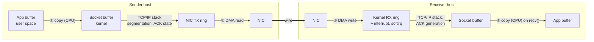
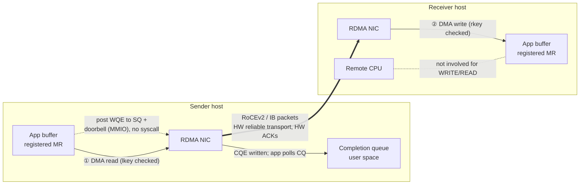
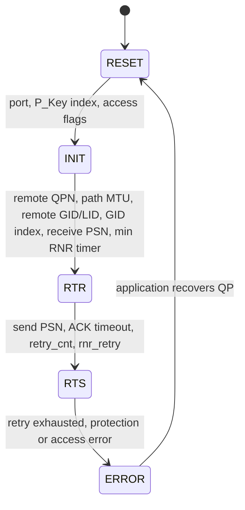
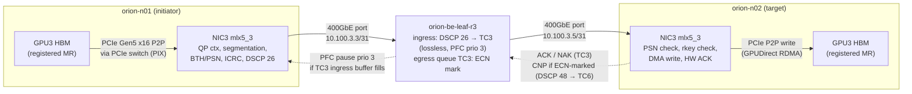

# Chapter 8 — RDMA, RoCEv2, and InfiniBand

> A 70-billion-parameter training step on ORION moves tens of gigabytes between GPUs every few
> seconds, and the step cannot finish until the slowest transfer does. Conventional TCP sockets spend
> CPU cycles, memory bandwidth, and microseconds on every byte; at 400 Gb/s per NIC and eight NICs per
> node, that tax is unaffordable. Remote Direct Memory Access (RDMA) removes the kernel and the CPU
> from the data path: applications post work directly to the network adapter, which reads and writes
> registered memory on both ends without copies or interrupts. This chapter explains how RDMA works,
> how its packets travel as RoCEv2 and over InfiniBand, how its reliable transport behaves when a
> packet is lost, and how a production team proves an RDMA fabric is ready before a training job lands
> on it — ending with a deployment-readiness validator that catches the faults that break clusters.

## Learning objectives

After working through this chapter, its exercises, and its lab, you will be able to:

1. **Explain** the RDMA verbs model (PDs, MRs with `lkey`/`rkey`, RC/UC/UD queue pairs, CQs, the QP
   state machine) and distinguish one-sided (READ/WRITE) from two-sided (SEND/RECV) operations.
2. **Draw and compare** the data path of a message sent over TCP sockets and over RDMA, counting CPU
   copies, interrupts, system calls, and context switches on each side.
3. **Decode** a RoCEv2 packet (Ethernet, IP with DSCP and explicit congestion notification (ECN), UDP
   port 4791, Base Transport Header) and
   **calculate** wire efficiency, packet rate, and payload ceiling for a given path MTU.
4. **Describe** InfiniBand management (LIDs, subnet manager, P_Keys, SL/VL, credit-based flow control)
   and **compare** RoCEv2 and InfiniBand across transport, management, operations, and evidence.
5. **Calculate** the cost of packet loss under go-back-N recovery and the retry time budget set by the
   ACK timeout and retry count.
6. **Design** a multi-rail RDMA attachment (addressing, GID selection, QoS marking, GPU/NIC locality)
   for an 8-NIC GPU server.
7. **Validate** RDMA deployment readiness with real tools and a scripted checklist, and **diagnose**
   underperforming pairs from perftest results.

## Prerequisites and connections

You need the Linux host diagnostics of [Chapter 3](../../part-1-foundations/ch03-linux-host-systems-diagnostics/manuscript.md)
(PCIe, NUMA, `ethtool`, `ip`), the HX8 topology and GPU/NIC locality of
[Chapter 5](../../part-2-accelerated-compute/ch05-gpu-interconnects-host-topology/manuscript.md), and the
leaf-spine, equal-cost multipath (ECMP), and rail-optimized fabric design of
[Chapter 7](../ch07-ethernet-datacenter-network-foundations/manuscript.md).

This chapter is a prerequisite for [Chapter 9](../ch09-congestion-control-lossless-fabrics/manuscript.md)
(priority flow control (PFC), ECN, and Data Center Quantized Congestion Notification (DCQCN) — the
machinery that keeps RoCEv2 loss-free and fair),
[Chapter 10](../ch10-switches-optics-physical-layer/manuscript.md) (the physical layer under the NIC↔switch
path), [Chapter 12](../../part-4-distributed-ai/ch12-collective-communication-nccl/manuscript.md) (NCCL's
IB/RoCE transport), and [Chapter 13](../../part-4-distributed-ai/ch13-gpu-data-movement/manuscript.md)
(GPUDirect RDMA). Capstones A (cluster design) and B (network troubleshooting) in [capstones/](../../../capstones/) reuse
the readiness checklist and perftest analyzer; Capstone H reuses the RDMA-versus-TCP data-path
comparison for KV-cache transfer.

## 8.1 Why RDMA: the cost of moving a byte through a kernel

Start with the conventional path. `send()` on a TCP socket traps into the kernel (a *mode switch*);
the kernel copies the user buffer into socket buffers, TCP segments it, and the NIC DMAs (direct
memory access) the kernel buffers onto the wire. The receiving NIC DMAs frames into kernel ring
buffers and raises a (moderated) interrupt; the kernel runs TCP, sends ACKs, and on `recv()` copies the
data into the user buffer — waking a blocked thread with a genuine *context switch*.

RDMA replaces almost all of that. The application registers its buffers once, writes a *work queue
element* (WQE) into a queue in its own address space, and rings a *doorbell* — one memory-mapped I/O
write to the NIC. The NIC DMA-reads the payload from the user buffer, segments and transmits it; the
remote NIC checks a key, DMA-writes into the destination buffer, and acknowledges in hardware. The
sender polls a *completion queue* (CQ) in user memory. No system call, no kernel copy, and — for a
one-sided WRITE — no remote CPU at all.



*Figure 8.1 — TCP socket data path. Two CPU copies (①, ④), two DMAs (②, ③), a system call on each
side, receive interrupts, kernel protocol processing on both CPUs, and a wake-up context switch if the
receiver was blocked.*



*Figure 8.2 — RDMA WRITE data path. Zero CPU copies, two DMAs, no system calls or interrupts on the
data path (completions are polled), and no remote CPU involvement. The kernel is used only on the
control path: opening the device, registering memory, and creating queue pairs.*


| Cost (per message) | TCP sockets, sender | TCP sockets, receiver | RDMA WRITE, initiator | RDMA WRITE, target |
|---|---|---|---|---|
| CPU data copies | 1 (user→kernel) | 1 (kernel→user) | 0 | 0 |
| DMA transfers | 1 | 1 | 1 | 1 |
| System calls (mode switches) | ≥ 1 (`send`) | ≥ 1 (`recv`/`epoll`) | 0 (doorbell is an MMIO write) | 0 |
| Interrupts | TX completions (moderated) | RX interrupts (moderated) | 0 if CQ is polled | 0 |
| Context switches | 0–1 | 0–1 (wake blocked reader) | 0 | 0 |
| Protocol processing | Kernel TCP | Kernel TCP + ACK generation | NIC hardware | NIC hardware (ACKs) |
| Remote CPU involvement | — | Yes | — | No |

*Table 8.1 — Per-message data-path costs, TCP versus RDMA WRITE `[ILLUSTRATIVE]`. Offloads (TSO/GRO,
interrupt moderation, `MSG_ZEROCOPY`) trim some TCP costs but not the receive copy.*

> **Key idea:** RDMA does not make the wire faster. It removes the host from the data path, so that
> the wire, PCIe, and memory — not kernel code — set the limits on bandwidth and latency.

The price of *kernel bypass* and *zero copy* is complexity: memory must be registered and pinned,
both ends must agree on queue-pair parameters out of band, and the hardware transport tolerates packet
loss far worse than TCP (Section 8.6, Chapter 9).

## 8.2 The verbs model

The RDMA programming interface is called *verbs*, after the abstract operations in the InfiniBand
Architecture specification. On Linux it is `libibverbs` in `rdma-core`, and InfiniBand, RoCEv2, and
iWARP all expose the same verbs (Figure 8.3).

```text
 Application (user space)
 ┌──────────────────────────────────────────────────────────────────────────────────┐
 │  Device context ── Protection Domain (PD)                                        │
 │                        ├── Memory Region MR#1  [addr, len, access] → lkey, rkey  │
 │                        ├── Memory Region MR#2                                    │
 │                        └── Queue Pair (QP n, type RC)                            │
 │                              ├── Send Queue  (SQ): WQE WQE WQE ──┐ doorbell      │
 │                              └── Receive Queue (RQ): WQE WQE     │ (MMIO write)  │
 │                         Completion Queue (CQ) ◄── CQE CQE ◄──────┼── NIC writes  │
 └──────────────────────────────────────────────────────────────────┼───────────────┘
                                                                    ▼
                                    RDMA NIC: QP context, MR translation table (MTT),
                                    transport engine (PSNs, ACKs, retries), DMA engines
```

*Figure 8.3 — Verbs objects. Work requests are posted to queues in user memory; the NIC executes
them, translating addresses through the registered-memory tables and writing completions to a CQ.*

**Protection domain (PD).** Ties memory regions and queue pairs together; a QP can only use memory
registered in its own PD.

**Memory region (MR) and keys.** `ibv_reg_mr()` pins a buffer's pages, programs the NIC's
translation tables, and returns two 32-bit keys. The *local key* (`lkey`) authorises the local NIC to
use the buffer in a local work request; the *remote key* (`rkey`) is handed to the peer so its READ or
WRITE can target the buffer, within the access flags given at registration
(`IBV_ACCESS_LOCAL_WRITE`, `IBV_ACCESS_REMOTE_WRITE`, `IBV_ACCESS_REMOTE_READ`). Registration is
expensive (kernel, page pinning, NIC table updates), so production code registers large buffers once
and reuses them. NCCL registers its internal buffers when it sets up connections (possibly lazily, on
first use of a peer), and applications can pre-register their own buffers with `ncclCommRegister`
`[VENDOR-SPEC, 2026-10]`.

> **Pitfall:** An `rkey` is a capability: whoever holds it, the address, and a connected QP can access
> that memory within its rights. Partitioning and keeping untrusted tenants off RDMA fabrics are the
> controls (Chapter 19).

**Queue pair (QP).** A send queue and a receive queue plus transport state in the NIC — the analogue
of a socket, identified by a 24-bit QP number (QPN) and walked through a state machine with
`ibv_modify_qp()`:



*Figure 8.4 — Queue-pair states (RTR = ready to receive, RTS = ready to send). Most RDMA
misconfigurations live in these transition parameters: GID index, path MTU, ACK timeout.*

Connection parameters (QPN, PSN, GID or LID, `rkey`, buffer addresses) are exchanged out of band
before RTR — over a TCP socket (perftest's default, NCCL's bootstrap) or by the RDMA connection
manager (`librdmacm`), which also selects the GID.

**Completion queue (CQ).** The NIC writes a completion queue entry (CQE) when a work request
finishes; the application polls it (`ibv_poll_cq()`, no system call) or sleeps on a completion
channel. Any status other than `IBV_WC_SUCCESS` (0) usually moves the QP to ERROR. Incident tickets
feature `IBV_WC_RETRY_EXC_ERR` (12: retries exhausted, the peer never acknowledged) and
`IBV_WC_RNR_RETRY_EXC_ERR` (13: the peer repeatedly had no receive posted).

### Transport services

| Service | Reliability | Connection | Operations | Typical use |
|---|---|---|---|---|
| RC — Reliable Connected | In-order, acknowledged, retransmitted in hardware | One QP per peer | SEND/RECV, WRITE, READ, atomics | NCCL, storage (NVMe-oF, GPUDirect Storage back ends), most RDMA apps |
| UC — Unreliable Connected | No ACKs; a lost packet drops the whole message | One QP per peer | SEND/RECV, WRITE | Rare; streaming where loss is tolerable |
| UD — Unreliable Datagram | No ACKs; one MTU per message | Connectionless, one QP talks to many | SEND/RECV only | Management (subnet management datagrams), IP over InfiniBand, scalable discovery |

*Table 8.2 — Standard transport services.* Scalable variants reduce per-peer QP state: XRC (in the
specification) and NVIDIA's Dynamically Connected transport (vendor-specific). NCCL uses RC.

### Operations: one-sided versus two-sided

- **SEND/RECV (two-sided).** The receiver must have posted a RECV describing where the message goes;
  otherwise the responder returns a *receiver-not-ready* (RNR) NAK and the sender retries up to
  `rnr_retry` times (7 = forever). Both CPUs participate.
- **RDMA WRITE (one-sided).** The initiator names a remote address and `rkey`; the target NIC places
  the data with no RECV and no target CQE. The target learns of it from a flag it polls, a following
  SEND, or WRITE-with-immediate (which consumes a RECV and delivers 32 bits of immediate data in a CQE).
- **RDMA READ (one-sided).** The target NIC returns the contents of a remote buffer. READs are round
  trips bounded by the outstanding-READ limits (`max_rd_atomic`, `max_dest_rd_atomic`), so READ curves
  differ from WRITE curves. Atomics (fetch-and-add, compare-and-swap) also exist.

> **Production note:** NCCL's IB/RoCE transport moves bulk data with RDMA WRITE, so `ib_write_bw` is
> the closest perftest analogue for AI collectives; `ib_send_bw` and `ib_read_bw` exercise other NIC
> paths and can expose different problems.

## 8.3 What an RDMA packet carries: the transport headers

The InfiniBand Architecture (IBA) transport layer is the same whether the packets ride on an
InfiniBand link or are encapsulated in UDP/IP for RoCEv2. Its core is the 12-byte *Base Transport
Header* (BTH), present in every packet:

```text
 Base Transport Header (12 bytes)
  0                   1                   2                   3
  0 1 2 3 4 5 6 7 8 9 0 1 2 3 4 5 6 7 8 9 0 1 2 3 4 5 6 7 8 9 0 1
 +---------------+-+-+---+-------+-------------------------------+
 |    OpCode     |S|M|Pad| TVer  |        Partition Key          |
 +-+-+-----------+-+-+---+-------+-------------------------------+
 |F|B|   Resv6   |        Destination QP number (24 bits)        |
 +-+-+-----------+-----------------------------------------------+
 |A|    Resv7    |        Packet Sequence Number (24 bits)       |
 +-+-------------+-----------------------------------------------+
 S = solicited event, M = migration state, Pad = pad count, TVer = transport version,
 F/B = FECN/BECN (InfiniBand congestion notification), A = acknowledge request
```

*Figure 8.5 — BTH layout. OpCode encodes the transport service and operation (for example RC RDMA
WRITE First/Middle/Last/Only, RC Acknowledge); the P_Key enforces partition membership; the 24-bit
PSN orders packets within a QP.*

Extension headers follow when needed: the 16-byte *RDMA Extended Transport Header* (RETH: remote
address, `rkey`, length) on a WRITE's first packet or a READ request; the 4-byte *ACK Extended
Transport Header* (AETH) on ACKs and READ responses. Every packet ends with a 4-byte *invariant CRC*
(ICRC) over the fields that do not change hop by hop.

A message larger than the *path MTU* is segmented into First, Middle, and Last packets with
consecutive PSNs; the responder checks order and returns (often coalesced) ACKs carrying the highest
in-sequence PSN. Section 8.6 covers what happens when the sequence breaks.

## 8.4 RoCEv2: the IBA transport over UDP/IP

RDMA over Converged Ethernet version 2 (RoCEv2, IBA Annex A17, 2014) wraps the IBA transport in
UDP/IP. RoCEv1 (Annex A16, 2010) used a raw Ethernet frame with EtherType 0x8915 and could not cross
an IP router, so every routed AI fabric — including ORION's /31-per-port design — needs RoCEv2.

```text
 RoCEv2 packet (RDMA WRITE Middle, IPv4, untagged), bytes on the wire
 ┌──────────┬───────────┬──────────┬──────────┬────────┬───────────────────────┬───────┬──────┬──────────┐
 │ Preamble │ Ethernet  │ IPv4     │ UDP      │ BTH    │ Payload               │ ICRC  │ FCS  │ Inter-   │
 │ + start  │ header    │ header   │ header   │        │ (≤ path MTU,          │       │      │ frame gap│
 │ delim. 8 │ 14        │ 20       │ 8        │ 12     │  e.g. 4096)           │ 4     │ 4    │ 12       │
 └──────────┴───────────┴──────────┴──────────┴────────┴───────────────────────┴───────┴──────┴──────────┘
                         │ DSCP (6b) │ src port: per-QP entropy (ECMP hash)
                         │ ECN  (2b) │ dst port: 4791 (IANA, RoCEv2)
                         │ proto 17  │
 First packet of a WRITE adds RETH (16 B) after the BTH; ACKs carry AETH (4 B) and no payload.
```

*Figure 8.6 — RoCEv2 encapsulation. The UDP destination port 4791 identifies RoCEv2; the UDP source
port is chosen per QP (or per flow) to give ECMP something to hash on; DSCP selects the switch
traffic class; the ECN bits carry congestion marks (Chapter 9).*

Four fields deserve an operator's attention.

**UDP destination port 4791.** Switch ACLs, sampling, and captures identify RoCEv2 by this port.
`tcpdump` on the host usually shows nothing, because RDMA frames bypass the kernel; use switch
mirroring or a vendor NIC capture facility.

**UDP source port.** All packets of one QP normally carry the same source port, so ECMP keeps a QP
on one path while different QPs spread out. Same-rail traffic crosses a single leaf and never meets
ECMP; for cross-rail traffic, few QPs per NIC pair make collisions of elephant QPs on one spine uplink
a real source of bandwidth variance (Chapter 7); NCCL opens several QPs
per connection, and some vendors add per-packet spraying or adaptive routing.

**DSCP and ECN.** The Differentiated Services Code Point (DSCP, 6 bits) selects the switch queue, PFC
priority, and ECN profile. On ORION, RoCE data is DSCP 26 (traffic class 3, lossless, ECN-marked) and
congestion notification packets (CNPs) are DSCP 48 (traffic class 6, strict priority). The 8-bit
IPv4 ToS / IPv6 Traffic Class byte holds DSCP in its top 6 bits and ECN in the bottom 2, so software
that sets the whole byte must shift DSCP left by two: DSCP 26 → 26 × 4 = 104; adding the
ECN-capable-transport codepoint ECT(0) = 0b10 = 2 gives 106. That is why ORION's site configuration contains `NCCL_IB_TC=106`.

> **Pitfall:** Setting a traffic-class value of 26 where the byte is expected yields DSCP 6 — a lossy
> default queue. Nothing fails; RDMA packets are simply dropped under load, at scale.

**GIDs and the GID index.** RDMA addresses a port by a 128-bit *global identifier* (GID). On RoCE,
the NIC populates a *GID table* per port from the netdev's MAC-derived IPv6 link-local address and
from every IP address configured on the interface; each address appears once per RoCE version.
The *GID index* an application chooses decides both the source address and whether the NIC emits
RoCEv1 or RoCEv2.

```text
$ show_gids mlx5_3                               # vendor script; [ILLUSTRATIVE] output
DEV     PORT  INDEX  GID                                      IPv4          VER  DEV
---     ----  -----  ---                                      ------------  ---  ---
mlx5_3  1     0      fe80:0000:0000:0000:ba3f:d2ff:fe47:0123                v1   ens4np0
mlx5_3  1     1      fe80:0000:0000:0000:ba3f:d2ff:fe47:0123                v2   ens4np0
mlx5_3  1     2      0000:0000:0000:0000:0000:ffff:0a64:0303  10.100.3.3    v1   ens4np0
mlx5_3  1     3      0000:0000:0000:0000:0000:ffff:0a64:0303  10.100.3.3    v2   ens4np0
n_gids_found=4
```

Index 3 is the RoCEv2 GID carrying the IPv4 address as an IPv4-mapped IPv6 address
(`::ffff:10.100.3.3`). Index 2 is the same address as RoCEv1 — a non-routable EtherType-0x8915 frame.
The vendor-neutral way to read the same table is sysfs:
`cat /sys/class/infiniband/mlx5_3/ports/1/gids/3` and
`cat /sys/class/infiniband/mlx5_3/ports/1/gid_attrs/types/3` (which prints `RoCE v2`). GID indices are
*not* stable: adding an address to the interface inserts entries and can shift them. Use `librdmacm`
(which selects by IP address) or validate the configured index on every node — as the lab does.

### The NIC↔switch data path

Figure 8.7 traces one same-rail RoCEv2 WRITE from GPU memory to GPU memory through the rail leaf —
the NIC↔switch reference path for Chapters 9 and 10.



*Figure 8.7 — NIC↔switch data path for a same-rail RoCEv2 WRITE on ORION. Data rides lossless class 3,
CNPs strict-priority class 6, PFC acts hop by hop. Cross-rail traffic adds a spine (Chapter 7).*

Two NICs, two PCIe paths, two cables, and two switch ports are in series; a fault can hide in any.

## 8.5 InfiniBand: a fabric designed for RDMA

InfiniBand (IB) is a complete architecture — physical, link, network, transport, and management
layers — specified by the InfiniBand Trade Association (IBTA). ORION's comparison design is an NDR
(400 Gb/s per 4-lane port) rail-optimized fat tree. The transport is the one you have met; everything
underneath differs.

### Addressing: GUIDs, LIDs, and GIDs

IB devices have burned-in 64-bit *globally unique identifiers* (GUIDs) per node and port. Inside a
subnet, packets are switched on a 16-bit *local identifier* (LID) carried in the 8-byte *Local Route Header* (LRH). LIDs are not burned in — the
subnet manager assigns them. Unicast LIDs run from 0x0001 to 0xBFFF (49,151 values), 0xC000–0xFFFE
are multicast, and 0xFFFF is the permissive LID used in management. A port can hold 2^LMC
consecutive LIDs (LID mask control) so that routing can install several paths to one destination. A
128-bit GID and the 40-byte Global Route Header are needed only across IB routers.

### The subnet manager

An InfiniBand subnet is centrally managed. A *subnet manager* (SM) — OpenSM on a host, or an SM in a
managed switch or vendor fabric manager — **discovers** every switch and adapter with directed-route
*subnet management packets* (SMPs); **assigns** LIDs and the subnet prefix; **routes** by running a
routing engine (min-hop, fat-tree, up/down, deadlock-free variants such as DFSSSP) and programming
every switch's *linear forwarding table* (DLID → output port); **configures** P_Key tables,
service-level-to-virtual-lane (SL-to-VL) maps, and MTU; and **sweeps** periodically, re-routing on port changes. SMPs use virtual lane
15, which is reserved for management and not flow controlled. One SM is master; standbys with lower
priority take over by election. Hosts see their SM in the `SM lid` field of `ibstat`.

> **Production note:** The SM is a single logical point of control: a routing-engine bug, an
> unfinished sweep, or two SMs fighting over mastership produces fabric-wide symptoms. Pin SM placement
> and priority, monitor sweep times, and change SM configuration only in a maintenance window.

### Partitions, service levels, and credit-based flow control

A *partition* is InfiniBand's isolation mechanism, analogous to a VLAN. Every packet's BTH carries a
16-bit P_Key, and a port drops packets whose P_Key is not in the table the SM programmed. The low 15
bits are the partition number; the high bit marks *full* membership (may talk to any member) versus
*limited* (may talk only to full members). The default partition 0x7FFF appears as 0xFFFF for full
members. On RoCEv2 the BTH still carries a P_Key, but isolation comes from IP segmentation (VRFs, ACLs).

IB links carry up to 15 data *virtual lanes* (VLs) plus VL15, each with its own buffers. A packet's
4-bit *service level* (SL) is mapped to a VL at every hop by SM-programmed tables — how IB separates
traffic classes and breaks routing-deadlock cycles. Flow control is *credit-based* per VL: the receiver
advertises free buffer space (in 64-byte blocks) and the sender transmits only when it holds enough
credits. Congestion cannot overflow a buffer, so IB is lossless by construction, without a pause
protocol or the headroom arithmetic PFC needs (Chapter 9). The cost is the same as for any lossless
network: waiting propagates upstream. `PortXmitWait` — ticks a port had data but no credits — is the IB
counterpart of PFC pause counters.

### Adaptive routing and congestion control

A static forwarding table gives one output port per destination LID, so collisions behave like ECMP
collisions. *Adaptive routing* lets switches pick among equal-cost ports per packet by queue
occupancy, relying on the receiving host channel adapter (HCA) to reorder.

> **Vendor implementation note (NVIDIA):** NVIDIA Quantum-class InfiniBand switches implement
> adaptive routing and fast link-fault recovery, configured through the subnet manager/fabric manager,
> and in-network reduction (SHARP, Chapter 12). Feature names, defaults, and the HCA/firmware
> combinations that support out-of-order delivery change by release. Verify against the current
> switch and HCA documentation `[VENDOR-SPEC, 2026-10]`.

IBA congestion control marks packets at congested ports (FECN), the destination returns a BECN, and
the source throttles — the ancestor of RoCEv2's ECN/CNP-based DCQCN (Chapter 9).

### Reading an InfiniBand port

```text
$ ibstat mlx5_0                                  # [ILLUSTRATIVE] output, IB variant of ORION
CA 'mlx5_0'
        CA type: MT4129
        Number of ports: 1
        Firmware version: 28.39.1002
        Node GUID: 0xb83fd20300470020
        Port 1:
                State: Active
                Physical state: LinkUp
                Rate: 400
                Base lid: 17
                LMC: 0
                SM lid: 1
                Port GUID: 0xb83fd20300470020
                Link layer: InfiniBand
```

A healthy port is `Active`/`LinkUp` at the expected `Rate` with a non-zero `Base lid` and the
expected `SM lid`. `State: Initializing` with `Physical state: LinkUp` means the link trained but the SM
has not configured the port — look at the SM, not the optic. `Polling` means no link partner.
Fabric-wide views come from `ibnetdiscover`, `iblinkinfo`, and `sminfo`; `perfquery -x <lid> <port>`
reads 64-bit port counters. Two traps: `PortXmitData`/`PortRcvData` count 32-bit words (multiply by 4
for bytes), and legacy 32-bit counters saturate rather than wrap.

## 8.6 Transport behaviour: what happens when a packet goes missing

RC guarantees in-order, exactly-once delivery. The classic recovery mechanism, defined in the IBA
specification and implemented by most deployed NICs, is **go-back-N**:

1. The requester sends consecutive PSNs and keeps the means to resend them until acknowledged.
2. The responder accepts only the next expected PSN. If *k* is missing and *k+1* arrives, it sends one
   NAK (*PSN sequence error*) naming *k* and drops every out-of-order packet until *k* arrives.
3. On the NAK, the requester rewinds and retransmits everything from *k* — including packets the
   responder had received and discarded.
4. If nothing comes back (the last packets or an ACK were lost), no NAK is possible: the requester
   waits for the **local ACK timeout**, then retransmits from the oldest unacknowledged PSN.

The ACK timeout is set per QP (the 5-bit `timeout` attribute at the RTS transition) and is
exponential:

> T_ack = 4.096 µs × 2^timeout   (timeout = 0 means wait forever — no ACK timer)

Each expiry consumes one of `retry_cnt` retries (3 bits, at most 7); when they are exhausted the work
request completes with `IBV_WC_RETRY_EXC_ERR` and the QP enters ERROR — for an AI job, usually fatal.
NCCL exposes the attributes as `NCCL_IB_TIMEOUT` and `NCCL_IB_RETRY_CNT`; the timeout default is 18
up to NCCL 2.22 and 20 from 2.23 `[VENDOR-SPEC, 2026-10]`. Table 8.3 gives the worst-case time-to-failure,
(retry_cnt + 1) × T_ack, for a vanished peer:

| `timeout` | T_ack | Time to declare failure with `retry_cnt` = 7 |
|---|---|---|
| 14 | 4.096 µs × 16,384 = 67.1 ms | 8 × 67.1 ms = 0.537 s |
| 18 | 4.096 µs × 262,144 = 1.07 s | 8 × 1.07 s = 8.59 s |
| 20 | 4.096 µs × 1,048,576 = 4.29 s | 8 × 4.29 s = 34.4 s |

*Table 8.3 — ACK timeout and retry budget `[MODELED]`; NICs may round or clamp the timer.*

A short timeout recovers a tail drop quickly but turns a transient stall (a long PFC pause, a brief
link flap) into a fatal error; a long one rides through transients but makes every tail drop cost
seconds. Large training clusters generally choose long timeouts and invest in *not losing packets*.

**Why loss is so expensive** `[MODELED]`. Take one 2 MiB RDMA WRITE (2,097,152 B) at a 4,096-byte path
MTU: 512 packets, taking 2,097,152 × 8 / 392 × 10⁹ = 42.8 µs at the 392 Gb/s ceiling of Section 8.7.

- *Mid-message loss.* If packet 100 is lost, the responder NAKs when packet 101 arrives, and the NAK
  reaches the requester about one round trip (≈ 4 µs on one rail, ≈ 5 µs cross-rail) after it sent packet
  100. Meanwhile it has sent about one bandwidth-delay product more — ≈ 48 packets — which are all
  discarded and resent: 48 × 4,096 × 8 / 392 × 10⁹ = 4.0 µs, i.e. about one round trip of extra time,
  a 9 % penalty. The waste per loss scales with the bandwidth-delay product, so it grows with link
  speed and with cross-spine round trips.
- *Tail loss.* If packet 512 (or its ACK) is lost, nothing triggers a NAK; the requester waits T_ack.
  At `timeout` = 14 the message takes 67.1 ms + 42.8 µs — about 1,570 times longer.

Tail loss dominates for *isolated* messages — a QP that goes idle after each message, so a lost last
packet (or final ACK) has no successor to trigger a NAK. With independent loss probability *p* per
packet, the expected timeout cost per such message is roughly p × T_ack: at p = 10⁻³ and T_ack = 67.1 ms that is 67 µs per 43 µs message, so
goodput falls to about 43 / (43 + 67) ≈ 39 % before counting mid-message rewinds; at `timeout` = 20
(4.29 s) even p = 10⁻⁶ costs 4.3 µs per message (≈ 9 %). For back-to-back traffic the next message's
first packet exposes the gap and triggers a NAK, so the timeout exposure is per *burst* (the last
packet before the QP idles), not per message — collectives that pause between steps still pay it once
per burst. TCP shrugs off such loss rates; RC with
go-back-N does not — which is why RoCE fabrics traditionally run *lossless* with PFC plus ECN-based rate
control (DCQCN), Chapter 9.

**Selective repeat.** Newer NICs can accept out-of-order packets and retransmit only missing ones —
far more loss-tolerant, and a prerequisite for multipath packet spraying. IRN (Mittal et al., 2018) argued that this plus end-to-end congestion
control can make PFC optional. Which mechanism a NIC uses depends on model, firmware, and
configuration `[VENDOR-SPEC, 2026-10]` — record it in the environment manifest.

**Where the evidence is.** Linux RDMA drivers expose transport counters per port. On mlx5 devices they
appear under `/sys/class/infiniband/<dev>/ports/1/hw_counters/` and in `rdma statistic show`:

```text
$ rdma statistic show link mlx5_3/1             # vendor counter names; [ILLUSTRATIVE] values
link mlx5_3/1 rx_write_requests 918273645 rx_read_requests 1024 out_of_buffer 0
  out_of_sequence 1842 duplicate_request 37 rnr_nak_retry_err 0 packet_seq_err 1790
  implied_nak_seq_err 0 local_ack_timeout_err 52 np_ecn_marked_roce_packets 2210934
  np_cnp_sent 1934410 rp_cnp_handled 1802256 ...
```

`out_of_sequence`: responder saw a PSN gap (loss upstream of this receiver). `packet_seq_err`: requester
received sequence-error NAKs (its packets were lost). `local_ack_timeout_err`: requester timed out
(tail loss or a dead peer). `duplicate_request`: responder received retransmissions it already had
(often a lost ACK). The `np_`/`rp_` counters are DCQCN's two NIC roles: the *notification point*
(receiver returning CNPs for ECN-marked packets) and the *reaction point* (sender cutting its rate);
the ECN-marking switch is the *congestion point* (Chapter 9). Names are driver-specific.

## 8.7 Path MTU and wire efficiency

IBA transport MTUs are powers of two: 256, 512, 1,024, 2,048, and 4,096 bytes. `ibv_devinfo` shows
`max_mtu` and `active_mtu` with an enumeration (1 = 256 … 5 = 4,096). On RoCE, `active_mtu` is the
largest IBA MTU that fits in the netdev MTU after RoCE headers: 4,096 with ORION's 9,000-byte IP MTU,
but 1,024 with a default 1,500 (2,048 + headers does not fit) — silently 4× the packets.

The *path MTU* of an RC QP is set at RTR, typically the minimum of the two ends' `active_mtu`. Switch
ports are separate: ORION's 9,216-byte ports carry 4,096-byte RoCE payloads, but a port left at 1,500
bytes silently drops every full-size RoCE packet while small ones pass — connections establish,
small-message tests pass, and large transfers hit ACK timeouts.

Wire efficiency follows from Figure 8.6. For a Middle packet of an RDMA WRITE on untagged IPv4, the
per-packet overhead is

> preamble + start-frame delimiter 8 + Ethernet 14 + IPv4 20 + UDP 8 + BTH 12 + ICRC 4 + frame check
> sequence (FCS) 4 + inter-frame gap 12 = 82 bytes.

| Path MTU (payload B) | Bytes on wire per packet | Efficiency | Payload ceiling at 400 Gb/s | Packets/s at line rate |
|---|---|---|---|---|
| 1,024 | 1,106 | 1,024 / 1,106 = 92.6 % | 370.3 Gb/s | 400 × 10⁹ / (1,106 × 8) = 45.2 M |
| 2,048 | 2,130 | 2,048 / 2,130 = 96.2 % | 384.6 Gb/s | 23.5 M |
| 4,096 | 4,178 | 4,096 / 4,178 = 98.0 % | 392.1 Gb/s | 400 × 10⁹ / (4,178 × 8) = 11.97 M |

*Table 8.4 — RoCEv2 wire efficiency by path MTU, RDMA WRITE Middle packets, untagged IPv4 `[MODELED]`.
The 16-byte RETH on the first packet of each message is negligible for large messages
(16 B / 512 packets for a 2 MiB WRITE). Add 4 bytes per packet if a VLAN tag is used, 20 bytes more for
IPv6.*

Between 1,024 and 4,096 the bandwidth difference is only 5.6 %, but the packet rate is 3.8 times higher
— and packet rate is what NIC and switch pipelines, ACK generation, and ECN/CNP machinery must sustain.

> **Pitfall:** MTU must be consistent at three layers: the host netdev MTU (which sets the RoCE
> `active_mtu`), the RDMA path MTU negotiated by the application, and every switch port's L2/L3 MTU on
> the path. Validate all three; a check of only the host misses the most dangerous case.

## 8.8 Multi-rail design

Each of an HX8's eight 400 Gb/s backend NICs sits behind the same PCIe switch as its GPU (PIX,
Chapter 5). On ORION's *rail-optimized* backend, NIC *r* of every node connects to rail leaf *r*, so
same-index GPUs on different nodes are one switch hop apart; cross-rail traffic crosses a spine.

A multi-rail attachment has to get five things right per NIC:

1. **Locality.** Use NIC *r* for GPU *r*. A GPU that sends through a NIC on the other socket crosses
   the inter-socket link and loses bandwidth and latency predictability (Chapter 5 quantifies this).
2. **Addressing and routing.** Each NIC has its own routed /31 — `10.100.r.(2n+1)/31` for node *n* —
   and per-NIC policy routing so traffic sourced from rail *r*'s address leaves through rail *r*'s NIC;
   otherwise bootstrap TCP for every rail can leave through one interface.
3. **GID selection.** The GID index must resolve, on every NIC of every node, to the RoCEv2 entry
   holding that NIC's rail address.
4. **QoS marking.** Every NIC must mark RoCE data with DSCP 26 and trust DSCP on receive; PFC must be
   enabled on priority 3 only, matching the switch.
5. **GPUDirect RDMA.** The GPU driver must expose GPU memory to the RDMA stack — via the
   `nvidia_peermem` module or, on recent kernels and drivers, dma-buf — and PCIe settings (ACS, IOMMU)
   must permit peer-to-peer. Chapter 13 validates the path; readiness checks that the baseline's
   mechanism is present.

> **Vendor implementation note (NVIDIA NCCL):** NCCL can route a transfer destined for a remote GPU
> through an NVLink-connected local GPU whose NIC is on the destination's rail (the PXN feature), which
> keeps traffic on-rail even for cross-rail pairs. Behaviour and controls (for example
> `NCCL_PXN_DISABLE`) are version-specific `[VENDOR-SPEC, 2026-10]`; Chapter 12 covers them.

Rails are also failure domains: if a NIC or rail leaf fails, NCCL fails the job or — depending on
version and configuration — continues on fewer rails. Eight rails at 392 Gb/s payload each give a node about 8 × 392 = 3,136 Gb/s ≈ 392 GB/s of backend bandwidth
`[MODELED]`; losing one rail removes 12.5 % of it, but because collectives are synchronous, the whole
job typically runs at the pace of the degraded node. InfiniBand clusters apply the same pattern, with
each rail often a separate subnet ("plane") with its own SM.

## 8.9 RoCEv2 versus InfiniBand

Both run the same verbs and RC transport, so NCCL, MPI, and storage clients barely notice the
difference. The people who build and operate the fabric do (Table 8.5).

| Dimension | RoCEv2 (ORION baseline) | InfiniBand (ORION comparison) |
|---|---|---|
| **Transport** | IBA transport (BTH, RC/UC/UD) in UDP/IP, dst port 4791 | Native IBA: LRH (+ optional GRH), BTH, variant CRC |
| **Loss behaviour** | Ethernet drops on buffer overflow unless PFC is enabled for the RoCE class; RC recovery is go-back-N (selective repeat on newer NICs) | Credit-based link flow control per VL: no congestion drops by design |
| **Congestion control** | ECN marking at switches, CNPs, DCQCN at NICs (Chapter 9); vendor-specific alternatives | IBA congestion control (FECN/BECN), adaptive routing; vendor-specific features |
| **Addressing** | IP addresses (one /31 per NIC on ORION); GIDs derived from IPs; GID index must be chosen | LIDs assigned by the SM; GUIDs burned in; GIDs needed only across subnets |
| **Routing / load balancing** | BGP/ECMP, hash on 5-tuple incl. UDP source port per QP; adaptive or per-packet spraying is vendor-specific | SM-computed forwarding tables (fat-tree aware); LMC multipath; adaptive routing on modern switches |
| **Fabric management** | Distributed: per-switch control plane (BGP); QoS/PFC/ECN pushed per switch by automation | Centralised: the SM discovers, addresses, routes, partitions |
| **Isolation** | VRFs, ACLs, VLANs; P_Key present but rarely the control | Partitions / P_Keys enforced at HCAs (and optionally switches) |
| **Operational model** | Same tooling and skills as the Ethernet fleet; multi-vendor | Specialist skills; typically single-vendor; SM is a critical service |
| **Configuration risk** | High: DSCP/trust/PFC/ECN on every NIC and switch port; MTU at three layers; GID index | Lower for QoS (SM-pushed); SM/routing engine is the critical path |
| **Troubleshooting evidence** | Switch: queue depth, ECN-marked, PFC pause tx/rx per priority, discards, FEC/CRC (Chapter 10). NIC: `rdma statistic`, CNP counters, `ethtool -S` pause counters | `perfquery` (`PortXmitWait`, `PortXmitDiscards`, `SymbolErrorCounter`, `LinkDownedCounter`), `iblinkinfo`, SM logs; NIC transport counters |
| **Typical failure signatures** | Mis-marked traffic in a lossy queue; PFC storms and pause propagation; ECMP collisions; MTU mismatch on a switch port; wrong GID index (RoCEv1) | SM failover or sweep problems; ports stuck in INIT; partition misconfiguration; credit starvation (`PortXmitWait` rising) |

*Table 8.5 — RoCEv2 versus InfiniBand across transport, management, operations, and troubleshooting
evidence.*

## 8.10 Tools and the evidence they give

Work from the host outwards — port state, addressing and QoS, a two-node functional test, a
performance test, then counters — the order of Table 8.10. Tools are from `rdma-core`, `iproute2`,
`infiniband-diags`, and `perftest` unless marked vendor-specific; outputs are `[ILLUSTRATIVE]`.

### `ibv_devinfo` and `rdma link`

```text
$ ibv_devinfo -d mlx5_3
hca_id: mlx5_3
        transport:                      InfiniBand (0)
        fw_ver:                         28.39.1002
        node_guid:                      b83f:d203:0047:0123
        board_id:                       MT_0000000838
                port:   1
                        state:                  PORT_ACTIVE (4)
                        max_mtu:                4096 (5)
                        active_mtu:             4096 (5)
                        sm_lid:                 0
                        port_lid:               0
                        link_layer:             Ethernet

$ rdma link show mlx5_3/1
link mlx5_3/1 state ACTIVE physical_state LINK_UP netdev ens4np0
```

`transport: InfiniBand (0)` appears even on RoCE devices — it names the verbs transport; `link_layer`
identifies RoCE. LIDs are 0 because there is no subnet manager. The board ID (PSID) selects the
firmware image.

### `ibv_rc_pingpong`: the smallest end-to-end proof

`ibv_rc_pingpong` (from `rdma-core`; `ibverbs-utils` on some distributions) creates an RC QP,
exchanges connection data over TCP, and ping-pongs messages — the whole verbs path with few knobs
(`-d` device, `-g` GID index, `-s` size, `-n` iterations, `-m` path MTU).

```text
# server, orion-n02
$ ibv_rc_pingpong -d mlx5_3 -g 3
# client, orion-n01
$ ibv_rc_pingpong -d mlx5_3 -g 3 10.100.3.5
  local address:  LID 0x0000, QPN 0x000108, PSN 0x5a3c1e, GID ::ffff:10.100.3.3
  remote address: LID 0x0000, QPN 0x000109, PSN 0x0d2f9b, GID ::ffff:10.100.3.5
8192000 bytes in 0.01 seconds = 9362.29 Mbit/sec
1000 iters in 0.01 seconds = 7.00 usec/iter
```

The default 1,000 one-at-a-time 4,096-byte messages make the bandwidth figure a sanity check, not a
result. The GID lines confirm the addresses used; link-local `fe80::` GIDs mean the wrong GID index.
Its default path MTU is **1,024**, so a default run passes even through a switch port left at a 1,500
MTU; add `-m 4096` to test the path MTU production uses `[VENDOR-SPEC, 2026-10]`.

### perftest

perftest (`ib_write_bw`, `ib_write_lat`, `ib_read_bw`, `ib_read_lat`, `ib_send_bw`, …) is the
standard RDMA benchmark; each test runs as a server and a client (destination as the last argument).
Common options: `-d` device,
`-i` port, `-x` GID index (RoCE), `-a` sweep all message sizes from 2 B to 8 MiB, `-s` one size,
`-n` iterations, `-D` duration in seconds, `-q` number of QPs, `-F` do not fail when CPU frequency
scaling is detected, `-R` use `librdmacm` for connection setup, `--report_gbits` report Gb/s instead of
MB/s, and — in builds compiled with CUDA support — `--use_cuda=<gpu>` to place buffers in GPU memory
(a GPUDirect RDMA test; Chapter 13).

```text
# server
$ ib_write_bw -d mlx5_3 -x 3 -a -F --report_gbits
# client
$ ib_write_bw -d mlx5_3 -x 3 -a -F --report_gbits 10.100.3.5
---------------------------------------------------------------------------------------
                    RDMA_Write BW Test
 Number of qps   : 1            Transport type : IB
 Connection type : RC           Using SRQ      : OFF
 TX depth        : 128
 Mtu             : 4096[B]
 Link type       : Ethernet
 GID index       : 3
---------------------------------------------------------------------------------------
 #bytes     #iterations    BW peak[Gb/sec]    BW average[Gb/sec]   MsgRate[Mpps]
 2          5000           0.19               0.19               11.711045
 ...
 4096       5000           181.32             180.97             5.523209
 8192       5000           254.66             254.20             3.879213
 ...
 1048576    5000           389.75             389.12             0.046386
 8388608    5000           389.91             389.84             0.005809
---------------------------------------------------------------------------------------
```

Three features carry the diagnosis: the *small-message rate* (≈ 11.7 M messages/s on one QP — a NIC
and host property), the *plateau* (≈ 390 Gb/s, versus the Table 8.4 ceiling), and the
*half-bandwidth size* n½ (how large messages must be to use the link). Latency tests report minimum,
maximum, typical (median), average, standard deviation, p99 and p99.9 per size. `ib_write_lat` and
`ib_send_lat` report half a ping-pong round trip; `ib_read_lat` times a full READ request–response, so
small-message READ latency is roughly twice WRITE latency.

> **Safety:** perftest saturates links and can trigger PFC pauses beyond the tested pair. Test only
> drained or dedicated acceptance nodes, with the fabric owner's agreement.

## 8.11 Worked example: commissioning rail 3 between two ORION nodes

**Problem.** Halcyon's Fleet team has returned `orion-n01` from repair. Before it rejoins training, the
Fabric team must show that its rail-3 NIC (`mlx5_3`, `ens4np0`) carries RoCEv2 at the expected rate to
`orion-n02`. Predict a healthy result, then interpret the measurement. Values are `[MODELED]` unless
labelled otherwise.

**Step 1 — expected configuration.** From the ORION plan:

- Host addresses: node *n*, rail *r* → `10.100.r.(2n+1)/31`. orion-n01: 10.100.3.(2×1+1) =
  **10.100.3.3/31** (leaf side 10.100.3.2). orion-n02: 10.100.3.(2×2+1) = **10.100.3.5/31**.
- RoCEv2 GID for 10.100.3.3: IPv4-mapped `::ffff:10.100.3.3` =
  `0000:…:ffff:0a64:0303` (10 = 0x0a, 100 = 0x64, 3 = 0x03, 3 = 0x03), expected at index 3.
- Traffic class byte: DSCP 26 × 4 + ECT(0) 2 = **106**.
- Host MTU 9,000 → `active_mtu` **4,096**. Switch port MTU 9,216 ≥ 4,096 + 82 − 20 (preamble/SFD and
  gap are not part of the frame) = 4,158-byte frame ✓.

**Step 2 — wire ceiling.** From Table 8.4, payload efficiency at a 4,096-byte path MTU is
4,096 / 4,178 = 0.9804, so the ceiling is 400 × 0.9804 = **392.1 Gb/s**, or 49.0 GB/s.

**Step 3 — PCIe ceiling.** `mlx5_3` is on a PCIe Gen5 x16 link: 32 GT/s × 16 lanes × 128/130
(encoding) = 504 Gb/s ≈ 63 GB/s per direction before transaction-layer overhead; with roughly 80–85 %
protocol efficiency `[ILLUSTRATIVE]`, about 400–430 Gb/s achievable. PCIe is not the bottleneck — but
at x8 it would be: 504 / 2 = 252 Gb/s raw, about 200–215 Gb/s achievable, *below* the wire ceiling.

**Step 4 — message-rate model and n½.** Model a single QP as a pipeline with a per-message cost set
by the NIC's message rate R and a per-byte cost set by the bandwidth ceiling B:

> BW(s) = 8s / (1/R + 8s/B)

With R = 11.5 M messages/s `[ILLUSTRATIVE]` and B = 392 Gb/s, half the ceiling is reached when the
two terms are equal, 8s/B = 1/R, so

> n½ = B / (8R) = 392 × 10⁹ / (8 × 11.5 × 10⁶) = 4,261 bytes.

perftest sweeps powers of two, so the first size at or above half bandwidth is **8,192 B**; at
4,096 B the model gives 32,768 / (86.96 ns + 83.59 ns) = 192 Gb/s, just under half (196 Gb/s). One QP
moving 4 KiB messages uses about half the link — one reason NCCL uses large chunks and several QPs.

**Step 5 — latency budget for a 2-byte WRITE through one leaf** `[ILLUSTRATIVE]`:

| Component | Estimate |
|---|---|
| Doorbell MMIO, WQE fetch, payload fetch (inline for tiny messages) on the sender NIC | 0.5–0.7 µs |
| Serialization of a minimum frame (64 B + 20 B preamble/gap) at 400 Gb/s | 84 × 8 / 400 × 10⁹ = 1.7 ns |
| Propagation, 2 × 3 m copper at ≈ 5 ns/m | 30 ns |
| Rail leaf `orion-be-leaf-r3`, cut-through forwarding (64 × 400G = 25.6 Tb/s in use) | 0.25–0.4 µs |
| Receiver NIC processing and PCIe write to memory; poller observes it | 0.6–0.8 µs |
| **One-way total** | **≈ 1.4–1.9 µs** |

*Table 8.6 — One-way latency budget, 2-byte WRITE through one leaf `[ILLUSTRATIVE]`.*

`ib_write_lat` reporting a typical latency of about 1.9 µs and p99 under 2.5 µs would therefore be
healthy; a cross-rail pair adds two switch traversals each way (≈ +0.5–0.8 µs one-way), consistent
with ORION's ≈ 4 µs same-rail and ≈ 5 µs cross-rail round trips.

**Step 6 — bandwidth-delay product.** With a same-rail round-trip time of about 4 µs, the bytes in
flight at full rate are 49 GB/s × 4 × 10⁻⁶ s ≈ 196 KB, about 48 packets of 4 KiB (≈ 245 KB at the 5 µs
cross-rail RTT). These are the bytes a go-back-N rewind throws away. PFC headroom (Chapter 9) is sized
differently — from cable propagation and pause-response terms on one link, not the end-to-end RTT.

**Step 7 — interpret the measurement.** The acceptance run (`ib_write_bw -a`, 5 repetitions, server
and client pinned to NUMA node 0 with `numactl`) returned `[ILLUSTRATIVE]`:

| Message size | Median BW average | Model prediction |
|---|---|---|
| 4,096 B | 181 Gb/s | 192 Gb/s |
| 8,192 B | 254 Gb/s | 8 × 8,192 / (86.96 ns + 167.18 ns) = 258 Gb/s |
| 8 MiB | 389.8 Gb/s | 392.1 Gb/s |

*Table 8.7 — Acceptance run versus model; spread across 5 runs < 0.5 % `[ILLUSTRATIVE]`.*

The plateau is within 0.6 % of the wire ceiling and the small-message curve follows the model, so the
evidence supports admission of rail 3 — **for host memory**. It says nothing yet about GPUDirect RDMA
(rerun with `--use_cuda`) or about behaviour under fabric congestion (Chapter 9). Had the plateau been
≈ 205 Gb/s, Step 3 tells you where to look first: `lspci -vv` on the NIC's BDF, comparing `LnkCap` with
`LnkSta` for a downgraded PCIe width. Had it been ≈ 370 Gb/s, Table 8.4 points at a 1,024-byte path
MTU — check the netdev MTU on both ends.

> **Key idea:** Predict before you measure. A modelled ceiling turns "389.8 Gb/s" into a verdict, and
> an anomaly into a short list of mechanisms that produce exactly that value.

## 8.12 Hands-on lab overview

The lab ([lab/README.md](lab/README.md)) is a Level 1 (laptop) exercise built on synthetic captures
from eight ORION nodes (`orion-n01`–`orion-n08`, `rack-01` and `rack-02`). You will:

1. Parse `ibv_devinfo`, `rdma link`, `show_gids`, `ethtool`, `ip`, `dcb`, `lsmod`, and the site RDMA
   environment file.
2. Build a readiness validator against Table 8.10 that produces a per-node READY/NOT_READY report.
   Lab coverage: the lab automates items 1–10 (item 9: DSCP map only) and 12 and correlates item 13 with perftest results.
3. Build a perftest analyzer for 32 node-pair/rail runs that flags underperforming pairs and
   correlates them with a PCIe link-status capture (item 13).

The dataset contains planted faults of the kinds this chapter describes; `python check.py` reports how
many you have found without revealing them. An L3 extension runs the validator and perftest on a
dedicated lab fabric.

> **Realism boundary:** The lab proves that you can collect, parse, and reason about RDMA readiness
> evidence. It does not prove that any NIC, switch, or cable performs as modelled; synthetic perftest
> outputs are `[SIMULATED]` and only real L3 runs, recorded with a manifest, are measurements.

## 8.13 Troubleshooting scenario: one node that "cannot talk RDMA"

**Symptom.** After a fleet configuration push, a 16-node training job that
includes `orion-n05` fails during NCCL initialisation. Jobs that exclude `orion-n05` start normally.
The training log contains `[ILLUSTRATIVE, abridged; message format as printed by NCCL 2.2x
releases — VENDOR-SPEC, 2026-10, varies by version]`:

```text
orion-n04:2291:2410 [3] NCCL INFO NET/IB : Using [0]mlx5_0:1/RoCE [1]mlx5_1:1/RoCE ... [7]mlx5_7:1/RoCE
orion-n04:2291:2410 [3] NCCL WARN NET/IB : Got completion from peer 10.100.3.11<41892> with error 12, opcode 0, len 0, vendor err 129 (Recv) localGid ::ffff:10.100.3.9 remoteGid ::ffff:10.100.3.11
```

**Evidence collection (diagnostic loop: observe → collect).** Status 12 is `IBV_WC_RETRY_EXC_ERR`:
orion-n04 never received an acknowledgement from orion-n05, through every retry. Other ranks report
the same against `10.100.r.11` on every rail. The on-call engineer collects, changing nothing:

| Evidence | orion-n04 (healthy peer) | orion-n05 (suspect) |
|---|---|---|
| `rdma link show` | 8 × ACTIVE / LINK_UP | 8 × ACTIVE / LINK_UP |
| `ibv_devinfo` `active_mtu` | 4096 | 4096 |
| `rdma statistic` `local_ack_timeout_err` (last 10 min) | +4,112 | +3,987 |
| `rdma statistic` `out_of_sequence` / `packet_seq_err` | 0 / 0 | 0 / 0 |
| `orion-be-leaf-r3`: port to n05, RX unicast packets in TC3 (RoCE) | — | 0 during the job |
| `orion-be-leaf-r3`: port to n05, RX packets dropped (non-IP / unknown EtherType) | — | rising |
| Interface FEC/CRC errors (Chapter 10) | 0 | 0 |
| `/etc/halcyon/rdma.env` | `NCCL_IB_GID_INDEX=3` | `NCCL_IB_GID_INDEX=2` |

*Table 8.8 — Evidence for the scenario `[ILLUSTRATIVE]`. Leaf counter names are vendor-specific; the
categories exist on every data-centre switch.*

**Hypotheses, ranked (trace the bottleneck).** (1) *Addressing/GID problem on orion-n05* — fits a
node-wide change and "nothing arrives at the leaf as RoCEv2 from n05". (2) *QoS mismatch* — would cause
drops under load, not a total absence of RoCE packets during low-volume initialisation. (3) *MTU
mismatch* — `active_mtu` matches and small setup messages would still flow. (4) *Physical fault* — all
eight links up with zero errors; eight simultaneous failures are implausible.

**Discriminating tests (on drained nodes, with the job stopped).** First, a functional test with the
GID index set explicitly to the RoCEv2 entry:

```text
orion-n05$ ib_write_bw -d mlx5_3 -x 3 -F --report_gbits           # server
orion-n04$ ib_write_bw -d mlx5_3 -x 3 -F --report_gbits 10.100.3.11
 #bytes     #iterations    BW peak[Gb/sec]    BW average[Gb/sec]   MsgRate[Mpps]
 65536      5000           386.21             385.77             0.735798
```

It passes. Repeating it with `-x 2` on orion-n05 fails to complete. Then the GID table:

```text
orion-n05$ cat /sys/class/infiniband/mlx5_3/ports/1/gid_attrs/types/2
IB/RoCE v1
orion-n05$ cat /sys/class/infiniband/mlx5_3/ports/1/gid_attrs/types/3
RoCE v2
```

**Root cause.** The push replaced a per-host GID lookup with a hard-coded `NCCL_IB_GID_INDEX=2`,
copied from a host group whose GID-table ordering differs. On HX8 hosts index 2 is RoCEv1, so orion-n05 emitted
EtherType-0x8915 frames that the routed rail leaves dropped as non-IP; peers' packets reached n05, but
its acknowledgements never left the leaf. Every observation fits: zero RoCE TC3 packets from n05 at
the leaf, rising non-IP drops, and `local_ack_timeout_err` on both sides.

**Safe change.** Following change discipline (Chapter 20), the fleet-config template is corrected to
derive the GID index per host — the `RoCE v2` entry whose address equals the rail IP — and applied to
orion-n05 as a canary, then to the host group.

**Validation.** The GID check passes on all eight NICs; `ib_write_bw -a` to orion-n04 reaches the
≈ 390 Gb/s plateau on each rail; an 8-node `all_reduce_perf` (Chapter 12) including n05 is within the
fleet's normal band over five repetitions. The readiness validator joins the post-change pipeline —
which is what the lab builds.

> **Production note:** "Proven cause" here rests on a discriminating test (`-x 3` works, `-x 2` does
> not) plus a mechanism that explains every observation. "The config changed at the same time" alone
> would only have been correlation.


## Trade-offs and design decisions

| Decision | Option A | Option B | A wins when… | B wins when… |
|---|---|---|---|---|
| Backend technology | RoCEv2 | InfiniBand | You run a large Ethernet estate, want multi-vendor sourcing and IP routing, and can automate and verify QoS on every port | You want a centrally managed lossless fabric and vendor-integrated features, and accept single-vendor operations |
| RoCE loss model | Lossless: PFC on the RoCE class + ECN/DCQCN | Lossy: ECN/DCQCN only | NICs recover with go-back-N, or incast is heavy | NICs support selective repeat and you want to remove PFC failure modes — validated on L3 hardware first (Chapter 9) |
| Transport service | RC | XRC / DC (vendor) / UD | Typical NCCL jobs | Huge all-to-all fan-out where per-peer RC state exhausts NIC or host memory |
| Path MTU | 4,096 | 1,024 / 2,048 | You control MTU end to end (ORION) | A legacy segment cannot carry jumbo frames — then make it uniform |
| GID selection | Static `NCCL_IB_GID_INDEX`, validated per host | `librdmacm` address-based selection | A validator checks every host (this chapter's lab) | Interface addressing changes, or the application supports `rdma_cm` |
| ACK timeout | Short (`timeout` ≈ 14, 67 ms) | Long (`timeout` ≈ 18–20, 1–4 s) | Small fabrics where fast failure detection matters | Large training fabrics where a spurious QP error kills a multi-thousand-GPU job |
| Rails | One NIC per GPU, rail-optimized | Fewer, shared NICs | Large-model training with heavy collectives | Inference or mixed fleets with modest east–west traffic |

*Table 8.9 — Design decisions for RDMA fabrics.*

The loss model and the ACK timeout interact: a lossy design shifts the cost of loss to NIC recovery,
making timeout and selective-repeat support first-order parameters; a lossless design shifts the risk
to PFC behaviour in switches (Chapter 9). Choose them together and record both in the design note.

## Production operations notes / runbook excerpt

### RDMA pre-deployment readiness checklist (ORION backend, per node)

This is the chapter's deliverable checklist. **Lab coverage:** the lab automates items 1–10 (item 9: DSCP map only) and 12 and correlates item 13 with perftest results; every other item needs real hosts or switches. Run the
checklist at admission, after any firmware/driver/OS change, and after hardware repair.

| # | Check | Command / source | Pass criterion |
|---|---|---|---|
| 1 | All backend RDMA devices present and mapped to the right netdev | `rdma link show`, `ibv_devices` | `mlx5_0`–`mlx5_7` ↔ `ens1np0`–`ens8np0` per baseline |
| 2 | Port state | `ibv_devinfo`, `rdma link` | `PORT_ACTIVE` / `LINK_UP` on all 8 |
| 3 | Link layer and speed | `ibv_devinfo`, `ethtool <if>` | Ethernet, 400000Mb/s |
| 4 | NIC firmware | `ibv_devinfo` `fw_ver`, `ethtool -i` | Equals baseline for this board ID (PSID) |
| 5 | Driver and RDMA stack | `ethtool -i`, package versions | Equals baseline; matches vendor compatibility matrix |
| 6 | Host MTU and RDMA MTU | `ip -o link`, `ibv_devinfo` | Netdev MTU 9000; `active_mtu` 4096 |
| 7 | Addressing | `ip -o -4 addr` | `10.100.r.(2n+1)/31` on the rail *r* NIC |
| 8 | GID index | site env file, `show_gids` or sysfs | Configured index is `RoCE v2` and carries the rail IP on every NIC |
| 9 | DSCP trust and mapping | `dcb apptrust show dev <if>` and `dcb app show dev <if> dscp-prio`, or vendor `mlnx_qos -i <if>` | Trust = DSCP; DSCP 26→prio 3, DSCP 48→prio 6 |
| 10 | PFC | `dcb pfc show dev <if> prio-pfc` | Enabled on priority 3 only |
| 11 | Traffic class marking | site env file | `NCCL_IB_TC=106` (DSCP 26 + ECT(0)) |
| 12 | GPUDirect RDMA mechanism present | `lsmod`, driver docs | `nvidia_peermem` loaded or DMA-BUF path supported — necessary, **not** sufficient (items 15, 19) |
| 13 | PCIe link of each NIC | `lspci -vv -s <bdf>` | `LnkSta` equals `LnkCap` (32GT/s, x16) |
| 14 | NUMA locality | `cat /sys/class/net/<if>/device/numa_node`, `nvidia-smi topo -m` | NIC *r* local to GPU *r* (PIX) |
| 15 | PCIe peer-to-peer allowed | `lspci -vvv` on the PCIe switch ports above GPU *r* and NIC *r* (`ACSCtl`); IOMMU mode per platform guidance | ACS redirect disabled on those ports (or platform-approved IOMMU passthrough) |
| 16 | Locked-memory limit | `ulimit -l` in a login shell, inside a Slurm job (`srun bash -c 'ulimit -l'`), and inside the container | `unlimited` everywhere; otherwise `ibv_reg_mr` fails |
| 17 | Per-rail routing and neighbours | `ip rule show`, `ip route show table <rail>`, `ip neigh show dev <if>` | One rule/table per rail; leaf gateway resolved (`REACHABLE`/`STALE`) on every rail |
| 18 | Switch side | switch CLI / telemetry | Port up at 400G, MTU 9216, DSCP 26→TC3 lossless + ECN, DSCP 48→TC6, PFC prio 3 |
| 19 | Peer validation | `ibv_rc_pingpong -m 4096`, `ib_write_bw -a`, `ib_write_lat -a` to a known-good peer on every rail; `ib_write_bw --use_cuda=<gpu r>` per rail | Completes; host- and GPU-memory plateaus ≥ 95 % of 392 Gb/s; p99 small-message latency within fleet band |
| 20 | Error counters baseline | `rdma statistic`, `ethtool -S` | Recorded; no transport errors during peer validation |

*Table 8.10 — RDMA deployment-readiness checklist.*

### Signals and thresholds

| Signal | Warn | Page / act |
|---|---|---|
| Port not ACTIVE on an allocated node (`rdma link`) | Any, outside maintenance | During a job → drain node |
| `local_ack_timeout_err` rate (NIC counters) | > 0 sustained over 5 min | Rising on one NIC across jobs → quarantine NIC |
| `out_of_sequence` / `packet_seq_err` rate | Above fleet p99 for the rail | 10× fleet median and correlated with job slowdown |
| Acceptance perftest plateau | < 95 % of modelled ceiling | < 90 % of fleet median → do not admit |
| NCCL status 12 (`IBV_WC_RETRY_EXC_ERR`) in job logs | — | Repeated against one peer → drain that peer, run readiness check |

*Table 8.11 — RDMA alerting starting points; tune per fleet `[ILLUSTRATIVE]`.*

### Safe actions and escalation

1. **Drain before testing.** `scontrol update NodeName=<node> State=DRAIN Reason="rdma-readiness"` in
   Slurm, or `kubectl cordon` and drain in Kubernetes (Chapter 17), before perftest or any change.
2. **Read-only first.** All checks in Table 8.10 except item 19 are read-only; attach the capture to the
   ticket before changing anything.
3. **One change at a time, canary first** — firmware, QoS, and GID changes go to one node, are
   validated with item 19, then roll out in batches (Chapter 20).
4. **Never change switch QoS from a host incident.** Escalate to the Fabric team with counters; switch
   QoS changes affect every node on the leaf.
5. **Escalate to the NIC vendor** with firmware, PSID, `rdma statistic` deltas, and perftest results when
   a NIC fails acceptance with clean configuration and a known-good cable (Chapter 10).

## Realism boundaries

> **Realism boundary:** The L1 lab runs on synthetic captures. It teaches what faults look like in
> tool output and how to detect them automatically; it cannot show real NIC message rates, PCIe
> behaviour, switch latency, go-back-N under real loss, selective-repeat firmware behaviour, or whether
> GPUDirect RDMA works on a platform. Every performance figure here is `[MODELED]` or `[ILLUSTRATIVE]`. Only an L3 run with
> a filled-in manifest (lab/README.md, Extensions) produces `[MEASURED]` evidence, and even that
> measures two nodes, not a 256-GPU job under contention.

## Summary

- RDMA removes the kernel and CPU from the data path: work requests are posted to user-space queues,
  a doorbell starts the NIC, completions are polled. TCP costs two CPU copies, system calls,
  interrupts, and kernel protocol work per message; an RDMA WRITE costs none on the data path.
- Verbs objects — PD, MR (`lkey`/`rkey`), QP (RC/UC/UD), CQ — and the QP state machine are where RDMA
  configuration lives; most misconfigurations are wrong RTR/RTS values (GID index, path MTU, timeouts).
  One-sided WRITE/READ bypass the remote CPU; NCCL moves bulk data with WRITE.
- RoCEv2 carries the IBA transport in UDP/IP port 4791; DSCP selects the lossless class, ECN carries
  congestion marks, the UDP source port gives ECMP entropy, and the GID index selects RoCEv1 versus v2.
- InfiniBand is centrally managed by a subnet manager (LIDs, forwarding tables, P_Keys, SL→VL) and
  lossless by credit-based flow control; `PortXmitWait` is its congestion signature.
- Go-back-N makes a mid-stream loss cost ≈ one RTT of resent packets and a lost tail packet (per
  burst) a full ACK timeout (4.096 µs × 2^timeout) — why RoCE runs lossless or relies on selective
  repeat. At a 4,096-byte path MTU RoCEv2 payload efficiency is 98.0 % (≈ 392 Gb/s at 400 Gb/s); at 1,024 it is
  92.6 % with 3.8× the packet rate. MTU must agree at netdev, RDMA, and switch layers.
- Multi-rail design jointly fixes locality, per-rail addressing and routing, GID selection, QoS
  marking, and GPUDirect RDMA on every NIC — and readiness is proven by a scripted checklist plus
  per-rail perftest (host and GPU memory) against a modelled ceiling, not assumed.

## Review questions

The full exercise set is in [exercises.md](exercises.md). Quick self-check:

1. A RoCE NIC shows `active_mtu: 1024 (3)` while its peer shows 4096. What host setting would you
   check first, and what bandwidth ceiling does the lower value imply on a 400 Gb/s link?
2. Why does an RDMA WRITE generate no completion on the target, and how does the target application
   learn that the data has arrived?
3. A QP has `timeout` = 16 and `retry_cnt` = 7. Roughly how long after a peer disappears does the
   initiator see `IBV_WC_RETRY_EXC_ERR`?

## Further reading

- InfiniBand Trade Association, *InfiniBand Architecture Specification, Volume 1* (current release),
  with Annexes A16 (RoCE, 2010) and A17 (RoCEv2, 2014). The normative source for everything in
  Sections 8.3–8.6.
- NVIDIA, *RDMA Aware Networks Programming User Manual*. The most complete practical guide to verbs
  and QP attributes.
- `rdma-core` project (linux-rdma), man pages for `ibv_devinfo`, `ibv_rc_pingpong`, `rdma`, and
  `ibv_modify_qp`. Authoritative for flags on Linux.
- `perftest` project (linux-rdma), README. Documents every option and how results are
  computed.
- Zhu, Y. et al., "Congestion Control for Large-Scale RDMA Deployments," ACM SIGCOMM 2015. The DCQCN
  paper; why RoCE needs ECN-based rate control on top of PFC (Chapter 9).
- Guo, C. et al., "RDMA over Commodity Ethernet at Scale," ACM SIGCOMM 2016. Operational lessons:
  PFC deadlocks, pause storms, and the safety mechanisms needed.
- Kalia, A., Kaminsky, M., Andersen, D., "Design Guidelines for High Performance RDMA Systems,"
  USENIX ATC 2016. How NIC caches, doorbells, and verb choice shape small-message performance.
- Mittal, R. et al., "Revisiting Network Support for RDMA," ACM SIGCOMM 2018. IRN: selective
  retransmission that makes PFC optional.
- Gangidi, A. et al., "RDMA over Ethernet for Distributed AI Training at Meta Scale," ACM SIGCOMM 2024.
  A production account of RoCEv2 for large training clusters, with routing and congestion choices.
