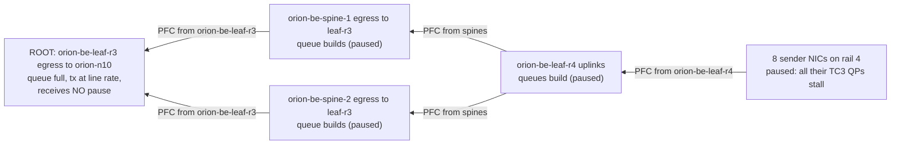
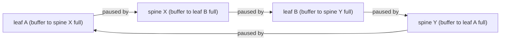
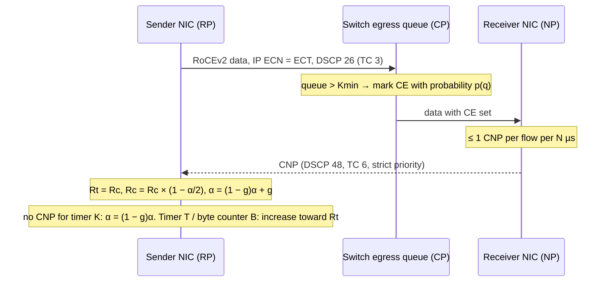
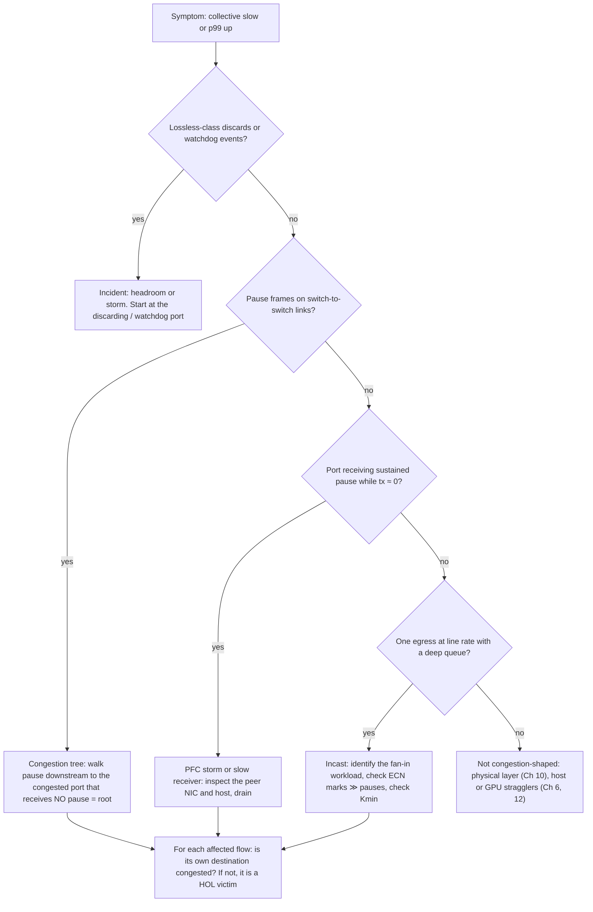

# Chapter 9 — Congestion Control and Lossless-Fabric Engineering

> An AI training job is only as fast as its slowest collective, and a collective is only as fast as
> its most congested queue. RDMA over Converged Ethernet version 2 (RoCEv2) fabrics make Ethernet
> behave "losslessly" by combining Priority-based Flow Control (PFC), which stops a sender before a
> buffer overflows, with Explicit Congestion Notification (ECN) and Data Center Quantized Congestion
> Notification (DCQCN), which slow senders before PFC has to act. Get the combination right and the
> fabric absorbs incast bursts with microseconds of delay; get it wrong and one misbehaving network
> interface card (NIC) can freeze a rail, innocent flows stall behind pauses they did not cause, and
> the only evidence is a handful of counters most dashboards do not plot. This chapter teaches the
> mechanisms, the arithmetic, the failure modes, and — above all — how to turn congestion telemetry
> into a diagnosis.

## Learning objectives

After this chapter you will be able to:

1. **Explain** how ECN marking, PFC pause, and DCQCN rate control interact on a RoCEv2 fabric, and
   which device plays each role.
2. **Calculate** the PFC headroom a port needs from link speed, cable length, maximum transmission unit (MTU), and response time,
   and the incast fill time of a switch buffer.
3. **Choose and justify** ECN thresholds (Kmin, Kmax, Pmax) relative to the bandwidth-delay product.
4. **Diagnose** incast, pause propagation, PFC storms, and head-of-line (HOL) blocking from queue,
   ECN, CNP, pause, throughput, and latency telemetry.
5. **Explain** why enabling PFC indiscriminately creates operational risk, and describe how to
   investigate pause propagation and HOL blocking.
6. **Design** a controlled experiment that compares two documented congestion configurations, and
   **state** what a simulation cannot conclude.
7. **Write** a runbook excerpt with signals, thresholds, and safe actions for lossless-fabric incidents.

## Prerequisites and connections

You need Chapter 7 ([Ethernet and Data-Center Network Foundations](../ch07-ethernet-datacenter-network-foundations/manuscript.md))
for ORION's rail-optimized leaf-spine, equal-cost multipath (ECMP), and Differentiated Services Code Point (DSCP) basics, and Chapter 8
([RDMA, RoCEv2, and InfiniBand](../ch08-rdma-rocev2-infiniband/manuscript.md)) for queue pairs (QPs),
RoCEv2 encapsulation, and why the remote direct memory access (RDMA) transport reacts so badly to loss (go-back-N retransmission).
Chapter 8 introduces the DCQCN roles; this chapter owns the depth. Chapter 3 supplies the host
diagnostics (`lspci`, `ethtool`) used in the troubleshooting scenario.

Later chapters apply it: Chapter 10 ([Switches, Optics, Cabling, and Physical-Layer Operations](../ch10-switches-optics-physical-layer/manuscript.md))
separates physical-layer errors from congestion; Chapter 12 (the NVIDIA Collective Communications Library, NCCL) shows how congestion appears as
collective bus-bandwidth loss; Chapter 13 explains the rank-to-rail mapping errors that create
cross-rail incast; Chapter 15 reuses the incast arithmetic for key-value (KV) cache transfer; Chapter 18 turns
the telemetry here into dashboards and alerts. **Capstone B** (AI network troubleshooting and
telemetry system) is built directly on this chapter's lab, which is also **Progressive Lab 3**.

## 9.1 Why AI fabrics care about congestion

In a web-service fabric one delayed flow means one slow request. An AI training fabric differs in
three ways that make congestion far more expensive.

**Synchronization amplifies tails.** A data-parallel all-reduce across ORION's graphics processing units (GPUs) completes only when *every*
rank has exchanged its share. If one of 256 GPUs waits 2 ms on a paused link, 255 GPUs wait with it.
Step time is set by the maximum, not the mean.

**Traffic is bursty and synchronized.** Every rank finishes its backward pass at roughly the same
moment and starts communicating at once. Collective algorithms such as ring all-reduce are usually
1:1 per link, but many patterns are N:1 by construction: all-to-all for mixture-of-experts dispatch,
gathers to a checkpoint writer, pipeline-parallel bubbles that release many sends together, and
KV-cache transfers converging on one decode server (Chapter 15). N:1 is **incast**.

**The transport hates loss.** Chapter 8 (Section 8.6) explained that classic RoCEv2 reliable-connected
QPs use go-back-N. A mid-stream loss triggers a negative acknowledgment (NAK); recovery costs about one
round-trip time (RTT) plus resending the whole in-flight window, ≈ 200–250 KB on ORION (Chapter 8,
Section 8.11) `[MODELED]`. A lost *tail* packet — the last before the QP goes idle — has no successor to
reveal the gap and waits for the ACK timeout, 4.096 µs × 2^timeout ≈ 4.3 s at timeout 20
`[VENDOR-SPEC, 2026-10]`. One such stall in a synchronized collective stalls every rank. That is why
RoCEv2 deployments traditionally make the RDMA traffic class *lossless* with PFC.

> **Key idea:** In AI fabrics congestion is not a throughput problem, it is a *tail-latency and
> blast-radius* problem. The question is never only "is the link full?" but "who is waiting because
> of it?"

ORION's backend fabric (see [REFERENCE_CLUSTER.md](../../../docs/REFERENCE_CLUSTER.md)) uses the
following QoS intent, which we will refer to throughout:

| Class | Marking | Traffic class (TC) | Behaviour |
|---|---|---|---|
| RoCE data | DSCP 26 | TC 3 | Lossless: PFC enabled on priority 3; ECN marking enabled |
| Congestion Notification Packets (CNPs) | DSCP 48 | TC 6 | Strict priority, lossy, not paused |
| Everything else | other | TC 0 | Lossy, best effort |

*Table 9.1 — ORION backend QoS intent `[ILLUSTRATIVE]`.*

## 9.2 Queues, buffers, and where congestion lives

Congestion happens at exactly one place: an **egress queue** whose arrival rate exceeds its drain
rate. Everything else — pause frames, ECN marks, CNPs, latency — is a consequence or a reaction.
Senior engineers therefore start every investigation with the question "which egress queue?".

### Shared buffers and dynamic thresholds

Modern switch application-specific integrated circuits (ASICs) do not give each port a private buffer. They have one (or a few)
on-chip **shared buffer** pools, typically tens of megabytes, partitioned at run time. A useful
mental number is how many *microseconds* of line rate the buffer represents. Take an ORION rail leaf with 64 × 400G = 25.6 Tb/s of ports in use and, as an assumption,
64 MB of shared buffer `[ILLUSTRATIVE]`:

- Buffer per port if divided evenly: 64 MB / 64 = 1 MB.
- Drain time of 1 MB at 400 Gb/s (50 GB/s): 1 × 10⁶ B / 50 × 10⁹ B/s = **20 µs**.

Switch buffers are microseconds deep: a millisecond of overload must be flow-controlled, not absorbed.

The buffer is shared using a **dynamic threshold** (Choudhury and Hahne): a queue may grow only while
its length is below α × (free buffer). With free buffer *B*, one congested queue stabilizes where
q = α(B − q), that is q = αB / (1 + α). For *N* equally congested queues, each gets q = αB / (1 + Nα).
With B = 40 MB available and α = 1:

- one congested queue: 40 / 2 = **20 MB**;
- four congested queues: 40 / 5 = **8 MB each**, 32 MB total, leaving 8 MB free for everyone else.
  `[MODELED]`

No single hot queue can starve the switch, and a busy switch hands each hot queue *less* buffer.
α is tuned per pool and class; vendors name it differently.

### Ingress and egress accounting

Switches account buffer usage twice. **Egress** accounting (per output queue) drives drop and ECN
decisions for lossy traffic and ECN marking for lossless traffic. **Ingress** accounting (per input
port and *priority group*, PG) drives PFC: when the bytes that arrived on input port *i* in priority
3 and are still in the buffer exceed the **Xoff** threshold, the switch sends a pause frame out of
port *i*. A separate **headroom** reservation per (port, lossless PG) absorbs the bytes still in flight
after the pause is sent (Section 9.4).

```text
                        shared buffer pool (on-chip SRAM)
  ┌──────────────────────────────────────────────────────────────────────────┐
  │ reserved minimums │        shared (dynamic threshold, α)        │ headroom │
  │ per queue / PG    │   lossy egress queues   lossless ingress PGs │ per port │
  │                   │   (drop / WRED)         (Xoff → send PFC)    │ × PG     │
  └──────────────────────────────────────────────────────────────────────────┘
        guaranteed            competes for space                  only after Xoff
```

*Figure 9.1 — Shared-buffer partitioning. Lossless traffic is limited at ingress (PFC), lossy traffic
at egress (drop/WRED); headroom is reserved separately and used only after a pause is sent.*

### Microbursts and what counters can see

A port at "40 % average utilization" over 10 s can be at 100 % for many 50 µs windows. Counters
sampled every 1–30 s average such bursts away. Two telemetry features matter more than sample rate:

1. **Watermarks** (peak occupancy since last read) for queues and PGs, which capture the burst even
   when the sample is slow.
2. **Cumulative event counters** (ECN marks, pause frames, discards), which never miss an event
   but tell you nothing about *when* within the interval it happened.

> **Pitfall:** Plotting instantaneous queue depth sampled every 10 s and concluding "queues are
> empty" is one of the most common false negatives in fabric operations. Plot watermarks.

## 9.3 ECN and WRED: marking before it hurts

**Explicit Congestion Notification** (ECN, RFC 3168) uses the two low-order bits of the IP
Traffic Class/ToS byte. A sender marks packets *ECN-Capable Transport* (ECT(0) = `10` or ECT(1) =
`01`); a congested switch rewrites the bits to *Congestion Experienced* (CE = `11`) instead of
dropping; the receiver tells the sender. RoCEv2 NICs set ECT on RDMA packets, and the receiver's
"tell the sender" step is the Congestion Notification Packet (Section 9.6).

Switches decide *whether* to mark with a random early detection (RED) profile, configured per egress queue:

```text
 mark
 prob.
  1.0 ┤                              ┌──────────── (mark every ECT packet)
      │                              │
 Pmax ┤                         ╱    │
      │                    ╱         │
      │               ╱              │
  0   ┼─────────────┴────────────────┴──────────── queue depth
                    Kmin            Kmax
```

*Figure 9.2 — ECN marking profile: no marks below Kmin; probability rising linearly to Pmax at Kmax;
every packet marked above Kmax (common switch behaviour; verify for your platform).*

**WRED** (weighted random early detection) uses the same curve to *drop* packets that are not ECN
capable. On a lossless class you want marking only: drops in the RDMA class trigger go-back-N, and
on a PFC class they should be impossible. A recurring misconfiguration is a profile that has ECN
enabled for TC 3 but also leaves a WRED drop curve active for non-ECT packets in that class.

### Choosing Kmin, Kmax, Pmax

Thresholds trade *latency* (short queues) against *throughput* (marking too early idles the link).
The anchor is the **bandwidth-delay product** (BDP), the bytes in flight that keep a link full for one RTT:

BDP = link rate × base RTT

ORION's base RTT is ≈ 4 µs same-rail (host → leaf → host) and ≈ 5 µs cross-rail via a spine
`[ILLUSTRATIVE]`:

BDP (same-rail) = 50 × 10⁹ B/s × 4 × 10⁻⁶ s = **200,000 B = 200 KB**; cross-rail:
50 × 10⁹ B/s × 5 × 10⁻⁶ s = **250 KB** `[MODELED]`

Rules of thumb (validate each on your hardware):

- **Kmin well below one BDP** so marks start while the queue is still short; DCQCN's original
  evaluation at 40 Gb/s used a Kmin of only 5 KB and Kmax of 200 KB with Pmax = 1 % (Zhu et al.,
  2015). ORION's template uses Kmin 150 KB, Kmax 1,500 KB, Pmax 0.2 `[ILLUSTRATIVE]`.
- **Kmin below the point where PFC fires.** Marking is an egress decision, PFC an ingress one, so
  they are not directly comparable — but if an N:1 incast reaches Xoff on its ingress PGs before the
  egress queue reaches Kmin, PFC acts before ECN ever does and the fabric runs on pause frames.
- **Kmax well below the buffer the queue can actually obtain** under the dynamic threshold.

> **Pitfall:** Thresholds are often configured in buffer *cells* on one platform and in bytes or KB on
> another. Copying a profile between platforms without converting units produces thresholds 10–200×
> off. The lab's `orion-be-leaf-r3` snapshot contains exactly this kind of error.

## 9.4 PFC (IEEE 802.1Qbb) mechanics and headroom

### What a PFC frame is

Classic Ethernet PAUSE (IEEE 802.3x) stops *all* traffic on a link. **Priority-based Flow Control**
(PFC, IEEE 802.1Qbb, now part of IEEE 802.1Q) stops only selected priorities, so the lossless RDMA
class can be paused while other classes keep flowing.

```text
 PFC frame (64 B minimum Ethernet frame)
 ┌──────────────────┬──────────────┬───────────┬─────────┬──────────────────┬───────────────────────┬─────┐
 │ DA 01-80-C2-00-  │ SA (sender   │ EtherType │ Opcode  │ Priority-enable  │ time[0] … time[7]      │ pad │
 │ 00-01 (6 B)      │ port) (6 B)  │ 0x8808    │ 0x0101  │ vector (2 B)     │ 8 × 2 B pause quanta   │ FCS │
 └──────────────────┴──────────────┴───────────┴─────────┴──────────────────┴───────────────────────┴─────┘
  1 quantum = 512 bit-times. Value 0 = resume (XON). Bit i of the vector enables time[i].
```

*Figure 9.3 — PFC frame layout. The frame is link-local (MAC Control), never forwarded, and is
consumed by the peer MAC.*

At 400 Gb/s one quantum is 512 bit / 400 × 10⁹ bit/s = **1.28 ns**, so the maximum pause a single
frame can request (65,535 quanta) is 65,535 × 1.28 ns = **83.9 µs** `[MODELED]`. Longer pauses are refreshed
before expiry and ended early with quanta = 0 (XON), so a sustained pause shows up as a steady *rate*
of pause frames (refresh policy is implementation-specific).

### Xoff, Xon, and why headroom exists

When the ingress PG for priority 3 on port *i* crosses **Xoff**, the switch sends a pause out of port
*i*. When it drains below **Xon**, it sends a resume. Between the decision to pause and the moment the
upstream device actually stops, bytes keep arriving. They must land in **headroom** or they are
dropped — in the class you promised was lossless.

```text
 time ─────────────────────────────────────────────────────────────────────────►
 receiver: PG crosses Xoff ─► waits for current frame (≤ MTU) ─► sends PFC (64 B)
 wire:                                          PFC propagates upstream (L / v)
 sender:                                                         processes PFC (t_resp),
                                                                 finishes frame in progress (≤ MTU)
 wire:                                          last bytes propagate downstream (L / v)
 receiver: everything that arrives after Xoff lands in HEADROOM
```

*Figure 9.4 — Why headroom is needed: four delays separate "pause decided" from "last byte arrives".*

### The headroom formula

Adding the bytes that arrive at line rate *r* during each delay:

**H = 2 × MTU + 2 × r × (L / v) + r × t_resp + S_pfc**

| Term | Meaning |
|---|---|
| MTU (first) | the frame the receiver's port is already transmitting when it decides to pause; the PFC frame waits behind it |
| MTU (second) | the frame the sender has already started; Ethernet cannot abort mid-frame |
| 2 × r × L / v | bytes on the wire: the PFC frame travels upstream while data keeps flowing downstream (L = cable length, v ≈ 2 × 10⁸ m/s in fibre, ≈ 5 ns/m) |
| r × t_resp | response time: the receiver's delay to generate the PFC frame plus the upstream port's delay to act on it, across media-access (MAC) and physical (PHY) layers including forward error correction (FEC). The standards bound parts of it; use the vendor's per-ASIC, per-speed values for a real design |
| S_pfc | the PFC frame itself (64 B; negligible) |

Use the switch's real MTU (ORION ports: 9,216 B), not the RDMA path MTU (4,096 B), because the
in-flight frame could be any frame in the class. Vendors also round to buffer-cell granularity, which
adds a few percent.

**ORION example** `[MODELED; t_resp = 1.0 µs ILLUSTRATIVE]`, r = 400 Gb/s = 50 GB/s = 50 B/ns. The 1.0 µs
is a typical implementation value for both ends combined: the receiver's time to generate the pause
plus the paused port's time to react. Standards bound only the second part, so a vendor's per-ASIC
figure for the whole term is what a real design should use.

| Quantity | Host↔leaf, L = 30 m | Leaf↔spine, L = 100 m |
|---|---|---|
| 2 × MTU = 2 × 9,216 B | 18,432 B | 18,432 B |
| L / v | 30 m × 5 ns/m = 150 ns | 100 m × 5 ns/m = 500 ns |
| 2 × r × L / v | 2 × 50 B/ns × 150 ns = 15,000 B | 2 × 50 × 500 = 50,000 B |
| r × t_resp | 50 B/ns × 1,000 ns = 50,000 B | 50,000 B |
| S_pfc | 64 B | 64 B |
| **H per port per lossless priority** | **83,496 B ≈ 83.5 KB** | **118,496 B ≈ 118.5 KB** |

*Table 9.2 — Headroom per (port, lossless priority) on ORION `[MODELED]`.*

A rail leaf has 32 host ports and 32 spine ports, so one lossless priority needs
32 × 83,496 + 32 × 118,496 = 2,671,872 + 3,791,872 = **6,463,744 B ≈ 6.5 MB** of headroom `[MODELED]`.
Each additional lossless priority adds the same amount again, taken out of the shared pool that
absorbs bursts. This is the first concrete reason not to make classes lossless "just in case".

> **Pitfall:** Undersized headroom does not announce itself. The symptom is a small, non-zero discard
> counter on the lossless class *despite* PFC being active — usually on the longest links first.
> Any discard in TC 3 on ORION is a page, not a ticket.

## 9.5 The risks of PFC: HOL blocking, propagation, storms, deadlock

PFC solves loss by moving the problem upstream, bluntly: it pauses a whole *(port, priority)*, not a
flow. Every risk below follows from that fact.

### Head-of-line blocking and victim flows

Suppose two queue pairs, A and B, on one sender NIC both send priority-3 traffic into leaf port 3.
A sends to a congested destination X; B to an idle destination Y. When the ingress PG for port 3
crosses Xoff (full of A's packets waiting for X), the leaf pauses port 3 — and B's packets stop too.

```text
   QP A ──┐  sender                              ┌──► port to X  (congested, queue full)
          ├─ NIC ──► leaf ingress port 3 [PG3 > Xoff]┤
   QP B ──┘            ▲                         └──► port to Y  (idle!)
                       │ PFC pause (priority 3) back to the NIC: stops A *and* B
```

*Figure 9.5 — Head-of-line blocking. Flow B→Y is a victim: its own path is uncongested, yet it is
paused because it shares a (port, priority) with the congested flow.*

The signature of a victim: **its latency rises while its destination egress queue is empty and shows
no ECN marks**. An ORION NIC carries QPs to many peers; when the leaf pauses it because of one hot
destination, every QP on it stalls. The same happens one hop up, where a spine port carries flows from
many senders.

### Pause propagation and congestion trees

A paused device's own queues now fill — and if they cross Xoff, *it* pauses its upstream neighbours.
Congestion that began at one leaf egress port spreads hop by hop toward every sender, forming a
**congestion tree** whose root is the original hot egress queue.



*Figure 9.6 — A congestion tree from the lab dataset. Arrows point from a paused device to the device
pausing it. The root is the only congested port that is not itself receiving pause.*

The diagnostic rule follows: **walk pause frames downstream until you reach a congested port that is
not receiving pause.** That port is the root. Ports along the way are branches; fixing them achieves
nothing. On a 2 s sample the whole tree appears simultaneously — propagation takes microseconds — so
you identify the root from topology and counter relationships, not from timestamps.

### PFC storms and the slow-receiver symptom

A healthy NIC sends pause frames briefly when its receive buffer is momentarily full. A faulty one —
a hung receive pipeline, a firmware bug, a host that stopped posting buffers — can send pause frames
*continuously*. The switch port facing it stops transmitting, its egress queue fills to the maximum
the dynamic threshold allows, the switch pauses every ingress port carrying traffic for that NIC, and
the storm propagates as in Figure 9.6. Guo et al. (SIGCOMM 2016) documented exactly this in
Microsoft's RoCEv2 deployment, along with a milder cousin, the **slow-receiver symptom**: a NIC that is
not broken but cannot move received data into host memory fast enough (they traced it to NIC
memory-translation cache misses) and therefore generates pauses under load. In Section 9.12 we will
diagnose a slow receiver caused by a downtrained Peripheral Component Interconnect Express (PCIe) link.

Table 9.4 (Section 9.8) contrasts a storm's signature with incast's.

### The PFC watchdog

Because storms are inevitable at scale, switches and NICs implement **PFC watchdogs**. A switch
watchdog monitors each lossless queue; if the queue has been paused continuously for longer than a
detection time (typically configured in the 100s of ms range — verify defaults for your platform)
it declares a storm and, depending on configuration, *drops* or *forwards ignoring pause* for that
queue and ignores incoming pause frames, until a restoration timer expires with no further pauses.
NICs may implement a transmit-side equivalent that stops the NIC from emitting pause frames after a
storm threshold (on mlx5-class NICs this is visible as `tx_pause_storm_warning_events` and
`tx_pause_storm_error_events` in `ethtool -S`; verify for your driver).

The watchdog deliberately sacrifices losslessness for one queue to protect the fabric. Its drops are
counted separately; seeing them is evidence that a storm happened, and it is an incident by itself.

> **Production note:** A watchdog is a circuit breaker, not a cure. When it trips, the right action
> is still to drain the offending node and find out why its NIC paused. Enable it everywhere the
> lossless class exists, and alert on every trip.

### PFC deadlock

PFC can deadlock. If a set of switches forms a cycle in which each one's lossless buffer is waiting
for the next to resume — a **cyclic buffer dependency** — nobody ever resumes, even after all
senders stop.



*Figure 9.7 — A cyclic buffer dependency. In a correct Clos, packets go up then down and no cycle
exists; a failed link that forces a leaf→spine→leaf→spine "bounce" path can create one.*

Up-down routing in a healthy Clos has no such cycles. They appear when routing breaks up-down order —
transient loops during convergence, a failed downlink that makes a spine bounce traffic up through
another leaf — or through flooding: Guo et al. describe a deadlock caused by lossless packets being
*flooded* when a switch had an ARP entry but no MAC-table entry for the destination; Hu et al.
(HotNets 2016) analyse further cases. Mitigations: keep routing strictly up-down even under failure,
never flood lossless traffic, keep the lossless domain small, and let the watchdog break any deadlock
that still forms.

> **Key idea (outline exercise):** Enabling PFC indiscriminately is risky because it (1) converts
> congestion into collateral pauses for innocent flows (HOL blocking), (2) spreads congestion upstream
> into congestion trees, (3) lets one faulty endpoint freeze a fabric (storms), (4) can deadlock when
> routing leaves up-down order, and (5) consumes headroom buffer per port per priority that would
> otherwise absorb bursts. Each lossless priority must earn its place.

## 9.6 DCQCN: end-to-end congestion control for RoCEv2

PFC prevents loss but has no notion of fairness or of *which* flow caused the problem. End-to-end
congestion control must slow down the right senders early enough that PFC rarely fires. The
algorithm most RoCEv2 NICs implement (with vendor variations) is **DCQCN**, *Data Center Quantized
Congestion Notification* (Zhu et al., "Congestion Control for Large-Scale RDMA Deployments",
SIGCOMM 2015). It combines the switch-side ECN of Section 9.3 with a rate-based reaction in the NIC
borrowed from QCN (Quantized Congestion Notification, IEEE 802.1Qau).

### Three roles

| Role | Device | Job |
|---|---|---|
| **CP** — congestion point | switch egress queue | marks ECT packets CE using the RED profile (Figure 9.2) |
| **NP** — notification point | receiving NIC | on receiving CE-marked packets for a flow, sends a CNP back to the sender — at most one per flow per interval *N* (50 µs in the paper) |
| **RP** — reaction point | sending NIC | cuts the flow's rate on each CNP and recovers it when CNPs stop |

The **CNP** (Congestion Notification Packet) is a small RoCEv2 packet (Base Transport Header, BTH, opcode 0x81, defined in
the RoCEv2 annex of the InfiniBand Trade Association specification) addressed to the sending QP.
ORION sends CNPs in DSCP 48 / TC 6 with strict priority so that feedback is never stuck behind the
congestion it is reporting — a misclassified CNP (for example in the paused TC 3) delays every rate
cut and makes PFC do the work instead. The lab's `orion-be-leaf-r4` snapshot contains that error.



*Figure 9.8 — The DCQCN control loop: CP marks, NP notifies, RP reacts. Feedback takes at least one
RTT, plus queueing on the reverse path if CNPs are misclassified.*

### The rate rules

On every CNP the RP remembers its current rate as the target (Rt = Rc), cuts the current rate
Rc ← Rc × (1 − α/2), and raises its congestion estimate α ← (1 − g)α + g. With no CNP for a timer
period *K*, α decays: α ← (1 − g)α. Rate recovery runs on a timer *T* and a byte counter *B*: first five
rounds of **fast recovery** (Rc ← (Rt + Rc)/2), then **additive increase** (Rt grows by a fixed
step), then **hyper increase** (larger steps). The paper's evaluation used g = 1/256, N = 50 µs,
K = 55 µs, T = 55 µs, B = 10 MB, Kmin = 5 KB, Kmax = 200 KB, and Pmax = 1 % at 40 Gb/s (verify against
Zhu et al., 2015); NIC defaults differ (for example in NVIDIA DOCA) `[VENDOR-SPEC, 2026-10]`.
Implementations also bound the *sender*: a rate-reduction monitor period limits how often an RP may
cut, however many CNPs arrive `[VENDOR-SPEC, 2026-10 — name and default vary by NIC]`.

A worked consequence: α starts at 1, so the first CNP halves the rate (1 − 1/2 = 0.5). Twelve senders at
400 Gb/s each into one 400 Gb/s port need a 12× aggregate reduction; repeated halving gets there after
log₂ 12 ≈ 3.6, so about **four CNP intervals ≈ 200 µs** at N = 50 µs, ignoring recovery `[MODELED]`. During
those 200 µs the excess arrival must be absorbed by buffer and PFC — which is the subject of Section 9.7.

### How DCQCN and PFC should interact

The intended division of labour: **PFC handles the first RTT** of a burst, before any feedback can
arrive; **DCQCN handles everything after**, so pause frames are rare and short. The health metric
that captures this is the ratio of ECN-marked packets to pause frames on congested ports: a fabric
where DCQCN is doing its job shows many marks and few pauses. A fabric whose pause counters climb as
fast as its marks is running on PFC. Common causes: Kmin too high (marks start after Xoff), ECN
disabled on one hop, CNPs misclassified, the RP disabled for the priority on some NICs, or congestion
that DCQCN cannot fix at all (a storm or a slow receiver).

> **Vendor implementation note (NVIDIA / AMD / Broadcom NICs):** DCQCN parameters are exposed through
> vendor tools, driver sysfs entries, or firmware configuration (mlx5-class NICs expose RP/NP enables
> and timers under the netdev's ECN configuration); some vendors ship alternative or programmable
> algorithms. Names, defaults, and scope change between firmware releases `[VENDOR-SPEC, 2026-10 —
> verify]`. Never tune them in production without a lab A/B (Section 9.11).

## 9.7 Incast arithmetic

Incast is where the mechanisms meet arithmetic. Consider the lab's first episode: **12 ORION nodes
send simultaneously to one destination NIC on the same rail leaf**.

1. **Overload.** Aggregate arrival = 12 × 400 Gb/s = 4.8 Tb/s; drain = 400 Gb/s; excess =
   4.4 Tb/s = 550 GB/s = **550 KB/µs** `[MODELED]`.
2. **Time to Xoff.** With a 1,000 KB threshold, 1,000 KB / 550 KB/µs ≈ **1.8 µs** — under half an
   RTT. ECN cannot possibly help the first burst; PFC (or loss) must.
3. **Time to fill the port's buffer share.** A 4 MB share fills in 4,000 / 550 ≈ **7.3 µs** without PFC.
   The dynamic threshold may allow more, but not orders of magnitude more.
4. **Minimum completion time.** If each sender has 4 MB, total = 48 MB, and the destination link is
   the bottleneck: 48 × 10⁶ B / 50 × 10⁹ B/s = **960 µs**. No congestion control can beat this; it can
   only avoid making it worse and avoid hurting bystanders.
5. **Bytes arriving during the PFC response.** With PFC taking effect 1 µs after Xoff, the switch
   receives 12 × 50 KB/µs × 1 µs = 600 KB more. Twelve 30 m host ports hold 12 × 83,496 B ≈ 1,002 KB
   of headroom (Table 9.2; the lab model assumes 50 m runs, 1,128 KB), so the class stays lossless
   `[MODELED]`. (Real switches pause each ingress PG independently; this aggregate view is a
   simplification the lab model shares.)

The general formula to carry: **fill time = buffer / ((N − 1) × r)** for N senders at line rate *r* into
one port of rate *r*. It shrinks linearly with fan-in and with link speed. Moving from 100 G to 400 G
without growing buffer per port by 4× quarters every fill time — one reason congestion-control
parameters cannot be copied across hardware generations.

> **Production note:** NCCL ring and tree collectives are mostly 1:1 per link and rarely create
> large incast on a rail-optimized fabric. When you see large incast on ORION's backend, ask which
> workload produced N:1 traffic (all-to-all, storage, KV transfer) and whether ranks are mapped to the
> rails you expect (Chapter 13). Cross-rail traffic that should not exist is a classic finding.

## 9.8 Congestion telemetry: what to collect and how to read it

### The NIC↔switch congestion data path

```text
  HOST orion-n05 (receiver)          orion-be-leaf-r3                       orion-n01.. (senders)
 ┌───────────────────┐  400G   ┌──────────────────────────────────┐  400G  ┌────────────────────┐
 │ GPU HBM ▲ PCIe G5 │         │ ingress PG3 ─► shared buffer     │        │ NIC = RP (DCQCN)   │
 │ NIC = NP          │◄─data──┤  (Xoff/Xon, headroom)  │         │◄─data──┤ sends ECT, TC 3    │
 │  counts CE pkts   │  (CE)   │          egress queue TC3 = CP   │        │                    │
 │  sends CNP ───────┼─CNP TC6─►  marks CE if q > Kmin          ├─CNP───►│ cuts rate on CNP   │
 │  may send PFC ────┼─PFC p3──►  pause rx: stop egress to NIC   │◄─PFC───┤ (if leaf PG > Xoff)│
 └───────────────────┘         │  pfc tx: pause an ingress port   ├─PFC───►│ pauses all TC3 QPs │
                               └──────────────────────────────────┘        └────────────────────┘
 NIC counters: rx/tx_prio3_pause, np_cnp_sent, np_ecn_marked_roce_packets, rp_cnp_handled
 Switch counters: TC3 queue watermark, ECN-marked, PFC tx/rx per priority, discards, watchdog events
```

*Figure 9.9 — NIC↔switch congestion data path and where each counter lives. Data flows right to
left; CNPs and pause frames flow toward the sender. NIC counter names are mlx5-class examples.*

### The counter set

| Signal | Where | Meaning | Healthy | Alarming |
|---|---|---|---|---|
| Egress queue watermark (TC 3) | switch, per port/queue | peak bytes queued in interval | ≪ Kmin most of the time | sustained ≥ Kmax; flat at maximum (storm) |
| ECN-marked packets | switch per queue; NIC NP side (`np_ecn_marked_roce_packets`) | CP marking | occasional bursts | near-continuous *with* rising pause counts |
| CNPs sent / handled | NIC (`np_cnp_sent`, `rp_cnp_handled`) | DCQCN loop active | proportional to marks | marks but no CNPs (NP disabled or mis-mapped) |
| PFC pause frames tx/rx, per priority | both ends of every link (`tx_prio3_pause`, `rx_prio3_pause`) | flow control | rare, short | sustained rates; any on switch↔switch links |
| Pause duration | NIC (`rx_prio3_pause_duration`, µs); some switches | time spent paused | ≪ 1 % of interval | ≥ 10 % of interval |
| Discards in lossless class | switch per queue/PG; NIC `rx_discards_phy` | buffer or headroom overflow | **0** | any |
| Watchdog events | switch per queue; NIC pause-storm events | storm declared | 0 | any |
| Throughput tx/rx | both | utilization | — | line rate + deep queue (incast) or ≈ 0 + full queue (storm) |
| Latency probes p50/p99 | hosts (pingmesh, perftest) | user-visible effect | stable | p99 × 10 with uncongested destination (victim) |

*Table 9.3 — Congestion telemetry. NIC counter names are from the mlx5 Linux driver
`[VENDOR-SPEC, 2026-10 — verify for your driver]`; switch counter names vary by vendor and are kept
generic here.*

Commands (Level 2/3, read-only):

```bash
# NIC: PFC and storm counters (mlx5-class), and RDMA congestion counters
ethtool -S ens4np0 | grep -E 'prio3_pause|pause_storm'      # netdev of mlx5_3 (Chapter 8)
rdma statistic show link mlx5_3/1
# NIC QoS state: trust mode, PFC-enabled priorities, buffers (vendor tool, display form only)
mlnx_qos -i ens4np0
dcb pfc show dev ens4np0                  # iproute2 DCB tool, where the driver supports it
```

Representative output `[ILLUSTRATIVE]` from a NIC that has been paused heavily by its leaf:

```text
$ ethtool -S ens4np0 | grep -E 'prio3_pause|pause_storm'
     rx_prio3_pause: 18234412
     rx_prio3_pause_duration: 912338411
     tx_prio3_pause: 77152
     tx_prio3_pause_duration: 4410983
     rx_prio3_pause_transition: 9117201
     tx_pause_storm_warning_events: 0
     tx_pause_storm_error_events: 0
```

Read it as a practitioner would: received pauses vastly outnumber transmitted ones, so this NIC is a
*victim* of congestion, not a cause; zero storm events say its own storm protection never fired.
These counters are cumulative since driver load — take a second sample before concluding anything.

> **Vendor implementation note (SONiC-based switches):** commands such as `show pfc counters`,
> `show queue counters`, `show queue watermark unicast`, `show priority-group watermark headroom`,
> `show pfcwd stats`, and `ecnconfig -l` expose the same signals; other network operating systems
> have equivalents, and streaming telemetry (gRPC Network Management Interface, gNMI, with OpenConfig paths, vendor sFlow and in-band
> telemetry extensions) can export them at sub-second intervals `[VENDOR-SPEC, 2026-10 — verify on
> your release]`.

### Reading counters correctly

Four rules prevent most analysis errors:

1. **Convert cumulative counters to rates using the true elapsed time** between the two samples you
   actually have. A missing sample means dividing by 4 s, not 2 s.
2. **A counter that goes backwards is a reset**, not negative traffic (someone ran "clear counters",
   the agent restarted, a 32-bit counter wrapped). Mark that interval unknown; never invent a value.
3. **Pause frames are directional and local.** `pfc_tx` on port P means P's *ingress* was filling and
   P told its peer to stop; `pfc_rx` means the peer told P to stop *transmitting*. Always read both
   ends of a link and expect them to agree.
4. **Correlate, then attribute.** A port with a high queue *and* received pause is a branch of a
   congestion tree; a port with a high queue and *no* received pause is a root candidate.

### Signatures

| Pattern | Queue | ECN | Pause | Throughput | Latency |
|---|---|---|---|---|---|
| Healthy, busy | low–moderate watermark | some marks | none | high | stable |
| Incast | deep at one egress | heavy at that egress | tx toward senders (first hop only) | that egress at line rate | high for flows *to* that destination |
| Pause propagation | deep at root and upstream branches | at root, some upstream | on switch↔switch links along the tree | root at line rate, branches reduced | high for flows crossing the tree |
| PFC storm | flat at maximum toward the storming device | ≈ 0 there | sustained rx from device; tx toward its peers | ≈ 0 toward device | very high for everyone sharing paused ports |
| HOL victim | **low** at its own destination | none at its destination | its source/ingress port paused | reduced | high p99 |

*Table 9.4 — Congestion signatures `[ILLUSTRATIVE]`. This table is the decision logic of the lab.*



*Figure 9.10 — Congestion troubleshooting tree (the skeleton of the Week 6 deliverable).*

## 9.9 Beyond the lossless class: lossy RoCE and newer transports

PFC's risks have pushed the industry to ask whether RDMA needs a lossless network at all. Three lines
of work matter to a practitioner today.

**Better loss recovery in the NIC (lossy RoCE).** Mittal et al. (SIGCOMM 2018) showed that with
selective retransmission and bounded in-flight data (their IRN design), RDMA performs well *without*
PFC. Several current NICs offer selective-repeat modes and "lossy RoCE" guidance `[VENDOR-SPEC, 2026-10
— verify per NIC and firmware]`: ECN-based congestion control stays on; PFC is off or only a backstop.
You trade PFC's blast radius for retransmission cost, so measure it: on mlx5-class NICs the RDMA
counters `out_of_sequence` (packets received out of order) and `packet_seq_err` (sequence-error NAKs)
show how often recovery runs.

**Richer congestion signals.** Delay-based (TIMELY, Swift) and in-band-telemetry-based (HPCC) schemes
react faster and more precisely than DCQCN's 1-bit mark, at the cost of NIC and switch support.

**New transports designed for AI and HPC scale.** The Ultra Ethernet Consortium (UEC) published its
1.0 specification in 2025. Its transport (UET) is designed around **multipath packet spraying** with
tolerance for out-of-order delivery, **selective retransmission**, end-to-end congestion control
with sender- and receiver-driven components, and optional link-layer features such as link-level
retry and credit-based flow control; it also describes **packet trimming**, where a congested switch
forwards a truncated header instead of silently dropping, so the receiver learns of loss immediately
`[VENDOR-SPEC, 2026-10 — consortium specification: which features are mandatory or optional, and
which products implement them, must be verified against the current release]`. InfiniBand
(Chapter 8) sidesteps much of this chapter in a different way: credit-based link-level flow control is
part of the link layer, so a sender never transmits without buffer space downstream.

> **Realism boundary:** These approaches change *which* failure modes dominate, not whether you need
> telemetry. A lossy fabric still has incast and still needs ECN thresholds tuned against BDP — and it
> now needs retransmission and out-of-order counters on every NIC. Claims of "congestion-free" fabrics
> are hypotheses to test with the experiment design in Section 9.11.

## 9.10 Worked example: commissioning review of a rail leaf's lossless profile

**Problem.** Halcyon's Fabric team is reviewing the QoS snapshot of ORION rail leaf `orion-be-leaf-r3` before
signing off a capacity expansion. The snapshot shows PFC on priority 3, ECN Kmin = 1,500 KB,
Kmax = 6,000 KB, Pmax = 0.2, PFC watchdog disabled. The fabric template says Kmin = 150 KB,
Kmax = 1,500 KB, watchdog enabled. Spine-2 additionally has priority 4 marked lossless. Decide what to
change, and quantify why, using the diagnostic loop.

**Step 1 — Anchor on the BDP.** Same-rail base RTT ≈ 4 µs `[ILLUSTRATIVE]`:
BDP = 50 × 10⁹ B/s × 4 × 10⁻⁶ s = 200,000 B = **200 KB** `[MODELED]`.
The as-found Kmin is 1,500 / 200 = **7.5 × BDP**; the template's is 150 / 200 = 0.75 × BDP.

**Step 2 — Will ECN act before PFC?** For the 12:1 incast of Section 9.7 the excess is 550 KB/µs.
The (aggregate) queue reaches the 1,000 KB PFC threshold after 1,000 / 550 ≈ 1.8 µs and the template
Kmin after 150 / 550 ≈ 0.27 µs. With the as-found profile, Kmin (1,500 KB) lies *above* the PFC
threshold, so PFC will hold the queue near Xoff and the queue will rarely reach the marking region.
Expectation: on orion-be-leaf-r3 the incast will be handled almost entirely by pause frames `[MODELED]`.

**Step 3 — Headroom cost of the extra lossless priority on orion-be-spine-2.** From Table 9.2, a spine port
facing a leaf at 100 m needs 118,496 B per lossless priority. Spine-2 has 64 such ports, so priority 4
reserves an extra 64 × 118,496 = 7,583,744 B ≈ **7.6 MB** `[MODELED]` of buffer that no traffic uses
(nothing in ORION uses priority 4 as lossless); worse, priority-4 traffic would be lossless on one
spine and lossy elsewhere, making behaviour path-dependent.

**Step 4 — Model the difference (SIMULATED).** The lab's fluid model replays the 12 × 4 MB incast
under the as-found profile (A), the template (B), and a lossy variant (C). Results:

| Config | Completion (µs) | Lower bound (µs) | Peak queue (KB) | Time senders were paused (µs) | Dropped (MB) | CNPs |
|---|---|---|---|---|---|---|
| A — as found (Kmin 1,500 KB) | 960.0 | 960.0 | 1,660 | 862.8 | 0 | 0 |
| B — template (Kmin 150 KB) | 1,256.8 | 960.0 | 1,660 | 113.6 | 0 | 60 |
| C — lossy, template ECN | 3,875.2 | 960.0 | 4,000 | 0 | 17.84 | 84 |

*Table 9.5 — Incast model results `[SIMULATED; single-queue fluid model, simplified DCQCN without
additive increase; see the cannot-conclude list in Section 9.11]`.*

Interpret every column before concluding:

- **Peak queue is identical for A and B (1,660 KB).** The first burst outruns any feedback: Xoff
  (1,000 KB) plus 1.2 µs of effective pause delay in the model (1 µs configured plus one 0.2 µs step
  of decision latency) × 550 KB/µs = 1,000 + 660 = 1,660 KB. This *is* Section 9.7's point: ECN thresholds
  cannot change the first RTT.
- **Pause exposure falls 862.8 / 113.6 ≈ 7.6×.** Under A, senders were paused for 862.8 / 960 ≈ 90 % of
  the incast. Every one of those microseconds pauses *all* TC 3 traffic on twelve ingress ports, so any
  other flow from those NICs is a HOL victim. Under B the senders slow down and pauses almost stop.
- **B finishes 1,256.8 / 960 ≈ 1.31× the lower bound; A finishes at the bound.** PFC keeps the
  bottleneck link perfectly busy; DCQCN in this model overshoots (fast recovery only, no additive
  increase) and leaves the link idle part of the time. Real DCQCN recovers faster, but the trade-off is
  genuine: you buy isolation for bystanders with some incast completion time.
- **C (lossy) loses 17.84 / 48 ≈ 37 % of the bytes once and finishes 3,875.2 / 960 ≈ 4.0× the bound** even
  though the model re-offers dropped bytes after 20 µs — a best case resembling NAK-triggered selective
  repeat. It ignores go-back-N's resending of the whole in-flight window and the ≈ 4.3 s ACK timeout
  if a tail packet is lost, so real lossy RoCE on a go-back-N NIC would be far worse. Turning PFC off
  is not a free lunch.

**Step 5 — Decision.** Restore the template ECN profile on orion-be-leaf-r3; enable the PFC watchdog; remove
priority 4 from orion-be-spine-2's lossless set (recovering ≈ 7.6 MB of headroom); fix orion-be-leaf-r4's CNP class.
Each change goes through the change pipeline (Chapter 20) with a canary leaf. The *simulation is not
the validation*: that is the L3 experiment of Section 9.11 and, in production, orion-be-leaf-r3's ratio of ECN
marks to pause frames in the week after the change versus the week before.

## 9.11 Hands-on lab overview and experiment design

**Lab 9 (Progressive Lab 3 — network telemetry), Tier L1.** From a ten-minute telemetry bundle of an
ORION slice (two rail leaves, two spines, 24 NICs, four latency probes) and the QoS snapshot above, you
convert counters to rates, detect and classify episodes, find congestion-tree roots, the storming NIC,
and HOL victims, audit the configuration, run the SIMULATED model of Section 9.10, and write the
deliverable: **a congestion diagnosis, an experiment plan, and a mitigation proposal**. A busy but
healthy port is planted to catch naive detectors. See [lab/README.md](lab/README.md).

### Designing a controlled experiment (outline exercise)

A simulation can rank hypotheses; only a controlled hardware experiment can test them. An acceptable
design has these parts:

1. **Question and hypothesis.** "On our lab leaf, lowering ECN Kmin from 1,500 KB to 150 KB reduces
   total pause duration during a 12:1 incast by at least 5× without increasing median incast
   completion time by more than 20 %."
2. **The two documented configurations.** Full QoS snapshots of both (trust mode, DSCP→TC map, PFC
   priorities, Xoff/Xon or headroom mode, ECN Kmin/Kmax/Pmax, watchdog), committed alongside results.
   Change **one** variable between them.
3. **Workload.** A deterministic incast generator: N perftest clients (`ib_write_bw`, fixed message
   size, fixed QP count, fixed duration) to one server, plus one *bystander* probe flow from a sender NIC
   to an idle destination to measure HOL impact.
4. **Procedure.** Warm-up run discarded; ≥ 5 repetitions per configuration, interleaved A, B, A, B…
   to spread drift; counters cleared or snapshotted before each run.
5. **Measurements.** Per run: per-client bandwidth, incast completion time, bystander p50/p99
   latency, pause frames and pause duration tx/rx on every involved port, ECN-marked packets, CNPs
   sent/handled, queue and PG watermarks, lossless-class discards, watchdog events.
6. **Analysis.** Median and p95/p99 per configuration with min/max or IQR; effect size relative to
   run-to-run spread; a result is "different" only if the ranges do not overlap or a pre-stated test
   says so.
7. **Environment manifest.** NIC model and firmware, driver/RDMA stack, switch model and OS version,
   cable lengths, MTUs, DCQCN parameters — the lab's `manifest.yaml` lists the fields.
8. **Safety.** A dedicated lab fabric only; no shared or production switch; a rollback snapshot
   taken first.

**What a simulation cannot conclude** — state this explicitly in every report that contains one:

- the *magnitude* of any effect on real hardware (no ASIC shared-buffer algorithm, cell rounding, or
  per-PG accounting in the model);
- anything about multi-hop propagation, ECMP collisions, or interaction with other traffic classes;
- the behaviour of a specific NIC's DCQCN implementation, timers, or loss recovery;
- HOL victim impact, PFC storms, deadlock, or watchdog behaviour;
- whether the model's assumptions (synchronous start, equal senders, fixed RTT) hold for your
  workload. Only the *direction* of a difference is a usable hypothesis.

## 9.12 Troubleshooting scenario: the rail that ran on pause frames

**Symptom (observe).** On Thursday, Training Infra reports that W-TRAIN on all 256 GPUs slowed from a
17.4 s median step to 19.9 s (+14 %) since a maintenance window on Tuesday `[ILLUSTRATIVE]`. No job
errors, no NCCL timeouts. The scheduler shows the same 32 nodes as last week.

**Evidence (collect).** The site reliability engineer (SRE) on call pulls the fabric congestion dashboard for the backend and
finds nothing on the spines, but one rail stands out:

```text
[ILLUSTRATIVE] orion-be-leaf-r6, 10-s samples during a training step window (Kmin 150 KB)
port      peer                tx_gbps  q_tc3_wm_kb  ecn_marks/s  pfc_rx/s  pfc_tx/s  discards
eth1/18   orion-n18 mlx5_6     212.6       3,410    2,100,000      6,950       0        0
eth1/3    orion-n03 mlx5_6     388.1          42            0          0     1,840       0
eth1/9    orion-n09 mlx5_6     385.6          37            0          0     1,910       0
eth1/22   orion-n22 mlx5_6     390.4          51            0          0        12       0
```

Port `eth1/18` has a deep queue, *receives* pause frames from its NIC, and transmits only ≈ 213 Gb/s.
The NIC side agrees:

```text
[ILLUSTRATIVE] orion-n18, two samples 60 s apart
$ ethtool -S ens7np0 | grep -E 'tx_prio3_pause:|rx_discards_phy|pause_storm'
     tx_prio3_pause: 51203377        (+417,000 in 60 s ≈ 6,950/s)
     rx_discards_phy: 0
     tx_pause_storm_warning_events: 0
```

**Hypotheses (rank).**

| # | Hypothesis | Predicts | Evidence so far |
|---|---|---|---|
| H1 | orion-n18's NIC cannot drain received data fast enough (slow receiver) | NIC sends pause; switch egress capped below line rate; queue deep | fits all |
| H2 | Incast toward orion-n18 | egress at line rate, no pause *from* the NIC | rejected: egress ≈ 213 Gb/s, NIC pausing |
| H3 | PFC storm from a hung NIC | egress ≈ 0, pause continuous | rejected: ≈ 213 Gb/s still flowing; no storm events |
| H4 | Physical-layer errors on the link (Chapter 10) | FEC and cyclic-redundancy-check (CRC) errors, no pause | to test |
| H5 | GPU straggler on orion-n18 (Chapter 6) | slow compute, normal network counters | does not explain pause frames |

Ports `eth1/3` and `eth1/9` transmit pause toward healthy NICs: orion-n03 and orion-n09 send to
orion-n18, their ingress PGs fill, and the leaf pauses them. Their egress queues are shallow and
unmarked, as Table 9.4 predicts for victims: the HOL victims are those senders' QPs to *other*
destinations, which stall with them and slow the whole rail-6 ring, and therefore the job.

**Discriminating tests (trace across layers).** A slow receiver at a steady ≈ 213 Gb/s smells like a
host-side bottleneck, not a network one, and it matches a PCIe Gen5 x8 link: raw 32 GT/s × 128/130 ×
8 lanes = 252 Gb/s per direction `[MODELED]`, of which ≈ 200–220 Gb/s is achievable after transaction-
and link-layer protocol overhead `[VENDOR-SPEC, 2026-10]`. Check the NIC's PCIe link
(Chapter 3), physical-layer counters (Chapter 10), and the other rails of the same node:

```text
[ILLUSTRATIVE]
$ sudo lspci -vv -s 0000:c1:00.0 | grep -E 'LnkCap:|LnkSta:'
        LnkCap: Port #0, Speed 32GT/s, Width x16, ASPM not supported
        LnkSta: Speed 32GT/s (ok), Width x8 (downgraded)
$ ethtool -S ens7np0 | grep -E 'rx_corrected_bits_phy|rx_err_lane'      # clean, unchanged in 60 s
```

The other seven NICs of orion-n18 report `Width x16`, and rail-6 pause frames appear only on
orion-n18's port. H4 is rejected (clean physical counters); H5 is rejected (pause is a network-path symptom and the
GPU timings are normal). **Root cause:** the NIC on rail 6 trained at x8 after Tuesday's maintenance
(reseated riser), capping host-side throughput near 200–220 Gb/s; under collective load the NIC's receive
buffer filled and it generated PFC, which paused the leaf, which paused other rail-6 senders.

**Fix (safe change).** Drain, do not debug in place:

```bash
scontrol update NodeName=orion-n18 State=DRAIN Reason="rail6 NIC PCIe x8 downtrain; PFC slow receiver"
```

ORION-256 has no spare nodes, so the job (checkpointed, Chapter 14) either waits for the repair or
restarts at DP = 7 (224 GPUs, with a global-batch/LR adjustment); each restart costs ≈ 15 min (900 s).
Fleet reseats the riser and runs acceptance tests (Chapter 16).

**Validate.** Before return to service: `LnkSta` shows `Width x16`; a perftest `ib_write_bw` between
orion-n18 `mlx5_6` and a rail-6 peer reaches the expected rate across ≥ 5 runs; `tx_prio3_pause` grows by
≈ 0 over a 10-minute NCCL `all_reduce_perf` burn-in; and the job's step time returns to its 17.4 s
baseline over 50 consecutive steps. Add a fleet check: alert on any backend NIC whose `LnkSta` width
is below `LnkCap`, and on any NIC with sustained transmitted pause frames.

> **Key idea:** PFC moved a host problem onto the network. Pause counters found the node; only a
> cross-layer check (PCIe link state) found the cause.

## Trade-offs and design decisions

| Option | Loss behaviour | Tail latency under incast | Blast radius / operational risk | Buffer cost | Ecosystem maturity | Wins when |
|---|---|---|---|---|---|---|
| Lossless RoCEv2: PFC + ECN/DCQCN (ORION) | No loss if headroom correct | Good if ECN tuned; bad if fabric runs on pause | HOL, propagation, storms, deadlock — needs watchdog and discipline | Headroom per port per lossless priority | Very mature, multi-vendor | Most RoCEv2 AI fabrics today with RC transport NICs |
| ECN/DCQCN only, PFC off (lossy RoCE) | Drops on bursts; NIC must recover | Depends on NIC retransmission (selective ≫ go-back-N) | No pause-related failure modes | None for headroom | Depends on NIC generation | NICs with robust selective retransmission; operators who prefer loss to blast radius |
| PFC only, no ECN | No loss | Poor: everything handled by pause | Highest: congestion trees by design | Headroom | — | Never intentionally |
| InfiniBand credit-based flow control | No loss (link-level credits) | Good; adaptive routing helps | Credit stalls can still spread; managed by subnet manager | Built in | Mature, single dominant vendor | Homogeneous HPC/AI clusters wanting integrated management |
| Multipath, loss-tolerant transports (UET-style) | Tolerated, fast recovery, trimming | Promising for spraying across paths | New; tooling and interoperability maturing | Varies | Emerging `[verify]` | New builds with supporting NICs and switches |

*Table 9.6 — Congestion-control architecture options `[ILLUSTRATIVE assessment]`.*

Across options: keep **one** lossless priority unless you can name the traffic that needs a second;
tune ECN so marks lead pauses; enable watchdogs wherever PFC exists; treat threshold changes as
measured experiments, not configuration tweaks.

## Production operations notes / runbook excerpt

**Runbook RB-FAB-09: Lossless-class congestion on the backend fabric** `[ILLUSTRATIVE thresholds — calibrate on your baseline]`

| Signal | Threshold | Severity | First action |
|---|---|---|---|
| Discards in TC 3 on any port | > 0 in 5 min | SEV2 | Identify port; check headroom config and cable length; check for storm |
| PFC watchdog trip (switch) or NIC pause-storm event | any | SEV2 | Identify the device on the far side; drain that node |
| Sustained pause rx on a host-facing port with tx < 10 Gb/s | > 60 s | SEV2 | Treat as storm; drain the node; preserve NIC counters and `dmesg` first |
| Pause frames on switch↔switch links | > 1 % of time paused for 5 min | SEV3 | Find the congestion-tree root (walk pause downstream) |
| ECN marks / pause frames ratio on a congested port | < 10 for 15 min | SEV4 | Check ECN profile, CNP class, NIC RP enable |
| Probe p99 > 10 × baseline with uncongested destination | 5 min | SEV3 | HOL victim: find which ingress/NIC is paused |

**Safe actions:** drain a node (Slurm `scontrol update … State=DRAIN`, Kubernetes `kubectl cordon` +
drain); shut a single host-facing switch port toward a confirmed storming NIC if the watchdog did not;
fail a job over to spares. **Unsafe during an incident:** disabling PFC or ECN fabric-wide, changing
DCQCN parameters on production NICs, changing buffer profiles, clearing counters before capturing them.
**Escalate** to the Fabric team for any switch configuration change and to the vendor with a counter
capture and the environment manifest for suspected NIC firmware faults.

> **Safety:** Every procedure that injects incast or modifies QoS in this chapter targets a dedicated
> lab fabric or a simulation. On shared fabrics, observe only.

## Realism boundaries

- The lab's telemetry is synthetic; 2 s sampling hides microsecond dynamics.
- The incast model is a single-queue fluid simulation with simplified DCQCN; Section 9.11 lists what
  it cannot conclude.
- Headroom and buffer figures are `[MODELED]`; real designs need the vendor's response times and cell
  rounding.
- NIC counter names are mlx5-class examples; switch counters are generic. Verify both.
- Only a Level-3 lab fabric validates PFC, ECN, DCQCN, and watchdog behaviour — at the scale it runs.

## Summary

- Congestion lives in egress queues; name the queue first. Switch buffers are microseconds deep at
  400 Gb/s, so PFC (or loss) handles an incast's first RTT and DCQCN everything after.
- ECN thresholds anchor on the BDP (≈ 200 KB same-rail, 250 KB cross-rail); Kmin must start marking
  before PFC fires.
- Headroom = 2 × MTU + 2 × r × L/v + r × t_resp + PFC frame: ≈ 83–119 KB per port per lossless priority
  on ORION, ≈ 6.5 MB per leaf, and the same again for each extra lossless priority.
- PFC pauses (port, priority), not flows: HOL blocking, congestion trees, storms, and deadlock follow.
- Read signatures: the tree's root is congested but *not* paused; a storm is a full queue with zero
  throughput and zero marks; incast is a full queue at line rate with heavy marking; a victim has high
  latency and an uncongested destination.
- A healthy lossless fabric has many more ECN marks than pause frames and exactly zero lossless-class
  discards.
- Lossy RoCE, delay- or telemetry-based control, and UET-style transports shift failure modes; none
  removes the need for telemetry and measured experiments.

## Review questions

The full set is in [exercises.md](exercises.md). Quick self-check:

1. A switch port shows a TC 3 queue watermark of 4 MB, 0 Gb/s transmitted, and 23,000 pause frames/s
   received. Incast or storm? Which device do you inspect next?
2. Why can ECN thresholds not reduce the peak queue of the first incast burst?
3. What is the headroom per lossless priority for a 400 Gb/s port on a 50 m link with a 9,216 B MTU and
   a 1 µs response time?

(Answers: 1 — storm; inspect the peer NIC/host. 2 — feedback needs at least one RTT, longer than the
1.8 µs it takes to reach Xoff. 3 — 18,432 + 25,000 + 50,000 + 64 = 93,496 B ≈ 93.5 KB.)

## Further reading

- IEEE 802.1Qbb-2011, *Priority-based Flow Control* (now incorporated in IEEE 802.1Q). The normative
  definition of PFC frames, quanta, and the delay model behind headroom calculations.
- K. Ramakrishnan, S. Floyd, D. Black, *RFC 3168: The Addition of Explicit Congestion Notification (ECN)
  to IP*, IETF, 2001, https://www.rfc-editor.org/rfc/rfc3168 — the ECN bits and semantics RoCEv2 reuses.
- InfiniBand Trade Association, *Supplement to InfiniBand Architecture Specification Volume 1, Annex A17:
  RoCEv2*, 2014 — defines RoCEv2 encapsulation and the CNP.
- Y. Zhu et al., "Congestion Control for Large-Scale RDMA Deployments", ACM SIGCOMM 2015 — the DCQCN
  paper: algorithm, parameters, and fluid-model analysis.
- C. Guo et al., "RDMA over Commodity Ethernet at Scale", ACM SIGCOMM 2016 — the best production
  account of PFC storms, slow receivers, deadlock, and watchdogs.
- S. Hu et al., "Deadlocks in Datacenter Networks: Why Do They Form, and How to Avoid Them", ACM HotNets
  2016 — how cyclic buffer dependencies arise even in Clos fabrics.
- A. K. Choudhury and E. L. Hahne, "Dynamic Queue Length Thresholds for Shared-Memory Packet Switches",
  IEEE/ACM Transactions on Networking, 1998 — the shared-buffer dynamic threshold.
- M. Alizadeh et al., "Data Center TCP (DCTCP)", ACM SIGCOMM 2010 — why ECN thresholds scale with BDP.
- R. Mittal et al., "Revisiting Network Support for RDMA", ACM SIGCOMM 2018 — the case for lossy RoCE
  with selective retransmission (IRN).
- R. Mittal et al., "TIMELY: RTT-based Congestion Control for the Datacenter", ACM SIGCOMM 2015; and
  G. Kumar et al., "Swift: Delay is Simple and Effective for Congestion Control in the Datacenter",
  ACM SIGCOMM 2020 — delay-based alternatives to ECN.
- Y. Li et al., "HPCC: High Precision Congestion Control", ACM SIGCOMM 2019 — congestion control driven
  by in-band telemetry.
- Ultra Ethernet Consortium, *UEC Specification 1.0*, 2025 — the primary source for UET concepts
  (packet spraying, trimming, transport congestion control); check which features are optional.
- Linux kernel documentation, *mlx5 counters* (Documentation/networking/device_drivers/ethernet/mellanox/mlx5/)
  — authoritative meanings of the NIC counters used in Section 9.8.
