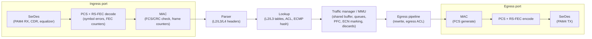

# Chapter 10 — Switches, Optics, Cabling, and Physical-Layer Operations

> A 256-GPU training job is only as fast as its worst link, and in an AI fabric the worst link is
> usually not congested — it is dirty, bent, mis-seated, mis-patched, or the wrong part. ORION's
> backend has 512 links and 1,024 transceivers, each a 4-lane PAM4 system that runs by design at a
> raw bit-error ratio (BER) that needs forward error correction (FEC) to look perfect. This chapter opens the box
> below the routing table: how a switch ASIC moves a frame, what a 400G optic is, the dB arithmetic of
> link budgets, how to read DOM, FEC, CRC, and flap counters, and — most important operationally — how
> to tell a physical-layer fault from a congestion or configuration problem that merely *looks* like
> one. It ends with the commissioning, labeling, and sparing discipline that keeps thousands of links
> healthy.

## Learning objectives

After this chapter you will be able to:

1. **Explain** the packet path through a switch ASIC (application-specific integrated circuit: SerDes, MAC/PCS, parser, lookup, traffic
   manager and shared buffer, egress) and the trade-off between cut-through and store-and-forward.
2. **Explain** how a 400G Ethernet port is built from 100 Gb/s PAM4 (four-level pulse-amplitude modulation) lanes, 256b/257b transcoding,
   and RS(544,514) FEC, and **calculate** the resulting line rate and FEC overhead.
3. **Compare** DAC, AEC, AOC, and pluggable optics (SR8, DR4, FR4) by reach, power, cost, and
   failure modes, and select a medium for each link class of a fabric.
4. **Calculate** an optical link budget in dB and dBm, and use it to decide whether a measured
   receive power indicates contamination, damage, or a healthy link.
5. **Interpret** digital optical monitoring (DOM/DDM) readings and CRC, symbol, FEC-corrected, FEC-uncorrectable, and link-flap
   counters, and **diagnose** whether a symptom is physical or higher-layer.
6. **Design** a cabling schedule and labeling scheme, a link commissioning checklist, and a
   sparing plan with stated assumptions.
7. **Validate** a leaf switch's physical layer with an automated analyzer and produce a
   commissioning report.

## Prerequisites and connections

- **Assumed:** Chapter 2 (racks and rows), Chapter 3 (`ethtool`, `ip`), Chapter 5 (GPU↔NIC PCIe locality), and Chapter 7
  ([Ethernet and Data-Center Network Foundations](../ch07-ethernet-datacenter-network-foundations/)),
  which designs ORION's rail-optimized leaf-spine fabric, its /31 addressing, eBGP, ECMP, and MTU.
- **Companion chapters:** Chapter 8 ([RDMA, RoCEv2, and InfiniBand](../ch08-rdma-rocev2-infiniband/))
  explains why RoCEv2 is so sensitive to packet loss; Chapter 9
  ([Congestion Control and Lossless-Fabric Engineering](../ch09-congestion-control-lossless-fabrics/))
  owns queues, ECN, and PFC — this chapter hands it every "congestion, not physics" symptom.
- **Applied later:** Chapter 16 (bare-metal fleet lifecycle: acceptance and RMA), Chapter 18
  (observability and incident response), Chapter 19 (reliability at ORION-XL scale), Chapter 21
  (power and cost of optics), and Capstones A (cluster design: bill of materials), B (network
  telemetry and troubleshooting), and G (fault-tolerant training operations).

## 10.1 Why the physical layer dominates AI-fabric operations

In a conventional enterprise data center, a flaky link is an annoyance: TCP retransmits, a
dashboard turns amber, someone swaps a cable next week. In an AI training fabric it is a
throughput incident. Two properties of AI workloads make the physical layer unforgiving.

**Synchronous collectives amplify one bad link.** A data-parallel all-reduce on ORION finishes when
the slowest of its 256 participants finishes (Chapter 12). If one uplink corrupts 1 in 10⁶ frames,
the RoCEv2 flows hashed onto it retransmit, those ranks arrive late, and every GPU in the job waits.
The cost is not 1/512 of the fabric; it is a fraction of the whole job's step time.

**RDMA recovers from loss badly.** Many RoCEv2 (RDMA over Converged Ethernet v2) NICs recover from a
lost packet with go-back-N retransmission (newer NICs add selective repeat): the receiver discards everything after the gap and the sender resends from the lost
packet (Chapter 8). A 0.01 % loss rate that TCP would shrug off can cut an RDMA flow's goodput by
much more than 0.01 %.

Zhuo et al. (SIGCOMM 2017) found production corruption concentrated on few links, largely
uncorrelated with utilization, often one-directional, and commonly caused by dirty connectors,
damaged fiber, and decaying or loose transceivers — the basis of this chapter's diagnostic method.

> **Key idea:** Congestion loss follows traffic; corruption follows the link. A counter that grows
> only when the link is busy points to queues (Chapter 9). A counter that grows in proportion to
> bits, regardless of load, on one link in one direction, points to physics.

## 10.2 Inside the switch ASIC

ORION's rail leaves and spines use a 51.2 Tb/s-class switch ASIC. Here is what that chip does.

### 10.2.1 SerDes, lanes, and ports

The chip's external interface is a set of **SerDes** (serializer/deserializer) lanes. A 51.2 Tb/s
ASIC has 512 lanes at 100 Gb/s-class PAM4 (each lane signals at 53.125 GBd × 2 bits = 106.25 Gb/s
on the wire, carrying 100 Gb/s of Ethernet payload after encoding) `[VENDOR-SPEC, 2026-10]`
(e.g., Broadcom Tomahawk 5 and NVIDIA Spectrum-4 class devices; verify the lane count and rate
against the datasheet of your platform). The next generation doubles the lane rate to 200 Gb/s-class
for 102.4 Tb/s; the principles below do not change.

A **port** is a group of lanes bound to one MAC. A front-panel cage (QSFP-DD or OSFP, Section
10.5) exposes eight electrical lanes, so one cage can run as 1 × 800G (8 lanes), 2 × 400G breakout
(4 lanes each), 1 × 400G (half the lanes unused), 4 × 200G, or 8 × 100G — supported combinations
are platform- and OS-specific `[VENDOR-SPEC, 2026-10]`. A 51.2 Tb/s ASIC can therefore present
64 × 800G, 128 × 400G, or 256 × 200G ports. ORION's rail leaves expose **64 × 400G** ports
(Chapter 7). We assume each of the 64 OSFP cages carries one single-port 400G-DR4 module using four
of its eight lanes, so the leaf uses 25.6 Tb/s of a 51.2 Tb/s-class ASIC `[ILLUSTRATIVE]`. The
alternative — 32 cages of "twin-port" 2 × 400G modules — needs half the modules but puts two links
behind each one (see the design-decisions table).

> **Pitfall:** Breakout changes port *names* and lane-to-port mapping. Keep the breakout
> configuration in the same source of truth as the cabling schedule (Section 10.10), or the schedule
> silently stops matching the switch.

### 10.2.2 The forwarding pipeline

Figure 10.1 shows the logical packet path through a single-chip switch.



*Figure 10.1 — Logical packet path through a switch ASIC. The counters an operator reads map to
specific stages: optical and SerDes health at the port edge, FEC and symbol errors in the PCS, CRC
in the MAC, and drops, pause, and ECN marks in the traffic manager.*

The **SerDes** receiver's clock-and-data recovery and adaptive equalizers (continuous-time linear, feed-forward, and decision-feedback: CTLE, FFE, DFE) turn an
attenuated analog waveform into PAM4 symbols; settings are tuned during *link training*, and a link
that trains marginally may come up and later degrade with temperature. The **PCS** (physical coding
sublayer) aligns lanes, decodes RS-FEC codewords, and counts corrected and uncorrectable codewords
(Section 10.4). The **MAC** checks the frame check sequence (FCS, a CRC-32) and counts runts and
oversized frames. The **traffic manager (MMU, memory management unit)** owns the shared buffer, queues, Priority Flow
Control (PFC), Explicit Congestion Notification (ECN) marking, and drops — *higher-layer* counters that report what traffic did, not what the wire did (Chapter 9).

### 10.2.3 Shared buffer: small, fast, and shared

Switch ASICs of this class carry on the order of 100–200 MB of on-chip packet buffer shared across
all ports `[ILLUSTRATIVE — vendor figures vary by device; check the datasheet]`. That sounds large
until you express it in time. With 160 MB and 51.2 Tb/s of capacity:

```text
buffer time = (160 × 10^6 B × 8 b/B) / (51.2 × 10^12 b/s) = 1.28 × 10^9 b / 5.12 × 10^13 b/s = 25 µs
```

`[MODELED]` from the `[ILLUSTRATIVE]` buffer size. Twenty-five microseconds of all-port line rate is
why AI fabrics rely on ECN and (carefully) PFC rather than deep buffers (Chapter 9). Operationally:
**discards and pause frames are buffer events, not wire events** — a port with a perfect optic can
show millions of discards.

### 10.2.4 Cut-through versus store-and-forward

A **store-and-forward** switch receives the whole frame, checks its FCS, and only then begins
transmission. A **cut-through** switch begins transmitting as soon as the headers needed for the
forwarding decision have arrived. The latency difference is the serialization time of the frame:

```text
serialization time = frame bits / port rate
RoCEv2 frame at path MTU 4096 = 4,096 B payload + 62 B (Eth 14 + IPv4 20 + UDP 8 + BTH 12
                                + ICRC 4 + FCS 4) = 4,158 B   (4,174 B with a 16 B RETH; Chapter 7)
t = 4,174 × 8 b / (400 × 10^9 b/s) = 83.5 ns
```

`[MODELED]`. So at 400G, cut-through saves roughly 80 ns per hop for a full 4 KB RDMA frame — real,
but small next to several hundred nanoseconds of pipeline latency and ~100 ns of FEC latency per
link `[ILLUSTRATIVE]`. Cut-through is only possible when the egress port is idle and at the same or
lower speed; when the egress queue is occupied, the switch stores the frame anyway.

Cut-through has one consequence that misleads people: **it forwards corrupted frames.** By the time
the MAC discovers a bad FCS, the frame's head is already leaving on another port. The switch
cannot recall it, so it deliberately corrupts ("stomps") the outgoing FCS with a known pattern so the
next hop discards it. The *next* device then counts an FCS error on a link that is perfectly
healthy. On cut-through fabrics, **CRC errors propagate downstream**; FEC-uncorrectable codewords
and symbol errors do not. That asymmetry is the key to localizing corruption (Section 10.8).

> **Vendor implementation note (Cisco / Arista / NVIDIA / Broadcom-based network OS (NOS)):** Some platforms
> count stomped frames separately (Cisco Nexus exposes a "stomped CRC" counter, for example); others
> fold them into one input-error counter. Default forwarding mode, and whether uncorrectable-FEC
> frames are dropped or forwarded and stomped, are platform- and release-specific
> `[VENDOR-SPEC, 2026-10]`. Find out before an incident.

## 10.3 The NIC↔switch data path

Figure 10.2 follows one RoCEv2 frame from GPU 3 of `orion-n21` to the rail-3 leaf. Chapters 5 and
13 own the GPU↔NIC half; here we follow the bits onto the glass.

```mermaid
flowchart LR
  subgraph HOST["HX8 node orion-n21 (rack-06)"]
    G["GPU3 HBM"] -->|"PCIe Gen5 x16<br/>(GPUDirect RDMA, Ch 5/13)"| N["NIC3 (rail 3)<br/>RDMA engine + MAC"]
    N --> NP["PCS: 64b/66b → 256b/257b<br/>RS(544,514) encode<br/>4 × 106.25 Gb/s"]
    NP --> NS["NIC SerDes<br/>4 lanes PAM4 53.125 GBd"]
  end
  NS --> OM1["OSFP 400G-DR4 module<br/>DSP, 4 × 1310 nm lasers<br/>DOM: Tx power, bias, temp"]
  OM1 -->|"MPO-12 jumper → panel →<br/>SMF trunk (≈ 30–45 m) → panel → jumper"| OM2["OSFP 400G-DR4 module<br/>4 photodiodes, DSP<br/>DOM: Rx power per lane"]
  subgraph LEAF["orion-be-leaf-r3, Ethernet21"]
    OM2 --> LS["Switch SerDes RX<br/>CDR + equalizer"]
    LS --> LP["PCS + RS-FEC decode<br/>corrected / uncorrectable CW"]
    LP --> LM["MAC: FCS check<br/>(CRC errors, giants)"]
    LM --> LT["Pipeline + MMU<br/>(ECMP to spines, ECN, PFC)"]
  end
```



*Figure 10.2 — NIC↔switch data path for one ORION rail-3 host link. Each box is also an evidence
source: DOM at the modules, FEC counters in the PCS, FCS/CRC in the MAC, and queue counters in the
MMU. The host NIC exposes the same layers for the reverse direction.*

Two points are easy to miss. First, **the link is two independent one-way systems**: leaf Rx power
and leaf FEC counters describe only the NIC→leaf direction; the leaf→NIC direction is visible only
in the NIC's counters, so always collect both ends. Second, **the electrical segments count too**:
between ASIC and module there is a host trace and the module DSP, so errors can originate on the
electrical host interface; modules that report host-side and media-side signal quality separately
let you tell them apart.

## 10.4 PAM4 signalling, FEC, and the BER you are supposed to have

### 10.4.1 PAM4

Up to 25 Gb/s per lane, Ethernet used NRZ (non-return-to-zero): two amplitude levels, one bit per symbol. 50 and
100 Gb/s lanes use **PAM4**: four levels, two bits per symbol, so the symbol rate is half the bit
rate (53.125 GBd for a 106.25 Gb/s lane).

```text
 level 3  ──────────  "10"     PAM4: 3 stacked eyes, each 1/3 the height of an NRZ eye
            eye 3
 level 2  ──────────  "11"     eye-height penalty = 20 log10(3) = 9.54 dB
            eye 2
 level 1  ──────────  "01"     Gray coding: adjacent levels differ by one bit, so a
            eye 1                 one-level decision error costs one bit, not two
 level 0  ──────────  "00"
```

*Figure 10.3 — PAM4 levels and eyes. Squeezing three eyes into the amplitude of one costs about
9.5 dB of signal-to-noise ratio `[MODELED]`, which is why 100G-per-lane links run with a raw error
ratio that requires FEC.*

So **a healthy 400G link has a non-zero raw BER**: a pre-FEC BER of 10⁻⁸ to 10⁻⁶ is normal
`[ILLUSTRATIVE]` and the FEC-corrected counter increments continuously. The question is never "are
there corrected errors?" but "how far from the FEC limit is this link, and is it moving?"

### 10.4.2 RS(544,514): the "KP4" FEC

400GBASE-R (IEEE 802.3bs) and 100G-per-lane Ethernet use a Reed-Solomon code over 10-bit symbols,
RS(544,514), often called KP4 FEC:

- Each codeword has 544 symbols: 514 data + 30 parity, i.e. 5,440 bits.
- It can correct up to t = (544 − 514)/2 = **15 symbol errors per codeword**. A symbol is wrong if
  *any* of its 10 bits is wrong, so a burst of 8 bit errors inside one symbol costs only one symbol.
- A codeword with 16 or more symbol errors is **uncorrectable**: the PCS marks the data as errored and
  the frame(s) it carries fail the FCS check (or are dropped as errored), so an uncorrectable codeword
  almost always becomes one or more CRC/FCS errors or drops.
- The 400G PCS interleaves two codewords symbol-by-symbol so a burst on the line is split across
  codewords `[VENDOR-SPEC, 2026-10: IEEE 802.3bs clause 119; verify details against the standard]`.

**Line-rate arithmetic.** The MAC runs at 400 Gb/s. The PCS transcodes 64b/66b blocks into
256b/257b, then adds FEC parity:

```text
line rate = 400 Gb/s × (257/256) × (544/514)
          = 400 × 1.00390625 × 1.0583658
          = 400 × 1.0625
          = 425 Gb/s  =  4 lanes × 106.25 Gb/s  =  4 × 53.125 GBd × 2 b/symbol
FEC overhead alone = 544/514 − 1 = 5.84 %
```

`[MODELED]` — and exactly the 106.25 Gb/s lane rate quoted in Section 10.2. The codeword rate per
400G port is 425 × 10⁹ / 5,440 ≈ **78.1 million codewords per second**.

### 10.4.3 Pre-FEC BER, post-FEC behaviour, and margin

IEEE link budgets for 100G-per-lane PMDs are built around a pre-FEC BER of about **2.4 × 10⁻⁴**,
which KP4 FEC converts into the frame-loss objective `[VENDOR-SPEC, 2026-10: IEEE 802.3bs/802.3cu;
the 2.4e-4 figure is the commonly cited design point — verify for your PMD]`. We can see why with a
binomial model. Assume bit errors are independent with ratio `b`. The probability a 10-bit symbol is
wrong is `p = 1 − (1 − b)^10 ≈ 10b`. The probability a codeword is uncorrectable is the probability
of 16 or more bad symbols among 544:

```text
P_uncorr = Σ_{k=16}^{544} C(544,k) p^k (1−p)^(544−k)
```

| Pre-FEC BER b | Symbol error p | P(uncorrectable) per codeword | Uncorrectables per 400G port | Margin to 2.4e-4 |
|---|---|---|---|---|
| 3.2 × 10⁻⁶ | 3.2 × 10⁻⁵ | 2.7 × 10⁻⁴² | none in the life of the universe | 1.9 decades |
| 1.0 × 10⁻⁵ | 1.0 × 10⁻⁴ | 2.1 × 10⁻³⁴ | none | 1.4 decades |
| 1.6 × 10⁻⁴ | 1.6 × 10⁻³ | 1.9 × 10⁻¹⁵ | ≈ 1 per 80 days | 0.18 decades |
| 2.4 × 10⁻⁴ | 2.4 × 10⁻³ | 8.2 × 10⁻¹³ | ≈ 1 per 4.4 hours | 0 |

*Table 10.1 — KP4 FEC behaviour under independent random errors `[MODELED]`: uncorrectables per port
= P_uncorr × 78.1 × 10⁶ codewords/s. Margin = log10(2.4 × 10⁻⁴ / b).*

The table holds the two most useful facts in physical-layer operations:

1. **FEC is a cliff, not a slope.** A link at 10⁻⁵ is effectively perfect after FEC; a link at
   2.4 × 10⁻⁴ loses frames. Little more than a decade separates them — a degrading laser or creeping
   contamination can cross it in days. Track **margin in decades** and **trend**.
2. **Uncorrectables at a modest average BER mean bursts.** A link at 3 × 10⁻⁵ (≈ 0.9 decades of
   margin) should essentially never produce an uncorrectable under random errors. If it produces
   hundreds per hour, something puts 16+ bad symbols into single codewords: reflections from a
   damaged or dirty connector, an intermittent cable, a marginal equalizer, or DFE error
   propagation. The **FEC histogram** (codewords with 0, 1 … 15 corrected symbols, exposed by many
   NICs and switches) shows the tail that the average hides: healthy histograms fall off steeply;
   populated bins at 12–15 precede uncorrectables.

> **Key idea:** Corrected codewords are normal. Uncorrectable codewords are never normal. Pre-FEC BER
> tells you the margin; the FEC histogram tells you whether the errors are random or bursty.

## 10.5 Transceivers and media

### 10.5.1 Form factors and management

400G and 800G pluggables in AI fabrics come in two families of 8-electrical-lane modules:
**QSFP-DD** (Quad Small Form-factor Pluggable Double Density, backward compatible with QSFP28/QSFP56 cages) and **OSFP** (Octal Small Form-factor Pluggable; slightly
larger, with more thermal headroom, common on NVIDIA InfiniBand and Spectrum-X Ethernet platforms and
on ConnectX-7-class NICs). Both are managed through the **CMIS** (Common Management Interface
Specification, published by the Optical Internetworking Forum, OIF) memory map, which exposes identity (vendor, part number,
serial, firmware), configuration (application/lane mode), and diagnostics (DOM). Older QSFP28
modules use **SFF-8636**; SFP-family modules use **SFF-8472**.

> **Vendor implementation note (NVIDIA):** ConnectX-7-class NICs commonly take flat-top single-port
> 400G OSFP modules; NVIDIA switches commonly take finned-top twin-port 800G OSFP modules (two 400G
> links). The two are not interchangeable `[VENDOR-SPEC, 2026-10 — verify part numbers]`.

### 10.5.2 400G physical media dependents (PMDs)

Table 10.2 abbreviations: SMF/MMF = single-/multimode fiber; MPO = multi-fiber push-on; CWDM =
coarse wavelength-division multiplexing.

| PMD | Lanes on the medium | Wavelength | Fiber / connector | Reach | Standard |
|---|---|---|---|---|---|
| 400GBASE-SR8 | 8 × 50 Gb/s PAM4 (26.5625 GBd), 8 fibers each way | 850 nm | MMF OM4, MPO-16 (or MPO-24) | 100 m OM4 (70 m OM3) | IEEE 802.3cm-2020 |
| 400GBASE-SR4 | 4 × 100 Gb/s PAM4, 4 fibers each way | 850 nm | MMF, MPO-12 | 100 m OM4 | IEEE 802.3db-2022 |
| 400GBASE-DR4 | 4 × 100 Gb/s PAM4 (53.125 GBd), 4 fibers each way | 1310 nm | SMF, MPO-12 (8 of 12 fibers used) | 500 m | IEEE 802.3bs-2017 |
| 400GBASE-FR4 | 4 × 100 Gb/s PAM4 on 4 CWDM wavelengths, 1 fiber each way | 1271/1291/1311/1331 nm | SMF, duplex LC | 2 km | IEEE 802.3cu-2021 |
| 400GBASE-LR4-6 | as FR4 | CWDM | SMF, duplex LC | 6 km | IEEE 802.3cu-2021 |

*Table 10.2 — Common 400G optical PMDs `[VENDOR-SPEC, 2026-10]` (IEEE 802.3 clause tables; MSA
variants such as 400G-LR4-10 also exist). Reaches are specification maxima under worst-case channel
loss, not typical values.*

Consequences: **DR4 dominates AI back-ends** — parallel SMF supports twin-port 2 × DR4 switch
modules, breakout of one 400G DR4 into four 100GBASE-DR links, and reach far beyond any row.
**PMDs are not interchangeable**: DR4 and FR4 both run on SMF but differ in connector (MPO vs duplex
LC), wavelengths, and lane structure, and an SR8 module facing a DR4 module never links. And **the
cabling plant constrains the optic**: parallel optics need MPO trunks with the correct polarity
method (TIA-568.3-D Methods A/B/C), so optics and structured cabling are one decision.

### 10.5.3 Copper and active cables

| Medium | Reach at 100G/lane | Power per end | Note |
|---|---|---|---|
| DAC (passive direct-attach copper) | ≤ 2–3 m | ≈ 0 W | Most reliable; thick, stiff |
| AEC (active electrical cable, retimed) | ≈ 3–7 m | ≈ 1–6 W | Thinner; retimer can fail |
| AOC (active optical cable) | ≈ 3–100 m | ≈ optic | Whole assembly replaced on failure |
| Pluggable optic + fiber | 100 m–km | ≈ 8–12 W (400G), 14–18 W (800G) | Most flexible; most failure points |

*Table 10.3 — Media options at 100 Gb/s per lane `[ILLUSTRATIVE]`; reaches and power vary by vendor
and generation (check the product datasheet).*

ORION's GPU racks are tens of meters from the network racks, so host links are optical; leaf↔spine
links could be AEC if spines sat within a few meters, but ORION uses DR4 everywhere to keep one spare
part type (Section 10.12) `[ILLUSTRATIVE]`. Inside a GPU rack (NVLink, Chapter 5), copper dominates
for the power reason in Table 10.3.

**Optics power at ORION scale.** 1,024 backend modules × ≈ 12 W = **≈ 12.3 kW** `[MODELED from
ILLUSTRATIVE per-module power]` — the IT load of more than one HX8 node, consumed only by
transceivers. This is why linear-drive (LPO) and co-packaged optics, which remove or relocate the
module's digital signal processor (DSP), are active areas of industry work; Chapter 21 prices it.

## 10.6 Link budgets: the dB arithmetic

### 10.6.1 dB and dBm

Optical power is expressed in **dBm**, decibels relative to 1 mW: `P(dBm) = 10 · log10(P / 1 mW)`.
Loss and gain are in **dB** (a ratio). Because both are logarithmic, a power budget is just addition
and subtraction:

| Absolute power (dBm) | +3 | 0 | −3 | −6 | −10 | −40 |
|---|---|---|---|---|---|---|
| mW | 2.0 | 1.0 | 0.50 | 0.25 | 0.10 | 0.0001 (LOS) |

| Loss (dB) | 1 | 3 | 6 | 10 | 20 |
|---|---|---|---|---|---|
| Fraction of power remaining | 79 % | 50 % | 25 % | 10 % | 1 % |

*Table 10.4 — Absolute power (dBm → mW, top) and loss (dB → fraction remaining, bottom) `[MODELED]`
(exact: 10^(−3/10) = 0.501). Add dB to dBm; never add two dBm values.*

### 10.6.2 The budget equation

```text
Rx power (dBm) = Tx power (dBm) − channel loss (dB)
channel loss   = fiber length × attenuation + Σ connector losses + Σ splice losses + penalties
margin (dB)    = Rx power − receiver minimum (dBm)
```

Typical planning values `[ILLUSTRATIVE — use your cable vendor's guaranteed figures]`: SMF at
1310 nm 0.35–0.5 dB/km cabled; OM4 MMF at 850 nm up to 3.5 dB/km; a mated LC pair 0.25–0.5 dB; a
mated low-loss MPO pair 0.35–0.75 dB; a fusion splice ≈ 0.1 dB.

The 400GBASE-DR4 specification `[VENDOR-SPEC, 2026-10: IEEE 802.3bs-2017 clause 124 tables; verify]`
allows an average launch power per lane from −2.9 to +4.0 dBm, a receiver average input down to
−5.9 dBm per lane, and a maximum channel insertion loss of 3.0 dB. (Formal compliance uses optical
modulation amplitude (OMA) and TDECQ, a PAM4 eye-quality metric, not average power; average power is
what DOM reports, so it is what operators budget against.)

**Worked budget — ORION host link, nominal.** A rail-3 host link from `orion-n14` (rack-04) to the leaf: NIC
module → 3 m MPO jumper → GPU-rack patch panel → 38 m MPO trunk → network-rack patch panel → 2 m
jumper → leaf module. Two mated MPO pairs in the panels (the module receptacles are part of the
transceiver specification), 43 m of SMF.

```text
fiber loss     = 0.043 km × 0.4 dB/km               = 0.017 dB
connector loss = 2 × 0.5 dB                          = 1.000 dB
channel loss   = 0.017 + 1.000                       ≈ 1.02 dB   (≤ 3.0 dB allowed: 1.98 dB spare)
worst-case Tx  = −2.9 dBm → Rx = −2.9 − 1.02         = −3.92 dBm
margin         = −3.92 − (−5.9)                      = 1.98 dB
typical Tx     = +0.5 dBm → Rx = +0.5 − 1.02         = −0.52 dBm  (5.4 dB above the minimum)
```

`[MODELED]`. A short-reach data-center link has dB to spare. That is exactly why **excess loss is
diagnostic**: if this link's leaf DOM reads −3.4 dBm on lane 0 while the NIC reports +0.3 dBm launch
on that lane, the measured loss is 0.3 − (−3.4) = 3.7 dB, against 1.02 dB expected. The excess
2.7 dB is not "within spec, ignore it"; it says one interface is contaminated or damaged.
10^(−0.37) = 0.43, so 57 % of the light is lost in a channel that should lose 21 %.

### 10.6.3 What contamination looks like

One dust particle on a single-mode core can add tenths of a dB to several dB of loss plus a
reflection `[ILLUSTRATIVE]`. On parallel optics contamination is often **per fiber**: one MPO lane
is low while the others are normal.

| Pattern (leaf Rx, per lane) | Far-end Tx | Most likely cause |
|---|---|---|
| One lane 4–7 dB below its siblings | normal on all lanes | Contamination or damage on that fiber position of an MPO end-face |
| All lanes low by a similar amount | normal | Dirty/damaged connector shared by all lanes, wrong fiber type, macro-bend, extra patch |
| All lanes low | low Tx, rising bias current | Far-end laser aging (bias rises to hold power, then fails) |
| ≈ −40 dBm on all lanes (LOS) | normal | Disconnected, broken, wrong polarity, or wrong optic type at one end |
| Rx above the high warning | normal | Long-reach optic on a short link (receiver overload) |

*Table 10.5 — Interpreting receive-power patterns `[ILLUSTRATIVE]` diagnostic heuristics. Always compare against the far-end transmit power
from the other device's DOM.*

## 10.7 DOM/DDM: reading the module's own diagnostics

Digital optical monitoring (DOM, also called digital diagnostic monitoring, DDM) exposes, per module
and per lane: **temperature**, **supply voltage**, **laser bias current**, **Tx optical power**, and
**Rx optical power**, plus vendor-programmed **high/low alarm and warning thresholds** for each. CMIS
modules add per-lane flags (loss of signal LOS, loss of lock LOL, Tx fault) and, on many modules,
media- and host-side signal-quality monitors.

On a Linux host the module behind a NIC port is read with `ethtool -m` (Level 2/3, needs the device;
root may be required):

```text
orion-n14$ sudo ethtool -m ens1f3   # NIC3; ILLUSTRATIVE; labels vary by ethtool version and module
        Identifier                                : 0x19 (OSFP 8X Pluggable Transceiver)
        Vendor name                               : EXAMPLE-OPTICS
        Vendor PN                                 : X400G-DR4-OSFP
        Module temperature                        : 47.20 degrees C / 116.96 degrees F
        Laser tx bias current (Channel 1)         : 7.410 mA
        Transmit avg optical power (Channel 1)    : 1.0715 mW / 0.30 dBm
        Transmit avg optical power (Channel 2)    : 1.0471 mW / 0.20 dBm
        Transmit avg optical power (Channel 3)    : 1.0965 mW / 0.40 dBm
        Transmit avg optical power (Channel 4)    : 1.0715 mW / 0.30 dBm
        Rcvr signal avg optical power (Channel 1) : 0.8128 mW / -0.90 dBm
        ...
        Rcvr signal avg optical power low warning threshold : 0.2512 mW / -6.00 dBm
```

*Figure 10.4 — `ethtool -m` on the NIC end of leaf port Ethernet14 `[ILLUSTRATIVE]`. Its Tx values
are the far-end reference for the leaf's Rx readings in Section 10.13. The module-programmed
−6.00 dBm Rx warning sits below the −5.9 dBm DR4 receiver minimum: informational, never the alert.*

On switches, the equivalent is the NOS transceiver view (vendor examples, verify on your release):
on Arista EOS `show interfaces Ethernet21/1 transceiver` (or `show interfaces transceiver` for all
ports); on SONiC `show interfaces transceiver eeprom --dom Ethernet160` (front-panel port 21 under
8-lanes-per-cage naming: (21 − 1) × 8 = 160). On NVIDIA NICs and switches
with the NVIDIA firmware tools installed, `mlxlink -d <device> -m` reports module information and
`mlxlink -d <device> -c` reports physical-layer counters (check `mlxlink --help` for your MFT
version).

**How seniors read DOM.** (1) *Compare to neighbours, not only to thresholds*: vendor alarm
thresholds are wide (a typical DR4 module warns at −6 and alarms at −9 dBm, both below the −5.9 dBm
receiver minimum), so ORION's policy warns at −4.0 and goes critical at −5.9 dBm; a lane 3 dB below
its siblings is suspicious even above −4.0. (2) *Pair the two ends*: build per-lane loss `Tx_far − Rx_near` and compare it with the
expected channel loss. (3) *Trend bias current*: constant output with rising bias is an aging laser.
(4) *Treat temperature as a facilities signal* when a whole row of ports warms (Chapter 2). (5) *Know
the accuracy*: absolute DOM power is typically good to only about ±2–3 dB `[ILLUSTRATIVE — see the
module datasheet]`, but much better relatively on the same module over time, so trends and
lane-to-lane comparisons beat absolute values.

## 10.8 Error counters and the physical-versus-higher-layer decision

Every counter lives at one layer of Figure 10.1. Table 10.6 maps the common ones and what they
prove.

| Counter (generic name) | Layer | Healthy 400G PAM4 link | What growth means |
|---|---|---|---|
| Rx power / Tx power / bias / temperature | PMD (module DOM) | Within thresholds, lanes within ~2 dB | Optical path or module health |
| LOS / LOL flags, link-down events | PMD / PMA | Zero changes | Signal lost; link flap |
| Symbol errors / PCS errors | PCS | Low, non-zero, steady | Raw channel errors (pre-FEC) |
| FEC corrected codewords | PCS / FEC | **Non-zero and growing** | Normal; rate ∝ pre-FEC BER |
| Pre-FEC BER (derived) | PCS / FEC | ~10⁻⁸ to 10⁻⁶ `[ILLUSTRATIVE]` | Margin to FEC limit (Table 10.1) |
| FEC uncorrectable codewords | PCS / FEC | **Zero** | Frames lost to the physical layer |
| FCS / CRC errors (Rx) | MAC | Zero | Corrupted frames received — local *or* stomped upstream |
| Runts / giants (oversize) | MAC | Zero | Framing/MTU problem, not optics |
| Output discards / drops | MMU | Zero or rare | Congestion or buffer policy (Chapter 9) |
| PFC pause sent/received | MMU / MAC control | Low | Lossless-class congestion (Chapter 9) |
| ECN-marked packets | MMU | Present on busy links | Normal congestion signalling (Chapter 9) |

*Table 10.6 — Counter-to-layer map; healthy ranges `[ILLUSTRATIVE]`. Counter names differ per platform; map your platform's names to
this table once and keep the mapping in your telemetry pipeline (Chapter 18).*

### 10.8.1 Discriminating tests

Use the diagnostic loop. The symptom is usually an application one ("rail 5 collectives are
slow"); the evidence should answer five questions, in order:

1. **Is the error load-dependent?** Corruption grows with bits transferred and is present even at
   low utilization; congestion counters (discards, PFC, ECN) track load and incast patterns. Plot
   the counter rate against port throughput.
2. **Is it one link, one direction?** Physical faults are localized and frequently one-directional.
   Congestion appears on many ports sharing a bottleneck (all uplinks of a leaf, all downlinks
   receiving an incast).
3. **Is there a physical precursor?** CRC errors *with* FEC-uncorrectable codewords on the same port
   are locally generated. CRC errors *without* any uncorrectables, with a clean pre-FEC BER, are
   either stomped frames from upstream (cut-through) or a MAC/internal problem — look one hop back.
4. **Do DOM and FEC agree?** Low Rx power with elevated pre-FEC BER on the same lanes is a coherent
   physical story. Perfect DOM with bursts of uncorrectables points to reflections, intermittent
   mechanical contact, or the electrical host interface.
5. **Is it configuration?** Giants/oversize drops on one port with clean FEC is an MTU mismatch
   (Chapter 7). A link that will not come up with LOS on all lanes and a module type different from
   the cabling schedule is a parts problem, not a fiber problem.

Commands for the host end (Level 2/3, vendor examples, counter names vary by driver and firmware):

```text
$ ethtool -S ens1f3 | grep -E 'crc|symbol|corrected|link_down|discard|pause'   # ILLUSTRATIVE (mlx5 names)
     rx_discards_phy: 0
     rx_crc_errors_phy: 0
     rx_symbol_err_phy: 0
     rx_corrected_bits_phy: 18734410662
     link_down_events_phy: 1
     tx_pause_ctrl_phy: 0
$ ethtool --show-fec ens1f3
FEC parameters for ens1f3:
Supported/Configured FEC encodings: RS
Active FEC encoding: RS
$ ethtool -I --show-fec ens1f3    # cumulative since link up; needs driver + kernel support
FEC parameters for ens1f3:
Supported/Configured FEC encodings: RS
Active FEC encoding: RS
Statistics:
  corrected_blocks: 46512331
  uncorrectable_blocks: 0
$ sudo mlxlink -d <mst-device> --rx_fec_histogram --show_histogram   # 600 s window after a clear; layout varies
  Bin 0  (0 errors)  : 46874961200
  Bin 1  (1 error)   : 1078503
  Bin 2  (2 errors)  : 12
  Bin 3..15          : 0
$ ip -s -s link show dev ens1f3   # kernel view: RX errors, crc, frame, missed
```

*Figure 10.5 — Host-side physical-layer evidence `[ILLUSTRATIVE output; command forms
VENDOR-SPEC, 2026-10 — verify against your ethtool and MFT versions]`. A healthy link: billions of
corrected bits, zero uncorrectable blocks, and a histogram falling ~5 orders of magnitude per bin.
Note the time bases: `ethtool` blocks are cumulative since link up; the histogram covers 600 s since
it was last cleared (`--clear_histogram`), so the two counts are not comparable.*

On switches (vendor examples, verify per release): Arista EOS `show interfaces counters errors`
(FCS, alignment, symbol, runts, giants) and `show interfaces Ethernet21/1 phy detail` (FEC
codewords, lane status); SONiC `show interfaces counters` (RX_ERR, RX_DRP, TX_DRP) and, on releases
that provide it, a FEC view:

```text
admin@orion-be-leaf-r3:~$ show interfaces counters fec-stats      # ILLUSTRATIVE
      IFACE    STATE        FEC_CORR    FEC_UNCORR    FEC_SYMBOL_ERR
-----------  -------  --------------  ------------  ----------------
Ethernet160        U   3,325,710,000             0     3,388,904,112
```

*Figure 10.6 — SONiC FEC counters `[VENDOR-SPEC, 2026-10 — verify: present in recent
sonic-utilities releases; the column set varies and newer releases add pre/post-FEC BER]`.*

**Deriving pre-FEC BER from counters.** BER is a ratio of *bits*, so it needs a corrected-bit (or
corrected-symbol) counter. A corrected-codeword counter cannot give it: one corrected codeword may
hide 1 or 15 bad symbols, so Δcodewords bounds the error count only from below. With a bit counter
such as mlx5 `rx_corrected_bits_phy`:

```text
BER_pre ≈ Δcorrected_bits / (line rate × Δt) = 1,083,224 / (425 × 10^9 b/s × 600 s) = 4.2 × 10^-9
```

`[MODELED]`, assuming the counter covers all four lanes at the 425 Gb/s serial rate (use 106.25 Gb/s
for a per-lane counter; some platforms normalize to the 400 Gb/s MAC rate — check). The estimate is
biased low: bits inside *uncorrectable* codewords are not counted as corrected, so always read the
uncorrectable counter beside it.

### 10.8.2 Link flaps

A **flap** is a link going down and up. Each transition on ORION withdraws and re-advertises a /31,
tears down and re-establishes the eBGP session (Bidirectional Forwarding Detection, BFD, at
300 ms × 3 declares it down in ≈ 0.9 s; Chapter 7), and
changes the equal-cost multipath (ECMP) set on the leaf and spine (Chapter 7). For an RDMA flow pinned by hash to that link,
the flap is a burst of loss and a path change; for NCCL (the NVIDIA Collective Communications Library), it can mean a timeout and a job restart.

Common causes `[ILLUSTRATIVE ordering]`: marginal optical power near the receiver's limit; a module
not fully seated or a cable under strain; module or NIC firmware defects; link-training instability
(especially on long copper); and far-end resets (a rebooting host looks like a flap). Controls:
**debounce/hold-down** timers that ride through microsecond glitches and delay re-entry to service;
**flap dampening / error-disable** that keeps a sick link down after N flaps in T seconds (and must
alert — a silently disabled uplink is lost capacity); and **never flap-testing in production** —
repeated admin up/down is a change with routing consequences, done only on a drained link.

## 10.9 Cleaning and inspection

The cheapest and most effective physical-layer practice is **inspect before you connect**. The
industry acceptance standard for end-face cleanliness is **IEC 61300-3-35**, which defines zones
(core, cladding, adhesive, contact) and the defects and scratches allowed in each; automated
inspection probes grade an end-face pass/fail against it.

Procedure for every new connection and reconnection:

1. **Inspect** both end-faces — cable connector and module receptacle — with the right probe tip
   (MPO tips must cover all fiber positions).
2. If dirty, **dry clean** with the right cleaner and **re-inspect**; if still dirty, wet-then-dry.
3. If a core-zone defect remains, **replace** the jumper; a damaged connector damages its mate.
4. **Cap** every unused port and connector, and **record** the result against the cable ID.

> **Safety:** Pluggable data-center optics are typically IEC 60825-1 Class 1 laser products, but
> never look into a fiber or a module receptacle, with or without magnification. Use a video
> inspection probe, not a direct-view microscope, on links that may be live, and treat MPO trunks as
> potentially lit.

> **Pitfall:** Cleaning one end of a link and blaming the optic. Contamination migrates: a dirty
> jumper contaminates the module receptacle, which contaminates the next clean jumper. Inspect *both*
> sides, every time.

## 10.10 Cabling schedules and labeling

A **cabling schedule** is the source of truth for the physical topology: every cable, both ends,
media, length, and the expected optic at each end. ORION's schedule (the lab's
`data/cabling_schedule.csv`) has one row per link:

| cable_id | a_device:a_port | b_device:b_port | expected optics | media | length |
|---|---|---|---|---|---|
| BE-R3-H-21 | orion-be-leaf-r3:Ethernet21 | orion-n21:nic3 | 400G-DR4 / 400G-DR4 | SMF MPO-12 | 38 m |
| BE-R3-S1-8 | orion-be-leaf-r3:Ethernet40 | orion-be-spine-1:Ethernet32 | 400G-DR4 / 400G-DR4 | SMF MPO-12 | 12 m |

*Table 10.7 — Cabling schedule rows `[ILLUSTRATIVE]`. Node `orion-nNN` lands on leaf port
EthernetNN; leaf r's eight uplinks to spine s land on spine ports 8r+1 … 8r+8 (Chapter 7's plan).*

Rules that keep the schedule useful: **generate it from the design** (the lab's
`generate_cabling_schedule()` does this) so port numbering, breakout, and spine port blocks are
predictable; **label both ends** with the cable ID and both endpoints following ANSI/TIA-606, e.g.
`BE-R3-H-21 | orion-be-leaf-r3:Ethernet21 -> orion-n21:nic3`, ideally with a barcode/QR; **validate
continuously with LLDP** (Link Layer Discovery Protocol) — a neighbour that differs from `b_device:b_port` is a miscabling even if
the link is error-free; and **record lengths and routes** so replacements fit and damaged trunks can
be traced.

On ORION, miscabling is not cosmetic. The /31 at each end of a backend link is assigned from the
*intended* neighbour (Chapter 7). Swap two uplink jumpers at the patch panel and both links come up
optically clean, but each leaf port now faces a spine port configured for a different /31: the eBGP
sessions do not establish, two ECMP members disappear, and the leaf's uplink capacity drops by
2/32 = 6.25 % `[MODELED]` with no physical error counter anywhere — only BGP-down alarms that send
responders to the routing configuration. An LLDP-versus-schedule check names the cause directly.

## 10.11 Commissioning

**Commissioning** is the gate between "installed" and "in production" — the physical-layer
analogue of node acceptance (Chapter 16) — and it stores a per-link baseline for later comparison.

```mermaid
stateDiagram-v2
  [*] --> Installed
  Installed --> Inspected: end-faces inspected/cleaned (IEC 61300-3-35)
  Inspected --> Configured: port speed, breakout, FEC, MTU match intent
  Configured --> LinkUp: link trains; no LOS/LOL
  LinkUp --> Verified: optic part = BOM, LLDP = schedule, DOM within policy
  Verified --> Soaked: traffic soak, zero uncorrectables, pre-FEC BER below policy
  Soaked --> InService: baseline recorded; routing enabled
  LinkUp --> Remediate: fails any check
  Verified --> Remediate
  Soaked --> Remediate
  Remediate --> Inspected
  InService --> Drained: alert or maintenance
  Drained --> Inspected
```



*Figure 10.7 — Link commissioning state machine. A link enters service only after every gate
passes, and returns through the same gates after any repair.*

**Link commissioning checklist** (ORION policy `[ILLUSTRATIVE]`; adapt the thresholds to your
platform):

| # | Check | Evidence | Pass criterion |
|---|---|---|---|
| 1 | Port configuration | Running config / intent diff | Speed 400G, breakout as designed, RS-FEC (KP4) on, MTU 9216, description = cable ID |
| 2 | Transceiver compatibility | Module identity (vendor PN, firmware) | PN on the approved list for that platform and NOS release; same PMD as schedule at both ends |
| 3 | End-face inspection | Probe image/result per cable ID | IEC 61300-3-35 pass at both ends |
| 4 | Link state | Port status, LOS/LOL flags | Up, no LOS/LOL, link-down counter stable during soak |
| 5 | Neighbour | LLDP | Equals schedule `b_device:b_port` |
| 6 | Optical power | DOM per lane, both ends | Rx ≥ −4.0 dBm per lane (policy warn; −5.9 dBm = DR4 receiver minimum), lanes within 3 dB, Tx/bias/temperature within module thresholds |
| 7 | Lane health | FEC corrected rate, pre-FEC BER, FEC histogram | Pre-FEC BER < 10⁻⁶ at acceptance (≥ 2.4 decades margin); histogram tail empty above bin ~8 |
| 8 | Error counters | FEC uncorrectable, FCS/CRC | Zero during a ≥ 30-minute loaded soak |
| 9 | Labeling | Physical audit / photo | Both ends labeled with cable ID and endpoints; matches schedule |
| 10 | Baseline | Stored snapshot | DOM, BER, and counters recorded with timestamp and module serials |

*Table 10.8 — Link commissioning checklist. Acceptance thresholds are deliberately stricter than
in-service alert thresholds: a new link should start with margin to lose.*

## 10.12 Spares and replacement logistics

Sparing answers: how many of each part must be on site so a failure is repaired without waiting
for a shipment?

**Rate-based** (simple, used in the lab): spares = ⌈installed × rate⌉ with a minimum per part type.
With 3 % for optics and 2 % for cables `[ILLUSTRATIVE policy]`, ORION's 1,024 optics need
⌈30.72⌉ = 31 spares and its 512 cables ⌈10.24⌉ = 11.

**Failure-model-based** (better when you know failure rates): if each of N parts fails
independently at annualized failure rate (AFR) *a*, failures during a resupply lead time of L days
are approximately Poisson with mean λ = N × a × L/365. Choose the smallest *k* with
P(X ≤ k) ≥ target. For ORION optics with a = 1 % `[ILLUSTRATIVE]` and L = 30 days:

```text
λ = 1,024 × 0.01 × 30/365 = 0.842
P(X ≤ k) = Σ_{i=0}^{k} e^(−λ) λ^i / i!
  k=0: 0.431   k=1: 0.794   k=2: 0.946   k=3: 0.989   k=4: 0.998
```

`[MODELED]`. Four spares cover the steady state at 99 % — far fewer than the 31 of the rate-based
policy. The difference is **commissioning**: dead-on-arrival and infant-mortality rates for new
modules and jumpers are higher than steady-state AFR, and a fabric build consumes spares quickly.
A sound plan therefore stocks the rate-based quantity during build-out, then the model-based
quantity (plus a buffer for correlated failures such as a bad manufacturing lot) in steady state.

Also: **minimise part types**, stock every jumper length, keep **one pre-imaged spare switch per
model**, and **track spares by serial** so return-merchandise (RMA) analysis finds bad lots
(Chapter 16).

## 10.13 Worked example: is rail-3 port Ethernet14 fit for service, and what does ORION's physical layer cost?

**Situation.** ORION's quarterly physical-layer review lists every lane > 2 dB below its siblings
(below the 3 dB alert threshold). One entry is `orion-be-leaf-r3:Ethernet14` (host link to
`orion-n14`, NIC3): lane 0 Rx −3.4 dBm,
lanes 1–3 between −0.7 and −1.0 dBm; pre-FEC BER 3.2 × 10⁻⁶ (two weeks ago: 2.9 × 10⁻⁶); zero
FEC-uncorrectable codewords and zero CRC errors over 7 days; NIC-side DOM shows lane-0 Tx +0.3 dBm.
All values `[ILLUSTRATIVE]`. Should it be drained now, scheduled, or left alone? Then: what is the
physical-layer inventory of the whole ORION backend?

**Step 1 — Is the optical loss consistent with the channel?** From Section 10.6.2 the expected
channel loss is ≈ 1.02 dB.

```text
measured lane-0 loss = Tx_far − Rx_near = 0.3 − (−3.4) = 3.7 dB
excess loss          = 3.7 − 1.02                       = 2.7 dB
lanes 1–3 (Tx ≈ 0.2–0.4 dBm, Rx −0.7 to −1.0 dBm) → loss ≈ 0.9–1.4 dB  (consistent with design)
```

One lane carries 2.7 dB of excess loss: the Table 10.5 row-1 signature of contamination or damage
on one MPO fiber position. Rx is still 2.5 dB above the −5.9 dBm DR4 receiver minimum
(−3.4 − (−5.9) = 2.5 dB), and above ORION's −4.0 dBm policy warning, so DOM thresholds alone would not
have flagged it — only the lane-to-lane review did (2.4–2.7 dB below its siblings).

**Step 2 — How much FEC margin is left?**

```text
margin = log10(2.4 × 10^-4 / 3.2 × 10^-6) = log10(75) = 1.88 decades
trend  = 3.2e-6 / 2.9e-6 = 1.10× in 14 days  (slow; well below the 10× "rising" policy)
```

From Table 10.1, uncorrectables at 3.2 × 10⁻⁶ are negligible under random errors, and the 7-day zero
uncorrectable count confirms there are no bursts. Corrected codewords run at about
3.2 × 10⁻⁶ × 425 × 10⁹ b/s ≈ 1.4 × 10⁶ per second (each bit error in its own codeword at this BER),
about 1.7 % of all codewords — normal for PAM4.

**Step 3 — What does draining cost?** This is a *host* link. Unlike a leaf uplink, it has no ECMP
siblings: draining it removes `orion-n14`'s rail-3 NIC from the fabric, and GPU3 of that node loses
its local NIC (Chapter 5). The running job would have to be checkpointed and the node drained in
Slurm (Chapter 17), or the job would lose a rank. Draining an *uplink* costs more than it looks:
raw leaf uplink capacity falls 12.8 → 12.4 Tb/s (−3.1 %), but the spine on that link keeps
advertising the leaf's prefix over its 7 remaining links, so every remote leaf still sends it a
quarter of this rail's traffic, which it must deliver spine→leaf over 7 links. ECMP-aware ingress
capacity is 4 spines × min(7, 8, 8, 8) × 400 Gb/s = **11.2 Tb/s (−12.5 %)** `[MODELED]` (Section 7.9,
Table 7.8).

**Step 4 — Decision.** Margin is adequate (1.9 decades, zero uncorrectables, slow trend), and the
remedy (inspect and clean both MPO end-faces of BE-R3-H-14 and the panel adapters) requires taking
a host link down. Decision: **keep in service; schedule the cleaning in the node's next maintenance
drain; raise the sampling rate and alert if pre-FEC BER exceeds 10⁻⁵ or any uncorrectable codeword
appears**. After cleaning, accept the link with the commissioning checklist (lane-0 loss should
return to ≈ 1 dB; pre-FEC BER should fall toward its siblings). This is the diagnostic loop: symptom
(lane imbalance) → evidence (both-end DOM, BER trend, uncorrectables) → root-cause hypothesis
(one contaminated fiber position) → safe change (cleaning in a drain window) → validation
(re-measured loss and BER against baseline).

**Step 5 — ORION's backend physical inventory.**

```text
host links   = 32 nodes × 8 rails                          = 256
fabric links = 8 leaves × 32 uplinks                       = 256   (= 4 spines × 64 ports)
total links                                                 = 512
optics       = 2 per link × 512                            = 1,024  (all 400G-DR4)
cables       = 1 per link                                   = 512   (256 host ≈ 28–46 m, 256 fabric ≈ 8–16 m)
switch ports = 8 leaves × 64 + 4 spines × 64               = 768   (all used: 1:1, no free ports)
optics power = 1,024 × 12 W                                ≈ 12.3 kW
spares (build-out, rate policy)   optics ⌈1,024 × 0.03⌉ = 31; cables ⌈512 × 0.02⌉ = 11; 1 spare switch
spares (steady state, AFR 1 %, 30-day lead, 99 %)           optics 4
```

All `[MODELED]` from ORION's `[ILLUSTRATIVE]` design. Note the last line of the port count: ORION's
switches have **no free ports**. Growth beyond 32 nodes per rail requires either larger-radix
switches or a third tier (ORION-XL, Chapter 19) — a physical-layer fact that constrains the
Chapter 7 design.

## 10.14 Hands-on lab overview

The **Level-1** lab ([lab/README.md](lab/README.md)) mirrors what a fabric engineer does on a new or
suspect switch: difference two snapshots of every port's counters and DOM, and decide which ports are
physically unhealthy, which merely look bad because of congestion or configuration, and which are
fine. You implement reset-aware deltas, KP4 and FEC-margin arithmetic, a classifier for the 64 ports
of `orion-be-leaf-r3`, a commissioning report, a link budget, and port/optic/cable/spares estimation
with a generated cabling schedule. The `[SIMULATED]` dataset contains planted faults and decoys; the
L3 extension repeats the analysis on real switches and NICs.

## 10.15 Troubleshooting scenario: "rail 5 is slow" and the host CRC errors that were not the hosts' fault

**Symptom.** Training Infra reports that an experimental mixture-of-experts (MoE) variant of W-TRAIN
has slowed from its own baseline of 21.0 s per step to 22.8–23.8 s over two days, with high
step-to-step variance `[ILLUSTRATIVE]`. Its expert-parallel all-to-all sends GPU *i*'s data to GPU *j*
on other nodes, and it was launched with `NCCL_PXN_DISABLE=1` left over from a debugging session
`[VENDOR-SPEC, 2026-10 — verify for your NCCL version]`. Without PXN (first hopping over NVLink to the
rail-matched GPU), cross-rail traffic leaves on the source rail's NIC and crosses the spines
(Chapter 12); same-rail collectives never touch a spine. NCCL logs show no errors. The SRE dashboard shows RoCE retransmission counters rising on rail 5 of
six nodes, and the host-NIC alert "rx CRC errors > 0" firing on rail-5 NICs of those same six nodes.
The first responder proposes replacing six host cables.

**Evidence collection (diagnostic loop: observe → collect).** Pull both ends of every link involved,
at two time points 10 minutes apart, plus the RDMA counters:

```text
# rail-5 NIC on orion-n04 (one of six affected; RDMA device mlx5_5)     [ILLUSTRATIVE, Δ over 600 s]
$ rdma statistic show link mlx5_5/1    (selected counters)
    out_of_sequence      +4,812      local_ack_timeout_err  +0
$ ethtool -S ens5f0 | grep -E 'crc|symbol|corrected'
    rx_crc_errors_phy            +452
    rx_symbol_err_phy            +0
    rx_corrected_bits_phy        +1,083,224        (pre-FEC BER ≈ 4e-9: excellent)
```

```text
orion-be-leaf-r5 (Δ over 600 s)                      [ILLUSTRATIVE]
port        role             FEC uncorr   FCS err   preFEC BER   Rx min (dBm)   discards  PFC tx
Ethernet4   host n04         0            0         3.1e-9       -1.2           0         410
Ethernet11  host n11         0            0         6.4e-9       -0.9           0         388
...         (6 affected hosts: all clean, same pattern)
Ethernet44  uplink S2 ¹     2,904        2,731     2.8e-5       -1.6           0         -
Ethernet45  uplink S2 ¹     0            0         5.0e-8       -1.1           0         -
orion-be-spine-2:Ethernet44 (reverse direction of the same cable)
            downlink L5 ¹    0            0         7.2e-9       -0.8           0         -
¹ S2 = orion-be-spine-2; L5 = orion-be-leaf-r5; nNN = orion-nNN
```

**Hypotheses, ranked.**

1. *Six bad host cables.* Weak: six simultaneous independent cable faults on one rail is improbable,
   and the host NICs show **zero symbol errors and an excellent pre-FEC BER** — their own links are
   clean. CRC errors with no physical precursor point upstream (Section 10.8.1, question 3).
2. *Congestion on rail 5 (Chapter 9).* Weak: no discards; PFC rates similar to other rails; the
   errors are corruption (CRC, out-of-sequence), not drops or pauses.
3. *Corruption on one leaf uplink, forwarded by the cut-through leaf and stomped.* Strong:
   Ethernet44 has FEC-uncorrectable codewords and FCS errors in the spine→leaf direction only; its
   reverse direction is clean (one-directional, as Section 10.1 predicted); its average BER is only
   2.8 × 10⁻⁵ yet it has thousands of uncorrectables — a **bursty** error signature.

**Discriminating tests.**

- *ECMP correlation:* the six affected nodes are exactly the destinations of cross-rail flows whose
  ECMP hash at `orion-be-spine-2` (Chapter 7) selects the cable behind leaf Ethernet44. Sum check: 6 NICs ×
  ≈ 450 CRC ≈ 2,700, matching the 2,731 FCS errors on Ethernet44.
- *Time correlation:* per-minute uncorrectable counts on Ethernet44 and out-of-sequence counts on the
  six NICs rise and fall together; neither correlates with link utilization.
- *Histogram:* the FEC histogram on Ethernet44 shows populated bins 13–15, unlike its siblings.

**Root cause and safe change.** In an approved maintenance window, the Fabric team drains
Ethernet44 by routing policy (the leaf stops advertising through, and preferring, that session so
ECMP shifts flows to the remaining 31 uplinks: −3.1 % raw, −12.5 % ECMP-aware ingress, because
`orion-be-spine-2` still delivers a quarter of remote traffic over 7 links; Section 10.13), confirms traffic on the
port has fallen to zero, then administratively disables it. Inspection of the spine-side MPO
end-face shows contamination on two fiber positions and a pit on one. The jumper is replaced, both
module receptacles are cleaned and re-inspected to IEC 61300-3-35, and the link passes the
commissioning checklist, including a 30-minute soak with zero uncorrectables and pre-FEC BER of
4 × 10⁻⁸.

> **Safety:** Draining and disabling a production uplink is a change: it requires an approved
> change record, a rollback (re-enable and restore policy), and a capacity check that the remaining
> uplinks can carry the load. The exercises in this chapter perform these steps only in the
> simulated dataset or a dedicated lab fabric.

**Validation.** Over the next 200 training steps, median and p95 step time return to the
pre-incident baseline (21.0 s ± 0.3 s) `[ILLUSTRATIVE]`, the six NICs' CRC and out-of-sequence
counters stop incrementing, and Ethernet44's FEC histogram matches its siblings. The postmortem
(Chapter 18) removes the stray `NCCL_PXN_DISABLE` and adds an alert on *any* backend FEC-uncorrectable codeword and a panel correlating NIC CRC
errors with upstream uncorrectables, so the next responder is not sent to replace six good cables.

## Trade-offs and design decisions

| Decision | Option | Reach / scope | Power | Cost | Failure modes and operations | When it wins |
|---|---|---|---|---|---|---|
| Medium | DAC | ≤ 2–3 m | ≈ 0 W | Lowest | Very reliable; thick, bend-limited; whole-cable swap | Intra-rack, switch-to-adjacent-rack, scale-up |
| | AEC | ≈ 3–7 m | Low | Low–medium | Retimer can fail; thinner cables | Adjacent racks without optics cost/power |
| | AOC | ≈ 3–100 m | Medium | Medium | Optics bonded to fiber: no cleaning, but whole-assembly replacement and fixed length | Short runs where structured cabling is not wanted |
| | Pluggable SR8/SR4 + MMF | ≤ 100 m | Medium | Medium | Cleaning-sensitive; MMF reach limits growth | Within a row on an existing MMF plant |
| | Pluggable DR4 + SMF | ≤ 500 m | Medium | Medium | Cleaning-sensitive MPO; breakout to 4 × 100G possible | AI back-ends across rows; single spare type |
| | Pluggable FR4 + SMF | ≤ 2 km | Higher | Higher | Duplex LC, fewer fibers; WDM optics | Between halls/buildings, fiber-scarce paths |
| Module density | Single-port 400G per cage | — | Higher per Tb/s | More modules | One failure = one link | Simple sparing; partial-fill ASIC (ORION assumption) |
| | Twin-port 2 × 400G per cage | — | Lower per Tb/s | Fewer modules | One failure = two links | Dense fabrics using full ASIC capacity |
| Forwarding | Cut-through | — | — | — | Lower latency; corrupt frames forwarded and stomped downstream | Latency-sensitive fabrics with good telemetry |
| | Store-and-forward | — | — | — | Corruption contained at first hop; +serialization delay per hop | Mixed-speed fabrics; easier fault localization |

*Table 10.9 — Physical-layer design trade-offs. Reach, power, and cost are `[ILLUSTRATIVE]`
relative values; check current vendor datasheets.*

Guidance: use copper wherever reach allows; across rows, standardise on one SMF parallel PMD so
one spare pool covers the fabric; use twin-port modules only when density justifies doubling a
module's blast radius; choose cut-through only if telemetry can localize stomped CRC errors.

## Production operations notes / runbook excerpt

**Physical-layer runbook — backend fabric (ORION) `[ILLUSTRATIVE thresholds]`**

| Signal | Warning | Critical / page | First safe action | Escalate to |
|---|---|---|---|---|
| FEC uncorrectable codewords (any backend port) | — | > 0 in 5 min | Correlate with host CRC/RDMA counters; prepare drain | Fabric on-call |
| FCS/CRC errors, with uncorrectables on same port | — | > 0 in 5 min | Drain (uplink) or schedule node drain (host link); inspect/clean; swap cable, then optic | Fabric on-call |
| FCS/CRC errors, no uncorrectables, clean BER | > 0 | Persisting > 15 min | Look one hop upstream for uncorrectables (stomped frames) | Fabric on-call |
| Pre-FEC BER | ≥ 1 × 10⁻⁵ or ≥ 10× rise vs 7-day baseline | ≥ 1 × 10⁻⁴ (0.38 decades from the KP4 limit) | Warn: cleaning ticket for next window, faster sampling. Critical: drain and clean/replace now | Fabric (warn: business hours; critical: on-call) |
| Rx power (per lane) | < −4.0 dBm, or > 3 dB below sibling lanes | < −5.9 dBm (DR4 receiver minimum; module −6/−9 dBm thresholds are informational) | Compare far-end Tx; inspect/clean both ends | Fabric |
| Link-down events | ≥ 2 in 10 min | Error-disabled by dampening | Keep down; reseat/inspect; check firmware; replace optic if repeat | Fabric on-call |
| Module temperature | ≥ 70 °C | ≥ vendor high alarm | Check airflow/fans/blanking (many ports = facilities) | Facilities |
| LLDP neighbour ≠ schedule | Any | Any on a backend uplink | Do not enable routing on the port; trace and re-patch | Fabric + DC ops |
| Discards / PFC / ECN rates | Per Chapter 9 | Per Chapter 9 | Not physical — use the congestion workflow | Fabric (Chapter 9) |
| Giants / oversize drops | > 0 | — | Not physical — compare port/host MTU (Chapter 7) | Fabric / Platform |

Safe-change rules: drain before you touch (routing policy first, admin-down second, confirm zero
traffic); one link at a time per leaf; never reseat a module on an undrained link; record
before/after DOM and counters in the change ticket; return to service only through the
commissioning gates (Figure 10.7). For host links, coordinate the drain with the scheduler
(Slurm/Kubernetes) so the node is empty first.

## Realism boundaries

> **Realism boundary:** The Level-1 lab analyses `[SIMULATED]` snapshots: it teaches decision
> logic, arithmetic, and correlation discipline. It cannot show real SerDes equalization behaviour, real FEC histograms and burst statistics,
> DOM accuracy and drift, the effect of a real contaminated end-face, temperature-dependent margin,
> or how your NOS actually reports and stomps CRC errors. The binomial FEC model (Table 10.1) assumes
> independent errors; real PAM4 links have correlated errors, so real uncorrectable rates at a given
> average BER are higher. Thresholds here are illustrative policy, not vendor limits; the lab's L3
> extension lists the hardware measurements needed.

## Summary

- A healthy 400G PAM4 link has a non-zero raw BER; KP4 FEC (RS(544,514), 15 correctable 10-bit
  symbols per codeword) hides it. Corrected codewords are normal; uncorrectable ones never are.
  400 × 257/256 × 544/514 = 425 Gb/s on the wire = 4 × 53.125 GBd PAM4.
- FEC is a cliff: track pre-FEC BER as *margin in decades* to ≈ 2.4 × 10⁻⁴ and as a *trend*;
  uncorrectables at modest average BER mean bursty errors — read the FEC histogram.
- A switch ASIC's counters map to pipeline stages: DOM and SerDes at the edge, FEC in the PCS, CRC in
  the MAC, discards/PFC/ECN in the MMU. Only the first three are physical.
- Cut-through switching forwards corrupted frames and stomps their FCS: CRC errors propagate
  downstream; FEC uncorrectables do not. Localize corruption by its FEC precursor.
- Corruption follows the link (one link, often one direction, load-independent); congestion follows
  traffic. That one distinction resolves most "is it the network?" escalations.
- Link budgets are dB addition; data-center links have dB to spare, so *excess* loss and lane
  imbalance are the early warnings, long before DOM alarm thresholds trip.
- Inspect before you connect (IEC 61300-3-35), clean both ends, and record the result against the
  cable ID.
- A generated cabling schedule plus continuous LLDP validation catches miscabling that produces no
  error counter at all — on a /31 eBGP fabric it silently removes ECMP members.
- Commission every link through explicit gates, store the baseline, and return repaired links
  through the same gates.
- Spare by rate during build-out and by failure model (Poisson over lead time) in steady state;
  minimise part types.

## Review questions

The full exercise set is in [exercises.md](exercises.md). Quick self-check:

1. A port shows ≈ 8 × 10⁷ FEC-corrected codewords per hour, zero uncorrectables, and a pre-FEC BER of
   5 × 10⁻⁸. Is it healthy? Why do the corrected codewords not matter?
2. A leaf host port's Rx power reads −3.0 dBm on all four lanes; the NIC reports Tx +0.5 dBm on all
   lanes; design loss is 1.0 dB. What is the excess loss, and where do you look first?
3. Six host NICs on one rail report CRC errors but zero symbol errors and excellent pre-FEC BER.
   Where is the fault most likely to be, and what single counter on which device confirms it?

## Further reading

- **IEEE Std 802.3bs-2017**, *200 Gb/s and 400 Gb/s Ethernet* (IEEE, 2017) — defines 400GBASE-R
  PCS, RS(544,514) FEC, and 400GBASE-DR4/FR8/LR8; the primary source for the line-rate arithmetic.
- **IEEE Std 802.3cu-2021** (400GBASE-FR4/LR4-6) and **IEEE Std 802.3cm-2020** (400GBASE-SR8/SR4.2)
  — the PMD tables for the other optics in Table 10.2.
- **IEEE Std 802.3ck-2022** — 100 Gb/s-per-lane electrical interfaces; why DAC reach shrinks.
- **OIF, Common Management Interface Specification (CMIS)**, current revision — the module memory
  map behind every DOM reading and alarm threshold on QSFP-DD/OSFP modules.
- **IEC 61300-3-35**, *Fibre optic connector end-face visual and automated inspection* — the
  pass/fail standard your inspection probe implements.
- **ANSI/TIA-606** (administration/labeling) and **ANSI/TIA-568.3-D** (optical fiber cabling,
  including MPO polarity methods) — the standards behind labels and polarity choices.
- **D. Zhuo et al., "Understanding and Mitigating Packet Corruption in Data Center Networks,"
  ACM SIGCOMM 2017** — the best measurement study of corruption versus congestion loss and their
  root causes; the empirical basis for Section 10.1.
- **J. Meza et al., "A Large Scale Study of Data Center Network Reliability," ACM IMC 2018** — how
  device and link failures behave in a hyperscale fleet; useful for sparing and alerting policy.
- **Your switch and NIC vendors' physical-layer command references** (e.g., NVIDIA `mlxlink`,
  Arista EOS, SONiC) — counter names and thresholds are platform-specific.
