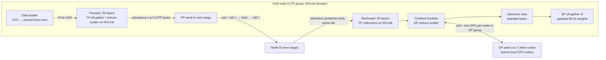

# Chapter 11 — Distributed Training Architecture

> A 70-billion-parameter model needs about 1.1 TB of training state and roughly 1.8 × 10¹⁸
> floating-point operations per optimizer step. No single GPU holds the first number or finishes the
> second in useful time, so the work is cut up across hundreds of GPUs — and every cut creates
> communication. Data parallelism, tensor parallelism, pipeline parallelism, sequence/context
> parallelism, and expert parallelism are five ways of cutting, each with a distinct traffic pattern,
> volume, latency sensitivity, and failure signature. This chapter teaches you to account for memory
> and bytes per GPU per step, place each traffic pattern on the right hardware (NVLink inside the
> node, rails across nodes), predict step time and scaling efficiency from first principles, and
> design a training workflow that survives the failures that are certain at scale.

## Learning objectives

After working through this chapter, its exercises, and its lab, you will be able to:

1. **Explain** the mechanism and per-step communication pattern of data, ZeRO/FSDP-sharded data,
   tensor, pipeline, sequence/context, and expert parallelism, including which collective each uses
   and how often.
2. **Calculate** per-GPU memory (weights, gradients, optimizer state, activations) for a stated
   model and parallel configuration, and identify configurations that overflow an 80 GB GPU.
3. **Calculate** per-GPU communication volume per step for each parallelism dimension and convert it
   into time using link bandwidth, latency, and overlap assumptions.
4. **Design** a topology-aware placement that keeps tensor parallelism inside the NVLink domain and
   puts data- and pipeline-parallel traffic on a single rail of a rail-optimized fabric.
5. **Estimate** step time, pipeline bubble, model FLOPs utilization (MFU), and strong/weak scaling
   efficiency, and explain how each changes when compute, communication, or synchronization varies.
6. **Diagnose** stragglers, hangs, and rank loss from their signatures in logs and per-rank timing.
7. **Design** a failure-aware training workflow: a checkpoint interval from the Young/Daly
   approximation, a restart procedure, and an explicit expected-lost-work budget.

## Prerequisites and connections

You need the GPU execution model and the meaning of FLOP/s and high-bandwidth memory (HBM) bandwidth from
[Chapter 4](../../part-2-accelerated-compute/ch04-gpu-architecture-cuda-execution/), the HX8 node's
NVLink, PCIe (Peripheral Component Interconnect Express), and network interface card (NIC) topology from
[Chapter 5](../../part-2-accelerated-compute/ch05-gpu-interconnects-host-topology/), and the
rail-optimized leaf-spine design from
[Chapter 7](../../part-3-networking/ch07-ethernet-datacenter-network-foundations/). Remote direct memory access (RDMA) verbs and
RoCEv2 ([Chapter 8](../../part-3-networking/ch08-rdma-rocev2-infiniband/)) are useful but not
required for this chapter.

This chapter is the "why" behind the next two. [Chapter 12](../ch12-collective-communication-nccl/)
opens the box labelled "all-reduce": how the NVIDIA Collective Communications Library (NCCL)
implements and benchmarks it.
[Chapter 13](../ch13-gpu-data-movement/) follows a byte from GPU memory through PCIe, the NIC, and the
fabric to a remote GPU, and diagnoses the stragglers introduced here. Checkpoint storage mechanics (sharded and asynchronous checkpoints,
restore validation) are in [Chapter 14](../ch14-storage-pipelines-checkpointing/); fleet-scale fault
isolation and quarantine are in
[Chapter 19](../../part-5-production-operations/ch19-reliability-security-multitenancy/). The
step-time model you build in this chapter's lab is the backbone of **Capstone C** (distributed
training performance optimization) and the checkpoint calculator feeds **Capstone G** (fault-tolerant
512-node training operations); see [capstones](../../../capstones/).

Throughout, we use **W-TRAIN** on **ORION-256** (all 32 nodes; a full-size run borrows the inference
nodes `orion-n25`–`n32` from the default 24 training + 8 inference split) from
[REFERENCE_CLUSTER.md](../../../docs/REFERENCE_CLUSTER.md): a 70 × 10⁹-parameter decoder-only
transformer (80 layers, hidden size *h* = 8192, 64 query heads, 8 key/value heads with grouped-query
attention (GQA), head dimension 128), sequence length *s* = 4,096, global batch 1,024 sequences
(≈ 4.19 M tokens), BF16 (bfloat16) mixed precision with the Adam optimizer, on 32 HX8 nodes × 8 H100-class GPUs. The baseline
layout is tensor parallel (TP) = 8, pipeline parallel (PP) = 4, data parallel (DP) = 8.

## 11.1 Anatomy of a training step

A training step (one optimizer update) has four phases. In the **forward pass**, each micro-batch of
tokens flows through the layers and produces a loss; intermediate results ("activations") are kept
for the backward pass. In the **backward pass**, gradients flow from the loss back through the layers;
each layer produces gradients for its own weights and for its input. In the **gradient
synchronization** phase, the replicas that processed different data agree on one averaged gradient.
In the **optimizer step**, Adam updates the FP32 (32-bit floating point) master weights and writes new BF16 weights.

The arithmetic cost of a dense transformer step is well approximated by the "6ND" rule
(Kaplan et al., 2020): forward costs ≈ 2 FLOP per parameter per token, backward ≈ 4, so

```text
FLOP_step ≈ 6 × N × D
          = 6 × 70e9 params × (1,024 seq × 4,096 tok/seq = 4,194,304 tokens)
          = 1.76 × 10^18 FLOP                                        [MODELED]
```

On 256 GPUs with a dense BF16 peak of ≈ 989 TFLOP/s each `[VENDOR-SPEC, 2026-10]`, the
*ideal* step time is 1.76e18 / (256 × 989e12) = 6.96 s. Real steps take longer because kernels do not
run at peak, because some communication is exposed, and because pipelines have idle time. We
summarize the gap with **model FLOPs utilization (MFU)**, introduced in the PaLM paper (Chowdhery et
al., 2022):

```text
MFU = (6 × N × D) / (GPUs × peak FLOP/s × measured step time)
```

MFU counts only "useful" model FLOPs: if you recompute activations, the extra forward pass costs time
but does not raise MFU. ORION's planning assumption is 40 % MFU, i.e. a step time of
6.96 s / 0.40 = 17.4 s `[MODELED]`. A large part of this chapter is about explaining where the other
60 % goes, because that is where infrastructure engineers can win it back.



*Figure 11.1 — End-to-end data path of one W-TRAIN training step on ORION (baseline TP=8, PP=4,
DP=8). Tensor-parallel traffic never leaves the NVLink domain; pipeline and data-parallel traffic
leave through the GPU's own rail NIC and reach peers attached to the same rail leaf. Chapter 13 traces
the same step at the byte level through PCIe and GPUDirect RDMA.*

## 11.2 Memory accounting per GPU

A configuration must *fit* before it can be fast. Per-GPU memory has four components.

**Model state.** For BF16 mixed-precision Adam, each parameter needs 2 B of BF16 weights, 2 B of BF16
gradients, and 12 B of FP32 optimizer state (4 B master weight, 4 B first moment *m*, 4 B second
moment *v*): 16 B per parameter. For W-TRAIN that is 16 × 70e9 = 1.12 TB `[MODELED]` — fourteen
80 GB GPUs' worth before a single activation is stored. Some stacks keep FP32 gradient accumulation
buffers (another 4 B/parameter); state which convention you use. This chapter uses 16 B.

**Activations.** The forward pass stores tensors that the backward pass needs. Korthikanti et al.
(2022) derived the per-layer activation memory of a standard transformer layer as

```text
A_layer ≈ s · b · h · (34 + 5·a·s/h)   bytes        (no parallelism, 16-bit activations)
```

where *s* is the sequence length, *b* the micro-batch size, *h* the hidden size and *a* the number of
attention heads. The `5as/h` term is the attention score matrix; for W-TRAIN it is
5 × 64 × 4096 / 8192 = 160 — almost five times the 34 term — which is why nobody trains at
*s* = 4,096 without either FlashAttention-style fused attention or *selective recomputation* of the
attention core, both of which remove that term. With tensor parallelism plus **sequence parallelism**
(Section 11.4) the remaining 34 term is divided by the TP degree *t*:

```text
A_layer ≈ s · b · h · 34 / t     (selective recompute + sequence parallelism)
        = 4096 × 1 × 8192 × 34 / 8 = 142.6 MB per layer per micro-batch   [MODELED]
```

The 34 coefficient assumes multi-head attention and a 4*h* MLP; W-TRAIN's GQA shrinks K and V and its
wider gated MLP grows the MLP activations, so treat the figure as a ±20 % planning estimate and
confirm with the memory profiler at L2. **Full recomputation** stores only each layer's input
(2·s·b·h/t bytes, 16.8 MB per layer here) and re-runs the whole forward pass during backward, costing
about one third more compute (8ND instead of 6ND).

**Pipeline in-flight micro-batches.** Pipeline schedules keep several micro-batches' activations alive
at once. Under the 1F1B schedule (Section 11.5), the first stage holds up to *p* micro-batches, where
*p* is the PP degree. The first stage is therefore the memory hot spot.

**Fixed overhead.** CUDA context, NCCL buffers, the allocator's fragmentation, and temporary
workspace typically consume a few GB. We budget 4 GB `[ILLUSTRATIVE]`, and we plan to use at most
85 % of HBM (68 GB of 80 GB) so that a longer sequence or a fragmentation spike does not turn into an
out-of-memory crash at step 40,000.

### Sharding the model state: ZeRO and FSDP

Plain data parallelism (PyTorch DistributedDataParallel, DDP) replicates the full model state on
every replica. **ZeRO** (Zero Redundancy
Optimizer; Rajbhandari et al., 2020) removes the redundancy in three stages across the *d* DP ranks:

| Stage | What is sharded across DP | Bytes per local parameter | DP traffic per step (per GPU, relative to all-reduce of gradients) |
|---|---|---|---|
| None (DDP) | nothing | 2 + 2 + 12 = 16 | 1× (all-reduce) |
| ZeRO-1 ("distributed optimizer") | optimizer state | 2 + 2 + 12/d | 1× (reduce-scatter gradients + all-gather updated weights) |
| ZeRO-2 | + gradients | 2 + (2 + 12)/d | 1× |
| ZeRO-3 / FSDP full shard | + weights | 16/d (+ gather buffer) | 1.5× per gradient-accumulation micro-batch (all-gather fwd, all-gather bwd, reduce-scatter) |

*Table 11.1 — ZeRO stages: memory per parameter and data-parallel communication `[MODELED]` from the
ZeRO paper's analysis. An all-reduce is a reduce-scatter followed by an all-gather, which is why
ZeRO-1/2 cost no extra bytes.*

PyTorch's Fully Sharded Data Parallel (FSDP; Zhao et al., 2023) implements the same family; its
`ShardingStrategy` options include `FULL_SHARD` (≈ ZeRO-3), `SHARD_GRAD_OP` (≈ ZeRO-2), `NO_SHARD`
(≈ DDP), and `HYBRID_SHARD` (full sharding inside a node, replication across nodes) — names as of
PyTorch 2.x `[VENDOR-SPEC, 2026-10]`; FSDP2's `fully_shard` API expresses the same choices through a
device mesh. Megatron-LM's `--use-distributed-optimizer` is ZeRO-1.

> **Pitfall:** ZeRO-3 with gradient accumulation re-gathers every layer's weights for every
> micro-batch. With *m* micro-batches per step, the DP traffic is 1.5 × *m* times the all-reduce
> volume, not 1.5×. On a slow network this turns a memory win into a throughput disaster; Section
> 11.10 shows the numbers.

### Baseline memory, all arithmetic shown

For the baseline (TP = 8, PP = 4, DP = 8, micro-batch *b* = 1, ZeRO-1, selective recompute):

```text
Local parameters   P = N / (TP × PP) = 70e9 / 32 = 2.1875e9
Weights            2 B × P            = 4.375 GB
Gradients          2 B × P            = 4.375 GB
Optimizer (ZeRO-1) 12 B × P / DP      = 26.25 GB / 8 = 3.281 GB
Model state                           = 12.03 GB
Micro-batches      m = 1024 / (DP × b) = 128 per pipeline per step
Activations        142.6 MB/layer × (80/4 = 20 layers) × min(PP, m) = 4 in flight
                                       = 11.41 GB
Overhead                              = 4.0 GB
Total                                 = 27.4 GB  (34 % of 80 GB)            [MODELED]
```

This is a comfortable fit — which is precisely why the baseline is a *conservative* layout. Section
11.10 shows that the tool you build in the lab finds a faster layout that spends some of that headroom.

## 11.3 Data parallelism

**Mechanism.** Each of *d* replicas holds the same model (or a shard group of it), processes a
different slice of the global batch, and averages gradients before the optimizer step. The averaging
is an **all-reduce**: every rank contributes a gradient tensor and every rank receives the sum.
Chapter 12 shows that a bandwidth-optimal ring all-reduce makes each GPU send (and receive)

```text
V_allreduce = 2 × (d − 1)/d × G   bytes,   G = gradient bytes per GPU
```

which tends to 2*G* as *d* grows. The per-GPU volume is therefore almost independent of the number of
replicas — the property that makes data parallelism scale.

**Bucketing and overlap in PyTorch DDP.** DistributedDataParallel (Li et al., 2020) registers an
autograd hook on every parameter. Gradients are assigned to **buckets** in roughly reverse parameter
order (the order in which backward produces them); when every gradient in a bucket is ready, DDP
launches an asynchronous all-reduce on that bucket while backward continues computing earlier layers.
The default bucket size is 25 MB (`bucket_cap_mb=25`), with a smaller first bucket so communication
starts early `[VENDOR-SPEC, 2026-10]`. Buckets trade per-collective latency (many small all-reduces
are latency-bound — Chapter 12) against overlap (one giant all-reduce could only start after
backward ends).

```text
time ──────────────────────────────────────────────────────────────────────────►
compute stream : [fwd L1..L80][bwd L80..L61][bwd L60..L41][bwd L40..L21][bwd L20..L1][opt]
comm stream    :                     [AR bkt1 ]   [AR bkt2   ]   [AR bkt3   ]   [AR bkt4]
                                                                         exposed ─►└──┘
```

*Figure 11.2 — Gradient bucketing in DDP. Each bucket's all-reduce runs on a separate CUDA stream
while backward continues. Only the last bucket(s) — produced at the very end of backward — are
exposed on the critical path. Bigger buckets mean fewer, more efficient collectives but a longer
exposed tail.*

**Gradient accumulation.** When the global batch is larger than what *d* replicas process in one
pass, each replica runs several micro-batches and accumulates gradients locally. DDP's `no_sync()`
context manager suppresses the all-reduce for all but the last micro-batch, so the DP traffic is paid
once per optimizer step, and only the last micro-batch's backward offers an overlap window. In a
pipeline-parallel job the same is true: gradients are reduced once per step, after the pipeline
drains. Megatron-LM's `--overlap-grad-reduce` and `--overlap-param-gather` overlap the distributed
optimizer's reduce-scatter and all-gather with compute `[VENDOR-SPEC, 2026-10]`.

**Numbers for the baseline.** Each GPU holds 2.1875e9 parameters, so BF16 gradients are
G = 4.375 GB. With DP = 8, the reduce-scatter + all-gather of the distributed optimizer moves
2 × 7/8 × 4.375 GB = 7.66 GB per GPU per step `[MODELED]`. Each DP group contains one GPU per node
(Section 11.8), so this traffic crosses the GPU's own 400 Gb/s rail NIC. At an effective 45 GB/s
`[ILLUSTRATIVE]` (90 % of the 50 GB/s line rate), that is 0.17 s. Only the last micro-batch's
backward pass can hide it — 13.92 s / 128 × 2/3 ≈ 72 ms (Chapter 13, Section 13.6) — so ≈ 98 ms is
exposed. (In plain DDP without pipelining, most buckets hide behind the full backward pass.)

> **Key idea:** Data parallelism is the cheapest parallelism per byte of model, because it moves each
> gradient once per step. Its cost is memory (full replicas unless sharded) and a dependence on large
> batch sizes.

## 11.4 Tensor parallelism

**Mechanism.** Tensor parallelism (TP) splits individual weight matrices across *t* GPUs. In the
Megatron-LM scheme (Shoeybi et al., 2019), the MLP's first linear layer is split by **columns** (each
GPU computes a slice of the intermediate activations with no communication) and the second by
**rows** (each GPU produces a partial sum of the output). The partial sums are combined by an
all-reduce. Self-attention is split by heads in the same column-then-row pattern. Per transformer
layer, the forward pass therefore needs **two all-reduces** (after attention and after the MLP) and
the backward pass needs **two more** (for the input gradients of the column-parallel layers). The
paper calls these conjugate operators *f* and *g*.

```text
            X (replicated, s·b·h)                              per TP rank i (of t)
   ┌───────────────┴────────────────┐
   │  Column-parallel A_i  (h × 4h/t) │  → Y_i = GeLU(X·A_i)       no communication
   │  Row-parallel    B_i  (4h/t × h) │  → Z_i = Y_i·B_i           partial sum
   └───────────────┬────────────────┘
                    Z = Σ_i Z_i   ← all-reduce over t ranks (forward "g")
   backward: dX = Σ_i dX_i         ← all-reduce over t ranks (backward "f")
```

*Figure 11.3 — Megatron-style tensor-parallel MLP. One all-reduce in forward and one in backward per
block; attention adds another pair, giving four all-reduces per layer per micro-batch.*

**Sequence parallelism** (Korthikanti et al., 2022) splits the LayerNorm and dropout regions along the
sequence dimension, replacing each all-reduce with a reduce-scatter followed (later) by an all-gather.
The bytes on the wire are the same as the all-reduce it replaces, but activations outside the matmuls
are now stored once instead of *t* times — which is where the `/t` in the activation formula comes
from. Megatron enables it with `--sequence-parallel`.

**Volume.** Each all-reduce carries the full activation tensor of a micro-batch,
M = s·b·h·2 B = 4096 × 1 × 8192 × 2 = 67.1 MB. Per layer per micro-batch each GPU sends
4 × 2(t − 1)/t × M = 4 × 1.75 × 67.1 MB = 470 MB. Across the 20 layers of a stage and 128
micro-batches per step:

```text
V_TP = 4 × 2(t−1)/t × M × (L/p) × m
     = 4 × 1.75 × 67.1e6 B × 20 × 128 = 1.20 × 10^12 B ≈ 1.2 TB per GPU per step   [MODELED]
```

That is 157 times the DP volume, and it is *synchronous*: the next matmul needs the reduced tensor.
Frameworks overlap part of it by chunking the matrix multiplications (GEMMs) and communication, but we assume only 25 % is hidden
`[ILLUSTRATIVE]`.

A useful identity falls out of the formula. With L/p layers per stage and m = B/(d·b) micro-batches,
and t·p·d = W GPUs:

```text
V_TP = 8 × (t − 1) × M × L × B / (W × b)
```

**Per-GPU TP volume is proportional to (t − 1)** and independent of how the remaining GPUs are split
between PP and DP. Going from TP = 8 to TP = 4 cuts TP bytes from 7 units to 3 — a 57 % reduction —
at the cost of twice the weights per GPU. That trade-off is the heart of the lab.

**Why TP must stay inside the NVLink domain.** Four all-reduces of 67 MB per layer per micro-batch,
10,240 collectives per step, all on the critical path, need the 450 GB/s-per-direction NVLink fabric,
not a 50 GB/s NIC. On ORION, 300 GB/s effective NVLink bus bandwidth `[ILLUSTRATIVE]` gives
1.2e12 / 300e9 = 4.0 s of TP communication per step plus ≈ 0.1 s of per-collective latency
(10,240 × 10 µs). If the TP group spans two nodes, each collective gains an inter-node phase that
crosses the rail NICs and the fabric; Section 11.10 shows the step time growing from 17.45 s to 23.9 s,
and every TP collective is now exposed to fabric congestion and tail latency.

> **Vendor implementation note (NVIDIA):** Multi-node NVLink systems (NVL72-class racks) extend the
> NVLink domain beyond 8 GPUs, which changes the "TP ≤ 8" rule of thumb into "TP ≤ NVLink domain
> size." ORION's HX8 nodes are 8-GPU NVLink domains. GQA adds a second constraint: frameworks
> generally require the number of KV heads (8 for W-TRAIN) to be divisible by the TP degree, so TP = 16
> is invalid for W-TRAIN regardless of topology. Verify the constraint in your framework version.

## 11.5 Pipeline parallelism

**Mechanism.** Pipeline parallelism (PP) assigns contiguous groups of layers to *p* stages. Stage *k*
sends its output activations to stage *k + 1* (forward) and receives activation gradients back
(backward) with point-to-point send/receive. To keep stages busy, the batch is split into *m*
micro-batches.

**Schedules.** GPipe (Huang et al., 2019) runs all forward passes and then all backward passes; it
holds *m* micro-batches of activations. The **1F1B** schedule (PipeDream-Flush; Harlap et al., 2018;
Narayanan et al., 2021) starts backward as soon as possible and then alternates one forward with one
backward, so stage 0 holds at most *p* micro-batches in flight. Both have the same idle time — the
**pipeline bubble** — while the pipeline fills and drains:

```text
p=4, m=8, 1F1B, F and B drawn as equal one-slot operations ('.' = idle)
slot:   1  2  3  4  5  6  7  8  9 10 11 12 13 14 15 16 17 18 19 20 21 22
stage0: F1 F2 F3 F4 .  .  .  B1 F5 B2 F6 B3 F7 B4 F8 B5 .  B6 .  B7 .  B8
stage1: .  F1 F2 F3 .  .  B1 F4 B2 F5 B3 F6 B4 F7 B5 F8 B6 .  B7 .  B8
stage2: .  .  F1 F2 .  B1 F3 B2 F4 B3 F5 B4 F6 B5 F7 B6 F8 B7 .  B8
stage3: .  .  .  F1 B1 F2 B2 F3 B3 F4 B4 F5 B5 F6 B6 F7 B7 F8 B8
        each stage: 16 busy slots out of 22 → idle 6/22 = 3/11 = (p−1)/(m+p−1)
```

*Figure 11.4 — 1F1B schedule produced by a small dependency simulation (F(i) on stage k waits for
F(i) on stage k − 1; B(i) waits for B(i) on stage k + 1). Real backward passes take about twice as
long as forward passes, which changes the picture's proportions but not the bubble fraction. Stage 0
never holds more than p = 4 micro-batches of activations, versus m = 8 under GPipe.*

With *m* micro-batches of ideal time *t_mb* per stage, the pipeline takes (m + p − 1) × t_mb, so

```text
bubble fraction of total time  = (p − 1)/(m + p − 1)
bubble time relative to ideal  = (p − 1)/m                      (Narayanan et al., 2021)
Baseline: (4 − 1)/(128 + 4 − 1) = 3/131 = 2.3 %   of pipeline time (compute + bubble)   [MODELED]
```

Both forms appear in the literature; state which you use. The **interleaved** schedule assigns *v*
non-contiguous "virtual" stages to each GPU (Megatron: `--num-layers-per-virtual-pipeline-stage`),
dividing the bubble by *v* at the cost of *v* times more point-to-point messages.

**Volume.** Per micro-batch each stage boundary carries M/t bytes per GPU in each direction (with
sequence parallelism, each TP rank sends only its sequence slice): 67.1 MB / 8 = 8.4 MB. Per step a
GPU sends 2 × 128 × 8.4 MB = 2.15 GB `[MODELED]` — small, latency-sensitive messages that sit on the
critical path at every stage boundary but are partly hidden by the schedule.

> **Pitfall:** The bubble depends on *m*, and *m* = global batch / (DP × micro-batch). Doubling DP to
> scale out with a fixed global batch halves *m* and nearly doubles the bubble fraction. Pipeline
> parallelism and strong scaling are natural enemies (Section 11.9).

## 11.6 Sequence and context parallelism

For long contexts (32k–1M tokens) the activations of a *single* sequence no longer fit even with
TP = 8. **Context parallelism (CP)** splits the sequence dimension across *c* GPUs for the whole
layer, including attention. Attention needs every query to see every key, so the GPUs exchange
key/value (KV) blocks: in the ring-attention formulation (Liu et al., 2023) each GPU passes its KV
block around a ring while computing attention on the block it currently holds, overlapping the
transfer with compute. DeepSpeed-Ulysses (Jacobs et al., 2023) instead uses all-to-all to re-shard
from sequence-split to head-split around the attention core.

Per layer per micro-batch, ring-style CP makes each GPU send (c − 1) KV blocks. With GQA, KV is small:
for a hypothetical 128k-token W-TRAIN variant with c = 8 and *no* tensor parallelism (each GPU holds
all 8 KV heads), each local block is (131,072/8) tokens × 2 (K,V) × 8 KV heads × 128 × 2 B = 67.1 MB,
and each GPU sends 7 × 67.1 MB = 470 MB per layer in forward `[MODELED]`; with TP = 8 each GPU holds
one KV head and the block shrinks to 8.4 MB, overlapped with the quadratic attention compute
on the block in hand. Megatron exposes this as `--context-parallel-size` `[VENDOR-SPEC, 2026-10]`;
place CP groups on the fastest links left after TP has claimed NVLink.

## 11.7 Expert parallelism (Mixture of Experts)

A Mixture-of-Experts (MoE) layer replaces one MLP with *E* expert MLPs and a router that sends each
token to its top-*k* experts (GShard, Lepikhin et al., 2020; Switch Transformer, Fedus et al., 2021).
**Expert parallelism (EP)** places different experts on different GPUs. Every MoE layer then needs
two **all-to-all** exchanges in forward — *dispatch* (send each token's hidden vector to the GPUs
hosting its experts) and *combine* (bring results back) — and two more in backward.

```text
per-GPU bytes per MoE layer per micro-batch ≈ 4 × T × k × h × 2 B × (e − 1)/e
  T = tokens per GPU per micro-batch, k = experts per token, e = EP group size
Example [ILLUSTRATIVE]: T = 4,096, k = 2, h = 4,096, e = 8
  = 4 × 4096 × 2 × 4096 × 2 × 7/8 = 235 MB
```

Three properties make EP traffic hard. It is **all-to-all**: on a rail-optimized fabric, traffic
between *different* rails crosses the spine unless the library first moves data over NVLink to the
GPU on the destination's rail. It is **data-dependent**: router imbalance makes some GPUs receive far
more tokens than others (a "hot expert"), creating incast and stragglers; a *capacity factor* caps
tokens per expert and drops or reroutes the overflow. And it is **on the critical path** between
attention and the MLP. Practitioners keep EP inside the NVLink domain where they can, and when they
cannot, they watch spine utilization and Explicit Congestion Notification (ECN) marks (Chapter 9) during MoE layers specifically.

> **Vendor implementation note (NVIDIA NCCL):** NCCL's PXN feature (introduced in NCCL 2.12) lets a
> GPU send inter-node traffic through an NVLink peer whose NIC is on the destination's rail,
> aggregating messages and keeping all-to-all traffic rail-local. Behaviour and controls vary by
> version; verify against the NCCL release notes `[VENDOR-SPEC, 2026-10]`.

## 11.8 Composing 3D/4D parallelism and topology-aware placement

Real jobs combine dimensions: **3D parallelism** is TP × PP × DP (PTD-P in Narayanan et al., 2021);
adding CP or EP gives "4D" or "5D". The GPU count is the product, and the rank *order* — which
dimension varies fastest across consecutive ranks — decides which GPUs share a group. Megatron-LM's default places TP fastest (consecutive ranks form a TP group), then (CP, EP,) DP,
then PP `[VENDOR-SPEC, 2026-10]`. With `torchrun --nproc-per-node=8`, global ranks 8n … 8n + 7 live on
node *n*, so TP = 8 maps exactly onto one node.

Each dimension has a distinct traffic profile, and placement should put the most demanding one on the
best link:

| Dimension | Collective | Frequency per step (baseline) | Bytes/GPU/step (baseline) | Latency sensitivity | Best placement |
|---|---|---|---|---|---|
| TP (+SP) | all-reduce or reduce-scatter + all-gather | 10,240 | 1.20 TB | Very high (critical path) | Inside NVLink domain |
| CP | ring send/recv or all-to-all | per layer | 470 MB per layer (128k example) | High, overlappable | NVLink, else nearest rail |
| EP | all-to-all | 4 per MoE layer per micro-batch | data-dependent | High, incast-prone | NVLink; else rail-local via NVLink forwarding |
| PP | send/recv | 256 | 2.15 GB | Medium (fill/drain) | Across nodes, same rail |
| DP (ZeRO-1) | reduce-scatter + all-gather | 1 (bucketed) | 7.66 GB | Medium — ≈ 98 of 170 ms exposed (window-limited) | Across nodes, same rail |

*Table 11.2 — Traffic profile by parallelism dimension for W-TRAIN on ORION `[MODELED]`. Volumes are
per GPU per optimizer step, counting bytes sent.*

**The ORION mapping.** With TP fastest and TP = 8, node *n* hosts one complete TP group. The 32 nodes
form a 4 (PP) × 8 (DP) grid. GPU *i* on any node holds TP rank *i*, and its DP and PP peers are
always GPU *i* on other nodes — attached through NIC *i* to rail leaf *i*. Every byte of DP and PP
traffic therefore travels NIC *i* → leaf *i* → NIC *i*: one switch hop, no spine, no cross-rail
traffic.

```text
              rail leaf 0 ─── GPU0 of every node (TP rank 0)  → DP/PP groups of TP rank 0
              rail leaf 1 ─── GPU1 of every node (TP rank 1)  → DP/PP groups of TP rank 1
                 ...
              rail leaf 7 ─── GPU7 of every node (TP rank 7)

   PP stage →    stage 0        stage 1        stage 2        stage 3
   DP replica 0  node 0         node 8         node 16        node 24
   DP replica 1  node 1         node 9         node 17        node 25
     ...          ...            ...            ...            ...
   DP replica 7  node 7         node 15        node 23        node 31
   (each node = one TP=8 group on NVLink; layers 1–20 | 21–40 | 41–60 | 61–80)
```

*Figure 11.5 — Topology-aware placement of W-TRAIN on ORION-256. TP stays inside each node's NVLink
domain; PP neighbours (rows) and DP peers (columns) differ only in node, never in local GPU index, so
inter-node traffic is rail-local. The exact node-to-grid assignment follows global rank order; what
matters is that local GPU index equals TP rank on every node.*

What breaks this mapping in practice: a scheduler that hands the job 4 GPUs per node (Section
11.14); `CUDA_VISIBLE_DEVICES` reordering that decouples `LOCAL_RANK` from the physical GPU index; or
a GPU-to-NIC affinity mistake that sends rail 3's traffic through NIC 7. The last two are invisible in
training logs and visible only in NIC counters and NCCL's topology output (Chapters 5, 12, 13).

## 11.9 Scaling efficiency: strong and weak

**Weak scaling** grows the problem with the machine: double the GPUs and double the global batch, so
work per GPU stays constant. **Strong scaling** keeps the problem (global batch) fixed and adds GPUs
to finish each step sooner. Efficiency is defined as

```text
weak:   E_w(W) = T_step(W0) / T_step(W)                         (ideal 1.0)
strong: E_s(W) = [T_step(W0) / T_step(W)] / (W / W0)              (ideal 1.0)
```

In weak scaling with DP, per-GPU compute is constant and per-GPU DP volume 2(d − 1)/d × G barely
changes, so data parallelism weak-scales almost perfectly *in bytes*. The lab's model confirms it:
growing W-TRAIN from 256 GPUs (DP = 8, 1,024 sequences) to 4,096 GPUs (DP = 128, 16,384 sequences)
leaves the modeled step at 17.45–17.47 s `[MODELED]`. Real weak-scaling losses come from what the model
omits: the chance that *some* rank is slow (Section 11.11), congestion at larger radix, and the
optimization cost of huge batches — beyond the **critical batch size** (McCandlish et al., 2018) more
tokens per step stop reducing the steps needed, so weak scaling stops being useful even when efficient.

Strong scaling is where the architecture shows. Holding the global batch at 1,024 and growing DP:

| GPUs | DP | m | Compute (s) | Bubble (s) | Bubble fraction | Exposed comm (s) | Step (s) | Speed-up | Strong-scaling efficiency | MFU |
|---|---|---|---|---|---|---|---|---|---|---|
| 256 | 8 | 128 | 13.92 | 0.33 | 2.3 % | 3.21 | 17.45 | 1.00 | 100 % | 39.9 % |
| 512 | 16 | 64 | 6.96 | 0.33 | 4.5 % | 1.67 | 8.95 | 1.95 | 97 % | 38.9 % |
| 1,024 | 32 | 32 | 3.48 | 0.33 | 8.6 % | 0.89 | 4.70 | 3.71 | 93 % | 37.0 % |
| 2,048 | 64 | 16 | 1.74 | 0.33 | 15.8 % | 0.51 | 2.57 | 6.78 | 85 % | 33.8 % |
| 4,096 | 128 | 8 | 0.87 | 0.33 | 27.3 % | 0.31 | 1.51 | 11.55 | 72 % | 28.8 % |

*Table 11.3 — Strong scaling of W-TRAIN (TP = 8, PP = 4, global batch 1,024) `[MODELED]` with the
lab's step model and ORION's illustrative efficiency assumptions. Speed-up = 17.45 s / step; e.g. at
4,096 GPUs 17.45/1.511 = 11.55, efficiency 11.55/16 = 72 %. "Bubble fraction" is (p − 1)/(m + p − 1),
i.e. relative to compute + bubble, not to the whole step.*

Compute halves with each doubling; the **bubble does not shrink at all** in absolute terms (p − 1 = 3
micro-batch slots of fixed size), so its *fraction* grows from 2 % to 27 %. TP communication halves
with compute. DP communication stays ≈ 0.17–0.19 s while the last micro-batch's backward that hides it
stays ≈ 72 ms, so exposed DP time grows from 98 to 120 ms. At ORION-XL scale you would cut PP,
interleave, or raise the global batch, each with its own cost.

> **Key idea:** Every parallelism dimension has a "fixed cost per step" that does not shrink when you
> add GPUs: the pipeline fill/drain, the DP gradient all-reduce, per-collective latency. Strong
> scaling ends when those fixed costs dominate.

## 11.10 Worked example: choosing a layout for W-TRAIN on ORION

**Problem.** Training Infra asks Fabric and Platform: "Is TP = 8, PP = 4, DP = 8 the right layout
for W-TRAIN on ORION-256, and what would break if we changed it?" We answer with the lab's model,
which encodes every formula in Sections 11.2–11.8. All results are `[MODELED]` under the
`[ILLUSTRATIVE]` assumptions in Table 11.4; none is a measurement.

| Assumption | Value | Why this value |
|---|---|---|
| Kernel efficiency (fraction of 989 TFLOP/s achieved in compute) | 0.50 | Typical large-GEMM efficiency once attention, norms and optimizer are included |
| Effective NVLink bus bandwidth for TP collectives | 300 GB/s | Below the ≈ 450 GB/s large-message plateau of Chapter 12 because 67 MB messages and compute contention cost efficiency |
| Effective per-GPU rail bandwidth | 45 GB/s | 90 % of 400 Gb/s = 50 GB/s line rate |
| Per-collective latency | 10 µs NVLink, 30 µs inter-node | Order of magnitude of small-message latency (Chapter 12) |
| Overlap: TP / PP | 25 % / 50 % | TP is mostly on the critical path |
| DP overlap window | last micro-batch's backward = compute/m × 2/3 (≈ 72 ms) | Exposed DP = max(0, T_DP − window); Chapter 13, Section 13.6 |
| HBM planning limit | 85 % of 80 GB = 68 GB | Headroom for fragmentation and longer sequences |

*Table 11.4 — Model assumptions `[ILLUSTRATIVE]`. Change them in `lab/data/cluster_orion.yaml` and
re-run; the lab's exercises ask you to do exactly that.*

**Step 1 — Compute time.** Per GPU, compute = 6ND / W / (peak × efficiency):

```text
6 × 70e9 × 4,194,304 = 1.7616e18 FLOP
1.7616e18 / 256 GPUs = 6.881e15 FLOP per GPU
6.881e15 / (989e12 × 0.50 = 4.945e14 FLOP/s) = 13.92 s
```

**Step 2 — Bubble.** m = 1024/(8 × 1) = 128. Bubble = compute × (p − 1)/m = 13.92 × 3/128 = 0.33 s
(2.3 % of compute + bubble; 0.33/17.45 = 1.9 % of the final step time).

**Step 3 — TP communication.** Per collective, a ring all-reduce over 8 GPUs on NVLink takes
2 × 7/8 × 67.1e6 B / 300e9 B/s = 391 µs, plus 10 µs latency = 401 µs. There are
4 × 20 × 128 = 10,240 collectives, so TP time = 10,240 × 401 µs = 4.11 s; exposed = 4.11 × 0.75 = 3.08 s.

**Step 4 — DP communication.** 2 × 7/8 × 4.375e9 B / 45e9 B/s = 0.170 s (+ 60 µs latency); exposed
= max(0, 0.170 − 0.072) = 0.098 s, because only the last micro-batch's backward
(13.92/128 × 2/3 = 0.072 s) can hide it.

**Step 5 — PP communication.** 2.15e9 B / 45e9 B/s = 0.048 s + 256 messages × 30 µs = 0.055 s;
exposed = 0.055 × 0.50 = 0.028 s.

**Step 6 — Step time and MFU.**

```text
step = 13.92 + 0.33 + 3.08 + 0.098 + 0.028 = 17.45 s
MFU  = 1.7616e18 / (256 × 989e12 × 17.45) = 0.399                      [MODELED]
```

17.45 s is the canonical 17.39 s (exactly 40 % MFU) plus 0.06 s of DP time that the ≈ 72 ms window
cannot hide; we quote ≈ 17.4 s / 40 % as the planning figure.

The model reproduces ORION's planning figure of ≈ 17.4 s at ≈ 40 % MFU — evidence that the assumptions
are mutually consistent, not that they are true. The breakdown is the useful part: 80 % compute, 18 % exposed TP communication, 2 % bubble, and under 1 % each for DP and PP.
**Here the fabric is not the bottleneck; NVLink-borne TP traffic is.**

**Step 7 — Evaluate alternatives.** The lab evaluates twelve candidates. The key rows:

| Candidate | TP | PP | DP | Mem (GB) | Bubble | TP comm (s) | Exposed comm (s) | Step (s) | MFU | Verdict |
|---|---|---|---|---|---|---|---|---|---|---|
| D | 4 | 8 | 8 | 38.8 | 5.2 % | 1.77 | 1.39 | **16.07** | 43.3 % | Feasible, fastest |
| A (baseline) | 8 | 4 | 8 | 27.4 | 2.3 % | 4.11 | 3.21 | 17.45 | 39.9 % | Feasible |
| B | 8 | 2 | 16 | 36.2 | 1.5 % | 4.11 | 3.32 | 17.45 | 39.9 % | Feasible |
| H | 8 | 1 | 32 | 53.7 | 0 % | 4.11 | 3.55 | 17.46 | 39.8 % | Feasible |
| J | 2 | 8 | 16 | 70.4 | 9.9 % | 0.60 | 0.50 | 15.94 | 43.7 % | **Exceeds 68 GB headroom** |
| F (FSDP, full recompute) | 1 | 1 | 256 | 17.2 | 0 % | — | 0.00 | 18.55 | 37.5 % | Feasible but slow; needs 9.4 s of DP traffic fully prefetched |
| I (b = 4, no ZeRO) | 8 | 4 | 8 | 84.6 | 8.6 % | 4.03 | 3.05 | 18.27 | 38.1 % | **Overflows 80 GB** |
| G | 1 | 4 | 64 | 168.5 | 15.8 % | — | 0.02 | 16.55 | 42.0 % | **Overflows 80 GB** |
| E | 16 | 2 | 8 | 21.7 | 0.8 % | 13.06 | 9.91 | 23.94 | 29.1 % | **TP spans nodes; KV heads 8 not divisible by 16** |

*Table 11.5 — Selected candidates from the lab `[MODELED]`. Memory is for pipeline stage 0.*

Four lessons:

1. **TP = 4 beats TP = 8 here.** D cuts per-GPU TP bytes by 4/7 (−57 %; (t − 1) = 3 instead of 7) and pays with a
   bigger bubble (7/135 = 5.2 %) and 2× activations per GPU. Net: 1.4 s (7.9 %) faster, at 38.8 GB.
   Larger TP = 4 GEMMs usually run *more* efficiently, which would widen D's lead.
2. **"Fits in 80 GB" is not the criterion.** J is the fastest row on paper, but at 70.4 GB it leaves
   under 10 GB for fragmentation spikes; a production team would reject it or re-test with the
   allocator's peak statistics before accepting it.
3. **Memory traps hide in innocent changes.** I is the baseline parallelism with a bigger micro-batch
   (b = 4) and no optimizer sharding: 35 GB of replicated model state plus 45.6 GB of activations
   overflows by 4.6 GB. G needs 168 GB per GPU because without TP there is no divisor on the 17.5e9 local
   parameters' activations or weights.
4. **TP across nodes is the worst feasible-looking option.** E's TP collectives each add an inter-node
   phase (186 µs of rail time plus two 30 µs latencies on top of the 391 µs NVLink phase), turning
   4.1 s of TP time into 13.1 s, mostly exposed. And it is invalid anyway for a GQA model with 8 KV
   heads.

**Step 8 — Validate the decision (diagnostic loop).** A model ranks options; only a measurement
decides. Run D and A on the same 32 nodes for 200 steps each after 20 warm-up steps; record p50/p95
step time, peak memory per stage, and exposed communication (Chapter 6); adopt D only if its p50 step
beats A by more than the run-to-run spread *and* stage-0 peak memory stays below 68 GB. Record both runs in the lab's `manifest.yaml`.

## 11.11 Failure modes of synchronous training

Synchronous training is a distributed barrier executed thousands of times per hour.

**Stragglers.** A step ends when the *slowest* rank finishes, because every collective waits for all
participants. If rank times are independent with mean μ and standard deviation σ, the expected
maximum over 256 ranks is about μ + 2.8σ (the classic √(2 ln N) ≈ 3.3σ is an asymptotic upper
estimate). A single rank that is 10 % slow makes the whole job 10 % slow, which wastes the equivalent
of 256 × (1 − 1/1.1) ≈ 23 GPUs on ORION-256 — almost three nodes. Typical causes: thermal or power throttling,
a degraded NIC or link with retransmissions, a noisy neighbour on the host CPU, a data loader that
falls behind on one node, or data imbalance (one rank receives longer sequences). In logs, stragglers
appear not as slow ranks but as *fast ranks that wait*: every other rank shows long time in the
collective. Chapter 13 teaches the per-rank attribution.

**Hangs.** If one rank never enters a collective, the others block until a timeout fires. In PyTorch
the timeout is the `timeout` argument of `init_process_group` (on the order of 10 minutes for NCCL in
recent releases — verify for your version), enforced by the NCCL watchdog thread, which logs a line
like this `[ILLUSTRATIVE]`:

```text
[rank37]:[E1029 03:12:44.118 ProcessGroupNCCL.cpp:…] [Rank 37] Watchdog caught collective operation
timeout: WorkNCCL(SeqNum=41023, OpType=ALLREDUCE, NumelIn=33554432, NumelOut=33554432,
Timeout(ms)=600000) ran for 600083 milliseconds before timing out.
```

Causes: a crashed or stuck process (a missing rank, a Python exception, a GPU Xid (NVIDIA driver error event) in one host's
kernel log), a **collective mismatch** (ranks call different collectives or sizes, typically from a
code path that depends on rank-local data), or a fabric partition. The rank that
reports the timeout is usually *not* the culprit; the culprit is the rank whose sequence number is
behind. PyTorch's NCCL "flight recorder" (controlled by `TORCH_NCCL_TRACE_BUFFER_SIZE` and dumped on
timeout when `TORCH_NCCL_DUMP_ON_TIMEOUT` is set) records the last collectives per rank so you can
find the laggard; `TORCH_DISTRIBUTED_DEBUG=DETAIL` adds collective-consistency checks at a performance
cost. These are PyTorch 2.x environment variables `[VENDOR-SPEC, 2026-10]`; confirm their names in
your release. `py-spy dump --pid <pid>` on every rank shows where each process waits.

**Rank loss.** A node reboots, a GPU falls off the bus (Xid 79-class event), or a process is
killed by the out-of-memory (OOM) killer. Without elasticity the whole job fails. `torchrun` can restart the worker group
(`--max-restarts`) and supports an elastic node range (`--nnodes=MIN:MAX`), but a model-parallel job
cannot usually continue with a different world size without re-sharding its checkpoint. In practice,
recovery is: detect, drain the bad node, then either wait for repair or restart from the last
checkpoint without it — ORION-256 has no spare nodes, so that means DP = 7 (224 GPUs, −12.5 %) with a
global batch divisible by 7 or a batch/learning-rate adjustment. The time this takes is the *restart cost R* in Section 11.12.

**Silent degradation.** The most expensive failures crash nothing: a NIC that trained at 200 Gb/s, a
link with rising corrected errors, a power cap left over from maintenance. Step time creeps up 3–15 %
and stays there, visible only to someone who tracks step time against a baseline and per-rank timing
against the median.

## 11.12 Designing a failure-aware training workflow

At scale, failures are a rate, not an event. The book's canonical planning value
([REFERENCE_CLUSTER.md](../../../docs/REFERENCE_CLUSTER.md), `[ILLUSTRATIVE]`) is a job-interrupting
failure every ≈ 1,536 node-hours per HX8 node — GPU, NIC, host, and link faults combined. A synchronous
job fails when *any* of its nodes does, so job MTBF (mean time between failures) = 1,536 h / nodes:
**48 h** for ORION-256's 32 nodes and **3 h** for ORION-XL's 512. That is conservative but matches public
reports in order of magnitude (Meta's Llama 3 paper, 2024: 419 unexpected interruptions in 54 days on
16,384 GPUs, about one every three hours). Measure your own fleet.

**The trade-off.** Checkpointing every τ seconds costs C seconds of blocked training each time
(overhead C/τ). A failure loses, on average, half an interval of work plus the restart time R. The
first-order expected waste fraction is

```text
waste(τ) ≈ C/τ + (τ/2 + R)/MTBF
```

Setting the derivative to zero gives the Young (1974) / Daly (2006) first-order optimum

```text
τ_opt ≈ √(2 · C · MTBF)
```

valid when C ≪ τ ≪ MTBF (Daly gives higher-order corrections otherwise).

**ORION numbers.** W-TRAIN's checkpoint (weights + optimizer, ≈ 980 GB) written synchronously to the
parallel file system at an aggregate 80 GB/s takes at least 12.3 s; we budget C = 45 s blocking for
metadata, stragglers in the writers, and barriers `[ILLUSTRATIVE]`. Restart R = 900 s (15 min:
detect, drain, reschedule (after repair, or at DP = 7), NCCL initialization, load checkpoint, warm up)
`[ILLUSTRATIVE]`.

```text
ORION-256 (MTBF 48 h = 172,800 s), synchronous:
  τ_opt = √(2 × 45 s × 172,800 s) = √(1.555e7) = 3,944 s ≈ 66 min
  waste = 45/3,944 + (1,972 + 900)/172,800 = 1.14 % + 1.66 % = 2.80 %
  lost work per failure = 1,972 + 900 = 2,872 s → × 256 GPUs = 204 GPU-hours
  with a naive 4-hour interval: 45/14,400 + (7,200 + 900)/172,800 = 0.31 % + 4.69 % = 5.0 %
ORION-XL (4,096 GPUs, MTBF 3 h = 10,800 s, R = 900 s), synchronous:
  τ_opt = √(2 × 45 × 10,800) = 986 s ≈ 16.4 min
  waste = 45/986 + (493 + 900)/10,800 = 4.56 % + 12.90 % = 17.5 %
  a 4-hour interval exceeds the MTBF: only e^(−4/3) ≈ 26 % of intervals finish without a failure
  (first-order formula invalid; the lab reports it as NaN with an "invalid" flag)
```

These are `[MODELED]`. Even at the optimum, ORION-XL loses a sixth of its time. **Asynchronous checkpointing** — copy
state to host memory in a few seconds, then write to storage in the background — shrinks C from 45 s
to ≈ 5 s, so τ_opt falls to 5.5 min at XL scale and waste to 11.4 %, of which R/MTBF = 900/10,800 =
8.3 %: restart time R dominates and becomes the thing to engineer (a declared spare pool, faster NCCL init, parallel checkpoint
load). Chapter 14 covers the storage mechanics (PyTorch Distributed Checkpoint, sharded state,
consistency, restore validation).

```mermaid
stateDiagram-v2
    [*] --> Training
    Training --> Checkpointing: every τ (async snapshot to host, then background write)
    Checkpointing --> Training: snapshot done (blocking C)
    Training --> Detecting: NCCL timeout / rank exit / step-time objective breach
    Detecting --> Isolating: identify smallest failure domain (GPU, NIC, node)
    Isolating --> Replacing: drain node; wait for repair or shrink DP (no spares on ORION-256)
    Replacing --> Restoring: load last *validated* checkpoint
    Restoring --> Validating: loss and step time match pre-failure baseline
    Validating --> Training: pass
    Validating --> Isolating: fail (wrong node? corrupt checkpoint?)
```

*Figure 11.6 — Failure-aware training workflow. The restart cost R is the sum of the Detecting,
Isolating, Replacing, and Restoring times; the lost work is the training time since the last
completed checkpoint.*

**Workflow rules.**

1. A checkpoint is complete only when its metadata is durable and a restore has been tested; keep two
   generations so a corrupt latest checkpoint costs one interval, not the run.
2. After the same node fails twice, quarantine it instead of restarting onto it (Chapter 19);
   automatic retry loops onto a bad host are a classic way to burn a weekend.
3. Measure C (checkpoint logs), R (failure to first post-restart step), and MTBF (incident log);
   recompute τ_opt monthly.
4. Report lost GPU-hours per failure (lost seconds × GPUs / 3,600); it justifies a spare pool and faster
   storage to finance.

## 11.13 Hands-on lab overview

The lab ([lab/README.md](lab/README.md)) is the tool Section 11.10 used. Tier **L1**: pure Python,
no GPU, under a second. You implement `starter/stepmodel.py` — configuration validation (including
the GQA and "TP spans nodes" rules), ZeRO-aware memory accounting, NVLink-versus-rail collective
costs, per-dimension communication volumes, step time and MFU, a recommendation under the 68 GB
headroom policy, and the Young/Daly checkpoint calculator. The candidate list contains planted traps
(two memory overflows, a headroom violation, TP spanning nodes); the checker compares your numbers
with independently computed expectations. L2/L3 extensions measure peak memory and step time on real
hardware and compare them with the model.

## 11.14 Troubleshooting scenario: "W-TRAIN got 17 % slower after the partition change"

**Symptom.** Monday 09:10, Training Infra reports W-TRAIN step time at 20.4 s p50 (baseline 17.45 s)
since the job was resubmitted on Sunday night to a new `train-shared` partition on ORION-XL
(same HX8 nodes and rails). No errors. SEV3: no outage, but
1 − 17.45/20.4 ≈ 14 % of the job's throughput is lost.

**Observe and collect evidence.** Per-rank step breakdown from the training logger
`[ILLUSTRATIVE]`:

```text
step   rank  fwd+bwd_s  tp_comm_total_s  dp_comm_total_s  pp_comm_total_s  step_s
41200  0     13.95      7.95       0.17       0.06       20.41
41200  3     13.93      7.97       0.17       0.05       20.40
41200  4     13.96      7.96       0.18       0.06       20.42
41200  255   13.94      7.94       0.17       0.07       20.40
(baseline week: tp_comm_total_s ≈ 4.1, step_s ≈ 17.45; comm columns are totals including
 time hidden behind compute, so the columns do not sum to step_s)
```

Every rank is equally slow and the increase is entirely in TP communication: 4.1 s → 8.0 s. That
rules out a straggler (one rank slow, others waiting) and points at the TP collectives themselves.

**Hypotheses, ranked.**

1. TP groups now span nodes (placement changed). Fits "all ranks equal, only TP slower".
2. NVLink degraded on many nodes (e.g., NVSwitch fault, or the fabric manager service down so
   peer-to-peer falls back to PCIe). Would also slow TP only — but it is unlikely to hit all 32 nodes
   at once.
3. A new NCCL version selected a different algorithm/protocol for TP-sized messages. Possible; the
   container image changed on Sunday too.
4. Fabric congestion. Would hurt DP and PP first; DP time is unchanged, so ranked last.

**Discriminating tests.**

```console
$ scontrol show job 88123 | grep -E 'NumNodes|TRES|Partition'
   NumNodes=64 NumCPUs=… Partition=train-shared
   TRES=cpu=…,gres/gpu=256,node=64
$ squeue -j 88123 -o "%.10i %.4D %.20b %N"
     JOBID NODE TRES_PER_NODE   NODELIST
     88123   64 gres/gpu:4      orionxl-n[001-064]
```

The job is on **64 ORION-XL nodes with 4 GPUs each** — the `train-shared` partition packs two jobs per
node. With global ranks 4n … 4n + 3 on node *n*, a TP = 8 group now spans two nodes. NCCL's own
initialization log on rank 0 (run with `NCCL_DEBUG=INFO`; format varies by version `[ILLUSTRATIVE]`)
confirms the TP communicator uses the network:

```text
NCCL INFO comm 0x5581… rank 0 nRanks 8 nNodes 2 localRanks 4 localRank 0 MNNVL 0
NCCL INFO Channel 00/08 :    0   1   2   3   4   5   6   7
NCCL INFO Channel 00/0 : 3[3] -> 4[0] [send] via NET/IB/0/GDRDMA
```

`nNodes 2` for an 8-rank TP communicator is the smoking gun: TP traffic now goes NET (over the rail
NICs) between the two halves of each group. NVLink health (hypothesis 2) is checked anyway with
`nvidia-smi nvlink --status` on two sample nodes — all links up at full speed — and the NCCL version
is unchanged in the job's environment dump (hypothesis 3 rejected).

**Root cause.** A partition change allowed the scheduler to allocate 4 GPUs per node to a job whose
parallel layout assumes 8-GPU NVLink domains. The lab's model predicts the result: with 4 GPUs per node, each
TP all-reduce becomes a 4-GPU NVLink phase (335 µs) plus an inter-node phase over only four rail NICs
(373 µs) plus two inter-node latencies (60 µs) — 768 µs instead of 401 µs — so TP time rises to
10,240 × 768 µs = 7.9 s and the step to ≈ 20.3 s `[MODELED]`, close to the observed 20.4 s.
DP and PP stayed rail-aligned because the scheduler handed the job the same GPU indices on every
node — `scontrol show job -d 88123` lists `GRES=gpu:4(IDX:0-3)` per node — so DP/PP peers still share
local index and rail; only TP lost its NVLink domain.

**Fix (safe change).** Resubmit W-TRAIN on an exclusive partition with
`--nodes=32 --gpus-per-node=8 --exclusive` from the last checkpoint; no fabric or node change needed.
Prevent recurrence with a launch-time guard: the training script asserts that every TP group's ranks
share one hostname (compare `socket.gethostname()` across the TP process group at startup) and exits
with a clear error otherwise. Platform adds a partition policy that requires whole nodes for jobs
requesting TP = 8.

**Validate.** After resubmission, 200 steps after warm-up show step time p50 17.45 s, p95 17.6 s;
TP communication back to 4.1 s; the NCCL log shows `nNodes 1` for TP communicators. Close the
incident with the before/after table and the guard in the job template.

## Trade-offs and design decisions

| Option | Memory per GPU | Comm volume / step | Latency sensitivity | Placement requirement | Wins when | Loses when |
|---|---|---|---|---|---|---|
| Pure DP (DDP) | Full replica (16 B/param) | 2G (all-reduce) | Low | Any; rail-local ideal | Model state fits one GPU | Model > ~4B params on 80 GB |
| DP + ZeRO-1/2 | Shards optimizer (and grads) | Same as DDP | Low | Any | Moderate models, big batches | Activations still too large |
| ZeRO-3 / FSDP | 16/d B/param | 1.5× per micro-batch | Medium | Fast fabric, or HYBRID_SHARD inside node | Few micro-batches, fast links | Gradient accumulation on slow links |
| Tensor parallel | Divides weights and (with SP) activations by t | ∝ (t − 1), ~1 TB/step here | Very high | NVLink domain only | Big layers, long sequences | TP > NVLink domain; small GEMMs at high t |
| Pipeline parallel | Divides layers by p; holds p micro-batches | Small p2p | Medium | Across nodes, same rail | Deep models, memory-bound | Few micro-batches (strong scaling) |
| Context parallel | Divides sequence by c | KV blocks per layer | High (overlappable) | NVLink or nearest rail | Long context ≥ 32k | Short sequences |
| Expert parallel | Divides experts by e | All-to-all, data-dependent | High, incast | NVLink, else rail-local forwarding | MoE models | Imbalanced routing, cross-rail all-to-all |

*Table 11.6 — Parallelism options compared `[MODELED]` qualitative summary; quantitative values for
W-TRAIN are in Tables 11.2 and 11.5.*

**Decision guidance.** Choose the smallest TP that, with PP and ZeRO-1, fits with headroom, inside
the NVLink domain. Use PP for the remaining memory gap with *m* ≥ 4p (preferably ≥ 8p). Spend the
rest on DP; add CP only for long contexts, EP only for MoE. Then measure: kernel efficiency, which
the model holds constant, changes with TP degree and micro-batch size.

## Production operations notes / runbook excerpt

**Runbook: W-TRAIN step-time regression (Training Infra + Fabric on-call)**

| Signal | Threshold `[ILLUSTRATIVE]` | First action |
|---|---|---|
| Step time p50 vs 7-day baseline | > +5 % for 30 min | Pull per-rank breakdown (compute / TP / DP / PP wait); classify "all ranks" vs "one rank" |
| Per-rank compute time vs median | > 3 robust standard deviations (MAD-based) | Straggler path: check GPU clocks/temperature, Xid, NIC errors on that host (Chapter 13) |
| TP comm time | > +20 % vs baseline | Verify placement: one node per TP group (`squeue -o %b`, NCCL `nNodes`); NVLink status |
| DP/PP comm time | > +30 % vs baseline | Fabric path: rail NIC counters, ECN/PFC, link errors (Chapters 9, 10) |
| NCCL watchdog timeout | any | Collect flight-recorder dumps and `py-spy dump` from all ranks before restart; find lowest sequence number |
| Checkpoint completion | missed 2 intervals | Page storage on-call; do not extend τ silently (the τ/(2·MTBF) lost-work term grows linearly with τ) |
| Restarts per day | > 2 × expected (from MTBF) | Stop auto-restart; quarantine repeat-offender nodes (Chapter 19) |

**Safe actions.** Restarting from checkpoint onto known-good nodes; cordoning a node in Slurm
(`scontrol update nodename=orion-n17 state=drain reason="straggler: thermal"`) — this stops new placement but does not move the running job, so pair it with a checkpoint and restart); changing the job's
parallel layout from a validated alternative. **Not safe without change control:** NCCL environment
changes on the production job, fabric QoS changes, firmware updates (Chapter 20).

**Escalation.** Fabric if DP/PP time regresses with clean placement; Fleet if one host repeats;
Facilities if hosts in one rack throttle together.

> **Safety:** Every fault-injection exercise in this chapter's lab is modeled. Never kill ranks,
> unplug cables, or change NCCL settings on a shared production job to "see what happens".

## Realism boundaries

> **Realism boundary:** The lab's step model is a *first-order analytic model*. It assumes constant
> kernel efficiency regardless of TP degree and micro-batch size, fixed TP/PP overlap fractions and a fixed DP window, ideal ring
> and hierarchical collective costs, no congestion, no stragglers, and no data-loader or optimizer
> time beyond the 6ND FLOPs. It cannot show NCCL algorithm selection, NVLink/NVSwitch contention,
> GEMM efficiency curves, fragmentation-driven out-of-memory errors, or fabric tail latency. Its
> activation formula is a ±20 % estimate for GQA models. The checkpoint calculator assumes
> exponentially distributed failures and constant C and R. Use the model to rank options and to know
> what to measure; validate with L2/L3 runs before changing production layouts.

## Summary

- A training step is forward, backward, gradient synchronization, and optimizer update; its cost is
  ≈ 6ND FLOP (1.76 × 10¹⁸ for W-TRAIN), and MFU measures how much of the GPUs' peak becomes useful work.
- Per-GPU memory = model state (16 B/param, sharded by TP, PP, and ZeRO stage) + activations
  (≈ s·b·h·34/t per layer with sequence parallelism, × in-flight micro-batches) + overhead. The
  baseline uses 27.4 GB; plausible-looking variants need 84.6 GB or 168 GB.
- DP moves ≈ 2× the gradient bytes once per step; with PP only the last micro-batch's backward hides it; ZeRO-1/2 cost no extra bytes,
  ZeRO-3 costs 1.5× per micro-batch.
- TP needs four collectives per layer per micro-batch; per-GPU TP volume ∝ (t − 1) — 1.2 TB per step
  for the baseline — and must stay inside the NVLink domain.
- PP's bubble is (p − 1)/(m + p − 1); it does not shrink in absolute terms when you add GPUs, which
  limits strong scaling (72 % efficiency at 16× in the model).
- CP exchanges KV blocks for long sequences; EP uses data-dependent all-to-all that stresses
  cross-rail paths and creates incast.
- On a rail-optimized fabric, TP-fastest rank order makes every DP and PP byte rail-local.
- Synchronous training runs at the speed of the slowest rank; stragglers show up as other ranks
  waiting in collectives; hangs show up as watchdog timeouts on the *victims*.
- The Young/Daly interval √(2·C·MTBF) balances checkpoint overhead against lost work: ≈ 66 min and
  2.8 % waste for ORION-256 (MTBF 48 h), but ≈ 16 min and 17.5 % for ORION-XL (MTBF 3 h), where
  restart time dominates.
- Use the diagnostic loop: per-rank breakdowns separate "everyone slow" (layout, NVLink, NCCL) from
  "one slow" (straggler) before anyone touches the fabric.

## Review questions

Full exercises are in [exercises.md](exercises.md). Quick self-check:

1. Why does moving from TP = 8 to TP = 4 cut per-GPU TP bytes by more than half, and what does it cost?
2. A job's global batch is fixed at 512 sequences and PP = 8. What is the bubble fraction at DP = 64
   with micro-batch 1, and what would you change first?
3. During an NCCL timeout, rank 12 logs the watchdog error first. Is rank 12 the likely culprit? What
   evidence identifies the culprit?

## Further reading

- Shoeybi et al., "Megatron-LM: Training Multi-Billion Parameter Language Models Using Model
  Parallelism," 2019 — the original tensor-parallel layer split and its communication pattern.
- Narayanan et al., "Efficient Large-Scale Language Model Training on GPU Clusters Using
  Megatron-LM," SC 2021 — PTD-P (3D) parallelism, the interleaved 1F1B schedule, and the placement
  rules that this chapter's model encodes.
- Korthikanti et al., "Reducing Activation Recomputation in Large Transformer Models," 2022 — the
  activation-memory formula, sequence parallelism, and selective recomputation.
- Rajbhandari et al., "ZeRO: Memory Optimizations Toward Training Trillion Parameter Models," SC 2020
  — the memory and communication analysis behind Table 11.1.
- Zhao et al., "PyTorch FSDP: Experiences on Scaling Fully Sharded Data Parallel," VLDB 2023 — how
  ZeRO-3 ideas are implemented, including hybrid sharding and prefetching.
- Li et al., "PyTorch Distributed: Experiences on Accelerating Data Parallel Training," VLDB 2020 —
  DDP's gradient bucketing and overlap design.
- Huang et al., "GPipe," NeurIPS 2019; Harlap et al., "PipeDream," 2018 — the pipeline schedules
  whose bubble you computed.
- Lepikhin et al., "GShard," 2020; Fedus et al., "Switch Transformers," 2021 — MoE routing, capacity
  factors, and expert parallelism.
- Liu et al., "Ring Attention with Blockwise Transformers for Near-Infinite Context," 2023; Jacobs et
  al., "DeepSpeed Ulysses," 2023 — the two main context-parallel designs.
- Chowdhery et al., "PaLM: Scaling Language Modeling with Pathways," 2022 — the definition of MFU.
- McCandlish et al., "An Empirical Model of Large-Batch Training," 2018 — why weak scaling stops
  paying beyond the critical batch size.
- Young, "A First Order Approximation to the Optimum Checkpoint Interval," CACM 1974; Daly, "A Higher
  Order Estimate of the Optimum Checkpoint Interval for Restart Dumps," FGCS 2006 — the checkpoint
  interval formula and its limits.
- Meta, "The Llama 3 Herd of Models," 2024 — a rare public account of interruption rates and their
  causes during a 16k-GPU training run.
