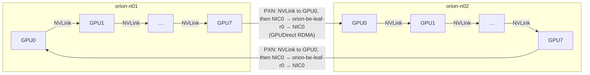

# Chapter 12 — Collective Communication and NCCL

> Chapter 11 turned every parallelism strategy into a list of collectives: an all-reduce of
> gradients, a reduce-scatter and all-gather per transformer layer, an all-to-all per MoE layer.
> This chapter opens those boxes. A collective is a coordinated data movement among *n* ranks with a
> precise contract and a cost that depends on message size, rank count, algorithm, protocol, and the
> topology underneath. NVIDIA's Collective Communications Library (NCCL) chooses the algorithm and
> protocol at run time from what it detects about the machine — which makes it fast when the machine
> is healthy and the mapping is right, and quietly slow when they are not. You will learn to reason
> about collectives with the alpha-beta model, to read nccl-tests output the way a performance engineer
> does (`busbw`, not "Avg bus bandwidth"), to see how NCCL builds rings and trees from topology, to
> control and debug it with environment variables that actually exist, and to turn a folder of
> benchmark logs into a defensible scaling and bottleneck report.

## Learning objectives

After this chapter, its exercises, and its lab, you will be able to:

1. **Explain** broadcast, reduce, all-reduce, reduce-scatter, all-gather, and all-to-all with small
   worked examples, including the identity all-reduce = reduce-scatter + all-gather.
2. **Calculate** collective time with the alpha-beta model for ring, tree, and in-network reduction,
   and identify the latency-dominated, transition, and bandwidth-dominated regions of a message-size
   sweep.
3. **Compute** `algbw` and `busbw` from nccl-tests output and explain why `busbw` is the quantity to
   compare across rank counts.
4. **Describe** how NCCL detects topology and builds channels, rings, and trees, and how its LL, LL128,
   and Simple protocols trade latency for bandwidth.
5. **Use** NCCL's debugging and control environment variables safely, and initialize PyTorch
   Distributed with `torchrun` for NCCL (GPU) and gloo (CPU) backends.
6. **Diagnose** a rank-mapping or NIC-selection error and a degraded rail from benchmark evidence,
   and name the topology information needed to prove the hypothesis.
7. **Produce** a collective benchmark report with scaling and bottleneck analysis (the chapter
   deliverable).

## Prerequisites and connections

You need Chapter 11's parallelism-to-collective mapping
([Chapter 11](../ch11-distributed-training-architecture/)), the HX8 node topology and the meaning of
`nvidia-smi topo -m` labels ([Chapter 5](../../part-2-accelerated-compute/ch05-gpu-interconnects-host-topology/)),
and RDMA/RoCEv2 basics ([Chapter 8](../../part-3-networking/ch08-rdma-rocev2-infiniband/)). Congestion
behaviour under collectives is in [Chapter 9](../../part-3-networking/ch09-congestion-control-lossless-fabrics/);
physical-layer counters for the troubleshooting scenario are in
[Chapter 10](../../part-3-networking/ch10-switches-optics-physical-layer/).
[Chapter 13](../ch13-gpu-data-movement/) follows a single NCCL message byte-by-byte through PCIe,
GPUDirect RDMA, and the fabric. The benchmark discipline here is reused in
[Chapter 22](../../part-5-production-operations/ch22-cross-layer-performance-engineering/) and
**Capstone C**; node acceptance tests in
[Chapter 16](../../part-5-production-operations/ch16-bare-metal-fleet-lifecycle/) use nccl-tests as a
gate. This chapter's lab is the core of **Progressive Lab 5 — Distributed communication** (week 9).

ORION recap ([REFERENCE_CLUSTER.md](../../../docs/REFERENCE_CLUSTER.md)): 32 HX8 nodes; inside a node,
8 GPUs on NVLink/NVSwitch at 450 GB/s per direction per GPU `[VENDOR-SPEC, 2026-10]`; across nodes,
GPU *i* uses NIC *i* (400 Gb/s = 50 GB/s line rate) on rail *i* of a non-blocking RoCEv2 fabric.

## 12.1 From parallelism to collectives

A **collective** is an operation in which all *n* ranks of a *communicator* (a group of processes, one
per GPU in NCCL) participate, each contributing and/or receiving data, with a contract on the result.
Point-to-point send/receive is the other primitive (pipeline parallelism uses it). Every collective
call must be made by every rank of the communicator, in the same order, with compatible sizes;
violating this is a *collective mismatch*, and the result is a hang (Chapter 11, Section 11.11).

| Training mechanism (Chapter 11) | Collective | Typical size per call on ORION | Frequency |
|---|---|---|---|
| DDP gradient bucket | all-reduce | 25 MB bucket | per bucket per step |
| ZeRO-1 / distributed optimizer | reduce-scatter + all-gather | 4.4 GB per GPU (W-TRAIN, TP 8 PP 4) | per step |
| FSDP / ZeRO-3 | all-gather (fwd, bwd), reduce-scatter | one layer's weights (≈ 1.75 GB / TP) | per layer per micro-batch |
| Tensor parallel + sequence parallel | reduce-scatter + all-gather (≡ all-reduce) | 67 MB | 4 per layer per micro-batch |
| Expert parallel | all-to-all | data-dependent | 4 per MoE layer per micro-batch |
| Weight/metadata distribution | broadcast | small to large | at start-up / checkpoint load |

*Table 12.1 — Where W-TRAIN's collectives come from `[MODELED]` (sizes from Chapter 11).*

The table already tells you something about benchmarking: TP collectives live at 67 MB, DDP buckets at
25 MB, and optimizer collectives at gigabytes. A single "bandwidth" number cannot describe a library
whose behaviour changes by two orders of magnitude across that range.

## 12.2 The collectives, with small worked examples

Use four ranks, each holding a 4-element vector:

```text
R0: [   1,    2,    3,    4]
R1: [  10,   20,   30,   40]
R2: [ 100,  200,  300,  400]
R3: [1000, 2000, 3000, 4000]
```

| Collective | Contract | Result on the example (sum where reducing) |
|---|---|---|
| **broadcast** (root R2) | root's buffer copied to all | all ranks: [100, 200, 300, 400] |
| **reduce** (root R0) | element-wise reduction delivered to root only | R0: [1111, 2222, 3333, 4444]; others unchanged |
| **all-reduce** | element-wise reduction delivered to every rank | all ranks: [1111, 2222, 3333, 4444] |
| **reduce-scatter** | reduction, then rank *r* keeps chunk *r* | R0: [1111]; R1: [2222]; R2: [3333]; R3: [4444] |
| **all-gather** | every rank's chunk concatenated on every rank | input R0 [1111], R1 [2222], …; output on all: [1111, 2222, 3333, 4444] |
| **all-to-all** | rank *i* sends its chunk *j* to rank *j* (a transpose) | R0: [1, 10, 100, 1000]; R1: [2, 20, 200, 2000]; R2: [3, 30, 300, 3000]; R3: [4, 40, 400, 4000] |

*Table 12.2 — The six collectives on a 4-rank example. Note that reduce-scatter followed by all-gather
produces exactly the all-reduce result — the identity behind ZeRO and sequence parallelism.*

**How a ring all-reduce actually moves the data.** Split each buffer into n = 4 chunks c0–c3. In
reduce-scatter step *k* (k = 1 … n − 1), rank *r* sends chunk (r − k + 1) mod n to rank r + 1, which
adds it to its own copy. The trace below was produced by a 20-line simulation:

```text
step 1: R0→R1 c0=1      R1→R2 c1=20     R2→R3 c2=300    R3→R0 c3=4000
step 2: R0→R1 c3=4004   R1→R2 c0=11     R2→R3 c1=220    R3→R0 c2=3300
step 3: R0→R1 c2=3303   R1→R2 c3=4044   R2→R3 c0=111    R3→R0 c1=2220
after reduce-scatter: R0 owns c1=2222, R1 owns c2=3333, R2 owns c3=4444, R3 owns c0=1111
all-gather (3 more steps): each rank forwards the newest complete chunk to its neighbour
step 1: R0→R1 c1=2222   R1→R2 c2=3333   R2→R3 c3=4444   R3→R0 c0=1111
step 2: R0→R1 c0=1111   R1→R2 c1=2222   R2→R3 c2=3333   R3→R0 c3=4444
step 3: R0→R1 c3=4444   R1→R2 c0=1111   R2→R3 c1=2222   R3→R0 c2=3333
result on every rank: [1111, 2222, 3333, 4444]
```

*Figure 12.1 — Ring all-reduce on four ranks: 2(n − 1) = 6 steps; in every step every rank sends one
chunk of S/n bytes and receives one. Every link is busy in every step, which is why the ring is
bandwidth-optimal.*

Count the bytes: each rank sends 2(n − 1) chunks of S/n bytes, i.e. **2(n − 1)/n × S** — the same
formula Chapter 11 used for data-parallel volume. For all-gather and reduce-scatter alone it is
(n − 1)/n × S each. For all-to-all each rank sends (n − 1)/n of its buffer, but to *n − 1 different
destinations at once*, which stresses switch fan-out and creates incast in a way rings never do.

## 12.3 Cost models: alpha-beta for ring, tree, and friends

The **alpha-beta (Hockney) model** charges each message a fixed latency α plus a per-byte cost β
(β = 1/B for link bandwidth B): T(m) = α + m·β. Apply it to an algorithm by counting steps and bytes
on the critical path.

| Algorithm (all-reduce of S bytes, n ranks) | Latency term | Bandwidth term | Character |
|---|---|---|---|
| Ring (reduce-scatter + all-gather) | 2(n − 1)·α | 2(n − 1)/n · S/B | Bandwidth-optimal; latency grows linearly with n |
| Binary tree (reduce then broadcast, pipelined) | ≈ 2·log₂(n)·α | ≈ 2·S/B per tree, halved by using two complementary trees | Low latency; NCCL's double binary tree recovers near-full bandwidth |
| Recursive halving/doubling (Rabenseifner) | 2·log₂(n)·α | 2(n − 1)/n · S/B | Optimal in both terms for powers of two; common in MPI |
| In-network / in-switch reduction (NVLS, SHARP-class) | small, switch-dependent | ≈ S/B (each GPU sends S once, receives S once) | Halves bytes per GPU; needs switch support |

*Table 12.3 — Alpha-beta costs of all-reduce algorithms `[MODELED]` (Thakur, Rabenseifner & Gropp,
2005; Patarasuk & Yuan, 2009; Sanders, Speck & Träff, 2009). Real implementations pipeline chunks and
overlap steps, so constants differ; the scaling with n and S is what matters.*

**Worked example (ring, inter-node).** Sixteen ranks on two ORION nodes, S = 1 GiB, and suppose the
effective per-rank bandwidth is the rail line rate of 50 GB/s with α = 5 µs per step `[ILLUSTRATIVE]`:

```text
latency term   = 2 × 15 × 5 µs                          = 150 µs
bandwidth term = 2 × 15/16 × 1,073,741,824 B / 50e9 B/s = 40.3 ms
total ≈ 40.4 ms  → bandwidth-dominated by a factor of ~270
For S = 64 KiB: latency 150 µs vs bandwidth 2.5 µs → latency-dominated by ~60×
```

The size at which the two terms are equal, S* = α_total × B / factor, is the **half-performance
message size** n½: at S = n½ the collective achieves half of its asymptotic bandwidth. Everything
below a few × n½ is a latency problem (fix it with tree algorithms, fewer/larger messages, CUDA graphs,
or fusion); everything above is a bandwidth problem (fix it with more channels, better links, or
in-network reduction).

> **Key idea:** "How fast is all-reduce?" has no answer without a message size. Always report a
> sweep, and always say which region the workload lives in.

But wait: the 1 GiB estimate above gives 40 ms, while the c2 benchmark in this chapter's lab shows
5.7 ms for 1 GiB on 16 ranks. The difference is the hierarchy. NCCL does not run one 16-rank ring at
one NIC's speed: it runs many **channels** (parallel rings), each crossing between nodes through a
*different* NIC, so the inter-node portion uses all eight 400 Gb/s NICs at once — 400 GB/s of node
egress — while the intra-node portion uses NVLink. The flat ring model with B = 50 GB/s is correct
only for a communicator that has one GPU per node, such as Chapter 11's data-parallel group.

## 12.4 In-network and in-switch reduction

Ring and tree algorithms do the arithmetic on GPUs and use links only to move partial results. A
switch that can *add* removes half of the traffic: each GPU sends its contribution once, the switch
reduces, and each GPU receives the result once.

> **Vendor implementation note (NVIDIA):** *NVLink SHARP (NVLS)* uses reduction engines in
> third-generation NVSwitch (H100-class systems) to perform reductions inside the NVLink fabric;
> NCCL exposes it as the `NVLS` algorithm (and `NVLSTree` for multi-node combinations) in 2.17+-era
> releases. *SHARP* (Scalable Hierarchical Aggregation and Reduction Protocol; Graham et al., 2016)
> performs reductions in InfiniBand switches; NCCL reaches it through the *CollNet* algorithms
> (`CollNetDirect`, `CollNetChain`) and a network plugin. Availability depends on switch hardware,
> firmware, fabric-manager/aggregation-manager services, and NCCL version `[VENDOR-SPEC, 2026-10]`.
> Ethernet in-network collectives are an active area of vendor and standards work; check your
> platform's documentation rather than assuming support.

Two practical consequences. First, **busbw can exceed the ring's link-bandwidth bound** when in-switch
reduction is active, because busbw is computed with the ring's 2(n − 1)/n factor even though fewer
bytes crossed each link; compare NVLS runs with NVLS runs. Second, in-network reduction adds **state
in the switch** (reduction trees, buffers, job allocation) — a new failure domain and a new resource
that schedulers must allocate.

## 12.5 Reading nccl-tests: `algbw`, `busbw`, and the traps

**nccl-tests** (NVIDIA, open source) is the standard microbenchmark for NCCL collectives:
`all_reduce_perf`, `all_gather_perf`, `reduce_scatter_perf`, `broadcast_perf`, `alltoall_perf`,
`sendrecv_perf`, and others. A typical multi-node run with one MPI process per GPU
`[VENDOR-SPEC, 2026-10 — check the nccl-tests README for your version]`:

```bash
# nccl-tests built with MPI support (make MPI=1 ...); Open MPI launcher, 8 ranks per node
mpirun -np 16 -N 8 --hostfile hosts.txt --bind-to numa \
       -x NCCL_DEBUG=INFO -x NCCL_DEBUG_SUBSYS=INIT,NET \
       ./build/all_reduce_perf -b 8 -e 8G -f 2 -g 1 -w 5 -n 20 -c 1
# Slurm equivalent
srun --mpi=pmix -N 2 --ntasks-per-node=8 --gpus-per-node=8 ./build/all_reduce_perf -b 8 -e 8G -f 2 -g 1
```

Flags: `-b`/`-e` minimum/maximum bytes, `-f` multiplicative step factor, `-g` GPUs per process, `-w`
warm-up iterations, `-n` timed iterations, `-c` check (validate results). The output (abridged from
this chapter's lab file `c2_2node_aligned.log`, `[SIMULATED]`):

```text
# nThread 1 nGpus 1 minBytes 8 maxBytes 8589934592 step: 2(factor) warmup iters: 5 iters: 20 agg iters: 1 validation: 1 graph: 0
# Using devices
#  Rank  0 Group  0 Pid  41848 on  orion-n01 device  0 [0x18] NVIDIA H100 80GB HBM3
#  ... (16 ranks, 8 per host)
#       size         count      type   redop    root     time   algbw   busbw #wrong     time   algbw   busbw #wrong
#        (B)    (elements)                               (us)  (GB/s)  (GB/s)            (us)  (GB/s)  (GB/s)
           8             2     float     sum      -1    28.31    0.00    0.00      0    28.07    0.00    0.00      0
       65536         16384     float     sum      -1    28.74    2.28    4.28      0    29.01    2.26    4.24      0
     1048576        262144     float     sum      -1    34.98   29.98   56.21      0    34.32   30.55   57.29      0
    33554432       8388608     float     sum      -1    206.2  162.73  305.11      0    203.5  164.89  309.16      0
  1073741824     268435456     float     sum      -1   5711.7  187.99  352.48      0   5719.7  187.73  351.99      0
  8589934592    2147483648     float     sum      -1    45758  187.73  351.98      0    45175  190.15  356.53      0
# Out of bounds values : 0 OK
# Avg bus bandwidth    : 127.6274
```

*Figure 12.2 — nccl-tests `all_reduce_perf` output for 16 ranks on two ORION nodes `[SIMULATED]`. The
left block is out-of-place (separate input and output buffers), the right block in-place. `#wrong`
counts validation errors; any non-zero value means a correctness problem, not a performance one.*

**The definitions** (from nccl-tests' `PERFORMANCE.md`):

```text
algbw = S / t
busbw = algbw × factor,   factor = 2(n−1)/n  (all-reduce)
                                   (n−1)/n   (all-gather, reduce-scatter, all-to-all)
                                   1         (broadcast, reduce)
```

For the 1 GiB row: algbw = 1,073,741,824 B / 5,711.7 µs = 187.99 GB/s; busbw = 187.99 × 2 × 15/16 =
352.5 GB/s. Note nccl-tests' GB is 10⁹ bytes and "size" is the per-rank buffer size.

**Why busbw.** algbw falls as n grows even on a perfect network, because the ring moves
2(n − 1)/n × S per rank. busbw multiplies that factor back in, so it estimates the bandwidth achieved
on the busiest link and is (ideally) independent of n. That makes it the number to compare across
rank counts and against hardware limits: the 352 GB/s here should be compared with the 400 GB/s of
node NIC egress (8 × 50 GB/s), giving 88 % efficiency — and *not* with the 50 GB/s of one NIC, which it
"exceeds" only because eight NICs work in parallel.

**Three traps.**

1. **"Avg bus bandwidth" is an average over every size in the sweep**, including the 8-byte rows whose
   busbw is 0.00. For this run it reports 127.6 GB/s although the large-message plateau is 352 GB/s.
   Use the plateau (median busbw of the largest sizes) for bandwidth and the small-size time for latency.
2. **Printed time precision changes with magnitude** (two decimals below 100 µs, one decimal below
   10 ms, none above), so parsers must not assume fixed columns.
3. **Single runs lie.** nccl-tests reports an average over `-n` iterations of one launch; between
   launches you see different NCCL channel choices, different contention, and different clocks.
   Benchmark discipline (Section 12.10) requires repeated launches and a spread.

**Regions.** Plotting time against size on log-log axes shows three regions. In the
**latency-dominated** region (here 8 B to ≈ 1 MiB), time is flat at ≈ 28 µs: α dominates. In the
**bandwidth-dominated** region (≥ 32 MiB here), busbw sits within 20 % of its plateau and time doubles
with size. Between them is a **transition** region where pipelining depth, protocol, and algorithm
switches create visible knees. Fitting T = α + factor × S/B with least squares weighted by 1/T gives
α ≈ 28.1 µs and B ≈ 354 GB/s for this run, so n½ = α·B/factor = 28.1e−6 × 354e9 / 1.875 ≈ 5.3 MB
`[MODELED]`. A DDP bucket of 25 MB therefore runs at roughly 25/(25 + 5.3) ≈ 82 % of plateau
bandwidth on 16 ranks — and lower on 64 ranks, where α is larger.

## 12.6 Inside NCCL: topology, channels, algorithms, protocols

**Initialization.** Each rank calls `ncclCommInitRank` with a shared unique ID that one rank created and
distributed out of band (PyTorch does this through its rendezvous store). NCCL's *bootstrap* network —
plain TCP sockets on the interface chosen by `NCCL_SOCKET_IFNAME` — exchanges addresses and topology
information. Initialization is collective and can take seconds at large scale; it is a component of
the restart cost R in Chapter 11.

**Topology detection.** NCCL reads the host's PCI hierarchy from sysfs, NVLink connectivity from the
driver, and NIC properties from the network plugin, and builds a graph of GPUs, NICs, CPUs, PCIe
switches, and NVSwitches. It classifies every GPU↔GPU and GPU↔NIC path with labels that mirror
`nvidia-smi topo -m` (Chapter 5): `NVL` (NVLink), `PIX` (same PCIe switch), `PXB` (multiple PCIe
switches, no host bridge), `PHB` (through a host bridge/root complex), `SYS` (across the
inter-socket link), and `NET` for network hops. `NCCL_TOPO_DUMP_FILE=/tmp/topo.xml` writes the
detected topology as XML — the single most useful artifact when a mapping looks wrong.

**Channels, rings, and trees.** NCCL searches the graph for the best rings and trees and instantiates
them as **channels**. Each channel is an independent instance of the algorithm, driven by one CUDA
thread block on each GPU and, for inter-node hops, bound to a specific NIC. A collective's buffer is
split across channels, so channels run in parallel; more channels mean more bandwidth up to the point
where SM usage and per-chunk overhead win. On a rail-optimized HX8 cluster, the ring for channel *c*
typically enters and leaves each node through the NIC closest to the GPUs at the node boundary, which
spreads inter-node traffic over all eight rails.



*Figure 12.3 — One rail-aligned NCCL ring channel across two HX8 nodes (simplified). The channel
enters each node on NIC 0 and must leave on NIC 0 too, so the same rail (`orion-be-leaf-r0`) carries
both crossings and no traffic touches a spine. The boundary GPU (GPU 7) is not local to NIC 0, so NCCL
uses PXN: it forwards the data over NVLink to GPU 0, whose NIC sends it. Other channels use other
rails, so all eight NICs carry traffic. The `NCCL_DEBUG=INFO` line `7[7] -> 8[0] [send] via
NET/IB/0(0)/GDRDMA` shows NIC 0 used through proxy GPU 0 (syntax varies by version
`[VENDOR-SPEC, 2026-10]`).*

**Algorithms.** For each collective and size, NCCL's tuning model estimates the time of each enabled
algorithm (`Ring`, `Tree`, `CollNetDirect`, `CollNetChain`, `NVLS`, `NVLSTree`, and in recent releases
`PAT` for some all-gather/reduce-scatter cases) and protocol, and picks the minimum
`[VENDOR-SPEC, 2026-10]`. Tree tends to win small and medium multi-node all-reduces (log-depth
latency); Ring or NVLS wins large ones.

**Protocols.** Three ways to move a chunk between GPUs:

| Protocol | Mechanism | Payload efficiency | Latency | Typical use |
|---|---|---|---|---|
| **LL** (low latency) | 8-byte stores carrying 4 B data + 4 B flag; receiver polls the flag | ≈ 50 % | Lowest | Small messages |
| **LL128** | 128-byte lines with 120 B data + 8 B flag; relies on ordered 128-byte writes (NVLink-class paths) | ≈ 94 % | Low | Small-to-medium messages where supported |
| **Simple** | Bulk copies with memory fences and flag synchronization per chunk | ≈ 100 % | Highest | Large messages |

*Table 12.4 — NCCL protocols `[VENDOR-SPEC, 2026-10]`. LL/LL128 avoid a separate synchronization
round-trip by embedding flags with the data; Simple pays for fences but moves data at full rate.*

The knees you see in a sweep's transition region are often protocol or algorithm switches. That is
why you test the sizes your workload uses, not just 8 GB.

**The network path.** For inter-node hops, a NCCL *proxy* thread on the CPU posts RDMA operations to
the NIC. When the GPU and NIC are close enough in the PCIe topology (controlled by
`NCCL_NET_GDR_LEVEL`), the NIC reads and writes GPU memory directly — **GPUDirect RDMA**, shown as
`GDRDMA` in NCCL's logs. Otherwise NCCL stages data through host memory, adding copies and latency.
Chapter 13 traces both paths and how to validate them.

## 12.7 NCCL environment variables you will actually use

NCCL is configured mainly through environment variables. The ones below exist and are widely used;
their accepted values and defaults change between releases, so treat this table as
`[VENDOR-SPEC, 2026-10]` and confirm against the NCCL documentation for your installed version.

| Variable | What it does | Typical values | Production-safe? |
|---|---|---|---|
| `NCCL_DEBUG` | Log verbosity | `VERSION`, `WARN`, `INFO`, `TRACE` (TRACE needs a trace-enabled build) | `WARN` yes; `INFO` for start-up diagnosis; `TRACE` no |
| `NCCL_DEBUG_SUBSYS` | Filter `INFO` output by subsystem | e.g. `INIT`, `NET`, `GRAPH`, `TUNING`, `ENV`, `COLL`, `ALL` (comma list) | Yes (diagnosis) |
| `NCCL_DEBUG_FILE` | Write debug output to a per-process file | path with `%h` (host) and `%p` (PID) | Yes |
| `NCCL_SOCKET_IFNAME` | Interface(s) for bootstrap and socket transport | prefix list (`fe0`), `^` to exclude, `=` for exact match | Yes, and usually required on multi-homed hosts |
| `NCCL_IB_HCA` | Which RDMA devices (and ports) NCCL may use | `mlx5_0,mlx5_1`, `mlx5_0:1`, `^mlx5_8` (exclude), `=` exact | Yes, but a wrong list silently cripples bandwidth (Section 12.8) |
| `NCCL_IB_GID_INDEX` | GID table index for RoCE (selects RoCE version / IP family) | e.g. `3` on many RoCEv2 setups — site-specific; newer releases can auto-select | Yes, set by platform team |
| `NCCL_NET_GDR_LEVEL` | Max GPU↔NIC path distance at which GPUDirect RDMA is used | `LOC`, `PIX`, `PXB`, `PHB`, `SYS` | Platform default; do not raise blindly |
| `NCCL_ALGO` | Restrict algorithms | `Ring`, `Tree`, `NVLS`, … (list; `^` to exclude) | **Diagnosis only** |
| `NCCL_PROTO` | Restrict protocols | `LL`, `LL128`, `Simple` (list; `^` to exclude) | **Diagnosis only** |
| `NCCL_MIN_NCHANNELS` / `NCCL_MAX_NCHANNELS` | Bound the number of channels | integers | Rarely; affects SM usage |
| `NCCL_TOPO_DUMP_FILE` | Dump detected topology as XML | path | Yes |
| `NCCL_CROSS_NIC` | Whether rings/trees may use different NICs (rails) on different nodes | `0`, `1`, `2` (version-dependent default) | Platform setting; verify rail alignment in INFO lines |
| `NCCL_NVLS_ENABLE` | Enable/disable NVLink SHARP (NVLS) | `0` / `1` | Diagnosis (NVLS on/off control) |
| `NCCL_IB_QPS_PER_CONNECTION` | Queue pairs per connection (spreads a flow over more QPs/ECMP paths) | integer, default 1 | Platform setting, validated per fabric |
| `NCCL_TOPO_FILE` | Load a topology XML instead of (or to supplement) detection | path | Only for VMs/containers that hide topology, per vendor guidance |

*Table 12.5 — Commonly used NCCL environment variables `[VENDOR-SPEC, 2026-10]`.*

> **Pitfall:** Forcing `NCCL_ALGO=Ring` or `NCCL_PROTO=Simple` to "fix" a benchmark makes the run
> faster at one size and slower everywhere else, and the setting outlives the experiment in a job
> template. Use these variables to *test a hypothesis* ("is the tree path broken?"), then remove them.

## 12.8 Rank mapping and topology

Rank mapping is the assignment of logical ranks to physical GPUs, and of GPUs to NICs. NCCL is good at
building rings inside a communicator once it knows the topology; it cannot fix a topology it was
not shown or a NIC list it was told to use. Four mapping failures recur:

1. **Restricted or misordered NIC list.** `NCCL_IB_HCA` set to the socket-0 NICs only (often copied
   from a different node type) makes GPUs 4–7 send through NICs 2–3 across the inter-socket link. The
   node's inter-node bandwidth halves (4 × 50 GB/s instead of 8 × 50 GB/s), the cross-socket GPU↔NIC
   distance is `SYS`, so GPUDirect RDMA is disabled for those GPUs and data is staged through host
   memory. Normally PXN would rescue part of this by forwarding over NVLink to a GPU that is local to
   one of the allowed NICs, but the alternative image also sets `NCCL_PXN_DISABLE=1` (copied from an
   old debugging recipe), so the cross-socket GPUs talk to NICs 2–3 directly at `SYS` distance. The
   lab's configuration c3 shows exactly this: a steady plateau of ≈ 184 GB/s instead of ≈ 352 GB/s,
   and α up from 28 µs to 39 µs from the host staging.
2. **Containers that hide topology.** A container that sees only some PCIe devices, or a VM whose
   virtual PCIe tree hides the real switches, makes NCCL guess. `NCCL_TOPO_DUMP_FILE` shows what it
   guessed.
3. **Communicators that span the wrong GPUs.** A data-parallel group with one GPU per node can use
   only that GPU's NIC: its busbw is bounded by 50 GB/s, not 400 GB/s. That is correct and expected
   (Chapter 11), but it surprises people who benchmarked the whole-node all-reduce.
4. **Process-to-GPU binding drift.** If `LOCAL_RANK` → GPU binding is reordered (e.g., a
   `CUDA_VISIBLE_DEVICES` permutation), rank *i*'s DP and PP peers may not share a rail, and traffic
   crosses the spine. Throughput may barely move on an idle non-blocking fabric and collapse under
   load.

**Rail alignment and PXN.** On a rail-optimized fabric NCCL tries to keep each channel's exit and
entry on the *same* NIC index, so inter-node hops stay on one rail leaf. A ring that leaves node A on
NIC 7 and enters node B on NIC 0 is cross-rail: every such hop goes leaf → spine → leaf and competes
with other jobs on the spines. When the GPU at the node boundary is not the one attached to the rail's
NIC, PXN (NCCL 2.12+) forwards the data over NVLink to the GPU that owns that NIC. `NCCL_CROSS_NIC`
controls whether NCCL may build rings and trees that use different NICs on different nodes; on a
rail-optimized fabric you want same-NIC graphs, and you verify the outcome in the INFO channel lines
rather than trusting the setting `[VENDOR-SPEC, 2026-10]`. All-to-all is where PXN matters most:
`alltoall_perf` reports busbw = algbw × (n − 1)/n, and on a rail-optimized cluster a healthy
all-to-all without PXN shows lower busbw and much higher spine utilization than with it, because
every GPU must reach GPUs on all other rails.

**What topology information proves a mapping hypothesis.** A benchmark difference is only a symptom.
To *prove* a mapping cause, collect: `nvidia-smi topo -m` (GPU↔NIC path labels), the NCCL topology dump
and `NCCL_DEBUG=INFO` "NET/IB : Using …" and "Channel … via NET/IB/k[/GDRDMA]" lines (which NIC each
channel uses, and whether GPUDirect RDMA is on), the process's environment (`NCCL_IB_HCA`,
`CUDA_VISIBLE_DEVICES`), per-NIC transmit counters during the run (which NICs carry traffic), and the
rank-to-host map from the nccl-tests "Using devices" header. For single-node or intra-node anomalies, add an NVLS on/off control
(`NCCL_NVLS_ENABLE=0`) so that NVSwitch reduction is not confused with the network. The lab ships the NCCL debug excerpts for
c2 and c3; compare them:

```text
c2: NET/IB : Using [0]mlx5_0:1/RoCE ... [7]mlx5_7:1/RoCE
    Channel 00/0 : 7[7] -> 8[0] [send] via NET/IB/0(0)/GDRDMA      (PXN: exits on NIC 0, rail 0)
    Channel 00/0 : 15[7] -> 0[0] [receive] via NET/IB/0/GDRDMA     (enters on NIC 0, rail 0)
    Channel 04/0 : 4[4] -> 12[4] [send] via NET/IB/4/GDRDMA
c3: NCCL_IB_HCA set to mlx5_0,mlx5_1,mlx5_2,mlx5_3
    NCCL_PXN_DISABLE set by environment to 1
    NET/IB : Using [0]mlx5_0:1/RoCE [1]mlx5_1:1/RoCE [2]mlx5_2:1/RoCE [3]mlx5_3:1/RoCE
    Channel 04/0 : 4[4] -> 12[4] [send] via NET/IB/2            (no GDRDMA: GPU4↔NIC2 is SYS)
```

*Figure 12.4 — NCCL INFO excerpts for an aligned and a misaligned configuration `[ILLUSTRATIVE]`;
line formats vary across NCCL versions.*

### Failure signatures of collectives

Performance problems are only half of the operational story. Collectives fail in a small number of
recognizable ways, and the first job of the on-call engineer is to tell them apart.

| Signature | What you see `[ILLUSTRATIVE]` | Usual meaning | First evidence to collect |
|---|---|---|---|
| Hang, no error | All ranks stuck; PyTorch watchdog fires after its timeout | A rank never joined (crash, Xid, stuck data loader) or a collective mismatch | Flight-recorder dumps, `py-spy dump` per rank, host kernel logs |
| Transport error | `NCCL WARN NET/IB : Got completion from peer 10.100.3.25<38211> with error 12, opcode 0, len 0, vendor err 129 (Send)` (format varies by version `[VENDOR-SPEC, 2026-10]`) | Work-completion error 12 is a transport retry-count-exceeded error: the peer stopped acknowledging (link down, NIC reset, severe loss) | Link state and counters on both ends, switch port logs at that time |
| Remote error | `ncclRemoteError` returned to the framework | A peer reported a failure (its process or NIC died) — look at the *other* rank | The peer host's logs |
| System error | `ncclSystemError` | Local OS/driver/resource problem: memory registration, file descriptors, `/dev/shm` too small in a container | `dmesg`, container limits, `ulimit -l` |
| Silent slowness | No errors; busbw low or jittery | Mapping, degraded link, congestion, retransmission | nccl-tests on reserved nodes, NIC/RDMA counters |

*Table 12.6 — Collective failure signatures. NCCL result codes such as `ncclSystemError`,
`ncclInternalError`, `ncclInvalidUsage`, and `ncclRemoteError` are part of the NCCL API; log line
formats vary by version `[VENDOR-SPEC, 2026-10]`.*

Two NCCL variables shape how quickly RDMA transport errors surface: `NCCL_IB_TIMEOUT` (the InfiniBand
verbs local ACK timeout exponent: 4.096 µs × 2^value per retry interval; default 18 ≈ 1.07 s up to
NCCL 2.22 and 20 ≈ 4.3 s from 2.23 `[VENDOR-SPEC, 2026-10]`) and `NCCL_IB_RETRY_CNT` (the verbs retry count). Raising them hides
short link flaps at the cost of longer stalls before a real failure is reported; platform teams set
them once, fleet-wide, and record them in the manifest. The decision of *what to do* after a failure
— restart from checkpoint, swap a node, quarantine — belongs to the workflow in Chapter 11, Section
11.12, and to Chapter 19.

The most important habit: **the rank that reports an error is usually the victim.** A transport error
on rank 12 names the peer address that stopped responding; a remote error names nothing but tells you
to look elsewhere. Map the peer IP (`10.100.3.25` is the host side of rail 3 for node 12, `orion-n12`, in ORION's addressing plan,
10.100.r.(2n + 1); Chapter 7) back to a host and NIC before touching anything.

## 12.9 PyTorch Distributed: the API on top of NCCL

PyTorch Distributed (`torch.distributed`) wraps NCCL (GPU), gloo (CPU, and GPU fallback for some
operations), and other backends behind one API. The pieces you need as an infrastructure engineer:

- **Launcher.** `torchrun` starts one process per GPU and sets `RANK`, `LOCAL_RANK`, `WORLD_SIZE`,
  `LOCAL_WORLD_SIZE`, `MASTER_ADDR`, and `MASTER_PORT` in each process's environment. Multi-node
  rendezvous uses `--rdzv-backend=c10d --rdzv-endpoint=<host>:<port> --rdzv-id=<job>`; elasticity uses
  `--nnodes=MIN:MAX` and `--max-restarts`.
- **Initialization.** `dist.init_process_group(backend="nccl")` with the default `init_method="env://"`
  reads those variables, builds a key-value store for rendezvous, and creates the default process
  group. Its `timeout` argument bounds how long a collective may block before the watchdog acts.
- **Subgroups.** `dist.new_group(ranks=[...])` or a `DeviceMesh` (`init_device_mesh("cuda", (pp, dp, tp))`)
  creates the TP, DP, and PP communicators of Chapter 11. Each is a separate NCCL communicator with
  its own channels and buffers.
- **Collectives.** `dist.all_reduce`, `all_gather_into_tensor`, `reduce_scatter_tensor`, `broadcast`,
  `all_to_all_single`, plus `send`/`recv`. With `async_op=True` they return a work handle; the
  collective runs on an internal NCCL stream, and `work.wait()` makes the current CUDA stream wait for
  it — which is how DDP overlaps gradient all-reduce with backward compute.

```python
# minimal_allreduce.py — run with: torchrun --nproc-per-node=8 minimal_allreduce.py   (L2, one GPU host)
import os, time, torch, torch.distributed as dist

dist.init_process_group(backend="nccl")                # gloo for CPU-only experiments
local_rank = int(os.environ["LOCAL_RANK"])
torch.cuda.set_device(local_rank)
x = torch.ones(64 * 2**20 // 4, device="cuda")        # 64 MiB of float32
for _ in range(5):                                     # warm-up: communicator setup, channel allocation
    dist.all_reduce(x)
torch.cuda.synchronize()
t0 = time.perf_counter()
for _ in range(20):
    dist.all_reduce(x)
torch.cuda.synchronize()                               # collectives are asynchronous w.r.t. the host
t = (time.perf_counter() - t0) / 20
n = dist.get_world_size()
if dist.get_rank() == 0:
    algbw = x.numel() * 4 / t / 1e9
    print(f"n={n} t={t*1e6:.1f} us algbw={algbw:.1f} GB/s busbw={algbw * 2 * (n - 1) / n:.1f} GB/s")
dist.destroy_process_group()
```

The two `torch.cuda.synchronize()` calls are the most common omission in home-made benchmarks: without
them you time the *launch* of 20 asynchronous kernels, not their execution, and report absurd
bandwidth. The lab's optional `gloo_allreduce.py` is the CPU-only analogue for laptops with PyTorch
installed; it prints its results in nccl-tests format so your parser reads them unchanged.

## 12.10 Benchmark discipline and scaling analysis

A collective benchmark is evidence only if someone else could reproduce it. For every run record the
environment manifest (driver, CUDA, NCCL, nccl-tests commit, NIC firmware, switch OS, topology,
`NCCL_*` variables), the exact command, warm-up and iteration counts, and the node list. Repeat each
configuration at least five times as separate launches; report the median plateau busbw, its spread
(min/max or IQR), small-message latency at p50 and p99 across launches, and whether the run was on an
otherwise idle fabric. Change one variable at a time.

**Scaling analysis.** Hold the collective and per-rank size fixed and grow the node count. For a
healthy rail-optimized fabric, the large-message busbw should be nearly flat with node count (the ring
factor already normalizes for n), and α should grow slowly (tree depth ≈ log n). Two numbers summarize
each configuration: **plateau busbw** (bandwidth health) and **α / n½** (latency health). A third,
**run-to-run or size-to-size jitter** at large sizes, separates steady problems (mapping, link speed)
from intermittent ones (errors, congestion, retransmissions).

## 12.11 Worked example: a scaling and bottleneck report for ORION

**Task.** Fabric hands Training Infra six `all_reduce_perf` results (the lab dataset, `[SIMULATED]`)
and asks: does ORION scale, which configurations are unhealthy, and what will W-TRAIN's collectives
cost?

**Step 1 — Parse and recompute.** For every row, recompute algbw = S/t and busbw = algbw × 2(n − 1)/n
and confirm they match the printed columns (they do, within rounding). This catches parser bugs and
hand-edited files before any conclusion is drawn.

**Step 2 — Summarize each configuration** (lab output, `[SIMULATED]` data, `[MODELED]` fits):

| Config | Nodes | Ranks | Plateau busbw (GB/s) | "Avg bus bandwidth" (GB/s) | α fit (µs) | B fit (GB/s) | n½ (MB) | Jitter CV |
|---|---|---|---|---|---|---|---|---|
| c1 1 node | 1 | 8 | 449 | 170 | 14.1 | 448 | 3.6 | 0.007 |
| c2 2 nodes aligned | 2 | 16 | 352 | 128 | 28.1 | 354 | 5.3 | 0.009 |
| c3 2 nodes alt map | 2 | 16 | 184 | 69 | 39.2 | 185 | 3.9 | 0.008 |
| c4 4 nodes | 4 | 32 | 349 | 122 | 36.2 | 349 | 6.5 | 0.011 |
| c5 8 nodes | 8 | 64 | 345 | 117 | 47.3 | 346 | 8.3 | 0.016 |
| c6 8 nodes, run 2 | 8 | 64 | 177 | 66 | 49.8 | 185 | 4.7 | 0.088 |

*Table 12.7 — ORION all-reduce scaling summary from the lab. Plateau = median out-of-place busbw of the
four largest sizes (1–8 GiB).*

**Step 3 — Scaling verdict.** Aligned multi-node plateaus are 352 → 349 → 345 GB/s from 2 to 8 nodes:
2 % loss over 4× scale, consistent with a non-blocking fabric, and 86–88 % of the 400 GB/s node NIC
egress. α grows 28 → 36 → 47 µs, roughly +10 µs per doubling — the log-depth signature of tree-based
small-message all-reduce. The single node's 449 GB/s is ≈ 100 % of the 450 GB/s per-direction NVLink rate.
A plain ring reaches only ≈ 0.80–0.85 × 450 ≈ 360–380 GB/s busbw, so ≈ 100 % implies fewer bytes per
GPU — NVLS in-switch reduction. To prove it rather than infer it, rerun with `NCCL_NVLS_ENABLE=0`
(expect ≈ 360 GB/s) and check the INFO log for NVLS initialization lines `[VENDOR-SPEC, 2026-10]`.
Either way, the single-node row is not comparable with the multi-node rows.

**Step 4 — Bottlenecks.** Two configurations fall below 75 % of the median multi-node plateau (346 GB/s):

- **c3** — steady 184 GB/s (CV 0.008) and +11 µs α relative to c2. A steady halving that matches
  4 × 50 GB/s × 0.92 points to a mapping problem: half the NICs unused. The NCCL excerpt confirms
  `NCCL_IB_HCA` limited to four HCAs and no `GDRDMA` for GPUs 4–7 (Section 12.8).
- **c6** — 177 GB/s *and* jittery (CV 0.088; per-size busbw swings between 154 and 204 GB/s). Same job
  shape as c5, one node swapped (`orion-n12` replaced `orion-n08`). A low, noisy plateau points to a
  degraded link or NIC with errors and retransmissions on one rail: NCCL splits every collective
  across channels, and the channel crossing the bad link finishes last, so the whole collective
  runs at the slowest channel's pace. Section 12.13 follows it to the root cause.

**Step 5 — What it means for W-TRAIN.** Using the c5 fit (α = 47.3 µs, B = 346 GB/s, factor
2 × 63/64 = 1.969):

```text
25 MB DDP-style bucket on 64 ranks: 47.3 µs + 1.969 × 25e6 / 346e9 s = 47.3 + 142.3 = 190 µs
  → 142.3/190 = 75 % of plateau bandwidth (n½ = 8.3 MB is a third of the bucket)
1 GiB on 64 ranks: 47.3 µs + 1.969 × 1,073,741,824 / 346e9 s = 6.16 ms (measured row: 6.19 ms)
```

Chapter 11's data-parallel group is different: one GPU per node, eight ranks, one rail each. Its
bandwidth ceiling is one NIC — 50 GB/s line rate, ≈ 45 GB/s effective — so W-TRAIN's 4.375 GB gradient
reduction costs 2 × 7/8 × 4.375e9 / 45e9 = 0.17 s `[MODELED]`. To validate that number you would run
nccl-tests on an 8-rank communicator with one rank per node (`mpirun -np 8 -N 1 … -x
CUDA_VISIBLE_DEVICES=3` to pin rail 3, for example), not on the whole cluster.

**Step 6 — Report.** The deliverable summarizes: scaling is healthy for aligned configurations
(plateau within 2 % from 2 to 8 nodes); two configurations are unhealthy with distinct signatures
(steady-low → mapping; low-and-jittery → degraded link); W-TRAIN's DP traffic is bounded by single-rail
bandwidth; and the evidence still missing (repeated launches, per-NIC counters, rail-pinned tests).

## 12.12 Hands-on lab overview

The lab ([lab/README.md](lab/README.md)), tier **L1**, is the analysis behind Section 12.11. You
implement `starter/nccl_analysis.py`: a robust parser for nccl-tests output (including its
variable-precision time column), algbw/busbw recomputation for any collective, plateau and region
classification, a weighted alpha-beta fit with n½, a jitter metric, and an anomaly detector that
labels configurations `ok`, `low_plateau_steady`, or `low_plateau_jittery`. The six logs include a
misaligned NIC map and a degraded rail. An optional script, `optional/gloo_allreduce.py`, runs a
CPU-only PyTorch gloo sweep on your laptop if PyTorch is installed (the checker never runs it). L2/L3
extensions give the exact nccl-tests and perftest commands for real hardware.

## 12.13 Troubleshooting scenario: "all-reduce bandwidth halved overnight"

**Symptom.** The nightly 8-node acceptance run (`all_reduce_perf -b 8 -e 8G -f 2 -g 1`) reports a
plateau of 177 GB/s against a 345 GB/s baseline (c6 versus c5). Training Infra separately reports
W-TRAIN's DP communication time up 40 % on the same nodes.

**Evidence.** The large-message rows are not just low but noisy `[SIMULATED]`:

```text
  1073741824     268435456     float     sum      -1    12194   88.05  173.36      0    10343  103.81  204.38      0
  2147483648     536870912     float     sum      -1    27501   78.09  153.73      0    23601   90.99  179.14      0
  8589934592    2147483648     float     sum      -1    92735   92.63  182.36      0    83504  102.87  202.52      0
```

`#wrong` is 0 (no corruption). The "Using devices" header shows the node list changed: `orion-n12`
replaced `orion-n08` after a drain.

**Hypotheses, ranked.**

1. A degraded link or NIC on the new node `orion-n12` (fits: node change, jitter, all channels gated by
   the slowest).
2. Congestion from another tenant's job on shared spines (fits jitter; but rail-local ring traffic in
   a non-blocking rail design rarely crosses spines).
3. NCCL configuration drift on `orion-n12` (e.g., a different `NCCL_IB_HCA`) — would produce a *steady*
   low plateau like c3, not jitter.
4. GPU clocks/NVLink problem on `orion-n12` — would affect intra-node phases; check but rank lower.

**Discriminating tests** (on a reserved allocation, never on a production job):

```console
# 1. Pairwise 2-node nccl-tests: orion-n01 with each other node. Only pairs including orion-n12 are slow.
$ for n in orion-n02 orion-n03 orion-n12; do mpirun -np 16 -N 8 -H orion-n01:8,$n:8 ./all_reduce_perf -b 1G -e 1G -n 50 | grep -E '^ +1073741824'; done
  1073741824     268435456     float     sum      -1   5704.8  188.22  352.91      0   5698.1  188.44  353.32      0
  1073741824     268435456     float     sum      -1   5721.3  187.67  351.89      0   5716.0  187.85  352.21      0
  1073741824     268435456     float     sum      -1    10512  102.14  191.52      0    11873   90.44  169.57      0

# 2. Per-rail RDMA bandwidth between orion-n12 and orion-n01 (perftest; server side runs the same command without the host)
$ ib_write_bw -d mlx5_3 -x 3 --report_gbits -s 1048576 -D 10 orion-n01
 #bytes     #iterations    BW peak[Gb/sec]    BW average[Gb/sec]   MsgRate[Mpps]
 1048576    218803         391.20             183.55               0.021880
# rails 0-2 and 4-7 report ~ 390 Gb/s average; only mlx5_3 (rail 3) is degraded

# 3. RDMA and physical-layer counters on mlx5_3 (names vary by driver/firmware)
$ rdma statistic show link mlx5_3/1 | tr ' ' '\n' | grep -A1 -E '^(out_of_sequence|packet_seq_err|local_ack_timeout_err)$'
out_of_sequence
48211
packet_seq_err
6120
local_ack_timeout_err
312
$ ethtool -S eth3 | grep -E 'rx_crc_errors_phy|rx_corrected_bits_phy'
     rx_crc_errors_phy: 91877
     rx_corrected_bits_phy: 41203398811
```

*All command output in this section is `[ILLUSTRATIVE]`.* The pairwise test isolates `orion-n12`; the
per-rail test isolates rail 3; the counters show CRC errors on the physical link and RDMA sequence
errors and ACK timeouts — the signature of packet loss followed by RoCE retransmission (go-back-N on
many NICs), which collapses throughput unevenly and explains the jitter.

A degraded rail shows up first in collective *tail* latency rather than in the mean: only the
channels crossing that link stall, and only when packets are lost, so p99 step and collective times
move days before the median does.

**Root cause.** A contaminated or damaged optical connection between `orion-n12` NIC 3 and its port on
`orion-be-leaf-r3` produces CRC errors; the dropped RoCE packets trigger retransmissions; every NCCL channel
that crosses rail 3 on that node stalls intermittently, and the whole all-reduce runs at that pace.

**Fix (safe change).** Drain `orion-n12` from the training partition (`scontrol update
nodename=orion-n12 state=drain reason="rail3 CRC errors"`), checkpoint W-TRAIN and either wait for the repair or restart it at DP = 7 (224 GPUs, with a global
batch divisible by 7 or a batch/learning-rate adjustment) — ORION-256 has no spare nodes, and a drain
alone does not move a running job — and hand the link to Fabric, who inspect, clean, or replace the optic and cable under
change control (Chapter 10).

**Validate.** On the repaired node: link error counters flat for 30 minutes under `ib_write_bw` load at
≈ 390 Gb/s; pairwise nccl-tests with `orion-n01` at ≥ 350 GB/s; then an 8-node run, five launches,
plateau median within 2 % of the 345 GB/s baseline and jitter CV < 0.02 — only then return the node.

## Trade-offs and design decisions

| Option | Latency (small msgs) | Bandwidth (large msgs) | Scale behaviour | Requirements | Risks |
|---|---|---|---|---|---|
| Ring | 2(n − 1)α — worst | Optimal for GPU-side reduction | Latency grows linearly with n | None | Slowest link gates every channel |
| Double binary tree | ≈ 2 log₂ n · α — good | Near ring for large messages | Good | None | More sensitive to per-hop latency variance |
| NVLS (in-NVSwitch) | Low | Fewer bytes per GPU; highest intra-node busbw | Node / NVLink-domain scoped | NVSwitch gen3+, fabric manager, recent NCCL | Extra GPU memory for multicast buffers; vendor-specific |
| CollNet / SHARP (in-network) | Low | ≈ S per GPU | Excellent at scale | IB switches with SHARP, plugin, aggregation manager | Switch resources per job; more moving parts |
| Forcing `NCCL_ALGO`/`NCCL_PROTO` | Can help one size | Usually hurts others | — | — | Settings outlive the experiment |
| Larger DDP buckets / fused collectives | Fewer α payments | Same | Better at scale | Framework support | Longer exposed tail after backward |

*Table 12.8 — Collective algorithm and tuning trade-offs `[MODELED]` qualitative summary;
in-network options are vendor features `[VENDOR-SPEC, 2026-10]`.*

**Guidance.** Leave algorithm and protocol selection to NCCL in production. Spend effort on the
things NCCL cannot fix: correct NIC lists and topology visibility, rail alignment of communicators,
healthy links, message sizes well above n½ (bucketing and fusion), and collectives that overlap with
compute. Consider in-network reduction when large-scale all-reduce or reduce-scatter dominates and the
platform supports it.

## Production operations notes / runbook excerpt

**Runbook: collective-performance regression (Fabric + Training Infra)**

| Signal | Threshold `[ILLUSTRATIVE]` | First action |
|---|---|---|
| Nightly nccl-tests plateau busbw (8-node, all-reduce) | < 90 % of baseline median | Re-run 3×; if confirmed, pairwise 2-node tests to isolate a node |
| Plateau jitter (CV over ≥ 256 MiB sizes) | > 0.04 | Suspect link errors/retransmissions or congestion; check RDMA and PHY counters per NIC |
| Small-message latency (8 B time) | > 1.3 × baseline | Check CPU frequency/affinity of proxy threads, `NCCL_SOCKET_IFNAME`, tree path |
| `#wrong` | > 0 at any size | Stop: correctness problem (GPU memory/ECC, NIC, driver); quarantine node |
| NCCL INFO shows fewer HCAs than GPUs, or no `GDRDMA` where expected | any | Check `NCCL_IB_HCA`, container device exposure, `NCCL_NET_GDR_LEVEL`, topology dump |
| RDMA `out_of_sequence` / `local_ack_timeout_err` rising | any sustained increase | Inspect link (Chapter 10); drain node if errors persist |

**Safe actions.** Running nccl-tests on drained or reserved nodes; collecting `NCCL_DEBUG=INFO` and
topology dumps; draining a node. **Unsafe without change control:** changing `NCCL_*` variables in
production job templates, switch QoS/PFC settings, NIC firmware.

> **Safety:** nccl-tests at 8 GiB saturates every rail it touches. Never run it on nodes that share
> rails or spines with production jobs without a maintenance window — you will create the congestion
> you are trying to diagnose for someone else.

## Realism boundaries

> **Realism boundary:** The lab's logs are `[SIMULATED]` from an alpha-beta model with a medium-size
> inefficiency term and multiplicative noise. They reproduce the *shape* of nccl-tests results and the
> signatures of two faults, not NCCL's real algorithm/protocol switching, channel counts, NVLS
> behaviour, PCIe or NVLink contention, congestion control dynamics, or RoCE retransmission timing.
> The gloo script measures CPU and loopback TCP, not GPUs or RDMA. Only L2/L3 runs on real hardware
> can validate bandwidth, latency, GPUDirect RDMA, or rail alignment.

## Summary

- A collective has a contract (who contributes, who receives, what is reduced) and a cost that depends
  on size, rank count, algorithm, protocol, and topology.
- All-reduce = reduce-scatter + all-gather; a ring moves 2(n − 1)/n × S bytes per rank and is
  bandwidth-optimal; trees cut latency to O(log n); in-network reduction halves the bytes per GPU.
- The alpha-beta model T = α + factor × S/B and the half-performance size n½ = α·B/factor tell you
  whether a workload's collectives are latency- or bandwidth-bound.
- `algbw = S/t`; `busbw = algbw × 2(n − 1)/n` for all-reduce. Compare busbw across rank counts and
  against link limits; ignore "Avg bus bandwidth".
- NCCL detects topology, builds channels (parallel rings/trees bound to NICs), and picks algorithm and
  protocol (LL, LL128, Simple) per size; its INFO log and topology dump are your primary evidence.
- Use `NCCL_DEBUG`, `NCCL_DEBUG_SUBSYS`, and `NCCL_TOPO_DUMP_FILE` freely; set `NCCL_IB_HCA`,
  `NCCL_SOCKET_IFNAME`, and `NCCL_IB_GID_INDEX` deliberately; use `NCCL_ALGO`/`NCCL_PROTO` only to
  test hypotheses.
- A steady low plateau suggests mapping or link speed; a low, jittery plateau suggests errors,
  retransmissions, or congestion; `#wrong > 0` is a correctness incident.
- One-GPU-per-node communicators (DP groups) are bounded by one NIC; whole-node benchmarks can hide this.
- Benchmark discipline — manifests, warm-up, repeated launches, spreads, one change at a time — is what
  turns a log into evidence.

## Review questions

Full exercises are in [exercises.md](exercises.md). Quick self-check:

1. An 8-rank all-reduce of 512 MiB takes 2.4 ms. Compute algbw and busbw.
2. A 64-rank job's busbw is 345 GB/s at 1 GiB but its 25 MB buckets achieve only 75 % of that. Which
   term of the alpha-beta model explains the gap, and name two remedies.
3. Why does a single degraded NIC on one node reduce the bandwidth of the *whole* all-reduce rather
   than 1/64 of it?

## Further reading

- NVIDIA, *NCCL User Guide* (environment variables, troubleshooting) — the authoritative list of
  variables and their current semantics; re-check it for every NCCL upgrade.
- NVIDIA, *nccl-tests* repository and its `PERFORMANCE.md` — definitions of algbw and busbw and the
  correction factors used in this chapter.
- Thakur, Rabenseifner, and Gropp, "Optimization of Collective Communication Operations in MPICH,"
  IJHPCA 2005 — the alpha-beta analysis of ring, recursive doubling/halving, and Rabenseifner's
  algorithm.
- Patarasuk and Yuan, "Bandwidth Optimal All-reduce Algorithms for Clusters of Workstations," JPDC
  2009 — why the ring's 2(n − 1)/n bound is optimal.
- Sanders, Speck, and Träff, "Two-Tree Algorithms for Full Bandwidth Broadcast, Reduction and Scan,"
  Parallel Computing 2009 — the idea behind NCCL's double binary tree.
- Hockney, "The Communication Challenge for MPP: Intel Paragon and Meiko CS-2," Parallel Computing
  1994 — the origin of the α + β·m model and the n½ metric.
- Graham et al., "Scalable Hierarchical Aggregation Protocol (SHArP): A Hardware Architecture for
  Efficient Data Reduction," COMHPC 2016 — in-network reduction as implemented in InfiniBand switches.
- Sergeev and Del Balso, "Horovod: Fast and Easy Distributed Deep Learning in TensorFlow," 2018 — how
  ring all-reduce became the default for data-parallel training.
- Li et al., "PyTorch Distributed: Experiences on Accelerating Data Parallel Training," VLDB 2020 —
  how bucketing and asynchronous collectives are built on NCCL.
