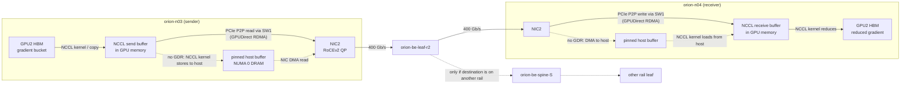

# Chapter 13 — GPU-to-GPU and GPU-to-NIC Data Movement

> Chapters 11 and 12 counted bytes and timed collectives. This chapter follows the bytes. A gradient
> chunk leaving GPU 3 on one ORION node crosses HBM, a PCIe switch, a NIC, a rail leaf, possibly a
> spine, another NIC, another PCIe switch, and lands in another GPU's HBM — with or without a detour
> through host memory, depending on whether GPUDirect RDMA is actually working. Each hop has a
> bandwidth, a latency, a set of counters, and a way to fail. And because synchronous training waits
> for the slowest rank, a problem on one hop of one GPU becomes a problem for every GPU in the job.
> This chapter teaches you to draw the data path, count its copies, keep it local, overlap it with
> compute, validate it on real hardware, and — the skill on-call engineers are paid for — decide
> from per-rank telemetry whether "GPU utilization is low while the network is busy" is a
> communication problem, a synchronization problem, or a data problem.

## Learning objectives

After this chapter, its exercises, and its lab, you will be able to:

1. **Trace** a distributed-training communication path from GPU memory through PCIe, NIC, and fabric
   to a remote GPU, with and without GPUDirect RDMA, and count the copies and PCIe crossings.
2. **Explain** NVLink/NVSwitch peer-to-peer paths, GPU↔NIC locality classes, and why locality changes
   bandwidth, latency, and variance.
3. **Explain** how CUDA streams let communication overlap compute, and calculate exposed
   communication from overlap windows.
4. **Calculate** straggler amplification in synchronous training: GPU time lost to waiting and the
   probability that some rank is slow at scale.
5. **Diagnose** "GPU utilization low while network utilization high" from per-rank telemetry,
   distinguishing communication, synchronization, and data-imbalance causes, and rejecting decoys.
6. **Design** measurements that validate GPUDirect RDMA and GPU/NIC locality on supported hardware.
7. **Produce** an annotated data-path diagram and a cross-layer diagnosis (the chapter deliverable).

## Prerequisites and connections

This chapter builds directly on [Chapter 5](../../part-2-accelerated-compute/ch05-gpu-interconnects-host-topology/),
which owns the *topology-mapping* skill: reading `nvidia-smi topo -m` and `lstopo`, mapping each GPU's
UUID and PCIe bus:device.function (BDF) to its nearest NIC, NUMA node, and rail, and producing the
mapping CSV. We do not repeat that here; we assume you have the map and ask what moves along it.
From [Chapter 8](../../part-3-networking/ch08-rdma-rocev2-infiniband/) you need RDMA verbs, queue
pairs, and memory registration; from [Chapter 11](../ch11-distributed-training-architecture/) the
traffic each parallelism dimension creates; from [Chapter 12](../ch12-collective-communication-nccl/)
NCCL channels, protocols, and the `GDRDMA` log marker. Chapter 9 explains the congestion that
appears when these paths are shared; [Chapter 18](../../part-5-production-operations/ch18-observability-slos-incident-response/)
turns this chapter's telemetry into dashboards and alerts; Chapter 22 generalizes the cross-layer
method; **Capstone C** uses the straggler analysis and **Capstone G** the per-rank fault isolation.

ORION facts used throughout ([REFERENCE_CLUSTER.md](../../../docs/REFERENCE_CLUSTER.md)): in each HX8
node, GPU *i* and NIC *i* share PCIe switch ⌊*i*/2⌋ (PCIe Gen5 x16, ≈ 63 GB/s per direction
theoretical, ≈ 50–55 GB/s achievable); GPUs 0–3 and NICs 0–3 hang off socket 0, GPUs 4–7 and NICs 4–7
off socket 1; all eight GPUs connect through NVSwitch at 450 GB/s per direction per GPU; NIC *i* is
400 Gb/s (50 GB/s) on rail *i*.

## 13.1 What actually moves in a training step

From Chapter 11, one W-TRAIN step (TP 8, PP 4, DP 8) moves, per GPU:

| Traffic | Bytes per GPU per step | Path | Message size | Pattern |
|---|---|---|---|---|
| Tensor parallel | 1.20 TB | GPU ↔ GPU over NVLink/NVSwitch | 67 MB collectives, 10,240 per step | On the critical path |
| Data parallel | 7.66 GB | GPU → PCIe → NIC *i* → rail leaf *i* → NIC *i* → PCIe → GPU | GB-scale, bucketed | Once per step, overlapped |
| Pipeline parallel | 2.15 GB | same as DP, to the next stage's node | 8.4 MB send/recv, 256 per step | Fill/drain sensitive |

*Table 13.1 — Bytes and paths of one W-TRAIN step `[MODELED]` (Chapter 11, Table 11.2).*

Two numbers frame this chapter. NVLink carries ≈ 123× more bytes than the NIC per step (1.20 TB / 9.81 GB), so *intra-node*
problems (a degraded NVLink, a P2P path that fell back to PCIe) are catastrophic. The NIC carries far
fewer bytes, but every one of them crosses PCIe twice and a fabric once, and each collective waits for
the slowest rank — so *inter-node* problems show up as tail latency and stragglers rather than raw
bandwidth loss.

## 13.2 GPU-to-GPU inside a node: NVLink, NVSwitch, and peer-to-peer

Inside an HX8, each GPU has 18 NVLink links to four NVSwitch chips. Any GPU can read or write any
other GPU's memory at up to 450 GB/s per direction `[VENDOR-SPEC, 2026-10]`, without the CPU or PCIe.
CUDA exposes this as **peer-to-peer (P2P)** access: once enabled between two devices, a kernel on
GPU 0 can dereference a pointer into GPU 5's memory, and copy engines can move data directly. NCCL
uses both: its collective kernels (running on a few SMs per channel) write LL/LL128 packets or Simple
chunks straight into a peer's receive buffer over NVLink, and with NVLS the NVSwitch itself reduces.

```text
   GPU0 HBM ──► GPU0 SMs (NCCL kernel) ──NVLink──► NVSwitch ×4 ──NVLink──► GPU5 HBM (receive buffer)
   (no PCIe, no CPU, no host memory)          450 GB/s per direction per GPU [VENDOR-SPEC]

   Fallback when NVLink P2P is unavailable:
   GPU0 HBM ──PCIe──► PCIe SW0 ──► CPU0 root complex ──(UPI/xGMI)──► CPU1 ──► PCIe SW2 ──PCIe──► GPU5
                       ≈ 50 GB/s at best, shared, and often disabled by ACS/IOMMU policy
```

*Figure 13.1 — GPU↔GPU data path inside an HX8 node. The NVLink path is the design point; the PCIe
fallback through the root complexes is what you get when the NVLink fabric or its management service
is unhealthy, and it is roughly an order of magnitude slower.*

Things that break the NVLink path, and what you see:

- **NVLink link down or degraded.** `nvidia-smi nvlink --status` shows fewer active links or lower
  speed; NCCL may route around it with lower bandwidth. TP communication time rises on that node only
  — a straggler *node*.
- **NVSwitch fabric not initialized.** On NVSwitch systems, a fabric-management service must configure
  the switches; if it is not running, CUDA reports the GPUs as not ready for peer access or
  workloads fail at initialization `[VENDOR-SPEC, 2026-10]`. This shows up after reboots and driver
  updates, which is why node acceptance tests (Chapter 16) run an intra-node all-reduce.
- **P2P disabled in a virtualized or containerized environment.** The application silently uses
  host-staged copies; intra-node collective bandwidth drops by 5–10×. `nvidia-smi topo -p2p r` (and
  `w`) prints the P2P read/write capability matrix.

## 13.3 GPU-to-NIC: PCIe, locality, and GPUDirect RDMA

Every inter-node byte crosses PCIe twice. The NIC is a PCIe device; to send, it must *read* the data
from memory via DMA, and the receiving NIC must *write* it into memory. The question is which memory.

**Without GPUDirect RDMA**, the NIC can only DMA to and from host memory. On NCCL's host-staged path
the NCCL kernel itself stores the outgoing data into a pinned host buffer across PCIe (SM stores, not a
separate copy-engine `cudaMemcpy`), then the NIC reads that buffer (another PCIe transfer, from host
memory to NIC). The receiver reverses it: the NIC writes into pinned host memory and the NCCL kernel
reads it across PCIe. **With GPUDirect RDMA**, the GPU exposes part of its memory through a PCIe BAR (base address
register) window and the NIC's DMA engine reads or writes GPU memory directly as a PCIe peer-to-peer
transaction. When GPU and NIC sit under the same PCIe switch, that transaction never touches the CPU
root complex or host memory.

```text
                         CPU0 / NUMA 0 (host DRAM)
                                  │ root port
                       ┌──────────┴──────────┐
                       │   PCIe switch SW1    │   ← GPU2 and NIC2 under the same switch: "PIX"
                       └───┬──────────────┬───┘
                    Gen5 x16           Gen5 x16
                        GPU2             NIC2 ── 400 Gb/s ── rail-2 leaf
  With GPUDirect RDMA:  GPU2 HBM ⇄ SW1 ⇄ NIC2           (peer-to-peer through the switch; 1 PCIe hop pair)
  Without GPUDirect:    GPU2 HBM → SW1 → root → DRAM → root → SW1 → NIC2   (2 PCIe transfers + DRAM copy)
  Misaligned (GPU2→NIC6): GPU2 → SW1 → CPU0 → inter-socket link → CPU1 → SW3 → NIC6   ("SYS")
```

*Figure 13.2 — GPU↔NIC data path on HX8 (rail 2 shown). PIX locality lets GPUDirect RDMA stay inside
the PCIe switch; a misaligned GPU↔NIC pair crosses both root complexes and the inter-socket link,
where NCCL by default does not use GPUDirect RDMA at all.*

NCCL decides per GPU/NIC pair whether to use GPUDirect RDMA from the path type and
`NCCL_NET_GDR_LEVEL` (Chapter 12, Table 12.5); by default it uses it for close paths (same switch or
nearby) and disables it across the inter-socket link `[VENDOR-SPEC, 2026-10]`. That is why a NIC
mapping error has two costs: the bytes cross the inter-socket link, *and* they are staged through
host memory.

**Prerequisites for GPUDirect RDMA** — necessary, but not proof that it is active `[VENDOR-SPEC,
2026-10]`:

1. A platform where the GPU and NIC can do PCIe peer-to-peer (data-center GPUs and RDMA NICs on a
   supported server; PCIe switches that permit P2P).
2. A kernel-side mechanism that lets the RDMA stack register GPU memory: the `nvidia-peermem` kernel
   module with the vendor RDMA stack, or the upstream dma-buf path with a sufficiently recent kernel,
   driver, and RDMA core.
3. PCIe Access Control Services (ACS) configured so peer-to-peer requests are not forced up to the
   root complex (on bare metal, ACS redirect is typically disabled on the relevant switch ports), and
   an IOMMU configuration that permits the traffic (commonly passthrough mode on bare metal).
4. Matching driver, firmware, and library versions per the vendor support matrix.

> **Pitfall:** "We installed the GPUDirect packages, so it is on." Installation proves nothing. The
> only acceptable evidence is a run that shows the path in use (NCCL's `GDRDMA` marker, perftest with
> GPU buffers at line rate) and a performance difference between GPU-buffer and host-buffer tests that
> matches the model. Section 13.10 gives the procedure.

## 13.4 The end-to-end path: from one GPU's HBM to another's

Put the pieces together for a DP gradient chunk sent by rank 18 (`orion-n03`, GPU 2) to rank 26 (`orion-n04`, GPU 2) — same rail, so one leaf hop.



*Figure 13.3 — End-to-end path of one data-parallel message in a W-TRAIN training step. Solid arrows:
GPUDirect RDMA path, rail-local. Dashed arrows: the host-staged path used when GPUDirect RDMA is
unavailable, and the spine detour taken by cross-rail traffic. This is the inter-node half of the
step diagram in Chapter 11, Figure 11.1.*

**Counting copies and crossings** for one message of S bytes:

| Path | Copies through host DRAM | PCIe transfers (sender + receiver) | Switch hops | Who moves the data |
|---|---|---|---|---|
| GPUDirect RDMA, rail-local (aligned) | 0 | 2 (GPU→NIC P2P, NIC→GPU P2P) | 1 (leaf) | NIC DMA engines |
| GPUDirect RDMA, cross-rail | 0 | 2 | 3 (leaf → spine → leaf) | NIC DMA engines |
| Host-staged RDMA | 2 (one per side) | 4 (GPU→host, host→NIC, NIC→host, host→GPU) | 1 | NCCL kernels (SM loads/stores over PCIe) + NIC DMA |
| Misaligned GPU↔NIC (SYS), host-staged | 2 | 4, two of them crossing the inter-socket link | 1 | as above, plus socket interconnect |
| TCP sockets (no RDMA) | ≥ 2 plus kernel socket-buffer copies | 4 | 1 | CPU and kernel network stack |

*Table 13.2 — Copies, PCIe transfers, and hops per message `[MODELED]`. NCCL's internal copy from the
user tensor into its own buffers (done by its kernels over HBM/NVLink) is common to all rows and
omitted.*

**Latency budget** of a small message, GPUDirect RDMA, rail-local `[ILLUSTRATIVE]` order-of-magnitude
values. Hardware, one way: PCIe read by the NIC ≈ 0.5 µs; NIC processing ≈ 0.3–0.5 µs each side;
serialization of a 4 KiB packet at 400 Gb/s ≈ 0.08 µs; a cut-through leaf switch ≈ 0.6–0.8 µs; 30 m of
fiber ≈ 0.15 µs; PCIe write at the receiver ≈ 0.5 µs — about 2 µs one way, which is what
`ib_write_lat`-class tests report (they print half of the measured ≈ 4 µs same-rail round trip). Software adds more than the wire: NCCL's kernel
posting to the proxy thread, the proxy posting the work request, and the receiver's kernel polling
add ≈ 2–5 µs per hop, so one NCCL hop costs ≈ 5–7 µs. That is consistent with the 28 µs two-node
all-reduce latency of Chapter 12 once you add the multiple steps of a tree and NCCL's
synchronization. The host-staged path adds two PCIe crossings by the NCCL kernel and two DRAM
round trips, typically several µs more per message, and it consumes host memory bandwidth on both
sockets.

> **Key idea:** For large messages, GPUDirect RDMA mostly saves host memory bandwidth and CPU/PCIe
> root-complex load; for small and medium messages it saves latency. Both matter at scale, because
> the collective's time is set by the slowest of thousands of such transfers.

## 13.5 Locality: NUMA, CPU affinity, and why "close" matters

Even with GPUDirect RDMA, the CPU is in the loop: NCCL's proxy thread posts work requests to the NIC
and polls completions, the data loader feeds the GPU from host memory, and the host-staged path (when
used) bounces through DRAM. Three locality rules follow; Chapter 5 shows how to derive them for any
platform:

1. **GPU *i* uses NIC *i*** — the NIC under the same PCIe switch (PIX). Any other choice adds root
   complex hops; a cross-socket choice adds the inter-socket link and loses GPUDirect RDMA.
2. **Processes and their memory live on the GPU's NUMA node.** Bind each rank's CPU threads and host
   allocations to the socket that owns its GPU and NIC (`numactl --cpunodebind=N --membind=N`, or the
   launcher's binding options such as Open MPI `--bind-to numa`, or Slurm `--cpu-bind`). A rank on
   GPU 6 whose proxy thread runs on socket 0 pays inter-socket latency on every completion poll.
3. **Spread work across both sockets.** Data-loader workers, pinned-memory pools, and interrupts should
   follow the GPUs they serve; an all-on-socket-0 configuration saturates one memory controller while
   the other idles.

Misalignment rarely halves bandwidth on an idle machine; it adds variance. That is the dangerous
part: synchronous training converts variance into stragglers (Section 13.7).

## 13.6 Overlapping communication with computation: CUDA streams

A CUDA **stream** is an ordered queue of GPU work; work in different streams may run concurrently.
Frameworks put compute kernels on one stream and NCCL collectives on another, and use **events** to
express dependencies ("the all-reduce of bucket 3 may start when the backward kernels that produce
bucket 3 have finished"; "the optimizer may start when all buckets are reduced"). The result is the
overlap pattern of Chapter 11, Figure 11.2.

Overlap has three real limits:

- **The window.** Communication can hide only behind compute that does not depend on it. DDP's last
  buckets are produced at the very end of backward, so their all-reduce is exposed. With pipeline
  parallelism and gradient accumulation, the DP reduction can hide only behind the final micro-batch's
  backward — ≈ 13.9 s / 128 × 2/3 ≈ 72 ms for W-TRAIN on ORION — while it needs ≈ 170 ms; Chapter 11's
  step model uses this window (≈ 98 ms exposed) `[MODELED]`. Exposed time is
  max(0, T_comm − T_window).
- **Shared resources.** NCCL kernels occupy SMs (one block per channel) and HBM bandwidth; compute
  slows slightly while they run. Copy engines and PCIe are shared with data loading.
- **Ordering.** Concurrency on the GPU depends on how work is submitted to hardware queues; frameworks
  sometimes constrain it deliberately (Megatron-style TP overlap commonly sets the CUDA environment
  variable `CUDA_DEVICE_MAX_CONNECTIONS=1` so that kernel submission order is preserved
  `[VENDOR-SPEC, 2026-10]`).

The only reliable way to see overlap is a timeline: Nsight Systems (`nsys profile -t cuda,nvtx,osrt`)
shows compute kernels and `nccl*` kernels on separate stream rows, and the gaps where the compute
stream waits on a collective are exposed communication.

## 13.7 Stragglers and their amplification

In a synchronous job, every collective completes when the last rank arrives. If rank *r* finishes its
compute at time a_r, every other rank waits (max_r a_r − a_r) inside the collective. Summed over ranks,
that is GPU time lost to synchronization:

```text
lost GPU-time per step = Σ_r (max a − a_r)
lost fraction          = Σ_r (max a − a_r) / (N × T_step)
```

**One straggler is enough.** If one rank of 64 is 29 % slower in compute, the other 63 wait ≈ 29 % of
compute time every step. In this chapter's lab (Section 13.11) that is 220 GPU-seconds lost over 20
steps — 18.6 % of all GPU time — from a single rank.

**At scale, someone is always slow.** If each rank independently has probability *p* of a slow step,
the probability that a step has at least one slow rank is 1 − (1 − p)^N:

```text
p = 0.1 %:  N = 64 → 6.2 %;  N = 256 → 22.6 %;  N = 4,096 → 98.3 %          [MODELED]
```

At ORION-XL scale a "rare" per-rank hiccup (a page-cache flush, an interrupt storm, a garbage
collection, an ECC scrub, a link-layer retransmission) slows almost every step. Hoefler et al. (2010)
showed the same effect from OS noise in HPC collectives; Dean and Barroso (2013) describe the general
"tail at scale" phenomenon.

**Two stragglers are not twice as bad — but fixing one may not help.** The step time is set by the
*maximum*. If two ranks are each 29 % slow, fixing either one leaves the step time unchanged; the lab's
data contains exactly this trap.

Sources of stragglers, by layer:

| Layer | Cause | Telemetry signature |
|---|---|---|
| GPU | Thermal or power throttling, a lower power cap, application clocks locked low | SM clock below peers, clocks-event reason set, temperature or power anomaly; compute slow, tokens normal |
| Data | More tokens/longer sequences on one rank, slow data shard, tokenizer on CPU | Tokens above peers (compute slow with normal clocks) or data-loader wait high |
| Host | CPU contention, NUMA misbinding, interrupt storms | Data-loader wait or kernel-launch gaps; host CPU metrics |
| Network | Link errors and retransmissions, a slow NIC, congestion on one rail | Communication slow for ranks on one NIC/rail; retransmission counters; ECN/PFC counters |
| Intra-node | NVLink degraded | TP communication slow on one node |

*Table 13.3 — Straggler causes and their signatures.*

### Instrumenting a job so stragglers are visible

None of the analysis in this chapter is possible without per-rank phase timing, and most training
jobs do not log it by default. The minimum useful instrumentation, which the lab's bundle imitates:

1. **CUDA events around phases**, recorded on the compute stream: start of forward, end of backward,
   entry into the gradient collective, completion of the collective, end of the optimizer step.
   Events measure GPU time without forcing a host synchronization on every step; read them back one
   step later. Host timestamps (`time.perf_counter()`) without synchronization measure kernel
   *launches*, not execution (Chapter 12, Section 12.9).
2. **Arrival skew, not just duration.** The useful quantity is when each rank *entered* the collective
   relative to the last rank. Ranks' clocks differ, so compute "wait" as collective duration minus
   the transfer time measured after the last arrival (or derive it from a small all-gather of entry
   timestamps every N steps), rather than comparing wall clocks across hosts.
3. **Work per rank** — tokens or samples processed — so that data imbalance can be separated from
   slow hardware.
4. **Hardware context per rank**, joined by host and GPU index: SM clock, clocks-event reasons,
   temperature, power (DCGM, sampled at ≥ 1 Hz), NIC throughput and retransmission-type counters
   (sampled per NIC), and the rank → host/GPU/NIC/rail map from the launcher.
5. **Cheap aggregation.** Log per-rank rows every N steps (N = 10–50) to keep volume manageable;
   alert on the robust statistics of Section 13.9 rather than on raw thresholds.

The join key matters: a rank number means nothing to the Fleet team, and a GPU serial number means
nothing to Training Infra. Chapter 5's mapping CSV (rank → host → GPU UUID/BDF → NIC → rail → leaf
port) is what makes cross-team diagnosis fast, and Chapter 18 turns these fields into dashboards.

### Where the network and hang evidence comes from

The lab's `nic_retx` column is a teaching abstraction. On ORION's mlx5-class RoCE NICs it maps to
per-port hardware counters `[VENDOR-SPEC, 2026-10]` — names vary by driver and firmware, so confirm
them on your stack:

| Counter (per RDMA port) | Side | Meaning | What a rise suggests |
|---|---|---|---|
| `packet_seq_err` | sender (requester) | NAKs for packet-sequence errors received from the responder | Packets lost in flight; go-back-N retransmission |
| `local_ack_timeout_err` | sender | ACK timeouts (no response within the QP timeout) | Severe loss, link flap, or a peer that stopped responding |
| `out_of_sequence` | receiver (responder) | Out-of-sequence packets received | Loss upstream of this receiver |
| `np_ecn_marked_roce_packets` | receiver (notification point) | ECN-marked RoCE packets received | Congestion on the path (Chapter 9) |
| `np_cnp_sent` | receiver | Congestion-notification packets sent | DCQCN reacting to marks |
| `rp_cnp_handled` | sender (reaction point) | CNPs processed — the sender slowed down | Rate reduction in response to congestion |
| `rx_prio3_pause` (ethtool, netdev) | port | PFC pause frames received on priority 3 (ORION's RoCE class) | Lossless-class back-pressure (Chapter 9) |

*Table 13.4a — RDMA and PFC counters that feed a `nic_retx`-style signal `[VENDOR-SPEC, 2026-10]`. In
the lab, `nic_retx` = Δ(`packet_seq_err` + `local_ack_timeout_err`) on the sending NIC plus
Δ`out_of_sequence` on the receiving NIC, per step.*

```console
$ ls /sys/class/infiniband/mlx5_2/ports/1/hw_counters/ | head
$ cat /sys/class/infiniband/mlx5_2/ports/1/hw_counters/{packet_seq_err,local_ack_timeout_err,out_of_sequence}
$ rdma statistic show link mlx5_2/1          # same counters via iproute2
$ ethtool -S eth2 | grep -E 'rx_prio3_pause|tx_prio3_pause'
```

Sample them per NIC at a fixed interval and store *deltas*; the raw values are cumulative since driver
load. Loss counters (`packet_seq_err`, `out_of_sequence`) with flat ECN/CNP counters point at the
physical layer (Chapter 10); rising ECN/CNP and pause counters with few sequence errors point at
congestion (Chapter 9).

For hangs rather than slowness, PyTorch's NCCL *flight recorder* keeps the last collectives per rank.
It is controlled by `TORCH_NCCL_TRACE_BUFFER_SIZE` (number of entries; 0 disables it),
`TORCH_NCCL_DUMP_ON_TIMEOUT=1` (dump when the watchdog fires), and `TORCH_NCCL_DEBUG_INFO_TEMP_FILE`
(path prefix of the per-rank dump files); `TORCH_NCCL_ENABLE_TIMING=1` adds per-collective start/end
timing, which also gives the per-rank collective durations used in this chapter. Newer releases may
rename these (for example `TORCH_FR_BUFFER_SIZE`); all are `[VENDOR-SPEC, 2026-10]` — verify against
your PyTorch version. The rank whose last recorded sequence number is lowest is the one the others are
waiting for.

## 13.8 "GPU utilization low while the network is busy"

This symptom is one of the most common escalations in AI infrastructure, and it is ambiguous by
construction. Three different mechanisms produce it:

1. **Communication-bound.** The network is the bottleneck: collectives take longer than the compute
   between them. Causes: bandwidth below expectation (degraded link, misaligned NIC, congestion), too
   many small messages (latency-bound, Chapter 12), or poor overlap.
2. **Synchronization-bound.** One or a few ranks are slow; everyone else waits inside collectives. The
   network is *not* the bottleneck; it is idle during the wait and then busy during the transfer.
3. **Data imbalance or input-bound.** Ranks receive unequal work (sequence lengths, samples) or wait
   for the data loader; the effect looks like (2) but the slow rank's GPU is healthy.

**The metric trap.** `nvidia-smi`'s `utilization.gpu` reports the fraction of time *any kernel* was
running. A rank waiting inside an NCCL collective is running a kernel — NCCL's kernels spin, polling
for data — so `utilization.gpu` stays near 100 % while the GPU does no useful work. In the lab data it
is 99.7 % before and after the incident. Use instead:

- SM activity and occupancy from DCGM profiling metrics (e.g., `DCGM_FI_PROF_SM_ACTIVE`,
  `DCGM_FI_PROF_PIPE_TENSOR_ACTIVE`), which fall when SMs idle in spin loops `[VENDOR-SPEC, 2026-10]`;
- per-rank **phase timings** from the training loop (compute, wait-in-collective, collective transfer,
  data-loader wait), which is what the lab provides;
- NIC throughput *during the communication phase* (bytes / transfer time), not averaged over the step:
  an average of 45 Gb/s can hide 360 Gb/s bursts.

**Decision table.**

| Evidence | Communication-bound | Synchronization (straggler) | Data imbalance |
|---|---|---|---|
| Transfer time (after last arrival) | **Up** for everyone | Normal | Normal |
| Wait time (before last arrival) | Normal | **Up** for all but the slow rank(s) | **Up** for all but the heavy rank(s) |
| Slow rank's compute | Normal | **Up** | **Up** |
| Slow rank's clocks/temperature/power | Normal | Often abnormal (GPU cause) | Normal |
| Slow rank's tokens/samples | Normal | Normal | **Up** |
| NIC retransmissions / errors | **Up** on affected NICs/rail | Normal | Normal |
| Burst NIC rate during transfer | **Down** (slow) or near line rate with long transfers (volume) | Near line rate | Near line rate |
| `utilization.gpu` | ≈ 100 % (misleading) | ≈ 100 % (misleading) | ≈ 100 % (misleading) |

*Table 13.4 — Distinguishing the three causes. Real incidents often combine them; the lab contains
all three.*

## 13.9 A cross-layer diagnosis method

The lab implements this procedure; it is the diagnostic loop specialized to per-rank telemetry.

1. **Establish the step-level symptom** with windows: step time, `sm_active`, transfer time, wait
   time, burst NIC rate — before and after the change.
2. **Find persistent outliers robustly.** For each step, compute a robust z-score of each rank's
   compute time, z = (x − median) / (1.4826 × MAD), where MAD is the median absolute deviation. The
   median and MAD are not dragged by the outliers you are looking for, unlike mean and standard
   deviation. Flag ranks above a high threshold (6 in the lab) in a meaningful fraction of steps.
3. **Find onsets.** A cause that starts at step 20 is a different event from one present since step 0.
   Use the first run of three consecutive flagged steps.
4. **Attribute with independent evidence.** Never explain slow compute with compute time. Use clocks,
   clocks-event reasons, temperature, and power (GPU); tokens (data); retransmissions and NIC counters
   (network).
5. **Group by shared components.** If ranks with the same local index on *different* nodes misbehave
   together, the common factor is the rail — the rail-*i* leaf, its configuration, or its optics bank —
   not eight separate NICs. If all ranks on one node misbehave, suspect the node.
6. **Reject decoys.** A GPU at 84 °C with normal clocks and no throttle reason is warm, not slow.
7. **Quantify the cost** (lost GPU-time, ideal versus actual step) to prioritize fixes.

## 13.10 Validating GPUDirect RDMA and GPU/NIC locality on supported hardware

This is the measurement plan for the outline's third exercise. All commands are standard tools; exact
names, flags, and outputs vary by vendor stack and version `[VENDOR-SPEC, 2026-10]`. Run on a drained
node pair.

| # | Question | Command / method (L2/L3) | Pass criterion |
|---|---|---|---|
| 1 | Is GPU *i* under the same PCIe switch as NIC *i*? | `nvidia-smi topo -m`; `lstopo --of txt` (Chapter 5 mapping CSV) | GPU*i*↔NIC*i* = `PIX` for all *i* |
| 2 | Is a peer-memory mechanism available? | `lsmod \| grep nvidia_peermem`; or DMA-BUF: perftest `ib_write_bw -d mlx5_2 --use_cuda=2 --use_cuda_dmabuf` succeeds and NCCL INFO reports DMA-BUF support | Module present, or DMA-BUF path works (DMA-BUF needs no `nvidia_peermem`) |
| 3 | Is ACS forcing P2P upstream? | `sudo lspci -vvv -s <switch-port-BDF> \| grep -i ACSCtl` | `ACSCtl:` shows `ReqRedir- CmpltRedir-` on the downstream ports of the GPU/NIC switch (per vendor guidance) |
| 4 | IOMMU mode | `cat /proc/cmdline` (e.g. `iommu=pt` on bare metal), `dmesg \| grep -i iommu` | Matches the platform's validated configuration |
| 5 | Does RDMA reach line rate from GPU memory? | perftest with CUDA buffers: server `ib_write_bw -d mlx5_2 --use_cuda=2 --report_gbits`, client same plus server host | ≈ line rate (≈ 390 Gb/s on 400G) |
| 6 | Is GPU-buffer RDMA as good as host-buffer RDMA? | Repeat 5 without `--use_cuda`; then with a *mismatched* GPU (e.g. `--use_cuda=6` with `mlx5_2`) | GPU≈host for PIX; mismatched GPU measurably worse (shows locality matters) |
| 7 | Is NCCL using GDR? | `NCCL_DEBUG=INFO NCCL_DEBUG_SUBSYS=INIT,NET` two-node nccl-tests | Every inter-node channel line ends in `/GDRDMA`. A `GPU Direct RDMA Enabled for GPU … / HCA …` line only reflects PCIe distance vs `NCCL_NET_GDR_LEVEL`, not that a peer-memory mechanism works |
| 8 | What does GDR buy end to end? | nccl-tests with default settings vs `NCCL_NET_GDR_LEVEL=LOC` (GDR off) | GDR-on ≥ GDR-off; latency difference visible at small/medium sizes |
| 9 | Is PCIe link healthy? | `sudo lspci -vvv -s <GPU-or-NIC-BDF> \| grep -E 'LnkCap\|LnkSta'` | Gen5 x16 in `LnkSta`, matching `LnkCap` |
| 10 | Is host traffic avoided? | DCGM PCIe TX/RX bytes (`DCGM_FI_PROF_PCIE_TX_BYTES`/`RX_BYTES`) and host memory bandwidth during the test | Host DRAM traffic low with GDR on |

*Table 13.5 — Measurement plan for GPUDirect RDMA and locality `[VENDOR-SPEC, 2026-10]`. Record each
result in the lab's `manifest.yaml` extension with versions; repeat bandwidth tests ≥ 5 times.*

> **Safety:** Changing ACS, IOMMU, or kernel modules requires a maintenance window and Fleet change
> control (Chapter 20); a wrong ACS change can break isolation between devices. The plan above
> *reads* configuration; it does not change it.

## 13.11 Worked example: what GPUDirect RDMA is worth for W-TRAIN on ORION

**Problem.** After a driver update on a test node pair, NCCL's channel lines no longer end in
`/GDRDMA`. Training Infra asks: "Does it matter? DP traffic is under 1 % of step time." We quantify
the data-parallel and pipeline traffic on both paths. All results are `[MODELED]` with the stated
`[ILLUSTRATIVE]` capacities.

**Inputs.** Per GPU per step: DP sends 7.66 GB and receives 7.66 GB; PP sends 2.15 GB and receives
2.15 GB (Chapter 11). Per HX8 PCIe switch: 2 GPUs + 2 NICs, one Gen5 x16 uplink to the socket
(≈ 55 GB/s achievable per direction, `[ILLUSTRATIVE]`). Host memory per socket: 8-channel DDR5-class, ≈ 300 GB/s
theoretical `[ILLUSTRATIVE]`. NIC: 45 GB/s effective.

**Step 1 — With GPUDirect RDMA.** The NIC reads the GPU's send buffer and writes the receive buffer
through the PCIe switch. Per GPU the bytes on the GPU's x16 link are 7.66 GB up and 7.66 GB down for
DP; the switch uplink carries **nothing**; host DRAM carries **nothing**. The NIC is the bottleneck:
7.66 GB / 45 GB/s = 0.170 s — the Chapter 11 number.

**Step 2 — Without GPUDirect RDMA (host-staged).** Every sent byte goes GPU → host DRAM (NCCL kernel stores, upward
through the switch uplink) and then host DRAM → NIC (downward). Every received byte goes NIC → host
DRAM (upward) and then host DRAM → GPU (downward, NCCL kernel loads). Per PCIe switch (two GPU/NIC pairs):

```text
uplink, upward   = 2 GPUs × (7.66 GB GPU→host + 7.66 GB NIC→host) = 30.6 GB
uplink, downward = 2 GPUs × (7.66 GB host→NIC + 7.66 GB host→GPU) = 30.6 GB
time on uplink  ≥ 30.6 GB / 55 GB/s = 0.56 s          (vs 0.17 s NIC-bound with GDR)
host DRAM per socket (4 GPUs): each byte written once and read once on both sides
                = 4 × (7.66 × 2 + 7.66 × 2) GB = 122.6 GB per step
time on DRAM    ≥ 122.6 GB / 300 GB/s = 0.41 s, competing with the data loader and the OS
```

So the DP reduction becomes ≈ 3.3× slower (0.56 s vs 0.17 s), bounded by the PCIe switch uplink,
not the network. With only ≈ 70 ms of real overlap window (Section 13.6), exposed DP time rises from
≈ 0.10 s to ≈ 0.49 s per step: +0.39 s, about +2.2 % on a 17.4 s step, or
0.022 × 256 GPUs × 24 h ≈ 140 GPU-hours per day. Pipeline traffic adds 2.15 GB in each direction per GPU, and each 8.4 MB
pipeline message gains two staging copies on the critical path of the fill and drain phases.

**Step 3 — Decision.** "Under 1 % of step time" was true only *with* GPUDirect RDMA. Without it the
data path stops being NIC-bound and becomes PCIe-uplink- and DRAM-bound, which also hurts the data
loader on the same sockets. The node pair fails acceptance until channel lines show `/GDRDMA` again
and the measurement plan in Table 13.5 passes (in particular items 2, 5, 7, and 8). Root cause in
this kind of incident is usually that the peer-memory mechanism did not load after the driver update
(`lsmod | grep nvidia_peermem` empty, or the dma-buf prerequisites not met).

**Step 4 — Diagnostic loop closure.** Re-run the two-node nccl-tests and the `--use_cuda` perftest
after the fix; record both in the manifest; compare with the pre-update baseline (≥ 5 launches).

## 13.12 Hands-on lab overview

The lab ([lab/README.md](lab/README.md)) is tier **L1**. You receive a telemetry bundle from a
64-rank synchronous data-parallel job on eight ORION nodes (`orion-n17` … `orion-n24`), 60 steps ×
64 ranks, with per-rank compute, wait, transfer, and data-loader times, `utilization.gpu`-style and
SM-active-style utilization, clocks, temperature, power, clocks-event reasons, NIC throughput, and
retransmission counts (`[SIMULATED]`). You implement `starter/telemetry_diag.py`: per-step straggler
statistics, robust z-scores, straggler detection and onset, cause attribution from independent
evidence, rail-level health, decoy rejection, amplification (GPU time lost to waiting), and symptom
windows. Several causes are planted, some overlapping in time, and one is a decoy. The deliverable is
an annotated data-path diagram plus the cross-layer diagnosis.

## 13.13 Troubleshooting scenario: "GPU utilization is fine, but the job is slow and the network is busy"

**Symptom.** A 64-rank fine-tuning job on `orion-n17`–`orion-n24` reports step time up from ≈ 924 ms
to ≈ 1,005 ms at step 30. The job dashboard shows GPU utilization 99.7 % throughout; the network
dashboard shows the backend NICs "busy". Training Infra says "network problem"; Fabric says "GPUs are
at 100 %, so it must be the model". This is the chapter's diagnosis in miniature; the data are the
lab bundle `[SIMULATED]`.

**Observe: windows first** (lab `symptom_windows`):

| Steps | Step (ms) | `utilization.gpu` (%) | SM active (%) | NIC tx avg (Gb/s) | Burst tx during transfer (Gb/s) | Wait (ms) | Transfer (ms) |
|---|---|---|---|---|---|---|---|
| 0–19 | 923.8 | 99.7 | 58.5 | 46.8 | 360 | 171.9 | 120.2 |
| 20–29 | 923.6 | 99.7 | 58.6 | 46.8 | 361 | 170.9 | 119.8 |
| 30–59 | 1,005.2 | 99.7 | 54.7 | 43.6 | 222 | 174.0 | 197.8 |

*Table 13.6 — Symptom windows from the lab data.* This fine-tuning job runs lighter kernels than
W-TRAIN, so healthy peers sustain ≈ 1,973 MHz; under dense training the ORION sustained baseline is
≈ 1,830 MHz. Judge throttling against the peers' clock under the same load, never against max boost.

`utilization.gpu` never moved, so it carries no information here (NCCL kernels spin while waiting).
SM activity is only ≈ 58 % even in the "good" window, and every rank spends ≈ 172 ms per step
*waiting* — a straggler problem that predates the incident. At step 30 a second, different problem
starts: transfer time rises 120 → 198 ms while the burst NIC rate *falls* from 360 to 222 Gb/s: the
network is busy for longer because it is moving data more slowly.

**Collect evidence: per-rank rows at step 45** `[SIMULATED]`:

```text
rank host       tokens compute_ms wait_ms comm_ms sm_clock temp  power clocks_event_reason nic_retx
   0 orion-n17  16820     619.66  158.00  198.82     1974  70.6  671.7 none                     1
   2 orion-n17  16330     605.60  172.72  199.06     1963  67.2  640.4 none                  3175
  10 orion-n18  16492     602.50  174.48  199.00     1975  67.2  633.2 none                  3198
  12 orion-n18  21385     776.71    1.68  197.83     1978  64.6  629.1 none                     2
  37 orion-n21  16872     777.71    0.00  198.14     1530  90.0  579.8 sw_thermal_slowdown       3
  51 orion-n23  15675     579.55  198.40  199.25     1971  84.0  635.4 none                     1
  (step median: compute 600 ms, tokens 16,367, clock 1,973 MHz)
```

**Hypotheses, ranked, and the tests that discriminate them** (the lab's method, Section 13.9):

1. *Data imbalance on rank 12* — compute 777 ms (robust z ≫ 6) **from step 0**, clocks and temperature
   normal, tokens 21,385 vs a median of 16,367 (+31 %). Cause: the rank's data shard has longer
   sequences (or packing is off for that shard). Not a hardware problem.
2. *Thermal straggler on rank 37* (`orion-n21`, GPU 5) — compute equally slow **from step 20**, SM clock
   1,530 MHz vs 1,973 (−22 %), 90 °C, power down, `sw_thermal_slowdown` in the clocks-event reasons,
   tokens normal. Cause: cooling problem on that GPU (fan/heatsink, airflow, or inlet temperature).
3. *Network degradation on rail 2* — **from step 30**, ranks with local index 2 on *every* node (ranks 2,
   10, 18, …, 58) report ≈ 3,200 retransmission events per step versus ≈ 1 elsewhere, and the
   collective's transfer time rises for everybody: channels use different rails, and the collective is
   gated by the channels that run on rail 2.
   Eight NICs on eight nodes failing at the same moment is not eight NIC failures: the common component
   is `orion-be-leaf-r2` (or its configuration, e.g. a PFC/ECN change, or a bank of optics on it).
4. *Rank 51 at 84 °C* — a decoy: clocks normal, no clocks-event reason, compute below median. Warm, not
   slow; log it for Facilities, take no action on the job.

Why the step time did not change at step 20: ranks 12 and 37 are *equally* slow, and step time is a
maximum. Fixing the thermal problem alone would have shown no improvement — and might have been
wrongly rolled back as "ineffective".

**Quantify** (lab `amplification`, steps 30–59): ranks waited for laggards for 334 GPU-seconds in 30
steps — **17.3 %** of all GPU time. If every rank ran at the median, the step would take ≈ 827 ms
(with the degraded rail) instead of ≈ 1,004 ms; with the rail also repaired, the steps 0–19 analysis
gives ≈ 749 ms. The three problems together cost 1 − 749/1,004 ≈ 25 % of the job's throughput.

**Root causes and safe fixes.**

| Finding | Owner | Safe action | Validation |
|---|---|---|---|
| Rank 12 data imbalance | Training Infra / data | Re-shard or enable sequence packing / token-based batching | Per-rank tokens within ±3 % of median; rank 12 compute z < 3 |
| Rank 37 thermal throttle | Fleet + Facilities | Checkpoint, drain `orion-n21` (a drain does not move the running job), restart without it or wait for repair, inspect cooling, burn-in before return | SM clock within ≈ 3 % of the peer median under the same load and no thermal clocks-event reasons for 30 min (≈ 1,830 MHz on a dense burn-in) |
| Rail 2 retransmissions | Fabric | Check `orion-be-leaf-r2` change log and counters (PFC pause, ECN marks, discards, CRC) — Chapter 9/10; roll back the change or move traffic | Retransmissions ≈ baseline; transfer time back to ≈ 120 ms; burst rate ≈ 360 Gb/s |
| Rank 51 warm | Facilities (ticket) | None on the job | Trend temperature |

**Validate.** After all three fixes, expected step ≈ 750 ms `[MODELED]`; confirm with 200 steps after
warm-up, p50 and p95, and the same windows table. Then write the cross-layer diagnosis (deliverable):
the annotated data-path diagram, the three findings with evidence, and the decoy explicitly rejected.

## Trade-offs and design decisions

| Option | Bandwidth / latency effect | Host impact | Operational cost | When it wins |
|---|---|---|---|---|
| GPUDirect RDMA, PIX-aligned (ORION design) | NIC-bound; lowest latency | None on the data path | Peer-memory/dma-buf, ACS/IOMMU config, version matrix | Always on supported bare metal |
| Host-staged RDMA | PCIe-uplink/DRAM-bound for large traffic; +µs per message | Heavy DRAM and root-complex load | Simplest | Unsupported platforms, some VMs |
| TCP sockets (no RDMA) | Much lower bandwidth, high CPU | Very heavy | None | Development, small CPU jobs (gloo) |
| One NIC per GPU (rail-optimized) | Full per-GPU bandwidth, rail locality | — | 8 NICs, 8 leaves, cabling | Large-scale training |
| Fewer NICs shared by GPUs | Lower per-GPU bandwidth, PXB/PHB paths | More root-complex traffic | Cheaper | Inference, small jobs |
| Aggressive overlap (bucketing, async collectives) | Hides communication | SM/HBM contention | Framework complexity | When compute ≥ communication per bucket |
| Straggler mitigation by replacement | Removes tail | — | Spare nodes, detection pipeline | Persistent hardware stragglers |
| Straggler mitigation by balancing (packing, token batching) | Removes data-driven tail | — | Data pipeline work | Variable-length data |

*Table 13.7 — Data-movement design options `[MODELED]` qualitative comparison.*

## Production operations notes / runbook excerpt

**Runbook: synchronous-job slowdown, per-rank triage (Training Infra on-call, Fabric and Fleet
secondary)**

| Signal | Threshold `[ILLUSTRATIVE]` | First action |
|---|---|---|
| Step time p50 vs 7-day baseline | > +5 % for 15 min | Pull per-rank phase table; compute windows (before/after) |
| Per-rank compute robust z | > 6 in ≥ 25 % of steps | Straggler path: check clocks, clocks-event reasons, temperature, power, tokens for that rank |
| Mean wait time | > 10 % of step | A straggler exists even if step time is "normal"; find it |
| Transfer time after last arrival | > +20 % | Network path: per-NIC retransmissions/errors, burst rate; group by rail and by node |
| Retransmissions on one local index across nodes | > 100 × other rails | Rail-level component: leaf, its config, optics; page Fabric |
| GPU clocks-event reason thermal/power on a rank | any sustained | Checkpoint, drain node, restart without it (no spares on ORION-256: shrink DP or wait for repair); Fleet/Facilities ticket |
| NCCL channel lines without `/GDRDMA` on a node | any | Fail node acceptance; check peer-memory/dma-buf, ACS, IOMMU (Table 13.5) |

**Safe actions:** draining a node at a checkpoint boundary; resharding data at the next restart;
collecting counters. **Change-controlled:** switch configuration rollback, ACS/IOMMU/kernel module
changes, firmware. **Escalation:** Fabric for rail-wide patterns; Fleet for single-node hardware;
Facilities for several hot GPUs in one rack.

> **Safety:** Never "test" a straggler hypothesis by power-capping or throttling a GPU in a shared
> production job. Reproduce on a drained node.

## Realism boundaries

> **Realism boundary:** The lab bundle is `[SIMULATED]`: it encodes simple causal rules (compute ∝
> tokens × clock factor; transfer gated by the slowest rail; waiting = max arrival − own arrival) with
> Gaussian and Poisson noise. Real telemetry has missing samples, clock skew between hosts, counters
> that wrap or reset, mixed sampling intervals, overlapping collectives, and causes that interact (a
> throttled GPU also slows its NVLink peers in TP). The latency budget and the host-staged analysis in
> Section 13.11 are first-order models; PCIe and DRAM behaviour under real contention, GPUDirect RDMA
> correctness, and NIC/switch behaviour can only be validated at L2/L3 with Table 13.5.

## Summary

- An inter-node byte crosses HBM, PCIe (twice), a NIC (twice), one leaf (rail-local) or leaf–spine–leaf
  (cross-rail), and lands in remote HBM; NVLink carries ≈ 123× more bytes per step than the NIC.
- GPUDirect RDMA lets the NIC DMA directly to and from GPU memory: zero host copies, no root-complex or
  DRAM traffic; on NCCL's host-staged path the NCCL kernel itself stores to and loads from pinned host
  buffers, adding two DRAM copies and four PCIe transfers per message.
- For W-TRAIN, losing GPUDirect RDMA turns the DP reduction from NIC-bound (0.17 s) into PCIe-uplink-
  bound (≥ 0.56 s) and loads host memory with ≈ 123 GB per socket per step.
- Locality rules: GPU *i* ↔ NIC *i* under one PCIe switch; ranks bound to their GPU's NUMA node;
  misalignment adds variance and disables GPUDirect RDMA across sockets.
- Overlap is limited by the window, shared SM/HBM resources, and ordering; exposed time =
  max(0, T_comm − T_window); verify with a timeline.
- Synchronous training amplifies stragglers: lost GPU-time = Σ(max − own); with p = 0.1 % per rank,
  98 % of steps at 4,096 ranks contain a slow rank.
- `utilization.gpu` is near 100 % while NCCL kernels spin; use SM activity, phase timings, and burst NIC
  rates.
- Distinguish communication-bound (transfer up), synchronization-bound (wait up, slow rank with
  hardware evidence), and data imbalance (wait up, slow rank with more tokens); group by rail and node
  to find common components; reject decoys.
- GPUDirect RDMA is proven by evidence (`/GDRDMA` channel lines, CUDA-buffer perftest at line rate,
  GDR-on vs GDR-off comparison), never by installed packages.

## Review questions

Full exercises are in [exercises.md](exercises.md). Quick self-check:

1. Count the host-memory copies and PCIe transfers for one 8.4 MB pipeline message with and without
   GPUDirect RDMA.
2. Every rank shows 99 % GPU utilization and step time is up 15 %. Name the two telemetry fields you
   would look at first and why.
3. Eight ranks with local index 5 on eight different nodes show retransmissions at the same time. What
   is the most likely failure domain?

## Further reading

- NVIDIA, *GPUDirect RDMA* documentation (CUDA Toolkit) — the authoritative description of how a
  third-party PCIe device accesses GPU memory and the platform requirements.
- NVIDIA, *NCCL User Guide* — `NCCL_NET_GDR_LEVEL`, topology detection, and troubleshooting of
  GPUDirect RDMA in collectives.
- Li et al., "Evaluating Modern GPU Interconnect: PCIe, NVLink, NV-SLI, NVSwitch and GPUDirect," IEEE
  TPDS 2020 — measured characteristics of the intra- and inter-node paths in this chapter.
- PCI-SIG, *PCI Express Base Specification* (Revision 5.0/6.0) — ACS, peer-to-peer routing, and link
  training, which govern whether P2P stays under a switch.
- Hoefler, Schneider, and Lumsdaine, "Characterizing the Influence of System Noise on Large-Scale
  Applications by Simulation," SC 2010 — why small per-rank delays dominate collectives at scale.
- Dean and Barroso, "The Tail at Scale," CACM 2013 — the general theory of tail amplification in
  fan-out systems.
- NVIDIA, *DCGM* documentation (profiling metrics such as SM active and PCIe/NVLink bytes) — the
  metrics that replace `utilization.gpu` for diagnosis.
- NVIDIA, *Nsight Systems User Guide* — how to read compute/communication overlap on a timeline.
- linux-rdma *perftest* README — `ib_write_bw`/`ib_read_lat` options, including CUDA-buffer tests.
