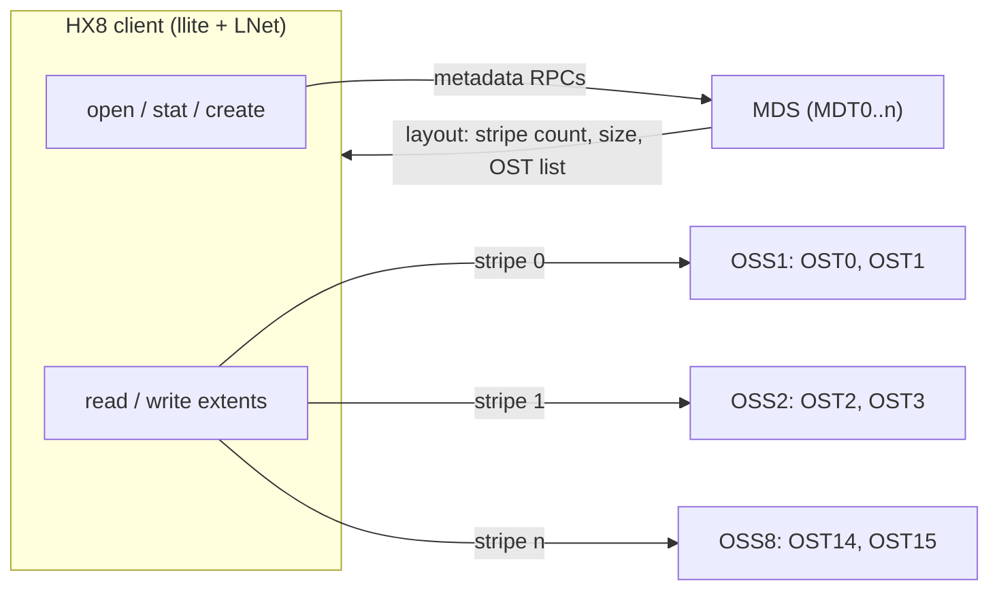

# Chapter 14 — Storage, Data Pipelines, and Checkpointing

> A 256-GPU training job reads its dataset continuously, writes a checkpoint of nearly a terabyte
> every few minutes, and — when something fails, which at scale is routine — must find, validate,
> and load the last good checkpoint before 256 accelerators can work again. Whether the input
> pipeline is bound by metadata operations or by bandwidth decides the file format and worker count.
> Whether checkpoints are synchronous or asynchronous, local or remote, decides how much accelerator
> time disappears into I/O and how much work each failure destroys. Whether checkpoints are committed
> atomically and validated before restore decides whether a restart resumes training or silently
> resumes from garbage. This chapter gives you the mechanisms, arithmetic, and operational checks for
> all three on the ORION reference cluster.

## Learning objectives

After this chapter you will be able to:

1. **Explain** the host↔storage data path on an HX8 node — GPU high-bandwidth memory (HBM),
   Peripheral Component Interconnect Express (PCIe), host memory, local Non-Volatile Memory Express
   (NVMe) drives, frontend network interface card (NIC), parallel file system — and identify which
   hop bounds a given workload.
2. **Calculate** NVMe throughput from queue depth and latency (Little's law), and checkpoint size,
   write time, overhead, and recovery point exposure for a stated model and storage bandwidth.
3. **Distinguish** a metadata-bound pipeline from a bandwidth-bound one using an I/O trace, and
   choose a data format and prefetch depth that removes the bottleneck.
4. **Design** a checkpoint strategy — synchronous, asynchronous, or multi-level — that balances
   overhead, storage capacity, restart time, and failure frequency, using the Young/Daly interval and
   a lost-accelerator-hours model.
5. **Describe** how PyTorch Distributed Checkpoint (DCP) and Megatron-LM structure sharded and
   asynchronous saves: staging buffers, consistency boundaries, and commit markers.
6. **Validate** a checkpoint before restore and select the latest valid one automatically.
7. **Diagnose** storage-induced training regressions with the diagnostic loop.
8. **Plan** a storage benchmark with warm-up, repetitions, percentiles, and an environment manifest.

## Prerequisites and connections

You need host topology and PCIe from Chapter 5
([GPU Interconnects and Host Topology](../../part-2-accelerated-compute/ch05-gpu-interconnects-host-topology/)),
Linux I/O observation tools from Chapter 3
([Linux, Host Systems, and Performance Diagnostics](../../part-1-foundations/ch03-linux-host-systems-diagnostics/)),
the frontend fabric from Chapter 7
([Ethernet and Data-Center Network Foundations](../../part-3-networking/ch07-ethernet-datacenter-network-foundations/)),
and W-TRAIN's tensor-, pipeline-, and data-parallel layout (TP = 8, PP = 4, DP = 8) from Chapter 11
([Distributed Training Architecture](../ch11-distributed-training-architecture/)). Chapter 13
([GPU-to-GPU and GPU-to-NIC Data Movement](../ch13-gpu-data-movement/)) covers the GPUDirect
mechanisms that GPUDirect Storage reuses.

This chapter is a prerequisite for Chapter 19
([Reliability, Security, and Multi-Tenancy](../../part-5-production-operations/ch19-reliability-security-multitenancy/)),
which builds failure isolation and coordinated restart on the checkpoint machinery here; Chapter 18
([Observability, SLOs, and Incident Response](../../part-5-production-operations/ch18-observability-slos-incident-response/)),
which turns the runbook signals at the end of this chapter into alerts; Chapter 21
([Capacity, Power, and Infrastructure Economics](../../part-5-production-operations/ch21-capacity-power-economics/)),
which prices lost accelerator-hours; and Chapter 15
([LLM Inference and Serving Infrastructure](../ch15-llm-inference-serving/)), where model-weight
loading is the storage problem of inference. Capstone G (training operations at 512 nodes) requires
the asynchronous
checkpoint and restore plan you build in the lab; Capstone A requires the storage sizing.

---

## 14.1 Why storage decides cluster goodput

An AI training cluster runs three storage workloads with completely different shapes, and a fourth
appears in inference:

| Workload | Direction | Shape | What bounds it | When it hurts |
|---|---|---|---|---|
| Dataset ingest | Read | Continuous; many readers; small to large objects | Metadata ops/s (small files) or bandwidth (shards) | Every step, if the loader cannot keep up |
| Checkpoint save | Write | Periodic burst; every rank writes at once | Aggregate write bandwidth, metadata creates, commit latency | At each checkpoint; overhead × frequency |
| Checkpoint restore | Read | Rare burst; every rank reads at once | Aggregate read bandwidth, read amplification | After every failure — on the critical path of recovery |
| Model-weight load (inference) | Read | Burst at replica start; few large files | Bandwidth per node, cold caches | Autoscaling and failover (Chapter 15) |

*Table 14.1 — The four storage workloads of an AI cluster `[ILLUSTRATIVE characterisation]`.*

These are very uneven. W-TRAIN on ORION-256 (`docs/REFERENCE_CLUSTER.md`) consumes
4,096 × 1,024 ≈ 4.19 M tokens in 17.4 s `[MODELED]`, i.e. 4.19e6 / 17.4 ≈ 241,000 tokens/s for the
whole cluster. Stored as 4-byte token IDs, that is 241,000 × 4 B ≈ 0.96 MB/s `[MODELED]` — less than
one thousandth of what a single NVMe drive can read. Text pretraining from pre-tokenized shards is
*not* a bandwidth problem. The same cluster training a vision model at 1,500 images/s per GPU
`[ILLUSTRATIVE]` with 110 KB JPEGs needs 256 × 1,500 = 384,000 images/s ≈ 42 GB/s — and, if every
image is its own file, 384,000 file opens per second, which no single metadata server delivers.

Meanwhile W-TRAIN's 980 GB checkpoint `[MODELED]`, written to ORION's parallel file system at
≈ 80 GB/s aggregate `[ILLUSTRATIVE]`, takes at least 980 / 80 = 12.25 s at perfect efficiency —
most of a 17.4 s step. If the GPUs wait for it, every checkpoint costs about one step of 256 GPUs.

> **Key idea:** For LLM pretraining, checkpoints and restarts — not dataset reads — dominate storage
> engineering. For multimodal training, the dataset pipeline can dominate, and it is usually
> metadata-bound before it is bandwidth-bound.

## 14.2 NVMe: queues, IOPS, bandwidth, and latency

### The mechanism

An NVMe drive is a PCIe endpoint driven through **queue pairs** in host memory: the driver places
64-byte commands in a *submission queue* and rings a *doorbell* register; the drive fetches them by
direct memory access (DMA), moves the data by DMA, posts a 16-byte entry to a *completion queue*,
and (unless the host polls) raises an MSI-X interrupt. The NVM Express Base Specification allows up
to 65,535 I/O queues of up to 65,536 entries; Linux's multi-queue block layer (blk-mq) maps roughly
one hardware queue per core so cores never contend on a submission lock.

Two numbers describe a drive — I/O operations per second (IOPS) and bandwidth — and they are linked
to latency by **Little's law**: the average number of
requests in flight equals throughput times latency.

```text
outstanding I/Os (queue depth, QD) = IOPS × mean latency
bandwidth                          = IOPS × I/O size
```

A drive answering a 4 KiB random read in 80 µs `[ILLUSTRATIVE]` delivers, at QD = 1,
1 / 80 µs = 12,500 IOPS × 4,096 B = 51 MB/s `[MODELED]`. The same drive at QD = 32, where the flash
channels work in parallel and latency only rises modestly, delivers about
32 / 78 µs ≈ 410,000 IOPS ≈ 1.68 GB/s `[MODELED; matches the lab's simulated fio run]`. Sequential
1 MiB writes at QD = 8 run at about 3.4 GB/s, and Little's law gives the latency you should expect:
8 / (3.4e9 / 1,048,576) ≈ 2.4 ms per request `[MODELED]`. If your fio output disagrees with Little's
law, your queue depth is not what you think it is (a common cause: `--ioengine=psync`, which is
synchronous and runs at QD = 1 regardless of `--iodepth`).

> **Pitfall:** A single synchronous reader thread (Python `f.read()` in a loop) runs at QD = 1. On
> NVMe that leaves over 95 % of the drive idle. Parallelism in the reader — more workers,
> asynchronous I/O, or larger requests — is what unlocks the hardware.

The link bounds bandwidth: PCIe Gen4 x4 carries 16 GT/s × 4 lanes × 128/130 ÷ 8 ≈ 7.9 GB/s per
direction; Gen5 x4 about 15.8 GB/s. ORION's eight 3.84 TB U.2 drives per node are assumed to be
Gen4-class with ≈ 3.5 GB/s sustained sequential write and ≈ 6 GB/s sequential read each
`[ILLUSTRATIVE]`, so a node striping across all eight (software RAID-0 or a file system that spreads
files) can write ≈ 28 GB/s and read ≈ 48 GB/s `[MODELED; these are the lab's planner inputs]`.

Sustained write rate also depends on drive state: a fresh drive writes into pre-erased blocks, a
full one must garbage-collect while writing. A 60 s write test on a new drive measures the
honeymoon; the SNIA performance test specification defines preconditioning for this reason.

### What you look at

```console
$ nvme list
Node          Model                    Namespace  Usage                 Format       FW Rev
/dev/nvme0n1  <vendor U.2 3.84TB>      1          3.84 TB / 3.84 TB     512 B + 0 B  <fw>
...
$ sudo nvme smart-log /dev/nvme5 | grep -Ei 'temperature|media_errors|percentage_used|critical'
critical_warning                        : 0
temperature                             : 41 C
percentage_used                         : 3%
media_errors                            : 0
$ iostat -xm 1 nvme0n1
Device   r/s      rMB/s   r_await  w/s    wMB/s   w_await  aqu-sz  %util
nvme0n1  410233   1602.5  0.078    0.00   0.00    0.00     31.9    100.0
```

*Listing 14.1 — NVMe inventory, health, and live queue statistics `[ILLUSTRATIVE output, abridged]`.*

Read `aqu-sz` (average queue size) against `r_await` and `r/s`: 410,233 × 0.078 ms ≈ 32 — Little's
law again. `%util` is meaningless for NVMe (it reports the fraction of time *any* request was
outstanding, so a drive at QD = 1 shows 100 % while delivering a few percent of its capability); judge
saturation by latency rising at constant throughput instead.

## 14.3 The host↔storage data path

Every byte a training job reads or writes crosses a chain of hops, and each has a different limit.
Figure 14.1 shows the HX8 node and ORION storage.

```text
   GPU0 HBM (80 GB)                                                    ORION storage (8 servers)
      │ PCIe Gen5 x16 (~50 GB/s achievable per direction)           ┌──────────────────────────┐
      ▼                                                             │ storage server s (×8)    │
   PCIe SW0 ──(GPUDirect Storage path, if enabled; see note)──┐     │  NIC(s) 2×200G (assumed) │
      │                                                        │     │  memory / cache          │
      ▼                                                        │     │  NVMe or HDD targets     │
   Socket 0 root complex ──── DDR5 host memory (1 TiB/socket)  │     │  (OST/NSD-class)         │
      │       ▲   page cache, pinned staging buffers           │     └────────────▲─────────────┘
      │       │   (checkpoint snapshot lands here)             │                  │
      ├── NVMe0–3 (local, ~3.5 GB/s write each) ◄──────────────┘                  │
      │      dataset cache / checkpoint staging                                   │
      ▼                                                                           │
   FE-NIC0 200 Gb/s (25 GB/s line rate) ── frontend leaf pair ── frontend spines (1.5:1 bw) ── storage leaves
   (Socket 1 mirrors this: GPU4–7, NVMe4–7, FE-NIC1)
```

*Figure 14.1 — Host↔storage data path on an HX8 node. Training reads and checkpoint writes cross
GPU↔PCIe↔host memory↔frontend NIC↔frontend fabric↔storage server; local NVMe hangs off the CPU
root ports, not the GPU PCIe switches. Bandwidths are `[ILLUSTRATIVE]` or as stated in
`docs/REFERENCE_CLUSTER.md`.*

Walk a checkpoint shard through it, using ORION numbers:

1. **GPU → host memory.** Device-to-host copy over PCIe into a *pinned* (page-locked) buffer:
   ~50 GB/s per GPU alone, ~25 GB/s per GPU with all eight copying `[ILLUSTRATIVE]`. Pageable
   destinations are slower (the driver bounces through its own pinned buffer).
2. **Host memory → frontend NIC.** The file-system client sends 2 × 200 Gb/s = 50 GB/s line rate.
3. **Frontend fabric.** Dual-homed to a leaf pair; 3:1 by port count but 1.5:1 by bandwidth
   (200G host ports, 400G uplinks): 32 × 400 Gb/s ÷ 1.5 ≈ 8.5 Tb/s ≈ 1,067 GB/s of spine capacity
   `[MODELED]` (design ratio; 1:1 as populated on ORION-256, ≈ 1,600 GB/s).
4. **Storage servers.** ≈ 80 GB/s aggregate write, ≈ 160 GB/s aggregate read `[ILLUSTRATIVE]`
   across 8 servers, i.e. ≈ 10 GB/s write per server.

For a full-cluster checkpoint the storage servers bind: nodes can inject 32 × 50 = 1,600 GB/s,
the spines carry ~1,067 GB/s, the servers absorb 80 GB/s. A single node restoring alone is bound by its
own NICs or client software. Knowing which hop binds tells you what to measure and what to buy.

> **Vendor implementation note (NVIDIA GPUDirect Storage) `[VENDOR-SPEC, 2026-10; verify the
> supported file systems and tools for your CUDA release]`:** GPUDirect Storage (GDS) lets local NVMe
> or an RDMA NIC used by a supported file-system client move data directly between GPU memory and
> storage, skipping the host bounce buffer. Applications use the cuFile API; the GDS tools include
> `gdscheck` to report supported paths. On HX8, local NVMe hangs off the CPU root ports, so
> GPU↔NVMe peer-to-peer crosses the root complex (PHB-class in `nvidia-smi topo -m` terms; Chapter 5)
> and may not beat a well-pipelined bounce through host memory. Measure before you assume.

## 14.4 Parallel file systems and object storage

### Parallel file systems

A **parallel file system** (PFS) separates *metadata* (names, directories, permissions, file
layouts) from *data* (the bytes), and spreads data across many storage servers so that one file or
many files can be read in parallel. The canonical open-source example is **Lustre**:

- **Metadata servers (MDS)** host *metadata targets* (MDTs). An `open()` or `stat()` goes to an
  MDS; with the Distributed Namespace (DNE) feature, directories can be spread over several MDTs.
- **Object storage servers (OSS)** host *object storage targets* (OSTs). A file is striped across
  one or more OSTs: the *stripe count* says how many, the *stripe size* how many bytes go to one OST
  before moving to the next.
- **Clients** obtain a file's layout from the MDS once, at open, then talk to the OSTs directly —
  so data bandwidth scales with OSTs while metadata rate scales with MDTs.



*Figure 14.2 — Parallel-file-system request flow (Lustre terminology). Metadata and data take
different paths; small-file workloads load the left path, large sequential workloads the right.*

```console
$ lfs getstripe -d /pfs/ckpt/w-train
stripe_count:  1 stripe_size:   1048576 pattern:       raid0 stripe_offset: -1
$ lfs setstripe -c 8 -S 16M /pfs/ckpt/w-train-v2     # new files in this directory: 8 OSTs, 16 MiB units
$ lfs df -h /pfs | head -4
UUID                       bytes        Used   Available Use% Mounted on
orion-MDT0000_UUID         3.5T       410.2G       2.9T  12% /pfs[MDT:0]
orion-OST0000_UUID        58.2T        31.6T      26.0T  55% /pfs[OST:0]
```

*Listing 14.2 — Inspecting and setting Lustre striping `[ILLUSTRATIVE output]`. Striping applies to
files created after the change; existing files keep their layout.*

Striping is a trade-off. A 30 GB file with stripe count 1 gets one OST's bandwidth; with 8 it can
use eight. But when 256 ranks each write their own file, file count already spreads load across OSTs
and wide striping mostly multiplies objects and lock traffic. A practical rule `[ILLUSTRATIVE]`: few
large shared files → wide striping; many per-rank files → stripe count 1–4. Lustre's Progressive File
Layouts widen a file as it grows, and Data-on-MDT keeps small files' first bytes on the MDT, saving
an OST round trip.

> **Vendor implementation note `[VENDOR-SPEC, 2026-10]`:** IBM Storage Scale (GPFS) distributes
> metadata with token-based locking; WEKA is NVMe-native with its own client; DDN EXAScaler is
> Lustre-based; VAST Data serves NFS (including over RDMA). Verify any vendor figure on your workload.

### Object storage

Object stores (Amazon S3 and S3-compatible systems) trade POSIX semantics for scale and cost: flat
key namespaces, whole-object PUT/GET over HTTP, no in-place update, and **no atomic rename**.
Throughput comes from many parallel connections and multipart transfers, and Amazon documents
request-rate guidance per key prefix (3,500 writes and 5,500 reads per second per prefix, reached by
gradual automatic scaling; bursts beyond it return HTTP 503 SlowDown) `[VENDOR-SPEC, 2026-10]`, so
key naming and client back-off matter. S3 is strongly read-after-write consistent (since 2020) and
supports conditional writes (`If-None-Match`, 2024), which make "create only if absent" commits safe;
S3 Express One Zone directory buckets added a `RenameObject` operation in 2025. S3-compatible
systems vary.

Object storage holds the *dataset of record* and the *checkpoint archive*; the PFS or local NVMe
is the hot tier. Without a directory rename, the portable commit pattern is **manifest last**: upload
every shard, then a manifest listing sizes and checksums; a checkpoint exists only if its manifest
exists and validates (Section 14.10).

## 14.5 Metadata-bound versus bandwidth-bound pipelines

We make this comparison quantitatively with the lab's trace (`lab/data/io_trace.csv`,
`[SIMULATED]`, 8 loader workers on one HX8 node).

**Pipeline 1 — one file per sample.** Each sample costs an `open` (median 5.0 ms, mean 5.7 ms, p99
15.5 ms: the metadata service is busy), a 64–256 KiB `read` (≈ 0.5 ms), and a `close` (0.2 ms):
≈ 6.4 ms per sample, so one synchronous worker completes ≈ 157 samples/s and eight ≈ 1,250
samples/s ≈ 0.2 GB/s `[SIMULATED; lab windows 0–5 show ≈ 1,210 samples/s and 0.20 GB/s]`. Metadata
operations take 89 % of the workers' I/O time.

**Pipeline 2 — 256 MiB shards read in 16 MiB requests.** One `open` per 16 reads; median read
≈ 12 ms on healthy targets, mean ≈ 17 ms including slow target 5 (Section 14.6). Eight workers
deliver 8 × 16.8 MB / 17.6 ms (read + amortised open) ≈ 7.6 GB/s per node `[SIMULATED]`; metadata
is 2 % of I/O time. Same node, same storage, 38× the bandwidth.

| Property | Metadata-bound (small files) | Bandwidth-bound (shards) |
|---|---|---|
| Dominant op | `open`/`stat`/`close` | large `read` |
| Throughput per node (lab) | 0.20 GB/s, ~1,200 samples/s | 7.6 GB/s |
| Scales with | MDS/MDT count, client metadata caching, concurrency | OST/server count, NIC bandwidth, request size |
| Symptom on storage | MDS CPU/ops high; OSTs idle | OST throughput high; MDS idle |
| Mean request size | < 1 MiB | ≥ 1 MiB |
| Fix | Pack samples into shards; cache file lists; raise concurrency | More stripes/servers; larger requests; local NVMe cache |

*Table 14.2 — Metadata-bound versus bandwidth-bound pipelines `[SIMULATED values from the lab
trace]`.*

The lab's classification rule is what a senior engineer does by eye: per window, if metadata
operations take ≥ 50 % of I/O time, the window is metadata-bound; if mean read size is ≥ 1 MiB and
metadata < 20 %, bandwidth-bound; otherwise mixed. Then check scaling. To reach the vision workload's
12,000 samples/s per node, Pipeline 1 needs 12,000 × 6.4 ms ≈ 77 requests in flight per node — ten
times the workers — *and* 32 × 12,000 = 384,000 opens/s cluster-wide. Pipeline 2 needs
12,000 × 110 KB ≈ 1.3 GB/s per node, about a sixth of what it already delivers.

> **Pitfall:** Adding loader workers to a metadata-bound pipeline helps until the metadata service
> saturates, then hurts every job on the file system. A pipeline's open rate is a capacity number to
> agree with the storage team.

## 14.6 Measuring storage: fio, throughput, and tail latency

### Throughput is an average; jobs feel the tail

A data-parallel training step cannot finish until every rank has its batch, and a collective
checkpoint is not complete until the slowest shard is durable. Both are *max-of-N* operations, so
per-request tail latency becomes per-step median latency. If each of 256 ranks issues one read per
step and each read independently has a 1 % chance of exceeding its p99, the probability that *no*
rank sees a p99 event is 0.99^256 ≈ 0.076 `[MODELED]`: 92 % of steps are paced by somebody's p99.
Even p99.9 events touch 1 − 0.999^256 ≈ 23 % of steps. This is the "tail at scale" effect described
by Dean and Barroso, and it is why storage acceptance for AI clusters is judged on p99 and p99.9,
not on mean throughput.

The same logic explains why one slow storage target hurts far more than its share of capacity. In
the lab trace, target 5 answers reads four times slower than its peers `[SIMULATED]`. It holds only
1/8 of the data, but every 256 MiB shard is striped over all eight targets, so *every* shard read
waits on target 5 at some point, and every window's p99 is set by it.

### fio, used properly

`fio` (Flexible I/O Tester) is the standard tool for synthetic storage measurement. A defensible
fio run states the I/O pattern, block size, queue depth, engine, whether the page cache is bypassed,
warm-up, duration, and repetition count:

```bash
# L2, read-only, on a lab host: 4 KiB random read at QD 32, page cache bypassed, 10 s ramp, 60 s run
sudo fio --name=randread-4k-qd32 --filename=/dev/nvme0n1 --readonly --rw=randread --bs=4k \
    --iodepth=32 --ioengine=libaio --direct=1 --ramp_time=10 --runtime=60 --time_based \
    --output-format=json --output=nvme0-randread.json
```

fio's JSON output gives, per job and direction, `iops`, `bw_bytes` (bytes/s), and a `clat_ns`
(completion latency) block with `mean` and a `percentile` map keyed by strings such as
`"99.900000"`; the lab's `parse_fio` reads exactly these. Four rules turn a number into a measurement:

1. **Control the cache.** Without `--direct=1`, a read test of a file smaller than RAM measures the
   page cache.
2. **Warm up and precondition.** `--ramp_time` discards the start of each run; solid-state write
   tests need preconditioning (Section 14.2).
3. **Repeat and report spread.** ≥ 5 runs; median and p95 with min/max (`docs/LAB_STANDARDS.md` §5).
4. **Check Little's law.** IOPS × mean latency must equal the intended queue depth; if not, the
   queue depth or engine is not what you think.

| Pattern | Typical use in AI clusters | What it validates |
|---|---|---|
| 4 KiB random read, QD 1 and QD 32 | Small-file datasets, metadata-heavy access | Latency floor; parallelism headroom |
| 1 MiB sequential read, QD 8–32, many jobs | Shard streaming, checkpoint restore | Per-node and aggregate read bandwidth |
| 1 MiB sequential write, QD 8–32, many jobs | Checkpoint save | Write bandwidth, steady-state behaviour |
| Sequential write + random read together | Checkpoint during training | Interference; read tail under write load |
| File create/stat/unlink rate (`mdtest`, from the IOR suite) | Small-file datasets, per-tensor checkpoints | Metadata service capacity |

*Table 14.3 — A storage benchmark plan for an AI cluster `[ILLUSTRATIVE]`.*

The lab's simulated acceptance run shows two anomalies you will meet in real fleets. `nvme2`
writes at 1.62 GB/s against a fleet median of ~3.4 GB/s while its random reads are normal — look at
the negotiated PCIe link (`lspci -vv` `LnkSta` versus `LnkCap`), temperature, and wear. `nvme5` has a
normal mean (+12 %) and a normal p99, but a p99.9 of 9.1 ms against a fleet median of ~0.26 ms —
a tail-only fault (firmware housekeeping or media retries) that a mean-throughput acceptance test
passes and a training job feels `[SIMULATED]`.

> **Safety:** fio write tests on a raw device destroy its contents, and load tests on a shared PFS
> degrade every tenant. Use a scratch file on a dedicated lab host, or agree a window with Storage.

## 14.7 Data loader design: formats, prefetch, staging, and caching

A data loader is a pipeline (list → open → read → decode → augment → collate → host-to-device
copy) that keeps the GPU fed only if, by Little's law, enough samples are in flight to cover the
slowest stage's latency at the required rate.

**Sharded formats.** Pack many samples into large sequential containers so that one `open`
amortises over thousands of samples and reads are large: WebDataset (POSIX tar shards), MosaicML
Streaming (MDS shards), TFRecord, Parquet/Arrow, or — for pre-tokenized LLM data — Megatron-LM's
indexed binary datasets (a `.bin` token file plus an `.idx` index, memory-mapped). Shard sizes of
hundreds of MiB to a few GiB `[ILLUSTRATIVE]` keep the open rate trivial and requests large.

**Shuffling without random reads.** Shuffle shard order per epoch, then samples inside a bounded
in-memory buffer — a little randomness traded for sequential I/O. Record shard order, position, and
seed in the checkpoint, or a restart replays or skips data.

**Prefetch.** In PyTorch's `DataLoader`, `num_workers` sets the number of worker processes,
`prefetch_factor` the batches each worker loads ahead, `pin_memory` copies batches into pinned host
memory so the host-to-device copy can be asynchronous, and `persistent_workers` keeps workers alive
across epochs. Size prefetch with Little's law: required in-flight samples = rate × latency at the
percentile you want to absorb. For 1,500 samples/s per GPU and a 60 ms p99 shard-read latency,
each GPU needs ≥ 1,500 × 0.060 = 90 samples in flight beyond what decoding holds `[MODELED]`.

**Staging and caching.** Three tiers are common: object store (dataset of record), PFS (shared
hot copy), local NVMe (per-node cache). *Staging* copies the dataset to local NVMe before the job;
*caching* fills it on first access, so epoch 1 is cold and later epochs are local. ORION's 30.7 TB
raw per node holds a few terabytes of cache beside checkpoint staging. A working set larger than the
cache, with poor eviction, thrashes and can read *more* from the PFS than no cache at all.

> **Production note:** Instrument the loader, not just storage: record time blocked in
> `next(iterator)` per step on every rank. "Data wait" rising on a few ranks points at their nodes
> (CPU contention, NUMA placement — Chapter 3); on all ranks, at shared storage. Mohan et al. (2021)
> found such data stalls common and built their tooling around this measurement.

## 14.8 Anatomy of a distributed checkpoint

A training checkpoint is everything needed to continue *as if nothing happened*.

| Component | W-TRAIN size | Notes |
|---|---|---|
| Model weights (BF16, 2 B/param) | 140 GB | Needed for inference export too |
| FP32 master weights (4 B/param) | 280 GB | Mixed-precision optimizer copy |
| Adam first moment *m* (4 B/param) | 280 GB | |
| Adam second moment *v* (4 B/param) | 280 GB | |
| **Total (14 B/param)** | **980 GB** | Gradients (2 B/param) are *not* saved: they are recomputed |
| Step counter, learning-rate scheduler, loss scaler, random-number-generator states (per rank) | KB–MB | Small, but a resume without them is not equivalent |
| Data-loader position (shard order, offsets, shuffle seed) | KB–MB | Without it, data is replayed or skipped |

*Table 14.4 — W-TRAIN checkpoint contents `[MODELED; 70 × 10⁹ params × bytes per param]`.*

**Sharding.** With TP = 8 and PP = 4, each of the 32 model-parallel positions owns 1/32 of the
weights: 140 GB / 32 = 4.375 GB of BF16 weights. Those weights are replicated across the 8
data-parallel (DP) replicas. If the optimizer state is also sharded across DP (a *distributed
optimizer*, ZeRO-1-style; Chapter 11), each of the 256 ranks owns 840 GB / 256 = 3.28 GB of
optimizer state, and the replicated weights can be split across the DP ranks for writing:
4.375 / 8 = 0.547 GB each. Every rank then writes 3.28 + 0.547 ≈ 3.83 GB, which is
980 GB / 256 `[MODELED]` — perfectly balanced, 30.6 GB per node.

Without DP-sharded state, only one DP replica writes (32 writers × 30.6 GB each), and per-writer
stream limits — one process, one file, one client connection — can bind before the storage does.
The opposite failure appears at restore: if every DP replica independently reads the weights it
needs, the 140 GB weight set is read 8 times — a **read amplification** that adds
7 × 140 = 980 GB of reads, doubling restore time. Good checkpoint libraries read disjoint pieces
and exchange them over the backend fabric, or read once and broadcast.

**Resharding.** A checkpoint saved at one layout (TP = 8, PP = 4, DP = 8) may need to be loaded at
another — fewer nodes after a failure, or a different layout for fine-tuning. That requires a
checkpoint format that records *global* tensor shapes and which chunk each file holds, not
"rank 17's tensors."

## 14.9 Synchronous and asynchronous checkpointing

A **synchronous** checkpoint stops training, writes every shard to durable storage, commits, and
resumes. Its cost is its whole duration. An **asynchronous** checkpoint splits the work:

1. **Snapshot (blocking).** At a step boundary, copy the state to a *staging buffer* — pinned host
   memory, or spare GPU memory — so that training can mutate the live tensors again. Cost: the
   device-to-host copy plus coordination.
2. **Persist (background).** Background threads or processes write the staged data to storage,
   then the coordinator writes metadata and the commit marker. Training continues meanwhile.
3. **Complete.** The checkpoint becomes usable only when its commit is durable.

```mermaid
sequenceDiagram
    participant T as Trainer (rank r)
    participant G as GPU HBM
    participant H as Pinned host buffer
    participant W as Background writer
    participant S as PFS or object store
    participant C as Coordinator (rank 0)
    T->>G: optimizer step N completes
    T->>H: snapshot: device-to-host copy of rank r's 3.83 GB (blocking, ~0.65 s incl. planning)
    T->>G: step N+1 forward/backward (training resumes)
    H->>W: hand off staged buffers
    W->>S: write shard files (~16 s for the whole cluster at 60 GB/s effective)
    W->>C: rank r done (gather of write results)
    C->>S: write global metadata / manifest, fsync
    C->>S: write COMMIT marker (temp file + atomic rename), fsync directory
    C-->>T: checkpoint N complete; staging buffer reusable
```

*Figure 14.3 — Asynchronous checkpoint sequence. Only the snapshot is on the training critical
path; the checkpoint is not recoverable until the commit marker is durable.*

Asynchronous checkpointing is not free, and its costs are where the engineering is:

- **Staging memory.** Each HX8 node pins its 30.6 GB share: 1.4 % of 2 TiB (2,199 GB), but
  unswappable, and double-buffering doubles it. GPU-side staging takes those bytes from HBM.
- **Interference.** The background persist shares PCIe, memory bandwidth, CPU cycles, and the
  frontend NICs with the data loader and the training process. The lab models this as a 3 %
  step-time slowdown while a persist runs `[ILLUSTRATIVE]`; the lab's I/O trace shows the read-side
  view — between 13 and 17 s, the p99 of 16 MiB reads rises from ~60 ms to ~200–240 ms and loader
  throughput falls from 7.6 to ~3 GB/s while a checkpoint burst hits the shared PFS `[SIMULATED]`.
  Python background threads also contend for the interpreter lock, which is why some
  implementations persist from a separate process.
- **One in flight.** If N+1 is due while N persists, the system blocks (stalls return) or skips
  (RPO silently stretches). Both must be visible in metrics.
- **Completion latency.** Recovery uses the last *completed* checkpoint, so an 18 s persist adds
  18 s of expected lost work to every failure (Section 14.11).

> **Vendor implementation note (PyTorch Distributed Checkpoint) `[VENDOR-SPEC, 2026-10; verify
> against the documentation for your PyTorch version]`:** `torch.distributed.checkpoint` (DCP)
> saves a *sharded* state dict collectively: with `dcp.save(state_dict, checkpoint_id=...)` every
> rank writes its own data (per-rank `*.distcp` files with the default file-system writer) and a
> coordinator, after all ranks finish, writes a global `.metadata` file recording each tensor's
> global shape and chunk locations. That `.metadata` write *is* DCP's commit point — there is no
> separate commit marker, and a directory without `.metadata` is incomplete. `dcp.load(...)` loads
> *in place* into a constructed state dict, resharding if layouts differ. `dcp.async_save(...)`
> stages to CPU memory and returns a future that completes when the persist does. Staging options
> and thread-versus-process execution have changed across 2.x releases.

> **Vendor implementation note (Megatron-LM / Megatron-Core) `[VENDOR-SPEC, 2026-10; verify against
> the release you run]`:** Megatron-Core's `dist_checkpointing` saves *sharded state dicts* (tensors
> annotated with global shape and offset), loadable under a different TP/PP layout; its `torch_dist`
> format builds on DCP. Recent releases offer asynchronous save (`--async-save`, requiring the
> distributed checkpoint format: snapshot to host memory, finalise in the background) and a fully
> parallel save that spreads replicated tensors across DP ranks — Section 14.8's balanced layout.

## 14.10 Consistency boundaries, atomic commit, and restore validation

### The consistency boundary

A checkpoint must be a **consistent cut**: every rank's state from the same step, after the
optimizer step and before the next one modifies anything. A collective save at a step boundary
guarantees this across ranks. Within a rank, asynchronous saving adds a hazard: if the snapshot is
still copying when step N+1's optimizer updates parameters in place, the checkpoint holds a *torn*
tensor that loads cleanly and trains subtly wrong — so implementations finish the device-to-host
copy (or a device-side clone) before returning control. Loader position, random-number-generator
state, and scheduler must be captured at the same boundary.

### Atomic commit and metadata durability

The commit protocol makes a checkpoint visible all at once, or not at all:

1. Every rank writes its shard files into the checkpoint directory and `fsync`s them.
2. A barrier confirms that every rank succeeded; any failure aborts the checkpoint.
3. The coordinator writes the manifest listing every shard with its size and checksum, and `fsync`s
   it. (In DCP, this `.metadata` write is the commit itself; steps 4–5 are added by your own tooling.)
4. The coordinator writes the commit marker under a temporary name, `fsync`s it, `rename`s it into
   place (POSIX `rename` is atomic within one file system), and `fsync`s the *directory* so that the
   new name itself is durable.
5. Only then does anything advance a `latest` pointer — ideally after validation (below).

On object storage there is no rename: the manifest written last *is* the commit, and readers must
treat a prefix without a valid manifest as nonexistent. Retention must respect the protocol:
deleting checkpoint N−3 while N is still persisting can leave you with no restorable checkpoint.

```mermaid
stateDiagram-v2
    [*] --> Staging: step boundary, snapshot begins
    Staging --> Persisting: snapshot done (training resumes)
    Persisting --> Committed: shards fsynced, manifest and COMMIT durable
    Persisting --> Aborted: rank failure, ENOSPC, or timeout
    Committed --> Validated: manifest hash, shard set, sizes, checksums OK
    Committed --> Quarantined: validation fails
    Validated --> Retained: restore candidate; latest pointer may advance
    Retained --> Archived: copied to object store
    Retained --> Deleted: N newer validated checkpoints exist
    Aborted --> Deleted
    Quarantined --> Deleted: after investigation
```



*Figure 14.4 — Checkpoint lifecycle state machine. Only validated, retained checkpoints are restore
candidates; retention counts validated checkpoints, never directories.*

### Restore validation

Before a restart controller loads a checkpoint, it checks, in increasing order of cost:

| Check | Catches | Cost |
|---|---|---|
| Commit marker present | Persist in flight at crash (torn checkpoint) | One `stat` |
| Manifest parses; commit content = hash of the manifest bytes | Manifest edited or partially rewritten after commit | Read one small file |
| Shard set covers ranks 0..world_size−1 | Missing rank, wrong world size | Manifest only |
| Every shard exists with the recorded size | Writer died mid-file, ENOSPC, missing file | One `stat` per shard |
| Every shard's checksum matches | Silent corruption, bit flips, bad copies | Read every byte: 980 GB at 120 GB/s effective ≈ 8.2 s on ORION `[MODELED]` |
| Semantic check: load, run one fixed batch, compare the loss with the value recorded at save | Wrong optimizer state, dtype or layout mismatch, a "valid" checkpoint of the wrong run | One forward pass |

*Table 14.5 — Restore validation ladder.*

Checksums can be verified *while* loading, so the full read is paid once. The lab's validator
implements the first five checks; its store's `latest` pointer names an uncommitted checkpoint — the
classic way a restart loads a torn one.

> **Pitfall:** "Keep the last three checkpoints" sounds safe. In the lab's store, the last three
> directories are all invalid; a count-based retention policy would have deleted both valid
> checkpoints. Retain *validated* checkpoints, and alert when the newest validated checkpoint is
> older than the RPO target.

## 14.11 Recovery economics: RPO, RTO, and lost accelerator-hours

### The measures

| Measure | Definition | Why it matters |
|---|---|---|
| Checkpoint overhead | Training time lost per checkpoint (δ) ÷ interval between checkpoints (τ), as a % | The "insurance premium" paid continuously |
| Checkpoint completion latency (L) | Snapshot start → commit marker durable | Exposure added to every failure |
| Recovery point objective (RPO) | Maximum training progress you accept losing; achieved worst case = τ + L | Policy target; alert when newest validated checkpoint is older |
| Recovery time objective (RTO) | Maximum accepted time from failure to training progressing again | Policy target for the restart path |
| Time-to-resume | *Measured* failure → first completed step after restart: detect + (replace) + relaunch + validate + load + warm-up | The RTO's evidence |
| Lost accelerator-hours | GPUs × (checkpoint overhead time + recomputed work + time-to-resume) | The single currency that makes all choices comparable |

*Table 14.6 — Checkpoint and recovery measures.*

For a checkpoint every τ seconds of training, with completion latency L ≤ τ, a failure at a uniformly
random moment loses on average τ/2 + L of work: τ/2 because it falls midway on average, plus L
because a failure during the persist window must fall back to the *previous* checkpoint (probability
L/τ, cost τ extra: τ × L/τ = L).

### The optimal interval (Young and Daly)

Ignoring restart time, which does not depend on τ, the fraction of time wasted is

```text
W(τ) = δ/τ  +  (τ/2)/M          (checkpoint overhead + expected recomputation per unit time)
dW/dτ = −δ/τ² + 1/(2M) = 0   →   τ* = √(2 δ M)                     (Young, 1974)
```

where M is the job's mean time between interruptions. At the optimum the two terms are equal, each
√(δ / 2M). Daly (2006) derived a higher-order estimate that also accounts for restart and for
failures during checkpointing:

```text
τ* = √(2 δ M) · [1 + ⅓·√(δ/2M) + (1/9)·(δ/2M)] − δ        for δ < 2M   (else τ* = M)
```

For δ ≪ M the two agree within about 1 %; the practical refinements matter more: round τ to whole
training steps, and never schedule the next asynchronous checkpoint before the previous one can
complete (τ ≥ L).

### How often do jobs fail?

Failure rate scales with component count. The book's canonical planning assumption
(`docs/REFERENCE_CLUSTER.md`) is one job-interrupting failure per HX8 node every ≈ 1,536 node-hours
`[ILLUSTRATIVE]`, so a 32-node (256-GPU) synchronous job has M ≈ 1,536 / 32 = **48 h** and a
512-node ORION-XL job M ≈ **3 h** — deliberately conservative. Meta's Llama 3 report (Dubey et al.,
2024) describes 419 unexpected interruptions in 54 days on up to 16,384 H100 GPUs (~78 % attributed
to hardware): 4.7 × 10⁻⁴ per GPU-day, which scaled linearly gives ORION-256 M ≈ 198 h `[derived from
a published operator report]`. Exercise 14.10 redoes the analysis at 198 h.

Failures also differ in what they leave behind. A **soft** failure (process crash, software-caused
collective timeout, transient link flap) leaves every node and its local NVMe usable. A **hard**
failure removes a node (GPU fallen off the bus, uncorrectable memory error needing diagnostics, dead
power supply); only copies *off* that node help. Chapter 19 covers classification and containment;
Halcyon assumes 40 % of failures are hard `[ILLUSTRATIVE]`.

### Multi-level checkpointing

Local NVMe and host memory are an order of magnitude faster than shared storage but do not survive
the loss of their node, so production systems combine levels. The Scalable Checkpoint/Restart (SCR)
library (Moody et al., 2010) formalised this for high-performance computing (HPC): frequent
node-local checkpoints, periodic copies to a *partner* node or erasure-coded group, rarer copies
to the PFS. Gemini (Wang et al., 2023) checkpoints large-model training into peer machines' CPU
memory; CheckFreq (Mohan et al., 2021) pipelines snapshot and persist and tunes frequency online.
All trade complexity for smaller δ
and RPO — and all are only as good as the restore path.

## 14.12 Worked example: checkpointing W-TRAIN on ORION

**Problem.** Choose a checkpoint strategy and interval for W-TRAIN on ORION-256, comparing the
shared PFS (≈ 80 GB/s aggregate write) with local NVMe staging. Quantify overhead, completion
latency, RPO, time-to-resume, and lost GPU-hours per day. All values are `[MODELED]` from
`lab/data/orion_ckpt_inputs.yaml`, whose inputs are `[ILLUSTRATIVE]`; the lab's planner reproduces
every number below.

**Step 1 — Size and distribution.**
S = 70 × 10⁹ params × 14 B/param = 9.8 × 10¹¹ B = **980 GB**. With the balanced layout of Section
14.8: per rank 980 / 256 = **3.83 GB**; per node 980 / 32 = **30.6 GB**.

**Step 2 — Effective PFS bandwidth.** 256 simultaneous writers do not get the full 80 GB/s: the
slowest target sets the finish (Section 14.6) and lock and metadata traffic take a share. Assume
75 %: B_w = 80 × 0.75 = **60 GB/s**; for restore B_r = 160 × 0.75 = **120 GB/s**. Replace this
assumption with a measurement first (lab L3 extension).

**Step 3 — Synchronous save to the PFS.**
T_pfs_w = 980 GB / 60 GB/s = 16.33 s; plus barrier, metadata, and commit c = 1.5 s:
δ_sync = 16.33 + 1.5 = **17.83 s**, about one 17.4 s training step of all 256 GPUs.

**Step 4 — Asynchronous save to the PFS.** Snapshot: 3.83 GB / 25 GB/s per GPU = 0.153 s, plus
0.5 s of save planning and coordination: blocking = **0.653 s**. Persist: 16.33 + 1.5 = 17.83 s, so
completion latency L = 0.653 + 17.83 = **18.49 s**. With a 3 % slowdown while persisting, the
effective cost is δ_async = 0.653 + 0.03 × 17.83 = 0.653 + 0.535 = **1.19 s**.

**Step 5 — Local NVMe staging.** Each node writes 30.6 GB across its eight drives at 28 GB/s:
T_loc_w = 30.6 / 28 = **1.09 s**; reading it back at 48 GB/s takes **0.64 s**.
- *Synchronous local, background drain to the PFS:* blocking = 1.09 + 1.5 = 2.59 s; the drain
  re-reads local NVMe and writes 16.33 s to the PFS, costing 0.03 × 16.33 = 0.49 s of interference:
  δ = **3.08 s**. Local completion 2.59 s; PFS completion 2.59 + 17.83 = 20.43 s.
- *Asynchronous two-level (snapshot → local every checkpoint, PFS every k = 5):*
  δ = 0.653 + 0.03 × (1.09 + 16.33 / 5) = 0.653 + 0.03 × 4.36 = **0.78 s**. Local completion
  0.653 + 1.09 + 1.5 = 3.25 s; PFS copy completion 3.25 + 17.83 = 21.08 s.

**Step 6 — Intervals.** M = 48 h = 172,800 s. Young, then round up to whole 17.4 s steps:

| Strategy | √(2 δ M) | Steps (rounded up) | τ |
|---|---|---|---|
| sync PFS | √(2 × 17.83 × 172,800) = 2,483 s | 142.7 → 143 | 2,488.2 s |
| async PFS | √(2 × 1.188 × 172,800) = 641 s | 36.8 → 37 | 643.8 s |
| sync local + drain | √(2 × 3.084 × 172,800) = 1,032 s | 59.3 → 60 | 1,044.0 s |
| async two-level | √(2 × 0.784 × 172,800) = 521 s | 29.9 → 30 | 522.0 s |

*Table 14.7 — Checkpoint intervals `[MODELED]`. Daly's formula gives 2,471 s for the synchronous
case, 0.5 % shorter; rounding to steps matters more.*

**Step 7 — Time-to-resume.** Components `[ILLUSTRATIVE]`, consistent with the canonical ≈ 15 min
restart overhead: detect 300 s, relaunch (reschedule, containers, rendezvous, NCCL initialisation)
330 s, validate 20 s, warm-up 150 s; plus load; for hard failures, plus 240 s to swap in a node
from a small spare pool that Halcyon keeps *outside* ORION-256 — a deliberate variation from the
reference cluster, which has no spares. Without it, wait for repair or restart at DP = 7 (224 GPUs,
−12.5 %); 1,024 sequences are not divisible by 7, so global batch or learning rate must change.
Load from the PFS: 980 / 120 = 8.17 s; from local NVMe: 30.6 / 48 = 0.64 s. For the PFS strategies:
soft 300 + 330 + 20 + 150 + 8.17 = 808.2 s; hard 808.2 + 240 = 1,048.2 s; expected with 40 % hard:
0.6 × 808.2 + 0.4 × 1,048.2 = **904.2 s ≈ 15 min**. Local loading saves only 7.5 s per soft failure.

**Step 8 — Lost GPU-hours per day.** Take asynchronous PFS:
- Checkpoint cost: 86,400 / 643.8 = 134.2 checkpoints/day × 1.188 s = 159.4 s/day;
  × 256 GPUs ÷ 3,600 = **11.3 GPU-h/day**.
- Expected recomputation per failure: τ/2 + L = 321.9 + 18.5 = 340.4 s (the same for soft and
  hard failures, because every checkpoint goes to the PFS).
- Failure cost: 86,400 / 172,800 = 0.5 failures/day × (340.4 + 904.2) s × 256 ÷ 3,600 =
  **44.3 GPU-h/day**.
- Total: **55.6 GPU-h/day**, 0.9 % of the cluster's 256 × 24 = 6,144 GPU-h/day.

For the two-level strategy, soft failures restore from the local copy (expected recomputation
522.0/2 + 3.25 = 264.3 s) but hard failures must use the PFS copy taken every 5 × 522.0 = 2,610 s
(expected 1,305 + 21.1 = 1,326.1 s). The full comparison:

| Strategy | τ (steps) | Blocking | Overhead | Completion | RPO max | E[lost work] | E[resume] | **Lost GPU-h/day** |
|---|---|---|---|---|---|---|---|---|
| async PFS | 643.8 s (37) | 0.65 s | 0.18 % | 18.5 s | 662 s | 340 s | 904 s | **55.6** |
| async two-level | 522.0 s (30) | 0.65 s | 0.15 % | 21.1 s (PFS) | 2,631 s | 689 s | 900 s | **65.7** |
| sync local + drain | 1,044.0 s (60) | 2.59 s | 0.30 % | 20.4 s (PFS) | 1,064 s | 532 s | 900 s | **69.0** |
| sync PFS | 2,488.2 s (143) | 17.83 s | 0.72 % | 17.8 s | 2,506 s | 1,262 s | 904 s | **121.1** |

*Table 14.8 — W-TRAIN checkpoint strategies on ORION-256, M = 48 h, 40 % hard failures
`[MODELED]`.*

**Step 9 — Check the other hops.** Each node sends 30.6 GB in 16.33 s = 1.9 GB/s ≈ 15 Gb/s, under
4 % of its 400 Gb/s frontend; the cluster's 480 Gb/s is ~6 % of the frontend spine.
Three validated checkpoints plus one in flight need 4 × 980 GB = 3.9 TB of PFS. The PFS averages
980 GB / 643.8 s = 1.5 GB/s (1.9 % of its write capability), but as a 16 s full-rate burst every
10.7 min — the burst other tenants feel (Section 14.9).

**Step 10 — Recommendation and sensitivity.**
1. Use **asynchronous checkpoints to the PFS every 37 steps (10.7 min)**: RPO ≤ 11 min and
   55.6 GPU-h/day lost, versus 121.1 for synchronous saves even at *their* optimal interval —
   ~65 GPU-h/day saved, almost three GPUs of capacity.
2. The remainder is dominated by **time-to-resume**: 904 s × 256 ÷ 3,600 = 64.3 GPU-h per failure,
   32.1 GPU-h/day. Cutting detection from 300 s to 60 s (Chapters 18–19) saves 8.5 GPU-h/day —
   comparable to the entire remaining checkpoint overhead (11.3).
3. Two-level loses here because 40 % of failures need its infrequent PFS copy. At 10 % hard failures
   it narrowly wins (51.75 vs 53.03 GPU-h/day); with 10 % hard failures *and* `pfs_write_GBps: 20`
   (read unchanged) it wins clearly (55.9 vs 66.1).
   A partner copy (SCR-style) removes most of its hard-failure penalty.
4. At the Llama-3-derived M = 198 h, the async interval stretches to 75 steps (21.8 min) and losses
   fall to 19.2 GPU-h/day; on ORION-XL at M = 3 h they dominate (Exercise 14.13) — measure M; do not
   guess it.

> **Key idea:** Once checkpoints are asynchronous, checkpoint overhead stops being the problem.
> Recovery point exposure and, above all, time-to-resume become the dominant costs, and they are
> fixed by faster detection, spare capacity, and validated restore paths — not by faster disks.

## 14.13 Hands-on lab overview

The lab ([lab/README.md](lab/README.md)) is **Progressive Lab 6**, tier **L1**, and builds three
tools in `starter/storage_lab.py`:

- **Part A — Checkpoint planner:** reproduces Table 14.8 and the Step 10 sensitivities, with every
  assumption an input rather than prose.
- **Part B — I/O trace analyzer:** segments a simulated 26,756-operation loader trace into
  metadata- and bandwidth-bound phases, finds the interference window and a slow storage target, and
  flags two drives in a simulated fio acceptance run.
- **Part C — Checkpoint validator:** audits a store with five planted defects and selects the latest
  valid checkpoint — not the one the `latest` pointer names.

L2/L3 extensions run real fio jobs, time `dcp.save` against `dcp.async_save` on one GPU host, and
measure checkpoint write rate and time-to-resume on a shared PFS in a maintenance window.

## 14.14 Troubleshooting scenario: the periodic stall

This scenario walks the diagnostic loop. All logs, counters, and outputs are `[ILLUSTRATIVE]`.

**Symptom.** Two days after Training Infra rolled out a new trainer image for W-TRAIN, the job's
dashboard shows median step time unchanged at 17.4 s, but every ~10.7 minutes two or three steps
take 24–31 s. The checkpoint-completion metric has risen from ~18.5 s to ~96 s. At the same cadence,
the Vision team's image-classification job on the same PFS reports data-loader wait rising from 2 %
to 35 %, and users complain that `ls` in their home directories hangs.

**Collect evidence.**

```text
2026-10-14T09:12:44Z rank0 ckpt step=41310 phase=snapshot blocking_s=0.66
2026-10-14T09:14:20Z rank0 ckpt step=41310 phase=commit completion_s=96.2 bytes=980.1e9 shard_files=262400
2026-10-14T09:12:47Z rank113 step=41312 step_s=29.8 data_wait_s=12.4  # opened a new shard
```

*Listing 14.3 — Trainer log excerpt (Halcyon's own structured log format) `[ILLUSTRATIVE]`.*

```console
$ lfs find /pfs/ckpt/w-train/step_041310 -type f -name 'shard_*' | wc -l
262400
$ lfs find /pfs/ckpt/w-train/step_040500 -type f -name 'shard_*' | wc -l   # last one before the rollout
512
```

| Metric (storage team dashboard) | Baseline during checkpoint | Now during checkpoint |
|---|---|---|
| MDS file creates/s | ~600 | ~2,700 (plateau) |
| MDS CPU | 25 % | 96 % |
| Metadata `open` p99 (all clients) | 9 ms | 1.4 s |
| Aggregate OST write throughput | 60 GB/s for ~16 s | 10–14 GB/s for ~95 s |
| Frontend spine utilisation | 6 % | 1 % |

*Table 14.9 — Storage evidence `[ILLUSTRATIVE]`.*

**Trace the bottleneck and rank hypotheses.**

| # | Hypothesis | Fits | Does not fit |
|---|---|---|---|
| H1 | Checkpoint now creates far more files: a metadata storm | Cadence; files 512 → 262,400; MDS at 96 %; `open` p99 up for everyone | — |
| H2 | Checkpoint bandwidth saturates the PFS | Cadence | Bytes unchanged (980 GB); OST throughput *lower* than baseline |
| H3 | Slow storage target | Higher write latency | Not periodic; per-OST latencies uniform |
| H4 | Frontend network congestion | Cadence | Spine utilisation 1 %; no drops or pause frames on frontend leaves |

**Discriminating test.** With the storage team's agreement, replay one checkpoint save from a small
test job into a scratch namespace twice: once with the old image, once with the new. The old image
writes 2 files per rank; the new one writes 1,025 per rank — one per tensor plus an index — and its
save takes 6× longer at identical byte counts. The image's change log shows a debugging option that
"saves each tensor separately for easier inspection" was enabled by default.

**Root cause.** 256 ranks × 1,025 files = 262,400 creates per checkpoint; at the MDS's ~2,700
creates/s plateau that alone takes 262,400 / 2,700 ≈ 97 s — the observed completion time. W-TRAIN
never blocked on the asynchronous save; it stalled only when a rank's loader had to open its next
shard mid-storm (1.4 s per metadata operation, several per shard, one shard of lookahead). The
metadata-bound Vision job (Section 14.5) stalled on every sample.

**Safe change.** Through the normal change process, disable the per-tensor option and raise the
loader's shard lookahead from 1 to 2 so a shard open is never on the critical path. Delete nothing;
pin the last validated checkpoint.

**Validate.** Next ten checkpoints: 512 shard files each; completion p50 18.6 s, p95 19.4 s; no step
above 18.2 s; Vision data wait back to 2 %; MDS creates peak ~600/s. The review adds a **checkpoint
file-count service-level indicator (SLI)** (alert at 2× baseline) and a staging-namespace
checkpoint test for every image
change.

> **Production note:** The lesson generalises: a checkpoint is a storage workload with a *metadata*
> dimension (files created per save) as well as a bandwidth dimension (bytes per save). Track both.

## Trade-offs and design decisions

| Option | Training stall per checkpoint | Completion latency | RPO after node loss | Restore speed | Host memory | PFS load | Complexity |
|---|---|---|---|---|---|---|---|
| Synchronous to PFS | High (whole write) | = stall | τ + L | PFS read | None | Burst every τ | Low |
| Asynchronous to PFS | Snapshot only | Snapshot + persist | τ + L | PFS read | Staging buffer (×2 if double-buffered) | Burst every τ | Medium |
| Synchronous local NVMe + drain | Local write | Local fast; PFS slower | τ + L_PFS | Local (soft) / PFS (hard) | None | Burst every τ (drain) | Medium |
| Asynchronous two-level (PFS every k) | Snapshot only | Local fast | k·τ + L_PFS | Local / PFS | Staging buffer | Burst every k·τ | High |
| In-memory replication to peers (Gemini-style) | Snapshot + network copy | Seconds | Survives single-node loss | From peer memory (fastest) | Own + peer's state | Rare archival | High |

*Table 14.10 — Checkpoint strategy trade-offs `[qualitative; quantified for ORION in Table 14.8]`.*

When each wins: **synchronous** for small models, rare failures, or a first deployment (revisit
when δ/τ exceeds ~1 %); **asynchronous to PFS** as the default when the PFS has adequate write
bandwidth (Table 14.8); **local staging** when the PFS is shared, slow, or expensive, soft failures
dominate, or a partner copy makes local copies survive node loss; **in-memory peer replication** for
very large jobs with frequent failures and engineering effort to spare.

## Production operations notes / runbook excerpt

**Signals and thresholds** `[ILLUSTRATIVE — tune to your baseline]`:

| Signal | Threshold | Action |
|---|---|---|
| Age of newest *validated* checkpoint | > 2 × planned interval (21 min for W-TRAIN) | Page Training Infra |
| Checkpoint completion latency | > 2 × 7-day median for 3 consecutive checkpoints | Ticket; check file count and PFS dashboards |
| Checkpoints skipped or back-pressured | > 0 in 1 h | Ticket; RPO is silently growing |
| Files created per checkpoint | > 2 × baseline | Ticket to the trainer owner; notify Storage |
| Restore validation failure | Any | Quarantine the checkpoint; page; never auto-delete |
| Data-loader wait fraction | > 5 % of step time for 10 min | Investigate: few ranks → node; all ranks → storage |
| Read p99 during checkpoint bursts | > 3 × off-burst p99 | Consider bandwidth limits on checkpoint writes or staggering |
| Time-to-resume (per incident) | > RTO target (e.g. 20 min) | Postmortem item: which component grew |

**Restore procedure (excerpt).**

1. Confirm no rank is still running or writing; record the failure time.
2. Run the validator over the store, *ignoring `latest`*; log each checkpoint's defect codes.
3. Select the newest validated checkpoint; record the achieved recovery point against the RPO.
4. Pin it against retention for the duration of the incident.
5. Relaunch with the same layout (or one the format reshards to); check the first step's loss
   against the value recorded at save.
6. Record time-to-resume by component: detect, replace, relaunch, validate, load, warm-up.

**Safe actions:** lengthen the checkpoint interval temporarily (trades RPO for PFS load); move
checkpoints to local staging; pin checkpoints. **Unsafe without the Storage team:** benchmarks or
`find` sweeps over the shared PFS, striping changes on shared directories, deleting checkpoints to
free space during an incident. **Escalate** to Storage for MDS or OST saturation, to Fleet (Chapter
16) for repeated hard failures on the same node, and to Platform (Chapter 17) when relaunch time
dominates time-to-resume.

## Realism boundaries

> **Realism boundary:** The planner is a first-order model. Real failures cluster (a bad rack, a
> firmware rollout, early-life failures) rather than arriving exponentially, and hard/soft fractions
> vary with fleet age. PFS efficiency (75 %), interference (3 %), and restart components stand in
> for measurements; restore is assumed to read the checkpoint once (Section 14.8 shows how read
> amplification can double it).

> **Realism boundary:** The I/O trace draws latencies from lognormal distributions with planted
> effects; it does not model metadata-server queueing, client caching, or lock contention, which
> shape real tails. The fio file uses a subset of fio's JSON fields; the checkpoint store is a
> teaching format, not the DCP or Megatron-LM layout. Nothing at L1 measures hardware: only the
> L2/L3 extensions, run with the discipline of Section 14.6, produce `[MEASURED]` values.

## Summary

- AI clusters run four storage workloads — dataset ingest, checkpoint save, restore, and model-weight
  load. For LLM pretraining checkpoints dominate; for multimodal training the input pipeline can.
- NVMe throughput follows Little's law (IOPS = queue depth ÷ latency); QD = 1 readers waste the
  drive. With 256 ranks, 92 % of steps see someone's p99: accept storage on p99/p99.9.
- On the host↔storage path, a full-cluster ORION checkpoint is bound by the storage servers'
  80 GB/s, not by NICs or the fabric.
- Small-file pipelines are metadata-bound (0.2 GB/s per node in the lab), sharded ones
  bandwidth-bound (7.6 GB/s). Fix the former with a format change, not more workers.
- W-TRAIN's 980 GB checkpoint is 3.83 GB per rank; a synchronous save blocks ~17.8 s, an
  asynchronous one ~0.65 s — at the price of staging memory, interference, completion latency, and
  one-in-flight back-pressure.
- A checkpoint exists only when committed (fsynced shards, durable manifest, atomic commit marker or
  manifest-last). Validate before restore; never trust `latest`; retain validated checkpoints.
- Pick τ ≈ √(2δM) rounded to steps and compare strategies in lost GPU-hours/day: 55.6 (async) versus
  121 (sync) on ORION at M = 48 h.
- Once checkpoints are cheap, time-to-resume dominates; detection and relaunch are the next levers.

## Review questions

Full exercise set: [exercises.md](exercises.md). Quick self-check:

1. `aqu-sz` 1.0, `r_await` 0.09 ms, 11,000 reads/s of 4 KiB: is the drive saturated? *(No — QD = 1.)*
2. Why does a 20 s asynchronous completion latency add ~20 s of expected lost work per failure?
3. Name three ways the checkpoint `latest` points to can be invalid although its directory exists.

## Further reading

- J. W. Young, "A first order approximation to the optimum checkpoint interval," *CACM*, 1974, and
  J. T. Daly, "A higher order estimate of the optimum checkpoint interval for restart dumps," *FGCS*,
  2006 — the interval formulas used throughout.
- A. Moody et al., "Design, Modeling, and Evaluation of a Scalable Multi-level Checkpointing
  System," SC 2010 — SCR; local/partner/PFS levels.
- J. Mohan, A. Phanishayee, V. Chidambaram, "CheckFreq: Frequent, Fine-Grained DNN Checkpointing,"
  USENIX FAST 2021 — pipelined snapshot/persist for deep learning and how to tune frequency online.
- Z. Wang et al., "Gemini: Fast Failure Recovery in Distributed Training with In-Memory
  Checkpoints," ACM SOSP 2023 — checkpointing to peer CPU memory for large-model training.
- A. Dubey et al. (Meta), "The Llama 3 Herd of Models," 2024 — its infrastructure and reliability
  sections give real interruption counts and causes at 16k-GPU scale.
- J. Mohan, A. Phanishayee, A. Raniwala, V. Chidambaram, "Analyzing and Mitigating Data Stalls in
  DNN Training," VLDB 2021 — how often training is input-bound and how to measure it.
- J. Dean, L. A. Barroso, "The Tail at Scale," *Communications of the ACM*, 2013 — why max-of-N
  systems are governed by tail latency.
- S. Rajbhandari et al., "ZeRO," SC 2020 — the optimizer-state sharding behind balanced shards.
- NVM Express, Inc., *NVM Express Base Specification* — queues, doorbells, command processing.
- *Lustre Operations Manual* (lustre.org) — striping, Progressive File Layouts, Data-on-MDT, and DNE.
- PyTorch documentation, *Distributed Checkpoint (torch.distributed.checkpoint)*, and the
  Megatron-Core *dist_checkpointing* documentation — read the versions matching your stack before
  relying on any API named in this chapter.
- J. Axboe, *fio documentation* — every option and output field used in Section 14.6.
