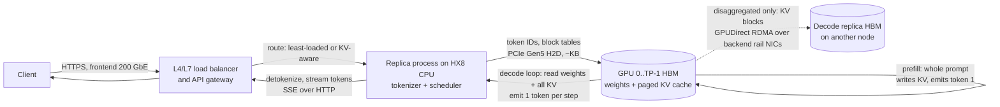
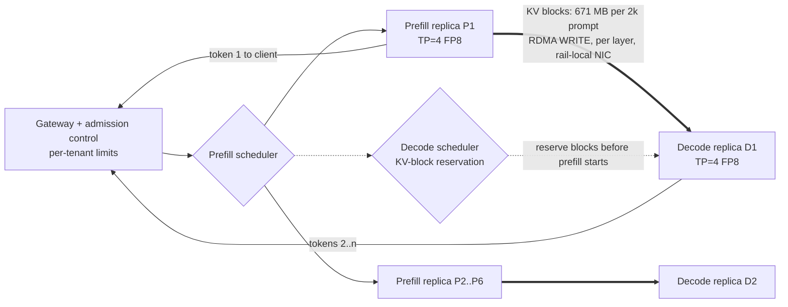

# Chapter 15 — LLM Inference and Serving Infrastructure

> Serving runs millions of short, unpredictable jobs per day, each with a user waiting. A large language model (LLM) request has two phases with
> opposite hardware appetites. *Prefill* processes the whole prompt in one compute-bound pass.
> *Decode* then produces one token at a time and is bound by memory bandwidth. Between the two sits
> the key-value (KV) cache, a per-request memory allocation that grows with every token and usually decides
> how many users a GPU can serve. This chapter explains the mechanics of each phase. It turns them
> into a capacity model you can defend in a design review, shows how to read a serving trace when
> the latency SLO (service-level objective) is breached, and follows the KV cache onto the
> network once prefill and decode run on different machines. The running example is W-INFER, the
> 70B chat model served on ORION. Every number is derived in front of you or labelled with
> its source.

## Learning objectives

After this chapter you will be able to:

1. **Explain** why prefill is compute-bound and decode is memory-bandwidth-bound, and calculate
   each phase's arithmetic intensity for W-INFER on H100-class GPUs.
2. **Calculate** KV-cache bytes per token, the KV budget per replica, and the maximum concurrent
   sequences for a given model, precision, tensor-parallel (TP) degree and memory reservation.
3. **Model** decode throughput and time per output token (TPOT) from HBM bandwidth, and size a
   serving pool against TTFT and TPOT SLOs with Little's law and a simple queueing model.
4. **Diagnose** a serving trace with TTFT, TPOT/ITL, queue time, preemptions and replica
   telemetry, separating an arrival-driven queueing collapse from a KV-pressure preemption storm
   and from a slow replica.
5. **Compare** batching strategies, paged KV allocation, chunked prefill and quantization by
   their effect on memory, latency and quality.
6. **Design** a disaggregated prefill/decode deployment: KV bytes per request, aggregate network
   bandwidth, transport (RDMA vs TCP), QoS, isolation and failure behaviour.
7. **Evaluate** speculative decoding from acceptance rate, draft length and batch size.
8. **Recommend** one serving configuration for a latency-sensitive objective and another for a
   throughput-oriented one, with labelled evidence.

## Prerequisites and connections

You need the GPU execution model and the roofline from
[Chapter 4](../../part-2-accelerated-compute/ch04-gpu-architecture-cuda-execution/), the HX8 host
topology from [Chapter 5](../../part-2-accelerated-compute/ch05-gpu-interconnects-host-topology/),
and the measurement habits of
[Chapter 6](../../part-2-accelerated-compute/ch06-gpu-performance-engineering/). The KV-transfer
material builds on remote direct memory access (RDMA) ([Chapter 8](../../part-3-networking/ch08-rdma-rocev2-infiniband/)),
lossless-fabric QoS ([Chapter 9](../../part-3-networking/ch09-congestion-control-lossless-fabrics/)),
and GPUDirect RDMA data paths ([Chapter 13](../ch13-gpu-data-movement/)). Tensor-parallel
all-reduce comes from [Chapter 12](../ch12-collective-communication-nccl/).

Later chapters build on this one. [Chapter 17](../../part-5-production-operations/ch17-kubernetes-slurm-scheduling/)
schedules these serving pods on Kubernetes.
[Chapter 18](../../part-5-production-operations/ch18-observability-slos-incident-response/) turns
the metrics defined here into SLIs and alerts.
[Chapter 19](../../part-5-production-operations/ch19-reliability-security-multitenancy/) covers
tenant isolation for shared serving.
[Chapter 21](../../part-5-production-operations/ch21-capacity-power-economics/) converts tokens/s
into cost per million tokens. Capstone D (production LLM inference platform) and Capstone H
(disaggregated serving across prefill and decode pools), both in `capstones/`, use this chapter's
models directly.

## 15.1 Anatomy of an inference request

Start with what moves. A chat request arrives over the frontend network and is routed to one
*replica*. A replica is one copy of the model, spread over one or more GPUs by
tensor parallelism. The replica's CPU process tokenizes the prompt and hands the token IDs to a
scheduler. The scheduler places the request into a batch with other requests. On the GPUs, the
**prefill** pass runs the whole prompt through all 80 layers at once. It writes each layer's key
and value vectors for every prompt token into the **KV cache** in HBM (high-bandwidth memory) and
produces the first output token. Each **decode** step then feeds the newest token back in. It
reads the *entire* KV cache of that sequence and appends one more K and V entry per layer. The
sampled token is detokenized on the CPU and streamed back to the client, usually as server-sent
events over HTTP.



*Figure 15.1 — End-to-end inference request data path on ORION. Solid arrows show a shared-pool
replica. The dotted arrow shows the extra KV-cache hop that disaggregated serving adds (Section 15.10).
Prompt bytes are kilobytes; the large flows are HBM weight and KV reads, NVLink all-reduces, and
the disaggregated KV transfer.*

Five latencies are defined on this path. Every later section refers back to them.

| Metric | Definition | What dominates it |
|---|---|---|
| Queue time | admission to a batch − arrival | Load relative to admission limits (slots, KV blocks) |
| **TTFT** (time to first token) | first token emitted − arrival = queue + prefill (+ network) | Prompt length, prefill compute, queueing |
| **TPOT** (time per output token) | (finish − first token) / (output tokens − 1), per request | Decode step time, batch size, interference from prefills |
| **ITL** (inter-token latency) | each individual gap between consecutive tokens | Same as TPOT plus spikes (prefill stalls, preemptions) |
| End-to-end (e2e) | finish − arrival = TTFT + (n − 1) × TPOT | All of the above |

*Table 15.1 — Serving latency metrics used in this chapter. TPOT is an average for one request.
ITL is the distribution of individual gaps, which is where tail spikes show up.*

> **Key idea:** TPOT averages away the spikes that users notice as a stutter. Report ITL
> percentiles alongside TPOT, or you will miss prefill interference and preemption stalls.

Pool throughput is output tokens/s across all users; per-user speed is roughly 1/TPOT (20
tokens/s at 50 ms, faster than people read).
**Goodput** counts only requests that meet their SLO. The DistServe paper (Zhong et al., 2024)
defines it as the maximum request rate that a deployment sustains while a target fraction of
requests (for example 90 %) meet both TTFT and TPOT SLOs. On a fixed trace, the operational form
is SLO-meeting requests per second. The two can diverge sharply: in the lab trace, throughput is
7.6 req/s but goodput is only 3.7 req/s `[SIMULATED]`.

The W-INFER SLO targets `[ILLUSTRATIVE]` from the reference cluster are TTFT p95 ≤ 800 ms for
2k-token prompts, TPOT p95 ≤ 50 ms, and 99.9 % availability.

## 15.2 Prefill and decode: two different machines

The roofline from Chapter 4 is the right lens. A kernel is compute-bound when its arithmetic
intensity (FLOP per byte moved from HBM) exceeds the GPU's *ridge point*, and memory-bound below
it. For an H100-class GPU `[VENDOR-SPEC, 2026-10]`:

* BF16 ridge = 989 × 10¹² FLOP/s ÷ 3.35 × 10¹² B/s ≈ **295 FLOP/B**
* FP8 ridge = 1,979 × 10¹² ÷ 3.35 × 10¹² ≈ **591 FLOP/B**

**Prefill.** A dense transformer forward pass costs about 2N FLOP per token, where N is the
parameter count: one multiply-add per weight. For W-INFER (N = 70 × 10⁹), a 2,048-token prompt
needs:

```text
FLOP_prefill ≈ 2 × N × P = 2 × 70e9 × 2,048 = 2.87 × 10^14 FLOP          [MODELED]
```

The weights are read once for the whole prompt, so the matrix multiplies have an intensity of
roughly P FLOP/B in BF16, about 2,048. That is far above the ridge, so prefill is compute-bound.
On TP = 8 with BF16 at a planning model-FLOPs utilization (MFU) of 40 % `[ILLUSTRATIVE]`:

```text
t_prefill = 2.87e14 / (8 × 989e12 × 0.40) = 2.87e14 / 3.165e15 = 90.6 ms  [MODELED]
```

The attention score computation adds a term quadratic in P: about 2 × L × P² × d FLOP with causal
masking, where L = 80 layers and d = 8,192. At 2k tokens that is 2 × 80 × 2,048² × 8,192 ≈
5.5 × 10¹² FLOP, under 2 % of the total. At 32k tokens it is 256× larger and no longer negligible.
Long-context prefill is superlinear.

**Decode.** Each step produces *one* token per sequence. To do that it must stream every weight
from HBM once, regardless of how many sequences are in the batch. With batch size B and BF16
weights:

```text
FLOP per step ≈ 2 × N × B        bytes per step ≈ 2N (weights) + KV reads
intensity (weights only) ≈ 2NB / 2N = B FLOP/B
```

Decode therefore stays memory-bound until B approaches the ridge, about 295 sequences, and it
never gets there in practice because the KV reads grow with B too. Attention over the KV cache is
worse still. With grouped-query attention (GQA), one decode step for one sequence reads
`2 × ctx × 8 heads × 128 × 2 B = 4,096 × ctx` bytes per layer and does about `4 × ctx × 8,192`
FLOP. That is **8 FLOP/B**, deep in memory-bound territory at any batch size.

This asymmetry drives most serving design decisions:

| Property | Prefill | Decode |
|---|---|---|
| Work per step | P tokens per sequence | 1 token per sequence |
| Bound | Tensor-core FLOP/s | HBM bandwidth |
| Helps | Higher MFU, FP8 compute, more GPUs | Bigger batch, fewer bytes (quantized weights/KV), more HBM bandwidth |
| Latency metric | TTFT | TPOT/ITL |
| Typical time, W-INFER 2k prompt, TP=8 `[MODELED]` | ≈ 91 ms | ≈ 6–12 ms per step |

*Table 15.2 — Prefill and decode compared for W-INFER on HX8.*

**The decode lower bound.** Because decode is bandwidth-bound, a hard floor follows directly:

```text
t_step ≥ (weight bytes + Σ KV bytes read) / (n_GPUs × HBM bandwidth)
```

For a single sequence on TP = 8 BF16 the floor is 140 × 10⁹ / (8 × 3.35 × 10¹²) = 140e9 / 26.8e12
= **5.22 ms** `[MODELED]`. So no single user can exceed about 191 tokens/s on this layout, however
fast the tensor cores are. Real engines reach perhaps 60–80 % of HBM bandwidth in decode and add
fixed per-step overhead `[ILLUSTRATIVE]`. That overhead comes from scheduling, kernel launches
(partly hidden by CUDA graphs), and the TP all-reduces discussed next. The lab's capacity model
uses `hbm_efficiency = 0.70` and `overhead = 3 ms`. Calibrating both against your own stack is
the L2 extension.

**Tensor-parallel serving.** TP splits each layer's matrices across GPUs, so each GPU streams
only 1/TP of the weights. The price is two all-reduces per layer, after attention and after the feed-forward block (Chapter 12),
which makes 160 per decode step for W-INFER. At B = 32 each all-reduce carries
32 × 8,192 × 2 B = 512 KiB. Over NVLink at 450 GB/s per direction, a ring all-reduce's bandwidth
term is about 1.75 × 512 KiB ÷ 450 GB/s ≈ 2 µs. Its latency term is closer to 5–15 µs
`[ILLUSTRATIVE]`, so the all-reduces cost roughly 1–2.5 ms per step. That fits inside the 3 ms
overhead assumption and explains why TP beyond the NVLink domain (TP = 16 across two nodes over
400G RDMA) is rarely worth it for decode. There are two more constraints. W-INFER has 8 KV heads,
so TP ≤ 8 keeps each KV head on exactly one GPU; TP = 16 would have to replicate KV heads.
Within an HX8, TP = 8, 2 × TP = 4, and 4 × TP = 2 are the natural layouts.

> **Pitfall:** "GPU utilization 100 %" from `nvidia-smi` means a kernel was resident during the
> sample period, not that the tensor cores or HBM were saturated. A decode-heavy replica reads
> 100 % while using a small fraction of peak FLOP/s. Use DCGM profiling fields, such as DRAM
> active and tensor active, for phase-level utilization (Chapter 6).

## 15.3 The KV cache: sizing and the memory budget

Every layer stores one key vector and one value vector per KV head for every token in the
context. The size per token is:

```text
KV bytes/token = 2 (K,V) × layers × KV heads × head_dim × bytes/element
W-INFER, BF16 = 2 × 80 × 8 × 128 × 2 = 327,680 B = 320 KiB/token           [MODELED]
```

A 4,096-token sequence therefore holds 4,096 × 327,680 = 1,342,177,280 B ≈ **1.34 GB** of KV
cache. GQA is doing heavy lifting here. With full multi-head attention (64 KV heads), the same
model would need 2 × 80 × 64 × 128 × 2 = 2,621,440 B = 2.5 MiB per token, 8× more, and a 4k
sequence would occupy 10.7 GB.

The **KV budget** of a replica is what is left after weights and a working reserve:

```text
budget = n_GPUs × HBM × memory_fraction − weight bytes − n_GPUs × reserve_per_GPU
```

The reserve covers activations for the largest batch, CUDA graph pools, NCCL buffers and
allocator fragmentation. Serving engines expose a memory-fraction setting and profile activation
memory at start-up, so measure your own value. We use `memory_fraction = 0.90` and 2 GB per GPU
`[ILLUSTRATIVE]`.

| Layout on one HX8 | Weights | Budget arithmetic | KV budget | 16-token blocks | Max 4k seqs |
|---|---|---|---|---|---|
| 1 × TP=8, BF16 | 140 GB | 8×80×0.9 − 140 − 16 | 420 GB | 80,108 | 312 |
| 2 × TP=4, FP8 weights | 70 GB | 4×80×0.9 − 70 − 8 | 210 GB each | 40,054 | 156 each |
| 4 × TP=2, FP8 weights | 70 GB | 2×80×0.9 − 70 − 4 | 70 GB each | 13,351 | 52 each |

*Table 15.3 — KV budgets per replica for W-INFER with BF16 KV `[MODELED]`. Blocks =
⌊budget ÷ (16 × 327,680)⌋. A 4,096-token sequence needs 256 blocks.*

Read the last row carefully. TP = 2 is attractive because it gives four replicas per node, and
70 GB of FP8 weights fits in 160 GB of HBM. But only 70 GB is left for KV, about 214k tokens.
Twenty sequences of 10k tokens fill it.

> **Deviation from the reference baseline:** ORION serves W-INFER at TP = 8 BF16 or TP = 4 FP8.
> The canary pool (lab, Section 15.14) deliberately runs **4 × TP = 2 FP8 replicas per
> node** (on `orion-n29`, an inference-partition node, so W-TRAIN is not at full size). It is a
> cost-per-token experiment: twice the replicas of TP = 4, testing
> whether short-chat traffic meets its SLOs at half the GPUs per replica. That is a valid test for
> 1–2k-token chat. It is unsafe for long context, because each replica has only 70 GB of KV
> (≈ 214k tokens), which is why that pool preempts when a long-context tenant arrives.

**Which limit binds depends on context length.** For W-INFER at an average context of
2,176 tokens (2,048 in + 128 average generated), one sequence holds 2,176 × 327,680 ≈ 713 MB. On
a TP = 4 FP8 replica that caps concurrency at about 278 sequences at their full 2,304-token
length (40,054 blocks ÷ 144 blocks each). The decode-step time at that batch, about 32 ms from
Section 15.12's formula, would still be inside a 50 ms TPOT SLO. So for short chat traffic on this
layout, memory is not the binding limit. The batch cap you set to protect TPOT binds first. For
long contexts the reverse is true, and that is what we will see go wrong.

## 15.4 Batching: static, dynamic, continuous

Decode is memory-bound, so batching is the main throughput lever. Sixty-four sequences sharing
one weight read cost far less than 64 separate steps. How you form the batch decides what
happens to latency.

* **Static and dynamic batching** run each batch to completion (dynamic just forms it on size
  or timeout), so early finishers idle their slots until the longest sequence ends.
* **Continuous (iteration-level) batching.** Orca (Yu et al., OSDI 2022) introduced this. The
  scheduler makes a decision at *every iteration*: finished sequences leave immediately, and
  waiting ones join at the next step. Every major engine uses it today (vLLM, SGLang, TensorRT-LLM,
  Text Generation Inference) `[VENDOR-SPEC, 2026-10]`.

Continuous batching creates a new problem: **prefill-decode interference**. When a new request
joins, its prefill has to run somewhere. In the simplest scheduler, an iteration either prefills
newly admitted requests or decodes the running ones. While a 2k-token prefill runs for about
91 ms, every running sequence on that replica gets no token, so its ITL for that step jumps from
about 12 ms to about 100 ms. Two families of fixes exist:

1. **Chunked prefill.** Split long prompts into chunks (for example 512 tokens) and co-schedule
   one chunk with each decode step. Sarathi-Serve (Agrawal et al., OSDI 2024) showed that this
   bounds the stall to one chunk. On a TP = 4 FP8 replica, prefill costs 2 × 70e9 ÷ (4 × 1,979e12
   × 0.40) = 44.2 µs per token, so a 512-token chunk adds about 22.6 ms to the affected step
   instead of about 91 ms `[MODELED]`. The cost is a slightly longer TTFT, because the prompt now
   finishes over several steps.
2. **Disaggregation.** Run prefill and decode on different replicas (Section 15.9).

Engines expose the batching knobs as a cap on concurrent sequences and a cap on tokens per
iteration (in vLLM, `--max-num-seqs` and `--max-num-batched-tokens`; verify names for your
version `[VENDOR-SPEC, 2026-10]`). The concurrency cap is a latency-protection valve: decode step
time grows with B (Section 15.12), so an uncapped batch trades TPOT for throughput. The token cap bounds
how long one iteration can run, which also bounds the worst ITL stall.

## 15.5 Paged attention, memory pressure and preemption

Before paged attention, engines reserved contiguous KV memory for each request's *maximum*
length. A request that might reach 4,096 tokens reserved 1.34 GB even if it stopped at 300. The
vLLM paper (Kwon et al., SOSP 2023) found that prior systems used only roughly 20–40 % of
their KV memory for token state; the rest was over-reservation and fragmentation.

**PagedAttention** borrows virtual memory's solution. The KV cache is a pool of fixed-size blocks
(16 tokens is a common default), and each sequence owns a *block table* mapping its logical
blocks to physical ones. Blocks are allocated as tokens are generated, so waste is bounded by one
partly filled block per sequence. Shared prefixes, such as a common system prompt, can point at
the same physical blocks with copy-on-write. The paper reports 2–4× throughput over FasterTransformer
and Orca at the same latency, mostly because many more sequences fit in a batch.

On-demand allocation brings a new risk: the pool can run dry *while sequences are decoding*.
Admission checks that the prompt fits, but each running sequence needs one more block every
16 tokens. When a decode step cannot get the blocks it needs, the scheduler must **preempt**:

* **Recompute:** free the victim's blocks and requeue it. When it is readmitted, its prompt plus
  every token generated so far is prefilled again. This is cheap in memory and expensive in
  compute. A 10k-token context costs about 0.9 s of prefill on a TP = 2 FP8 replica
  (10,000 × 88.4 µs) `[MODELED]`.
* **Swap:** copy the victim's blocks to host DRAM over PCIe and copy them back later. A
  10k-token context is 3.3 GB. At about 50 GB/s achievable PCIe per GPU, with TP = 2 splitting it
  across two links, that is about 33 ms each way, and host memory
  and PCIe contention become the new bottleneck.

vLLM's scheduler preempts the most recently admitted sequence first and, in current versions,
defaults to recompute `[VENDOR-SPEC, 2026-10]`, verify for your version. A **preemption storm**
is the pathological case. KV usage pins near 100 %. Every few steps another sequence is evicted,
and each eviction later costs a prefill that stalls every other sequence on the replica. Long
contexts make the storm worse because the victims are expensive to recompute. The signature is
distinctive: KV usage at 95–100 %, a rising preemption counter, a growing waiting queue
*without* an arrival spike, and ITL outliers of hundreds of milliseconds to seconds.

> **Production note:** Admission based only on request *count* is blind to memory. A router that
> balances by number of running requests will happily send the fifth 10k-token request to a
> replica whose KV is 95 % full. KV-aware routing (or at least per-tenant concurrency limits for
> long-context traffic) is the structural fix.

**Prefix caching** keeps the KV blocks of shared prefixes (system prompts, earlier turns), so
a new request skips that part of prefill. It is a big TTFT win. It also turns the pool into a
cache that sits near 100 % full by design, which makes "KV usage" alone a poor pressure signal.
Watch preemptions of *running* sequences instead.

## 15.6 Quantization: fewer bytes, faster decode, careful quality

Decode time is bytes ÷ bandwidth, so every byte removed from the weights or the KV cache speeds
up decode almost proportionally. Quantization also frees HBM for more KV.

| Option | W-INFER bytes | What it buys | Main risk |
|---|---|---|---|
| BF16 weights (baseline) | 140 GB | Reference quality | Needs TP ≥ 2; lowest concurrency |
| FP8 weights (E4M3, per-tensor/channel scales) | 70 GB | 2× fewer weight bytes per step; FP8 tensor cores double prefill peak | Small accuracy loss; requires calibration and hardware FP8 support |
| INT8 weights (W8A8 e.g. SmoothQuant, or W8A16) | ≈ 70 GB | Same byte savings on GPUs without FP8 | Activation outliers need smoothing |
| INT4 weights (W4A16, e.g. GPTQ, AWQ) | ≈ 35–40 GB incl. scales | 4× fewer weight bytes; fits TP = 1–2 | Larger quality loss on reasoning/code; dequant overhead at large batch |
| FP8 KV cache | 160 KiB/token | 2× concurrency or context; fewer KV bytes per step | Long-context accuracy; needs scales |

*Table 15.4 — Quantization options for W-INFER `[MODELED]` byte counts. The quality effects are
model- and task-dependent and must be measured on your evaluation suite.*

Here is what FP8 KV buys on a TP = 4 FP8 replica. The budget stays at 210 GB, but each 16-token
block now costs 16 × 163,840 = 2,621,440 B. That gives ⌊210e9 ÷ 2,621,440⌋ = 80,108 blocks, or
312 sequences of 4k tokens instead of 156 `[MODELED]`.

INT4 weight-only kernels dequantize inside the matrix multiply, which costs more than the saved
bytes at large batch, so benchmark at your production batch size.

> **Pitfall:** A quantized model validated on short prompts and then deployed for long documents
> can regress, because KV quantization error accumulates with context. Treat a quantization change
> as a model change with its own canary.

## 15.7 Queueing, Little's law and phase SLOs

**Little's law** (L = λW) holds for any stable system. The average number of requests in the
system equals the arrival rate times the average time each request spends there. For serving it
yields two sizing identities:

```text
requests in system      = λ × e2e
sequences in decode      = λ × output_tokens × TPOT     (each sequence spends output × TPOT decoding)
```

At λ = 40 req/s, 256 output tokens and TPOT = 23 ms, about 40 × 256 × 0.023 ≈ 236 sequences are
decoding at any instant. That is the batch you must hold in KV memory across the pool.

**Queueing knees.** Prefill behaves like a single server per replica with near-deterministic
service time, so an M/D/1 queue (Poisson arrivals, deterministic service) is a reasonable first
model. Its mean wait is:

```text
W_q = ρ × t_s / (2 × (1 − ρ)),    ρ = λ_replica × t_prefill
```

At ρ = 0.45 the wait is 0.41 × t_s. At ρ = 0.9 it is 4.5 × t_s, and it grows without bound as
ρ → 1. When arrivals exceed capacity, even briefly, the queue grows at λ − μ per second and
drains only at the spare rate μ − λ after the burst. **A 45-second burst can cause 60 seconds of
SLO breach after it ends.** The lab trace shows exactly this shape `[SIMULATED]`.

**Phase-specific SLOs.** TTFT and TPOT depend on different resources, so give them separate
service-level indicators (SLIs), SLOs and alerts:

| SLI | Resource it reflects | Typical alert input |
|---|---|---|
| TTFT p95 (per prompt-length bucket) | Prefill capacity + admission queue | Queue time p95, waiting count |
| TPOT p95 and ITL p99 | Decode bandwidth + interference | Batch size, prefill tokens per step, preemptions |
| KV transfer time p99 (disaggregated) | Network path between pools | NIC throughput, ECN/PFC counters |
| e2e p95 | All | Mostly for user-facing reporting |
| Goodput (SLO-meeting req/s) | Whole system | Capacity planning |
| GPU busy by phase (prefill vs decode pool) | Pool sizing | Ratio drift as the prompt mix changes |

*Table 15.5 — Phase-specific SLIs for serving.*

Bucket TTFT by prompt length. No layout here serves a 32k-token prompt in 800 ms, so one TTFT
SLO across all prompt lengths is an artifact, not an objective.

## 15.8 Choosing a replica layout on HX8

Here are the two configurations the lab compares, at their saturated operating points
(average context 2,176 tokens):

```text
t_step = overhead + (W + B × 2,176 × 327,680) / (TP × 3.35e12 × 0.70)

L-tp8-bf16 (B = 32):  3 ms + (140e9 + 22.82e9) / 18.76e12 = 3 + 8.68 = 11.68 ms
                      tokens/s per node = 32 / 0.01168 = 2,740
T-tp4-fp8 (B = 128):  3 ms + (70e9 + 91.27e9) / 9.38e12  = 3 + 17.19 = 20.19 ms
                      tokens/s per node = 2 × 128 / 0.02019 = 12,678          [MODELED]
```

The latency-oriented layout gives each user about 86 tokens/s. The throughput-oriented layout
gives each user about 50 tokens/s, but serves 4.6× more tokens per node, because FP8 halves the
weight bytes and a batch of 128 amortizes them across four times as many sequences. Prefill time
is about 90.6 ms in both layouts: TP = 8 BF16 and TP = 4 FP8 have the same aggregate peak.

Recommend L for an interactive coding assistant with a tight TPOT budget, and T for a batch
summarization API or a cost-sensitive chat tier. State the T risk explicitly: FP8 quality must
be validated, and TPOT p95 under burst will sit closer to the 50 ms SLO.

## 15.9 Disaggregated prefill and decode

Section 15.4 showed that co-locating the phases makes them interfere. Disaggregation removes the
interference by giving each phase its own pool. A prefill replica processes prompts, emits the
first token, and ships the request's KV cache to a decode replica, which generates the rest.
DistServe (Zhong et al., OSDI 2024) and Splitwise (Patel et al., ISCA 2024) made the case. DistServe optimizes goodput under separate TTFT and TPOT SLOs and reports serving
up to 7.4× more requests, or meeting 12.6× tighter SLOs, than co-located baselines on its
workloads. Splitwise characterizes the phases on production traces and explores heterogeneous
pools, for example newer GPUs for compute-hungry prompt processing and older or power-capped GPUs
for token generation.



*Figure 15.2 — Disaggregated serving on ORION. Before prefill begins, the decode scheduler
reserves KV blocks on a target decode replica, so a finished transfer always has somewhere to
land. Thick arrows carry KV-cache bytes over the backend fabric.*

**What disaggregation changes operationally:**

* **Two capacity plans.** Prefill scales with prompt tokens per second, and decode with
  concurrent sequences × context. The right P:D ratio drifts with the prompt mix (for example
  when retrieval-augmented prompts grow from 1k to 8k tokens), so watch utilization *by pool*.
* **Scheduling and admission control.** The gateway admits a request only when a prefill slot
  *and* decode KV capacity are both available. Admitting on prefill capacity alone moves the
  queue to the decode side, where it surfaces as preemptions.
* **Load balancing.** Prefill balancing is by queued prompt tokens, not request count. Decode
  balancing is by free KV blocks and current batch.
* **Heterogeneous placement.** Prefill wants FLOP/s; decode wants bandwidth per dollar, so pools
  may differ in GPU generation, power cap or TP degree (TP changes force KV resharding).

**When disaggregation hurts.** It adds a network hop, a second scheduler and new failure modes.
At low load, or with short prompts and long outputs, interference is small, and chunked prefill
on a shared pool often gets most of the benefit at no network cost. Fixed pools also strand
capacity when the mix shifts. In the worked example (Section 15.12), the shared pool has *lower* mean
TTFT, because its prefill load is spread over eight replicas instead of six. Disaggregation wins
on TPOT and especially on worst-case ITL. Choose based on which SLO is binding.

## 15.10 KV-cache transfer: size, layout, transport, network

**Size per request.** The prefill node must ship the KV for every prompt token:

```text
KV bytes/request = P × KV bytes/token = 2,048 × 327,680 = 671,088,640 B ≈ 671 MB  [MODELED]
```

The prompt's text is about 8 KB; its KV is about 80,000 times larger. Prefix caching on the decode side can skip
blocks the decode replica already holds, and FP8 KV halves the bytes.

**Bandwidth at target concurrency.** Aggregate demand is λ × bytes/request. At 40 req/s:

```text
40 × 671.09e6 B = 26.84 GB/s = 214.7 Gb/s across the pool
per decode replica (6P + 2D, Section 15.12) = 107.4 Gb/s                                       [MODELED]
```

**Layout and serialization.** The KV cache is not one buffer. With paged blocks, each GPU of a
TP = 4 replica holds 2 of the 8 KV heads, so one 16-token block of K for one layer is 16 × 2 ×
128 × 2 B = 8 KiB. A 2k-token request therefore consists of 128 blocks × 80 layers × 2 (K and V)
= 20,480 non-contiguous 8 KiB segments *per GPU* `[ILLUSTRATIVE; actual layout is
engine-specific]`. Transfer engines handle this in one of three ways: scatter-gather work
requests, coalescing into staging buffers, or a layout with larger contiguous regions. Three
design points follow:

1. **Per-layer streaming.** Send layer *i*'s KV while layer *i + 1* is still prefilling. On
   RDMA, one layer's 8.4 MB per request moves in about 49 µs at 170 GB/s, against about 1.13 ms
   of prefill compute per layer, so the transfer is fully hidden.
2. **TP mismatch.** If prefill runs TP = 8 (one KV head per GPU) and decode runs TP = 4 (two
   heads per GPU), each decode GPU receives from two prefill GPUs. This resharding by head works
   because 8 heads divide evenly. Mismatches that do not divide require splitting heads and
   should be avoided.
3. **Rail locality.** Each prefill GPU should send through its own PIX-attached NIC (Chapter 5),
   so that four GPUs use four rails in parallel. Funnelling a whole replica's KV through one NIC
   cuts bandwidth by 4× and crosses PCIe switches.

**RDMA vs TCP.** The lab's model uses these `[ILLUSTRATIVE]` assumptions:

| Transport | Path | Achievable per replica | Fixed latency | Transfer of 671 MB |
|---|---|---|---|---|
| RDMA (RoCEv2) with GPUDirect RDMA | GPU HBM → rail NIC → backend fabric → NIC → GPU HBM, no host copies | 4 × 400 Gb/s × 0.85 = 1,360 Gb/s (170 GB/s) | 30 µs | 3.98 ms |
| TCP over frontend | GPU → host DRAM (PCIe) → kernel TCP → 200 GbE → host → GPU | 1 × 200 Gb/s × 0.50 = 100 Gb/s (12.5 GB/s) | 1 ms | 54.7 ms |

*Table 15.6 — KV transport assumptions and the resulting transfer time `[MODELED]`. The
efficiency factors are teaching values. Measure yours with `ib_write_bw` and `iperf3` on the
actual path (lab Section 9).*

At 107.4 Gb/s per decode replica, RDMA runs at 7.9 % of achievable bandwidth. TCP would need
107 % of its achievable 100 Gb/s, so it cannot keep up at all; even at the 5:3 split (72 %),
transfers would queue and the tail would stretch. TCP also burns CPU cores on copies and touches the frontend fabric, which on ORION is
3:1 oversubscribed and shared with storage (Chapter 14). TCP is a defensible fallback for low
rates or for crossing a boundary where RDMA is not available. At this load it is not the primary
path.

> **Vendor implementation note (NVIDIA, open source; verify against current docs):** Production
> KV-transfer layers include NVIDIA's NIXL transfer library, used by NVIDIA Dynamo, the
> disaggregated-prefill connectors in vLLM and SGLang, and the Mooncake transfer engine. Connector
> names, supported transports (UCX, RDMA verbs, TCP) and configuration keys change between
> releases `[VENDOR-SPEC, 2026-10]`.

**Network QoS and isolation.** ORION's backend lossless class (DSCP 26 → traffic class 3,
with priority flow control, PFC, on priority 3) carries training collectives. KV traffic is
bursty, latency-critical and many-to-few (six prefill replicas into two decode replicas). If it shares the training class, it can
trigger PFC pauses that stall a training job's all-reduce. In order of preference:

1. Put inference on dedicated nodes and rails, so it shares no links with training.
2. Otherwise, give KV its own traffic class with explicit congestion notification (ECN) and a
   guaranteed share, size buffers for incast, and verify DCQCN under fan-in (Chapter 9).
3. Rate-limit each sender so a prefill burst cannot saturate a decode node's ingress.

**Security boundary.** The KV cache encodes the user's prompt, so treat it as user data. RoCEv2
traffic is generally unencrypted on the wire. Isolate it with a dedicated
virtual routing and forwarding (VRF) domain or VLAN (RoCE), or a partition key (InfiniBand). Scope memory registrations so that a decode
process can reach only its own buffers. Use link-layer encryption such as MACsec or NIC IPsec
offload where policy requires it and the hardware supports it (vendor-specific). TCP paths can
use TLS at a CPU cost. Multi-tenant pools must never let one tenant's prefix cache satisfy
another tenant's request (Chapter 19).

**Failure behaviour.** Write these down before production does it for you:

| Failure | Effect | Designed response |
|---|---|---|
| KV transfer timeout or NIC error | Request has first token, no decode state | Retry once to another decode replica, else re-prefill locally; count as SLO miss |
| Decode replica crash | All in-flight sequences lose KV | Re-prefill prompt + generated tokens elsewhere (expensive), or fail fast with a retriable error |
| Prefill replica crash | Queued prompts lost; transfers in flight abort | Gateway retries; decode side frees reserved blocks after a TTL |
| Lost acknowledgement | Prefill side holds KV blocks forever | Block lifecycle with TTL and reconciliation; alert on leaked blocks |
| Fabric congestion | Transfer p99 rises, then ITL of token 2 | Alert on transfer p99, check ECN/PFC counters, shed load at gateway |

*Table 15.7 — Failure behaviour of the KV-transfer path.*

## 15.11 Speculative decoding

Decode leaves tensor cores idle while it waits on HBM. Speculative decoding (Leviathan et al.,
ICML 2023; Chen et al., 2023) spends that idle compute. A small *draft* model proposes k tokens.
The large *target* model verifies all k in one forward pass, which costs about the same as one
decode step while decode is memory-bound. A modified rejection-sampling rule accepts a prefix of
the draft tokens and guarantees that the output distribution is *identical* to the target model's.
If each draft token is accepted independently with probability α, the expected number of tokens
per verification step is:

```text
E[tokens/step] = (1 − α^(k+1)) / (1 − α)
α = 0.8, k = 4:  (1 − 0.8^5) / 0.2 = (1 − 0.32768) / 0.2 = 3.36                     [MODELED]
```

Each step costs k draft passes plus one verification. With the draft costing c = 5 % of a target
step:

```text
speedup = E / (k × c + 1) = 3.36 / (4 × 0.05 + 1) = 3.36 / 1.2 = 2.80×             [MODELED]
```

Infrastructure consequences:

* **Placement.** Co-locate the draft with the target; a remote draft puts a network round trip
  inside every decode step.
* **Memory footprint.** A 1B-class draft in BF16 adds about 2 GB of weights plus its own KV cache
  per replica, which reduces target KV capacity.
* **Batch interaction.** The 2.8× assumes verification is still memory-bound. At B = 128 on
  T-tp4-fp8, verifying k + 1 = 5 tokens per sequence pushes 640 tokens through each 1-byte FP8
  weight: 2 × 640 = 1,280 FLOP/B, above the 591 FLOP/B ridge. The compute time is
  2 × 70e9 × 640 ÷ (4 × 1,979e12 × 0.40) = 28.3 ms, plus 3 ms overhead = 31.3 ms, against a
  20.2 ms plain decode step: a verification cost of 1.55. The speedup falls to
  3.36 ÷ (0.2 + 1.55) ≈ 1.9× `[MODELED]` at k = 4. At k = 8 the cost is 2.67 and α = 0.8 gives only
  1.4×. A short draft (k = 2, 384 tokens) stays memory-bound and keeps ≈ 2.2× even at B = 128; so at
  large batch, shorten k rather than disable.
* **Acceptance is workload-dependent.** α is high for code and templated text and lower for
  creative or high-temperature sampling. With α = 0.5, k = 8 and c = 0.05, the step yields
  2.0 tokens for 1.4× the cost (1.43×), which is barely a win. Monitor α in production and adapt k.

Speculative decoding helps most on lightly loaded, TPOT-bound services; at large batch, keep k short.

## 15.12 Worked example: sizing W-INFER on ORION for 40 requests per second

**Problem.** Halcyon AI expects a launch peak of **40 req/s** with 2,048-token prompts and
256-token outputs (planning averages). The SLOs are TTFT p95 ≤ 800 ms and TPOT p95 ≤ 50 ms. The
Inference team must choose a replica layout, a pool size, shared vs disaggregated serving, and a
network budget for the Fabric team. All values below are `[MODELED]` from the stated formulas
and the `[ILLUSTRATIVE]` efficiency assumptions in `lab/data/configs.yaml`.

**Step 1 — KV per token and per request.**

```text
KV/token = 2 × 80 × 8 × 128 × 2 B = 327,680 B
At end of generation (2,048 + 256 = 2,304 tokens): 2,304 × 327,680 = 754,974,720 B ≈ 755 MB
Average context while decoding = 2,048 + 256/2 = 2,176 tokens → 2,176 × 327,680 = 713,031,680 B ≈ 713 MB
```

**Step 2 — Replica layout and KV capacity.** Choose T-tp4-fp8: two replicas per HX8, FP8
weights, BF16 KV.

```text
budget  = 4 × 80e9 × 0.90 − 70e9 − 4 × 2e9 = 288e9 − 70e9 − 8e9 = 210e9 B
blocks  = ⌊210e9 / (16 × 327,680)⌋ = ⌊210e9 / 5,242,880⌋ = 40,054
per seq = ⌈2,304 / 16⌉ = 144 blocks  →  max ⌊40,054 / 144⌋ = 278 sequences per replica
```

**Step 3 — Prefill time.**

```text
t_p = 2 × 70e9 × 2,048 / (4 × 1,979e12 × 0.40) = 2.867e14 / 3.166e15 = 90.55 ms
Prefill demand = λ × t_p = 40 × 0.09055 = 3.62 replica-seconds of prefill per second
```

Before any decode is counted, the pool needs at least four replicas' worth of prefill compute.
For this prompt:output ratio of 8:1, **prefill, not decode, sets the pool size.**

**Step 4 — Decode step model.**

```text
t_d(B) = 3 ms + (70e9 + B × 713.03e6) / (4 × 3.35e12 × 0.70)
       = 3 ms + 70e9/9.38e12 + B × 713.03e6/9.38e12
       = 3 + 7.463 + 0.0760 × B   ms   = 10.46 ms + 0.0760 ms × B
```

**Step 5 — Shared pool of 8 replicas (4 nodes, 32 GPUs).** Each replica receives λ_r = 40/8 =
5 req/s.

```text
ρ_prefill = 5 × 0.09055 = 0.4528
Mean prefill wait (M/D/1) = 0.4528 × 0.09055 / (2 × 0.5472) = 37.5 ms
Mean TTFT = 37.5 + 90.6 = 128 ms
```

Decode progresses only when the replica is not prefilling, so TPOT = t_d(B)/(1 − ρ). By Little's
law, B = λ_r × 256 × TPOT = 1,280 × TPOT. Substituting:

```text
TPOT × 0.5472 = 0.010463 + 0.0000760 × 1,280 × TPOT = 0.010463 + 0.09730 × TPOT
TPOT = 0.010463 / (0.5472 − 0.0973) = 0.010463 / 0.4499 = 23.3 ms;  B = 1,280 × 0.0233 = 29.8
Worst ITL (a 2k prefill lands between two tokens) = t_d(29.8) + t_p = 12.7 + 90.6 = 103 ms
```

Could six replicas do it? Then λ_r = 6.67, ρ = 0.604 and B = 1,707 × TPOT, so
TPOT = 0.010463 / (0.3962 − 0.1297) = 39.3 ms. That is the *mean*, already within 11 ms of the
p95 SLO, so six is rejected.

**Step 6 — Sanity checks with Little's law.**

```text
Requests in system = λ × e2e = 40 × (0.128 + 255 × 0.0233) = 40 × 6.07 ≈ 243
KV in use ≈ 8 × 29.8 × 713 MB ≈ 170 GB of 8 × 210 GB = 1,680 GB  (≈ 10 %)
Mean TTFT 128 ms; with an M/D/1 p95 wait of roughly 3× the mean, TTFT p95 ≈ 0.20 s ≪ 0.8 s
```

Memory is not the constraint. Prefill compute and ITL spikes are.

**Step 7 — Disaggregated: choose the P:D split from a sweep (same 8 replicas, 32 GPUs).**
Prefill: ρ = (40/P) × 0.09055, TTFT = M/D/1 wait + 90.6 ms. Decode: B = (40/D) × 256 × TPOT with
TPOT = 10.463 ms + 0.0760 ms × B, so TPOT = 10.463 ÷ (1 − 0.0760e-3 × 10,240/D) ms. KV ingress per
decode replica = 214.7 Gb/s ÷ D.

| P:D | ρ_prefill | Mean TTFT | Mean TPOT | B per decode replica | KV ingress per decode replica |
|---|---|---|---|---|---|
| 4:4 | 0.906 | 524 ms | 13.0 ms | 33 | 53.7 Gb/s |
| 5:3 | 0.724 | 210 ms | 14.1 ms | 48 | 71.6 Gb/s |
| **6:2** | **0.604** | **160 ms** | **17.1 ms** | **88** | **107.4 Gb/s** |
| 7:1 | 0.517 | 139 ms | 47.2 ms | 484 (> 278 KV cap) | 214.7 Gb/s |

*Table 15.8 — P:D sweep at 40 req/s `[MODELED]`.*

4:4 starves prefill (TTFT p95 would breach 800 ms). 7:1 fails both TPOT and KV capacity. 6:2
beats 5:3 on TTFT and still leaves a third of the TPOT budget, so **6P + 2D** it is. For 6:2, the
TPOT is 10.463 ÷ (1 − 0.0760e-3 × 5,120) = 10.463 ÷ 0.6109 = 17.1 ms.

```text
KV/request = 2,048 × 327,680 = 671,088,640 B
RDMA: 30 µs + 671.09e6 / (4 × 50e9 × 0.85) = 3.98 ms  → worst ITL = 17.1 + 4.0 = 21.1 ms
TCP:  1 ms + 671.09e6 / (25e9 × 0.50)     = 54.7 ms → worst ITL = 17.1 + 54.7 = 71.8 ms
Per decode replica: 107.4 Gb/s = 7.9 % of RDMA's 1,360 Gb/s; 107 % of TCP's 100 Gb/s achievable
```

TCP is **infeasible** at 6:2: demand exceeds achievable bandwidth. The first token comes from the
prefill pool, so the transfer delays token 2, not TTFT, and averaged over 255 gaps it barely
moves TPOT. Place the two decode replicas on different nodes, so one node failure does not take
out all decode capacity.

**Step 8 — Decision.**

| Design (32 GPUs) | Mean TTFT | Mean TPOT | Worst ITL | Network | Verdict |
|---|---|---|---|---|---|
| Shared, 8 replicas | 128 ms | 23.3 ms | 103 ms | none | Meets TTFT/TPOT; ITL spikes on every admission |
| Shared + 512-token chunked prefill | slightly higher | ≈ 23 ms | ≈ 12.7 + 22.6 ≈ 35 ms | none | Simplest fix for ITL |
| Disaggregated 6P+2D, RDMA | 160 ms | 17.1 ms | 21.1 ms | 214.7 Gb/s; 7.9 % of achievable per decode replica | Best ITL; RDMA required |
| Disaggregated 6P+2D, TCP | 160 ms | 17.3 ms | 71.8 ms | 107 % of achievable per decode replica | Infeasible: link saturated |

*Table 15.9 — Worked-example comparison `[MODELED]`.*

Recommendation: launch on a **shared pool of 8 TP = 4 FP8 replicas with chunked prefill**, plus
one extra node (2 replicas) as N+1 headroom for a node failure or a burst: **5 HX8 nodes**. Keep
6P + 2D over RDMA as the planned step for when retrieval-augmented prompts grow and raise
ρ_prefill. Give the Fabric
team a KV budget of about 215 Gb/s at 40 req/s with 2k prompts, scaling linearly with prompt
tokens per second. Validate on L2/L3 hardware before committing: the 0.70 HBM efficiency and the
3 ms overhead are assumptions, not measurements.

## 15.13 Hands-on lab overview

The Level 1 lab ([lab/README.md](lab/README.md)) runs on a laptop in seconds. **Part A** builds
this chapter's capacity model and the two-configuration recommendation `[MODELED]`. **Part B**
analyzes a 600-second, 4,539-request trace from a four-replica TP = 2 canary pool. It computes
latency percentiles, SLO attainment and goodput, and classifies the trace's anomalies
`[SIMULATED]`. **Part C** reproduces Table 15.9 and the speculative-decoding model
`[MODELED]`. `python check.py` reports 18 checks. The L2 extension calibrates the model against a
real engine; L3 measures KV transfer over RDMA.

## 15.14 Troubleshooting scenario: "TTFT p95 breached on the canary pool"

This scenario is `[ILLUSTRATIVE]`: the command outputs and log lines are representative, with
formats simplified. It follows the same pool as the lab trace, so you can reproduce every
number there.

**Symptom.** At 14:07 the SLO alert fires: *w-infer-canary TTFT p95 = 31 s over 5 min (SLO
800 ms)*. Four minutes earlier the same pool had a burst-driven TTFT breach that recovered on
its own. The on-call engineer's first instinct is "another burst, scale out".

**Step 1 — Observe and collect evidence; don't act on the first hypothesis.** Start by
decomposing TTFT. The question is whether requests are slow to *start* (queue) or slow to
*compute* (prefill).

| Window | Arrivals/15 s | Queue p95 | Prefill p50 | TTFT p95 | Preemptions |
|---|---|---|---|---|---|
| Baseline (00:00–03:50) | ≈ 90 | 0.11 s | 0.12 s | 0.45 s | 0 |
| Earlier incident (04:00–04:45) | ≈ 390 | 8–43 s | 0.15 s | 8–43 s | 0 |
| Now (08:15–08:30) | 93 | 86 s | 0.15 s | 87 s | rising |

*Table 15.10 — TTFT decomposition. Times are mm:ss from the start of the trace window, which opened at 13:59 `[SIMULATED]`.*

Prefill is normal and queueing dominates, but **arrivals are flat**. That rules out the burst
hypothesis. Next, look at the engine's own metrics on each replica:

```text
$ for h in w-infer-canary-0 w-infer-canary-1 w-infer-canary-2 w-infer-canary-3; do
    kubectl -n inference exec $h -- curl -s localhost:8000/metrics \
      | grep -E '^vllm:(num_requests_running|num_requests_waiting|gpu_cache_usage_perc|num_preemptions_total)'
  done
vllm:num_requests_running{model_name="w-infer-70b"} 32.0
vllm:num_requests_waiting{model_name="w-infer-70b"} 1.0
vllm:gpu_cache_usage_perc{model_name="w-infer-70b"} 0.98
vllm:num_preemptions_total{model_name="w-infer-70b"} 0.0
vllm:num_requests_running{model_name="w-infer-70b"} 24.0
vllm:num_requests_waiting{model_name="w-infer-70b"} 11.0
vllm:gpu_cache_usage_perc{model_name="w-infer-70b"} 0.999
vllm:num_preemptions_total{model_name="w-infer-70b"} 8.0
...
```

*The canary runs an older (V0-architecture) vLLM release with chunked prefill disabled. V1
enables chunked prefill by default, logs preemption differently, and renames the gauge to
`vllm:kv_cache_usage_perc`. Check `/metrics` on your version `[VENDOR-SPEC, 2026-10]`.*

Replica 1 is running *fewer* sequences than its 48-sequence cap, yet requests are waiting, KV
usage is at 99.9 % and preemptions are climbing. The engine log agrees:

```text
WARNING ... Sequence group 3517 is preempted by PreemptionMode.RECOMPUTE mode because there is
not enough KV cache space. This can affect the end-to-end performance. Increase
gpu_memory_utilization or tensor_parallel_size to provide more KV cache memory.
total_num_cumulative_preemption=8
```

**Step 2 — Trace the bottleneck across layers and rank the hypotheses.**

| # | Hypothesis | For | Against | Rank |
|---|---|---|---|---|
| H1 | Arrival burst (as before) | Queue is high | Arrivals flat; slots *not* full | Rejected |
| H2 | KV-cache exhaustion → preemption storm | KV 98–100 %, preemptions rising, running < cap with queue > 0 | — | 1 |
| H3 | Slow replica dragging the pool | r3 TPOT is 1.6–1.8× its peers | r3's KV is 77–82 %; r3 has no preemptions; its slowness was already present in the healthy baseline | 2 (separate defect) |
| H4 | Network or gateway latency | — | Queue time is measured inside the engine; prefill normal | Rejected |
| H5 | GPU fault | — | All GPUs "100 % busy", no Xid in `dmesg`; busy % cannot discriminate anyway | Rejected for now |

**Step 3 — Discriminating test.** If H2 is true, something changed in the *size* of work, not
the rate. Grouping requests by tenant settles it. A `longctx` tenant (8k–12k-token prompts,
3k–5k-token outputs) began sending traffic at 07:00. Its 60 requests account for 1.3 % of
requests and over half of the KV blocks. Routing balances by request count, so it kept placing
long sequences on replicas whose KV was already 90 % full.

**Root cause.** A long-context tenant was onboarded without per-tenant admission limits onto the
TP = 2 canary pool. That pool has only about 214k tokens of KV per replica (Table 15.3). Twenty
such sequences exhaust it. The count-based router could not see KV pressure, and recomputing
10k-token victims (about 0.9 s of prefill each) stalled every co-scheduled sequence.

**Step 4 — Make a safe change.** Avoid restarting replicas: a restart drops all in-flight KV and
reloads 70 GB of weights, adding a cold-start storm (Chapter 14) to an overload. In order:

1. At the gateway, cap `longctx` concurrency per replica (for example 2) and queue the excess
   at the gateway. This is reversible in seconds.
2. Route `longctx` to the TP = 4 pool, which has 210 GB of KV per replica, 3× the canary's.
3. Follow-up change through review (Chapter 20): KV-aware routing and FP8 KV for the canary pool,
   each canaried separately.

**Step 5 — Validate with repeatable measurements.** Replay the same tenant mix against the
changed configuration in staging, or in the lab simulator for a first pass. Require all of the
following over a one-hour window at the same mix: preemption rate = 0, KV p95 < 90 %, chat TTFT
p95 < 800 ms, and ITL p99 back to its healthy baseline (about 0.22 s in the lab trace, where
the pool runs without chunked prefill). Then close the
incident.

**The second defect.** H3 was real but separate. On r3's host, `orion-n29`:

```text
$ nvidia-smi --query-gpu=index,power.draw,power.limit,clocks.sm,clocks.mem --format=csv
index, power.draw [W], power.limit [W], clocks.sm [MHz], clocks.mem [MHz]
6, 298.40 W, 300.00 W, 1020 MHz, 2619 MHz
7, 299.10 W, 300.00 W, 1035 MHz, 2619 MHz
```

`nvidia-smi -q -d PERFORMANCE` shows "SW Power Cap: Active" under Clocks Event Reasons. A 300 W
limit, left behind by a facilities power-capping exercise, holds SM clocks at about half of
maximum while the HBM clock is untouched. The weight-streaming part of decode barely changes,
and this canary spends only about a fifth of its time in compute-bound prefill
(1.7 × (1,444 × 88.4 µs + 3 ms) ≈ 0.22), so the prefill share does *not* explain the observed
1.6–1.8×. The next step is to measure per-phase step time on r3 (decode vs prefill iterations)
before attributing the rest to SM-clock-sensitive kernels. (The lab simulator applies one uniform
1.65× factor, a simplification.) Open a ticket with the Fleet team
([Chapter 16](../../part-5-production-operations/ch16-bare-metal-fleet-lifecycle/)) instead of
fixing it under the incident, and add a per-replica TPOT check to the alert rules so a slow
replica can no longer hide inside pool percentiles.

## Trade-offs and design decisions

| Option | TTFT | TPOT / ITL tail | Throughput per node | Complexity | Blast radius / failure | Network demand |
|---|---|---|---|---|---|---|
| Shared pool, continuous batching | Good at low ρ | ITL spikes = prefill time | High | Low | One replica | None |
| Shared + chunked prefill | Slightly worse | Spikes bounded by chunk | High | Low | One replica | None |
| Disaggregated over RDMA | Worse at equal GPUs unless prefill pool sized up | Best | Highest when ratio tuned | High (2 schedulers, KV lifecycle) | Decode loss drops many sequences' KV | High, needs QoS |
| Disaggregated over TCP | Same as RDMA | Token-2 stall, tail under load | Lower (CPU copies) | Medium–high | Same | High on frontend |
| Speculative decoding | Unchanged | Lower at small batch | Can drop at large batch | Medium | Draft adds memory | None if co-located |
| FP8 KV cache | Unchanged | Slightly faster decode | 2× concurrency | Low | Quality risk at long context | Halves KV transfer |

*Table 15.11 — Serving design options against the criteria that usually decide them.*

**When each wins.** Shared pool with chunked prefill: moderate prompts, variable load, and a
premium on simplicity. Disaggregation: a stable, large mix, a tight ITL SLO, enough scale to
amortize two schedulers, and an RDMA path with QoS. Large-batch T-tp4-fp8 (Section 15.8): cost
per token. Small-batch L-tp8-bf16 with speculative decoding: lowest per-user latency.

## Production operations notes / runbook excerpt

**Runbook: W-INFER serving pool — latency SLO breach** (thresholds `[ILLUSTRATIVE]`; tune them
to your baseline).

| Signal | Threshold | First check | Safe action |
|---|---|---|---|
| TTFT p95 (2k bucket) | > 800 ms for 10 min (page) | Decompose into queue vs prefill; arrivals per minute | Burst: shed or throttle low-priority tenants at the gateway; scale replicas if a node is ready |
| Queue p95 | > 2 s for 5 min | Running vs concurrency cap; KV usage | Slots full and KV < 80 %: capacity issue. Running < cap and KV > 95 %: memory issue |
| KV usage + preemptions | > 95 % and preemption rate > 0.1/s for 5 min | Tenant and prompt-length mix of new admissions | Per-tenant concurrency cap; route long contexts to a larger-KV pool |
| Per-replica TPOT p50 | > 1.4× pool median for 15 min | `nvidia-smi` clocks, power limit, clock event reasons, NVLink errors, Xid in `dmesg` | Remove the replica from the Service (scale it out or mark it unready), then `kubectl cordon <node>`; ticket Fleet |
| ITL p99 | > 3× baseline | Prefill tokens per iteration; chunked prefill setting | Lower the per-iteration token cap (config change through review) |
| KV transfer p99 (disaggregated) | > 20 ms (RDMA) | NIC throughput, ECN marks and PFC pauses on decode-side ports | Rate-limit prefill senders; escalate to Fabric |

**Escalation.** Hardware (power caps, Xid, ECC) goes to Fleet, KV-transfer congestion to Fabric,
routing and autoscaling to Platform, and quantization quality regressions to Inference/ML.

> **Safety:** Never restart a whole serving pool to "clear" a latency incident. Each replica
> reloads 70–140 GB of weights. On ORION, 32 nodes pulling weights at once compete for about
> 160 GB/s of aggregate parallel-file-system read
> ([Chapter 14](../ch14-storage-pipelines-checkpointing/)). Each node's frontend link
> (2 × 200 GbE = 50 GB/s line rate) bounds its own load at under 3 s at best, and minutes when
> contended. Roll restarts one replica at a time behind the load balancer. Run load tests and
> fault injection only against dedicated lab or staging pools.

## Realism boundaries

* The capacity model treats decode as bandwidth-bound with a single efficiency factor and a fixed
  overhead. Real engines vary with kernel choice, CUDA graphs, attention implementation, batch
  composition and context length. The model is for *planning*. Calibrate it with an L2 run.
* The M/D/1 queue assumes Poisson arrivals and identical prompts; real tails are worse. The lab
  trace is simulated, with planted anomalies (see the lab's realism boundary).
* KV-transfer efficiencies of 0.85 for RDMA and 0.50 for TCP are teaching assumptions. Measure
  them on your NICs, MTU, message sizes and congestion state (Chapters 8, 9 and 13).

## Summary

* Prefill is compute-bound (about 91 ms for a 2k prompt on HX8). Decode is HBM-bandwidth-bound:
  each step streams all weights plus every running sequence's KV.
* W-INFER's KV cache is 327,680 B (320 KiB) per token, 1.34 GB per 4k sequence. For long
  contexts, the KV budget after weights and reserve sets concurrency: 420 GB on TP = 8 BF16,
  210 GB on TP = 4 FP8, 70 GB on TP = 2 FP8.
* Continuous batching and paged KV allocation make large batches possible. They also introduce
  prefill interference and preemption, and both show up in ITL before they show up in TPOT.
* Quantization removes bytes and speeds decode proportionally; validate quality at real context lengths.
* Use Little's law and a queueing model to size pools. Queues outlive bursts, and goodput is the
  metric that matters for capacity.
* Separate TTFT and TPOT SLOs, bucket TTFT by prompt length, and report ITL tails.
* For an 8:1 prompt:output mix, prefill sets the pool size. In the worked example, eight TP = 4 FP8
  replicas meet the SLOs at 40 req/s.
* Disaggregation removes interference but adds a 671 MB-per-request KV transfer (214.7 Gb/s at
  40 req/s). RDMA with rail locality and its own QoS class makes it nearly free. TCP makes it a
  visible stall.
* Speculative decoding yields (1 − α^(k+1))/(1 − α) tokens per step, a strong latency win at
  small batch that fades as verification becomes compute-bound.
* In incidents, decompose TTFT, compare running against the cap and KV usage, and group by
  replica and tenant. GPU "utilization" discriminates nothing.

## Review questions

The full exercise set is in [exercises.md](exercises.md). Quick self-check:

1. A replica shows `num_requests_running` at its cap, KV usage at 35 % and a growing queue. Is
   it memory-bound or slot-bound, and which two levers do you consider first?
2. Moving W-INFER from TP = 8 BF16 to TP = 4 FP8 halves the GPUs per replica. Why does the
   decode-step floor for weights stay the same, and what happens to prefill time?
3. In disaggregated serving, why does a 55 ms KV transfer over TCP barely change mean TPOT, and
   where in the metrics would you see it?

## Further reading

* Kwon, W. et al., "PagedAttention" (vLLM), SOSP 2023. KV fragmentation and block tables.
* Yu, G.-I. et al., "Orca," OSDI 2022, and Agrawal, A. et al., "Taming Throughput-Latency
  Tradeoff in LLM Inference with Sarathi-Serve," OSDI 2024. Continuous batching, then chunked
  prefill.
* Zhong, Y. et al., "DistServe," OSDI 2024; Patel, P. et al., "Splitwise," ISCA 2024; Qin, R. et
  al., "Mooncake," 2024. Disaggregation: goodput-driven pool sizing, phase characterization on
  production traces, and a KV-store-centric design.
* Leviathan, Y. et al., "Speculative Decoding," ICML 2023, and Chen, C. et al., "Speculative
  Sampling," 2023. The acceptance-rate analysis.
* Ainslie, J. et al., "GQA," EMNLP 2023. Why W-INFER's KV cache is 8× smaller.
* Frantar et al., "GPTQ," ICLR 2023; Lin et al., "AWQ," MLSys 2024; Xiao et al.,
  "SmoothQuant," ICML 2023. The quantization methods behind Table 15.4.
* Williams, S. et al., "Roofline," CACM 2009; Little, J. D. C., "L = λW," Operations Research,
  1961. The models behind Sections 15.2 and 15.7.
* vLLM, SGLang and NVIDIA TensorRT-LLM / Dynamo documentation (current versions). The
  authority on scheduler settings, metric names and KV connectors, which change often.
