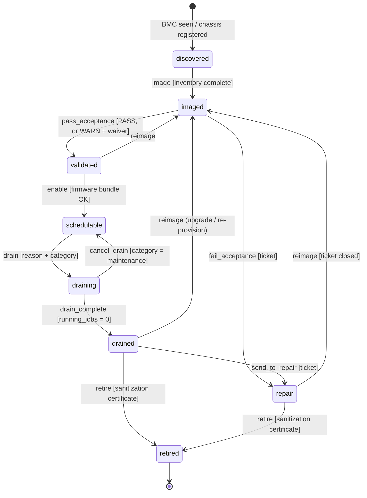
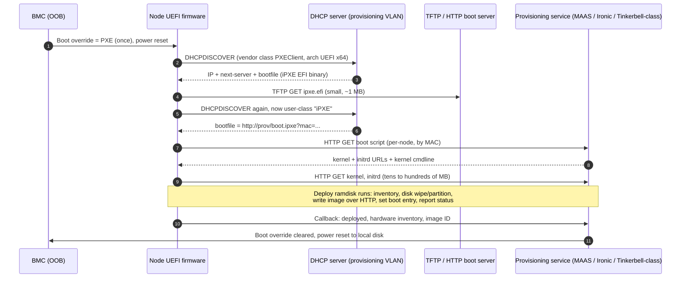
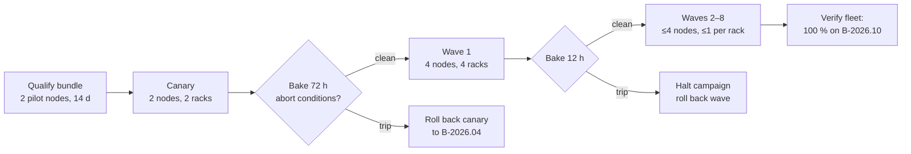

# Chapter 16 — Bare-Metal GPU Fleet Lifecycle

> A GPU cluster is not built once; it is built every day. Nodes arrive, get imaged, fail acceptance,
> get repaired, get upgraded in waves, fall off the bus at 3 a.m., and are eventually wiped and
> retired. Every transition is a chance to put a subtly broken machine into a 256-GPU job, where one
> throttling GPU silently taxes every other GPU in the job. This chapter treats the fleet as a
> system with a lifecycle: source-of-truth inventory, out-of-band control through the baseboard
> management controller (BMC), network imaging, fail-fast acceptance tests, firmware/driver
> compatibility matrices, staged upgrades with canaries and rollback, repair and RMA loops, and
> auditable decommissioning. The lab turns it into code.

## Learning objectives

After this chapter you will be able to:

1. **Explain** the node lifecycle (discovered → imaged → validated → schedulable → draining →
   drained → repair → retired) and **design** guarded transitions with an append-only audit trail.
2. **Operate** a node out-of-band through IPMI and Redfish (power, boot override, sensor and event
   logs, firmware inventory) and **explain** how PXE, iPXE, and UEFI HTTP boot deliver an image.
3. **Design** a node acceptance test that orders checks from cheap to expensive and covers GPU
   discovery, DCGM diagnostics, HBM ECC and row remapping, NVLink/NVSwitch health, PCIe link
   width/speed, NIC link and RDMA bandwidth, storage, thermals, burn-in, and a single-node NCCL test.
4. **Diagnose** acceptance failures from raw evidence (`nvidia-smi`, `lspci`, `ethtool`, `dcgmi`,
   `ib_write_bw`, `nvme`) and separate real defects from normal behaviour such as idle PCIe
   down-training and power capping.
5. **Build** a firmware/driver compatibility matrix as a set of validated *bundles* with a blocked
   list, and **calculate** a staged upgrade plan (canary, waves, bake time) whose blast radius and
   capacity loss are explicit.
6. **Plan** drain, repair, RMA, and replacement so that hardware returns to service only through
   acceptance, and **specify** decommissioning with media sanitization evidence.
7. **Quantify** the cost of a single bad node in a synchronous training job on ORION and use it to
   justify acceptance depth.

## Prerequisites and connections

You should be comfortable with the HX8 host topology from Chapter 5
([GPU Interconnects and Host Topology](../../part-2-accelerated-compute/ch05-gpu-interconnects-host-topology/)),
including `nvidia-smi topo -m`, PCIe switches, and GPU↔NIC locality; with Linux host diagnostics from
Chapter 3 ([Linux, Host Systems, and Performance Diagnostics](../../part-1-foundations/ch03-linux-host-systems-diagnostics/));
with RDMA verbs and perftest from Chapter 8 ([RDMA, RoCEv2, and InfiniBand](../../part-3-networking/ch08-rdma-rocev2-infiniband/));
with optics and link commissioning from Chapter 10 ([Switches, Optics, Cabling, and Physical-Layer Operations](../../part-3-networking/ch10-switches-optics-physical-layer/));
and with `all_reduce_perf` and bus bandwidth from Chapter 12
([Collective Communication and NCCL](../../part-4-distributed-ai/ch12-collective-communication-nccl/)).

This chapter is **Progressive Lab 7, part 1**. Part 2 is Chapter 17
([Kubernetes, Slurm, and Workload Scheduling](../ch17-kubernetes-slurm-scheduling/)), whose scheduler
treats only `schedulable` nodes from this chapter's state machine as eligible. Chapter 18
([Observability, SLOs, and Incident Response](../ch18-observability-slos-incident-response/)) consumes
the health signals defined here; Chapter 19
([Reliability, Security, and Multi-Tenancy](../ch19-reliability-security-multitenancy/)) builds fault
isolation and quarantine on top of the drain/repair loop; Chapter 20
([Infrastructure Automation and Safe Change](../ch20-automation-safe-change/)) generalises the canary
and wave mechanics to all fleet changes. **Capstone E** (bare-metal fleet lifecycle automation)
requires the state machine, acceptance plan, compatibility matrix, and canary/rollback design you
build here; **Capstone G** (fault-tolerant 512-node training) reuses the quarantine and
return-to-service rules.

**Acronyms** (defined here for readers who jump in): BMC baseboard management controller; CMDB
configuration management database; CPLD complex programmable logic device; DBE/SBE double-/single-bit
(uncorrectable/correctable) error; DCGM Data Center GPU Manager; ECC error-correcting code; HBM
high-bandwidth memory; IPMI Intelligent Platform Management Interface; MFU model FLOP utilisation;
MTTR mean time to repair; NCCL NVIDIA Collective Communications Library; OOB out-of-band; PXE
Preboot Execution Environment; RMA return material authorisation; SEL/SDR system event log / sensor
data record; TP/PP/DP tensor/pipeline/data parallelism; TPM Trusted Platform Module; UEFI Unified
Extensible Firmware Interface; VBIOS GPU video BIOS firmware; Xid NVIDIA driver error event.

## 16.1 The fleet as a system

A web fleet tolerates a few sick machines behind a load balancer; a GPU training fleet does not. A W-TRAIN step on ORION is a synchronous
collective across 256 GPUs (Chapter 11), so the step completes at the pace of the *slowest*
participant. One GPU that thermally throttles, one NIC that negotiated 200 Gb/s instead of 400 Gb/s,
one PCIe link that trained at x8 — each turns into a fleet-wide tax rather than a local one. That
asymmetry is the reason fleet lifecycle engineering exists as a discipline.

GPU fleets are also harder than CPU fleets because of **component count and early-life failures**
(an HX8 has 8 GPUs, 4 NVSwitch chips, 10 NICs, 8 NVMe drives, and dozens of firmware images; failure
rates follow the *bathtub curve*, and burn-in exists to move infant mortality out of production);
**tight version coupling** (driver, fabric manager, VBIOS, NIC firmware, RDMA stack, and kernel must
agree, so "upgrade the driver" is really a bundle change); and **expensive degradation** (a node out
of service removes 8 GPUs; a degraded node in service can remove far more, Section 16.6). The
Llama 3 paper (Meta, 2024) attributes most unexpected interruptions in its 54-day pretraining
snapshot to hardware, led by GPU and HBM faults. At thousands of GPUs *some* component fails every
day (the ORION-XL assumption), so the lifecycle must be routine, automated, and auditable.

### The lifecycle state machine

The core abstraction of this chapter is a per-node state machine with **guarded transitions** — a
transition happens only if its precondition (the *guard*) holds — and an **append-only audit log**
that records every attempted transition, accepted or rejected.



*Figure 16.1 — Node lifecycle state machine used throughout this chapter and its lab. Guards are in
brackets. Note what is* not *drawn: there is no edge from `repair` or `imaged` to `schedulable`.*

Three design rules are encoded in that diagram, each learned the hard way:

- **The only road to `schedulable` runs through `validated`** (or back from a cancelled
  *maintenance* drain). Repaired, re-imaged, and re-flashed nodes all re-enter at `imaged`. "The tech
  swapped the NIC, just resume it" is how a NIC with the wrong firmware ends up in a 256-GPU job.
- **A fault drain cannot be cancelled.** A node drained for a double-bit ECC error must go through
  `drained → repair → imaged → validated`; a maintenance drain (a PDU window) can be cancelled.
- **`retired` is terminal and requires sanitization evidence.** A chassis leaving the building with
  tenant data on its NVMe is a security incident.

Real fleets add sub-states (`burn_in`, `rma_shipped`), which is cheap; adding *edges* is where safety
erodes, so every new edge needs a guard and a reason.

> **Key idea:** A node lifecycle is a safety mechanism, not a status field. The value is in the edges
> you forbid and the evidence each allowed edge demands.

## 16.2 Inventory and the source of truth

Every lifecycle decision reads from an inventory (the CMDB or "source of truth"). It must record, per
node, *what should be here* (intended state) and *what is actually here* (discovered state); their
difference is a primary acceptance input.

| Category | Fields worth recording | Why it matters |
|---|---|---|
| Identity | Hostname, chassis serial, asset tag, rack/U position, BMC MAC and IP | Ties the logical node to a physical box a technician can find |
| GPU | Index, UUID, serial, PCIe BDF (bus:device.function), VBIOS, board part number | UUID and serial survive re-enumeration; index does not |
| NVSwitch / baseboard | Baseboard serial, NVSwitch firmware | Baseboard swaps are a common repair path on 8-GPU systems |
| NICs | BDF, MAC, port GUID, firmware, rail, leaf switch and port, cable/optic ID | GPU↔NIC↔rail mapping (Chapter 5) and switch-side correlation (Chapter 10) |
| Storage | NVMe serials, firmware, capacity, slot | Sanitization and RMA tracking |
| Firmware/software | BIOS, BMC, CPLD, kernel, driver, fabric manager, RDMA stack, image ID | Compatibility matrix checks (Section 16.7) |
| Lifecycle | State, drain reason and category, ticket, last acceptance run ID, waivers | Guards and audit |

*Table 16.1 — Minimum inventory fields for an HX8-class node.*

Two practical rules. **Key on immutable identifiers:** GPU index 3 is merely the fourth device the
driver enumerated and can change after a baseboard swap; a UUID or serial does not, and rank-to-device
correlation during incidents (Chapter 19) depends on recording UUID ↔ BDF ↔ NIC ↔ switch port at
acceptance. **Reconcile continuously:** discovery re-reads hardware at every boot and diffs it
against the record; a changed serial or a missing NVMe device is either an expected repair (with a
ticket) or an anomaly — never a silent update.

> **Pitfall:** Letting discovery overwrite the inventory. A node that lost a GPU then "becomes" a
> 7-GPU node and passes every check against the record. Humans write intended state through reviewed
> changes; agents write discovered state; acceptance compares the two.

## 16.3 Out-of-band management: BMC, IPMI, and Redfish

Every HX8 has a baseboard management controller (BMC): a small independent computer with its own
1 GbE port on the out-of-band (OOB) network (`172.16.0.0/16` on ORION). The BMC works when the host OS
is hung, powered off, or not yet installed. It provides power control, boot-device override, a serial
console (serial-over-LAN), sensors (temperatures, fans, PSU, power draw), a system event log (SEL),
and firmware inventory and update.

Two protocols expose it. **IPMI** (Intelligent Platform Management Interface) v2.0 is the
long-standing binary protocol, driven with `ipmitool` over `lanplus` (RMCP+): universal but dated,
with weak cipher suites on some implementations and OEM extensions for anything modern. **Redfish**
(DMTF DSP0266) is a RESTful HTTPS/JSON API with a schema-defined resource model
(`/redfish/v1/Systems`, `/Chassis`, `/Managers`, `/UpdateService`). Use Redfish for new automation;
keep IPMI for gaps.

Representative IPMI commands (Level 3 hardware; run only against lab or your own nodes):

```bash
# Read the password from the IPMI_PASSWORD environment variable (-E) instead of the command line.
ipmitool -I lanplus -H 172.16.1.11 -U fleetops -E chassis power status
ipmitool -I lanplus -H 172.16.1.11 -U fleetops -E sel elist | tail -5
ipmitool -I lanplus -H 172.16.1.11 -U fleetops -E sdr type Temperature
ipmitool -I lanplus -H 172.16.1.11 -U fleetops -E chassis bootdev pxe options=efiboot
```

```text
Chassis Power is on
 1a3 | 09/14/2026 | 02:41:07 | Temperature GPU6_Temp | Upper Critical going high | Asserted
 1a4 | 09/14/2026 | 02:41:09 | Processor CPU1_Status | Thermal Trip | Deasserted
 1a5 | 09/14/2026 | 02:58:30 | Power Supply PSU2_Status | Power Supply AC lost | Asserted
 1a6 | 09/14/2026 | 02:58:42 | Power Supply PSU2_Status | Power Supply AC lost | Deasserted
Inlet_Temp       | 30h | ok  |  7.1 | 24 degrees C
GPU6_Temp        | 4Bh | cr  | 41.6 | 92 degrees C
```

*Listing 16.1 — `ipmitool` power status, the tail of the SEL, and temperature sensors
[ILLUSTRATIVE]. Sensor names and SEL text are vendor-specific.*

The Redfish equivalents are plain HTTPS. The `Systems` member ID differs by vendor (for example
`1`, `Self`, or `System.Embedded.1`), so discover it from the collection rather than hard-coding it:

```bash
BMC=https://172.16.1.11
curl -sk -u fleetops:"$BMC_PASS" $BMC/redfish/v1/Systems | jq -r '.Members[]."@odata.id"'
curl -sk -u fleetops:"$BMC_PASS" $BMC/redfish/v1/Systems/1 | jq '{PowerState, BiosVersion, Boot}'
# One-time UEFI PXE boot, then a reset:
curl -sk -u fleetops:"$BMC_PASS" -X PATCH -H 'Content-Type: application/json' \
  -d '{"Boot":{"BootSourceOverrideTarget":"Pxe","BootSourceOverrideEnabled":"Once","BootSourceOverrideMode":"UEFI"}}' \
  $BMC/redfish/v1/Systems/1
curl -sk -u fleetops:"$BMC_PASS" -X POST -H 'Content-Type: application/json' \
  -d '{"ResetType":"ForceRestart"}' $BMC/redfish/v1/Systems/1/Actions/ComputerSystem.Reset
# Firmware inventory (what is actually flashed):
curl -sk -u fleetops:"$BMC_PASS" $BMC/redfish/v1/UpdateService/FirmwareInventory | jq '.Members | length'
```

*Listing 16.2 — Redfish discovery, boot override, reset, and firmware inventory (DMTF Redfish
resource paths; `-k` only for lab BMCs with self-signed certificates). Verify property support
against your BMC's schema, as implementations vary [VENDOR-SPEC, 2026-10].*

Firmware updates go through `UpdateService` (the `SimpleUpdate` action pulls an image from a URI;
many BMCs also accept a multipart push). BIOS, BMC, CPLD, and some device firmware activate only
after a reboot or AC power cycle, so automation must read back the *running* version afterwards
rather than trust the task's "Completed" status.

> **Safety:** The OOB network can power-cycle every node in the fleet in seconds. Isolate it (separate
> switches and VRF, no route from tenant networks), rotate BMC credentials from factory defaults on
> day one, disable IPMI cipher suite 0 and unused services, and rate-limit fleet-wide power actions
> in your automation (Chapter 20). Every example here targets a single lab node.

## 16.4 Imaging and provisioning

Provisioning turns a powered-on chassis into a configured operating system; the network boot chain
is still the backbone of bare-metal fleets.



*Figure 16.2 — UEFI PXE → iPXE → HTTP provisioning flow. The second DHCP exchange matches on the
iPXE user class (DHCP option 77) so the server hands iPXE a script instead of the iPXE binary again,
avoiding an infinite chainload loop.*

Why chainload? TFTP is lock-step (one block in flight, 512-byte blocks unless `blksize` negotiates
more) and collapses on large images; iPXE switches to HTTP(S) after the first ~1 MB. UEFI HTTP Boot
(vendor class `HTTPClient`) removes TFTP entirely where firmware supports it.

Once the deploy ramdisk is running, provisioning systems take one of two strategies:

| Strategy | How it works | Strength | Weakness |
|---|---|---|---|
| **Image-based** (golden image) | Write a versioned disk image, then minimal first-boot config (cloud-init-class) | Fast, byte-identical nodes; image ID is one inventory field | Rebuild per change; image sprawl |
| **Install-based** | OS installer with an answer file (autoinstall, kickstart), then configuration management | Flexible; small artefacts | Slow; drift between install dates |

*Table 16.2 — Provisioning strategies (diskless/stateless boot also exists but is rare on GPU
training nodes). GPU fleets favour versioned golden images because the bundle is part of the image.*

Open-source provisioning systems share one shape — machine inventory, BMC driver, boot service,
deploy agent, and their own state machine: MAAS (*New → Commissioning → Ready → Allocated →
Deployed*), OpenStack Ironic and Metal3 (*enroll → manageable → available → active*, with cleaning
between tenants), Tinkerbell (declarative workflows of containerised actions), and xCAT or Warewulf
at HPC sites. Choose by integration, cleaning requirements, scale, and BMC driver support — then map
*its* states onto your lifecycle states rather than letting the tool define your safety rules.

> **Production note:** Imaging all of ORION at once moves ≈ 6 GB [ILLUSTRATIVE] × 32 = 192 GB:
> ≥ 15 s from one 100 Gb/s (12.5 GB/s) port [MODELED], but disk, TLS, and frontend
> oversubscription (3:1 by port count, 1.5:1 by bandwidth) dominate. Stagger power-on by rack; cache images per frontend leaf.

### The post-image GPU node configuration

An HX8 is not usable until these pieces are present *and version-matched*:

- **GPU driver** plus `nvidia-persistenced`, so the driver stays initialised between jobs.
- **NVIDIA Fabric Manager** (`nvidia-fabricmanager`) on NVSwitch baseboards: it configures the
  NVSwitch fabric, CUDA applications fail to initialise until it has run, and its version must match
  the driver exactly [VENDOR-SPEC, 2026-10].
- **DCGM** (Data Center GPU Manager) host engine and exporter (Chapter 18).
- **RDMA stack and NIC firmware**, plus the GPUDirect RDMA path (`nvidia-peermem` or DMA-BUF,
  Chapter 13).
- **Vendor-recommended kernel parameters and BIOS settings** (IOMMU mode, PCIe ACS, power
  profile), versioned in the bundle rather than kept as tribal knowledge.
- **Host network config** for 8 rails: per-NIC /31s (`10.100.r.(2n+1)`), per-rail policy routing,
  IP MTU 9000, RDMA path MTU 4096, RoCE QoS (DSCP 26 → TC 3 with PFC; CNP DSCP 48) — Chapters 7–9.

## 16.5 Node acceptance testing

Acceptance answers one question: *is this node fit to join a synchronous multi-node job?* — not
"does it boot" or "does `nvidia-smi` show eight GPUs". Five principles: (1) **fail fast, cheap
first** — inventory and topology checks take seconds and catch many defects, so run them before the
24-hour burn-in; (2) **test what production stresses** — tensor cores, HBM, NVLink, PCIe to the NIC,
RDMA at line rate, sustained power and heat; (3) **judge against a versioned policy** (the lab's
`acceptance_policy.yaml`) and record which version judged each result; (4) **separate FAIL from
WARN** — a double-bit ECC error fails, a few corrected errors in burn-in warn and may be waived with a
recorded reason; (5) **keep the raw evidence**, because the history matters when the same GPU fails
again in six months.

```mermaid
flowchart LR
    A[Inventory diff<br/>serials, BDFs, firmware<br/>~1 min] --> B[PCIe topology<br/>gen/width, ACS, topo -m<br/>~1 min]
    B --> C[GPU discovery + DCGM r1<br/>count, HBM, ECC, row remap<br/>~2 min]
    C --> D[NVLink / NVSwitch<br/>links up, fabric state<br/>~2 min]
    D --> E[NIC link + RDMA<br/>speed, MTU, ib_write_bw per rail<br/>~15 min]
    E --> F[Storage<br/>NVMe count, SMART, fio read<br/>~10 min]
    F --> G[DCGM r3 + burn-in<br/>sustained stress, thermals<br/>hours]
    G --> H[Single-node NCCL<br/>all_reduce_perf 8 GPUs<br/>~10 min]
    H --> I{Policy verdict}
    I -->|PASS / WARN+waiver| J[validated]
    I -->|FAIL| K[repair + ticket]
```



*Figure 16.3 — Acceptance pipeline, cheap checks first. Durations are [ILLUSTRATIVE] planning
values; measure your own. Multi-node NCCL and fabric tests (Chapter 12) run after a group of nodes
is validated.*

### Discovery and PCIe topology

Start with what the PCIe bus and the driver can see. A GPU that has "fallen off the bus" is still in
the inventory but missing from `nvidia-smi`; the kernel log shows an Xid 79.

```bash
nvidia-smi -L | wc -l
nvidia-smi --query-gpu=index,pci.bus_id,pcie.link.gen.current,pcie.link.gen.max,pcie.link.width.current,pcie.link.width.max --format=csv
sudo lspci -vv -s 5d:00.0 | grep -E 'LnkCap:|LnkSta:'
sudo dmesg -T | grep -i xid
```

```text
8
index, pci.bus_id, pcie.link.gen.current, pcie.link.gen.max, pcie.link.width.current, pcie.link.width.max
0, 00000000:18:00.0, 1, 5, 16, 16
1, 00000000:2A:00.0, 1, 5, 16, 16
2, 00000000:3A:00.0, 1, 5, 16, 16
3, 00000000:5D:00.0, 1, 5, 8, 16
...
		LnkCap:	Port #0, Speed 32GT/s, Width x16, ASPM not supported
		LnkSta:	Speed 32GT/s, Width x8 (downgraded)
```

*Listing 16.3 — Discovery and PCIe link state [ILLUSTRATIVE output]. GPUs 0–2 report Gen 1 because
they are idle — normal power management. GPU 3's* width *is x8 while the GPU is under load (the
`lspci` line was captured during a stress run): a real defect.*

GPUs lower their PCIe link *speed* when idle to save power, so `pcie.link.gen.current` = 1 on an
idle GPU is expected; judge speed *under load*. Link *width* should not change with load; x8 where the
capability is x16 means a lane problem — a poorly seated board or riser, a damaged connector, or a
signal-integrity issue — and halves host bandwidth: PCIe Gen5 x16 is 32 GT/s × 16 lanes × 128/130 ÷
8 ≈ 63.0 GB/s per direction; x8 is ≈ 31.5 GB/s [MODELED]. Data loading, checkpoint staging, and any
GPU↔NIC path that crosses that link run at half rate. Chapter 5 shows how `nvidia-smi topo -m`
confirms the GPU↔NIC relationship (`PIX` on HX8) that this link carries.

### GPU health: DCGM diagnostics, ECC, and row remapping

DCGM's active diagnostic, `dcgmi diag`, runs at increasing *run levels* [VENDOR-SPEC, 2026-10;
durations and test lists vary by DCGM version and GPU — verify against current DCGM documentation]:

| Run level | Purpose | Typical use | Order of duration |
|---|---|---|---|
| `-r 1` (quick) | Deployment/software checks (driver, persistence, row-remap state) | Every boot; pre-job | Seconds |
| `-r 2` (medium) | Adds short functional tests (PCIe, memory) | Repair verification | Minutes |
| `-r 3` (long) | Adds Diagnostic (compute kernels), targeted stress/power, memory bandwidth | Acceptance; post-RMA | Tens of minutes |
| `-r 4` (extended) | Longest stress and memory coverage | Burn-in; intermittent faults | Hours |

*Table 16.3 — DCGM diagnostic run levels.*

```text
$ dcgmi diag -r 3
| Software            | Pass        |      | Targeted Stress     | Pass - All  |
| PCIe                | Pass - All  |      | Targeted Power      | Pass - All  |
| GPU Memory          | Pass - All  |      | Memory Bandwidth    | Pass - All  |
| Diagnostic          | Pass - All  |      |                     |             |
```

*Listing 16.4 — Condensed `dcgmi diag -r 3` result rows [ILLUSTRATIVE; the real output is a single
bordered table whose rows depend on the DCGM version]. Use `-j` for JSON output in automation.*

HBM errors deserve their own reading. H100-class GPUs protect HBM with ECC and handle failing memory
rows by **row remapping**: when an uncorrectable error (or a pattern of correctable ones) hits a
row, the driver records the row to be remapped to a spare, and the remap takes effect at the next GPU
reset. Until then the row remap is **pending** and the GPU should not run production work.

```bash
nvidia-smi -q -d ECC -i 2 | sed -n '/Volatile/,/Aggregate/p'
nvidia-smi -q -d ROW_REMAPPER -i 2
```

```text
        Volatile
            SRAM Correctable              : 0
            SRAM Uncorrectable            : 0
            DRAM Correctable              : 0
            DRAM Uncorrectable            : 0
    Remapped Rows
        Correctable Error                 : 0
        Uncorrectable Error               : 0
        Pending                           : Yes
        Remapping Failure Occurred        : No
```

*Listing 16.5 — ECC counters and row-remapper state for one GPU [ILLUSTRATIVE; field labels vary
slightly across driver versions]. Volatile counters reset when the driver reloads; aggregate counters
persist. A pending remap with zero volatile errors usually means the error happened before the last
driver reload.*

How to act on them:

- **Pending remap** → drain, reset the GPU (on NVSwitch baseboards follow the vendor procedure; a
  reset may need to cover all GPUs and the fabric manager), confirm `Pending: No`, re-run `dcgmi diag
  -r 3`. If it recurs, or **Remapping Failure Occurred: Yes**, the GPU is an RMA candidate.
- **Uncorrectable (DBE) during acceptance** → FAIL. Kernel-log signatures: Xid 48 (DBE, older
  GPUs); on A100/H100-class GPUs Xid 94 (*contained* error — only the affected application is
  killed; drain and reset at the next opportunity) and Xid 95 (*uncontained* — all work on the GPU is
  suspect; drain immediately and reset before reuse). Xid 63 records a row-remap event (reset
  needed to apply it); Xid 64 is a remap failure (RMA candidate) [VENDOR-SPEC, 2026-10].
- **Correctable (SBE) errors** → count them. A few during a 24-hour burn-in is normal; a GPU whose
  correctable count keeps climbing is predicting a failure. The lab policy warns above 10 volatile
  corrected errors during burn-in [ILLUSTRATIVE].

### NVLink and NVSwitch

On HX8 every GPU has 18 NVLink links to the 4 NVSwitch chips: 900 GB/s total bidirectional,
450 GB/s per direction per GPU [VENDOR-SPEC, 2026-10]. Check that all links are up and that the
fabric manager initialised the fabric:

```bash
nvidia-smi nvlink --status -i 0 | head -4
systemctl is-active nvidia-fabricmanager
nvidia-smi -q -i 0 | grep -A 2 -i '^ *Fabric'
```

```text
GPU 0: H100 80GB HBM3 (UUID: GPU-...)
	 Link 0: 26.562 GB/s
	 Link 1: 26.562 GB/s
	 Link 2: 26.562 GB/s
active
    Fabric
        State                             : Completed
        Status                            : Success
```

*Listing 16.6 — NVLink link status and fabric state [ILLUSTRATIVE]. 18 links × 26.562 GB/s ≈
478 GB/s raw signalling per direction, ≈ 450 GB/s usable per direction. A link reported as
inactive, or a fabric state other than Completed/Success, fails acceptance.*

### NICs and RDMA

For each of the 8 compute NICs and 2 frontend NICs, acceptance checks link state, negotiated speed,
MTU, PCIe width, firmware, and achieved RDMA bandwidth.

```bash
ethtool ens5np0 | grep -E 'Speed|Link detected'
ip -br link show ens5np0
ibv_devinfo -d mlx5_5 | grep -E 'fw_ver|state|active_mtu|link_layer'
# Pair test against a same-rail reference node; its server side must use matching flags:
#   ib_write_bw -d mlx5_5 -x 3 -F --report_gbits -s 65536 -D 10 -q 4
ib_write_bw -d mlx5_5 -x 3 -F --report_gbits -s 65536 -D 10 -q 4 10.100.5.3
```

```text
	Speed: 200000Mb/s
	Link detected: yes
ens5np0          UP             9c:63:c0:aa:10:05 <BROADCAST,MULTICAST,UP,LOWER_UP>
	fw_ver:				28.41.1000
			state:			PORT_ACTIVE (4)
			active_mtu:		4096 (5)
			link_layer:		Ethernet
 #bytes     #iterations    BW peak[Gb/sec]    BW average[Gb/sec]   MsgRate[Mpps]
 65536      3693010        0.00               193.62               0.369
```

*Listing 16.7 — A rail-5 NIC that negotiated 200 Gb/s [ILLUSTRATIVE]. The RDMA pair test reports
≈ 194 Gb/s average, consistent with the negotiated speed, not with a host problem. In duration
mode (`-D`) iterations ≈ BW × time / message size = 193.62 × 10⁹ × 10 / (65,536 × 8) ≈ 3.69 × 10⁶. `-x 3` selects
the RoCEv2 GID index on this host; look it up with `show_gids` or `rdma link`/`ibv_devinfo -v`
rather than assuming it.*

Low RDMA bandwidth *and* a 200 Gb/s link are one fault, not two: the link negotiated down —
typically an optic, cable, or lane fault, or a leaf port misconfiguration (Chapter 10). Fix the link
and the bandwidth follows. A healthy 400 Gb/s RoCEv2 pair test typically lands around 380–395 Gb/s at
64 KiB [ILLUSTRATIVE]; the lab policy fails below 360 Gb/s (90 % of line rate). Frontend NICs are
200 Gb/s *by design* — judge each NIC against its role.

> **Pitfall:** "Loopback" tests between two NICs in one host cross a spine (different rails) or may
> short-circuit inside the host. A pair test against a known-good *reference node on the same rail*
> exercises the path training uses: NIC → optic → rail leaf → optic → NIC.

### Storage

```bash
nvme list
sudo nvme smart-log /dev/nvme3 | grep -E 'critical_warning|media_errors|percentage_used'
# Read-only sequential read across all 8 drives (non-destructive; never run write tests on drives holding data)
sudo fio --name=seqread --rw=read --bs=1M --iodepth=32 --ioengine=libaio --direct=1 \
  --numjobs=1 --runtime=60 --time_based --group_reporting \
  --filename=/dev/nvme0n1:/dev/nvme1n1:/dev/nvme2n1:/dev/nvme3n1:/dev/nvme4n1:/dev/nvme5n1:/dev/nvme6n1:/dev/nvme7n1
```

Pass criteria on ORION: 8 NVMe devices present, `critical_warning` 0, `media_errors` 0, aggregate
sequential read ≥ 40 GB/s [ILLUSTRATIVE; eight PCIe Gen4 U.2 drives at ≈ 6–7 GB/s each give
≈ 48–56 GB/s, MODELED from VENDOR-SPEC-class drive ratings]. Chapter 14 explains why this local NVMe
bandwidth matters for checkpoint staging.

### Thermals and burn-in

Burn-in runs sustained, realistic load to surface infant-mortality and thermal failures: full-power
GEMM-class stress on all 8 GPUs at once (neighbours heat each other as in production), DCGM
`-r 3`/`-r 4` loops, memory stress, and network traffic. Duration is a cost/benefit decision; 12–48 hours is common [ILLUSTRATIVE]. During burn-in,
record per-GPU maximum temperature and **clock event (throttle) reasons**:

```bash
nvidia-smi --query-gpu=index,temperature.gpu,power.draw,clocks.sm,clocks_event_reasons.active --format=csv -l 60
nvidia-smi -q -d PERFORMANCE -i 6
```

```text
    Clocks Event Reasons
        Idle                              : Not Active
        Applications Clocks Setting       : Not Active
        SW Power Cap                      : Active
        HW Slowdown                       : Not Active
            HW Thermal Slowdown           : Not Active
            HW Power Brake Slowdown       : Not Active
        Sync Boost                        : Not Active
        SW Thermal Slowdown               : Active
```

*Listing 16.8 — Clock event (throttle) reasons on a hot GPU at its software thermal limit
[ILLUSTRATIVE]; HW thermal slowdown would trigger only a few °C higher. This book uses the
current field `clocks_event_reasons.active`; older drivers name it `clocks_throttle_reasons.active`
and the section "Clocks Throttle Reasons" — check `nvidia-smi --help-query-gpu`.*

**SW Power Cap** under full load is *normal* — the GPU is at its 700 W power limit. **HW/SW Thermal
Slowdown** or **HW Power Brake Slowdown** under acceptance load is a defect of the node or its
environment: blocked airflow, a failed fan, missing blanking panels, rack recirculation, or a PSU
event. The same hot slot on several nodes points at chassis or rack airflow; one hot GPU points at
that node. Correlate with BMC inlet temperature (Listing 16.1), fans, and the SEL. Burn-in is also a
facility test: 4 nodes × 10.2 kW ≈ 41 kW per rack at max, exactly the rack design point [MODELED
from reference values; Chapter 2].

### The single-node NCCL test

The last per-node test exercises the whole intra-node collective path: all 8 GPUs, NVLink, NVSwitch,
and the fabric manager, using the same library production jobs use.

```bash
./build/all_reduce_perf -b 8 -e 8G -f 2 -g 8
```

```text
#       size         count      type   redop    root     time   algbw   busbw #wrong     time   algbw   busbw #wrong
#        (B)    (elements)                               (us)  (GB/s)  (GB/s)            (us)  (GB/s)  (GB/s)
  4294967296    1073741824     float     sum      -1    16131  266.26  465.95      0    16118  266.48  466.34      0
  8589934592    2147483648     float     sum      -1    32170  267.02  467.29      0    32155  267.15  467.51      0
# Avg bus bandwidth    : 167.42
```

*Listing 16.9 — Tail of a single-node `all_reduce_perf` run on 8 H100-class GPUs, NCCL using NVLS [ILLUSTRATIVE].
Columns: out-of-place then in-place results. The "Avg bus bandwidth" averages over all sizes, so it
is dominated by small messages; acceptance compares the large-message `busbw`.*

Bus bandwidth normalises algorithm bandwidth to ring all-reduce link traffic:
busbw = algbw × 2(n − 1)/n = 267.02 × 1.75 = 467.3 GB/s for n = 8, matching the column [MODELED
check of ILLUSTRATIVE output]. A busbw above the 450 GB/s per-direction NVLink figure is possible
only because NCCL used in-switch reduction (NVLink SHARP, "NVLS") on the NVSwitches. With NVLS off
(`NCCL_NVLS_ENABLE=0`, or a driver/NCCL combination without NVLS) the ring ceiling is
algbw ≤ 450 / 1.75 ≈ 257 GB/s, i.e. busbw ≤ 450 GB/s, and healthy nodes measure below that
[MODELED ceiling; VENDOR-SPEC, 2026-10]. So an acceptance floor is meaningless without its
algorithm. Force it per run (`NCCL_ALGO=NVLS` or `NCCL_ALGO=Ring`), confirm from the
`NCCL_DEBUG=INFO` init log that NVLS actually initialised, record the NCCL version and algorithm,
and baseline each separately. With healthy ranges of ≈ 455–480 GB/s (NVLS) and ≈ 360–390 GB/s
(Ring) [ILLUSTRATIVE], the lab floors are baseline minus margin: 400 and 330 GB/s; a run with no
recorded algorithm fails (`NCCL_ALGO_UNRECORDED`). A node that passes every component test but fails here usually has a
fabric-manager, NVLink, or driver-configuration problem that component tests miss.

| Check | Tool / source | Pass criterion on ORION `[ILLUSTRATIVE thresholds]` | Failure code (lab) |
|---|---|---|---|
| GPU count, product, HBM | `nvidia-smi -L`, `--query-gpu` | 8 × H100-SXM-80GB, ≥ 81,000 MiB | `GPU_COUNT`, `GPU_PRODUCT`, `HBM_CAPACITY` |
| PCIe link (GPU, compute NIC) | `--query-gpu pcie.*`, `lspci -vv` | Gen5 x16 *under load* | `PCIE_DEGRADED` |
| NVLink | `nvidia-smi nvlink --status` | 18/18 links per GPU | `NVLINK_DOWN` |
| ECC / row remap | `nvidia-smi -q -d ECC,ROW_REMAPPER` | 0 volatile DBE; no pending remap or failure; SBE ≤ 10 (else WARN) | `ECC_DBE`, `HBM_ROW_REMAP_PENDING`, `HBM_ROW_REMAP_FAILURE`, `ECC_SBE_ELEVATED` |
| DCGM | `dcgmi diag -r 3 -j` | Level ≥ 3, Pass | `DCGM_DIAG_FAIL` |
| Thermals | burn-in log, throttle reasons | No thermal/power-brake slowdown; max < 87 °C | `THERMAL_THROTTLE` |
| NIC link | `ethtool`, `ibv_devinfo` | Up; 400 Gb/s compute, 200 Gb/s frontend; MTU 9000, `active_mtu` 4096 | `NIC_LINK_DOWN`, `NIC_SPEED`, `NIC_COUNT`, `NIC_MTU` |
| RDMA | `ib_write_bw` pair test per rail | ≥ 360 Gb/s | `RDMA_PAIR_BW_LOW` |
| Storage | `nvme smart-log`, `fio` | 8 drives, 0 media errors, ≥ 40 GB/s read | `NVME_COUNT`, `NVME_MEDIA_ERRORS`, `STORAGE_THROUGHPUT_LOW` |
| Collective | `all_reduce_perf -g 8` (+ NCCL version, algorithm) | busbw at 8 GiB ≥ 400 GB/s (NVLS) / ≥ 330 GB/s (Ring); algorithm recorded | `NCCL_BUSBW_LOW`, `NCCL_ALGO_UNRECORDED` |
| Kernel log | `dmesg`, journal | No Xid events during acceptance | `XID_PRESENT` |
| Firmware | inventory vs matrix | Exact production bundle | `FW_OFF_MATRIX`, `FW_DEPRECATED` (WARN) |

*Table 16.4 — HX8 acceptance checks, criteria, and the reason codes used by the lab evaluator.
Thresholds are [ILLUSTRATIVE] teaching values; derive yours from a measured baseline of known-good
nodes (median minus a margin informed by run-to-run spread).*

## 16.6 Worked example: acceptance economics for ORION

Halcyon AI's Fleet team is bringing 32 freshly racked HX8 nodes into service. Finance asks why
acceptance takes "a whole day per node" when the vendor already tested the hardware. We answer with
three calculations — the diagnostic loop in planning mode: which symptoms to expect, what evidence
catches them, and what missing them costs.

**Step 1 — How many defective nodes should we expect?** Assume early-life defect probabilities of
1.0 % per GPU, 1.0 % per backend link (NIC + optic + cable + leaf port), and 3 % per node for
everything else (DIMMs, NVMe, fans, PSUs, mis-flashed firmware) [ILLUSTRATIVE assumptions; use your
own vendor and RMA history]. Treating them as independent:

```text
P(node clean) = (1 − 0.01)^8  ×  (1 − 0.01)^8  ×  (1 − 0.03)
              = 0.99^16 × 0.97
              = 0.8515 × 0.97
              = 0.826                                           [MODELED]
E[defective nodes] = 32 × (1 − 0.826) = 32 × 0.174 ≈ 5.6 nodes
P(at least one defective node) = 1 − 0.826^32 = 1 − e^(32 × ln 0.826) = 1 − e^(−6.12) ≈ 99.8 %
```

Bad nodes are essentially certain — five or six expected, as in the lab's dataset.

**Step 2 — What does one undetected bad node cost W-TRAIN?** W-TRAIN runs TP = 8 inside each node,
PP = 4 and DP = 8 across nodes, with a modelled step time of 17.4 s at 40 % MFU (reference cluster).
Consider two different defects.

*Defect A: one GPU thermally throttles to 75 % of its normal throughput.* Every step waits for that
GPU. If the step were 100 % compute on the critical path, step time would scale by 1/0.75:

```text
Upper bound:   T_step = 17.4 s / 0.75 = 23.2 s
               throughput loss = 1 − 17.4 / 23.2 = 25 %
```

A more realistic split is 80 % compute and 20 % exposed communication [ILLUSTRATIVE split], where
only the compute portion stretches:

```text
T_step = 0.8 × 17.4 / 0.75 + 0.2 × 17.4 = 18.56 + 3.48 = 22.04 s
throughput loss = 1 − 17.4 / 22.04 = 21.1 %
GPU-equivalents lost = 256 × 0.211 ≈ 54 GPUs                     [MODELED]
```

One bad GPU costs the output of roughly 54 good ones — nearly seven nodes' worth.

*Defect B: one backend NIC negotiated 200 Gb/s instead of 400 Gb/s.* Its traffic is dominated by
the DP gradient all-reduce on that rail. Each GPU holds 70 × 10⁹ / (TP 8 × PP 4) = 2.19 × 10⁹
parameters, so its BF16 gradient shard is 2.19 × 10⁹ × 2 B = 4.375 GB. A ring all-reduce over
DP = 8 sends 2 × (8 − 1)/8 = 1.75 times that per GPU. Assume ≈ 90 % of line rate is achieved
(400 Gb/s = 50 GB/s line rate → ≈ 45 GB/s) [ILLUSTRATIVE]:

```text
bytes per GPU per step = 1.75 × 4.375 GB = 7.66 GB
at 400 Gb/s (≈ 45 GB/s achieved):   7.66 / 45   = 0.170 s
at 200 Gb/s (≈ 22.5 GB/s achieved): 7.66 / 22.5 = 0.340 s
added time if fully exposed = 0.170 s → 0.170 / 17.4 ≈ 1.0 % per step   [MODELED]
```

For this parallelism the half-speed NIC costs about 1 % (less with overlap) — but under
expert-parallel all-to-all, larger DP, or KV-cache transfer (Chapter 15) the same fault can dominate.
**The cost of a defect depends on whether the component sits on the job's critical path**, and
acceptance cannot know which job will land on the node, so it must reject both.

**Step 3 — Does a 24-hour burn-in pay for itself?** Using the per-node pipeline in Figure 16.3 with
DCGM `-r 3` budgeted at 45 minutes [ILLUSTRATIVE]:

```text
per node: 31 min quick checks + 45 min DCGM r3 + 1,440 min burn-in + 10 min NCCL = 1,526 min ≈ 25.4 h
all 32 nodes in parallel (racks at their 41 kW design point): ≈ 25.4 h wall clock
acceptance cost = 256 GPUs × 25.4 h ≈ 6,510 GPU-hours
cost of shipping Defect A for one week = 54 GPU-equivalents × 168 h ≈ 9,070 GPU-hours   [MODELED]
```

This assumes Defect A would otherwise run undetected for a week; production telemetry that flags
throttle reasons and step-time stragglers (Chapter 18) shortens that window, so treat 9,070 as an
upper bound. Even so, catching one thermal defect a week earlier repays the cluster's entire burn-in. Each extra hour
costs 256 GPU-hours and catches progressively fewer infant-mortality failures, so tune burn-in
duration from your own failure-time data.

> **Key idea:** Acceptance depth is justified by the *fleet-wide* cost of a degraded node in a
> synchronous job, not by the cost of the node itself.

## 16.7 Firmware and driver compatibility matrices

A compatibility matrix records which combinations of firmware and software are *qualified to run
together*. For an HX8 the coupled components include:

| Layer | Components | Typical coupling |
|---|---|---|
| Platform | BIOS/UEFI, BMC, CPLD, PSU firmware, NVMe firmware | BIOS settings for PCIe/IOMMU; BMC Redfish features |
| GPU | GPU VBIOS, NVSwitch firmware, GPU driver, fabric manager, CUDA user-mode, DCGM | Fabric manager version = driver version exactly; CUDA toolkit needs a minimum driver; VBIOS qualified per driver branch |
| Network | NIC firmware, RDMA stack (OFED/DOCA-class), `nvidia-peermem` / DMA-BUF path, switch NOS (Chapter 10) | NIC firmware ↔ RDMA stack supported pairs; GPUDirect RDMA needs driver + RDMA stack + kernel support |
| OS | Kernel, kernel parameters, container runtime + NVIDIA container toolkit | Out-of-tree modules (GPU driver, RDMA) built per kernel |

*Table 16.5 — Coupled components on an HX8-class node.*

Pairwise "A works with B" tables explode combinatorially and still miss three-way interactions. The
robust pattern is a small number of **validated bundles**: complete, named combinations of every
component, each qualified as a unit, plus a **blocked list** of versions known to be bad. A node is
compliant only if it matches a production bundle exactly.

```yaml
# compat_matrix.yaml (excerpt) [ILLUSTRATIVE version strings — not a statement about real products]
components: [bios, bmc_fw, kernel, gpu_driver, gpu_vbios, nic_fw, rdma_stack]
bundles:
  - id: B-2026.04
    status: production          # current fleet baseline
    versions: {bios: 2.4.1, bmc_fw: 1.12.0, kernel: 6.8.0-45-generic, gpu_driver: 550.127.08,
               gpu_vbios: 96.00.99.00.01, nic_fw: 28.41.1000, rdma_stack: '24.07'}
  - id: B-2026.10
    status: production          # upgrade target, qualified on 2 pilot nodes for 14 days
    versions: {bios: 2.6.0, bmc_fw: 1.14.2, kernel: 6.8.0-60-generic, gpu_driver: 570.86.15,
               gpu_vbios: 96.00.A5.00.01, nic_fw: 28.43.1014, rdma_stack: '24.10'}
blocked:
  - {component: nic_fw, version: 28.42.1000, reason: "intermittent 400G renegotiation under load"}
```

*Listing 16.10 — Bundle-style compatibility matrix used by the lab. Real matrices also pin the
fabric manager, CUDA user-mode, DCGM, container toolkit, and NVMe/PSU firmware; the lab trims the
list to keep the data readable.*

Rules that make a matrix useful in operations:

- **Check every node, every boot,** and report the *closest* bundle and mismatching components so
  the operator knows what to fix (the lab's `check_compat` returns `OK`, `DEPRECATED`, `OFF_MATRIX`,
  or `BLOCKED`).
- **Check per-device components per device.** A replacement NIC from the RMA depot arrives with
  factory firmware, so "seven NICs on one version, one on another" is a common off-matrix state that
  a node-level field would hide (`mlxfwmanager --query` shows each device).
- **Give bundles a lifecycle** — candidate → production → deprecated → retired — and keep at most two
  production bundles in the fleet: current and upgrade target.
- **Treat vendor matrices as inputs.** Release notes list supported combinations [VENDOR-SPEC,
  2026-10 — verify against current release notes]; your bundle is the subset *you* qualified on
  *your* hardware and workloads.

> **Vendor implementation note (NVIDIA):** On NVSwitch-based HGX baseboards the Fabric Manager
> package must be the same version as the GPU driver; a mismatch leaves the fabric uninitialised and
> CUDA applications fail to start. CUDA "forward compatibility" packages allow newer CUDA user-mode
> libraries on some older data-center driver branches, but within documented limits — pin the
> combination in the bundle rather than relying on it implicitly.

## 16.8 Staged upgrades: canary, waves, bake time, and rollback

Moving the fleet from B-2026.04 to B-2026.10 is a production change to 256 GPUs. The safe pattern —
generalised to all change types in Chapter 20 — is: **qualify → canary → bake → waves → verify**,
with explicit abort conditions and a rollback path decided *before* the first node is touched.

**Blast radius** — how many nodes a bad change reaches before you notice — has two caps on ORION:

- *Per-wave node cap:* **4 nodes per wave** (12.5 % of capacity). A W-TRAIN data-parallel replica
  is also 4 nodes (TP 8 × PP 4 = 32 GPUs), but a wave equals *one* replica only if replicas are
  **striped across racks** (each replica's 4 pipeline stages placed in 4 different racks), so that
  the per-rack cap below can still be met; then the job can continue at DP = 7 on 28 nodes if it
  restarts elastically (Chapter 19). Without striping, a 4-node, 4-rack wave touches up to 4 replicas,
  so align waves with checkpoint/restarts instead. (DP = 7 also changes the global batch unless
  gradient accumulation is adjusted — Training Infra's decision.) The lab planner enforces only the
  rack and wave caps; replica-aware wave selection is a design extension (exercise M2).
- *Per-rack cap:* **1 node per rack per wave**, so firmware that interacts badly with rack power or
  cooling (a new fan curve or power-capping behaviour) cannot take out a whole rack.

**Canary.** The first wave is a canary: 2 nodes in different racks, upgraded, re-accepted, returned
to production work, and *baked*. Bake time is set by the failure rates you want to catch. For a
regression that causes an intermittent fault at rate λ per node-hour (modelled as a Poisson
process), the probability of seeing at least one occurrence across N canary nodes in T hours is
1 − e^(−λNT):

```text
λ = 1 per 100 node-hours, N = 2, T = 72 h:
P(detect) = 1 − e^(−0.01 × 2 × 72) = 1 − e^(−1.44) = 1 − 0.237 ≈ 76 %          [MODELED]
For 95 % we need e^(−λNT) ≤ 0.05 → λNT ≥ ln 20 ≈ 3.0 → NT ≥ 300 node-hours
  → 2 nodes × 150 h, or 4 nodes × 75 h
```

A 2-node, 72-hour canary misses such a fault about a quarter of the time. Detection is bought with
canary *node-hours*: bake longer or widen the canary, trading exposure against calendar time.

**Wave plan for ORION.** Assume all 32 nodes start on B-2026.04, a per-wave duration of 3 h (drain
up to 1 h aligned to job checkpoints; flash and AC power cycle 1 h; re-acceptance with DCGM `-r 2`,
RDMA pair tests, and single-node NCCL 1 h), and a 12 h bake between waves [ILLUSTRATIVE planning
values]:

```text
canary:            2 nodes (rack-01, rack-02), 3 h + 72 h bake
remaining nodes:   30; per-wave cap 4; per-rack cap 1; largest rack remainder 4
waves needed:      max(ceil(30 / 4), ceil(4 / 1)) = max(8, 4) = 8 waves (7 × 4 nodes + 1 × 2 nodes)
calendar time:     (3 + 72) + 8 × (3 + 12) = 75 + 120 = 195 h ≈ 8.1 days
node-hours out:    32 nodes × 3 h = 96 node-hours = 768 GPU-hours
fraction of fleet capacity over the campaign: 96 / (32 × 195) = 96 / 6,240 ≈ 1.5 %     [MODELED]
```



*Figure 16.4 — Staged firmware/driver campaign for ORION with abort gates after the canary and every
wave (each of waves 2–8 has its own bake gate; collapsed here).*

**Abort conditions** are written down before the campaign starts and checked automatically: any
canary or wave node fails re-acceptance; single-node NCCL busbw below the bundle's baseline for the same NCCL algorithm by more
than the measured run-to-run spread (for example −3 % [ILLUSTRATIVE]); any new Xid class on an
upgraded node; RDMA pair bandwidth or link-flap counts worse than the B-2026.04 baseline; job-level
step time on upgraded nodes regressed; or any operator raises a stop. A tripped condition halts the
campaign — it does not merely log a warning.

**Rollback is per component, not per bundle.** The OS image, driver, and RDMA stack revert by
reimaging to the previous image ID; many BMCs and BIOSes keep the previous image in a second bank;
firmware with anti-rollback protection (security version numbers) cannot be reverted at all. The plan
states, per component, *how* and *whether* it reverts; irreversible components get longer
qualification and a smaller canary.

**Waves run through the state machine, never around it:** `drain` (category `maintenance`, reason
naming the change ID) → `drain_complete` → `reimage` with the new bundle → `pass_acceptance` →
`enable`. The scheduler-side drain is
`scontrol update NodeName=orion-n03 State=DRAIN Reason="CHG-7731 fw wave 1"` in Slurm, or
`kubectl cordon orion-n03` then `kubectl drain orion-n03 --ignore-daemonsets --delete-emptydir-data`
in Kubernetes (Chapter 17). A single large maintenance window trades blast radius for calendar time
(Table 16.7).

## 16.9 Drain, repair, RMA, and replacement

When a production node develops a fault (Xid 79, a DBE, a link that keeps flapping), the lifecycle
is: **contain → preserve evidence → repair → re-accept**.

1. **Contain.** Drain with category `fault` and a reason naming the evidence ("Xid 48 (DBE) on
   GPU3"). A Slurm `DRAIN` node takes no new jobs while running ones finish; a fault that kills
   running work requeues the job from its last checkpoint (Chapter 19). In Kubernetes a `NoExecute`
   taint evicts non-tolerating pods; `NoSchedule` only blocks new ones.
2. **Preserve evidence before touching anything** — reboots clear volatile ECC counters, logs, and
   GPU state. Capture `nvidia-bug-report.sh` (driver state, logs, and `nvidia-smi -q` in one
   archive), `dcgmi diag -r 1`, `dmesg`, the BMC SEL, and switch-port counters for the 8 backend
   links.
3. **Triage to the smallest replaceable unit:** reseat, reflash, swap optic/cable/NIC, and only then
   GPU, tray, or baseboard (often a vendor field-service action on HGX-class systems).
   Swap-to-isolate — does the fault follow the part or the port? — is the cheapest discriminating
   test for links (Chapter 10).
4. **RMA** with serials, failure signature, and diagnostic output; complete bundles shorten
   turnaround.
5. **Re-accept.** Repaired nodes re-enter at `imaged`; the reconciler flags new serials and the
   ticket explains them.

Track **MTTR** (mean time to repair, drain to `schedulable`) and **repeat offenders** — a slot whose
GPU has been replaced twice is telling you about the baseboard, cooling, or power. Size spares with
Little's law: with the reference node MTBF of 1,536 h, ORION sees λ = 32 / 1,536 per hour = 0.5
node-faults per day (a 256-GPU job is interrupted every ≈ 48 h); with a 5-day MTTR, nodes in repair
L = λW = 0.5 × 5 ≈ 2.5 [MODELED]. The number in repair is roughly Poisson with mean 2.5, so
P(≤ 2) = 54 %, P(≤ 3) = 76 %, P(≤ 4) = 89 %, P(≤ 5) = 96 % [MODELED]. W-TRAIN needs all 32 nodes, so
spares must sit *outside* the 32-node cluster: 4 spares keep the full job schedulable ≈ 89 % of the
time, 5 spares ≈ 96 %.

> **Pitfall:** "Resume after reboot." A node that threw Xid 79, rebooted, and now shows 8 GPUs has
> *not* been repaired; the fault is latent. Without a guard that forces re-acceptance, the node goes
> back into the next 256-GPU job and fails it hours later, costing every GPU in the job its progress
> since the last checkpoint.

## 16.10 Decommission and data sanitization

Retirement has legal weight: local NVMe holds dataset shards, checkpoint copies, and possibly tenant
data and secrets; the BMC holds credentials; the TPM may hold keys.

A decommissioning procedure:

1. **Drain** (`drained`); remove from scheduler, monitoring, DNS/IPAM, and access control; revoke
   host certificates and credentials.
2. **Sanitize media** following NIST SP 800-88 (*Guidelines for Media Sanitization*; check for the
   current revision), which defines **Clear**, **Purge**, and **Destroy**. For NVMe, Purge is
   normally a cryptographic erase or block erase through the NVMe Sanitize command, which also covers
   over-provisioned areas a file-level wipe cannot reach:

   ```bash
   sudo nvme id-ctrl /dev/nvme0 -H | grep -i -A4 'sanicap'    # which sanitize actions the drive supports
   sudo nvme sanitize /dev/nvme0 --sanact=4                    # 4 = crypto erase (if supported)
   sudo nvme sanitize-log /dev/nvme0                           # poll until sanitize completes
   ```

   Drives that cannot be purged, or that fail verification, are physically destroyed.
3. **Reset the BMC and BIOS** to factory defaults; clear the TPM if the platform policy requires it.
4. **Record a sanitization certificate**: serials of every sanitized device, method, tool and
   version, operator, date, and verification result. The lab's `retire` guard refuses the
   transition without a certificate ID.

> **Safety:** Sanitize commands are irreversible and some continue in the background across power
> cycles. Run them only on drives confirmed (by serial, not by device name) to belong to a node that
> is `drained` or in `repair` and approved for retirement.

## 16.11 Automating the lifecycle

Everything above becomes automation that is boring in the best sense: each transition is a small,
idempotent function with a guard, an action, and an audit record.

- **Single writer.** One lifecycle service owns the state; humans and bots submit *events*, never
  raw state edits, which keeps the audit log complete.
- **Audit every attempt.** A cluster of rejected `ILLEGAL_TRANSITION` events from one operator or
  bot is a training gap or an automation bug.
- **Idempotent actions.** Sending "drain" twice is safe; "reimage" checks the image ID first
  (Chapter 20).
- **Map lifecycle states to scheduler states,** so placement and lifecycle never disagree:

| Lifecycle state | Slurm node state (typical) | Kubernetes node (typical) |
|---|---|---|
| discovered / imaged / validated | Not in a partition, or `DOWN`/`DRAIN` with a reason | Not joined, or joined with a `NoSchedule` taint |
| schedulable | `IDLE` / `MIXED` / `ALLOCATED` | Ready, no lifecycle taint, GPU resources advertised |
| draining | `DRAINING` (drain flag set, jobs still running) | Cordoned (`spec.unschedulable: true`), pods finishing or being evicted |
| drained | `DRAINED` | Cordoned, no workload pods |
| repair / retired | `DOWN` or `DRAIN` with the ticket in the reason; removed when retired | Tainted `NoExecute`, or deleted from the cluster |

*Table 16.6 — Lifecycle-to-scheduler mapping. Chapter 17 explains each scheduler state and how a
mismatch shows up as "pending despite free GPUs".*

## 16.12 Hands-on lab overview

The lab ([lab/README.md](lab/README.md)) is **Level 1** (pure Python over committed synthetic ORION
data). In `lab/starter/fleet_lifecycle.py` you implement: (1) `check_compat` against the bundle
matrix, including per-NIC firmware lists; (2) `evaluate_node`, which applies the acceptance policy to
32 nodes' results containing planted defects *and* distractors that must not fail; (3) the guarded
state machine of Figure 16.1, replayed over a week of events that include illegal shortcuts; and
(4) the canary + wave planner of Section 16.8 against the fleet's mixed state. `python lab/check.py`
reports 33 PASS/FAIL/TODO checks. The chapter deliverable (exercise D1 in
[exercises.md](exercises.md)) uses your evaluator's output as evidence; the L2/L3 extension produces
the same JSON from real hardware.

## 16.13 Troubleshooting scenario: the canary that sees eight GPUs but runs nothing

**Symptom.** Change CHG-7731 upgrades the two canary nodes, orion-n01 and orion-n06, to B-2026.10.
Both reboot cleanly and `nvidia-smi` lists 8 GPUs on each. The re-acceptance
step then fails on both: `all_reduce_perf` exits immediately. The upgrade controller halts the
campaign (abort condition: canary fails re-acceptance) and pages the Fleet on-call.

**Evidence.** The on-call collects before changing anything:

```text
$ ./build/all_reduce_perf -b 8 -e 8G -f 2 -g 8
orion-n01: Test CUDA failure common.cu:... 'system not yet initialized'
$ systemctl is-active nvidia-fabricmanager
failed
$ journalctl -u nvidia-fabricmanager -b | tail -3
... fabric manager NVIDIA GPU driver interface version 550.127.08 don't match with driver version 570.86.15.
... Please update with matching NVIDIA driver package.
... Fabric Manager failed to start
$ nvidia-smi --query-gpu=driver_version,vbios_version --format=csv,noheader | sort | uniq -c
      8 570.86.15, 96.00.A5.00.01
$ dpkg-query -W -f='${Package} ${Version}\n' 'nvidia-fabricmanager*'
nvidia-fabricmanager-550 550.127.08-1
```

*Listing 16.11 — Canary evidence [ILLUSTRATIVE; exact log wording varies by version].*

**Hypotheses, ranked by prior and by cost to test:**

| # | Hypothesis | Supporting evidence | Discriminating test |
|---|---|---|---|
| H1 | Fabric manager not running because its version does not match the new driver | FM `failed`; journal names two different versions; CUDA "system not yet initialized" is the signature of an uninitialised NVSwitch fabric | Compare installed FM package version with `driver_version` |
| H2 | New VBIOS or NVSwitch firmware incompatible with the driver | Firmware changed in the same bundle | Do the 2 pilot nodes (same bundle, passed for 14 days) have the same VBIOS? |
| H3 | Hardware fault on both canaries | Both failed | Identical failures on two nodes right after one change make hardware unlikely |

**Root cause.** H1, confirmed directly: the B-2026.10 golden image installed the new driver but kept
the fabric-manager package pinned to the 550 branch. The pilot nodes passed qualification because
they were hand-built with the matching package. The matrix did not list `fabric_manager`, so
`check_compat` called the canaries compliant. Correlation (both failed after the change) pointed at
the change; the journal's version strings *proved* the mechanism.

**Fix (safe change).** Impact is limited to the two drained canaries. Add `fabric_manager` to the
matrix and to B-2026.10, rebuild the image with the matching package, add an image-build CI
assertion that the FM and driver versions match (Chapter 20), and record the hand-built-pilot gap in
the campaign review.

**Validation.** Reimage the canaries with the corrected image and run full re-acceptance: fabric
state `Completed / Success`, busbw 466 GB/s at 8 GiB, within 1 % of the B-2026.04 baseline
[ILLUSTRATIVE]. Only then does the 72-hour canary bake start, on the image that will actually ship.

The diagnostic loop in one line: symptom (NCCL fails on canary) → evidence (FM journal, versions) →
trace across layers (driver ↔ fabric manager ↔ NVSwitch ↔ CUDA) → root cause (unpinned coupled
component) → safe change (matrix + image + CI guard) → validation (re-acceptance, fresh bake).

## Trade-offs and design decisions

| Decision | Option | Wins when | Costs |
|---|---|---|---|
| Provisioning | Golden image | Fleet must be byte-identical; bundle = image ID | Image pipeline; rebuild per change |
| | Installer + config management | Heterogeneous fleet, frequent small config changes | Drift; slower; mirror state in the build |
| Acceptance depth | Quick (DCGM r1–r2, no burn-in) | Return-to-service after a software-only change | Misses thermal and infant-mortality faults |
| | Full (r3/r4, 12–48 h burn-in, NCCL, RDMA pairs) | New nodes, post-hardware-repair, post-firmware | ≈ 25 GPU-hours per GPU per run (Section 16.6) |
| Wave sizing | Small rolling waves (4 nodes, ≤ 1/rack) | Long-running training must keep going; unproven bundle | Calendar time (≈ 8 days for ORION) |
| | Large maintenance window (16–32 nodes) | Coordinated cluster-wide pause is acceptable; well-proven bundle | Blast radius; one bad flash hits half the fleet |
| Firmware update path | In-band (host OS tools) | Fast, scriptable, per-device | Depends on a healthy OS; driver conflicts |
| | Out-of-band (Redfish `UpdateService`) | Node is down or untrusted; uniform automation | BMC support varies; activation may need AC cycle |
| WARN handling | Strict vs waiver with expiry | Strict: small fleet with spares; waiver: large fleet with re-tests | Idle capacity vs waiver accumulation |

*Table 16.7 — Fleet lifecycle trade-offs [durations and costs ILLUSTRATIVE, from Sections 16.6 and
16.8].*

The rule of thumb: spend acceptance and canary effort in proportion to *how many GPUs a mistake can
reach* and *how hard it is to undo*. Irreversible firmware and fleet-wide changes deserve the
slowest path.

## Production operations notes: runbook excerpt

**Runbook FL-03 — Node fails acceptance or develops a hardware fault** [thresholds ILLUSTRATIVE]

| Signal | Threshold | Safe action | Escalate to |
|---|---|---|---|
| Xid 79 (fallen off bus), 48 or 95 (uncontained ECC), 64 (remap failure) | Any | Immediate `drain` category `fault`; capture `nvidia-bug-report.sh`, SEL, `dmesg` before reboot | Fleet on-call; vendor RMA if repeat |
| Xid 94 (contained ECC) | Any | Drain at next opportunity (job boundary), then GPU reset and `dcgmi diag -r 3` | Fleet |
| Xid 63 / row remap pending | Any | Drain; GPU reset per vendor procedure; `dcgmi diag -r 3`; RMA if pending recurs | Fleet |
| GPU PCIe width < x16 under load | Any | Drain; reseat in maintenance; re-accept | DC tech, then vendor |
| Thermal / power-brake slowdown in acceptance or production | Any occurrence under normal inlet temperature | Check inlet, fans, blanking panels, neighbours; drain if it recurs | Facilities (rack airflow), Fleet |
| Compute NIC speed ≠ 400 Gb/s or RDMA pair < 360 Gb/s | Any | Drain; check optic DOM, leaf port config, swap-to-isolate | Fabric (Chapter 10 runbook) |
| Firmware off-matrix or blocked | Any | Do not enable; reflash to the bundle; re-accept | Fleet |
| ECC correctable rising | > 10 per burn-in, or rising week-on-week | WARN; waiver with expiry; schedule DCGM `-r 4` | Fleet |

Sequence: drain via the lifecycle service → preserve evidence → ticket + `send_to_repair` →
repair the smallest replaceable unit → close ticket, `reimage` → full acceptance → `enable`.
**Never** resume a fault-drained node without re-acceptance, or run sanitize, flash, or fleet-wide
power actions outside an approved change with a blast-radius cap.

## Realism boundaries

> **Realism boundary:** The Level 1 lab teaches the *logic* of acceptance, compatibility, guards,
> and wave planning. It cannot show real failure signatures over time (a flapping link, a GPU that
> fails after 30 hours of burn-in), burn-in physics, or how a given BMC behaves during firmware
> activation; thresholds and version strings are teaching values. The evaluator checks NIC MTU 9000
> and RDMA `active_mtu` 4096 but not end-to-end path MTU through the fabric (Chapter 8). Section 16.6 assumes independent
> failures and a fixed compute/communication split, whereas real failures cluster (bad part
> batches, one hot rack). The L2/L3 extension runs the real commands and records a manifest.

## Summary

- In synchronous training one degraded node taxes the whole job (one throttling GPU ≈ 54 GPUs of
  lost output on ORION, modelled), so lifecycle rigour pays for itself.
- Guarded transitions plus an append-only audit log are the safety mechanism: the only road to
  `schedulable` runs through `validated`, fault drains cannot be cancelled, retirement needs
  sanitization evidence.
- Inventories separate intended from discovered state; Redfish drives the isolated OOB network;
  PXE → iPXE → HTTP delivers versioned golden images.
- Acceptance runs cheap checks first against a versioned policy, ending with burn-in and an
  algorithm-aware single-node NCCL test; idle PCIe down-training, `SW Power Cap`, and 200 Gb/s
  frontend NICs are normal.
- Compatibility matrices: validated bundles plus a blocked list, checked per device.
- Staged upgrades: canary in separate racks, bake sized by λNT, per-wave and per-rack caps,
  pre-declared abort conditions, per-component rollback.
- Repaired hardware returns only via re-acceptance; retirement needs a sanitization certificate.

## Review questions

Full exercises are in [exercises.md](exercises.md). Quick self-check:

1. Why is `pcie.link.gen.current = 1` on an idle GPU not a defect, while `pcie.link.width.current =
   8` under load is?
2. A canary of 3 nodes bakes for 48 h. What is the probability of catching a regression that faults
   once per 200 node-hours? (Answer: 1 − e^(−3 × 48 / 200) = 1 − e^(−0.72) ≈ 51 %.)
3. Which transition in Figure 16.1 would you have to add to let a repaired node skip acceptance, and
   why should you refuse to add it?

## Further reading

- **DMTF, *Redfish Specification* (DSP0266).** The authoritative resource model for boot override,
  reset actions, and `UpdateService`.
- **Intel, HP, NEC, Dell, *IPMI v2.0 Specification*.** Background for `ipmitool`, SEL, SDR, and
  RMCP+ cipher-suite risks.
- **NVIDIA, *DCGM User Guide*.** Current run-level definitions, test lists, and durations.
- **NVIDIA, *GPU Memory Error Management*, *Xid Errors*, and *Fabric Manager User Guide*.** ECC and
  row-remap semantics, Xid meanings, and the fabric-manager version rule.
- **NVIDIA `nccl-tests` (`PERFORMANCE.md`) and `linux-rdma/perftest`.** The busbw definition and the
  `ib_write_bw` semantics behind acceptance thresholds.
- **NIST SP 800-88, *Guidelines for Media Sanitization*; NVM Express, *NVMe Base Specification*
  (Sanitize).** Clear/Purge/Destroy and what crypto erase guarantees; read current revisions.
- **iPXE documentation; UEFI Forum, *UEFI Specification* (HTTP Boot); MAAS, Ironic, and Tinkerbell
  documentation.** The boot chain of Figure 16.2 and three designs for provisioning state machines.
- **Meta, *The Llama 3 Herd of Models* (2024).** A public account of interruption causes in
  large-scale pretraining.
- **Beyer et al., *Site Reliability Engineering* (O'Reilly, 2016).** The theory behind canaries,
  bake time, and staged rollout.
