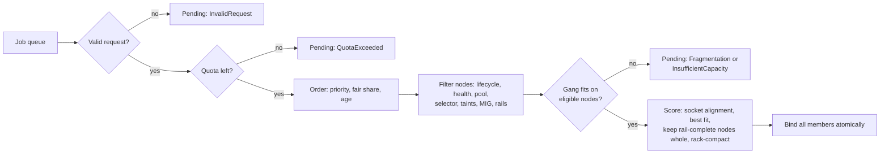
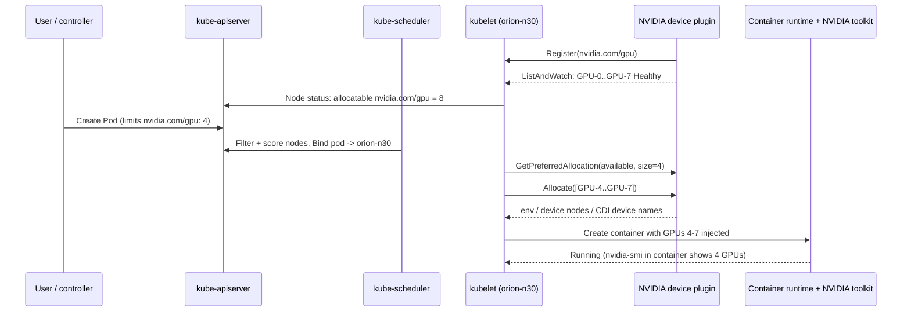
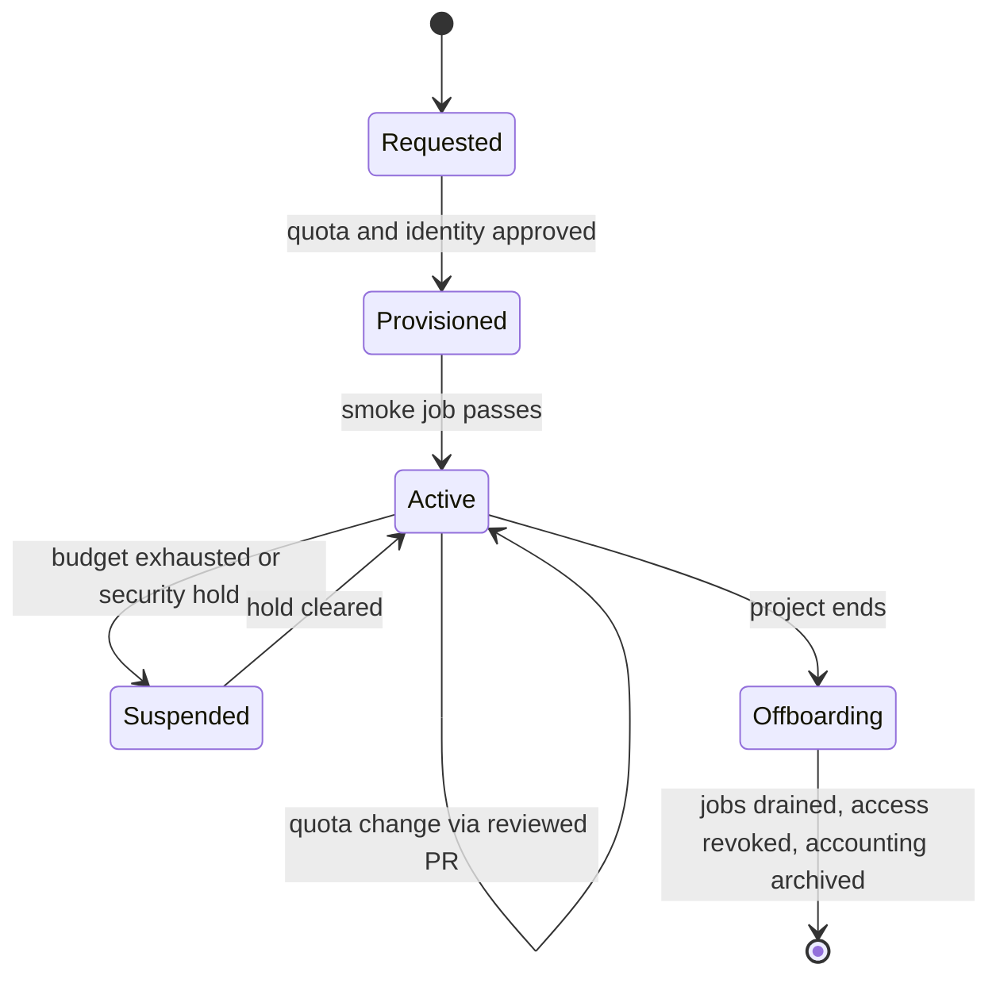

# Chapter 17 — Kubernetes, Slurm, and Workload Scheduling

> A GPU cluster is only as productive as the decisions that put work onto it. ORION has 256 GPUs,
> but at any moment some are allocated, some sit on nodes that are draining for a firmware wave,
> some are carved into MIG (Multi-Instance GPU) slices, some are reserved for one tenant, and the free ones may be
> scattered across nodes in a way that no 32-GPU training job can use. This chapter explains how
> Kubernetes and Slurm turn physical GPUs into schedulable resources, how gang scheduling, quotas,
> priority, and fair share decide *who* runs, how topology decides *where*, and how to diagnose the
> most common ticket a GPU platform team receives: "my job is pending but there are free GPUs."
> You will build a topology-aware gang scheduler simulator and an evidence-driven pending-job
> diagnoser over an ORION snapshot.

## Learning objectives

After this chapter you will be able to:

1. **Explain** how a GPU becomes a schedulable resource in Kubernetes (device plugin, extended
   resources, GPU Operator, Topology Manager) and in Slurm (`gres`, `select/cons_tres`), and where
   the physical count and the schedulable count can diverge.
2. **Configure** labels, node selectors, taints, tolerations, MIG, and time-slicing so that work
   lands only on nodes intended for it, and read the YAML and `slurm.conf` that express those
   intents.
3. **Calculate** gang feasibility, fragmentation, quota headroom, and fair-share ordering for a
   queue of jobs on ORION, and the GPU-hour cost of partial-allocation deadlock and preemption.
4. **Design** a workload placement policy that considers GPU type, intra-node and fabric
   topology, rail health, quotas, queue fairness, and gang placement.
5. **Compare** Kubernetes and Slurm for interactive inference, batch training, and tightly coupled
   multi-node jobs, and justify a hybrid split.
6. **Diagnose** a job that is pending despite apparently free GPUs by collecting scheduler,
   device-plugin, topology, quota, and node-health evidence, using the diagnostic loop.
7. **Integrate** scheduler state with the Chapter 16 node lifecycle so that only `schedulable`
   nodes receive work and drains are safe.

## Prerequisites and connections

You need the HX8 host topology from Chapter 5 ([GPU Interconnects and Host Topology](../../part-2-accelerated-compute/ch05-gpu-interconnects-host-topology/)):
GPU *i* and NIC *i* share a PCIe switch, GPUs 0–3 hang off socket 0 and 4–7 off socket 1, and all
eight GPUs share an NVLink/NVSwitch domain. You need the rail-optimized ORION backend from Chapter 7
([Ethernet and Data-Center Network Foundations](../../part-3-networking/ch07-ethernet-datacenter-network-foundations/)),
the parallelism layout of W-TRAIN from Chapter 11 ([Distributed Training Architecture](../../part-4-distributed-ai/ch11-distributed-training-architecture/)),
and the serving model from Chapter 15 ([LLM Inference and Serving Infrastructure](../../part-4-distributed-ai/ch15-llm-inference-serving/)).
Most directly, this chapter is **part 2 of Progressive Lab 7**: it consumes the node lifecycle
states produced in Chapter 16 ([Bare-Metal GPU Fleet Lifecycle](../ch16-bare-metal-fleet-lifecycle/)).

Later chapters build on this one. Chapter 18 ([Observability, SLOs, and Incident Response](../ch18-observability-slos-incident-response/))
turns scheduler signals (pending time, admission failures) into SLIs. Chapter 19
([Reliability, Security, and Multi-Tenancy](../ch19-reliability-security-multitenancy/)) extends
tenant isolation beyond quotas into identity, network, and secrets. Chapter 20
([Infrastructure Automation and Safe Change](../ch20-automation-safe-change/)) treats scheduler
policy as code that is rolled out in canaries. Chapter 21 ([Capacity, Power, and Infrastructure Economics](../ch21-capacity-power-economics/))
uses the utilization and fragmentation metrics defined here. Capstone E (fleet lifecycle
automation) and Capstone G (fault-tolerant 512-node training) both require a placement policy and
a quarantine-aware scheduler integration.

## 17.1 The scheduling problem on a GPU cluster

A scheduler answers five questions for every job, in order:

1. **Eligible?** Which nodes *may* run this job at all — correct pool, correct GPU type, healthy,
   in the `schedulable` lifecycle state, not reserved for someone else?
2. **Allowed?** Does the tenant have quota left for the job's GPUs?
3. **Ordered?** Among all allowed jobs, which goes first — by priority, then by fairness, then by
   age?
4. **Fits?** Is there a set of eligible nodes with enough free GPUs *in the right shape* — for a
   multi-node job, enough whole nodes, all at once?
5. **Where?** Among the sets that fit, which is best for the job's communication pattern and for
   the jobs that will come after it?

CPU-cluster schedulers spent decades on questions 2–3. GPU clusters make questions 1, 4, and 5 hard
for three reasons. First, the unit of allocation is coarse and expensive: one HX8 node is eight
GPUs, ≈ 10.2 kW, and — at an `[ILLUSTRATIVE]` fully loaded cost of $2.50 per GPU-hour — $20 per
node-hour. Second, the dominant training jobs are *gangs*: a W-TRAIN step needs all 256 ranks
present, so a job that has 31 of its 32 nodes is doing nothing at full cost. Third, the hardware
has internal structure the scheduler must respect: tensor parallelism (TP) of 8 must stay inside one
NVLink domain (one node), each GPU wants the NIC and CPU socket next to it, and a node with one
dead rail cannot carry its share of a rail-aligned all-reduce.


*Figure 17.1 — The scheduling decision pipeline used throughout this chapter and in the lab. Each
pending reason corresponds to a box that failed.*

> **Key idea:** "Free GPUs" is not a scheduling fact. A GPU is usable by a job only if it survives
> every filter in Figure 17.1 *and* sits in a shape the job's gang can use.

## 17.2 How a GPU becomes a schedulable resource in Kubernetes

### 17.2.1 Extended resources and the device plugin

The Kubernetes scheduler knows nothing about GPUs. It schedules opaque integers called
**extended resources**, such as `nvidia.com/gpu`, that the kubelet reports in each Node object's
`status.capacity` and `status.allocatable`. The kubelet learns those integers from a **device
plugin**: a node-local gRPC server that registers with the kubelet over a Unix socket in
`/var/lib/kubelet/device-plugins/`, streams the list of devices and their health through
`ListAndWatch`, and answers `Allocate` when a container is about to start. An optional
`GetPreferredAllocation` call lets the plugin suggest *which* device IDs to hand out — the hook the
NVIDIA plugin uses to prefer NVLink-connected sets on systems where GPUs are not all-to-all.

Extended resources have three properties that shape everything else in this chapter:

- **Integers only, no overcommit.** A pod asks for `nvidia.com/gpu: 1`, never 0.5. If both are
  given, the request must equal the limit. The scheduler will never place more requests than
  `allocatable` on a node.
- **The scheduler trusts `allocatable`, not the hardware.** If the device plugin is down or
  reports zero healthy devices, `allocatable` drops to 0 while `nvidia-smi` still lists eight GPUs.
  This divergence is the root of an entire class of "pending despite free GPUs" tickets.
- **Health is per device.** When the plugin sees a fatal event on a GPU (for example an Xid — the NVIDIA driver's error code — that
  NVML, the NVIDIA Management Library, reports as critical), it marks that device `Unhealthy` and `allocatable` drops by one. A node
  with 7 allocatable GPUs cannot run an 8-GPU pod, even though it is `Ready`.


*Figure 17.2 — GPU allocation path in Kubernetes, from device registration to a running container.
The scheduler chooses the node; the kubelet and device plugin choose the specific GPUs.*

Note the split of responsibilities in Figure 17.2: **the scheduler picks the node, the kubelet
picks the devices.** The default scheduler has no idea that GPUs 4–7 share socket 1 and NICs 4–7.
That knowledge lives in the kubelet's Topology Manager (Section 17.2.4) and in the device plugin's
preferred allocation — or, with Dynamic Resource Allocation (Section 17.3.4), in structured device
attributes the scheduler can see.

A minimal inference pod on ORION looks like this:

```yaml
# [ILLUSTRATIVE] TP=4 FP8 replica of the 70B chat model (W-INFER) on the ORION inference pool
apiVersion: v1
kind: Pod
metadata:
  name: chat-70b-replica-3
  namespace: inference
spec:
  priorityClassName: inference-prod
  nodeSelector:
    halcyon.ai/pool: infer
    nvidia.com/gpu.product: NVIDIA-H100-80GB-HBM3
  containers:
  - name: server
    image: registry.halcyon.example/serving/chat-70b:2026.10.1
    resources:
      limits:
        nvidia.com/gpu: 4        # integer; request defaults to the limit
        cpu: "48"
        memory: 400Gi
```

### 17.2.2 The GPU Operator and node labels

Installing the driver, container toolkit, and device plugin by hand on every node does not scale,
and version skew among them is a common outage cause. The **NVIDIA GPU Operator** packages them as
Kubernetes-managed components: driver (containerized or host-installed), container toolkit, device
plugin, **GPU Feature Discovery** (GFD), DCGM (Data Center GPU Manager) and its exporter, the MIG manager, and a
validator that runs a small CUDA workload before the node is considered ready for GPU pods.

GFD publishes node labels that selectors and policies use. On an HX8 node you would see labels such
as the following (values `[ILLUSTRATIVE]`; label keys `[VENDOR-SPEC, 2026-10]` — verify against the
GFD version you run):

```text
$ kubectl get node orion-n30 --show-labels | tr ',' '\n' | grep nvidia.com/
nvidia.com/gpu.count=8
nvidia.com/gpu.product=NVIDIA-H100-80GB-HBM3
nvidia.com/gpu.memory=81559
nvidia.com/gpu.family=hopper
nvidia.com/mig.capable=true
nvidia.com/mig.strategy=mixed
nvidia.com/cuda.driver.major=570
```

> **Pitfall:** product strings are exact. A selector written from a datasheet
> (`NVIDIA-H100-SXM5-80GB`) will not match the string NVML reports (`NVIDIA-H100-80GB-HBM3`), and
> the pod will wait forever with `didn't match Pod's node affinity/selector`. Copy label values
> from a live node, and validate selectors in CI against the label inventory (Chapter 20).

> **Vendor implementation note (NVIDIA):** the GPU Operator's component versions, label keys, and
> the MIG manager's `nvidia.com/mig.config` label values change between releases. Treat every key
> in this chapter as `[VENDOR-SPEC, 2026-10]` and check the release notes of the operator version
> you deploy. AMD's GPU Operator and device plugin expose `amd.com/gpu` with an analogous model.

### 17.2.3 Labels, selectors, taints, and tolerations

Kubernetes has two complementary mechanisms for steering work, and confusing them is the most
common policy bug on shared GPU clusters:

- **Labels + selectors/affinity attract.** A pod with `nodeSelector: {halcyon.ai/pool: infer}` may
  run only on nodes carrying that label.
- **Taints + tolerations repel.** A node tainted `halcyon.ai/dedicated=search:NoSchedule` refuses
  every pod that does not tolerate the taint.

A toleration *permits* a pod onto a tainted node; it does not *send* the pod there. To dedicate
`orion-n31` to the search tenant you need both: the taint keeps everyone else off, and a
selector (or required node affinity) keeps the search pods on. Without the selector, search pods
happily land on general nodes and consume general capacity, and the dedicated node sits idle.

```yaml
# [ILLUSTRATIVE] Dedicating orion-n31 to the search tenant
# kubectl label node orion-n31 halcyon.ai/dedicated=search
# kubectl taint node orion-n31 halcyon.ai/dedicated=search:NoSchedule
spec:
  nodeSelector:
    halcyon.ai/dedicated: search          # attract: only nodes with this label
  tolerations:
  - key: halcyon.ai/dedicated            # permit: tolerate the dedication taint
    operator: Equal
    value: search
    effect: NoSchedule
```

Taint effects matter. `NoSchedule` blocks new pods; `NoExecute` also evicts running pods that do not
tolerate it; `PreferNoSchedule` is only a scoring hint and never blocks placement. `kubectl cordon`
sets `spec.unschedulable: true`, which the scheduler treats as the taint
`node.kubernetes.io/unschedulable:NoSchedule`. That is the Kubernetes expression of Chapter 16's
`draining` state: running pods continue, nothing new lands. `kubectl drain` then evicts pods
(respecting PodDisruptionBudgets) to reach `drained`.

### 17.2.4 Topology Manager: aligning CPUs, memory, and devices

On an HX8, a 4-GPU inference replica pinned to GPUs 4–7 runs best with its CPU threads and memory on
socket 1 (NUMA node 1; NUMA = non-uniform memory access), next to those GPUs and NICs 4–7. If the kubelet hands it GPUs 4–7 but CPUs on
socket 0, every host-to-device copy and every NIC interrupt crosses the inter-socket link. Chapter 5
measured the cost of such cross-socket paths; Chapter 13 showed it on GPUDirect RDMA traffic.

The kubelet's **Topology Manager** collects NUMA *hints* from hint providers — the CPU Manager
(with the `static` policy and integer CPU requests in a Guaranteed-QoS pod), the Memory Manager, and
the Device Manager (device plugins that report NUMA affinity) — and admits the pod only if the
policy is satisfied:

| Policy | Behaviour | When to use on ORION |
|---|---|---|
| `none` | No alignment (default) | Never for GPU serving |
| `best-effort` | Prefer aligned; admit anyway | Mixed fleets during migration |
| `restricted` | Reject pod if preferred alignment impossible | Serving pods that must be aligned |
| `single-numa-node` | Reject unless all resources fit one NUMA node | 1/2/4-GPU replicas on HX8 |

*Table 17.1 — Kubelet Topology Manager policies. Policy names and the `container`/`pod` scope
setting are `[VENDOR-SPEC, 2026-10]` (Kubernetes 1.27+ GA); verify against your kubelet version.*

> **Pitfall:** Topology Manager rejection happens **on the node, after scheduling**. The scheduler
> binds the pod, then the kubelet refuses it with a `TopologyAffinityError` and the pod fails. A
> controller recreates it, the scheduler picks the same node, and you get a loop. Pair a strict
> kubelet policy with scheduler-visible information (a node label for "socket with 4 free GPUs"
> is not available by default) or with replica sizes that always fit a socket (1, 2, or 4 GPUs on
> an HX8, never 3 + 3 + 2 packing).

## 17.3 Sharing a GPU: MIG, time-slicing, and Dynamic Resource Allocation

ORION's W-INFER replicas use 4 or 8 whole GPUs. Many inference and development workloads need far
less: an embedding model, a reranker, a notebook. Giving each a whole H100 wastes most of 80 GB of
HBM (high-bandwidth memory) and most of the SMs (streaming multiprocessors). There are three ways to share.

### 17.3.1 Multi-Instance GPU (MIG)

**MIG** partitions one GPU into up to seven hardware-isolated instances, each with dedicated SMs,
L2 slices, memory controllers, and HBM capacity. Isolation is real: one instance cannot read
another's memory or steal its bandwidth beyond its slice. Profiles for an H100 80 GB are named
`<compute slices>g.<memory>gb`:

| Profile | Instances per GPU | Memory per instance | Typical ORION use |
|---|---|---|---|
| `1g.10gb` | 7 | ≈ 10 GB | Embedding/rerank models, notebooks |
| `1g.20gb` | 4 | ≈ 20 GB | Small LLMs with longer context |
| `2g.20gb` | 3 | ≈ 20 GB | Small LLM serving |
| `3g.40gb` | 2 | ≈ 40 GB | 7–13B models in BF16 |
| `4g.40gb` | 1 | ≈ 40 GB | Mixed with a `3g.40gb` |
| `7g.80gb` | 1 | ≈ 80 GB | Whole GPU, still MIG-mode |

*Table 17.2 — H100 80 GB MIG profiles `[VENDOR-SPEC, 2026-10]`. Valid combinations are constrained
by slice placement; verify with `nvidia-smi mig -lgip` on your driver.*

The device plugin exposes MIG in one of two **strategies**. With `single`, every GPU on the node
uses the same profile and the instances are advertised as `nvidia.com/gpu` (so a pod requesting
`nvidia.com/gpu: 1` gets one `1g.10gb` slice — surprising if you expected a whole GPU). With
`mixed`, each profile is its own resource, for example `nvidia.com/mig-1g.10gb: 56` on a node with
all eight GPUs in `all-1g.10gb`, and **`nvidia.com/gpu` drops to 0**. A pod that asks for a whole GPU
will never land there; that is planted case P07 in the lab.

```text
$ kubectl get node orion-n28 -o jsonpath='{.status.allocatable}' | tr ',' '\n'   # [ILLUSTRATIVE]
{"cpu":"222",
"memory":"2113309044Ki",
"nvidia.com/gpu":"0",
"nvidia.com/mig-1g.10gb":"56",
"pods":"110"}
```

Changing MIG geometry requires the GPU to be idle; the MIG manager does it in response to the
`nvidia.com/mig.config` node label, typically by draining GPU pods first. Treat a MIG
reconfiguration as a node lifecycle event (Chapter 16: `schedulable → draining → drained →
reconfigure → validated → schedulable`), not as a live tweak.

### 17.3.2 Time-slicing and MPS

**Time-slicing** makes the device plugin advertise each GPU *N* times (for example `replicas: 4`
turns 8 GPUs into 32 schedulable `nvidia.com/gpu`). The GPU context-switches between processes.
There is **no memory isolation and no fault isolation**: one process can exhaust HBM for all, and a
fatal error affects all. It is acceptable for development and CI; it is not acceptable for
multi-tenant production serving.

```yaml
# [ILLUSTRATIVE] Device-plugin sharing config (GPU Operator ConfigMap); keys [VENDOR-SPEC, 2026-10]
version: v1
sharing:
  timeSlicing:
    resources:
    - name: nvidia.com/gpu
      replicas: 4
```

**MPS** (Multi-Process Service) lets several processes share a GPU *concurrently* with limits on SM
share and memory, with weaker isolation than MIG. Both are configured through the device plugin;
consult the plugin documentation for the exact keys of your version.

### 17.3.3 Choosing a sharing mode

| Criterion | Whole GPU | MIG | MPS | Time-slicing |
|---|---|---|---|---|
| Memory isolation | Full | Hardware | Limits, shared address space risk | None |
| Fault isolation | Full | Strong | Weak | None |
| Performance predictability | Best | Good (fixed slice) | Medium | Poor under contention |
| Reconfiguration cost | None | Drain node | Restart daemon | Restart plugin |
| Multi-tenant production | Yes | Yes | With care | No |

*Table 17.3 — GPU sharing modes `[ILLUSTRATIVE]` qualitative comparison.*

### 17.3.4 Dynamic Resource Allocation (GA in 1.34)

Extended resources are a count. They cannot express "two GPUs on the same NVLink island", "a GPU and
the NIC on the same PCIe switch", or "a MIG slice of at least 20 GB". **Dynamic Resource Allocation
(DRA)** replaces counts with structured devices: drivers publish `ResourceSlice` objects describing
devices and their attributes, administrators define `DeviceClass`es, and workloads reference
`ResourceClaim`s (or per-pod `ResourceClaimTemplate`s) with selectors written in CEL (Common
Expression Language) over attributes. Because the scheduler itself sees the attributes, it can make
topology-aware decisions that with extended resources require the kubelet.

> **Version note:** DRA's structured-parameters model reached beta in Kubernetes 1.32 (the older
> "classic" DRA API was removed in 1.32), and the core API went GA in 1.34 as `resource.k8s.io/v1`
> `[VENDOR-SPEC, 2026-10]`; ORION's Kubernetes 1.30+ baseline must be ≥ 1.34 to rely on it.
> NVIDIA ships a DRA driver for GPUs separately from the classic device plugin. Feature gates,
> API versions, and driver maturity are moving quickly — verify against current Kubernetes and
> vendor documentation before relying on DRA in production.

## 17.4 Batch semantics on Kubernetes: gangs, queues, quotas, priority

The default `kube-scheduler` schedules **one pod at a time**. That is correct for stateless
services and wrong for distributed training.

### 17.4.1 Why gang scheduling is necessary

Suppose four HX8 nodes are free and two tenants each submit a 3-node PyTorch job (3 pods × 8 GPUs).
Pod-by-pod scheduling interleaves them: job A gets two pods placed, job B gets two pods placed, and
both are stuck waiting for a third node that will never come. All 32 GPUs are allocated, none
compute. If it happens at 22:00 and someone notices at 06:00:

```text
idle_gpu_hours = GPUs held × hours = 32 × 8 h = 256 GPU-hours              [MODELED]
cost           = 256 GPU-hours × $2.50/GPU-hour = $640                     [ILLUSTRATIVE price]
```

A **gang** (also called co-scheduling) is placed all-or-nothing: either every member gets resources
in the same scheduling decision, or none does. Three families of tools add gangs to Kubernetes:

- **Kueue** (a Kubernetes SIG project) is a *job-level admission* system. A job is suspended until
  Kueue admits its whole `Workload` against a `ClusterQueue`'s quota; then the pods are created and
  scheduled by the normal scheduler. Optional "wait for pods ready" semantics and topology-aware
  scheduling (TAS) strengthen the all-or-nothing guarantee and placement.
- **Volcano** is a batch scheduler that replaces or runs alongside `kube-scheduler`, with a
  `PodGroup` whose `minMember` must be satisfiable before any member binds, plus queues with weights.
- The **coscheduling plugin** from the Kubernetes scheduler-plugins project adds a `PodGroup` with
  `minMember` to the default scheduler framework.

All three implement the same principle. This book calls the class "gang schedulers" and shows Kueue
syntax because it composes with the default scheduler; the concepts transfer.

### 17.4.2 Quotas: ResourceQuota versus queue admission

A namespace `ResourceQuota` caps the sum of requests:

```yaml
# [ILLUSTRATIVE] Hard cap for the inference namespace
apiVersion: v1
kind: ResourceQuota
metadata: {name: gpu-quota, namespace: inference}
spec:
  hard:
    requests.nvidia.com/gpu: "48"
```

ResourceQuota is enforced **at pod creation** by API-server admission: a pod that would exceed it is
rejected, never Pending. The owning controller records a `FailedCreate` event on its ReplicaSet or
Job (`exceeded quota: gpu-quota, requested:
requests.nvidia.com/gpu=8, used: requests.nvidia.com/gpu=44, limited: requests.nvidia.com/gpu=48`);
*no pod exists*, so `kubectl get pods` shows nothing pending — a frequent source of confusion.

Kueue's `ClusterQueue` instead holds the *job* in a queue and admits it when quota is available,
with borrowing between queues in the same cohort:

```yaml
# [ILLUSTRATIVE] Kueue objects; apiVersion and field names are [VENDOR-SPEC, 2026-10] (v1beta1 era).
# Recent Kueue releases rename some fields (e.g. cohort) — verify against your installed CRDs.
apiVersion: kueue.x-k8s.io/v1beta1
kind: ResourceFlavor
metadata: {name: h100-sxm}
spec:
  nodeLabels:
    nvidia.com/gpu.product: NVIDIA-H100-80GB-HBM3
---
apiVersion: kueue.x-k8s.io/v1beta1
kind: ClusterQueue
metadata: {name: inference-cq}
spec:
  namespaceSelector: {}
  cohort: orion-infer
  preemption:
    reclaimWithinCohort: Any
    withinClusterQueue: LowerPriority
  resourceGroups:
  - coveredResources: ["nvidia.com/gpu"]
    flavors:
    - name: h100-sxm
      resources:
      - name: nvidia.com/gpu
        nominalQuota: 48
        borrowingLimit: 8
---
apiVersion: kueue.x-k8s.io/v1beta1
kind: LocalQueue
metadata: {name: inference, namespace: inference}
spec:
  clusterQueue: inference-cq
# Jobs opt in with the label  kueue.x-k8s.io/queue-name: inference
```

When quota is short, Kueue reports it on the Workload's conditions, for example
`QuotaReserved=False ... insufficient unused quota for nvidia.com/gpu in flavor h100-sxm, 4 more
needed` `[ILLUSTRATIVE]` message text.

> **Key idea:** quota is a *policy* limit, not a *capacity* limit. A job blocked by quota stays
> blocked even if half the cluster is idle. That is intended — but it must be visible, or users
> will report it as a scheduler bug.

### 17.4.3 Priority and preemption

`PriorityClass` objects assign an integer priority; the scheduler orders the pending queue by it
and, when a high-priority pod does not fit, may **preempt** (evict) lower-priority pods.

```yaml
# [ILLUSTRATIVE]
apiVersion: scheduling.k8s.io/v1
kind: PriorityClass
metadata: {name: inference-prod}
value: 100000
preemptionPolicy: PreemptLowerPriority
description: "Customer-facing serving; may preempt batch evaluation"
```

Preemption is cheap for a stateless replica and expensive for training. Preempting a 64-GPU
training job that checkpoints every 30 minutes loses, on average, half a checkpoint interval of
work plus the restart cost (≈ 15 min = 900 s, the book-wide figure, to reschedule, load the checkpoint, and warm up):

```text
lost = GPUs × (interval/2 + restart) = 64 × (0.25 h + 0.25 h) = 64 × 0.5 h = 32 GPU-hours   [MODELED]
```

On ORION the policy is therefore asymmetric: serving may preempt best-effort evaluation, training
may never be preempted by serving, and training is preempted only under Slurm's `preempt/qos`: jobs in a preemptible QOS (quality of
service), named in a higher QOS's `Preempt=` list, are requeued (`PreemptMode=REQUEUE`, Section 17.5).

### 17.4.4 Fair share

Priority answers "how important"; **fair share** answers "who has had less than their entitlement
recently". A simple fair-share key orders equal-priority jobs by the tenant's *share used*:

```text
share(tenant) = GPUs in use by tenant / tenant GPU quota
```

The tenant furthest below its entitlement goes first, and the share is recomputed after each
placement so one tenant cannot win every slot in a burst. Slurm's multifactor priority uses usage
*decayed over time* (Section 17.5.4); Kueue uses cohort borrowing and fair sharing weights. The lab
implements the simple instantaneous version above so that every decision can be checked by hand.

## 17.5 Slurm for GPU training

### 17.5.1 Architecture and resources

Slurm's controller (`slurmctld`) holds the whole cluster state and makes every scheduling decision;
`slurmd` on each node launches and monitors job steps; `slurmdbd` records accounting for fair share
and reporting. A job asks for nodes, tasks, and **generic resources** (`gres`); with the
`select/cons_tres` plugin, GPUs are trackable resources that can be allocated per node, per task,
or per job.

```ini
# [ILLUSTRATIVE] slurm.conf excerpt for ORION's training partition (verify keys for your Slurm version)
ClusterName=orion
SelectType=select/cons_tres
SelectTypeParameters=CR_Core_Memory
GresTypes=gpu
SchedulerType=sched/backfill
PriorityType=priority/multifactor
PriorityDecayHalfLife=7-0
PriorityWeightFairshare=10000
PriorityWeightQOS=20000
PriorityWeightAge=1000
PreemptType=preempt/qos
PreemptMode=REQUEUE
AccountingStorageType=accounting_storage/slurmdbd
AccountingStorageEnforce=associations,limits,qos
AccountingStorageTRES=gres/gpu
TopologyPlugin=topology/tree
HealthCheckProgram=/usr/sbin/nhc
HealthCheckInterval=300
HealthCheckNodeState=ANY

NodeName=orion-n[01-13,15-24] Sockets=2 CoresPerSocket=56 ThreadsPerCore=2 RealMemory=2000000 \
    Gres=gpu:h100:8 Feature=hx8,h100,rails8 Weight=100 State=UNKNOWN
# rail 3 down: lifecycle automation swaps rails8 -> rails7 and lowers Weight (Section 17.6)
NodeName=orion-n14 Sockets=2 CoresPerSocket=56 ThreadsPerCore=2 RealMemory=2000000 \
    Gres=gpu:h100:8 Feature=hx8,h100,rails7 Weight=10 State=UNKNOWN
PartitionName=train Nodes=orion-n[01-24] Default=YES MaxTime=7-00:00:00 State=UP
PartitionName=debug Nodes=orion-n[13-14] MaxTime=02:00:00 State=UP
```

```ini
# [ILLUSTRATIVE] gres.conf — bind GPUs to the cores of their socket so allocations stay NUMA-local
NodeName=orion-n[01-24] Name=gpu Type=h100 File=/dev/nvidia[0-3] Cores=0-55
NodeName=orion-n[01-24] Name=gpu Type=h100 File=/dev/nvidia[4-7] Cores=56-111
# Alternatively: AutoDetect=nvml (requires Slurm built with NVML support)
```

The `Cores=` binding is Slurm's equivalent of the Topology Manager: a 4-GPU job is steered to four
GPUs and cores on one socket. The 24/8 training/inference split is `[ILLUSTRATIVE]`: day to day,
pretraining runs at TP = 8, PP = 4 and DP ≤ 6 (≤ 24 nodes). The full 32-node, 256-GPU W-TRAIN gang
fits only when the inference nodes are moved into `train` through a lifecycle transition
(Section 17.7).

### 17.5.2 Partitions, QOS, and associations

A **partition** is a set of nodes with limits (time, node count, who may submit). A **QOS** (quality
of service) carries priority, preemption relationships, and group limits. An **association** ties a
user to an account and partition, with fair-share shares and limits. Tenant GPU quotas on ORION are
QOS group limits on TRES (trackable resources):

```bash
# [ILLUSTRATIVE] tenant onboarding in Slurm accounting
sacctmgr add account research Description="research experiments" Fairshare=2
sacctmgr add qos research Priority=100 GrpTRES=gres/gpu=48 MaxTRESPerUser=gres/gpu=16
sacctmgr modify account where name=research set QOS=research DefaultQOS=research
sacctmgr add user alice Account=research
```

A job that would exceed `GrpTRES=gres/gpu=48` stays pending with `QOSGrpGRES`; one over
`MaxTRESPerUser` shows `QOSMaxGRESPerUser` (verify reason strings for your version). These limits
are enforced **only** with `AccountingStorageType=accounting_storage/slurmdbd` and
`AccountingStorageEnforce` including `limits` and `qos`; without them they are silently ignored and
the tenant's quota is fiction.

### 17.5.3 Reading Slurm's view of the cluster

These four commands answer most questions. Outputs are `[ILLUSTRATIVE]`.

```text
$ sinfo -p train -N -o '%N %T %G %E'
NODELIST STATE GRES REASON
orion-n13 idle gpu:h100:8 none
orion-n14 idle gpu:h100:8 none
orion-n18 idle gpu:h100:8 none
orion-n19 drained gpu:h100:8 GPU5 uncorrectable ECC (RMA open)
orion-n20 mixed gpu:h100:8 none
orion-n21 mixed gpu:h100:8 none
orion-n22 idle gpu:h100:8 none
orion-n23 drained gpu:h100:8 fw-upgrade wave 2
...
```

State words to know: `idle`, `alloc` (fully allocated), `mixed` (partly allocated), `draining`
(DRAIN set, jobs still running — Chapter 16's `draining`), `drained` (DRAIN set, empty — Chapter 16's
`drained`), `down` (not responding or set down), `maint`/`resv` (reservation). A `*` suffix means
the node is not responding. `idle` in `sinfo` means *no job*, not *eligible for your job*.

```text
$ squeue -p train -o '%.8i %.10u %.12j %.2t %.10M %.5D %R'
   JOBID       USER         NAME ST       TIME NODES NODELIST(REASON)
   48302      alice    rs-2node PD       0:00     2 (Resources)
   48297      bob   pt-ablation PD       0:00     4 (Priority)
   48288    carol      sweep-32 PD       0:00     4 (QOSGrpGRES)
   48101   pretrain     w-train  R 2-03:11:42     8 orion-n[01-08]
```

`Resources` means the job is first in line and does not fit; `Priority` means higher-priority jobs
are ahead of it; `QOSGrpGRES` (or `QOSMaxGRESPerUser`) means a QOS GPU cap is reached; `ReqNodeNotAvail` means
nodes it requires are down, drained, or reserved.

```text
$ scontrol show node orion-n20 | egrep 'State|Gres|AllocTRES|CfgTRES|Reason'
   Gres=gpu:h100:8
   State=MIXED ThreadsPerCore=2 TmpDisk=0 Weight=1 Owner=N/A
   CfgTRES=cpu=224,mem=2000000M,billing=224,gres/gpu=8
   AllocTRES=cpu=56,mem=500000M,gres/gpu=4
```

```text
$ sacct -j 48101 -o JobID,Partition,AllocTRES%40,State,Submit,Start,Elapsed
JobID         Partition                         AllocTRES      State              Submit               Start    Elapsed
48101             train  billing=1792,cpu=1792,gres/gpu=64    RUNNING 2026-10-10T06:40:02 2026-10-10T06:52:19 2-03:11:42
```

The gap between `Submit` and `Start` (12 min 17 s here) is the job's queue wait — the raw material
for a scheduling SLI (service-level indicator) in Chapter 18. `sprio` shows the priority components of pending jobs and
`sshare` shows each account's fair-share factor; both are the first stop when a user asks "why
did their job start before mine?".

### 17.5.4 Multifactor priority and fair share

With `priority/multifactor`, a pending job's priority is a weighted sum of factors in [0, 1]:

```text
priority = W_qos × f_qos + W_fairshare × f_fs + W_age × f_age + W_jobsize × f_size + ...
```

Under the classic algorithm the fair-share factor is `f_fs = 2^(−U/S)`, where `U` is the account's
decayed normalized usage and `S` its normalized shares: an account that used exactly its share gets
0.5, one that used nothing gets 1.0. Current Slurm releases default to the **Fair Tree** algorithm,
which ranks accounts hierarchically instead; the intuition is the same `[VENDOR-SPEC, 2026-10]`.
With the weights above, QOS dominates (20,000), fair share comes next (10,000), and age only breaks
near-ties (1,000) — deliberately: on ORION production pretraining should not be overtaken
by a burst of small jobs merely because they waited longer.

### 17.5.5 Node health and the lifecycle hand-off

Slurm's `HealthCheckProgram` (commonly LBNL Node Health Check, NHC) runs on each node and sets `DRAIN` with a reason
for faults that make the node unsafe for *any* job — a GPU missing from `nvidia-smi`, a fatal Xid, all
backend rails down. A single dead rail is *not* a drain: it changes the node's feature/label
(Section 17.6). That is the scheduler-side half of Chapter 16's lifecycle: the fleet system decides
the state, the scheduler enforces it.

| Chapter 16 lifecycle state | Kubernetes expression | Slurm expression |
|---|---|---|
| `validated` (not yet in service) | Node joined, tainted `halcyon.ai/acceptance=pending:NoSchedule` | `State=DRAIN Reason="acceptance pending"` |
| `schedulable` | Uncordoned, no lifecycle taint | `State=RESUME` → `idle`/`mixed`/`alloc` |
| `draining` | `kubectl cordon` (+ `drain` for evictions) | `scontrol update NodeName=… State=DRAIN Reason=…` (shows `draining`) |
| `drained` | Cordoned, no GPU pods | `drained` |
| `repair` / `retired` | Cordoned or removed; `NoExecute` taint | `DOWN`/`DRAIN` with ticket ID; removed from `slurm.conf` when retired |

*Table 17.4 — Mapping Chapter 16 lifecycle states onto scheduler state. The fleet lifecycle system
is the source of truth; scheduler state is derived and reconciled from it (Chapter 20).*

> **Pitfall:** someone runs `scontrol update NodeName=orion-n23 State=RESUME` to "free up GPUs"
> while the firmware wave still has the node mid-upgrade. The node accepts a job, the upgrade
> reboots it, and a 16-GPU job dies. Never resume a node the lifecycle system has not returned to
> `schedulable`; make the lifecycle controller the only writer of node scheduling state.

### 17.5.6 Topology in Slurm: `topology.conf`, tree, and block

Slurm's `topology/tree` plugin describes the switch hierarchy so the scheduler can minimize the
number of leaf switches a job spans; users can demand it with `sbatch --switches=1@01:00:00`
(wait up to an hour for a single-leaf placement). A `topology/block` plugin (Slurm 23.11 and later
`[VENDOR-SPEC, 2026-10]`) models contiguous blocks such as an NVLink rack domain.

ORION's backend is unusual — and instructive. It is **rail-optimized and non-blocking**: rail leaf
*r* (`orion-be-leaf-rR`) connects NIC *r* of all 32 nodes. Any two nodes are one leaf hop apart *on every rail*, so in
`topology/tree` terms every node hangs off the same switch:

```ini
# [ILLUSTRATIVE] topology.conf for ORION-256: one rail plane reaches all 32 nodes, so the tree is flat
SwitchName=orion-be-leaf-r0 Nodes=orion-n[01-32]   # r1..r7 are identical; one entry suffices
```

On ORION, fabric-aware placement therefore buys nothing for same-rail traffic; what matters is
*intra-node* topology and *rail health* (Section 17.6). On ORION-XL (512 nodes, 3-tier Clos), the
picture changes: a rail leaf reaches only a block of nodes, cross-block traffic crosses spine and
super-spine tiers, and `topology.conf` must list leaf groups so that a 64-node job lands inside as
few blocks as possible.

```ini
# [ILLUSTRATIVE] ORION-XL fragment: 16 blocks of 32 nodes, each block one set of rail leaves
SwitchName=blk01 Nodes=orionxl-n[001-032]
SwitchName=blk02 Nodes=orionxl-n[033-064]
...
SwitchName=pod1 Switches=blk[01-08]
SwitchName=pod2 Switches=blk[09-16]
SwitchName=top  Switches=pod[1-2]
```

## 17.6 Topology-aware placement on ORION

"Topology-aware" means different things at different scales. On ORION there are five levels, and a
good policy treats each one explicitly.

```text
Level 4  Leaf block (ORION-XL only)   jobs inside as few blocks as possible; cross-block = spine hops
Level 3  Rack (rack-01 .. rack-08)    failure/power domain; Chapter 16 drains in rack waves
Level 2  Rail completeness            node needs all 8 backend rails up to join a multi-node gang
Level 1  Node (NVLink/NVSwitch)       TP=8 must stay inside one HX8; multi-node jobs take whole nodes
Level 0  Socket (NUMA 0 / NUMA 1)     GPUs 0-3 + NICs 0-3 + cores 0-55 | GPUs 4-7 + NICs 4-7 + cores 56-111
```
*Figure 17.3 — Placement levels on ORION, from the socket to the fabric. Each level contributes one
rule to the placement policy.*

**Level 0 — socket.** NVLink connects all eight GPUs all-to-all, so GPU↔GPU traffic does not care
about sockets. Host traffic does: data loading, tokenization, KV-cache offload, and the PCIe path
from GPU *i* to NIC *i* all prefer the socket that owns the GPU. A 4-GPU replica on GPUs 4–7 with
cores on socket 1 keeps every one of those paths local; a replica split 2 + 2 across sockets drags
half its host traffic over the inter-socket link. Rule: for jobs of 1, 2, or 4 GPUs, choose a socket
that can hold the whole job, and among those the one with the *fewest* free GPUs (best fit), so the
other socket stays whole for the next 4-GPU replica.

**Level 1 — node.** W-TRAIN's TP = 8 group exchanges activations every layer over NVLink
(Chapter 11). Splitting a TP group across nodes would move that traffic from 450 GB/s per direction
of NVLink to 50 GB/s per direction of one 400 Gb/s NIC — a 9× drop `[MODELED: 450 / 50]`. Rule:
multi-node jobs request whole nodes (8 GPUs per node); jobs larger than 8 GPUs that are not a
multiple of 8 are rejected as invalid requests rather than silently split.

**Level 2 — rail completeness.** In the rail-optimized backend, NCCL pairs GPU *i* with NIC *i* and
traffic on rail *i* stays on leaf *i*. A node with one rail down (in the lab, `orion-n14`, NIC3 no
carrier) has at most 7/8 of its inter-node bandwidth:

```text
node inter-node bandwidth = rails × 50 GB/s per direction = 7 × 50 = 350 GB/s vs 8 × 50 = 400 GB/s   [MODELED]
```

Because a synchronous collective runs at the speed of its slowest participant, one such node caps
the whole gang at roughly 7/8 of its communication bandwidth — and in practice NCCL may build an
asymmetric graph or fail initialization on that node (Chapter 12). Yet the node's NVLink domain is
perfect. Rule: rail-incomplete nodes are ineligible for multi-node gangs but **preferred** for
single-node 8-GPU work (fine-tuning, TP = 8 inference), which keeps rail-complete nodes whole for
the gangs that need them. Express it as attributes, not as a drain: in Slurm, lifecycle automation
swaps feature `rails8` for `rails7` and lowers the node's `Weight` (Slurm fills low-weight nodes
first), and multi-node jobs carry `--constraint=rails8` (set by a job-submit plugin); in Kubernetes,
a label `halcyon.ai/rails-complete=false` plus required node affinity on `true` for gang workers.

**Level 3 — rack.** On ORION the backend gives no reason to prefer one rack over another. The rack
still matters as a *failure and maintenance domain*: a PDU (power distribution unit), a CDU (coolant distribution unit) loop, or a Chapter 16 upgrade wave
takes out a rack at a time. If each rack independently suffers a disruptive event with probability
*p* per day, a job spanning *k* racks is hit with probability 1 − (1 − *p*)^*k* ≈ *k·p* for small *p*:
a 2-node job packed into one rack has about half the exposure of the same job spread over two
`[MODELED]`. Rule: for multi-node gangs, fill racks that have the most whole-free nodes first
("rack-compact").

**Level 4 — leaf block (ORION-XL).** Only at ORION-XL scale do leaf groups matter for bandwidth;
that is where `topology.conf` blocks and Kueue topology-aware scheduling earn their keep
(Section 17.5.6).

> **Key idea:** topology awareness is mostly about *not wasting shape*. Best-fit inside sockets and
> nodes, steering single-node work onto nodes that are useless to gangs, and packing gangs into
> racks all preserve whole, healthy nodes for the jobs that cannot run anywhere else.

## 17.7 Kubernetes or Slurm? Matching scheduler to workload

The two systems grew from different worlds. Kubernetes schedules long-running *services*:
declarative desired state, controllers that reconcile it, health probes, rolling updates, service
discovery, and autoscaling. Slurm schedules *jobs*: a queue, a priority function, accounting, gangs
by construction (a job's allocation is atomic), and a launcher (`srun`) that starts tightly coupled
MPI/NCCL processes in lock-step. Each has grown toward the other — Kueue, Volcano, and the Kubeflow
training operators on one side; container plugins, REST APIs, and Slurm-on-Kubernetes projects on
the other — but their defaults still differ.

| Criterion | Interactive inference (W-INFER) | Batch training, single node | Tightly coupled multi-node (W-TRAIN) |
|---|---|---|---|
| Unit of work | Long-lived replica behind a load balancer | Job with finite run time | 32-node gang, hours to weeks |
| What matters most | Availability, rollout safety, autoscaling, p95 latency | Throughput, fairness, queue wait | All-or-nothing start, topology, restart from checkpoint |
| Kubernetes default | Strong: Deployments, Services, autoscalers, PodDisruptionBudgets, probes | Adequate with Kueue quotas | Needs gang admission (Kueue/Volcano), a training operator, topology labels |
| Slurm default | Weak: no service abstraction, no rolling update | Strong: queue, fair share, accounting | Strong: atomic allocation, `srun` launch, `--switches`, QOS preemption/requeue |
| Health integration | Probes + device-plugin health + node conditions | NHC drain | NHC drain + requeue |
| Who adapts more | Slurm users | Neither | Kubernetes users |

*Table 17.5 — Kubernetes versus Slurm for the three workload classes `[ILLUSTRATIVE]` qualitative
assessment. "Default" means without significant add-ons.*

Halcyon AI's choice for ORION — Slurm for the training pool, Kubernetes for inference and platform
services — follows the table. The cost of a hybrid is two control planes that must agree on node
state. The rule that keeps it safe is the one from Section 17.5.5: **the fleet lifecycle system owns
node state; both schedulers derive from it**, and a node belongs to exactly one scheduler at a time.
Moving a node between pools is itself a lifecycle transition (`schedulable` in Slurm → `draining` →
`drained` → relabel and rejoin → `validated` → `schedulable` in Kubernetes), never a hot handover.

> **Production note:** organizations that run *only* Kubernetes for large training succeed when
> they install the full stack — gang-capable admission, a training operator, topology labels for
> blocks, and checkpoint-aware restart — and measure gang time-to-start as an SLI.

## 17.8 The multi-tenant lifecycle

A tenant on ORION is a team with a budget of GPUs. Its lifecycle mirrors a node's: provisioned,
active, changed, suspended, offboarded.


*Figure 17.4 — Tenant lifecycle. Every transition is a change to scheduler objects and is made
through reviewed configuration (Chapter 20), not ad-hoc commands.*

| Step | Kubernetes objects | Slurm objects |
|---|---|---|
| Provision | Namespace, RBAC (role-based access control) RoleBinding, LocalQueue → ClusterQueue (nominal quota), ResourceQuota, default PriorityClass, NetworkPolicy | `sacctmgr` account (Fairshare), QOS (`GrpTRES=gres/gpu=N`, priority), user associations, partition access |
| Smoke test | 1-GPU Job through the LocalQueue; verify admission and placement | `srun -A <acct> --gpus=1 nvidia-smi -L` |
| Change quota | PR to ClusterQueue `nominalQuota`; policy check (Chapter 20) | PR to QOS `GrpTRES`; applied by automation |
| Suspend | ClusterQueue `spec.stopPolicy: Hold` (or `HoldAndDrain` to evict admitted work); verify for your Kueue version | `sacctmgr modify qos <q> set GrpTRES=gres/gpu=0`; hold pending jobs |
| Offboard | Delete LocalQueue after jobs finish; revoke RBAC; archive usage | Remove associations; keep `slurmdbd` records for chargeback |

*Table 17.6 — Tenant lifecycle operations. Commands and fields `[ILLUSTRATIVE]`; verify against your
versions.*

Quotas may sum to more than the cluster only if borrowing and preemption rules make the overcommit
safe. In the lab the quotas sum to 160 + 48 + 32 + 48 + 8 = 296 GPUs against 256 physical — an
overcommit of 296 / 256 = 1.16× `[ILLUSTRATIVE]`, acceptable because the pretraining quota is rarely
fully used and quota does not guarantee capacity. Chapter 19 extends isolation from quotas to
identity, network, storage, and secrets.

## 17.9 Worked example: Monday morning on ORION

The lab's snapshot is ORION at 09:00 on a Monday. Twelve jobs are running and fifteen are queued.
The Grafana panel says **105 GPUs free**. The pretraining lead asks why the 32-GPU ablation (J01),
the earliest priority-50 submission, has not started. We work through Figure 17.1 by hand. All values are
`[SIMULATED]` from `lab/data/` (seed 17).

**Step 1 — Allocated and apparently free GPUs.** Running jobs hold:

```text
pretrain  = 64 (n01–n08) + 32 (n09–n12)                         = 96
research  = 16 (n15–n16) + 2 (n20 GPUs 0–1)                      = 18
finetune  = 8 (n17) + 2 (n21 GPUs 4–5)                           = 10
inference = 8 + 4 + 2 + 1 + 4 + 8 (n25, n26, n27 ×2, n29, n32)   = 27
allocated = 96 + 18 + 10 + 27 = 151
apparent free = 256 − 151 = 105 GPUs
```

**Step 2 — Remove ineligible GPUs (filters).** `orion-n19` is in `repair` (GPU5 uncorrectable ECC),
`orion-n23` is `drained` for firmware wave 2, `orion-n28` has MIG enabled (its eight GPUs are 56
`1g.10gb` slices, not whole GPUs), and `orion-n31` is dedicated to the search tenant:

```text
ineligible for general whole-GPU work = 4 nodes × 8 = 32 GPUs
usable by a general job = 105 − 32 = 73 GPUs
  train pool: n13 8 + n14 8 + n18 8 + n20 6 + n21 6 + n22 8 + n24 8 = 52
  infer pool: n26 4 + n27 5 + n29 4 + n30 8                        = 21      (52 + 21 = 73 ✓)
```

**Step 3 — Shape.** A multi-node gang needs whole, rail-complete nodes. `orion-n14` has rail 3
down, so the whole-free, rail-complete training nodes are n13, n18, n22, n24:

```text
largest placeable training gang = 4 nodes × 8 = 32 GPUs (not 52)
```

**Step 4 — Quota headroom.** Quota minus use: pretrain 160 − 96 = 64; research 48 − 18 = 30;
finetune 32 − 10 = 22; inference 48 − 27 = 21; search 8 − 0 = 8. Research job J03 (32 GPUs) already
fails: 18 + 32 = 50 > 48. J04 asks for 12 GPUs, more than one node and not a multiple of 8 — an
invalid request under the whole-node rule.

**Step 5 — Order and place.** Starting shares (used / quota): search 0/8 = 0; finetune 10/32 =
0.3125; research 18/48 = 0.375; inference 27/48 = 0.5625; pretrain 96/160 = 0.600. Priority 100 goes
first, then priority 50 by share, then 10, then 5, recomputing shares after each placement:

| # | Job | Tenant, GPUs, prio | Share at pick | Result | Why |
|---|---|---|---|---|---|
| 1 | J10 | inference, 4, 100 | 27/48 = 0.5625 | n26 GPUs 4–7 | Socket 1 exactly fits (best fit); n29 ties, loses on name |
| 2 | J05 | pretrain, 16, 100 | 96/160 = 0.600 | n22 + n24 | Rack-compact: rack-06 has 2 whole-free nodes |
| 3 | J12 | search, 8, 50 | 0/8 = 0 | n31 | Selector + toleration for the dedicated node |
| 4 | J02 | finetune, 8, 50 | 10/32 = 0.3125 | n14 | Single-node: prefers the rail-degraded node |
| 5 | J03 | research, 32, 50 | 18/48 = 0.375 | QuotaExceeded | 18 + 32 = 50 > 48 |
| 6 | J04 | research, 12, 50 | 18/48 = 0.375 | InvalidRequest | 12 > 8 and 12 mod 8 ≠ 0 |
| 7 | J08 | research, 16, 50 | 18/48 = 0.375 | n13 + n18 | The last two whole rail-complete nodes |
| 8 | J07 | finetune, 4, 50 | 18/32 = 0.5625 | n20 GPUs 4–7 | Aligned; ties n21 on score, wins on name |
| 9 | J11 | inference, 2, 50 | 31/48 = 0.6458 | n29 GPUs 0–1 | Best fit (2 left) beats n27 (3 left) |
| 10 | J13 | inference, 8, 50 | 33/48 = 0.6875 | n30 | Only whole-free eligible inference node |
| 11 | J01 | pretrain, 32, 50 | 112/160 = 0.700 | InsufficientCapacity | No whole nodes left; 2 + 6 = 8 free < 32 |
| 12 | J15 | inference, 1, 50 | 41/48 = 0.8542 | n29 GPU 2 | Best fit (1 left) |
| 13 | J06 | research, 8, 10 | 34/48 = 0.7083 | Fragmentation | 2 (n20) + 6 (n21) = 8 free, no node has 8 |
| 14 | J14 | inference, 8, 10 | 42/48 = 0.875 | QuotaExceeded | 42 + 8 = 50 > 48 |
| 15 | J09 | finetune, 2, 5 | 22/32 = 0.6875 | n20 GPUs 2–3 | Exact socket fit |

*Table 17.7 — Scheduling the Monday queue `[SIMULATED]`. At step 10, inference (0.6875) beats
pretrain (0.700), so J13 goes before J01; at step 8, finetune (0.5625) beats inference (0.6458).*

**Step 6 — Outcome.** Ten jobs start, consuming 4 + 16 + 8 + 8 + 16 + 4 + 2 + 8 + 1 + 2 = 69 GPUs:

```text
allocated after = 151 + 69 = 220 GPUs → 220 / 256 = 85.9 % allocated            [SIMULATED]
still free      = 36 = n19 8 (repair) + n23 8 (drained) + n28 8 (MIG) + n21 6 + n27 5 + n29 1
```

Of the 36 free GPUs, 24 are unusable by policy and 12 are scattered fragments — none can host an
8-GPU job.

**Step 7 — Answering the pretraining lead.** J01 did not start because, at equal priority, research
(share 0.375) ranked ahead of pretraining (0.700 once J05 was placed), and J08 took two of the four
whole nodes; J05's urgent evaluation had already taken the other two. The policy did what it says:
it protected the under-served tenant. Whether that is *right* is a policy question with three
defensible answers: (a) accept it — J01 starts when R-pt-002 finishes; (b) give multi-node gangs a
reservation once they reach the head of the queue (Slurm's backfill does this using job time limits,
so jobs that would delay J01 cannot start); (c) make large ablations priority 100 via a QOS, at the
cost of research wait time. Exercise 17-W2 asks you to test one of them in the simulator.

**Step 8 — The cost of the drain.** `orion-n23`'s firmware wave keeps 8 GPUs out of service. If the
wave holds the node for 6 h, that is 8 × 6 = 48 GPU-hours `[MODELED]` — the price of a safe upgrade.

## 17.10 Hands-on lab overview

[Lab 17](lab/README.md) (tier **L1**, standard-library Python, < 5 s) gives you the Monday snapshot
as JSON plus twelve pending-job evidence bundles. You implement the filters, gang placement, fair
share, and the pending-job diagnoser of Figure 17.1; L2/L3 extensions reproduce the causes on real
nodes. This is Progressive Lab 7 part 2; part 1 is the [Chapter 16 lab](../ch16-bare-metal-fleet-lifecycle/lab/),
whose `schedulable` state is your eligibility filter.

## 17.11 Troubleshooting scenario: "26 free GPUs and my job won't start"

**Symptom.** At 14:20 a researcher opens a ticket: Slurm job 48302 (`rs-2node`, 2 nodes × 8 GPUs)
has been pending for 2 h 10 min; the Grafana "free GPUs, train partition" panel shows 26. The
platform on-call engineer runs the diagnostic loop.

**Observe and collect evidence.** First the job's own reason, then the nodes, then the policy.
Outputs are `[ILLUSTRATIVE]`.

```text
$ squeue -j 48302 -o '%.8i %.9P %.10j %.2t %.10M %.5D %R'
   JOBID PARTITION       NAME ST       TIME NODES NODELIST(REASON)
   48302     train   rs-2node PD       0:00     2 (Resources)

$ sinfo -p train -N -O 'NodeList:12,StateLong:12,Gres:14,GresUsed:28,Reason:30'
NODELIST    STATE       GRES          GRES_USED                   REASON
...
orion-n20   mixed       gpu:h100:8    gpu:h100:4(IDX:0-3)         none
orion-n21   mixed       gpu:h100:8    gpu:h100:2(IDX:4-5)         none
orion-n22   idle        gpu:h100:8    gpu:h100:0(IDX:N/A)         none
orion-n23   drained     gpu:h100:8    gpu:h100:0(IDX:N/A)         fw-upgrade wave 2
orion-n24   allocated   gpu:h100:8    gpu:h100:8(IDX:0-7)         none

$ sacctmgr show qos research format=Name,GrpTRES%30
      Name                        GrpTRES
---------- ------------------------------
  research                  gres/gpu=48
```

**Hypotheses, ranked by prior probability and cost to test.**

| # | Hypothesis | Evidence for | Discriminating test | Result |
|---|---|---|---|---|
| H1 | QOS/quota limit | Research is a busy tenant | Reason would be `QOSGrpGRES`; usage 20 + 16 = 36 ≤ 48 | Rejected |
| H2 | Higher-priority job ahead | Busy queue | Reason would be `Priority`; `sprio` shows 48302 highest in partition | Rejected |
| H3 | Constraint/feature mismatch | — | `scontrol show job 48302` shows `Features=(null)` | Rejected |
| H4 | Nodes unavailable (drain/down) | n23 `drained` holds 8 free GPUs | `sinfo` reason column; lifecycle system shows wave 2 in progress | **Confirmed (partial)** |
| H5 | Fragmentation | 4 + 6 free on n20/n21 | Count eligible nodes with 8 free: only n22 | **Confirmed** |

The dashboard's 26 is 8 (n22) + 4 (n20) + 6 (n21) + 8 (n23). The eligible free GPUs are 18 — more
than the 16 the job needs — but only one eligible node has eight free, and the job needs two.

**Root cause.** Two independent conditions combine: a *planned* drain (firmware wave 2) removed one
of the whole nodes, and small jobs scattered across n20 and n21 fragmented the rest. Neither alone
would block the job: without the drain there would be two whole nodes; without the fragments the
partition would have had another whole node. This is lab case P10.

**Safe change.** The tempting fix — `scontrol update NodeName=orion-n23 State=RESUME` — is unsafe:
the node is mid-upgrade (Section 17.5.5 pitfall). The on-call engineer instead (1) tells the user the
expected start time: the lifecycle system shows wave 2 completing at 15:30, after which n23 passes
acceptance and becomes `schedulable`; (2) files a policy change, reviewed and rolled out through
Chapter 20's process, to confine jobs of ≤ 4 GPUs in the training partition to a small set of
"shared" nodes (the debug partition plus rail-degraded nodes), so that fragments stop accumulating
on nodes that gangs need; and (3) adds a dashboard panel for "largest placeable gang" next to "free
GPUs".

**Validate.** At 15:42 n23 returns to `schedulable`; job 48302 starts at 15:43 on n22 + n23
(`sacct` Start). For the policy change, the team replays the previous week's queue through the lab
simulator before and after, then measures in production for a week: the p95 queue wait of multi-node
jobs and the fraction of time the largest placeable gang is ≥ 4 nodes. A claim of improvement is
accepted only with that before/after evidence.

> **Key idea:** "pending despite free GPUs" almost always decomposes into *ineligible* free GPUs
> (state, health, device plugin, MIG, selector, taint) plus *unusable-shape* free GPUs
> (fragmentation) plus *policy* (quota, priority). Count each separately.

## Trade-offs and design decisions

| Decision | Option | Wins when | Costs |
|---|---|---|---|
| Single-node placement | Spread (most free first) | Replicas that want headroom from noisy neighbours | Fragments nodes; starves gangs |
| | **Best-fit pack** (ORION) | Mixed queues with gangs | Hot nodes; one node failure hits more small jobs |
| Multi-node placement | Any whole nodes | Flat non-blocking fabric, no maintenance waves | More racks per job, more disruption exposure |
| | **Rack/leaf-compact** (ORION) | Waves by rack; ORION-XL blocks | May wait longer for a compact set (`--switches` timeout) |
| Small jobs in training pool | Allowed anywhere | Low gang demand | Fragmentation (Section 17.11) |
| | **Confined to shared/degraded nodes** (ORION, after Section 17.11) | High gang demand | Small-job wait rises; needs a partition or labels |
| | Exclusive nodes (`OverSubscribe=EXCLUSIVE`) | Only gangs | Wastes up to 7 GPUs per small job |
| Gang mechanism | **Slurm native** (ORION training) | Training-first cluster | Weak service model |
| | Kueue admission | Kubernetes-first; quota + borrowing | Extra controller; versions move fast |
| | Volcano/coscheduling | Need scheduler-level gangs | Second scheduler to operate |
| Quota model | Hard per tenant | Strict chargeback | Idle quota while others wait |
| | **Nominal + borrowing + asymmetric preemption** | Bursty tenants | Preemption cost (≈ 32 GPU-h per 64-GPU training preemption `[MODELED]`) |
| GPU sharing | **MIG** (ORION small serving) | Multi-tenant small serving | Drain to reconfigure; fixed geometry |
| | Time-slicing | Dev/CI only | No isolation |

*Table 17.8 — Placement and scheduling trade-offs `[ILLUSTRATIVE]`. Bold marks ORION's choice.*

## Production operations notes / runbook excerpt

**Runbook: GPU scheduling health (Platform on-call).** Thresholds are `[ILLUSTRATIVE]`; tune them to
your SLOs (Chapter 18).

| Signal | Source | Threshold | First safe action |
|---|---|---|---|
| Node `allocatable nvidia.com/gpu` < physical GPU count | Node status vs fleet inventory | Any node, > 10 min | Check device-plugin pod and DCGM health; if a GPU is unhealthy, open a Chapter 16 repair ticket. Do not restart the plugin on a node running training without change approval. |
| Device-plugin / GFD / validator pods not Running | `kubectl get pods -n gpu-operator -o wide` | Any | Inspect logs; move the node to `draining` via the lifecycle system if GPU pods cannot start |
| GPU jobs pending while eligible free GPUs ≥ request | Scheduler metrics + diagnoser | > 15 min | Run the diagnoser; post the cause on the ticket |
| Largest placeable gang (whole, healthy, rail-complete nodes) | Derived metric | < size of next queued gang for > 2 h | Review fragmentation; consider confining small jobs |
| Nodes drained/down without a lifecycle ticket | `sinfo -R` vs fleet system | Any, > 1 h | Reconcile: find who drained it and why |
| Kueue workloads with `QuotaReserved=False` | Workload conditions | > 1 h for production queues | Confirm the quota is intended; escalate to the capacity owner |
| Gang time-to-start p95 | `sacct` Submit→Start; Kueue admission time | > 2× weekly baseline | Investigate ordering, reservations, drains |

**Safe without approval:** read-only inspection; moving a node with a confirmed hardware fault to
`draining` through the lifecycle system; posting diagnoses. **Require change review (Chapter 20):**
quota changes, priority/QOS changes, taints that affect a tenant, partition changes, and `RESUME`
of any drained node. **Escalate** to Fleet when more than one node per rack, or more than 5 % of the
cluster (2 of 32 nodes), becomes ineligible within an hour — that pattern is a fleet or facility
event, not a scheduling problem.

> **Safety:** every command in this chapter that changes node or tenant state (`cordon`, `drain`,
> `taint`, `scontrol update`, `sacctmgr modify`) belongs in a lab or behind change control. Never
> experiment on a shared production cluster.

## Realism boundaries

> **Realism boundary:** the lab is a single-snapshot policy simulator. It shows whether a policy
> produces the intended placements and whether evidence supports a diagnosis. It cannot show queue
> dynamics over time, scheduler throughput or latency, Slurm backfill with real time limits, Kueue
> borrowing and preemption, Topology Manager admission on a real kubelet, MIG reconfiguration time,
> or the NCCL bandwidth consequences of a placement. The L2 extension reproduces the planted causes
> on a real node; the L3 extension measures placement effects with `all_reduce_perf`. Event strings
> in the lab are representative, not captured from a specific version.

## Summary

- A GPU is schedulable only if it survives every filter — lifecycle, health, pool, selector, taint,
  MIG, rail — and sits in a shape the job can use. "Free GPUs" on a dashboard is not that number.
- In Kubernetes the scheduler trusts `allocatable` from the device plugin; when the plugin fails or
  MIG is enabled, `allocatable nvidia.com/gpu` diverges from `nvidia-smi`.
- Labels and selectors attract; taints repel. Dedicated nodes need both.
- The scheduler picks the node; the kubelet's Topology Manager and the device plugin pick the
  devices. DRA (`resource.k8s.io`, version-sensitive) moves device attributes into the scheduler.
- Distributed training needs gangs: all-or-nothing placement prevents partial-allocation deadlock,
  which on ORION can waste 256 GPU-hours overnight `[MODELED]`.
- ResourceQuota rejects pods at creation; Kueue holds jobs at admission; Slurm QOS holds jobs with a
  `QOSGrp*` reason. Quota is a policy limit and must be visible to users.
- Preempting training costs half a checkpoint interval plus restart — ≈ 32 GPU-hours for a 64-GPU
  job at a 30-minute interval `[MODELED]` — so make preemption asymmetric.
- On ORION's flat rail-optimized fabric, topology awareness means socket best-fit, whole nodes for
  TP = 8, rail completeness for gangs, and rack-compact placement for failure-domain exposure; leaf
  blocks matter only at ORION-XL scale.
- Kubernetes fits interactive inference; Slurm fits tightly coupled training; a hybrid works when the
  Chapter 16 lifecycle system is the single source of truth for node state.
- Diagnose pending jobs by separating ineligible free GPUs, fragmented free GPUs, and policy limits,
  and validate any policy change with a replay plus before/after queue-wait measurements.

## Review questions

The full exercise set is in [exercises.md](exercises.md). Quick self-check:

1. A node shows eight GPUs in `nvidia-smi` and `allocatable nvidia.com/gpu: 0`. Name two causes and
   the evidence that distinguishes them.
2. Why does a toleration alone not dedicate a node to a tenant?
3. A 3-node gang job is pending with 30 eligible free GPUs. What must be true about their
   distribution, and what metric would have warned you?

## Further reading

- The Kubernetes Authors, Kubernetes documentation: "Device Plugins", "Control Topology Management
  Policies on a node", "Taints and Tolerations", "Resource Quotas", "Pod Priority and Preemption",
  and "Dynamic Resource Allocation" (current) — the authoritative description of Sections 17.2–17.4;
  use the version selector.
- NVIDIA, *GPU Operator* documentation and *Multi-Instance GPU User Guide* (current) — component
  list, GFD labels, MIG profiles and strategies, time-slicing configuration.
- Kubernetes SIG Scheduling, Kueue documentation (current) — ClusterQueue, cohorts, preemption, and
  topology-aware scheduling; read the version notes before copying YAML.
- SchedMD, Slurm documentation: `slurm.conf`, `gres.conf`, "Generic Resource (GRES) Scheduling",
  "Topology Guide", "Multifactor Priority Plugin", "Fair Tree Fairshare Algorithm", and the
  `squeue` reason codes (current) — every Slurm key used in this chapter.
- M. Jette, A. Yoo, M. Grondona, "SLURM: Simple Linux Utility for Resource Management", JSSPP 2003 —
  the design rationale for Slurm's controller-centric model.
- A. Verma et al., "Large-scale cluster management at Google with Borg", EuroSys 2015 — the lineage of
  Kubernetes scheduling, quotas, and priority/preemption.
- A. Ghodsi et al., "Dominant Resource Fairness: Fair Allocation of Multiple Resource Types", NSDI
  2011 — the theory behind multi-resource fair share.
- M. Jeon et al., "Analysis of Large-Scale Multi-Tenant GPU Clusters for DNN Training Workloads",
  USENIX ATC 2019 — measured gang/locality effects and queueing delay on a production GPU cluster.
- J. Gu et al., "Tiresias: A GPU Cluster Manager for Distributed Deep Learning", NSDI 2019 —
  scheduling without known job durations and the cost of strict consolidation.
- Q. Weng et al., "MLaaS in the Wild: Workload Analysis and Scheduling in Large-Scale Heterogeneous
  GPU Clusters", NSDI 2022 — fragmentation and GPU-sharing evidence from a production fleet.
