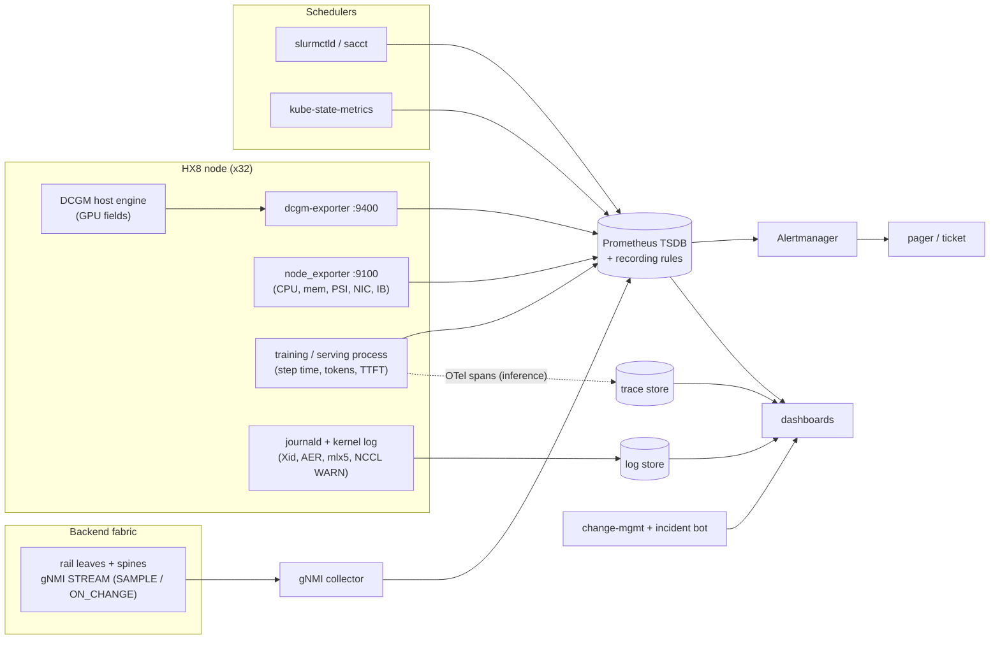
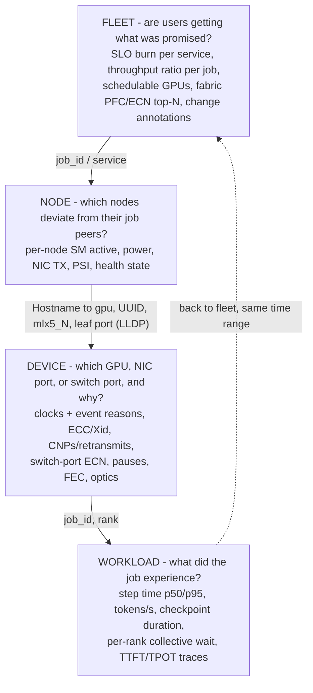

# Chapter 18 — Observability, SLOs, and Incident Response

> A 128-GPU training job that runs 18 % slower for two hours does not crash, does not log an error,
> and does not trip a single classic infrastructure alert — yet it burns more accelerator time than
> most hard outages. AI clusters fail *quietly*: one hot link, one throttled GPU, or one bad switch
> profile stretches every synchronous step for every rank. This chapter builds the observability
> system that catches those failures. We instrument every layer — GPU, host, NIC/RDMA, switch,
> scheduler, workload — learn which signals tell the truth and which ones lie, turn user-facing
> promises into SLIs, SLOs, and burn-rate alerts, organise dashboards so that an on-call engineer
> can descend from "fleet goodput is down" to "this switch port" in minutes, and run incidents and
> blameless postmortems that leave the system better than they found it.

## Learning objectives

After this chapter you will be able to:

1. **Explain** what each telemetry layer of an AI cluster (GPU, host, NIC/RDMA, switch, scheduler,
   workload, logs, traces) can and cannot reveal, and why `GPU utilization` is a misleading health
   signal for synchronous training.
2. **Write** PromQL queries, recording rules, and alert rules for GPU fleets, and **estimate** the
   series cardinality and sampling resolution they require.
3. **Define** SLIs and SLOs for training-job goodput and completion, inference latency, cluster
   availability, and fabric health, and **calculate** error budgets and burn rates.
4. **Design** symptom-based, multiwindow burn-rate alerts and **evaluate** an existing rule set for
   noisy and missing alerts.
5. **Design** a dashboard hierarchy from fleet overview to node, GPU/NIC/switch, and workload detail,
   with explicit drill-down keys.
6. **Run** an incident using incident-command roles, severity levels, and a communications cadence,
   and **construct** a timeline with time-to-detect, time-to-mitigate, and time-to-resolve.
7. **Write** a blameless postmortem whose root cause is supported by evidence, whose rejected
   hypotheses are documented, and whose action items change detection, mitigation, or prevention.

## Prerequisites and connections

This chapter assumes the GPU execution model of Chapter 4 (what an SM is and what "active" means),
the host topology of Chapter 5 (GPU↔NIC locality, PCIe), the RoCEv2 congestion machinery of
Chapter 9 (ECN, PFC, DCQCN), the physical-layer counters of Chapter 10, collective behaviour from
Chapter 12, checkpoint mechanics from Chapter 14, serving metrics (TTFT, TPOT) from Chapter 15, and
the scheduler models of Chapter 17. It is the observability foundation for Chapter 19 (fault
isolation and recovery rely on the correlation keys defined here), Chapter 20 (safe change uses SLOs
as abort criteria), Chapter 21 (utilization and goodput definitions), and Chapter 22 (cross-layer
performance diagnosis). Capstone B (telemetry and troubleshooting system), Capstone F (reliability
game day), and Capstone G (fault-tolerant 512-node operations) apply it directly.

Acronyms used throughout: SLI (service-level indicator), SLO (service-level objective), SLA
(service-level agreement), DCGM (NVIDIA Data Center GPU Manager), TSDB (time-series database),
gNMI (gRPC Network Management Interface), YANG (the data-modelling language used by NETCONF and gNMI),
SNMP (Simple Network Management Protocol), PFC (Priority Flow Control), ECN (Explicit Congestion
Notification), CNP (Congestion Notification Packet), MFU (model FLOP utilization), TTFT (time to first
token), TPOT (time per output token), IC (incident commander), TTD/TTM/TTR (time to detect / mitigate
/ resolve).

## 18.1 Why AI clusters defeat conventional monitoring

Classic monitoring grew up around independent servers serving independent requests: if one web
server in fifty slows down, a load balancer routes around it. Alarms on per-host CPU, memory, disk,
and "is the process up" work because failures are mostly local and mostly loud.

Synchronous distributed training breaks those assumptions. Every rank waits for the slowest rank at
each collective (Chapter 12). A GPU that loses 10 % of its clock, a NIC whose link retrains, or a
switch queue that pauses too often adds its delay to *every* step of *every* rank. The job does not
crash; it gets slower, and the cost lands on hundreds of GPUs at once. Three properties make this
hard:

1. **The busiest-looking metric lies.** `nvidia-smi` utilization and `DCGM_FI_DEV_GPU_UTIL` report
   the fraction of time *any* kernel was resident. NCCL kernels stay resident while they wait for the
   network, so a GPU blocked on a stalled all-reduce reports ≈ 95–100 % "utilization" while doing
   almost no math (Section 18.3).
2. **The blast radius is the job, not the host.** A per-node threshold tuned to avoid noise is far too
   insensitive for a fault whose cost is multiplied by the job size.
3. **The fault often lives between hosts.** Fabric problems (Chapters 9–10) appear as symptoms on
   healthy hosts; correlating "this rank was slow" with "this switch port paused" needs a join across
   telemetry systems usually built by different teams.

> **Key idea:** In an AI cluster the primary health signal is *workload progress* — step time,
> tokens per second, goodput, request latency. Component metrics explain a problem; they rarely
> detect it first.

At an illustrative fully loaded $3 per GPU-hour `[ILLUSTRATIVE]` (Chapter 21 derives ORION's
figure), an 18 % slowdown of all 256 GPUs for two hours wastes 256 × 2 h × 0.18 ≈ 92 GPU-hours ≈ $280
`[MODELED]`. At ORION-XL scale (4,096 GPUs) the same incident is ≈ 1,475 GPU-hours, and a week
unnoticed is a six-figure loss. Detection latency dominates.

## 18.2 The telemetry stack: layers, signals, and resolution

Observability for an AI cluster is a stack of collectors, each owning one layer, feeding shared
stores that are joined by a small set of *correlation keys*. Figure 18.1 shows the reference
pipeline we use on ORION.



*Figure 18.1 — ORION's telemetry pipeline. Metrics are pulled (Prometheus scrapes exporters) except
switch telemetry, which is pushed by gNMI streaming to a collector. Logs and traces live in separate
stores. Change and incident events are rendered as dashboard annotations so that every graph shows
"what changed".*

Table 18.1 summarises the layers. The resolution column matters: a signal sampled every 30 s
cannot show a 200 ms event, and a counter scraped every 15 s needs a `rate()` window of at least
four scrape intervals (60 s) to be robust to one missed scrape.

*Table 18.1 — Telemetry layers on ORION. Intervals and series counts are `[ILLUSTRATIVE]` defaults
used in this book; tune them per environment.*

| Layer | Source | Transport | Typical interval | What it answers | What it cannot answer |
|---|---|---|---|---|---|
| GPU | DCGM via dcgm-exporter | Prometheus pull | 15 s (1 s for profiling bursts) | Is the GPU computing, hot, throttled, erroring? | Why the job is slow if the GPU is waiting on the network |
| Host | node_exporter, kernel log | Pull / log shipper | 15 s / event | CPU, memory, PSI stalls, NIC and IB port counters, Xid/AER events | Fabric-wide congestion |
| NIC/RDMA | `rdma statistic`, `ethtool -S`, sysfs `hw_counters` | Exporter textfile or vendor exporter | 15–30 s | Retransmits, CNPs, out-of-buffer, PFC pauses seen by the host | Which switch queue caused them |
| Switch | gNMI streaming (OpenConfig + vendor YANG) | Push to collector | 1–10 s sample; on-change for state | Per-port/queue throughput, ECN marks, PFC pauses, discards, optics, BGP | Which job or rank was affected |
| Scheduler | Slurm (`sacct`, `slurmctld` log), kube-state-metrics | Pull / log | 30–60 s / event | Job placement, drains, preemptions, pending reasons | Performance inside the job |
| Workload | Application metrics (step time, tokens/s, loss, TTFT, TPOT) | Pull / push gateway | Per step / per request | **Whether users get what they were promised** | Which component is responsible |
| Logs | journald, NCCL `WARN`, PyTorch watchdog, switch syslog | Log shipper | Event | Discrete errors with exact timestamps | Gradual degradation |
| Traces | OpenTelemetry spans (inference); profiler and NCCL flight recorder (training) | Push | Per request / on demand | Where time goes inside one request or step | Fleet-wide trends (sampled) |

### Correlation keys

Every layer above uses a different identity for "the thing". Joining them is the core skill of AI
infrastructure on-call, and Chapter 19 builds the full rank-to-switch-port workflow on top of it.
The minimum set of keys every series and log line should carry (as labels or structured fields):

| Key | Example | Present in |
|---|---|---|
| Job / service | `slurm_job_id=731842`, `job_id=trn-70b`, `namespace/pod` | App metrics, Slurm, Kubernetes, DCGM (pod labels via the Kubernetes integration) |
| Host | `Hostname=orion-n08` | Everything on the node |
| GPU | `gpu=3`, `UUID=GPU-…`, PCI bus ID | DCGM, `nvidia-smi`, Xid log lines (by PCI address) |
| NIC / HCA | `device=mlx5_3`, netdev name, PCI BDF | node_exporter IB collector, `rdma`, `ethtool` |
| Switch port | `orion-be-leaf-r3:Ethernet12/1` | gNMI, LLDP neighbour tables |
| Rank | `rank=1043`, `local_rank=3` | Application logs, NCCL logs |

> **Pitfall:** Xid lines name the GPU by PCI address, DCGM by index and UUID, and the job by its
> renumbered `CUDA_VISIBLE_DEVICES` index. Keep a per-node inventory mapping all three (Chapter 16).

## 18.3 Host and GPU telemetry: the counters that tell the truth

DCGM exposes hundreds of *fields*; dcgm-exporter publishes a configurable subset as Prometheus
metrics named `DCGM_FI_<field>`. Table 18.2 lists the families that matter for operations. Field
availability differs by GPU generation and by DCGM version, and the exporter's default field list
changes between releases.

*Table 18.2 — DCGM metric families used in this book `[VENDOR-SPEC, 2026-10]` (verify each name
against the dcgm-exporter field list for your version; profiling fields need a supported datacenter
GPU and may conflict with other profilers).*

| Family | Metrics | Unit | Operational use |
|---|---|---|---|
| Coarse activity | `DCGM_FI_DEV_GPU_UTIL`, `DCGM_FI_DEV_MEM_COPY_UTIL` | % | Allocation and idle detection only — **not** efficiency |
| Profiling activity | `DCGM_FI_PROF_GR_ENGINE_ACTIVE`, `DCGM_FI_PROF_SM_ACTIVE`, `DCGM_FI_PROF_SM_OCCUPANCY`, `DCGM_FI_PROF_PIPE_TENSOR_ACTIVE`, `DCGM_FI_PROF_DRAM_ACTIVE` | ratio 0–1 | How much of the GPU is doing work; tensor-pipe activity tracks MFU trends |
| Interconnect | `DCGM_FI_PROF_PCIE_TX_BYTES`, `DCGM_FI_PROF_PCIE_RX_BYTES`, `DCGM_FI_PROF_NVLINK_TX_BYTES`, `DCGM_FI_PROF_NVLINK_RX_BYTES`, `DCGM_FI_DEV_PCIE_REPLAY_COUNTER` | B/s, count | GPU↔NIC and GPU↔GPU traffic; PCIe link quality |
| Power and thermal | `DCGM_FI_DEV_POWER_USAGE`, `DCGM_FI_DEV_TOTAL_ENERGY_CONSUMPTION`, `DCGM_FI_DEV_GPU_TEMP`, `DCGM_FI_DEV_MEMORY_TEMP` | W, mJ, °C | Throttling risk, rack power, facility coordination (Chapter 21) |
| Clocks | `DCGM_FI_DEV_SM_CLOCK`, `DCGM_FI_DEV_MEM_CLOCK`, clock-event reasons bitmask `DCGM_FI_DEV_CLOCKS_EVENT_REASONS` (formerly `DCGM_FI_DEV_CLOCK_THROTTLE_REASONS`) | MHz, bitmask | Distinguish thermal, power-cap, and power-brake slowdowns |
| Memory health | `DCGM_FI_DEV_ECC_SBE_VOL_TOTAL`, `DCGM_FI_DEV_ECC_DBE_VOL_TOTAL`, `DCGM_FI_DEV_CORRECTABLE_REMAPPED_ROWS`, `DCGM_FI_DEV_UNCORRECTABLE_REMAPPED_ROWS`, `DCGM_FI_DEV_ROW_REMAP_FAILURE` | count | Chapter 19's error taxonomy |
| Errors | `DCGM_FI_DEV_XID_ERRORS` (last Xid code seen) | code | Event trigger; the kernel log has the full record |
| Memory capacity | `DCGM_FI_DEV_FB_USED`, `DCGM_FI_DEV_FB_FREE` | MiB | KV-cache headroom (Chapter 15), leaks |

### GPU_UTIL versus SM_ACTIVE: the mechanism

`DCGM_FI_DEV_GPU_UTIL` (and `nvidia-smi`'s `utilization.gpu`) is a *time-occupancy* metric: over the
sample period, what fraction of time had at least one kernel executing. It says nothing about how
many of the GPU's 132 SMs (H100 SXM) were busy, or how busy. `DCGM_FI_PROF_SM_ACTIVE` is the fraction
of time, averaged over all SMs, that an SM had at least one warp resident; `DCGM_FI_PROF_PIPE_TENSOR_ACTIVE`
is the fraction of cycles the tensor pipes were issuing. A single-block kernel that occupies one SM
for the whole second shows `GPU_UTIL = 100 %` and `SM_ACTIVE ≈ 1/132 ≈ 0.008`.

During a training step on ORION the GPU alternates between compute kernels (high SM and tensor
activity) and NCCL kernels. NCCL kernels use a handful of SMs (channels) and spend much of their
time polling for data to arrive from the network. When the fabric slows down, the NCCL kernels stay
resident longer: `GPU_UTIL` stays near 97 %, while `SM_ACTIVE`, tensor activity, and power fall in
proportion to the stall. In the lab's incident, step time rose from 17.4 s to 21.2 s and SM activity
fell from 0.62 to ≈ 0.51 — exactly the ratio 17.4 / 21.2 ≈ 0.82 `[SIMULATED]` — while GPU_UTIL did not
move.

> **Pitfall:** An alert like `avg(DCGM_FI_DEV_GPU_UTIL) < 80` pages on idle inference nodes at night
> and stays silent when a training job is stalled on the network. It is both noisy and blind. Use
> GPU_UTIL to detect *allocated-but-idle* GPUs (a cost problem for Chapter 21); use workload
> progress to detect slowness.

### Power as a free efficiency proxy

Spinning kernels draw little power, so an H100-class GPU (700 W TDP) draws ≈ 600–650 W in dense BF16
training and ≈ 350–450 W while blocked on communication `[ILLUSTRATIVE]`. Per-job
`sum(DCGM_FI_DEV_POWER_USAGE)` is the cheapest "is the job doing math" panel — and what the facility
sees (Chapter 21).

### Clock-event reasons

When SM clocks drop, a reason bitmask (`nvidia-smi -q -d PERFORMANCE`, section "Clocks Event
Reasons", query fields `clocks_event_reasons.*`; "Clocks Throttle Reasons" and `clocks_throttle_reasons.*` are the deprecated names on older drivers) says why: *SW Power Cap* (the enforced power
limit is binding), *HW Slowdown* with its sub-reasons *HW Thermal Slowdown* and *HW Power Brake
Slowdown* (an external signal, typically from the node's power-supply or baseboard logic), *SW Thermal
Slowdown*, and others. Thermal reasons point at cooling; power-brake and an unexpectedly low enforced
power limit point at the platform and are hardware tickets, not tuning knobs. Section 18.14 walks an
incident in which a failed power supply caps a node's GPUs.

### Host signals that matter for GPUs

From node_exporter: pressure stall information (`node_pressure_cpu_waiting_seconds_total`, `…memory…`,
`…io…`) catches data-loader starvation; `node_infiniband_*` (which also reads RoCE devices' IB counters)
gives per-port bytes, `link_downed`, and `symbol_error`; filesystem metrics explain checkpoint stalls.
Kernel-log events — `NVRM: Xid`, PCIe AER, `mlx5_core` link messages — belong in the log store with
their own alerting path (Chapter 19).

## 18.4 NIC/RDMA and switch telemetry

### Host-side RDMA counters

The RDMA NIC keeps hardware counters that reveal the *host's view* of congestion and loss. On
ConnectX-class NICs with the upstream `mlx5` driver they appear under
`/sys/class/infiniband/<dev>/ports/1/hw_counters/` and through the `rdma` tool:

```text
$ rdma statistic show link mlx5_3/1                     # [ILLUSTRATIVE output, abridged]
link mlx5_3/1 rx_write_requests 0 rx_read_requests 0 out_of_buffer 0 out_of_sequence 412
 duplicate_request 0 rnr_nak_retry_err 0 packet_seq_err 0 implied_nak_seq_err 0
 local_ack_timeout_err 3 resp_local_length_error 0 req_cqe_error 0
 np_ecn_marked_roce_packets 1882210 np_cnp_sent 1873991 rp_cnp_handled 2210441
```

How to read it (counter semantics are `[VENDOR-SPEC, 2026-10]`, mlx5): `np_ecn_marked_roce_packets`
and `np_cnp_sent` count ECN-marked packets *received* and the CNPs this NIC sent back as the
notification point; `rp_cnp_handled` counts CNPs received as the reaction point, i.e. how often this
NIC was told to slow down (DCQCN, Chapter 9). `out_of_sequence` and `local_ack_timeout_err` indicate
loss and retransmission — on a lossless RoCE fabric they should be ≈ 0, and a rising rate on one NIC
is a physical-layer or path suspect (Chapter 10). `out_of_buffer` counts receive-queue starvation on
the host.

PFC pause counters are on the Ethernet side:

```text
$ ethtool -S ens3np0 | grep -E 'prio3_pause|discards_phy'    # [ILLUSTRATIVE]
     rx_prio3_pause: 18833102
     rx_prio3_pause_duration: 9120044
     tx_prio3_pause: 112
     tx_prio3_pause_duration: 31
     rx_discards_phy: 0
```

`rx_prio3_pause` rising means the *switch* is pausing this host on the lossless class: the host is a
victim of congestion somewhere downstream. `tx_prio3_pause` rising means the *host* cannot drain its
own receive buffers — a host-side problem (PCIe, memory, slow consumer) spreading backpressure into
the fabric.

> **Production note:** Export *raw counters* (textfile collector or vendor exporter) and compute
> rates in PromQL; exporting pre-computed rates hides counter resets.

### Switch telemetry: why streaming replaced polling

SNMP polling every 60–300 s was designed for a world where link utilization changed slowly. Two
pieces of arithmetic show why it fails on a 400 Gb/s fabric:

- **Counter wrap.** A 32-bit octet counter (`ifInOctets`) wraps after 2³² B ≈ 4.29 GB. At
  400 Gb/s = 50 GB/s it wraps every 4.29 / 50 ≈ 0.086 s `[MODELED]`. Only 64-bit counters (`ifHCInOctets`,
  OpenConfig `in-octets`) are usable.
- **Dilution.** A 1 ms microburst at line rate moves 50 GB/s × 1 ms = 50 MB. Averaged over a 30 s
  poll, it shows as 50 MB / (50 GB/s × 30 s) ≈ 0.003 % utilization `[MODELED]`. The burst that filled
  a buffer and triggered PFC is invisible in the average — you see it only in queue-occupancy
  watermarks, ECN-mark counters, and PFC pause counters.

gNMI (an OpenConfig-originated gRPC protocol) lets the collector *subscribe* to YANG paths. In
`STREAM` mode the switch pushes updates either every `sample_interval` (`SAMPLE`), when a value
changes (`ON_CHANGE`, ideal for oper-status and BGP state), or at the device's discretion
(`TARGET_DEFINED`). ORION's subscriptions:

*Table 18.3 — Switch telemetry subscriptions on ORION `[ILLUSTRATIVE]`; OpenConfig paths
`[VENDOR-SPEC, 2026-10]`. PFC, ECN, and buffer-watermark counters are usually in vendor-native YANG
models — check your switch OS.*

| What | Path (OpenConfig unless noted) | Mode |
|---|---|---|
| Interface counters (octets, packets, errors, discards, FCS errors) | `/interfaces/interface/state/counters` | SAMPLE 10 s |
| Oper status, link flaps | `/interfaces/interface/state/oper-status` | ON_CHANGE |
| Per-queue transmit and drop counters | `/qos/interfaces/interface/output/queues/queue/state` | SAMPLE 10 s |
| Optical power and laser bias per lane | `/components/component/transceiver/physical-channels/channel/state` | SAMPLE 60 s |
| BGP neighbour state | `/network-instances/network-instance/protocols/protocol/bgp/neighbors/neighbor/state` | ON_CHANGE |
| PFC pause frames per priority, ECN-marked packets, buffer watermarks | vendor-native paths | SAMPLE 1–10 s |

```bash
# Read-only subscription from a lab collector [ILLUSTRATIVE target and credentials]
gnmic -a orion-be-leaf-r3:<port> -u <user> -p <pass> --skip-verify subscribe \
      --path /interfaces/interface/state/counters --mode stream --stream-mode sample --sample-interval 10s
```

A PFC pause frame carries a pause time in *quanta* of 512 bit times. At 400 Gb/s one quantum is
512 / 400 × 10⁹ = 1.28 ns, and the maximum 65,535 quanta is ≈ 83.9 µs `[MODELED]`. Pause *frame counts*
therefore say little on their own; pause *duration* counters (where the switch or NIC provides them)
or the derived "fraction of time paused" are the useful SLIs for lossless-class health.

> **Pitfall:** A fabric dashboard built only on `out-discards` is green during the worst RoCE
> incidents. On a lossless class, congestion shows up as pauses and ECN marks, not drops (Chapter 9).
> In this chapter's lab incident, discards stayed at exactly zero while PFC pauses rose ≈ 90×.

## 18.5 Job, scheduler, logs, and traces

### Workload metrics are the primary SLI source

The training process knows its step time, tokens, loss, checkpoint duration, and data-loader wait;
exporting them costs a few lines of code and yields the only signal that directly measures user value.
ORION's jobs export (Halcyon's names, `[ILLUSTRATIVE]`) `train_step_seconds` (histogram, by `job_id`),
`train_tokens_total`, `train_checkpoint_duration_seconds`, and `train_step_seconds_baseline` (set after
warm-up).

Inference servers export rich metrics too — vLLM publishes TTFT, per-token and end-to-end latency
histograms, queue gauges, and KV-cache usage under `vllm:` (names version-sensitive, `[VENDOR-SPEC,
2026-10]`).

### Scheduler signals

Slurm and Kubernetes record the *control-plane* story: when a job started, which nodes it got,
which nodes were drained and why, which pods were evicted.

```text
$ sinfo -R                                            # [ILLUSTRATIVE]
REASON                                       USER      TIMESTAMP           NODELIST
xid79 gpu3 fell off bus INC-2287             fleetbot  2026-10-10T14:02:11 orion-n20
psu2 failed, gpu power capped                fleetbot  2026-10-11T09:40:55 orion-n28
```

On Kubernetes, kube-state-metrics provides `kube_pod_status_phase`, `kube_node_status_condition`,
`kube_node_spec_unschedulable`, and allocatable/requested GPU counts (the `nvidia.com/gpu` extended
resource appears as `resource="nvidia_com_gpu"` in its labels). These feed the *cluster availability*
SLI in Section 18.7.

### Logs

Logs carry discrete, exactly timestamped facts that metrics smear: an Xid code, a PCIe AER
uncorrectable error, an NCCL `WARN` with the peer address, a PyTorch watchdog timeout with the
collective sequence number, a switch commit with a change ticket. Structure them (JSON or key=value)
with the correlation keys of Section 18.2; synchronise clocks (chrony/NTP everywhere, alert on
offset — a 2 s skew reorders cause and effect in a timeline); and alert on a few critical patterns
(critical Xid codes, fatal AER, backend link-down, watchdog timeouts), never on log volume.

### Traces

For inference, OpenTelemetry spans (gateway → router → prefill → decode) show where a slow request
spent its time — queueing, prefill, KV transfer (Chapter 15), decode. Keep a small random sample plus
*all* requests slower than the SLO threshold (tail-based sampling).

For training: the PyTorch profiler on demand, and PyTorch's NCCL flight recorder
(`TORCH_NCCL_TRACE_BUFFER_SIZE`, dumped on timeout with `TORCH_NCCL_DUMP_ON_TIMEOUT=1`, `[VENDOR-SPEC,
2026-10]`), which records each rank's last collectives — Chapter 19 uses it to localise hangs.

## 18.6 Prometheus and PromQL for GPU fleets

### Metric types and the two functions you must get right

Prometheus has counters (monotonic, reset on restart), gauges, histograms (bucketed counters), and
summaries. Almost every operational query on a counter is `rate()` (per-second average over a
window, reset-aware) or `increase()` (total over a window). Rules of thumb:

- Window ≥ 4 × scrape interval: with a 15 s scrape, use `[1m]` or more.
- Never `rate()` a gauge, never `avg_over_time()` a counter.
- Aggregate *after* `rate()`: `sum by (switch) (rate(x_total[1m]))`, never `rate(sum(...))`.
- Quantiles from histograms aggregate correctly across instances
  (`histogram_quantile(0.95, sum by (le) (rate(h_bucket[5m])))`); summaries' precomputed quantiles do
  not.

### Cardinality budget

Each unique label combination is a series: ≈ 40 DCGM fields × 8 GPUs ≈ 320 series per node, ≈ 10,240
for ORION and ≈ 164,000 for ORION-XL, plus thousands per switch `[MODELED]`. One Prometheus server
handles a few million active series, so the danger is not the count but *unbounded* labels: never put a
rank, request ID, step number, or pod UID on a high-frequency metric — those belong in logs and traces.

### Recording rules

Recording rules precompute expensive or frequently used expressions and give dashboards and alerts
one stable name. The convention is `level:metric:operations`. ORION's core training rules:

```yaml
groups:
- name: orion-training
  interval: 30s
  rules:
  # Median step time per job over the last 10 minutes (from the app's histogram)
  - record: job:train_step_seconds:p50_10m
    expr: histogram_quantile(0.5, sum by (le, job_id) (rate(train_step_seconds_bucket[10m])))
  # Throughput ratio vs the job's declared baseline (1.0 = nominal; 0.8 = 20 % slow)
  - record: job:train_throughput:ratio
    expr: max by (job_id) (train_step_seconds_baseline) / job:train_step_seconds:p50_10m
  # Fraction of GPU time spent with the tensor pipes busy, per job (pod labels via k8s / job labels via Slurm prolog)
  - record: job:dcgm_tensor_active:avg
    expr: |
      avg by (job_id) (DCGM_FI_PROF_PIPE_TENSOR_ACTIVE
        * on (Hostname, gpu) group_left(job_id) slurm_gpu_job_info)
  # Backend PFC pause rate per leaf (vendor-native counter name; illustrative)
  - record: switch:pfc_pause_tx:rate1m
    expr: sum by (switch) (rate(switch_pfc_pause_tx_frames_total{priority="3"}[1m]))
```

The `job_id` label on DCGM series requires that you attach job identity to GPUs: on Kubernetes,
dcgm-exporter's pod-resources integration adds `pod`, `namespace`, and `container` labels; on Slurm,
a prolog/epilog can write the GPU-to-job mapping to a file that a textfile collector exports as an
info metric — `slurm_gpu_job_info{Hostname="orion-n04", gpu="3", job_id="731842"} 1` — joined with
`* on (Hostname, gpu) group_left(job_id)`. The prolog must write `Hostname` itself (a textfile metric
otherwise carries only node_exporter's `instance`), or relabel `instance` to `Hostname` at scrape time.

### `for:` semantics

`for:` requires the expression to be true at every evaluation for that long before the alert moves
from *pending* to *firing*: it suppresses flapping but adds delay. A 2 m `for` with a 30 s evaluation
interval fires 2.0–2.5 minutes after the condition becomes true. The lab's `evaluate_rule()`
implements this at 1-minute resolution.

## 18.7 SLIs and SLOs for AI infrastructure

An SLI is a ratio of *good events* to *valid events*, measured as close to the user as possible. An
SLO is a target for that ratio over a compliance window (ORION uses 30 days). The *error budget* is
1 − SLO: the badness you have agreed to tolerate. An SLA is a contract with consequences and should
be looser than the SLO. On an AI platform the "users" are research teams and inference customers;
choose events that reflect their experience.

*Table 18.4 — ORION's SLI/SLO specification. Targets are `[ILLUSTRATIVE]` and must be set from your
own history and user needs.*

| Service | SLI (good / valid) | Measurement source | SLO | Budget per 30 days |
|---|---|---|---|---|
| Training throughput | Job-minutes whose median step time ≤ 1.10 × the job's baseline / all running job-minutes after warm-up | App histogram + baseline gauge | 99 % | 432 job-minutes per job running all month |
| Training goodput | Accelerator time producing *retained* progress / allocated accelerator time (lost = slow steps + work since last checkpoint at each failure + restart time) | Step records, checkpoint log, scheduler | ≥ 90 % per job-week | 10 % of allocated GPU-hours |
| Training job recovery | Infrastructure-attributed interruptions after which the job resumed (first step completed) within 30 min / all infrastructure-attributed interruptions | Scheduler + step records + incident attribution | 95 % | 5 % of interruptions |
| Inference latency | Requests with TTFT ≤ 800 ms (2k-token prompt class) / successful requests; separately, output tokens with TPOT ≤ 50 ms / output tokens | Serving histograms | 95 % TTFT, 95 % TPOT (matches ORION's p95 targets) | 5 % of requests |
| Inference availability | Non-5xx responses / all valid requests (client 4xx excluded) | Gateway | 99.9 % | 0.1 % of requests ≈ 43.2 min of full outage |
| Cluster availability | Minutes during which ≥ 24 of 32 nodes (192 GPUs) are healthy *and* schedulable, outside announced maintenance / all such minutes | kube-state-metrics, `sinfo`, health checks | 99.5 % | 216 min |
| Fabric health | Scheduled probe runs (per-rail node-pair `all_reduce_perf`) achieving ≥ 90 % of the commissioning bus bandwidth / probe runs; and 5-min backend link-windows with zero FEC-uncorrectable or link-down events / all link-windows | Probe job + gNMI | 99 % of probes; 99.9 % of link-windows | 1 % / 0.1 % |

The budget arithmetic: a 30-day window is 30 × 24 × 60 = 43,200 minutes. A 99.9 % availability SLO
allows 0.001 × 43,200 = 43.2 minutes of total outage (or proportionally more partial badness). A
99.5 % cluster-availability SLO allows 0.005 × 43,200 = 216 minutes. A training-throughput SLO of 99 %
for a job that runs all month allows 0.01 × 43,200 = 432 slow minutes `[MODELED]`.

Two targets are derived from the canon rather than chosen. *Completion:* with a node MTBF of 1,536 h, a
16-node job's MTBF is 96 h, so P(no interruption in 24 h) = e^(−24/96) = 0.78; for 32 nodes e^(−0.5) =
0.61. An SLO of "95 % of 24-hour attempts uninterrupted" would be violated by design, so the SLI measures
what the platform controls — how fast interruptions are *recovered*. *Availability:* with a 5-day repair
turnaround, ORION averages 2.5 nodes in repair (Poisson). "≥ 248 GPUs" (at most one node down) holds
only P(≤ 1) = e^(−2.5) × 3.5 = 0.29 of the time. Allowing 7 down holds P(≤ 7) = 0.996, but repair alone
would then use ≈ 85 % of the 0.5 % budget; allowing 8 down holds P(≤ 8) = 0.9989, leaving most of the
budget for real outages — hence "≥ 24 of 32 nodes" at 99.5 % `[MODELED]`.

Four design notes. **Baselines are per job**, recorded after warm-up, re-recorded on configuration
change, with checkpoint steps excluded. **Throughput and goodput differ**: goodput also charges failures
for lost work and restart time (Chapters 14, 19). **Attribute interruptions** (infrastructure, user code,
preemption), or the platform owns every Python exception. **Probe what users cannot see yet**: fabric
health uses synthetic probes on drained node pairs in idle windows, never on nodes running user jobs.

## 18.8 Alert design: symptoms, causes, and burn rates

### Page on symptoms, ticket on causes

A page interrupts a human at 03:00. It is justified only when users are being hurt now or will be
soon, a human must act, and the action is urgent. The Google SRE book's on-call guidance caps the
load at roughly two incidents per 12-hour shift, and every page should be actionable. In practice:

- **Page** on SLO burn (symptoms) — training throughput burn, inference latency and availability
  burn — plus a short list of *imminent-risk causes* whose symptom would arrive too late: an Xid that
  guarantees a job crash (Chapter 19), any discard on the lossless class (a misconfiguration that will
  degrade RoCE fabric-wide), loss of PSU or cooling redundancy, failing checkpoints (RPO is growing).
  Note that `DCGM_FI_DEV_XID_ERRORS` holds the *last* Xid code seen and latches; application Xids (13,
  31, 43) set it too, so filter on hardware codes (Chapter 19) rather than paging on `> 0`.
- **Ticket** on causes that need fixing during business hours: a GPU with rising correctable ECC, an
  optic with degrading receive power, a node running hot with normal clocks.
- **Dashboard only** for everything else.

The lab's alert set inverts this: it pages on `GPU_UTIL < 80 %` — a proxy that is wrong for both
inference and training — and has no symptom alert for training at all.

### Burn rate

The *burn rate* is how fast the error budget is being consumed relative to the rate that would exactly
exhaust it at the end of the SLO window:

```text
burn_rate(window) = (bad events / valid events over the window) / (1 − SLO)
fraction of budget consumed = burn_rate × (alert window / SLO window)

  2 % = 14.4 × (1 h  / 720 h)       14.4 × 1/720  = 0.020
  5 % =  6   × (6 h  / 720 h)        6   × 6/720  = 0.050
 10 % =  1   × (72 h / 720 h)        1   × 72/720 = 0.100
```

A burn rate of 1 consumes the 30-day budget in exactly 30 days; a sustained burn rate of 14.4
exhausts it in 720 / 14.4 = 50 hours.

### Multiwindow, multi-burn-rate alerts

The SRE workbook's recommended policy pairs a *long* window (which proves the problem is significant)
with a *short* window (which proves it is still happening, so the alert resets quickly after
mitigation).

*Table 18.5 — Multiwindow burn-rate policy for a 30-day SLO (Google SRE workbook, "Alerting on SLOs").*

| Severity | Long window | Short window | Burn rate | Budget consumed at trigger |
|---|---|---|---|---|
| Page | 1 h | 5 min | 14.4 | 2 % |
| Page | 6 h | 30 min | 6 | 5 % |
| Ticket | 3 d | 6 h | 1 | 10 % |

For ORION's 99.9 % inference availability SLO the page threshold on the 1 h window is an error ratio
of 14.4 × 0.001 = 1.44 %. As Prometheus rules (`gateway_requests_total` is ORION's gateway counter,
`[ILLUSTRATIVE]` name):

```yaml
groups:
- name: chat-70b-slo
  rules:
  - record: slo:errors:ratio_rate5m
    expr: |
      sum(rate(gateway_requests_total{service="chat-70b",code=~"5.."}[5m]))
        / sum(rate(gateway_requests_total{service="chat-70b"}[5m]))
  # ...the same rule for 30m, 1h and 6h windows: slo:errors:ratio_rate30m, _rate1h, _rate6h
  - alert: ChatAvailabilityFastBurn
    expr: |
      (slo:errors:ratio_rate1h > (14.4 * 0.001) and slo:errors:ratio_rate5m > (14.4 * 0.001))
      or
      (slo:errors:ratio_rate6h > (6 * 0.001) and slo:errors:ratio_rate30m > (6 * 0.001))
    for: 2m
    labels: {severity: page, team: inference}
    annotations:
      summary: "chat-70b is burning its availability budget fast"
      runbook: "runbooks/inference/availability-burn.md"
```

**Detection time follows from the arithmetic.** During a total outage (100 % errors) the 1 h window
crosses 1.44 % after 0.0144 × 60 ≈ 0.9 min and the 5 min window within seconds, so the page fires
about 3 minutes after onset including `for: 2m` `[MODELED]`. At a 2 % error rate (burn 20) the 1 h
window needs 1.44 / 2 × 60 ≈ 43 min. Slow burns are caught later by design — they also cost less per
minute.

**Short blips do not page.** The lab's inference service has a 7-minute bad deploy at 05:10 with
≈ 4 % errors against a ≈ 0.02 % background. The 5-minute burn reaches 0.04 / 0.001 = 40, but the 1 h
window holds only 7 bad minutes: (7 × 0.04 + 53 × 0.0002) / 60 ≈ 0.0048, a burn of ≈ 4.8 by hand and
4.65 in the request-weighted data `[SIMULATED]` — below 14.4. The 30-minute window peaks at ≈ 9.8
(above 6) while the 6 h window stays at ≈ 0.95. No page, which is correct: the canary auto-rolled back
after 7 minutes, having consumed well under 1 % of the month's budget.

**Low SLOs saturate.** Maximum burn is 1 / (1 − SLO): 20 for the 95 % TTFT SLO, so a 14.4 page needs
72 % of requests bad for an hour. For loose SLOs use lower thresholds with longer windows.

### A burn-rate alert for training throughput

The same machinery applies to the training throughput SLI. With a 99 % SLO the budget is 1 %. During
INC-2291 every minute was bad (bad ratio 1.0): a burn rate of 1.0 / 0.01 = 100. The 1 h window crosses
14.4 × 0.01 = 0.144 after 0.144 × 60 ≈ 8.6 bad minutes. But the input is a 10-minute median, which
crosses the threshold only ≈ 5 minutes after the steps slow down; add `for: 2m` and the page fires ≈ 15–17
minutes after onset — still far better than the 48 minutes it took a researcher `[MODELED]`. A 5-minute
median cuts this to ≈ 13 minutes at the cost of more noise. ORION's
rule, built on the recording rules of Section 18.6:

```yaml
  - record: job:train_slow_minutes:ratio_rate1h
    expr: avg_over_time((job:train_throughput:ratio < bool 0.909)[1h:1m])
  - record: job:train_slow_minutes:ratio_rate5m
    expr: avg_over_time((job:train_throughput:ratio < bool 0.909)[5m:1m])
  - alert: TrainingThroughputFastBurn
    expr: |
      job:train_slow_minutes:ratio_rate1h > (14.4 * 0.01)
        and job:train_slow_minutes:ratio_rate5m > (14.4 * 0.01)
    for: 2m
    labels: {severity: page, team: training-infra}
    annotations:
      summary: "{{ $labels.job_id }} is more than 10 % slower than its baseline"
      dashboard: "d/orion-workload?var-job_id={{ $labels.job_id }}"
```

A throughput ratio below 1 / 1.10 ≈ 0.909 is the same condition as step time above 1.10 × baseline;
`< bool` turns the comparison into 0/1, and the `[1h:1m]` subquery evaluates it every minute over the
past hour. The lab asks you to build the simpler rolling-median version (`goodput_alert()`); it fires
at 02:19, nine minutes after the 02:10 onset — the same order as the burn-rate rule.

### Alert hygiene

Track pages per week, alert precision (pages that led to action), and incidents found by humans
before any alert. Every postmortem asks whether the right alert fired and whether a useless one did.

## 18.9 The dashboard hierarchy: fleet → node → device → workload

Dashboards exist to answer questions in a fixed order during an incident. Each level answers one
question and links down with the key the next level needs.



*Figure 18.2 — Dashboard hierarchy. Each arrow is a drill-down link carrying a correlation key
(Section 18.2) and the current time range. The workload level links back to the fleet so that on-call
can check whether a job-level symptom is cluster-wide.*

*Table 18.6 — Dashboard mock-up specification for ORION (queries reference Sections 18.3–18.6).*

| Level | Panel | Query sketch | Why it is there |
|---|---|---|---|
| Fleet | Training throughput ratio per job | `job:train_throughput:ratio` | Primary training symptom; shows whether many jobs moved at once |
| Fleet | Inference burn rate (1 h, 5 m) and TTFT p95 | `slo:errors:ratio_rate1h / 0.001`; `histogram_quantile(0.95, …)` | Primary serving symptom |
| Fleet | Schedulable vs allocated GPUs | kube-state-metrics + Slurm exporter | Capacity and drains (Chapters 17, 21) |
| Fleet | Backend PFC pause and ECN, top-5 switches | `topk(5, switch:pfc_pause_tx:rate1m)` | Cluster-wide fabric symptoms appear here first |
| Fleet | Change and incident annotations | change-management feed | "What changed?" is the first diagnostic question |
| Node | Per-node SM active and power, grouped by job | `avg by (Hostname) (DCGM_FI_PROF_SM_ACTIVE)` | Peer comparison: a straggler stands out against its job peers |
| Node | Backend NIC TX/RX, PSI, health/drain state | `node_infiniband_port_data_transmitted_bytes_total`, `node_pressure_*` | Host-side starvation vs network |
| Device | GPU clocks, event reasons, temperature, ECC, Xid | `DCGM_FI_DEV_SM_CLOCK`, reasons bitmask | Why one GPU is slow |
| Device | NIC CNPs, out-of-sequence, link-downed, pauses | RDMA counters, `ethtool -S` | Loss and congestion at the host edge |
| Device | Switch-port ECN, PFC, FEC/symbol errors, optics | gNMI series | Fabric fault location |
| Workload | Step time p50/p95, tokens/s, checkpoint duration | `train_step_seconds` histogram | What the user saw |
| Workload | Per-rank collective wait | log / flight-recorder query | Which ranks waited and which were late |

Rules experienced operators insist on: **peer comparison beats absolute thresholds** ("GPU 5 runs
12 % below the SM clock of the other 127 GPUs in its job" is a finding; "1,590 MHz" is not); the
**same time range** passes through every link, with change annotations on every graph; **units on
every axis**, bits vs bytes explicit; and **fewer panels** — ten good ones per level, not forty.

## 18.10 Incident command

Incidents on a shared AI cluster cross team boundaries (Halcyon's Fabric, Fleet, Platform, Training
Infra, Inference, SRE, and Facilities teams). Without explicit roles, everyone debugs and nobody
decides. ORION uses an incident-command structure adapted from the SRE book's incident-management
chapter, itself derived from emergency-services incident command.

*Table 18.7 — Incident roles.*

| Role | Owns | Does **not** |
|---|---|---|
| Incident commander (IC) | Severity, role assignment, priorities, decisions, all-clear; the decision log | Debug hands-on |
| Operations lead | The hands-on investigation and every change made during the incident | Talk to stakeholders |
| Communications lead | Status updates on a fixed cadence to users and leadership | Speculate on cause |
| Scribe (often the IC on small incidents) | Timestamped record of observations, hypotheses, decisions, actions | Filter or editorialise |
| Subject-matter experts | Specific systems: fabric, GPUs, scheduler, storage, facilities | Change anything without the ops lead |

*Table 18.8 — Severity levels on ORION (`[ILLUSTRATIVE]` criteria).*

| Severity | Criteria (any one) | Response | Update cadence |
|---|---|---|---|
| SEV1 | Inference availability fast-burn with customer impact; all training stalled; risk of checkpoint or data loss; facility safety event | Page IC and all relevant teams; leadership notified | 30 min |
| SEV2 | Cluster-wide training throughput ≥ 10 % below baseline; a job using ≥ 25 % of the cluster down; inference latency fast-burn | Page owning team and IC | 60 min |
| SEV3 | Single job or node degraded; workaround exists | Owning team, business hours | Daily |
| SEV4 | No user impact; latent risk | Ticket | — |

Practices that matter more than the template: **declare early, downgrade freely**; **mitigate before
you fully understand** — roll back a preceding change if safe, exclude a suspect node and restart from
checkpoint (Chapter 19), pause low-priority jobs, or shift inference traffic; make **one change at a
time, logged** through the ops lead; use **explicit all-clear criteria** ("step time within 5 % of
baseline for 10 consecutive minutes on every affected job, PFC/ECN back in band"); and hand over state,
hypotheses, and pending actions explicitly at shift change.

## 18.11 Timelines and blameless postmortems

### Building the timeline

Assemble the timeline from *machine evidence first* and human recollection second. Onset comes from
telemetry, not from the first report: in INC-2291 the step-time series shows the regression starting
at 02:10, while the first human signal arrived at 02:58.

| Milestone | Definition | Source |
|---|---|---|
| Onset | First minute of sustained SLI degradation | Workload metrics |
| Detection | First alert or human report | Pager, chat |
| Declaration | Incident opened with severity and IC | Incident bot |
| Mitigation | User impact stopped (e.g. rollback complete, SLI recovering) | Change records + SLI |
| Resolution | All-clear criteria met | Incident bot |

From these: **TTD** = detection − onset, **TTM** = mitigation − onset, **TTR** = resolution − onset.
Report all three; an aggregate MTTR (mean time to restore) hides whether you are slow to notice or slow
to fix. For INC-2291 the lab computes TTD = 48 min, TTM = 118 min, TTR = 140 min `[SIMULATED]`:
detection was 41 % of the time to mitigation.

### The blameless postmortem

A postmortem is written for every SEV1/SEV2 and for any incident that taught something. Blameless means
the document examines how the *system* — tooling, process, defaults, incentives — allowed a
reasonable person's action to cause harm. It does not mean that nobody owns the action items.

| Blaming | Blameless |
|---|---|
| "The network engineer pushed a bad config." | "CHG-4471 applied buffer-profile v2 to all eight rail leaves in four minutes. Its post-checks verified reachability and discards but not RoCE performance, so the regression passed the gate." |
| "On-call missed the problem for 48 minutes." | "No alert covered training throughput. The only page-severity GPU rule (GPUUtilLow) measures time-occupancy, which stays ≈ 97 % while NCCL kernels wait on the network." |
| Root cause: human error. | Contributing factors: no performance canary for fabric QoS changes; fleet-wide rather than rail-by-rail rollout; no training-SLO alert. |

The lab's template follows the structure ORION uses: summary; impact with evidence labels; timeline;
detection (TTD, how detected, missing alert, noisy alert); root cause and trigger; rejected hypotheses
*with the evidence that rejected them*; what went well, what went poorly, where we got lucky; action
items.

**Action items** are the point. Each has an owner, a priority, a due date, and a type:

- *Detect*: add `TrainingThroughputFastBurn`; replace `GPUUtilLow` with an allocated-but-idle ticket.
- *Mitigate*: one-command rollback for QoS profiles; runbook links in every page.
- *Prevent*: canary fabric QoS changes on one rail leaf behind an `all_reduce_perf` performance gate
  before fleet rollout (Chapter 20); extend change post-checks to PFC/ECN rate deltas.

> **Pitfall:** "Five whys" applied mechanically produces a single causal chain that stops at a person.
> Complex-system failures usually have several contributing factors; list them all, then fix the
> cheap ones that would have changed the outcome most.

## 18.12 Worked example: quantifying INC-2291 on ORION

We now apply the diagnostic loop to the lab's bundle and show every number. All values come from the
synthetic bundle and are `[SIMULATED]`; formulas are `[MODELED]`.

**Setting.** ORION-256 on 2026-10-12. `trn-70b` is a W-TRAIN variant on 16 nodes (128 GPUs; TP = 8,
PP = 4, DP = 4; 512 sequences × 4,096 tokens = 2,097,152 tokens per step — half the reference global
batch, so the step time stays near the reference 17.4 s on half the GPUs). `ft-13b` is a 13B fine-tune
on 8 nodes (64 GPUs). The Kubernetes inference pool uses the other 8 nodes.

**Step 1 — Observe: baselines.** Median step time of non-checkpoint steps between 00:00 and 02:00:

```text
trn-70b: baseline = 17.39 s        ft-13b: baseline = 6.00 s
```

Checkpoint steps carry +9 s (trn-70b, every 30 min) and +4 s (ft-13b, every 20 min) of stall and are
excluded; including them would not move the median much but would trip any threshold rule twice an hour.

**Step 2 — Quantify the symptom.** Median step time on the plateau (02:20–04:00): 21.24 s and 7.09 s. In
this chapter "X % slower" means throughput down X %: trn-70b's throughput fell 18 % (ratio 0.819), which
is the same thing as its step time rising 22 % (21.24 / 17.39 = 1.22).

```text
throughput ratio = baseline / regressed
trn-70b: 17.39 / 21.24 = 0.819  → 18.1 % slower
ft-13b :  6.00 /  7.09 = 0.846  → 15.4 % slower
tokens/s (trn-70b): 2,097,152 / 17.39 = 120,600 → 2,097,152 / 21.24 = 98,700 (−21,900 tokens/s)
```

**Step 3 — Bound it in time.** Sustained-regression detection (5 consecutive minutes above
1.10 × baseline) gives onset 02:10 for both jobs; recovery (10 consecutive minutes within 1.05 ×
baseline) begins at 04:07. Impact duration = 04:07 − 02:10 = 117 min = 7,020 s.

**Step 4 — Lost accelerator time.** On the plateau, the fraction of wall time wasted is
1 − ratio. Plateau model:

```text
lost GPU-h = duration × GPUs × (1 − ratio) / 3600
trn-70b: 7,020 × 128 × 0.181 / 3600 = 45.2 GPU-h
ft-13b : 7,020 ×  64 × 0.154 / 3600 = 19.2 GPU-h
total ≈ 64.4 GPU-h  [MODELED]
```

The lab sums the excess of every step instead — Σ max(0, step − baseline) × GPUs / 3600 — and gets
43.8 + 18.7 = 62.4 GPU-h, slightly less because the push and rollback ramps are partial. At an
illustrative $3 per GPU-hour this is ≈ $190; the same incident across all of ORION-XL would be ≈ 30×
larger. Bound the sum to the incident window: over all six hours, `max(0, …)` adds ≈ 4 GPU-h of pure
noise from normal steps slower than the median.

**Step 5 — SLI and budget.** Per-minute SLI for `trn-70b` over the six hours: 0.678 (≈ 244 good of 360
minutes, 116 bad). Against the 99 % monthly SLO of Table 18.4 (432 bad minutes allowed), this one
incident consumed 116 / 432 ≈ 27 % of the month's budget in two hours — a burn rate of 100 while it
lasted.

**Step 6 — Detection the alerts should have provided.** A training burn-rate page (Section 18.8)
would have fired ≈ 15–17 min after onset (median lag + 8.6 min + `for`); the lab's simpler goodput alert fires at
02:19 (9 min). Actual detection: 02:58 by a human (TTD 48 min). The page-severity rule that existed,
`GPUUtilLow`, fired 63 times in six hours — all on inference nodes at normal low load — and never for
the training regression, because DCGM time-occupancy stayed ≈ 97 %.

**Step 7 — Trace the bottleneck.** Both jobs regressed at the same minute, on disjoint node sets
(orion-n01..n16 and orion-n17..n24). The only shared resources are the backend fabric, storage, and the
schedulers; inference (no backend-fabric dependency in TP = 8 serving) was unaffected. Switch
telemetry, mean of 02:30–03:30 over 01:00–02:00:

| Switch group | PFC pause TX | ECN-marked packets | PFC pause RX | TX utilization |
|---|---|---|---|---|
| Rail leaves (8) | × 91–98 | × 0.03 | ≈ × 1 | 31 % → 25 % |
| Spines (4) | × 4 | × 0.10 | × 104–107 | 31 % → 25 % |

*Table 18.9 — Fabric shift during INC-2291 `[SIMULATED]`.*

**Step 8 — Root cause.** The change record CHG-4471 (02:08–02:12) raised the ECN/WRED marking
thresholds on the lossless class of every rail leaf. Mechanism (Chapter 9): DCQCN senders slow down
only when they receive CNPs, which are triggered by ECN marks. Raising the marking threshold lets
queues grow further before any sender is told to slow down; the queues now reach the PFC XOFF
threshold first, so the lossless class falls back to hop-by-hop pause. Pauses propagate to spines
(their PFC RX rises ≈ 100×), create head-of-line blocking, and lower the fabric's effective
throughput — exactly the 18 % step-time increase of a communication-sensitive job. The red herrings:
the row-B CRAH maintenance (FAC-0912, from 01:40) heated `orion-n08` from 01:45 — 25 minutes
before onset — and raised `GPUTempHigh` at 01:53, but it covers only `trn-70b`'s nodes and its clocks never
throttled and the Grafana upgrade (scope: monitoring only).

**Step 9 — Safe change and validation.** Rollback CHG-4471-RB (04:02–04:08); both jobs within 1.05 ×
baseline for 10 minutes from 04:07 and leaf PFC/ECN back in band; resolved at 04:30.

## 18.13 Hands-on lab overview

Progressive Lab 8 ([lab/README.md](lab/README.md)) hands you this incident's bundle — step records,
node and switch summaries, inference counts, events, the live alert rules, and the postmortem template —
and you implement this chapter's analyses on it, from onset detection to the dashboard specification.
Tier L1, `[SIMULATED]`; L2/L3 extensions rebuild the pipeline on real DCGM, node_exporter, and gNMI data.

## 18.14 Troubleshooting scenario: the job that got 12 % slower

**Symptom.** At 14:20 on a weekday, `TrainingThroughputFastBurn` pages for `trn-70b` (now running on
orion-n01..n16 again). The throughput ratio is 0.88 and stable. `ft-13b` is healthy.

**Collect evidence (fleet level).** One job only, so the cause is probably inside its footprint;
fabric PFC/ECN are normal and no change is annotated in the last six hours.

**Node level.** Per-node `DCGM_FI_PROF_SM_ACTIVE` for the 16 nodes `[ILLUSTRATIVE]`:

```text
orion-n01 0.55  orion-n02 0.55  orion-n03 0.54  orion-n04 0.55  orion-n05 0.55  orion-n06 0.54
orion-n07 0.55  orion-n08 0.55  orion-n09 0.55  orion-n10 0.54  orion-n11 0.55  orion-n12 0.65
orion-n13 0.55  orion-n14 0.55  orion-n15 0.54  orion-n16 0.55
```

Fifteen nodes fell from 0.62 to 0.55; one *rose* to 0.65: it is still computing while everyone else
waits in NCCL.

> **Key idea:** When a synchronous job slows down, look for the node whose activity went *up*
> relative to its peers. Healthy nodes show lower activity because they are waiting for it.

**Ranked hypotheses.**

1. A slow node (clocks reduced by thermal, power cap, or power brake) — supported by the SM-active
   outlier.
2. A rail or link problem on one node's NIC — would show as *lower* activity on that node (it waits
   on the network) and NIC retransmits; not supported.
3. Data-loader starvation on one node — would show lower activity and high CPU/IO PSI; not supported.
4. A code or configuration change — no restart or config change in the job's log; not supported.

**Discriminating tests (read-only).**

```text
$ Q=index,clocks.sm,power.draw,power.limit,enforced.power.limit,power.default_limit,clocks_event_reasons.sw_power_cap,temperature.gpu
$ ssh orion-n12 nvidia-smi --query-gpu=$Q --format=csv
index, clocks.sm [MHz], power.draw [W], power.limit [W], enforced.power.limit [W],
       power.default_limit [W], clocks_event_reasons.sw_power_cap, temperature.gpu
0, 1545 MHz, 449.20 W, 450.00 W, 450.00 W, 700.00 W, Active, 58
1, 1530 MHz, 448.75 W, 450.00 W, 450.00 W, 700.00 W, Active, 57
...                                     # all eight GPUs enforced at 450 W [ILLUSTRATIVE]

$ ssh orion-n12-bmc ipmitool sdr type "Power Supply"   # or the Redfish PowerSubsystem resource
PSU1 Status      | 60h | ok  | 10.1 | Presence detected
PSU2 Status      | 61h | cr  | 10.2 | Presence detected, Failure detected
```

Peers run at ≈ 1,830 MHz, the sustained clock of an H100-class GPU under dense training on ORION
(compare with peers' *sustained* clock, not the 1,980 MHz maximum boost). All eight GPUs on orion-n12
run ≈ 1,540 MHz with an enforced limit of 450 W against a 700 W default, *SW Power Cap* active, and low
temperatures (not thermal); the BMC reports PSU2 failed. The arithmetic matches the symptom: if ≈ 13 s of
the 17.4 s step is compute on the critical path `[ILLUSTRATIVE]`, a 1,830 / 1,540 ≈ 1.19× slower GPU adds
≈ 13 × 0.19 ≈ 2.4 s per step, giving 19.8 s and a ratio of 17.4 / 19.8 ≈ 0.88 `[MODELED]`. It also explains
the node panel: the straggler's SM activity rises to ≈ 0.62 × 1.19 × 0.88 ≈ 0.65 while its peers' falls to
0.62 × 0.88 ≈ 0.55.

> **Vendor implementation note:** HX8 nodes have N+1 power supplies, so one failed PSU does not by itself
> limit power. The cap comes from a *platform policy*: Halcyon's BMC configuration caps all GPUs at 450 W
> whenever PSU redundancy is lost, so that a second PSU failure cannot brown out the node (4.6 kW base +
> 8 × 0.45 kW = 8.2 kW). Such policies are platform-specific `[VENDOR-SPEC, 2026-10]`; some platforms
> instead assert the GPU power-brake signal (*HW Power Brake Slowdown*), which cuts clocks far more.

**Root cause.** PSU2 in orion-n12 failed; the redundancy-loss policy lowered the GPU power limit from
700 W to 450 W; all eight GPUs clocked down ≈ 16 %; orion-n12 became the straggler for all 128 ranks.

**Decide and make a safe change.** Draining the node does not move the running job, and ORION has no
spare nodes: trn-70b uses orion-n01–n16, ft-13b n17–n24, and inference n25–n32. Options:

```text
continue slow for the remaining 20 h:  20 h × 128 GPUs × (1 − 0.88) = 307 GPU-h lost
checkpoint + requeue on a borrowed node: (15 min expected loss since the 30-min checkpoint + 15 min restart)
                                       = 30 min × 128 GPUs = 64 GPU-h lost        [MODELED]
```

Restart wins by ≈ 240 GPU-hours (restart overhead ≈ 15 min is ORION's canonical value). The sixteenth
node comes from the inference pool through a lifecycle transition (Chapter 17), accepting N+1 instead of
N+2 serving headroom until the repair:

```bash
scontrol update nodename=orion-n12 state=drain reason="PSU2 failed, GPU power capped INC-2304"
kubectl cordon orion-n25 && kubectl drain orion-n25 --ignore-daemonsets --delete-emptydir-data
scontrol update nodename=orion-n25 state=resume       # return the node to service in Slurm
scontrol requeue 731842                               # job restarts from its latest checkpoint
```

`state=resume` does not change partitions: orion-n25 must already be defined in the training partition
(in `slurm.conf`, or via `scontrol update PartitionName=train Nodes=…`) and normally held drained while it
serves inference. Trigger an on-demand checkpoint first if the framework supports one.
Fleet replaces the PSU and returns orion-n12 only after acceptance tests (Chapter 16); orion-n25 then
goes back to the inference pool.

**Validate.** Throughput ratio back to 0.99–1.01 for 10 minutes after restart; SM activity uniform
across nodes; the burn-rate alert resolves. The postmortem's *detect* action items: a ticket on any
GPU whose enforced power limit is below its default or whose power-brake bit is set, and a page on
PSU-redundancy loss for nodes in running jobs.

## Trade-offs and design decisions

*Table 18.10 — Observability design trade-offs.*

| Decision | Option A | Option B | Choose A when | Choose B when |
|---|---|---|---|---|
| GPU sampling | 15 s scrape of coarse + profiling fields | 1 s profiling (dcgmi dmon / high-rate exporter) | Fleet dashboards, alerting, capacity | Short diagnostic windows; per-step behaviour |
| Switch telemetry | SNMP polling, 60 s | gNMI streaming, 1–10 s sample + on-change | Small, slow, legacy networks | Any 400G RoCE/IB fabric; microburst and pause diagnosis |
| Alerting basis | Symptom/SLO burn | Component thresholds | Paging | Tickets and dashboards; a few imminent-risk causes may page |

## Production operations notes / runbook excerpt

**Runbook: `TrainingThroughputFastBurn` (page, team training-infra).**

1. **Scope (≤ 5 min).** Open the fleet dashboard with the alert's time range. Is more than one job
   burning? *Several jobs* → shared cause: check change annotations, fabric top-N, storage latency,
   scheduler events; escalate to Fabric/Storage on-call. *One job* → continue.
2. **Peer comparison (≤ 10 min).** Node level for the job: find the node whose SM active or power is
   *higher* than its peers (compute straggler) or whose NIC TX is *lower* with rising retransmits or
   CNPs (network straggler).
3. **Device evidence (read-only).** On the suspect node: `nvidia-smi -q -d PERFORMANCE`,
   `nvidia-smi --query-gpu=index,clocks.sm,power.draw,temperature.gpu --format=csv`,
   `journalctl -k --since "-2h" | grep -E 'NVRM: Xid|AER|mlx5'`, `rdma statistic show`, and the
   switch-port panel for its eight backend ports.
4. **Decide.** If a single node is implicated and the remaining runtime × GPUs × slowdown exceeds
   restart cost (lost work since the last checkpoint + restart time) × GPUs, drain the node and
   requeue the job from checkpoint. If a change preceded onset by < 30 min and rollback is
   pre-approved, roll it back. Otherwise declare SEV2 and page the owning team.
5. **Validate.** Throughput ratio ≥ 0.95 for 10 consecutive minutes; the alert resolves.
6. **Record** every command and decision, timestamped.

Thresholds: page at burn ≥ 14.4 (1 h & 5 m) or ≥ 6 (6 h & 30 m) on the training-throughput SLO;
SEV2 if ≥ 2 jobs or ≥ 25 % of the cluster's GPUs are affected.

> **Safety:** Steps 1–3 are read-only. Draining a node, requeueing a job, or rolling back a fabric
> change are production changes: they go through the incident's operations lead and (for fabric) the
> pre-approved rollback procedure of Chapter 20. Never run fault injection or benchmarks on nodes
> that carry user jobs.

## Realism boundaries

> **Realism boundary:** The lab's bundle is synthetic: one-minute summaries, pre-aggregated per node
> and per switch, with a scripted fabric response. It cannot show scrape gaps, counter resets,
> exporter crashes, label-join failures, cardinality explosions, or clock skew — all of which you will
> meet in production. The ECN →
> PFC mechanism in the worked example is a qualitative model from Chapter 9; the 18 % magnitude is
> chosen, not simulated from queue dynamics. DCGM field names, gNMI paths, and exporter behaviours are
> version-sensitive and marked `[VENDOR-SPEC, 2026-10]`; verify them on your platform. Only the L2/L3
> extensions produce `[MEASURED]` evidence.

## Summary

- In synchronous training one slow component slows every rank: workload progress (step time, tokens/s,
  goodput, TTFT/TPOT) detects; component metrics explain.
- `DCGM_FI_DEV_GPU_UTIL` is time-occupancy and stays ≈ 97 % while NCCL waits; SM activity, tensor
  activity, and power show whether GPUs do math.
- Host RDMA and PFC counters show congestion from the host; streaming gNMI with 64-bit counters at
  1–10 s shows it from the fabric. Every series and log line carries correlation keys.
- SLIs are good/valid ratios near the user; targets must be achievable under the canonical failure and
  repair rates (recovery within RTO, availability allowing the repair pool).
- Page on multiwindow SLO burn (14.4 over 1 h & 5 m, 6 over 6 h & 30 m) and on a few imminent-risk causes;
  ticket the rest. A training burn alert would have caught INC-2291 in ≈ 10–17 minutes, not 48.
- Dashboards descend fleet → node → device → workload with change annotations; in a synchronous job the
  straggler is the node whose activity *rises* against its peers, judged on the sustained clock.
- Incident command separates deciding, doing, and telling; timelines start from telemetry onset and
  report TTD, TTM, and TTR; blameless postmortems record rejected hypotheses and owned action items.

## Review questions

Full exercises are in [exercises.md](exercises.md). Quick self-check:

1. Why does `DCGM_FI_DEV_GPU_UTIL` stay high during a network-bound stall, and which two metrics
   would you graph instead?
2. A 99.5 % SLO over 30 days is burning at 6 for 6 hours. What fraction of the budget has been
   consumed? *(6 × 6 / 720 = 5 %.)*
3. Two training jobs on disjoint nodes slow down at the same minute. Name three shared resources you
   would check first and the telemetry for each.

## Further reading

- Beyer, Jones, Petoff, Murphy (eds.), *Site Reliability Engineering*, O'Reilly, 2016 — monitoring,
  on-call, incident management, and postmortem culture (Sections 18.8–18.11).
- Beyer, Murphy, Rensin, Kawahara, Thorne (eds.), *The Site Reliability Workbook*, O'Reilly, 2018 —
  "Implementing SLOs" and "Alerting on SLOs": the burn-rate derivation and Table 18.5.
- Prometheus documentation, `https://prometheus.io/docs/` — recording and alerting rules, `rate()`, and
  histograms.
- NVIDIA, *DCGM User Guide* and `dcgm-exporter` documentation — field definitions and profiling-metric
  semantics per GPU generation.
- OpenConfig, *gNMI Specification* and YANG models — subscription modes and Table 18.3's paths.
- John Allspaw, "Blameless PostMortems and a Just Culture", Etsy Code as Craft, 2012 — the essay that
  defined blameless practice.
- Brendan Gregg, *Systems Performance*, 2nd ed., Addison-Wesley, 2020 — the USE method and Linux
  observability tools.
- Llama Team (Meta), "The Llama 3 Herd of Models", 2024 — a frontier-scale account of interruptions,
  their attribution, and the diagnostic tooling needed to keep effective training time high.
