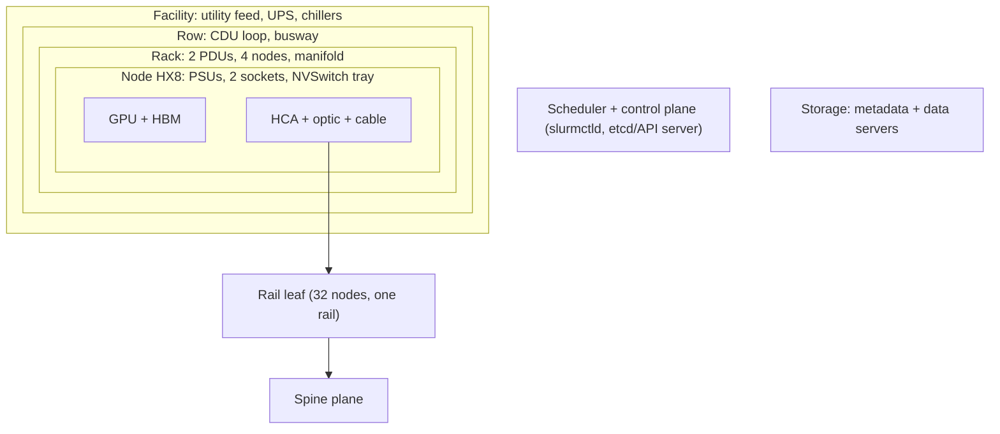
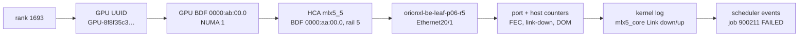
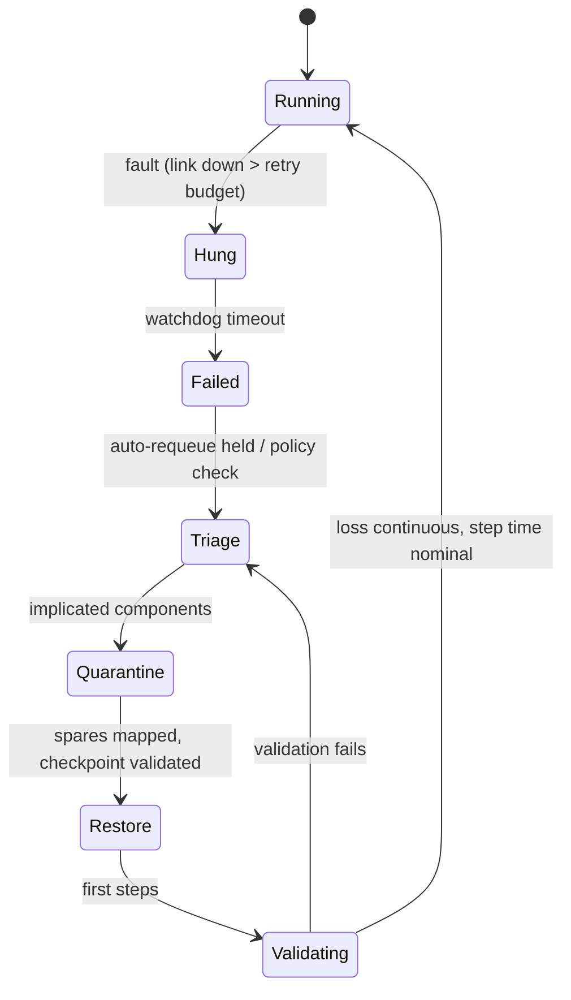
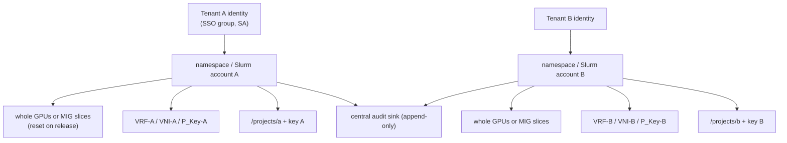

# Chapter 19 — Reliability, Security, and Multi-Tenancy

> A 4,096-GPU training job built from components that each fail once every couple of months will
> still be interrupted every few hours. At that scale, failure is not an incident class; it is the
> operating environment. This chapter teaches how to engineer for it: map fault domains and score them
> with FMEA; recognise GPU, host, NIC, and fabric errors by their signatures; walk from a hung rank to
> the exact GPU, HCA, and switch port in minutes; quarantine the smallest defensible failure domain
> without destroying evidence; restart safely from a checkpoint you have *validated*, under a retry
> policy that prevents restart loops; and measure the result in RTO, RPO, and lost accelerator-hours.
> The second half applies the same discipline to the other way platforms fail their users — one tenant
> seeing, starving, or breaking another — through identity, RBAC, secrets, network, storage, and GPU
> isolation, with audit trails that prove it.

## Learning objectives

After this chapter you will be able to:

1. **Calculate** job-level MTBF, expected interruptions, checkpoint-interval trade-offs, and goodput
   from per-node failure rates.
2. **Perform** a failure-mode and effects analysis (FMEA) across GPU, node, rack, leaf, PDU, CDU,
   storage, scheduler, and control-plane fault domains, and **critique** its scoring.
3. **Classify** GPU and host errors — ECC, row remapping, Xid events, thermal/power events, PCIe AER,
   link retraining, NIC/HCA health, firmware/driver incompatibility — and **choose** the correct action.
4. **Diagnose** distributed failure signatures (NCCL timeout or hang, rank loss, collective mismatch,
   straggler, fabric partition, host stall) using flight-recorder, log, and counter evidence.
5. **Correlate** a rank to GPU UUID, PCIe BDF, NUMA node, NIC/HCA, switch port, counters, kernel log,
   and scheduler events, and **distinguish** proven cause from correlation.
6. **Design** containment (mark unhealthy, cordon/drain, smallest defensible failure domain, evidence
   preservation) and recovery (checkpoint selection and validation, rank remapping, spares, retry
   policy) with RTO/RPO and lost accelerator-hours.
7. **Define** tenant isolation boundaries for identity, network, storage, GPU allocation, secrets, and
   audit, and **audit** a configuration against an isolation policy.

## Prerequisites and connections

You need Chapter 5 (GPU↔NIC topology, NUMA, `nvidia-smi topo -m`), Chapters 8–10 (RDMA transport,
lossless fabrics, link-layer counters and optics), Chapter 12 (collectives, NCCL), Chapter 14
(checkpointing: asynchronous and sharded saves, Distributed Checkpoint), Chapter 16 (fleet lifecycle,
acceptance tests, inventory), Chapter 17 (Slurm and Kubernetes placement), and Chapter 18 (telemetry,
correlation keys, incident command). This chapter feeds Chapter 20 (safe change and automated
remediation), Chapter 21 (spare capacity and maintenance reserve), Chapter 23, and Capstones F
(reliability game day) and G (fault-tolerant 512-node training operations).

Acronyms: MTBF (mean time between failures), FMEA (failure-mode and effects analysis), RPN (risk
priority number), RTO/RPO (recovery time / recovery point objective), ECC (error-correcting code), SBE
/ DBE (single-bit / double-bit error), Xid (NVIDIA driver error event identifier), AER (PCIe Advanced
Error Reporting), BDF (PCIe bus:device.function), HCA (host channel adapter, the RDMA NIC), FEC (forward
error correction), BER (bit error rate), DOM (digital optical monitoring), QP (RDMA queue pair), RBAC
(role-based access control), VRF (virtual routing and forwarding), VXLAN/VNI (Virtual eXtensible LAN /
its 24-bit network identifier), EVPN (Ethernet VPN), P_Key (InfiniBand partition key), MIG (Multi-
Instance GPU), KMS (key management service), PDU (power distribution unit), CDU (coolant distribution
unit).

## 19.1 Failure is the steady state

Assume, as the reference cluster does, that each HX8 node suffers a job-interrupting fault — GPU, HCA,
host, or a link attributable to the node — about once every 1,536 node-hours (≈ 64 days)
`[ILLUSTRATIVE]`. A synchronous job fails when *any* of its nodes fails, so failure rates add:

```text
MTBF_job = MTBF_node / N_nodes
ORION-256 job (32 nodes):    1,536 / 32  = 48 h      → 0.5 interruptions per day
ORION-XL job (512 nodes):    1,536 / 512 =  3 h      → 8 interruptions per day     [MODELED]
```

These values are deliberately conservative teaching numbers, but they are the same order as published
frontier-scale reports: the Llama 3 paper (Meta, 2024) describes 419 unexpected interruptions in a
54-day snapshot of a ≈ 16k-GPU training job, about one every three hours, with roughly 78 % attributed
to hardware and faulty GPUs and HBM3 memory the largest categories.

### What a failure costs

Each interruption loses the work done since the last checkpoint plus the time to detect, reschedule,
restore, and warm up. With a checkpoint interval τ, a blocking checkpoint cost δ (the time training is
paused per save), restart overhead R, and job MTBF M, the expected fraction of time lost is
approximately (Young's first-order model, see Further reading):

```text
overhead ≈ δ/τ  +  (τ/2 + R) / M
τ_opt    ≈ sqrt(2 · δ · M)
```

For ORION-XL with asynchronous checkpointing (δ ≈ 1 min of blocking staging, Chapter 14), M = 180 min,
and the reference restart overhead R ≈ 15 min:

```text
τ_opt    = sqrt(2 × 1 × 180)            = 19 min
overhead = 1/19 + (9.5 + 15)/180        = 0.053 + 0.136 = 0.189  → goodput ≈ 81 %
with τ = 30 min: 1/30 + (15 + 15)/180   = 0.033 + 0.167 = 0.200  → goodput ≈ 80 %   [MODELED]
```

Two lessons. The curve is flat near the optimum (19 vs 30 minutes changes goodput by one point). And
**restart overhead dominates**: R alone costs 15/180 = 8.3 %. Halving R — hot spares, pre-staged images,
parallel restore, no human in the loop for known failures — buys more than checkpoint tuning, and a
restart *into the same fault* (Section 19.7) pays R and the lost work again for nothing.

> **Key idea:** At scale, reliability engineering is throughput engineering. Every minute of MTTR is
> paid by every GPU in the job, several times daily.

## 19.2 Fault domains, FMEA, and blast radius

### Fault domains

A *fault domain* is a set of components that fail together because they share a dependency. Figure
19.1 shows ORION's nesting; Table 19.1 lists each domain's blast radius for a rail-optimized training
job.



*Figure 19.1 — Nested physical fault domains (facility → row → rack → node → GPU/HCA) and the
cross-cutting logical domains (fabric, scheduler/control plane, storage) that a job depends on.*

*Table 19.1 — Fault domains on ORION-XL and their effect on a 512-node rail-optimized training job
`[ILLUSTRATIVE]`.*

| Domain | What shares fate | Effect on the training job | Effect on inference | Primary mitigation |
|---|---|---|---|---|
| GPU | One GPU, its HBM | Rank crash or hang → whole job restarts | One replica (TP group) lost | Spares + fast restart; MIG/replica redundancy for serving |
| Node | 8 GPUs, PSUs, NVSwitch, 8 HCAs | Job restarts | One replica lost | Spares; N+1 PSUs |
| HCA/link | One rail of one node | Collectives on that rail hang → job restarts | Usually none (TP = 8 inside a node) | Flap detection, optics hygiene |
| Rack / PDU | 4 nodes | Job restarts with 4 fewer nodes | Several replicas | Spread replicas across racks/PDUs; dual feeds |
| Rail leaf | One rail of 32 nodes | All jobs on those nodes stall | None or minimal | Spares cannot fix a leaf — needs fast switch replacement; jobs placed elsewhere |
| CDU / cooling loop | A row of racks | Thermal throttling then shutdown of many nodes | Many replicas | Redundant pumps, leak detection, thermal alarms (Chapter 21) |
| Storage metadata | All checkpoints and data loading | Checkpoint stalls; restore impossible → RPO grows | Model loading at scale-out | HA metadata servers; checkpoint to two tiers |
| Scheduler | Job starts, requeues | Running jobs continue; *restarts blocked* | Scaling and rollouts blocked | Active/standby controllers |
| Control plane (etcd, API server) | Kubernetes state | — | Rollouts, autoscaling, self-healing blocked | 3- or 5-member etcd across fault domains |

A rail-optimized backend has no redundant path for a node's rail, so training survives component
failure through **spares or re-packing plus fast restart**; inference survives through **replicas spread
across fault domains**.

### FMEA and the risk register

FMEA walks each component's failure modes and scores Severity (S, impact), Occurrence (O, likelihood),
and Detection (D, how *unlikely* we are to detect it before impact; 10 = undetectable), each 1–10. The
classic *risk priority number* is RPN = S × O × D. A risk register built from it drives the reliability
backlog.

Two caveats. The scales are ordinal — RPN 200 is not "twice as risky" as 100 — which is why the
AIAG-VDA handbook (2019) replaces RPN with an *Action Priority* lookup and many teams act on any
severity ≥ 9 regardless of RPN. And scores are only as honest as their evidence: the lab's register
rates a CDU pump failure's detection as 2 while listing the detection control as "none", hiding a
severity-10 risk at RPN 40; re-scored with D = 10 it is RPN 200.

*Table 19.2 — Excerpt of ORION-XL's corrected risk register `[ILLUSTRATIVE]` scores.*

| ID | Failure mode | S | O | D | RPN | Action |
|---|---|---|---|---|---|---|
| F03 | Intermittent HCA link flap | 8 | 7 | 6 | 336 | Flap-rate alert; auto-quarantine after 2 flaps/24 h |
| F07 | CDU pump failure (D corrected 2 → 10) | 10 | 2 | 10 | 200 | Pump-state telemetry and alarm; redundant pump |
| F12 | NIC firmware/driver mismatch after upgrade | 9 | 3 | 7 | 189 | Compatibility gate in provisioning and canary (Chapter 20) |
| F08 | Storage metadata failover | 7 | 4 | 5 | 140 | Checkpoint-duration SLO alert; two-tier checkpoints |
| F06 | Leaf switch reboot | 9 | 3 | 3 | 81 | Severity override: spare switch on site, runbook |

### Blast-radius control

Blast-radius control keeps a fault inside its domain: N+1 PSUs and dual PDUs; inference replicas spread
across racks, PDUs, and leaf groups; training placement that minimises jobs per leaf; separate training
and inference control planes; rate-limited remediation bots (at most *k* drains per hour, Chapter 20);
and staged changes that touch one leaf before eight (Chapter 18's INC-2291).

## 19.3 GPU and host error taxonomy

This section is the field guide. For each class: what happens physically, what you see, and what to do.
Xid meanings, row-remapper behaviour, and recommended actions are documented by NVIDIA per GPU
generation and driver branch — every table entry here is `[VENDOR-SPEC, 2026-10]` and must be checked
against the current *Xid Errors* and *GPU Memory Error Management* documents for your platform.

### ECC, row remapping, and page retirement

HBM is protected by ECC. A **correctable** error (single-bit, SBE) is fixed transparently and only
counted. An **uncorrectable** error (DBE) cannot be fixed; the data is lost and whatever was using it
must be terminated. Counters come in two flavours: *volatile* (since the last driver load or reset) and
*aggregate* (lifetime).

Older data-center GPUs (V100-class) handled bad memory by **retiring pages** — blacklisting a page
after repeated SBEs or a DBE, effective after reboot. A100- and H100-class GPUs use **row remapping**:
the faulty HBM row is replaced by a spare row. The remap is recorded immediately but only takes effect
after a GPU reset; until then it is *pending*. If no spare row is available in that bank, the remap
*fails* and the GPU should be replaced.

```text
$ nvidia-smi -q -d ROW_REMAPPER -i 3                    # [ILLUSTRATIVE output, abridged]
    Remapped Rows
        Correctable Error                 : 0
        Uncorrectable Error               : 0
        Pending                           : Yes
        Remapping Failure Occurred        : No
```

Decision rules used on ORION (and in the lab's `gpu_actions()`):

| State | Meaning | Action |
|---|---|---|
| Remapping failure, or uncorrectable errors still occurring | No spare capacity / memory unreliable | Quarantine; RMA |
| Pending = Yes | Remap recorded, not active | Drain when no job needs it (or at the next restart), reset GPU, verify pending cleared, run diagnostics, return |
| Rows remapped, nothing pending | Repaired; normal | Monitor; do **not** quarantine |
| Correctable errors rising quickly | Possible degrading memory | Ticket; watch for remap events |

### Xid events

The NVIDIA kernel driver logs `NVRM: Xid (PCI:<domain:bus:dev>): <code>, …` for driver-detected
errors. The PCI address — not the CUDA index — identifies the GPU. Some codes indicate application bugs,
some hardware faults, and many depend on context.

*Table 19.3 — Common Xid codes in GPU-cluster operations `[VENDOR-SPEC, 2026-10]` — verify meanings and
recommended actions for your driver branch.*

| Xid | Meaning (abridged) | Usually | Typical operator action |
|---|---|---|---|
| 13 | Graphics engine exception | Application (illegal instruction, bad address) | Tell the user; hardware only if recurring across jobs |
| 31 | GPU memory page fault | Application (bad pointer) or driver | Same as 13 |
| 43 | GPU stopped processing | Application fault in a context | Usually none for the node |
| 45 | Preemptive cleanup after previous errors | Follows another error | Look at the preceding Xid |
| 48 | Double-bit (uncorrectable) ECC error | Hardware | Process killed; check row remapper; drain/reset |
| 63 | ECC page retirement or row-remapping recording event | Hardware (handled) | Reset to activate remap at next opportunity |
| 64 | ECC page retirement or row-remapper recording failure | Hardware | Quarantine; RMA path |
| 74 | NVLink error | Hardware (link, NVSwitch, board) | Drain; diagnostics; reseat/replace |
| 79 | GPU has fallen off the bus | Hardware/PCIe/power/thermal | Drain node; collect logs; cold reboot; diagnostics; often RMA |
| 92 | High single-bit ECC error rate | Hardware (degrading) | Ticket; watch row remapping |
| 94 | Contained ECC error | Hardware; affected contexts terminated, GPU can continue | Restart affected job; drain when convenient, then reset |
| 95 | Uncontained ECC error | Hardware; all contexts on the GPU affected | Drain immediately; reset; diagnostics |
| 119 / 120 | GSP RPC timeout / GSP error (GPU System Processor firmware) | Firmware/driver or hardware | Drain; collect bug report; GPU reset or node reboot; check driver/firmware matrix; RMA if recurrent |
| 154 | GPU recovery action changed (driver reports the recovery the GPU now needs, e.g. reset or node reboot) | Follows another fault | Perform the stated recovery action before returning the GPU |

NVSwitch-based nodes add a second error stream. The NVSwitch driver logs *SXid* events for NVSwitch and
NVLink-fabric faults, and the **fabric manager** service must be running and healthy for CUDA to use
the NVLink fabric. If it is stopped or fails, applications on HX8-class systems fail at CUDA
initialisation ("system not yet initialized") instead of running slowly. Check
`systemctl status nvidia-fabricmanager` and its log, and alert on SXids and on fabric-manager
restarts `[VENDOR-SPEC, 2026-10]`.

Collect Xids from the kernel log (`journalctl -k | grep 'NVRM: Xid'`) and DCGM
(`DCGM_FI_DEV_XID_ERRORS`, `dcgmi health -c`). The Kubernetes NVIDIA device plugin also watches
critical Xids and marks the affected GPU unhealthy so that it is no longer allocatable.

### Thermal and power events

Clock-event reasons (Chapter 18) separate thermal slowdown, power capping, and power brake; judge
against the peers' *sustained* clock (≈ 1,830 MHz). A throttled GPU is a straggler, not a failure. One hot
GPU among cool neighbours points to its cold plate; a whole hot rack to the loop or CDU (Chapter 21).

### PCIe AER and link retraining

PCIe Advanced Error Reporting classifies errors as **correctable** (handled by the link layer, e.g.
receiver errors, bad TLPs replayed), **uncorrectable non-fatal** (a transaction is lost but the link
works), and **uncorrectable fatal** (the link is unreliable; the device may need reset). Correctable
errors at a low, steady rate are common background noise on large fleets; a *rising* rate, or any
fatal error, is actionable.

```text
$ journalctl -k | grep AER                               # [ILLUSTRATIVE]
pcieport 0000:98:01.0: AER: Corrected error received: 0000:9b:00.0
pcie ... PCIe Bus Error: severity=Corrected, type=Physical Layer, (Receiver ID)
$ lspci -vvv -s 9b:00.0 | grep -E 'LnkCap:|LnkSta:'
        LnkCap: Port #0, Speed 32GT/s, Width x16, ...
        LnkSta: Speed 32GT/s, Width x16
```

A link that trained below capability (`LnkSta` showing a lower speed or width than `LnkCap`, often
flagged "downgraded") halves or quarters the GPU↔NIC or GPU↔host bandwidth (Chapter 5) and is a
classic silent straggler. Per-device AER counters are also exposed in sysfs
(`/sys/bus/pci/devices/<bdf>/aer_dev_correctable`, `…_nonfatal`, `…_fatal`).

### NIC/HCA and link health

On the RDMA side, watch: link-down events and flap rate (kernel `mlx5_core … Link down/up`, switch
oper-status), FEC-uncorrectable and symbol-error counts on both ends of the link, transceiver DOM (TX
power, RX power, bias current, temperature) on both ends, and HCA counters such as `link_downed`,
`local_ack_timeout_err`, and `out_of_sequence` (Chapter 18). Vendor tools add pre-FEC and post-FEC BER
and the HCA's internal health/firmware syndrome reports (`[VENDOR-SPEC, 2026-10]`, e.g. `mlxlink` in
NVIDIA's firmware tools). The diagnostic trick is directionality: errors counted *by the switch* on its
receive side implicate the host's transmitter, the host-side optic, or the cable; errors counted by the
host implicate the switch's transmitter or the switch-side optic. Comparing DOM readings at both ends
tells you whether light is being lost in the transmitter or in the fibre.

### Firmware and driver incompatibility

Driver, CUDA, NCCL, RDMA stack, NIC firmware, VBIOS, and the GPUDirect RDMA enablement path (peer-memory
module or DMA-BUF) form a compatibility matrix (Chapter 16). Mismatches rarely crash cleanly: GPUDirect
RDMA silently not used (NCCL channel lines lack `/GDRDMA`, so data is staged through host memory),
failures only above a message size, transport fallback, or one node behaving differently after a
partial upgrade. Diff versions between a good and a bad node; upgrade through canaries (Chapter 20).

## 19.4 Distributed failure signatures

A single-component fault becomes a *distributed* symptom. Learn the signatures, because the symptom
almost never points at the component directly.

### NCCL timeout or hang

When one connection of a collective stops making progress, every rank in that communicator blocks.
Ranks that depend on them (the next pipeline stage, the next collective) block too. Nothing errors
until a timer fires. In PyTorch the process-group *watchdog* aborts a collective that has not
completed within the process-group timeout. The default is 10 minutes for the NCCL backend in the
PyTorch 2.x documentation for `torch.distributed.init_process_group` `[VENDOR-SPEC, 2026-10]`. A
separate heartbeat monitor (`TORCH_NCCL_HEARTBEAT_TIMEOUT_SEC`) kills a process whose watchdog itself is
stuck. Large jobs often *raise* the timeout because legitimate long collectives — checkpoint barriers,
first-step compilation, evaluation — would otherwise trip it, and every extra minute is paid by every GPU
when a real hang occurs. The watchdog logs:

```text
[Rank 817] Watchdog caught collective operation timeout: WorkNCCL(SeqNum=88214, OpType=SEND,
Timeout(ms)=600000) ran for 600003 milliseconds before timing out.        [ILLUSTRATIVE]
```

Three properties of this message mislead newcomers. The rank that logs **first** is simply the one
whose timer expired first; in the lab it is rank 817 on orionxl-n103, which had nothing to do with the
fault. **Every** rank eventually logs a timeout, so the timeout itself localises nothing. And the
timestamp is ≈ 10 minutes *after* the fault. Localisation needs the evidence that precedes it: which
ranks are *behind* (the flight recorder's last-completed sequence numbers), and which transport errors
appeared at the start of the stall.

RDMA transport errors are the start-of-stall evidence. A reliable-connection QP retransmits an
unacknowledged packet after the local ACK timeout, 4.096 µs × 2^timeout, up to a retry count; when the
budget is exhausted the work completion fails with status 12 (`IBV_WC_RETRY_EXC_ERR`, "transport retry
counter exceeded") and NCCL logs it:

```text
orionxl-n211:3688:3794 [5] NCCL WARN NET/IB : Got completion from peer 10.135.1.167<40685> with status=12
opcode=0 len=0 vendor err 129 (Send) hca mlx5_5                                    [ILLUSTRATIVE]
```

The `NCCL_IB_TIMEOUT` default depends on the NCCL version: 18 up to and including 2.22, 20 from 2.23
onward `[VENDOR-SPEC, 2026-10]`. ORION-XL's job runs an NCCL 2.21-class build, so with the default 18
and `NCCL_IB_RETRY_CNT=7`:

```text
per-attempt timeout = 4.096 µs × 2^18 = 4.096e-6 × 262,144 = 1.07 s
retry budget        ≈ (7 + 1) × 1.07 s ≈ 8.6 s                     [MODELED]
```

A link that flaps for 5–6 s recovers inside the budget and the job survives (with a step-time
hiccup); a 14 s flap exhausts it and the job hangs until the watchdog fires. The lab's HCA flapped four
times: the 6 s and 5 s flaps were survived, the two 14 s flaps each killed an attempt.

### Rank loss, collective mismatch, stragglers, partitions, host stalls

*Table 19.4 — Distributed failure signatures and the first evidence to check.*

| Signature | Mechanism | What you see | First check |
|---|---|---|---|
| NCCL hang / timeout | A connection or peer stops progressing; all dependants block | Watchdog timeouts on all ranks ≈ 10 min later; NET/IB status 12 errors at onset from a few ranks | Flight recorder: which ranks are behind; NET/IB errors' local and peer endpoints |
| Rank loss | A process dies (Xid 48/79/94/95, OOM, segfault) | One rank's process exits with an error; peers hang or receive connection errors | Exit code and kernel log on the dead rank's node *before* looking at peers |
| Collective mismatch | Ranks issue different collectives, sizes, or orders (code bug, conditional collective) | Hang with **no** transport errors; flight recorder shows different `OpType` or sizes at the same sequence number | `TORCH_DISTRIBUTED_DEBUG=DETAIL` or the flight-recorder dump; recent code change |
| Straggler amplification | One slow rank delays every collective | Step time up for the whole job; the straggler's SM activity *higher* than peers (Chapter 18) | Peer comparison of clocks, power, PCIe link state, thermal reasons |
| Fabric partition | Some endpoints cannot reach others (black-holed ECMP path, misconfigured route) | A *subset* of node pairs fails consistently; others fine | Pairwise probes along the failing pairs; switch routes and counters |
| Packet loss / congestion | Loss on a lossless class, PFC storms, ECN misconfiguration | Rising `out_of_sequence`, retransmits, CNPs; slow rather than hung | Switch pause/ECN counters, host RDMA counters (Chapters 9, 18) |
| Host-side stall | CPU contention, data-loader starvation, memory pressure, page cache | Slow steps on one node with *lower* GPU activity and high PSI | `top`/PSI, data-loader timing, NUMA placement |

Straggler arithmetic: if each node is degraded with probability p at any moment, an N-node job has a
straggler with probability 1 − (1 − p)^N; with p = 0.001 `[ILLUSTRATIVE]`, 3.2 % at N = 32 and 40 % at
N = 512 `[MODELED]`. Large jobs need automatic straggler detection.

## 19.5 The fast isolation workflow

Isolation is a join across the correlation keys of Chapter 18. Figure 19.2 is the path every hop of
which must be answerable in seconds, from data you prepared *before* the incident.



*Figure 19.2 — Rank-to-hardware isolation path for the lab incident. Each arrow is a lookup in a table
built at job start (rank map) or kept by inventory and LLDP (HCA → switch port).*

The GPU↔NIC data path behind those hops is the one from Chapter 5: GPU5 and HCA `mlx5_5` share a PCIe
switch under socket 1, so a rail-5 collective moves GPU5 → PCIe switch → HCA → optic → orionxl-be-leaf-p06-r5
port 20 → spine → the peer's leaf → peer HCA → peer GPU. Any hop can be the fault.

```text
 GPU5 (0000:ab:00.0) ──PCIe Gen5 x16──┐
                                      ├─ PCIe SW2 (socket 1, NUMA 1)
 HCA mlx5_5 (0000:aa:00.0) ───────────┘
      │ 400G optic (host side)  ── fibre ──  optic (switch side)
      └──────────────────────────────────────────── orionxl-be-leaf-p06-r5 Ethernet20/1 ── spines
```

*Figure 19.3 — The GPU↔HCA↔switch data path for rank 1693 (HX8 topology, Reference Cluster Figure
R.1). Host counters see the left side, switch counters the right.*

### Commands at each hop

```bash
# rank -> node/GPU: from the job's rank map (emit it at job start: rank, host, local_rank, CUDA UUID)
nvidia-smi --query-gpu=index,uuid,pci.bus_id --format=csv           # index <-> UUID <-> BDF
nvidia-smi topo -m                                                   # GPU <-> NIC affinity (PIX/PXB/SYS)
cat /sys/bus/pci/devices/0000:aa:00.0/numa_node                      # NUMA of the HCA
rdma link show                                                       # mlx5_N <-> netdev, state
lldpctl                                                              # host port -> switch + port (if LLDP runs)
ethtool -m ens5np0                                                   # transceiver DOM (TX/RX power)
cat /sys/class/infiniband/mlx5_5/ports/1/counters/link_downed        # link-down count
journalctl -k --since "-6h" | grep -E 'mlx5_core|NVRM: Xid|AER'
sacct -j 900211 --format=JobID,State,Start,End,NodeList%40           # scheduler view
```

On the switch, read the port's counters, oper-status history, and DOM through gNMI or the CLI
(Chapter 10). The lab's `rank_map.csv` is exactly this join materialised for 4,096 ranks.

### Localising with the flight recorder

PyTorch's NCCL flight recorder (Chapter 18) records each rank's enqueued and completed collectives. The
ranks with the *lowest* completed sequence number are the communicator that never finished; map them
through the rank map to their shared rail, stage, and leaves. Then score every endpoint named in a
NET/IB error (reporter and resolved peer): the dominant endpoint, cross-checked against the switch
port with link-down events and FEC bursts, closes the chain. Section 19.11 does this on the lab data.

### Proven cause versus correlation

Write each hypothesis down and classify it explicitly:

- **Proven cause** — temporal precedence (the fault precedes the symptom by the right interval),
  locality (the component is in the stuck group's path), mechanism (a known causal path, e.g. 14 s link
  down > 8.6 s retry budget → status-12 errors → hang), and ideally *intervention* (removing it removes
  the symptom; the restart without orionxl-n212 will test this).
- **Real fault, not the cause** — a genuine defect needing action that is not on the failing path or
  not aligned in time.
- **Correlation only** — an event near the incident in time or space with no causal path, or a
  *consequence* of the fault.
- **Refuted** — the hypothesis predicts evidence that is absent.

In the lab: the HCA link (H1) is proven; the orionxl-n389 GPU3 row-remap event (H2) is a real fault, 42
minutes earlier, on a GPU whose ranks completed every later collective — not the cause; the first
watchdog reporter (H3), the steady stream of corrected AER errors on orionxl-n451's NIC (H4), and the spine
PFC spike that *followed* the link drop (H5) are correlations; "orionxl-be-leaf-p06-r5 is failing" (H6) is
refuted because a failing switch would show errors on more than one of its 32 ports.

> **Pitfall:** "The last thing that changed" and "the loudest log line" are both correlation
> generators. On a 512-node cluster something alarming is happening somewhere every hour. Demand
> locality and mechanism before you call anything a cause.

## 19.6 Containment: quarantine the smallest defensible domain

Containment has four goals: stop new work landing on the suspect component, protect running work,
preserve evidence, and return the component only after it proves healthy.

1. **Mark unhealthy.** Health checks should flip state automatically: Slurm's `HealthCheckProgram`
   (for example a node-health-check script that runs DCGM health and counter checks) drains nodes that
   fail; on Kubernetes the device plugin marks GPUs unhealthy on critical Xids, and a node-problem
   detector or operator applies a taint.
2. **Prevent new placement and drain.** `scontrol update nodename=orionxl-n212 state=drain
   reason="INC-3107 rail5 HCA link flaps x4"`; `kubectl cordon <node>` then `kubectl drain <node>
   --ignore-daemonsets --delete-emptydir-data` (or taint `NoSchedule`/`NoExecute` per policy).
3. **Choose the smallest defensible failure domain.** Smallest *defensible* means: as small as the
   evidence supports, and no smaller. Quarantining the leaf for a single bad port takes 31 healthy
   nodes' rail 5 out of service; quarantining only "the cable" when the evidence points to the host
   transmitter guarantees a repeat. Distinguish the *fault domain* from the *scheduling unit*: the fault
   domain of H1 is one link (HCA port, host optic, cable); the scheduling unit removed is the whole node,
   because a rail-optimized TP = 8 job cannot use a node with seven rails.
4. **Preserve evidence before you reset anything.** A GPU reset clears volatile ECC counters and pending
   state; a reboot loses the kernel ring buffer. Capture `nvidia-bug-report.sh`, `dmesg`, DCGM health,
   HCA counters and DOM (`ethtool -S`, `ethtool -m`), switch-port counters, and flight-recorder dumps.
5. **Return to service only after acceptance.** The node re-enters through the Chapter 16 lifecycle:
   repair, acceptance tests (DCGM diagnostics, link BER soak, NCCL tests on its rails), then
   schedulable.

*Table 19.5 — Containment decisions for the lab incident.*

| Component | Evidence class | Fault domain | Scheduling unit removed | Evidence to capture | Return criteria |
|---|---|---|---|---|---|
| orionxl-n212 `mlx5_5` link | Proven cause | Host transmitter path: HCA port, host optic (TX −5.8 dBm vs ≈ −1.6 dBm fleet), cable | Node orionxl-n212 | Host and switch counters, DOM both ends, kernel log, flap times | Replace optic first (cheapest, matches DOM); if errors persist, HCA. 24 h link soak with zero FEC-uncorrectable bursts; rail-5 NCCL test |
| orionxl-n389 GPU3 | Real fault, not cause | GPU3 (pending row remap) | Node orionxl-n389 for this restart | `nvidia-smi -q -d ROW_REMAPPER,ECC`, Xid line | GPU reset; pending cleared, no failure; `dcgmi diag -r 3` pass |
| orionxl-n046 GPU6 | Healthy (remap applied long ago) | — | None | — | — |
| orionxl-be-leaf-p06-r5 | Refuted | — | None | Port table showing 31 clean ports | — |
| Spare orionxl-s00 | Failed acceptance | GPU2 (DBE, remap failure) | Not eligible as a spare | — | RMA |

## 19.7 Recovery: restart safely, and only once

### Coordinated restart

The default recovery for a synchronous job is a **coordinated restart**: stop all ranks, exclude the
quarantined nodes, allocate replacements, restore a validated checkpoint, resume. `torchrun` elastic
launch (`--nnodes=MIN:MAX`, `--max-restarts=N`, `c10d` rendezvous) restarts workers automatically and
can continue on fewer nodes only if the code re-shards data and optimizer state. Most large pretraining
runs keep the world size fixed and swap in spares; in-job fault-tolerant frameworks exist — measure
their real recovery time before relying on them.

### Checkpoint selection and restore validation

"Complete" in a log is not "restorable". A checkpoint is safe only if every shard was written, the
metadata (the index that ties shards to tensors — in PyTorch Distributed Checkpoint the `.metadata`
file written at the end of save) was durably committed, and, ideally, checksums match. Asynchronous
checkpointing makes this sharper: shards may be persisted while the metadata commit is still in flight
when the job dies. In the lab, `ckpt-0085` (03:40) has all 4,096 shards but uncommitted metadata — the
hang came 62 s after it started — so the restorable checkpoint is `ckpt-0084` (03:10). Validate on
restore: shard count and checksums, a loss value at the first resumed step consistent with the loss
recorded at checkpoint time, and step time back to baseline.

### Rank remapping and spares

Replace each excluded node with a healthy spare and give the spare the excluded node's ranks *with the
same local ranks*, so that TP, PP, and DP coordinates — and rail alignment — are unchanged. Spares must
themselves be healthy: the lab's first spare in the list failed acceptance and the second is in repair.

**The spare pool is a declared variation.** The reference cluster has no spares; ORION-XL's training
partition is exactly 512 nodes. For this chapter Halcyon adds a pool *outside* the partition, sized with
Chapter 16's Poisson method from the canonical failure rate and 5-day repair turnaround:

```text
node failures per day (ORION-XL)  = 512 × 24 h / 1,536 h          = 8 per day
mean nodes in repair              = 8 per day × 5 days            = 40 (Poisson)
pool for P(in repair ≤ k) ≥ 0.99   → k = 55   (P(≤ 55) = 0.990)   [MODELED]
declared pool: orionxl-s00 – orionxl-s54 (55 nodes, ≈ 10.7 % extra capex)
```

At the moment of the lab incident 47 of the 55 are already standing in for nodes in repair; `spares.csv`
lists the eight that remain assigned to the pool, and only four of those are `ready`. Without a pool —
the ORION-256 situation — the choices are to wait for repair, restart at reduced DP, or borrow a node
from another partition through a lifecycle transition (Chapter 17). Draining never moves a running
job; that takes a checkpoint and a requeue or restart.

**Elastic training granularity is a whole DP replica.** With TP = 8 and PP = 8, one DP replica is 64 GPUs
= 8 nodes. A single failed node therefore removes a whole replica: its seven healthy nodes go idle
unless their ranks are re-packed. DP drops from 64 to 63, and the global batch (a multiple of DP × micro-
batch × accumulation steps) must still divide evenly — 63 rarely does, so the job must change
accumulation steps, the per-replica batch, or the learning-rate schedule. That is a correctness
decision, not just a scheduling one. With 40 nodes in repair on average, the difference between
re-packing and not is large:

```text
re-packed (healthy nodes regrouped into full replicas): ⌊(512 − 40) / 8⌋ = 59 replicas  (−7.8 %)
not re-packed, failures in distinct replicas (worst):    64 − 40     = 24 replicas  (−62.5 %)
not re-packed, random placement (expected):  64 × (1 − C(504,40)/C(512,40)) ≈ 30.8 replicas lost → ≈ 33 left
```

Elastic training pays off only with topology-aligned re-packing.

### Asynchronous checkpointing: staging, consistency, completion latency

Section 19.1's δ — the time training is *blocked* per checkpoint — is small only because saves are
asynchronous. Both main stacks implement the same pattern `[VENDOR-SPEC, 2026-10]`:

- **PyTorch Distributed Checkpoint (DCP)** provides `torch.distributed.checkpoint.async_save`, which
  stages each rank's shard of the state dict into CPU memory and then writes shards plus a final
  `.metadata` file in a background thread or process.
- **Megatron-LM** provides `--async-save`, which works with the `torch_dist` distributed-checkpoint
  format (`--ckpt-format torch_dist`): a background process performs the shard writes, and the
  finalisation step — the metadata commit — is called from the training loop once the writes finish.

The mechanism has three parts. **Staging**: device-to-host copies of every rank's shard into (ideally
pinned) host buffers. This is the blocking part; it costs host memory equal to the shard size and PCIe
bandwidth, and HX8's 2 TiB of host RAM is ample. **Persisting**: background writes of the shards to the
file system (Chapter 14), overlapped with training. **Committing**: a coordinator writes the metadata
once *every* rank has persisted its shard for the *same* step. That is the consistency boundary — a
checkpoint is a set of shards from one step plus the metadata that names them. Until the commit, the
checkpoint does not exist, whatever the logs say.

*Table 19.6 — Checkpoint and resume metrics from the lab `[SIMULATED]`.*

| Metric | Definition | Lab value |
|---|---|---|
| Blocking cost δ | Training paused per save (staging) | ≈ 1 min (Section 19.1 assumption) |
| Checkpoint completion latency | Save start → metadata committed | 72 s (ckpt-0082, 0083, 0084: 02:10:00 → 02:11:12, …) |
| Unsafe window | Shards persisted, metadata not yet committed | ckpt-0085: shards done at +58 s, hang at +62 s, metadata never committed → unusable |
| Effective RPO | Failure − state time of the newest *committed* checkpoint | 31.0 min (attempt 2) instead of ≈ 1 min had ckpt-0085 committed |
| Time to detect | Fault → job declared failed | 10.9 min (attempt 1: 01:12:44 → 01:23:40); 11.2 min (attempt 2) |
| Time to reschedule | Failed → new allocation started | 16.4 min (attempt 1: 01:23:40 → 01:40:02, auto-requeue queueing) |
| Time to restore and warm up | Start → first completed step | 12.1 min (attempt 1: 01:40:02 → 01:52:10) |
| Time to resume (RTO) | Fault → first completed step | 39.4 min (attempt 1); 50.0 min (attempt 2, includes triage and held requeue) |

**Reconciling with the canonical 15-minute restart.** The canon's 15 minutes is *detect + reschedule +
restore + warm-up* for ORION-256, assuming early hang detection (a health signal or the link-down +
NET/IB signature, not the 10-minute watchdog) and automated requeue onto ready capacity. The lab's
ORION-XL attempts are slower on every term: 10.9 minutes to detect, 16 to requeue, 12 to restore and warm
up. Early abort on the link signature (≈ 9 minutes saved), a pre-reserved restart allocation, and
parallel restore bring it towards the canon.

### Retry-loop policy

The most expensive failure in the lab is not the hardware fault — it is the **first automatic
restart onto the same nodes**. Attempt 1 hung at 01:12 because of the same link; the auto-requeue
policy restarted on the identical allocation, and attempt 2 hung at 03:41 for the same reason. ORION's
policy afterwards:

1. Automatic restart is allowed at most twice per 6 h per job; then a human decides.
2. Before any automatic restart, nodes implicated by the failure's evidence (top NET/IB endpoint, Xid
   source, failed health check) are excluded.
3. A node implicated in two failures within 24 h is quarantined regardless of its current health
   (flaky components look healthy between flaps).
4. Back off: restart immediately the first time, wait for health checks to finish the second time.

### RTO, RPO, and lost accelerator-hours

For a training job: **RPO** = failure time − checkpoint state time (work lost); **RTO** = resume time −
failure time; **lost accelerator-hours** = GPUs × (resume time − checkpoint state time), which counts both
the redone work and the downtime. Section 19.11 computes them for both lab attempts.



*Figure 19.4 — Recovery state machine with the policy gate (Triage) that prevents restart loops.*

## 19.8 Security foundations for shared AI platforms

Multi-tenancy is a reliability problem with an adversary: a tenant must not be able to read, slow, or
break another tenant's work. The controls are standard; what is AI-specific is where they attach.

- **Identity:** SSO groups for humans; workload identities (service accounts, Slurm accounts) with
  short-lived credentials; no shared accounts.
- **RBAC:** namespaced `Role`/`RoleBinding`s for tenants; cluster-scoped roles only for the platform team
  behind break-glass. A tenant service account bound to `cluster-admin` (planted in the lab) can read
  every Secret and schedule anywhere. Slurm accounts, associations, partitions, and QOS do the same job
  for batch.
- **Secrets:** credentials, dataset tokens, and *model weights* live in a secrets manager/KMS under
  per-tenant paths, injected at runtime, never baked into images or logs. A non-tenant-specific prefix
  (the lab's `kv/tenants/`) is a read-all grant.
- **Audit:** Kubernetes API audit, Slurm accounting, switch AAA, BMC access, and secrets-manager logs go
  to an append-only store with policy retention (ORION: ≥ 365 days) — the proof of isolation.
- **Management plane:** BMCs (Redfish/IPMI) live on the isolated OOB network; firmware and images are
  signed and tracked (Chapter 16).

## 19.9 Multi-tenancy: the isolation model

*Table 19.7 — Isolation boundaries per layer on ORION-XL.*

| Layer | Mechanism | Strength | Notes and pitfalls |
|---|---|---|---|
| Identity / RBAC | SSO groups → namespaced roles; Slurm accounts | Strong if least privilege holds | Audit for cluster-scoped bindings to tenant subjects |
| GPU allocation | Whole GPU (exclusive) | Strong | Simplest; default for training |
| | MIG (H100: up to 7 instances) | Hardware-partitioned SMs, memory, and cache | Required for cross-tenant sharing of one GPU on ORION |
| | Time-slicing / MPS | Weak: separate address spaces, but no memory-capacity limits (MPS can set them), no bandwidth or performance isolation, shared fault exposure | Same tenant only — never across tenants |
| GPU memory residue | Scrub / reset between tenants | Depends on driver and platform | Do not assume; verify vendor behaviour for your driver; ORION resets GPUs on tenant change and validates in the lifecycle (Chapter 16) |
| Frontend network | VRF per tenant; VXLAN/EVPN with a VNI per tenant | Strong if VNI/VRF unique | A shared VNI (planted in the lab) is a shared L2 segment |
| Backend RoCE fabric | Per-tenant VRF on leaves or dedicated node/leaf groups; QoS | Isolation of reachability, not of congestion | Shared spines carry both tenants' traffic: noisy-neighbour risk |
| Backend InfiniBand | Partition keys (P_Key), managed by the subnet manager; full vs limited membership; switch-side partition enforcement on ingress ports | Strong for reachability when switches enforce | IB fabrics only — VNIs/VRFs are the RoCE/Ethernet equivalent. Duplicate P_Keys across tenants (planted) merge partitions |
| Storage | Separate exports/filesets per tenant; per-tenant encryption keys; identity mapping on the file system | Strong if paths don't overlap | A parent-path export (planted) exposes every child tenant's data |
| Secrets | Per-tenant paths and policies | Strong | Prefixes must be tenant-specific |
| Audit | Central append-only sink, retention policy | Evidence, not prevention | Retention below policy (planted) loses the proof |



*Figure 19.5 — Tenant isolation layers: each tenant's identity maps to its own compute, network, and
storage boundaries; audit is shared and append-only.*

VRFs, VNIs, and P_Keys isolate *reachability*, not *performance*: two tenants' collectives can congest
the same spines, and one tenant's PFC pauses can spread (Chapter 9). Performance isolation needs
placement (separate leaf groups for large tenants), QoS classes, and working congestion control.

GPU sharing deserves another. Whole-GPU allocation and MIG partition the hardware. Time-slicing and
MPS keep separate virtual address spaces, but clients compete for memory capacity (unless MPS limits
are set), SM time, and memory bandwidth with no performance isolation, and a fatal fault in one client
can take down the others sharing the GPU —
fine for one team's notebooks, unacceptable between tenants. Residual data in GPU memory after a job is
a real concern on shared fleets; establish (and test) what your driver guarantees, reset GPUs on tenant
change, and consider confidential-computing modes where the platform supports them
`[VENDOR-SPEC, 2026-10]`.

## 19.10 Testing containment: tenant-failure recovery exercises

Isolation and blast-radius claims are hypotheses until tested. A *containment exercise* (tabletop
first, then on a dedicated lab partition) injects a failure into one tenant's footprint and verifies
that the other tenants' SLOs do not move. A minimal plan:

| Step | Example |
|---|---|
| Hypothesis | "If tenant A's training job crashes and restarts repeatedly, tenant B's inference TTFT and tenant C's training throughput stay within SLO." |
| Steady state | B's TTFT p95 and C's step-time ratio for 30 min (Chapter 18 SLIs) |
| Injection (lab partition only) | Kill A's ranks every 10 min; or disable one of A's backend ports; or fill A's storage quota |
| Abort criteria | Any non-target SLI burn-rate > 2; any alert on shared infrastructure |
| Observations | B and C SLIs; shared spine utilisation and PFC; scheduler and storage metadata latency |
| Pass | Non-target SLIs unchanged within noise; A's failures contained to A's nodes, namespaces, and paths |
| Evidence | Timeline, dashboards, audit-log excerpts showing no cross-tenant access |

Typical findings: restart storms overload a shared scheduler or metadata server, and fabric patterns
leak across tenants through shared spines.

## 19.11 Worked example: INC-3107 on ORION-XL

We apply the diagnostic loop to the lab dataset. Values from the dataset are `[SIMULATED]`; formulas
are `[MODELED]`.

**Setting.** Job 900211 is a W-TRAIN-architecture pretraining run scaled to ORION-XL: 512 nodes, 4,096
GPUs, TP = 8 (inside each node), PP = 8 (64 nodes per stage), DP = 64. Rank r runs on node
`orionxl-n(⌊r/8⌋ + 1)`, local GPU r mod 8, which uses HCA `mlx5_(r mod 8)` on rail r mod 8. Checkpoints
are asynchronous, every 30 minutes. Expected job MTBF = 1,536 / 512 = 3 h, so two failures in one night
are normal; two failures *from the same component* are not.

**Step 1 — Observe.** 03:52:15: Slurm marks 900211 `FAILED (NCCL watchdog timeout)`; auto-requeue held.
The first watchdog line is rank 817 on orionxl-n103 at 03:51:01 — noted, not trusted.

**Step 2 — Localise the stuck group.** Flight recorder: 64 ranks have `last_completed_seq` = 88212, all
others 88213. Through the rank map, the 64 ranks are local rank 5 on orionxl-n193–n256: one rail (5), one
pipeline stage (3), leaves orionxl-be-leaf-p06-r5 and orionxl-be-leaf-p07-r5. The fault is on rail 5 of stage 3.

**Step 3 — Find the start-of-stall evidence.** At 03:41:11 three NET/IB status-12 errors appear, from
orionxl-n211 and orionxl-n213 (peer 10.135.1.167) and from orionxl-n212 (peer orionxl-n211's rail-5
address). Resolving 10.135.1.167 through the rank map gives orionxl-n212 `mlx5_5`. Endpoint scores:
orionxl-n212 = 3, orionxl-n211 = 2, orionxl-n213 = 1. The kernel log on orionxl-n212 shows `Link down` at
03:41:02 and `Link up` at 03:41:16:

```text
link-down duration = 03:41:16 − 03:41:02 = 14 s
retry budget       = (7 + 1) × 4.096 µs × 2^18 ≈ 8.6 s
first NET/IB error ≈ link down + 8.6 s = 03:41:10.6  (observed 03:41:11)
watchdog           ≈ last enqueue + 600 s ≈ 03:51:01–03:51:09   (observed)
```

The timing matches the mechanism to the second.

**Step 4 — Locate the fault on the link.** Switch side, orionxl-be-leaf-p06-r5 Ethernet20/1: 4 link-down
events and 203,903 FEC-uncorrectable blocks over 4.5 h, while the other 95 inspected ports increased by
at most a handful. Its DOM receive power sits in a marginal band, −5.6 to −6.4 dBm over the night (median
−6.1 dBm), against ≈ −1.8 dBm on healthy ports:

```text
Δ = −6.1 − (−1.8) = −4.3 dB  →  10^(−4.3/10) = 0.37  → the switch receives ≈ 2.7× less light
```

For 400GBASE-DR4-class optics the receiver's minimum average power is ≈ −5.9 dBm per lane
`[VENDOR-SPEC, 2026-10]`. A link hovering around that sensitivity runs with a high pre-FEC error rate,
has FEC-uncorrectable bursts when it dips below, and flaps when the dip lasts — exactly this port's
history. ORION's DOM alerting warns at ≈ −4 dBm and goes critical at ≈ −5.9 dBm: this port should have
raised a ticket hours before the first hang.

Host side, the transceiver on orionxl-n212 `mlx5_5` reports TX power −5.8 dBm (fleet ≈ −1.6 dBm) and RX
power −2.1 dBm (normal); host-side symbol and receive errors are zero. The switch receives about what the
host transmits (−5.8 dBm sent, ≈ −6.1 dBm received, the usual ≈ 0.2–0.3 dB of link loss), so the fibre
is not losing light: the host transmit path (host optic, then HCA port) is the suspect, and the
switch→host direction is healthy. Smallest defensible fault domain: the orionxl-n212 rail-5 transmit
path; scheduling unit removed: node orionxl-n212.

**Step 5 — Check the other alarms.**

| Hypothesis | Evidence | Verdict |
|---|---|---|
| H1 orionxl-n212 rail-5 link | In stuck group's path; link down 9 s before first NET/IB error; 14 s > 8.6 s budget; top endpoint score; only bad port | Proven cause (intervention test: restart without it) |
| H2 orionxl-n389 GPU3 (Xid 63, row remap pending) | 42 min earlier; its ranks (3104–3111, stage 6) completed 88213; not in stuck group | Real fault, not cause → reset before reuse |
| H3 rank 817 first to time out | Stage 1, rail 1; not in stuck group; watchdog order is arbitrary | Correlation only |
| H4 orionxl-n451 AER corrected errors | Corrected, ~every 40 min since 00:10; node in stage 7, not stuck | Correlation only (ticket if the rate rises) |
| H5 orionxl-be-spine-p06-03 PFC spike | Starts 03:41:20, *after* the first NET/IB error | Consequence (correlation only) |
| H6 orionxl-be-leaf-p06-r5 failing | 1 of 32 ports bad | Refuted |

**Step 6 — History.** Attempt 1 (job 900198) failed the same way: link down 01:12:44–01:12:58 (14 s),
NET/IB errors at 01:12:53 naming orionxl-n212 `mlx5_5`. Auto-requeue restarted on the same 512 nodes.
orionxl-n212 is a repeat offender; the retry policy must block any restart that includes it.

**Step 7 — Recovery plan and metrics.** Exclude orionxl-n212 and orionxl-n389; spares orionxl-s00 (failed
acceptance) and orionxl-s02 (in repair) are ineligible, so orionxl-s01 takes ranks 1688–1695 and
orionxl-s03 takes ranks 3104–3111, local ranks preserved. `ckpt-0085` (03:40) has uncommitted metadata;
restore `ckpt-0084` (03:10). Resume at 04:31:00:

```text
Attempt 2: RPO = 03:41:02 − 03:10:00 = 31.0 min
           RTO = 04:31:00 − 03:41:02 = 50.0 min
           lost = 4,096 GPUs × (04:31:00 − 03:10:00 = 81 min) / 60 = 5,529.6 GPU-h
Attempt 1: RPO = 01:12:44 − 01:00:00 = 12.7 min
           RTO = 01:52:10 − 01:12:44 = 39.4 min
           lost = 4,096 × (01:52:10 − 01:00:00 = 52.17 min) / 60 = 3,561.2 GPU-h
Total ≈ 9,091 GPU-h ≈ $27,300 at an illustrative $3 per GPU-hour            [MODELED]
```

**Step 8 — What the numbers teach.** The watchdog alone costs 10 min × 4,096 GPUs = 683 GPU-h per hang;
detecting the link-down + NET/IB signature and aborting early would cut each hang's RTO by ~10 min.
Attempt 2 restored from a checkpoint 31 min old because the newest one was unusable; two-phase commit
of checkpoint metadata, or keeping the previous checkpoint until the next is validated, bounds that.
And the second attempt's 5,530 GPU-h was caused by restarting into a known-bad link: a quarantine rule
of "two flaps in 24 h" (FMEA F03) would have prevented it.

**Step 9 — Validate.** After restart: first-step loss consistent with the value logged at step 151799;
step time within 5 % of baseline for 30 min; zero link events on the replacement node's rails; orionxl-n212
re-enters service only after optic replacement, a 24 h BER soak, and a rail-5 NCCL test.

## 19.12 Hands-on lab overview

The lab ([lab/README.md](lab/README.md)) provides the full ORION-XL dataset — rank map, flight
recorder, GPU health, HCA and switch counters, events, checkpoints, restarts, spares, hypotheses, FMEA
register, tenant configuration — and you implement every step of this chapter's workflow on it. Tier L1,
`[SIMULATED]`; the L3 extension measures the flap duration a real job survives on a lab partition.

## 19.13 Troubleshooting scenario: the hang with no hardware fault

**Symptom.** A training job on all 24 nodes of ORION's training partition (orion-n01–n24, 192 GPUs)
hangs; the watchdog kills it. The auto-quarantine bot drained orion-n01 because "rank 0 timed out".
ORION has no spare nodes, so the requeued job pended at 23 available nodes until on-call borrowed
inference node orion-n25 through a lifecycle transition (Chapter 17). The job restarted from its
checkpoint, ran 3,000 steps, and hung again — rank 0 now on orion-n02.

**Evidence** `[ILLUSTRATIVE]`:

```text
watchdog lines: all 192 ranks, SeqNum=5121, 600 s
flight recorder (per rank, last entry):
  ranks 0, 8, 16, ... 184 (local_rank 0, 24 ranks): SeqNum 5121 ALLREDUCE  numel=1
  all other 168 ranks:                              SeqNum 5121 ALLGATHER  numel=209715200
NET/IB errors: none     Xid/AER: none     link events: none     switch counters: normal
hang steps: 3000, 6000, 9000 (every 3,000 steps)
code change 2 days ago: "log global grad-norm on local_rank 0 every 3,000 steps"
```

**Ranked hypotheses.** (1) Collective mismatch introduced by the code change — supported by the
different `OpType` and `numel` at the same sequence number and by the step periodicity. (2) Hardware on
orion-n01 — refuted: the hang recurred with orion-n01 drained and rank 0 on orion-n02, and there are no
transport errors. (3) Fabric — refuted: no errors, no counter anomalies, hangs are exactly
periodic in steps rather than in time.

**Discriminating test.** Re-run on a small dedicated allocation with `TORCH_DISTRIBUTED_DEBUG=DETAIL`
(which checks collective consistency across ranks, `[VENDOR-SPEC, 2026-10]`) and a reduced logging
interval: it reports mismatched collectives within minutes.

**Root cause.** The new logging code called `all_reduce` on a one-element tensor only when
`local_rank == 0`, so 24 ranks entered a collective the other 168 never called; the next collective
paired an all-reduce with an all-gather and hung.

**Fix and validation.** Make the collective unconditional (every rank participates, only rank 0 logs);
canary on two nodes; run past step 3,000 three times. Return orion-n01 to service — it was never faulty —
and return orion-n25 to the inference pool;
and change the bot's rule: no quarantine for a hang without node-specific hardware evidence (Xid,
AER fatal, link events, failed health check). Draining healthy nodes is itself an outage.

## Trade-offs and design decisions

*Table 19.8 — Reliability and isolation trade-offs.*

| Decision | Option A | Option B | A wins when | B wins when |
|---|---|---|---|---|
| Checkpoint interval | Short (≈ τ_opt) | Long | High failure rate, cheap async saves | Saves are blocking or storage-limited |
| Restart model | Fixed world size + spares | Elastic (changing world size) | Strict TP/PP/DP layouts; reproducibility | Code supports re-sharding; spares scarce |
| Quarantine policy | Aggressive (any evidence) | Conservative (proven only) | Repeat offenders cost thousands of GPU-hours | Spares scarce; false positives drain good nodes |
| Watchdog timeout | Short (minutes) | Long (10+ min) | Fast detection of hangs | Long checkpoints or collectives legitimately exceed it |
| Spare pool | ≥ nodes-in-repair + margin | Minimal | Large synchronous jobs (restart needs whole sets) | Mostly small, flexible jobs |
| Tenant GPU sharing | Whole GPU / MIG | Time-slicing / MPS | Different tenants | Same tenant, interactive work |
| Network isolation | VRF/VNI/P_Key on shared fabric | Dedicated leaves/nodes per tenant | Many small tenants | Large tenants needing performance isolation |

## Production operations notes / runbook excerpt

**Runbook: NCCL watchdog timeout on a job ≥ 64 nodes.**

1. **Hold auto-restart** until steps 2–4 are done (policy gate). Capture flight-recorder dumps, the
   NCCL/PyTorch logs, and `sacct` for the job.
2. **Localise (≤ 10 min).** Ranks behind (minimum completed sequence) → common rail/stage/leaf. NET/IB
   errors in the 60 s after the stall started → score endpoints → top endpoint.
3. **Corroborate (≤ 10 min).** On the top endpoint's node: `journalctl -k | grep -E 'mlx5_core|Xid|AER'`;
   `ethtool -m <if>`; HCA `link_downed`; switch port counters and DOM. No transport errors at all →
   suspect collective mismatch or a dead rank: check exit codes and `OpType` consistency.
4. **Decide.** Proven or repeat-offender components: drain (`scontrol update … state=drain reason=…`),
   preserve evidence, file Fleet ticket. Real-but-unrelated faults in the allocation (pending row
   remap, rising ECC): exclude for this restart.
5. **Restore.** Select the newest checkpoint with all shards and committed metadata; map healthy
   `ready` spares preserving local ranks; restart.
6. **Validate.** Loss continuity at the first step; step time within 5 % for 30 min. Record RPO, RTO,
   lost GPU-hours in the incident.

Escalate to SEV2 if a second failure with the same signature occurs within 24 h, or if spares fall
below the size of one restart.

> **Safety:** All isolation steps above are read-only until step 4. GPU resets, link disables, and
> fault-injection exercises run only on drained nodes or dedicated lab partitions, never on nodes
> carrying user jobs or on shared fabric links.

## Realism boundaries

> **Realism boundary:** The lab is a synthetic incident with clean, complete logs and synchronised
> clocks. Real incidents have missing log lines, skewed timestamps, partial flight-recorder dumps,
> nodes that hang without logging, and several overlapping faults. Message formats (Xid, NCCL,
> PyTorch, `mlx5_core`) are `[ILLUSTRATIVE]` and change across versions; Xid meanings, row-remapper
> behaviour, NCCL defaults, and watchdog defaults are `[VENDOR-SPEC, 2026-10]`. The reliability
> numbers (node MTBF 1,536 h, restart overhead 15 min) are the book's `[ILLUSTRATIVE]` canon, not
> measurements. Only the L3 extension measures what flap duration a real job survives.

## Summary

- Job MTBF = node MTBF / nodes: 48 h for 32 nodes, 3 h for 512 (canonical `[ILLUSTRATIVE]`). At scale
  failure is routine, and restart overhead dominates lost goodput.
- FMEA is ordinal: act on high severity regardless of RPN, and audit detection scores against real
  controls. Training survives faults through spares or re-packing plus fast restart; inference through
  replicas spread across fault domains.
- Row remap *pending* needs a reset; remap *failure* or ongoing DBEs need RMA; applied remaps need only
  monitoring. Xids identify GPUs by PCI address; Xid 95 means drain now, 94 when convenient.
- An NCCL timeout localises nothing; the ranks *behind* in the flight recorder and the NET/IB errors at
  stall onset do. The retry budget (4.096 µs × 2^timeout × (retries + 1)) explains which flaps survive.
- Correlate rank → GPU UUID → BDF → NUMA → HCA → switch port → counters → logs → scheduler, from a map
  built before the incident, and classify every hypothesis: proven cause, real fault not cause,
  correlation only, refuted.
- Quarantine the smallest defensible fault domain, remove the scheduling unit that contains it,
  preserve evidence before resets, and return only via acceptance. Draining never moves a running job.
- A checkpoint exists only once its metadata is committed; measure completion latency and time to
  resume, not just save start. Never auto-restart into a repeat offender.
- Spares are a declared, Poisson-sized pool outside the partition; elastic training loses whole DP
  replicas unless ranks are re-packed.
- Tenant isolation spans identity, RBAC, secrets, network (VRF/VNI or P_Key), storage paths and keys,
  GPU allocation (whole or MIG across tenants), scrubbing, and audit retention — and must be tested.

## Review questions

Full exercises are in [exercises.md](exercises.md). Quick self-check:

1. A 1,024-node job uses nodes with a 1,536 h MTBF and a 15 min restart overhead. What is the job MTBF,
   and what fraction of time does restart overhead alone cost? *(1.5 h; 15/90 ≈ 17 %.)*
2. Why is "rank 817 timed out first" weak evidence, and what two artefacts should you look at instead?
3. A GPU shows `Remapped Rows: Correctable 1, Pending No, Failure No`. Quarantine, reset, or monitor?

## Further reading

- Llama Team (Meta), "The Llama 3 Herd of Models", 2024 — interruption statistics from a 16k-GPU run;
  the best public calibration for Section 19.1.
- A. Kokolis et al. (Meta), "Revisiting Reliability in Large-Scale Machine Learning Research Clusters",
  2024 — measured failure rates and job-level reliability metrics.
- J. W. Young, "A first order approximation to the optimum checkpoint interval", *CACM*, 1974; J. T. Daly,
  "A higher order estimate of the optimum checkpoint interval for restart dumps", *FGCS*, 2006 — the
  checkpoint-interval models.
- NVIDIA, *Xid Errors*, *GPU Memory Error Management*, and *Fabric Manager User Guide* — authoritative
  error meanings and NVSwitch fabric behaviour per generation.
- PyTorch documentation, "Distributed communication package" and "Distributed Checkpoint" — watchdog,
  flight recorder, and `async_save`; Megatron-LM documentation on distributed and asynchronous
  checkpointing (`--async-save`).
- PCI-SIG, *PCI Express Base Specification*; InfiniBand Trade Association, *InfiniBand Architecture
  Specification* — AER classes, transport retries, and partition keys.
- AIAG & VDA, *FMEA Handbook*, 2019 — FMEA method and Action Priority versus RPN.
- NIST SP 800-190, *Application Container Security Guide*, 2017 — container-platform isolation risks.
- NVIDIA, *Multi-Instance GPU User Guide* — what MIG partitions and what it does not.
