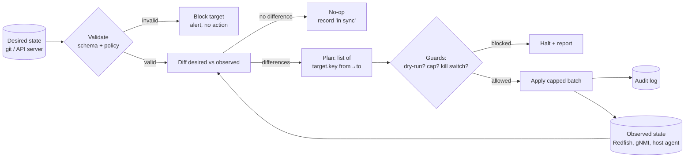
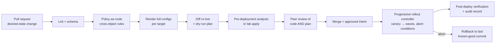
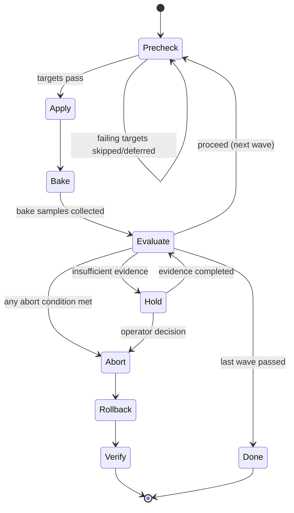

# Chapter 20 — Infrastructure Automation and Safe Change

> A GPU (graphics processing unit) cluster is changed far more often than it is built: firmware
> bundles, quality-of-service (QoS) profiles, kernel patches, maximum transmission unit (MTU) corrections, scheduler policy. At fleet scale those changes are made by automation,
> which is also the fastest way to take the whole cluster down: one wrong value in one template,
> applied in parallel, breaks all 256 of ORION's GPUs in under a minute. This chapter is about the engineering that lets automation move fast without that
> outcome. We cover the languages and APIs, idempotent reconciliation, infrastructure as code,
> validation and policy-as-code, continuous integration and delivery (CI/CD) and GitOps, staged rollout with pre-declared abort
> conditions, rollback, fleet-safety mechanisms (dry runs, blast-radius caps, rate limits, kill
> switches), and the audit evidence that makes every change explainable afterwards.

## Learning objectives

After this chapter you will be able to:

1. **Explain** idempotency, desired-state reconciliation, and drift, and **write** a reconciler
   whose second run is provably a no-op.
2. **Design** a validation pipeline (syntax → schema → cross-object policy → pre-deployment
   analysis → post-deployment verification) for node and fabric configuration, and **calculate**
   the MTU budget a RoCEv2 fabric requires.
3. **Compare** imperative scripts, infrastructure as code, configuration management, and GitOps
   controllers, and **choose** among them for bare-metal, network, and Kubernetes changes.
4. **Design** a canary rollout with prechecks, wave sizes, bake time, measurable success criteria,
   pre-declared abort conditions, rollback scope, and audit evidence.
5. **Calculate** detection probability, capacity impact, and duration for a wave plan on ORION.
6. **Apply** fleet-safety controls (dry run by default, blast-radius caps, rate limits, kill
   switches, circuit breakers) and **justify** their thresholds.
7. **Diagnose** an automation-caused incident from audit logs, controller logs, and counters using
   the diagnostic loop.
8. **Review** a change plan and **identify** missing validation, blast-radius controls, and rollback
   mechanisms.

## Prerequisites and connections

This chapter assumes the ORION fabric and QoS design from
[Chapter 7](../../part-3-networking/ch07-ethernet-datacenter-network-foundations/) and
[Chapter 9](../../part-3-networking/ch09-congestion-control-lossless-fabrics/): RoCE (RDMA over Converged Ethernet) data on Differentiated Services Code Point (DSCP) 26
→ traffic class 3 with Priority Flow Control (PFC), and Congestion Notification Packets (CNPs) on
DSCP 48 → traffic class 6. It also assumes the Remote Direct Memory Access (RDMA) MTU concepts of
[Chapter 8](../../part-3-networking/ch08-rdma-rocev2-infiniband/), and the fleet lifecycle of
[Chapter 16](../ch16-bare-metal-fleet-lifecycle/). Chapter 16 defines the lifecycle states
(discovered, imaged, validated, schedulable, draining, drained, repair, retired), the
firmware/driver compatibility matrix ("validated bundles"), and the staged firmware-upgrade wave
pattern this chapter generalises. Draining nodes uses the scheduler mechanisms of
[Chapter 17](../ch17-kubernetes-slurm-scheduling/). The rollout health signals come from the
telemetry in [Chapter 18](../ch18-observability-slos-incident-response/), and blast-radius thinking
connects to the failure domains of [Chapter 19](../ch19-reliability-security-multitenancy/).
Capstone E (fleet lifecycle automation) and Capstone F (reliability game day) in
[capstones/](../../../capstones/) apply this chapter directly.

---

## 20.1 Why automation is the largest blast radius in the building

Ask an operator of any large fleet what caused their worst outages. Hardware failure is rarely the
answer. The answer is usually a *change*: a configuration push, a firmware rollout, an automation
job that did exactly what it was told on far more machines than anyone intended. Google's study of
failures in its network infrastructure (Govindan et al., SIGCOMM 2016) found that a large share of
high-impact failure events coincided with management operations: planned upgrades,
reconfigurations, and the automation that performs them. The pattern is general. Hardware fails
*randomly and locally*. Changes fail *systematically and globally*, because the same defect is
copied to every target.

Consider the reach of one automation run on ORION.

| Scope of one run | Count | What a bad value breaks `[ILLUSTRATIVE]` |
|---|---|---|
| Backend network interface card (NIC) ports (32 nodes × 8 NICs) | 256 | Every GPU's path to the fabric |
| Rail-leaf ports (8 leaves × 64 × 400G) | 512 | All rails, so even rail-local traffic fails |
| BMCs (one per node) | 32 | Out-of-band recovery for the whole cluster |
| Slurm/Kubernetes node objects | 32 | Every job placement |

*Table 20.1 — Reach of a single fleet-wide automation run on ORION-256 `[ILLUSTRATIVE]`.*

A technician who mistypes an MTU takes down one link. A script with the same mistake, run as
`for n in $(cat all_nodes.txt); do ... & done`, applies it to 256 ports faster than any alert can
fire. The rest of this chapter is the engineering that makes that multiplier work for you:

- **Correctness before execution**: validation and dry runs (§20.3–§20.5).
- **Limited exposure during execution**: canaries, waves, caps, rate limits, and kill switches
  (§20.7, §20.9).
- **Fast, reliable recovery**: rollback (§20.8).
- **Explainability afterwards**: audit evidence (§20.10).

> **Key idea:** Every safe-change control does one of four jobs. It finds the defect before any
> target is touched, limits how many targets one defect can reach, detects the defect while the
> exposure is still small, or restores the previous state quickly. A change plan that lacks any of
> the four is unsafe, however good the code is.

## 20.2 Languages and interfaces: what automation actually talks to

### 20.2.1 Shell, Python, and Go

Each language has a natural role in infrastructure automation, and senior engineers choose
deliberately.

| Language | Natural role | Strengths | Typical failure mode |
|---|---|---|---|
| Bash | Glue on a single host; wrappers around CLIs; bootstrap in images | Ubiquitous, zero dependencies | Unquoted variables, ignored errors, unbounded `&` parallelism, parsing human-readable output |
| Python | Fleet tools, validators, API clients, data analysis, test harnesses | Rich libraries (YAML/JSON, HTTP, pandas), fast to write | Slow at very high concurrency without care; dynamic typing hides schema drift |
| Go | Long-running controllers and agents, Kubernetes operators, high-concurrency collectors | Static binaries, goroutines, Kubernetes `client-go` and controller tooling | More code for simple tasks; error handling verbosity tempts shortcuts |

*Table 20.2 — Language roles in infrastructure automation.*

A multi-host bash script should start with `set -euo pipefail`, quote every expansion, prefer
machine-readable output over human tables from a command-line interface (CLI) (`ip -j`,
`kubectl -o json`, `sacct --parsable2`), and never background work with a bare `&` in a fleet loop:
that has *no concurrency limit, no error collection, and no stop button* (§20.9).

### 20.2.2 The APIs underneath

Automation is only as good as the interface it drives. On an AI cluster there are four families.

| Target | Interface | Model | Notes |
|---|---|---|---|
| Server hardware (baseboard management controller, BMC) | **Redfish** (DMTF, REST/JSON over HTTPS); legacy **IPMI** (Intelligent Platform Management Interface) | Resource tree: `/redfish/v1/Systems/...`, `/Managers/...`, `/UpdateService` | Power, boot override, firmware inventory and update, sensor reads. Vendor OEM extensions differ, so test per platform (Chapter 16) |
| Host OS and NIC | SSH plus CLIs (`ip`, `ethtool`, `rdma`, `nvidia-smi`), configuration management agents, vendor NIC tools | Imperative commands, or declarative files (netplan, systemd-networkd) | Prefer machine-readable output; NIC firmware tools are vendor specific |
| Network devices | **gNMI** (gRPC Network Management Interface) with **OpenConfig** YANG models; **NETCONF** (Network Configuration Protocol, RFC 6241) with the YANG modelling language (RFC 7950); vendor JSON-RPC/REST; CLI | Structured get/set/subscribe on a schema-defined tree | gNMI `Set` supports replace and update semantics; streaming telemetry via `Subscribe`. Model coverage for QoS/PFC varies by platform |
| Orchestrators | **Kubernetes API** (declarative objects, `resourceVersion` optimistic concurrency, server-side apply with field managers); **Slurm** (`scontrol`, `sacctmgr`, slurmrestd) | Desired state stored in the API server; controllers reconcile | The Kubernetes API is itself a reconciliation system (§20.3) |

*Table 20.3 — The interfaces fleet automation drives. Versions and coverage are
`[VENDOR-SPEC, 2026-10]`; verify against current DMTF, OpenConfig, IETF, Kubernetes, and SchedMD
documentation.*

Two properties matter more than syntax. Is the interface **declarative** ("set MTU to 9000", safe
to repeat) or **imperative** ("increase MTU by 500", not)? And does it support **compare-and-set**?
Kubernetes rejects an update with a stale `resourceVersion`; most device CLIs are last-writer-wins,
so the automation layer must add its own guards.

> **Pitfall:** Firmware updates and BIOS changes usually take effect only after a reset, so a
> "successful" API response means *staged*, not *active*. Read back the *running* version (Redfish
> firmware inventory, `ethtool -i`) after the reset before reporting success.

## 20.3 Idempotency, desired state, and reconciliation

### 20.3.1 Definitions that matter in practice

An operation is **idempotent** if applying it once or many times leaves the system in the same
state. `ip link set dev eth1 mtu 9000` is idempotent. `echo "mtu 9000" >> /etc/config` is not:
every run appends another line. Idempotency is what makes *retry* safe. Fleet automation always
retries, because at fleet scale something always times out.

A **desired-state** system separates intent from observed state; a **reconciler** repeatedly runs:



*Figure 20.1 — The reconciliation loop. Each pass observes, diffs, plans, guards, applies a
bounded batch, and records evidence. A pass on an in-sync fleet produces an empty plan.*

If observation, diffing, and apply are correct, the system **converges**: each pass reduces the
difference, and once none remains every further pass is a no-op. Convergence also handles drift: a
hand edit is noticed on the next pass and reverted or alerted, depending on policy.

### 20.3.2 Level-triggered versus edge-triggered

Kubernetes controllers are **level-triggered**: they act on the *current difference* between
desired and observed state, not on the *event* that caused it. An edge-triggered script ("when a
node is added, configure it") misses events while it is down and never repairs drift; a
level-triggered reconciler restarted after a week simply computes the current diff. Build
reconcilers, not event handlers, wherever the target state is declarable.

### 20.3.3 Where idempotency breaks

Real targets have operations that are not naturally idempotent. Each needs explicit handling.

| Operation | Why it is not idempotent | Standard technique |
|---|---|---|
| Firmware flash | Re-flashing the same image costs a reset and can fail. Some images enforce anti-rollback | Compare the *running* version first; flash only when it differs; read back after reset |
| Reboot / reset | Each call disrupts the node | Gate on observed state ("needs reboot because staged ≠ running"); use a per-change idempotency key so a retry does not reboot twice |
| Append-style config (access control list (ACL) entries, routes added one by one) | Repeats create duplicates | Replace the whole object (gNMI `replace`, server-side apply) rather than append |
| Allocate an IP / create a ticket | Repeats allocate twice | Idempotency key: "allocate for node orion-n07, change CHG-123" returns the existing allocation |

*Table 20.4 — Non-idempotent operations in fleet automation and how to make them safe to retry.*

A subtler failure is the **check-then-act race**. The reconciler reads "MTU is 1500" and decides to
set 9000. Meanwhile another actor sets 9216, and the reconciler overwrites it. Two writers on one
field is a design bug, whatever the timing. The fix is **single ownership** of every field: one
controller, one source of truth. Where the API allows it, add compare-and-set (`resourceVersion`
in Kubernetes, or a version or etag check in other APIs). §20.13 walks through an incident caused
by exactly this.

### 20.3.4 A minimal reconciler

The core of the Part 1 lab is short enough to show in full. Here is the diff step. Note that it
never consults the plan history: it compares only desired and observed state.

```python
def compute_plan(desired, actual, violations):
    resolved = resolve_desired(desired)                       # defaults + overrides
    blocked = sorted({v["target"] for v in violations})       # never act on invalid intent
    unreachable = sorted(t for t in resolved if actual.get(t) is None and t not in blocked)
    actions = []
    for t in sorted(resolved):                                # sorted = deterministic plans
        if t in blocked or t in unreachable:
            continue
        for key in sorted(resolved[t]):
            if actual[t].get(key) != resolved[t][key]:
                actions.append({"target": t, "key": key,
                                "from": actual[t].get(key), "to": resolved[t][key]})
    return {"actions": actions, "blocked": blocked, "unreachable": unreachable}
```

Three design choices are deliberate:

- **Invalid intent blocks only its own target**; the other 31 nodes proceed, and no bad value is
  applied anywhere.
- **Unreachable is a distinct outcome**, not an endless retry; it is a Chapter 16 lifecycle problem.
- **Plans are deterministic** (sorted), so they are reviewable, diffable, and testable in CI.

## 20.4 Infrastructure as code: plan, apply, state, and drift

**Infrastructure as code (IaC)** means the desired state of infrastructure is held in
version-controlled, reviewable files and applied by a tool rather than by hand. Terraform (and its
open-source fork OpenTofu) is the most widely used example, and its vocabulary has become the
lingua franca:

| Concept | Meaning | Why it matters for safety |
|---|---|---|
| **Provider** | Plugin that maps resources to a target API (cloud, Redfish-based bare metal, switches, DNS, Kubernetes) | Provider quality limits safety: a provider that cannot read a field cannot detect drift in it |
| **Resource** | A declared object (`a VLAN`, `a DNS record`, `a node pool`) | The unit of plan, apply, and ownership |
| **State** | The tool's record of which real objects it manages and their last-known attributes | Lost or corrupted state means the tool may try to create duplicates or destroy live objects; protect it (remote backend, locking, encryption, backups) |
| **Plan** | Computed diff: create / update in place / destroy / replace | The reviewable artifact; a plan that says `destroy` on a fabric object must stop a human cold |
| **Apply** | Executes a plan | Apply exactly the reviewed plan (saved plan file), not a fresh one computed later |
| **Refresh / drift** | Reading real state and comparing it with recorded state | Detects hand edits; decide whether IaC reverts them or a human reconciles first |
| **Import** | Bringing an existing object under management | Necessary for brownfield fabrics; review imported attributes carefully |
| **Locking** | Prevents two applies against the same state at once | Prevents the two-writer race of §20.3.3 at the tool level |

*Table 20.5 — Infrastructure-as-code concepts (Terraform/OpenTofu vocabulary). Behaviour details
are version-sensitive `[VENDOR-SPEC, 2026-10]`; verify against current HashiCorp/OpenTofu
documentation.*

The most important IaC safety habit is to **read the plan**, especially *replace* actions: some
attribute changes force destroy-and-recreate, which on a network object means an outage. In CI, a plan containing any destroy or replace of a
protected resource class should fail unless an explicit, reviewed override is present. That rule
is a one-screen policy check (§20.5), and it has prevented more outages than any amount of
cleverness.

### 20.4.1 Where IaC fits in a GPU cluster

IaC fits best where APIs are declarative: cloud resources, DNS, IP address management (IPAM), Kubernetes clusters, and
switches with model-driven APIs (gNMI/OpenConfig, NETCONF/YANG) or full-config replace from
templates. Bare metal is a partial fit. Provisioning systems (MAAS-, Ironic-, or Tinkerbell-class,
Chapter 16) expose APIs, but firmware updates, burn-in, and acceptance are long-running,
non-idempotent *workflows* that belong in a lifecycle controller with explicit states (Chapter 16).
In-host settings (MTU, sysctls, packages) are usually handled by configuration management
(Ansible-, Salt-, Puppet-, or Chef-class tools) or baked into the image, with the same principles:
declarative modules, check mode, idempotent tasks.

> **Production note:** The highest-leverage artifact in fleet automation is often not the tool but
> the **source of truth**: an inventory/configuration management database (CMDB, Chapter 16) that says which nodes exist, which rack
> and rail leaf they attach to, which bundle they should run, and which lifecycle state they are
> in. Every reconciler on ORION resolves its targets from that inventory. Lists pasted into
> `all_nodes.txt` drift from reality within weeks.

## 20.5 Validation: catching the defect before any target is touched

Validation is cheap; outages are not. Mature pipelines validate in layers. Each layer catches a
class of defect the previous one cannot.

| Layer | Question it answers | Example tools/techniques | ORION example defect caught |
|---|---|---|---|
| 1. Syntax | Does it parse? | YAML/JSON parsers, `terraform validate`, linters | Tab in YAML |
| 2. Schema | Are fields known, typed, and in range? | JSON Schema, YANG models, typed config structs | `ecn_enabled: "yes"` (string, not boolean) |
| 3. Cross-object policy | Are invariants across objects satisfied? | Policy-as-code (Open Policy Agent with Rego, Kyverno for Kubernetes admission), custom Python rules | Leaf PFC on priority 4 while RoCE uses priority 3 |
| 4. Pre-deployment analysis | What will the network *do* with this config? | Configuration analysis (Batfish-class), rendered-config diffs, simulation | Route leak, ACL shadowing, missing BGP neighbour |
| 5. Post-deployment verification | Did the target end up in the intended state and behave correctly? | Read-back via API, synthetic tests (RDMA pair test, `all_reduce_perf` from nccl-tests, which exercises the NVIDIA Collective Communications Library, NCCL), telemetry | Active RDMA MTU still 1024 after the change |

*Table 20.6 — Validation layers. Tool names are examples of a class; check current project
documentation for capabilities.*

Layers 1–2 are mechanical. Layer 3 holds the domain expertise and is the most under-built. A schema can say that `pfc_priorities` is a list of integers in
0–7. Only a cross-object policy can say *PFC must be enabled on exactly the priority that RoCE data
is mapped to, on both hosts and leaves, and CNPs must map to a strict-priority class that is not
PFC-enabled*. That invariant spans two device types and three fields. Violating it gives you either
packet loss on the lossless class or a pause storm (Chapter 9).

### 20.5.1 The ORION MTU chain, as a policy

The MTU invariant is a classic cross-object rule. It is worth deriving once with numbers.

```text
 RoCEv2 packet on the wire (IPv4, no VLAN tag shown)
 ┌──────────┬──────────┬────────┬────────┬───────┬──────────────────┬────────┬───────┐
 │ Preamble │ Ethernet │  IPv4  │  UDP   │  BTH  │ RDMA payload     │ ICRC   │  FCS  │ + IFG
 │ + SFD 8  │ hdr  14  │   20   │   8    │  12   │ ≤ path MTU       │   4    │   4   │   12
 └──────────┴──────────┴────────┴────────┴───────┴──────────────────┴────────┴───────┘
            |<------------- IP packet = 20+8+12+payload+4 ---------->|
            |<-------- Ethernet frame = 14 + IP packet + 4 FCS (+4 if 802.1Q) -------->|
```

*Figure 20.2 — RoCEv2 framing and the MTU budget (SFD start-of-frame delimiter; BTH InfiniBand Base
Transport Header; ICRC invariant CRC; FCS frame check sequence; IFG inter-frame gap). Some operations add extended transport headers
after the BTH (RETH 16 B on the first packet of an RDMA write, AETH 4 B on responses, an immediate
data header of 4 B); the policy below reserves a 64-byte budget for them.*

Three constraints follow, and ORION's validator encodes each as a rule:

1. **RDMA path MTU fits in the IP MTU.** IP packet = 20 + 8 + 12 + extended headers + payload + 4.
   With a 64-byte header budget: `rdma_path_mtu + 64 ≤ host_mtu` → 4096 + 64 = 4,160 ≤ 9,000 ✓.
   The RDMA MTU must also be one of the InfiniBand-defined values (256, 512, 1024, 2048, 4096).
2. **The host frame fits through the switch port.** Frame = IP MTU + 14 (Ethernet) + 4 (802.1Q,
   if tagged) + 4 (FCS) = IP MTU + 22 at most. Rule: `host_mtu + 22 ≤ leaf port_mtu` →
   9,000 + 22 = 9,022 ≤ 9,216 ✓; a host MTU of 9,216 gives 9,238 > 9,216 ✗. RoCE itself is
   unharmed: its packets are bounded by the RDMA path MTU (4,096 + headers ≪ 9,216). The victims are
   TCP/IP flows on the backend NICs (NCCL bootstrap/socket fallback, iperf/health checks, ssh over backend addresses).
   They send 9,216-byte packets that are dropped at the port; with no ICMP "fragmentation needed"
   reply they black-hole: connections open, small requests work, bulk transfers hang. Under a
   full-frame port convention the rule is exact. Under an IP-MTU convention (below) it is
   conservative, which is why it is a portable *policy*, not a law of physics.
3. **The constraints hold on every path.** A node connects to all 8 rail leaves, so the rule uses
   the *minimum* `port_mtu` across leaves.

> **Vendor implementation note (Arista / Cisco / Juniper):** MTU conventions differ. On Arista
> EOS and Cisco NX-OS, the L3 interface `mtu` is the IP MTU (L2 header and FCS not counted); on
> Juniper Junos, the interface (media) `mtu` includes the L2 header, and the IP MTU is set
> separately under `family inet`. Verify against current platform documentation `[VENDOR-SPEC,
> 2026-10]`, then confirm per platform with a don't-fragment ping (`ping -M do -s 8972 <peer>`:
> 8,972 + 8 ICMP + 20 IP = 9,000-byte IP packet).

### 20.5.2 Policy-as-code in practice

Policy-as-code means writing those invariants as executable rules, stored and reviewed like any
other code, and run in CI and at admission time. Open Policy Agent (OPA) evaluates policies written
in its Rego language against JSON input. Kyverno and OPA Gatekeeper enforce policies as Kubernetes
admission controllers. Many network teams simply write rules in Python or Go against the rendered
desired state, as in the lab. The engine matters less than four practices:

- **Every rule has an ID, an owner, and a message that names the target and the violated
  invariant** ("POL-MTU-FABRIC orion-n10: host_mtu 9216 + 22 = 9238 > leaf port_mtu 9216"). Vague
  messages get overridden; precise ones get fixed.
- **Rules read thresholds from policy data**, not constants buried in code. The approved firmware
  list comes from the Chapter 16 compatibility matrix; the lab's `policy.approved_nic_firmware`
  stands in for it.
- **Schema failures short-circuit policy evaluation** for that target. A value of the wrong type
  makes every downstream comparison meaningless.
- **Every rule is tested** with a known-good input (no violations) and with a known-bad input that
  triggers exactly that rule. The lab checker does both.

## 20.6 CI/CD and GitOps for infrastructure

### 20.6.1 The pipeline

A change to ORION's fabric QoS profile or node configuration should follow the same path as
application code, with extra infrastructure-specific stages:



*Figure 20.3 — An infrastructure change pipeline. The reviewed artifact is both the code change and
the computed plan against live state; deployment is progressive, not a single apply.*

The step most often skipped is **diff against live**. A reviewer who sees only the template
change ("raise `rdma_path_mtu` to 4096") cannot see that the plan *also* resets `orion-n06`'s
drifted `host_mtu` from 1,500 to 9,000, which may be an unclosed debugging session or a NIC that
reverted after reimaging. The rendered plan is the review artifact.

### 20.6.2 GitOps

GitOps applies the reconciliation loop of §20.3 to delivery. The OpenGitOps principles (CNCF
OpenGitOps project) are:

1. The desired state is **declarative**.
2. It is **versioned and immutable**, held in a store such as git with full history.
3. It is **pulled automatically** by software agents.
4. It is **continuously reconciled**: agents observe actual state and converge it to desired state.

Argo CD and Flux are the common Kubernetes implementations. For ORION's inference services and
platform components, GitOps is the default (Chapter 17). For the fabric and bare-metal hosts the
same principles apply, with a controller that pulls from git and drives gNMI or the provisioning
API.

Two consequences follow. **Hand edits are reverted**, so an incident break-glass fix must go
through git (expedited review) or a recorded, time-limited exemption for that target; otherwise
human and controller fight (§20.13). **Bad commits propagate automatically**, so GitOps needs the
staged rollout of §20.7: waves as separate target groups, or a controller that promotes a commit
from group to group.

## 20.7 Staged rollout: canaries, waves, bake time, and abort conditions

Validation catches defects visible in the *intent*. Many appear only when the change meets real
hardware and traffic: a firmware build that regresses PFC behaviour under incast, or a new MTU that
exposes a link silently dropping jumbo frames. **Staged rollout** meets those defects on a few
targets instead of all of them.

### 20.7.1 The vocabulary

- **Canary**: the first small set of targets to receive the change, chosen to be *representative*
  (each hardware model variant (SKU), firmware bundle, rack type, and rail) yet *low-impact*.
- **Wave**: each subsequent batch. Wave sizes usually grow geometrically once confidence builds.
- **Bake time**: how long a wave runs under load before the next decision; long enough for the
  slowest expected failure signal.
- **Precheck**: what a target must satisfy *before* change: healthy, drained if needed, compatible
  bundle, baseline captured.
- **Success criteria / abort conditions**: measurable conditions, declared *before* the rollout,
  that must hold to proceed, or that stop the rollout and trigger rollback.
- **Hold**: evidence insufficient to decide (too few samples, telemetry gap): neither proceed nor
  roll back; a human looks.



*Figure 20.4 — Rollout controller states. Hold and Abort are distinct: Hold means "we cannot tell
yet"; Abort means "we can tell, and it is bad".*

### 20.7.2 Designing the ORION wave plan

Chapter 16's firmware pattern sets the shape: a two-node canary in different racks, then waves of
at most one node per rack. Wave sizes 2, 3, 4, 8, 8, 7 cover 32 nodes; taking nodes in
*slot-major* order (first node of every rack, then the second, …) guarantees one node per rack
per wave at most:

```text
 Wave   Nodes                                                        Racks touched
  0     n01 n05                                                      rack-01 rack-02 (canary)
  1     n09 n13 n17                                                  rack-03 rack-04 rack-05
  2     n21 n25 n29 n02                                              rack-06 rack-07 rack-08 rack-01
  3     n06 n10 n14 n18 n22 n26 n30 n03                              all 8, one each
  4     n07 n11 n15 n19 n23 n27 n31 n04                              all 8, one each
  5     n08 n12 n16 n20 n24 n28 n32                                  rack-02..rack-08
```

*Figure 20.5 — ORION wave plan (2/3/4/8/8/7) in slot-major order: never more than one node per rack
per wave, so a rack-level problem such as power, a top-of-rack issue, or cooling is never confused
with the change, and no rack loses more than 25 % of its GPUs at once.*

Why not a single canary node? The arithmetic of detection says why. Suppose a defect affects a
fraction *p* of nodes: one board revision, one optics vendor, one NIC firmware lot. If *k* nodes
are chosen independently of the defect, the probability that at least one of them exhibits it is

  P(detect) = 1 − (1 − p)^k.

For *p* = 0.10 `[ILLUSTRATIVE]`:

| Nodes changed so far (k) | P(at least one affected node) `[MODELED]` |
|---|---|
| 1 | 1 − 0.9¹ = 0.10 |
| 2 (wave 0) | 1 − 0.9² = 0.19 |
| 5 (waves 0–1) | 1 − 0.9⁵ = 0.41 |
| 9 (waves 0–2) | 1 − 0.9⁹ = 0.61 |
| 17 (waves 0–3) | 1 − 0.9¹⁷ = 0.83 |

*Table 20.7 — Probability that a defect affecting 10 % of nodes has appeared after each wave
`[MODELED]` (independent selection assumed).*

Two lessons follow. First, **random canaries are weak against minority defects**: if 10 % of nodes
carry a different NIC board revision, put one in the canary *deliberately*. Canary selection is stratified by every attribute the change interacts with:
hardware SKU, firmware bundle, rail, rack, and switch OS version on the attached leaves. Second,
**early waves are small because their job is detection, not throughput**. Once detection
probability is high, waves can grow.

### 20.7.3 Bake time

Bake time must exceed the time to the slowest failure signal you care about. On ORION:

| Failure signal | Typical time to appear `[ILLUSTRATIVE]` | Implication |
|---|---|---|
| Link down, NIC not enumerated, wrong firmware running | Seconds to minutes | Read-back verification catches it immediately |
| Bandwidth regression in a pair test | Minutes (one benchmark run) | A synthetic test at the start of the bake |
| CNP/PFC behaviour change under real collective traffic | Minutes to an hour; needs representative load | Bake under a real or replayed training workload |
| Thermal or power-related GPU errors (NVIDIA Xid events), error-correcting code (ECC) trends | Hours | Longer bake for firmware touching power/thermal; or watch early waves into later waves |
| Memory leaks in agents, slow counter drift | Days | Cannot be caught by bake; rely on fleet monitoring and fast rollback |

*Table 20.8 — Time-to-signal for change-induced failures `[ILLUSTRATIVE]`.*

The lab rollout uses **60 minutes** of bake per wave: 12 samples at 5-minute intervals. With six
waves, bake alone takes 6 h. That cost is why waves grow: making all 32 nodes individual waves would
take 32 h of bake for little extra information.

### 20.7.4 Success criteria and abort conditions that work

An abort condition is a *test statistic plus a threshold*, declared in advance. Writing good ones
means respecting measurement noise (LAB_STANDARDS §5, Chapter 22).

- **Compare each target with its own baseline**, not with a fleet average. Node-to-node variation
  in pair-test bandwidth can exceed the regression you want to detect.
- **Use robust statistics**. A median of 12 post-change samples against a median of 6 baseline
  samples ignores a single transient dip. A `max` or `min` over samples turns every transient into
  an abort and teaches operators to ignore the controller.
- **Size the threshold against noise.** In the lab, a node's per-rail busbw (2-node
  `all_reduce_perf` busbw ÷ 8 rails) has a sample standard deviation of ≈ 0.25 GB/s around
  ≈ 44 GB/s of the 50 GB/s rail line rate (≈ 352 GB/s for all 8 rails) `[SIMULATED]`, so
  ≈ 0.6 % noise per sample. The standard error of a 12-sample median is about
  1.25 × 0.25 / √12 ≈ 0.09 GB/s and of the 6-sample baseline median ≈ 0.13 GB/s, so the
  difference has a standard error of √(0.09² + 0.13²) ≈ 0.16 GB/s. A 5 % threshold (2.2 GB/s) is
  ≈ 14 standard errors from zero.
  It will essentially never fire on noise, yet it catches any regression worth caring about.
- **Pair relative thresholds with absolute floors** for count-like signals. A CNP rate that goes
  from 2/s to 7/s is "3.5× baseline" but operationally meaningless. The lab's AC2 requires both
  `> 3× baseline` and `> 500/s`.
- **Treat any hard-fault signal as an abort**: a GPU Xid, a link flap, a NIC reset. These are rare
  in a healthy baseline, so a count above zero is informative.
- **Make "no data" a hold, not a pass.** If the telemetry pipeline drops samples during the bake,
  the controller cannot claim success. The most dangerous rollout controller is one that treats
  missing evidence as good evidence.

The lab's abort conditions, all `[ILLUSTRATIVE]` thresholds:

| ID | Metric | Statistic | Abort if |
|---|---|---|---|
| AC1 | Per-rail busbw: 2-node `all_reduce_perf` busbw ÷ 8 (GB/s) | median post vs median baseline | drop > 5 % |
| AC2 | CNP received per second (8 NICs) | median | > 3 × baseline **and** > 500/s |
| AC3 | PFC pause frames received per second, priority 3 | median | > 3 × baseline **and** > 150/s |
| AC4 | GPU Xid events | sum over bake | > 0 |
| AC5 | Backend link flaps | sum over bake | > 0 |

*Table 20.9 — Pre-declared abort conditions for the ORION NIC-firmware rollout in the lab
`[ILLUSTRATIVE]` thresholds.*

> **Pitfall:** Prechecks exist so that the rollout does not blame the change for pre-existing
> faults. A node whose link was already flapping before the change will "fail" AC5 after it. If the
> controller evaluates it, the rollout aborts for the wrong reason. If an operator then overrides
> the abort because "that node always flaps", the team has learned to override the controller. The
> right behaviour is to fail the precheck, skip and defer the node, and send it to the Chapter 16
> repair workflow.

## 20.8 Rollback, roll-forward, and the changes you cannot undo

A rollback plan is a claim that you can return to the previous state within a bounded time. Like
any claim in this book, it needs evidence. The usual evidence is a rehearsal in the lab.

| Change type | Rollback mechanism | Hidden traps |
|---|---|---|
| Network device config | Reapply last known-good config (saved before change; ideally a full replace from the previous git commit). Use commit-confirm where offered (auto-revert unless confirmed): Junos `commit confirmed`, the NETCONF `:confirmed-commit` capability; EOS and NX-OS offer comparable session/rollback features, so verify per platform | Partial-apply states; config that also changed the management path (you lose access mid-rollback) |
| Host config (MTU, sysctl, NIC settings) | Re-run reconciler with previous desired state | Settings that need a link reset or reboot to take effect; stale RDMA connections (QPs) that keep old parameters until re-established |
| NIC/BMC/GPU firmware | Flash previous image | Downgrade may be blocked by anti-rollback or security-version policy; requires reset; previous image may not be compatible with a newer driver (Chapter 16 matrix) |
| Driver / OS image | Reboot into previous image (A/B partitions, or reimage via provisioning) | Reimage takes tens of minutes per node; a reimage does **not** roll back firmware |
| Scheduler/orchestrator config | Revert commit; controller reconciles | Jobs admitted under the new policy keep running; quotas may already be consumed |
| Schema/data migrations (CMDB, accounting DBs) | Often impossible; requires forward fix | Only safe with expand-then-contract migrations and backups |

*Table 20.10 — Rollback mechanisms by change type and their traps.*

Three rules keep rollback honest:

1. **Capture the before-state per target, immediately before changing it.** Templates from
   yesterday are not enough. The lab's audit record stores `before` as read at apply time.
2. **Rehearse the rollback in the lab with the same automation**, and time it. "Re-image the
   affected nodes" is not a rollback for a firmware change.
3. **Decide the rollback scope in advance.** When wave 2 aborts, do waves 0 and 1 roll back too? If
   the defect is plausibly latent (load-dependent, time-dependent), *all changed targets* is the
   conservative scope. The lab uses `rollback_scope: all_changed`. If the failure is clearly tied
   to an attribute only wave 2 has, rolling back that wave alone may be defensible, but it is a
   decision to record, not to improvise.

**Roll-forward** (a new fixing change) is right when rollback is impossible (anti-rollback
firmware, irreversible migrations) or riskier than the fix. It is still a change and needs its own
validation and staging.

## 20.9 Fleet-automation safety controls

The controls in this section are what separate a script from a production automation system. Each
answers a specific way that automation fails.

| Control | Failure it prevents | ORION setting `[ILLUSTRATIVE]` |
|---|---|---|
| **Dry run by default** | Running a destructive command by accident; reviewing code but not effect | Every tool's default is `--dry-run`; apply requires an explicit flag and a change ID |
| **Blast-radius cap** | One run touching too many targets or failure domains | ≤ 1 node per rack per batch; ≤ 8 nodes and ≤ 1 rail leaf per batch; refuse plans touching > 25 % of the fleet without a second approval |
| **Rate limit / concurrency limit** | Thundering herd: reboots overwhelming Preboot Execution Environment (PXE)/DHCP/image servers, BMC network, or the scheduler | ≤ 4 concurrent node operations; ≤ 8 reboots per 10 min |
| **Kill switch** | Inability to stop a run that is going wrong | A flag in the change system checked before every target and every wave; one command flips it |
| **Circuit breaker (failure budget)** | Automation ploughing on through a growing failure rate | Stop if > 2 targets or > 10 % of attempted targets fail within a run |
| **Destructive-operation budget** | Repair automation draining half the fleet (Chapter 19) | ≤ 2 nodes per day auto-drained per rack; beyond that, page a human |
| **Two-person rule** | One person's mistake reaching production | Second approver for plans with destroy/replace actions or fabric-wide scope |
| **Sanity bounds on input** | An empty or truncated inventory interpreted as "remove everything" | Refuse if target count differs from inventory by > 10 %; refuse empty desired state |

*Table 20.11 — Fleet-automation safety controls and ORION settings `[ILLUSTRATIVE]`.*

The last row deserves emphasis. If a failed API call, an empty file, or a filter typo truncates
the input, a reconciler can conclude the desired state is "nothing" and act on it at full speed.
The defence is to treat *large plans* as suspicious in themselves. A reconciler that
normally changes 0–3 targets per pass and suddenly plans to change 40 should stop and ask.

In the lab, `apply_plan` defaults to `dry_run=True`, takes `max_targets` as its blast-radius cap,
and refuses nothing silently: capped targets come back as `deferred_targets` for the next batch.

> **Safety:** Every lab and exercise in this chapter runs against simulated fleets or a dedicated
> lab environment. Do not run a reconciler, rollout controller, or any exercise script against
> production or shared switches and hosts. Fault-injection or "what if the canary fails" drills
> belong in a lab or a tabletop exercise.

## 20.10 Audit evidence

Every change must answer, after the fact: *who changed what, where, when, why, from which value to
which, under which approval?* That is the raw material for rollback, incident response (Chapter
18's first question is "what changed?"), postmortems, and tenant audits (Chapter 19).

A minimal per-action audit record, as produced by the lab:

```json
{"seq": 14, "change_id": "CHG-2026-1103-RDMA-MTU", "actor": "rollout-controller",
 "target": "orion-n13", "key": "pfc_priorities", "before": [], "after": [3],
 "result": "changed", "dry_run": false}
```

A production record adds a timestamp in UTC, the git commit of the desired state, the plan hash,
the approver(s), the tool version, and the verification result after apply. Records go to an
append-only store that the automation itself cannot rewrite. The change ticket links to the run,
and the run links back to the ticket. Test: can an engineer who was not present reconstruct the change and its
rollback from the records alone?

Record "nothing happened" outcomes too: `noop` proves the target was checked, `dry-run` shows
what *would* have happened, and a precheck skip explains why a target was untouched.

---

## 20.11 Worked example: raising ORION's RDMA MTU from 1024 to 4096

**Situation.** The Fabric team finds that the backend NICs in rack-03 to rack-08 still report
an RDMA `active_mtu` of 1,024 B, despite a 9,000-byte netdev MTU. On RoCE, `active_mtu` is the
minimum of the port's maximum RDMA MTU and the largest InfiniBand MTU that fits under the netdev MTU
after headers ([Chapter 8, §8.7](../../part-3-networking/ch08-rdma-rocev2-infiniband/)). Those
racks were imaged with an old host profile that caps the port's RoCE MTU at 1,024 through a
vendor-specific NIC setting, so min(1,024, 4,096) = 1,024. Rack-01 and rack-02 were fixed last
quarter. Change CHG-2026-1103 brings all 32 nodes to 4,096. It also enforces the full RoCE QoS
baseline, so any drift found along the way is corrected. We work through the change as the
reconciler and rollout controller would, with all arithmetic shown. Values follow the lab dataset
`[SIMULATED]` unless labelled otherwise.

**Step 1 — Is the change worth making?** On a 400 Gb/s link the raw line rate is
400 × 10⁹ / 8 = 50 × 10⁹ B/s. Per-packet wire overhead for RoCEv2 over IPv4 (Figure 20.2) is
preamble+SFD 8 + Ethernet 14 + IPv4 20 + UDP 8 + BTH 12 + ICRC 4 + FCS 4 + inter-frame gap 12 =
82 B, ignoring extended headers.

| RDMA MTU | Wire bytes per packet | Payload efficiency | Packets/s at 50 GB/s `[MODELED]` |
|---|---|---|---|
| 1,024 | 1,024 + 82 = 1,106 | 1,024 / 1,106 = 92.6 % | 50 × 10⁹ / 1,106 ≈ 45.2 M |
| 4,096 | 4,096 + 82 = 4,178 | 4,096 / 4,178 = 98.0 % | 50 × 10⁹ / 4,178 ≈ 12.0 M |

*Table 20.12 — Wire efficiency and packet rate by RDMA MTU on a 400 Gb/s link `[MODELED]`.*

The bandwidth ceiling rises by 0.9804 / 0.9259 − 1 ≈ 5.9 % (5.6 % when expressed relative to the 4,096
figure, as Chapter 8 does). The packet rate the NIC and switch must
process falls by a factor of 45.2 / 12.0 ≈ 3.8. Fewer packets also means fewer CNP and ACK
opportunities per byte. The change is worth making. It is also a change to the *lossless class's
traffic shape*, hence the waves.

**Step 2 — Validate intent.** The desired state sets `host_mtu` 9,000, `rdma_path_mtu` 4,096, and
leaf `port_mtu` 9,216, with four per-target overrides. The policy rules give:

- `rdma_path_mtu + 64 ≤ host_mtu` → 4,096 + 64 = 4,160 ≤ 9,000 ✓ (all nodes on defaults).
- `host_mtu + 22 ≤ min(port_mtu)` → 9,022 ≤ 9,216 ✓, except `orion-n10`, whose override sets
  9,216: 9,238 > 9,216 ✗ (POL-MTU-FABRIC). RoCE on `n10` would be fine; its backend TCP traffic
  would black-hole.
- `orion-be-leaf-r5` override sets PFC on priority 4 while RoCE data is on priority 3 ✗ (POL-PFC). Had it
  been applied, RoCE traffic on rail 5 would have been lossy under congestion while an unused
  class was pausing. That is a silent, rail-specific busbw collapse: the hardest kind to diagnose.
- `orion-n22` override pins NIC firmware 28.44.0500, which is not in the approved list
  {28.42.1000, 28.43.1014} ✗ (POL-FW).
- `orion-n25` override sets `ecn_enabled: "yes"`, a string where a boolean is required ✗ (SCHEMA).
  Some YAML loaders and some device APIs coerce strings, and one that coerces any non-empty string
  to true could hide this. Strict typing refuses it.

Four targets are **blocked**. They need corrected intent, not automation.

**Step 3 — Compute the plan.** Observed: rack-01 and rack-02 (`orion-n01`–`n08`) at 4,096; rack-03 to rack-08
(`n09`–`n32`, 24 nodes) at 1,024; `orion-n18` unreachable. Drift: `orion-n06` `host_mtu` 1,500
(NIC reverted after a reimage), which drags its `active_mtu` to 1,024 (2,048 + headers does not
fit in 1,500); `orion-n13` `pfc_priorities` [] (PFC config lost); `orion-be-leaf-r2` `dscp_to_tc` missing
the `48 → 6` CNP mapping.

- RDMA MTU actions: 24 − 3 blocked (`n10`, `n22`, `n25`) − 1 unreachable (`n18`) = 20, plus `n06`
  = **21 actions**.
- Other drift actions: `n06.host_mtu`, `n13.pfc_priorities`, `orion-be-leaf-r2.dscp_to_tc` = **3 actions**.
- Total **24 actions on 22 targets**. On real hardware `n06`'s RDMA action becomes a read-back
  check, because fixing its netdev MTU restores `active_mtu` by itself.

Each drift item gets a human look: `orion-be-leaf-r2` had been silently weakening congestion control on
rail 2.

**Step 4 — Apply in capped batches, prove idempotency.** With `max_targets = 8`, 22 targets take
⌈22 / 8⌉ = 3 batches (8 + 8 + 6). After the third batch the re-plan has **0 actions**, and
re-running the old plan records 24 `noop` entries: the idempotency proof for the change record. In
production the batches are the waves of Step 5, each with its bake, not back-to-back cap-8 batches.

**Step 5 — Size the rollout.** We size the full 32-node wave plan of Figure 20.5. It is an upper
bound for this change, whose in-sync nodes are read-back no-ops, and exact for the companion firmware
change in Step 7. Assume each node is drained for its wave (on many NICs an MTU change
briefly reinitialises the port's queues, and RDMA connections already established keep their old
path MTU until they are re-created, Chapter 8). With 5 min to apply and
verify plus a 10 min pair test plus 60 min of bake, each wave takes 75 min `[ILLUSTRATIVE]`.

- Duration: 6 waves × 75 min = 450 min = **7.5 h**, plus drain lead time. Drain time depends on
  job length. A maintenance reservation (Chapter 17) placed in advance avoids waiting.
- Peak capacity removed: the largest wave is 8 nodes = 64 GPUs = 64 / 256 = **25 %** of ORION, and
  never more than 1 of 4 nodes (25 %) of any rack.
- GPU-hours consumed by the rollout: 32 nodes × 8 GPUs × 1.25 h = **320 GPU-h** `[MODELED]`.

**Step 6 — Compare with a big bang.** A big-bang change takes all 256 GPUs out for 30 min:
256 × 0.5 = 128 GPU-h. That is cheaper *if nothing goes wrong*. Now include risk. Suppose there is
a 5 % chance that the change is bad, and a bad fleet-wide change costs a 4 h outage of all 256
GPUs plus a lost training-state window of 2 h `[ILLUSTRATIVE]`:

- Big bang expected loss: 128 + 0.05 × 256 × (4 + 2) = 128 + 0.05 × 1,536 = 128 + 76.8 ≈
  **205 GPU-h**.
- Staged expected loss, if the defect is caught by wave 2 at the latest: the worst-case exposure is
  the 9 nodes of waves 0–2, i.e. 72 GPUs. Rollback takes 1 h. Drained nodes run no training jobs,
  so no training state is lost. That gives 320 + 0.05 × 72 × 1 = 320 + 3.6 ≈ **324 GPU-h**.

The big bang is cheaper in expectation, an honest result. Staging wins on **tail risk**: a
1,536 GPU-h worst case, plus a broken training run and a service-level objective (SLO) breach
(Chapter 15), versus about 72 GPU-h. Organisations rightly price the tail far above its mean.

**Step 7 — The same controller on the companion firmware change.** The lab's NIC firmware rollout
28.42.1000 → 28.43.1014 (`rollout.json`, CHG-2026-1110, after the MTU change) gives:

| Wave | Decision | Why `[SIMULATED]` |
|---|---|---|
| 0 (`n01`, `n05`) | proceed | All conditions within thresholds |
| 1 (`n09`, `n13`, `n17`) | proceed | `n13` failed precheck (health degraded: flapping since before the change) → skipped and deferred; `n09` had a single 7 % busbw dip in one sample, but its median was within 5 % |
| 2 (`n21`, `n25`, `n29`, `n02`) | **abort** | `n25`: busbw median 39.41 vs 43.67 (−9.7 %) and CNP median 986/s vs 200/s; `n29`: −9.9 % and 1,008/s vs 200/s |

*Table 20.13 — Rollout decision log from the lab `[SIMULATED]`.*

Rollback scope `all_changed` returns `n01, n05, n09, n17, n21, n25, n29, n02` (8 nodes) to firmware
28.42.1000. Waves 3–5 never start. The PFC pause rate on the two regressed nodes rose about 1.7–1.8×
(≈ 30 → 55/s), visible on a dashboard but below AC3's 3× and its 150/s floor. It shows why one regression should trip
*several independent* conditions: had the controller watched only pause frames, it would have
proceeded.

## 20.12 Hands-on lab overview

[Lab 20](lab/README.md) (tier **L1**, ≈ 3 h, `[SIMULATED]` data) builds the chapter's automation
sample. **Part 1** validates ORION's desired RoCE configuration, plans 24 actions, applies them in
capped, audited batches, and proves the re-run is a no-op. **Part 2** runs the rollout controller of
§20.7 over a NIC-firmware rollout and must survive a precheck failure and a transient dip before
catching the real regression. **Part 3** reviews an unsafe change plan against a gap catalogue. L2
and L3 extensions point the reconciler at a real host and feed real pair tests into the controller.

## 20.13 Troubleshooting scenario: the rail that kept forgetting its CNP mapping

**Symptom.** Three days after the QoS-baseline change completed, Training Infra reports that a
256-GPU job's step time has become *periodically* worse. Every few minutes, step time jumps from
≈ 17.4 s to ≈ 19–20 s for a few steps, then recovers (`[ILLUSTRATIVE]`; the baseline is the
W-TRAIN figure in REFERENCE_CLUSTER). No alerts fired. The diagnostic loop starts.

**Collect evidence.** The on-call engineer pulls rail-level metrics (Chapter 18) and sees that rail
2 alone shows the periodic pattern.

```text
[ILLUSTRATIVE] orion-be-leaf-r2 egress, TC3 (RoCE) and TC6 (CNP), 1-min rates
time     tc3_ecn_marked/s  tc6_cnp_tx/s  tc0_cnp_tx/s  tc3_pfc_pause_tx/s
09:00    18,200            17,950        0             35
09:05    18,400            0             18,100        410
09:10    18,100            17,800        0             38
09:15    18,300            0             18,250        395
```

Every 10 minutes, CNPs leave in TC0 (best effort) instead of TC6 (strict priority), and PFC pauses
on TC3 rise more than tenfold. Delayed or dropped CNPs mean senders do not slow down in time,
queues build, and PFC takes over (Chapter 9).

**Hypotheses, ranked.** (1) A configuration writer changes the leaf's DSCP map periodically; this
fits the strict 10-minute period. (2) A switch OS bug resets QoS maps; unlikely to be periodic.
(3) A telemetry artefact; would not explain the PFC rise or the step-time impact.

**Discriminating test.** Pull the audit log for `orion-be-leaf-r2` and the switch's own configuration
change log.

```text
[ILLUSTRATIVE] audit store, target=orion-be-leaf-r2, key=dscp_to_tc
2026-11-06T09:04:58Z actor=fabric-gitops  change=commit 8c1e2f0  before={"26":3,"48":6} after={"26":3}  result=changed
2026-11-06T09:09:41Z actor=qos-cron       change=-               before={"26":3}        after={"26":3,"48":6} result=changed
2026-11-06T09:14:58Z actor=fabric-gitops  change=commit 8c1e2f0  before={"26":3,"48":6} after={"26":3}  result=changed
2026-11-06T09:19:40Z actor=qos-cron       change=-               before={"26":3}        after={"26":3,"48":6} result=changed
```

Two writers are fighting. The GitOps controller (`fabric-gitops`) reconciles `orion-be-leaf-r2` to commit
`8c1e2f0`, in which `orion-be-leaf-r2`'s DSCP map *lacks* the CNP entry. Five minutes later a legacy cron
job (`qos-cron`), running a QoS template from before GitOps adoption, "fixes" the map. Neither is
aware of the other. The desired state in git was wrong for `orion-be-leaf-r2` only: a per-leaf override
written months earlier for a migration and never removed.

**Root cause.** Two independent writers owned the same field. The intended source of truth (git)
contained a stale per-target override, and policy-as-code did not check the CNP mapping on leaves,
so CI accepted it. The cron job masked the defect half the time, which is why the symptom was
periodic and why no static audit had found it.

**Fix (safe change).**

1. Remove the stale `orion-be-leaf-r2` override in git, via an expedited but still reviewed pull request.
   The plan shows exactly one action on one target.
2. Add policy rule POL-PFC's CNP clause (CNP DSCP must map to a strict, non-PFC class) so CI now
   rejects the defect class.
3. Retire `qos-cron`. Before deleting it, confirm in the audit store which targets it has been
   writing to; it may be masking other drift.
4. Add an alert on *config-write oscillation*: more than N writes to the same target.key within an
   hour by different actors.

**Validate.** After the merge, the controller's next pass on `orion-be-leaf-r2` records `noop`. Over 24 h:
zero writes to `orion-be-leaf-r2.dscp_to_tc`, TC0 CNPs at zero, TC3 pause rate back to baseline (≈ 35/s),
and the job's step-time periodicity gone. The incident review (Chapter 18) records the fighting
controllers as a contributing factor and adds "single writer per field" to the automation design
standard.

> **Key idea:** Periodic symptoms with a clean period usually come from software: a cron job, a
> reconcile interval, a timer. Hardware rarely keeps time that well. When you see one, read the
> audit log before you read the optics.

## Trade-offs and design decisions

| Decision | Option A | Option B | Choose A when | Choose B when |
|---|---|---|---|---|
| Change mechanism | Imperative script | Declarative reconciler/IaC | One-off, investigative, tiny scope, with dry-run and cap anyway | Anything repeated, fleet-wide, or that must resist drift |
| Delivery | Central push | Agent/controller pull (GitOps) | Small fleet; no agent permitted; ad hoc | Large fleet; continuous drift repair; audit via git |
| Drift policy | Auto-revert | Alert-only | Field has a single owner and the desired state is authoritative (QoS maps, MTU) | Field is legitimately changed by other systems, or the team is still learning the drift sources |
| Rollout shape | Big bang in a window | Canary + waves + bake | Change is fully reversible in seconds and pre-validated in an identical lab, *and* the fleet is idle | Default for anything that touches the data path, firmware, or scheduler policy |
| Rollback scope | Failing wave only | All changed targets | Failure is clearly attributable to an attribute only that wave has | Defect could be latent in earlier waves (load- or time-dependent) |
| Recovery | Rollback | Roll-forward | Rollback is rehearsed and faster than a fix | Rollback impossible (anti-rollback firmware, irreversible migration) or riskier |
| Abort statistic | Max/min of samples | Median vs own baseline | Hard-fault counters (any Xid, any flap) | Noisy performance metrics (busbw, latency) |

*Table 20.14 — Automation and safe-change trade-offs.*

## Production operations notes: safe-change runbook excerpt

This excerpt is the template for the chapter deliverable (Exercise 20.10). Thresholds are ORION
`[ILLUSTRATIVE]` values; tune them from your own baselines.

**Before the change (T − 2 days to T − 0)**

1. Change record with owner, approver, linked desired-state commit, rendered plan, and dry-run
   output attached. One logical change per record; firmware, QoS, and MTU are separate changes.
2. Validation green: schema, policy-as-code, compatibility matrix (Chapter 16 validated bundle).
3. Rollback rehearsed in the lab with the same automation; rollback time measured and written down.
4. Wave plan with stratified canary; at most one node per rack and one rail leaf per wave.
5. Maintenance reservation or drain plan for affected nodes (Chapter 17); no running jobs on a
   target at apply time.
6. Out-of-band access verified: BMC/Redfish for every node, console for every leaf.
7. Baselines captured per target: pair-test busbw, CNP/PFC rates, error counters.
8. Kill switch tested (flip it in the lab; confirm the controller stops before the next target).

**During the change**

| Signal | Threshold | Action |
|---|---|---|
| Any abort condition (AC1–AC5) | As declared | Controller aborts; on-call confirms; rollback per scope |
| Missing telemetry for > 1 sample on a changed node | — | Hold; investigate the pipeline before proceeding |
| Target fails to return within 15 min of apply | — | Stop wave; escalate to Fleet; do not retry blindly |
| Failures > 2 targets or > 10 % in a run | Circuit breaker | Halt run; kill switch on |
| Unexpected plan size (differs from reviewed plan) | Any | Halt; re-review |

**After the change**

1. Final reconciler pass: plan size 0 (idempotency proof).
2. Post-change verification across the fleet (read-back plus synthetic test).
3. Audit bundle attached to the change record: per-target before/after, decision log, metrics.
4. 24–72 h watch on fleet dashboards for slow signals (Table 20.8).

**Escalation.** Fabric → Fabric on-call; firmware/OS → Fleet; scheduler → Platform; job impact →
Training Infra; SLO burn → SRE incident process (Chapter 18).

## Realism boundaries

- The lab's fleet API never times out, half-applies, or lags. Real Redfish, gNMI, and SSH endpoints
  do all three; production reconcilers need timeouts, backoff, idempotency keys, and
  partial-failure handling the lab does not exercise.
- Rollout metrics are `[SIMULATED]`: they teach decision logic and statistics, not whether a real
  firmware build changes NCCL bandwidth or CNP behaviour. Only L3 measurement can show that.
- MTU arithmetic is `[MODELED]` from header sizes; per-vendor MTU accounting must be validated per
  platform.
- `rdma_path_mtu` models the NIC's RoCE MTU cap; on hardware the observed value is the derived `active_mtu`; SimFleet does not recompute it when `host_mtu` changes.
- The §20.11 expected-loss figures are `[ILLUSTRATIVE]`: the method transfers, the numbers do not.
- The Part 3 checker measures coverage by ID and keyword, not judgement; instructor review is part
  of the grade.

## Summary

- Changes, not hardware, cause the largest outages, because automation copies one defect to every
  target. Safe change rests on four jobs: catch defects before execution, limit exposure, detect
  early, recover fast.
- Build **level-triggered reconcilers** over desired state: invalid intent blocks only its own
  target, unreachable is a distinct outcome, plans are deterministic, and the second run is a
  provable no-op. Give every field **one writer**.
- Make non-idempotent operations (firmware flash, reboot, allocation) retry-safe by checking
  running state first and using idempotency keys.
- IaC's value is the **plan**: read it, block destroy/replace of protected objects in CI, lock and
  protect state, and apply exactly the reviewed plan.
- Validate in layers. Cross-object **policy-as-code** encodes invariants a schema cannot:
  `host_mtu + 22 ≤ port_mtu`, `rdma_mtu + 64 ≤ host_mtu`, PFC on exactly the RoCE priority.
- GitOps gives versioned intent and drift repair, but without staged rollout a bad commit reaches
  every agent.
- Stratify canaries by the attributes the change touches; random canaries are weak against
  minority defects (detection = 1 − (1 − p)^k).
- Abort conditions are pre-declared statistics sized against noise: medians against each target's
  own baseline, absolute floors for counters, zero tolerance for hard faults, and **hold** when
  evidence is missing. Prechecks keep pre-existing faults from being blamed on the change.
- Rollback needs evidence: per-target before-state, a rehearsed and timed procedure, and a scope
  decided in advance. Some changes can only roll forward.
- Dry run by default, blast-radius caps, rate limits, kill switches, circuit breakers, and input
  sanity bounds turn a script into production automation; audit records, including no-ops and
  skips, make every change explainable.

## Review questions

The full exercise set is in [exercises.md](exercises.md). Quick self-check:

1. A reconciler plans 40 actions when it usually plans 0–3. Name two safety controls that should
   stop it, and explain why the plan size itself is evidence.
2. Why does a single canary node give only a 10 % chance of seeing a defect that affects 10 % of
   nodes, and what do you do about it?
3. A node fails AC5 (link flaps) during bake, and its precheck shows it was already flapping. What
   should the controller have done, and what should happen to the node?

## Further reading

- *Site Reliability Engineering* (Beyer, Jones, Petoff, Murphy, eds.; O'Reilly/Google, 2016) —
  the release-engineering and automation chapters frame automation risk at fleet scale.
- *The Site Reliability Workbook* (Beyer et al., eds.; O'Reilly/Google, 2018), chapter
  "Canarying Releases" — the most practical treatment of canary metric selection, evaluation, and
  pitfalls.
- Govindan, Minei, Kallahalla, Koley, Vahdat, "Evolve or Die: High-Availability Design Principles
  Drawn from Google's Network Infrastructure" (SIGCOMM 2016) — evidence that management operations
  are a dominant cause of network failure events, and the design principles that follow.
- Tang et al., "Holistic Configuration Management at Facebook" (SOSP 2015) — configuration as code
  with validators and canaries at very large scale.
- Fogel et al., "A General Approach to Network Configuration Analysis" (NSDI 2015) — the Batfish
  approach to pre-deployment verification of network configurations.
- Li et al., "Gandalf: An Intelligent, End-to-End Analytics Service for Safe Deployment in
  Cloud-Scale Infrastructure" (NSDI 2020) — correlating rollout waves with fleet health at Azure.
- DMTF, *Redfish Specification* (DSP0266) — the standard BMC API for power, boot, inventory, and
  firmware update.
- OpenConfig, *gNMI Specification* — Get/Set/Subscribe semantics, including replace versus update.
- IETF RFC 6241 (NETCONF) and RFC 7950 (YANG 1.1), <https://www.rfc-editor.org/rfc/rfc6241>,
  <https://www.rfc-editor.org/rfc/rfc7950> — candidate configs, commit, and confirmed commit.
- CNCF OpenGitOps project, *GitOps Principles v1.0.0* — the four principles in §20.6.2, in their
  canonical form.
- HashiCorp, *Terraform documentation* (and OpenTofu documentation) — plan/apply, state, locking,
  drift, and import semantics; verify current behaviour per version.
