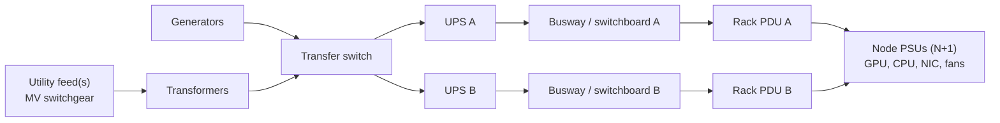
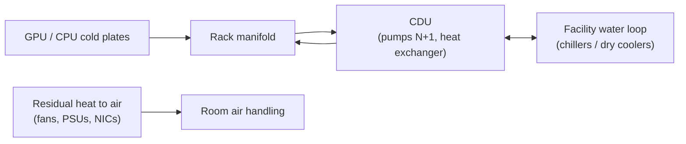

# Chapter 21 — Capacity, Power, and Infrastructure Economics

> "We have 1,024 GPUs" is the most expensive sentence in AI infrastructure planning. Some of those GPUs
> are not energized, some are in repair or held as spares, some sit in fragments too small for the
> jobs in the queue, and the ones that run spend part of their time waiting on the network or redoing
> lost work. This chapter turns nominal GPU counts into *usable* and *useful* capacity, forecasts when
> that capacity runs out and what must be ordered by when, computes total cost of ownership down to
> the cost of a *useful* GPU-hour, compares designs on throughput per dollar and per watt, and treats
> the facility — power chain, rack limits, liquid cooling, transient headroom, power capping — as a
> first-class capacity constraint with operational guardrails.

## Learning objectives

After this chapter you will be able to:

1. **Distinguish** allocated, active, MFU-based, and goodput-based utilization, and **compute** the
   utilization ladder for a cluster.
2. **Calculate** usable capacity from nominal capacity after maintenance, repair/spare, fragmentation,
   energized-power, network, and storage constraints.
3. **Build** a quarterly capacity forecast from supply, demand, utilization targets, reserves, and
   growth, and **derive** order-by dates from lead times.
4. **Compute** TCO (capex amortization, power at PUE, space, network, support, staff) and the cost per
   nominal, allocated, and useful GPU-hour.
5. **Compare** cluster designs on useful throughput per dollar and per watt with explicit assumptions.
6. **Explain** facility constraints — facility capacity, rack power limits, liquid-cooling capacity,
   transient headroom — and **model** the GPU power-capping trade-off.
7. **Define** operational guardrails that coordinate workloads with the facility.

## Prerequisites and connections

You need Chapter 2 (rack power and cooling basics, the facility envelope), Chapter 6 (MFU and
roofline), Chapter 7 (oversubscription), Chapter 14 (storage throughput), Chapter 15 (inference
capacity models), Chapter 17 (fragmentation and placement), and Chapters 18–19 (goodput, failure rates,
spare pools). This chapter supplies the economics for Chapter 22's optimisation decisions, Chapter 23,
and Capstones A (256-GPU cluster design, cost/performance memo) and D (inference cost analysis).

Acronyms: TCO (total cost of ownership), PUE (power usage effectiveness = total facility power / IT
power), MFU (model FLOP utilization), UPS (uninterruptible power supply), PDU (power distribution
unit), CDU (coolant distribution unit), DLC (direct liquid cooling), MEP (mechanical, electrical, and
plumbing), TDP (thermal design power), GPU-h (GPU-hour), capex/opex (capital/operating expenditure).

## 21.1 What "utilization" means — four definitions

Teams argue about utilization because they measure different things. Define all four and report them
together as a *ladder* (Figure 21.1).

| Definition | Numerator / denominator | Measured from | Typical ORION value `[ILLUSTRATIVE]` |
|---|---|---|---|
| **Allocated** | GPU-hours allocated to jobs / usable GPU-hours | Scheduler (Slurm, Kubernetes) | 85 % |
| **Active** | GPU-hours with kernels resident / allocated GPU-hours | `DCGM_FI_DEV_GPU_UTIL` (time-occupancy) | 90–97 % |
| **MFU** | Achieved model FLOP/s / peak FLOP/s while running | Step time and model FLOP count (Chapter 6) | 40 % (W-TRAIN reference) |
| **Goodput** | GPU-hours producing retained progress / allocated GPU-hours | Step records, checkpoints, failures (Chapters 18–19) | 88 % |

```text
Nominal GPU-hours                         100 %
 └─ usable (after reserves, 21.2)          85.0 %
     └─ allocated (× 0.85)                 72.2 %
         └─ goodput (× 0.88)               63.6 %   ← cost per *useful* GPU-hour is based on this
             └─ × MFU 0.40                 25.4 %   of nominal peak FLOPs become model math
```

*Figure 21.1 — The utilization ladder on ORION `[MODELED]` from the illustrative factors above.*

The ladder makes two things obvious. "GPU utilization 95 %" on a dashboard is the *active* rung and
says almost nothing about efficiency (Chapter 18 shows NCCL kernels count as active). And the cost of a
useful GPU-hour is roughly 1 / 0.636 ≈ 1.57× the cost of a nominal one before any MFU discussion.
Improving any rung is worth money; the cheapest rungs to improve are usually allocation (scheduling,
fragmentation) and goodput (reliability), not MFU.

> **Key idea:** Buy and report capacity in *useful* GPU-hours. Nominal GPUs are an input to the
> model, not its answer.

## 21.2 Nominal versus usable capacity

Usable capacity is nominal capacity multiplied by availability factors, then limited by whichever
shared resource binds first.

```text
usable GPUs = min(installed, energizable) × (1 − maintenance) × (1 − repair/spares) × (1 − fragmentation)
ORION factors: (1 − 0.03) × (1 − 0.078) × (1 − 0.05) = 0.97 × 0.922 × 0.95 = 0.850    [ILLUSTRATIVE inputs]
```

**Maintenance reserve (3 %).** Nodes drained for firmware, driver, and OS rollouts (Chapter 20) and for
planned hardware work. Rolling upgrades of a 512-node fleet at 16 nodes per day keep ≈ 3 % out of
service for a month.

**Repair (7.8 %).** With the canonical node MTBF of 1,536 h and 5-day repair turnaround (Chapter 16),
ORION-256 averages 32 × 24 / 1,536 = 0.5 failures per day × 5 days ≈ 2.5 nodes in repair — 2.5 / 32 =
7.8 % (Poisson-distributed, so some weeks see 4–5). The fraction does not depend on fleet size:
ORION-XL's 8 failures per day × 5 days = 40 nodes is also 7.8 %. ORION-256 has no spare nodes; a spare
pool (Chapter 19's ORION-XL variation) sits *outside* the production partition, so it is extra
capex rather than a reserve inside this formula.

**Fragmentation (5 %).** Gang-scheduled jobs need whole nodes, often whole leaf groups (Chapter 17).
Free GPUs scattered across partially used nodes or leaf groups are nominally free but useless to the
job at the head of the queue.

**Energized power.** GPUs that are delivered but not powered are *stranded*. Power, not GPUs, is the
long-lead item (Section 21.3). On ORION each GPU needs 10.2 kW / 8 × 1.12 = 1.428 kW of provisioned IT
power including a 12 % allowance for fabric, storage, and management `[MODELED]`; an 800 kW hall can
energize ⌊800 / 1.428 / 8⌋ = 70 nodes = 560 GPUs.

**Network oversubscription.** ORION's backend is 1:1, so the full fleet can run communication-heavy
jobs at once. The frontend is 3:1 by port count and 1.5:1 by bandwidth (200G host ports, 400G uplinks):
fine for control and storage traffic, but a fleet-wide checkpoint storm or dataset reload is limited by
it. A cheaper backend with a 2:1 spine tier makes every cross-spine collective slower; Section 21.5
models the penalty.

**Storage.** ORION's parallel file system writes ≈ 80 GB/s aggregate. A 980 GB W-TRAIN checkpoint takes
≥ 980 / 80 ≈ 12 s at full aggregate bandwidth. Double the GPU fleet without adding storage and twice
as many jobs checkpoint concurrently: each save stretches toward ≈ 24 s, and every blocking second is
paid by every GPU in the job (Chapter 14). Storage is a capacity dimension, not an accessory.

### A capacity waterfall for ORION-XL

Put the factors together for ORION-XL's 4,096 GPUs running large synchronous jobs, using Chapter 19's
goodput for a 512-node job (MTBF 3 h, canonical 15-minute restart: ≈ 81 % at the optimal 19-minute
checkpoint interval, 80 % at 30 minutes):

```text
nominal                          4,096 GPUs
− maintenance 3 %          →     3,973
− repair 7.8 %             →     3,663
− fragmentation 5 %        →     3,480   usable
× allocation 0.85          →     2,958   allocated
× goodput 0.81             →     2,396   GPU-equivalents of retained progress   (≈ 58 % of nominal)  [MODELED]
```

About 42 % of the nominal fleet disappears before MFU is even considered. Each line has an owner
and a lever: maintenance (Chapter 20's rollout speed), repair (Chapter 16's turnaround), fragmentation
and allocation (Chapter 17's scheduler), goodput (Chapters 14 and 19's checkpointing and recovery).

> **Pitfall:** A capacity spreadsheet with one row — GPUs — will report surplus in exactly the
> quarters when researchers queue for days. In this chapter's lab, 2028Q3 shows 1,024 installed GPUs
> against a demand of 420 (a nominal "41 % utilization") and is in **shortfall**: only 560 are
> energized, and after reserves and headroom 476 usable GPUs cannot meet the 494 required.

## 21.3 Demand forecasting and onboarding lead times

### Forecasting demand

Demand for an AI platform comes in two shapes:

- **Training programs** — discrete, large, scheduled: "a 405B-class pretraining run needs ≈ 300 GPUs
  for 5 months from 2028Q3". Forecast from the research roadmap, in GPU-months, with uncertainty
  (programs slip, grow, and get cancelled).
- **Inference** — continuous, growing with users: forecast requests per second and token mix, convert
  to GPUs with the Chapter 15 capacity model (prefill and decode throughput per GPU at the SLO), and add
  peak-to-average and failover headroom.

Plan against a *required* capacity that includes queueing headroom: running a shared training cluster
at 100 % allocation means unbounded queues. ORION targets ≤ 85 % allocation:

```text
required GPUs = demand / target_allocation      e.g. 420 / 0.85 = 494.1 usable GPUs
```

Present at least two scenarios (P50 and P90 demand) and show where they diverge. The forecast's most
useful output is not a number but a date: *the first quarter of shortfall* in each scenario.

### Converting inference demand to GPUs

Inference demand is converted with a *measured* per-replica capacity at the SLO, never with peak
FLOPs. Suppose `chat-70b` (TP = 8 on one HX8 node) sustains 2.5 requests/s per replica while meeting
the TTFT and TPOT targets for its prompt mix (an `[ILLUSTRATIVE]` figure — measure it with the
Chapter 15 load-test method), and the product forecast is 25 requests/s at the daily peak:

```text
replicas for peak     = 25 / 2.5                 = 10
fault-domain headroom = +2 replicas (N+2, spread over racks and PDUs; Chapter 19)
GPUs                  = 12 replicas × 8          = 96 GPUs                       [MODELED]
average load          = 40 % of peak (diurnal)   → average busy replicas ≈ 4 of 12
```

The last line is the planning tension: inference capacity is sized for peak plus failures, so its
*average* allocation is low. Either accept it (and price it into the inference service), or make the
idle troughs useful — preemptible training or batch inference that yields within seconds when traffic
returns (Section 21.11).

### Uncertainty and scenarios

Demand forecasts for AI are notoriously wrong in both directions: a model architecture change can halve
inference cost per request; a new research program can double training demand in a quarter. Good
practice is a P50 and a P90 scenario, each carried through the full model, with the decision rule
stated in advance — for example "commit facility power for P90, GPUs for P50, and keep a burst option
(cloud or a partner) for the difference". Facility power is the cheapest thing to over-provision
relative to its lead time and the most expensive thing to be short of.

### Lead times turn shortfalls into deadlines

*Table 21.1 — Onboarding lead times `[ILLUSTRATIVE]` — they vary widely with market conditions and
site.*

| Resource | Lead time | Notes |
|---|---|---|
| GPU servers | 2 quarters | Supply-constrained generations can be longer; add 2–4 weeks for acceptance and burn-in (Chapter 16) |
| Network (switches, optics, cabling) | 1 quarter | Optics are a frequent long pole |
| Facility power and cooling | 4+ quarters | Utility upgrades, switchgear, UPS, CDUs; new sites take years |
| Colocation space | 1–4 quarters | Depends on market; power-dense space is scarcer than floor space |

Order-by = first shortfall quarter − lead time. In the lab the first shortfall is 2028Q3; GPUs would
have to be ordered by 2028Q1 and network by 2028Q2 — but the shortfall is caused by power (464 GPUs
already delivered are stranded), and facility power had to be committed by **2027Q3**, a year before
anyone saw a problem. Capacity planning for AI clusters is facility planning first.

### Capacity onboarding: from loading dock to schedulable

"Delivered" is not "in service". Between the two sit receiving and asset tagging, racking, power and
cooling hook-up, cabling (eight backend links per HX8 node plus frontend, management, and power),
firmware alignment to the fleet baseline, burn-in, and acceptance tests (Chapter 16) — then fabric
validation of the new leaf groups (Chapter 10) and scheduler admission (Chapter 17). For a 64-node
expansion on ORION `[ILLUSTRATIVE]` rates:

```text
racking + cabling        16 nodes per day        → 4 working days
burn-in + acceptance     48 h per batch of 32    → 2 batches, 4 days (overlapping the next racking)
first-pass yield         95 % → ≈ 3 nodes need rework (DOA GPU, bad optic, mis-cabled rail)
fabric validation        2 days per leaf group   → 2 leaf groups, 4 days
time to schedulable      ≈ 2–3 weeks after delivery, with ≈ 3 nodes trailing by another 1–2 weeks
```

Two planning consequences. First, a forecast quarter in which hardware arrives late in the quarter
gets little or none of its capacity in that quarter; model deliveries with an in-service date, not a
dock date. Second, onboarding throughput is itself a capacity — of people, cabling crews, and test
infrastructure — and large expansions are often limited by it. The expansion that lands while the
facility team is energising a new phase competes for the same people.

## 21.4 Total cost of ownership

TCO sums the annualised cost of everything required to deliver GPU-hours. ORION-256's model
`[ILLUSTRATIVE]` prices and quantities:

| Component | Formula | ORION-256 |
|---|---|---|
| Capex amortization | (32 nodes × ($320k server + $85k network) + $2.0M storage) / 4 years | $14.96M / 4 = **$3.74M** |
| Power | 32 × 8.5 kW sustained × 1.12 overhead = 304.6 kW IT; × PUE 1.25 × 8,760 h × $0.09/kWh | 380.8 kW facility × 8,760 × 0.09 = **$0.30M** |
| Space (colocation) | 32 × 10.2 kW provisioned × 1.12 × $130/kW-month × 12 | 365.6 kW × 1,560 = **$0.57M** |
| Support and maintenance | 8 % of hardware capex per year | 0.08 × $14.96M = **$1.20M** |
| Staff | 4 FTE × $240k | **$0.96M** |
| **Total** | | **$6.77M per year** |

Cost per GPU-hour on each rung of the ladder:

```text
nominal GPU-h per year   = 256 × 8,760              = 2,242,560
$/nominal GPU-h          = 6,767,300 / 2,242,560    = $3.02
$/allocated GPU-h        = 3.02 / (0.850 × 0.85)    = $4.18
$/useful GPU-h           = 4.18 / 0.88              = $4.75           [MODELED]
```

Three observations practitioners make about this table. Capex dominates (55 %), and support contracts
priced as a fraction of capex add another 18 %: the cost of a GPU-hour is mostly the cost of *owning*
the GPU, so every idle or wasted hour is expensive. Electricity is only ≈ 4 %, which is why power
matters for capacity (it limits how many GPUs you can run) far more than for cost. And the 1.57×
difference between nominal and useful cost is larger than most hardware price negotiations achieve.

### Sensitivity: which inputs move the answer

*Table 21.2 — Sensitivity of ORION-256's cost per useful GPU-hour to one input at a time `[MODELED]`
(base $4.75).*

| Input changed | From → to | $/useful GPU-h | Change |
|---|---|---|---|
| Allocation | 0.85 → 0.75 | 4.75 × 0.85 / 0.75 = 5.38 | +13 % |
| Goodput | 0.88 → 0.80 | 4.75 × 0.88 / 0.80 = 5.22 | +10 % |
| Fragmentation reserve | 0.05 → 0.10 | 4.75 × 0.95 / 0.90 = 5.01 | +6 % |
| Electricity price | $0.09 → $0.15/kWh | (6.77 + 0.300 × 0.667) / 6.77 × 4.75 = 4.89 | +3 % |
| Amortization | 4 → 5 years | (6.77 − 0.75) / 6.77 × 4.75 = 4.22 | −11 % |
| Server price | −10 % | (6.77 − 0.10 × 10.24 / 4 − 0.08 × 1.024) / 6.77 × 4.75 = 4.51 | −5 % |

(The server-price row removes 10 % of the $10.24M server capex from both amortization, $0.256M/yr,
and support, $0.082M/yr.) Operational factors — allocation and goodput — move the cost of useful work
as much as the hardware price negotiation or the electricity contract. That is the economic case for
the scheduling work of Chapter 17 and the reliability work of Chapters 18–19.

### Build versus rent

Renting GPU capacity from a cloud or neocloud replaces most of the TCO table with an hourly price,
but the ladder still applies: a rented GPU that sits idle or redoes lost work costs the same per hour.
The useful comparison is cost per *allocated* hour. With an illustrative rented price of $6.00 per
GPU-hour for comparable capacity, owning ORION is cheaper whenever

```text
3.02 / (usable fraction × allocation) < 6.00   →   0.850 × allocation > 0.503   →   allocation > 59 %
```

i.e. as long as Halcyon keeps more than ≈ 59 % of usable ORION capacity allocated `[MODELED]`. The
comparison assumes rented GPUs are themselves 100 % allocated — reserved capacity left idle has the
same ladder problem, and on-demand capacity at the P90 moment may not exist. Below
that, or for short bursts and uncertain programs, renting wins. Real comparisons must also price data
egress, storage, network performance (is the rented fabric rail-optimized and non-blocking?), contract
commitments, and availability of capacity when needed — the P90 scenario is exactly when everyone else
also wants GPUs.

> **Production note:** Amortization period is a policy choice with large effects: 4 years gives
> $3.74M/yr capex; 5 years gives $2.99M/yr and a lower $/GPU-h — but assumes the GPUs remain
> competitive and supported for 5 years. Make it explicit in every comparison.

## 21.5 Throughput per dollar and per watt: comparing designs

A fair design comparison holds the *binding constraint* fixed and compares *useful throughput* —
never GPU counts. Halcyon's next hall has 1.0 MW of IT power and 1.0 MW of liquid-cooling (CDU)
capacity. Two candidates, all values `[ILLUSTRATIVE]`:

| Per node | Design A — H100-class, air | Design B — next-gen, liquid (DLC) |
|---|---|---|
| GPUs | 8 | 8 |
| Relative training throughput per GPU | 1.0 | 2.2 |
| Backend fabric | 1:1 rail-optimized | 2:1 at the spine (cheaper) |
| Provisioned / sustained IT kW | 10.2 / 8.5 | 14.3 / 12.0 |
| Server + network + cooling capex | $320k + $85k + $0 | $700k + $70k + $30k |
| Heat to liquid | 0 % | 80 % |
| Nodes per rack (rack kW) | 4 (≈ 41 kW) | 8 (≈ 114 kW) |
| PUE | 1.35 | 1.20 |

**The oversubscription penalty.** B's 2:1 spine tier slows only the communication that crosses
spines and is not hidden by computation. If 15 % of W-TRAIN's step is exposed communication and half
of that traffic crosses the spine tier (rail-optimized placement keeps the rest leaf-local):

```text
comm efficiency = 1 / (1 + f_exposed × f_spine × (oversubscription − 1))
                = 1 / (1 + 0.15 × 0.5 × (2 − 1)) = 1 / 1.075 = 0.930           [MODELED]
```

**How many nodes fit?** Power: A needs 10.2 × 1.12 = 11.42 kW per node → ⌊1,000 / 11.42⌋ = 87 nodes; B
needs 14.3 × 1.12 = 16.02 kW → 62 nodes. Cooling: B puts 14.3 × 0.80 = 11.44 kW per node into liquid →
⌊1,000 / 11.44⌋ = 87 nodes, so for B *power binds before cooling*.

**Useful throughput** (HX8-GPU equivalents of retained work, using the ladder factor 0.850 × 0.85 × 0.88
= 0.636):

```text
A: 87 × 8 × 1.0 × 1.00 × 0.636 = 442 units      B: 62 × 8 × 2.2 × 0.93 × 0.636 = 645 units
```

*Table 21.3 — Design comparison for a 1.0 MW hall `[MODELED]` (TCO per Section 21.4, staff scaled by
node count).*

| Metric | A | B | B / A |
|---|---|---|---|
| Nodes / GPUs | 87 / 696 | 62 / 496 | 0.71 |
| Useful units | 442.3 | 644.9 | 1.46 |
| TCO per year | $16.67M | $20.57M | 1.23 |
| Useful units per $M/yr | 26.53 | 31.36 | 1.18 |
| Facility power (sustained IT × 1.12 × PUE) | 1.118 MW | 1.000 MW | 0.89 |
| Useful units per facility MW | 396 | 645 | 1.63 |
| Cost per GPU-year | $23,950 | $41,463 | 1.73 |
| Cost per useful unit-year | $37,687 | $31,888 | 0.85 |

B has 29 % fewer GPUs and costs 73 % more per GPU, yet delivers 46 % more useful work, 18 % more per
dollar, and 63 % more per facility watt. A procurement process that compares "$ per GPU" picks the wrong
design. But the conclusion is only as strong as its most uncertain input: if B achieves 1.8× per-GPU
throughput on Halcyon's workloads instead of 2.2×, its useful units fall to 644.9 × 1.8 / 2.2 = 528 and
its value per $M to 25.7 — below A. The break-even is ≈ 1.86× `[MODELED]`. The decision memo must
therefore name the measurement that de-risks it: an L2/L3 benchmark of W-TRAIN on B-class hardware.

Two further caveats. The 0.93 communication efficiency assumes B's faster NICs keep exposed
communication near 15 % of its (shorter) step; if the network did not speed up with compute, exposed
communication would be ≈ 0.15 / (0.85 / 2.2 + 0.15) ≈ 28 % of the step, efficiency at 2:1 would fall to
1 / (1 + 0.28 × 0.5) ≈ 0.88, and B's value would be 31.36 × 0.88 / 0.93 ≈ 29.6 per $M — still ahead.
And the PUE values are design variations, not the canon: ORION's liquid-assisted hall runs at 1.25;
an all-air hall for A pays more fan and chiller energy (1.35), a mostly-liquid warm-water hall for B
less (1.20).

### Energy per useful unit of work

Throughput per watt has a concrete operational form: energy per training token or per served request.
For W-TRAIN on ORION-256 at its 17.4 s reference step:

```text
IT energy per step   = 32 nodes × 8.5 kW × 1.12 × 17.4 s = 5,301 kJ = 1.47 kWh
facility energy      = 1.47 × PUE 1.25                    = 1.84 kWh per step
per million tokens   = 1.84 / 4.19                        = 0.44 kWh  → $0.040 at $0.09/kWh   [MODELED]
```

Against $4.75 per useful GPU-hour × 256 GPUs × 17.4 s / 3,600 = $5.88 of total cost per step (≈ $1.40
per million tokens), electricity is again ≈ 3 % of the cost of training — but every improvement in MFU
or goodput reduces energy per token and cost per token together, while a power cap (Section 21.8) can
reduce energy per token even as it lowers per-GPU speed. Track both "tokens per facility kWh" and
"tokens per dollar"; they reward different optimisations.

> **Pitfall:** Comparing designs at equal GPU count. In a power-limited hall the question is "how much
> useful work per facility megawatt and per dollar", and the GPU count is an *output* of the design.

## 21.6 The facility envelope: power chain and rack limits

AI racks are power-dense enough that the facility, not the GPU supply, often sets capacity. Figure 21.2
sketches the power chain as a one-line concept.



*Figure 21.2 — Power-chain one-line concept for an ORION rack with A/B (2N) feeds. Each feed must be
able to carry the whole rack if the other fails; telemetry exists at the UPS, busway, PDU, and node
(BMC/Redfish) levels.*

Key engineering facts for capacity planning:

- **Redundancy halves usable feed capacity.** With 2N A/B feeds each side normally carries ≈ 50 %, but
  must be sized for 100 % of the rack. Planning to 100 % of *both* feeds gives a rack that trips on the
  first feed failure.
- **Continuous-load derating.** Many jurisdictions limit continuous load to a fraction of breaker
  rating (for example 80 % in North American practice). ORION's canonical rack circuit (Chapter 2) is
  three-phase 415 V, 60 A at power factor 0.95: √3 × 415 V × 60 A × 0.95 × 0.80 = 32.78 kW continuous.
  Each side (A and B, 2N) has two such circuits = 65.55 kW, so one side alone carries a full 4-node rack
  (4 × 10.2 = 40.8 kW max) with margin `[ILLUSTRATIVE; jurisdiction- and equipment-dependent]`. Older
  halls with one circuit per side (32.78 kW) cannot run four uncapped HX8 nodes — Section 21.8 uses
  such a legacy hall as its declared variation.
- **Provisioned versus used power.** Racks are provisioned for nameplate peak (10.2 kW per node), but
  training nodes sustain ≈ 8.5 kW: 1.7 kW (17 %) per node is *stranded power* — paid for in
  electrical and cooling capacity and never drawn. Fan, Weber, and Barroso (2007) showed that
  provisioning for the *observed aggregate* peak, which is always below the sum of nameplates, recovers
  much of this, provided a capping mechanism guarantees the limit is never exceeded. Power capping is
  that safety net.
- **Rack power is platform-specific.** ≈ 120 kW-class liquid-cooled racks exist in vendor reference
  designs; any such figure must be tied to a specific reference design and date `[VENDOR-SPEC,
  2026-10]`, not treated as a standard.
- **Telemetry at every level.** UPS load, busway and PDU per-phase current, and node power (Redfish,
  DCGM) must be collected and correlated (Chapter 18); phase imbalance is a common hidden limit.

## 21.7 Liquid cooling constraints and transient headroom

### Heat removal

Every watt of IT power becomes heat. Air cooling at 40 kW per rack is already demanding; above it,
direct-to-chip liquid cooling removes most heat through cold plates on GPUs and CPUs, with CDUs
exchanging heat between the rack's technology cooling loop and the facility water loop. Coolant flow
follows from the heat load:

```text
mass flow = P / (c_p × ΔT)
100 kW, water (c_p ≈ 4.18 kJ/kg·K), ΔT = 10 K:  100 / (4.18 × 10) = 2.39 kg/s ≈ 143 L/min
same load with a glycol mix (c_p ≈ 3.9):        100 / (3.9 × 10)  = 2.56 kg/s  (≈ 7 % more flow)   [MODELED]
```



*Figure 21.3 — Direct-liquid-cooling block diagram: the technology cooling loop (cold plates, manifold,
CDU) exchanges heat with the facility water loop; heat not captured by cold plates still needs air
handling. Telemetry points: CDU supply/return temperature, flow, pump state, leak sensors.*

Capacity constraints that bind in practice: CDU heat capacity and redundancy (N+1 pumps), supply
temperature (warmer supply saves chiller energy but raises GPU temperatures and can reduce sustained
clocks — the thermal-performance coupling of Chapter 2), flow per rack and per cold plate, the
fraction of heat still going to air (B's 20 % residual ≈ 23 kW per 114 kW rack still needs room air
handling), leak detection, coolant quality, and serviceability. In Section 21.5, B's hall had 1.0 MW of
CDU capacity; power bound first. Halve the CDU capacity and cooling binds at ⌊500 / 11.44⌋ = 43 nodes.

### Thermal-performance coupling

Cooling capacity is not binary. GPUs throttle when they reach their temperature limits: first software
thermal slowdown at the maximum operating temperature, then hardware slowdown a few degrees above it
(Chapter 18). A cooling loop that is *nominally* adequate but runs a warm supply temperature, uneven
flow across cold plates, or a hot aisle with recirculation will push a fraction of GPUs into slowdown
during long sustained phases. In a synchronous job that fraction is a straggler set: if 2 % of GPUs run
10 % slower, the whole job runs ≈ 10 % slower. Capacity models should therefore carry a *thermal
derate* for halls operating near their cooling limits, and facility telemetry (supply temperature,
flow, ΔT per rack) should be on the same dashboards as GPU clock-event reasons, so that "the GPUs are
slow" and "the loop is warm" are seen together.

### Transient headroom

Synchronous training makes thousands of GPUs change power together. During compute phases each
H100-class GPU draws near its limit; during communication-bound phases and checkpoints much less. If
each GPU swings by ≈ 250 W (650 → 400 W) `[ILLUSTRATIVE]`:

```text
ORION-256: 256 × 0.25 kW = 64 kW swing,   ORION-XL: 4,096 × 0.25 kW ≈ 1.0 MW swing, at step frequency
```

These swings repeat every step (seconds) and happen all at once when a job starts, stops, or hangs.
The Llama 3 report describes data-center-wide power fluctuations of tens of megawatts from a single
large training job. Effects: UPS and generator stress, utility interconnect limits, and breaker trips
if racks are planned to their limit. Hence the **transient margin**: plan peak rack load to ≤ 90 % of
the rack limit (ORION's illustrative policy), coordinate job start/stop ramps, and agree with the
facility how large a step change the site can absorb. GPUs also have millisecond-scale excursions
above their sustained limit; PSU and PDU sizing must follow the vendor's guidance for the platform
`[VENDOR-SPEC, 2026-10]`.

## 21.8 Power capping and workload/facility coordination

### The power-capping trade-off

Power-limiting a GPU reduces clocks and throughput sub-linearly: near the top of the curve the last
100 W buy little performance. Using the lab's illustrative curve (700 W → 1.000, 650 W → 0.990, 550 W →
0.945, 400 W → 0.790) and the canonical node model (4.6 kW base + 8 × cap; 10.2 kW at 700 W), consider a
declared variation: 64 HX8 nodes must go into 16 racks of a **legacy hall** whose racks have one
canonical circuit per side (32.78 kW, 2N), with a 10 % transient margin — a planned peak of
32.78 × 0.9 = 29.5 kW per rack.

| GPU cap | Node peak | Nodes per rack | Deployable nodes | Cluster throughput (node-eq.) | Racks for all 64 | Unused rack budget |
|---|---|---|---|---|---|---|
| 700 W | 4.6 + 5.6 = 10.2 kW | ⌊29.5 / 10.2⌋ = 2 | 32 | 32 × 1.000 = 32.0 | 32 | 29.5 − 20.4 = 9.1 kW |
| 650 W | 4.6 + 5.2 = 9.8 kW | ⌊29.5 / 9.8⌋ = 3 | 48 | 48 × 0.990 = 47.5 | 22 | 0.1 kW |
| 550 W | 9.0 kW | 3 | 48 | 48 × 0.945 = 45.4 | 22 | 2.5 kW |
| 400 W | 7.8 kW | 3 | 48 | 48 × 0.790 = 37.9 | 22 | 6.1 kW |

*Table 21.4 — Power-capping trade-off in a rack-limited legacy hall `[MODELED]`.*

A light 650 W cap fits a third node into every rack and delivers **48 % more** cluster throughput than
running 32 nodes uncapped, while uncapped racks strand 9.1 kW of their 29.5 kW budget. Deeper caps do
not help: a fourth node needs node peak ≤ 29.5 / 4 = 7.375 kW, i.e. a cap ≤ (7.375 − 4.6) / 8 ≈ 347 W,
below the useful range of the curve. The best cap is the *lightest* cap that fits one more node — a
5.5 % or 1 % per-GPU loss on a benchmark chart can be a large gain at the facility level. Throughput per
kW peaks near 500 W, the right cap only when power rather than rack slots binds. The 650 W option leaves
only 29.5 − 3 × 9.8 = 0.1 kW of planned headroom, so measure the 4.6 kW base on each site's nodes before
adopting it: a base just 2 % higher (4.69 kW) makes three nodes at 650 W need 29.7 kW, and the best
option falls to 600 W (3 × 9.49 = 28.5 kW, throughput 46.7).

Three cautions. The throughput-versus-cap curve is **workload-dependent** (memory-bound decode loses
less than dense GEMM training) and **varies per GPU** (silicon and cooling differences), so measure it
(L2 extension) and leave margin. A power limit is enforced by the GPU's power controller over
milliseconds-to-seconds averaging windows; it does **not** bound millisecond-scale excursions, which the
PSU and PDU sizing must still absorb `[VENDOR-SPEC, 2026-10]`. And caps are set with
`nvidia-smi -pl <watts>` (per GPU, not persistent across driver reloads) or fleet configuration
management, and are visible as `clocks_event_reasons.sw_power_cap` and `DCGM_FI_DEV_CLOCKS_EVENT_REASONS`
(Chapter 18).

**Cap jobs, not racks.** In a synchronous job the slowest node sets the pace (Chapter 18, Section
18.14). Capping one rack's four nodes to 550 W inside a 24-node, 192-GPU job slows the *whole* job to
≈ 0.945 — a loss of 0.055 × 192 ≈ 10.6 GPU-equivalents to save ≈ 4 × 8 × 0.15 kW = 4.8 kW. If a cap is
needed, apply it uniformly to every node of the affected job (same throughput loss, ≈ 29 kW saved
instead of 4.8 kW), or checkpoint and move the job off the constrained rack.

### Coordinating workloads with the facility

The scheduler and the facility must share information both ways:

- **Facility → scheduler:** per-rack and per-row power budgets, cooling capacity and maintenance windows
  (a CDU pump in maintenance lowers the row's budget), demand-response events.
- **Scheduler → facility:** planned large-job starts and stops (step changes of hundreds of kW), expected
  sustained load per row.
- **Mechanisms:** treat rack power as a schedulable resource (place jobs so that no rack exceeds its
  budget), apply fleet-wide caps when headroom shrinks, stagger job start-up, and prefer capping to
  breaker trips.

*Table 21.5 — Operational guardrails for ORION `[ILLUSTRATIVE]` thresholds.*

| Signal | Threshold | Automated action | Human owner |
|---|---|---|---|
| Rack power (per side; 65.55 kW canonical, 32.78 kW legacy) | > 80 % of continuous limit for 5 min | Stop placing new jobs on the rack | Platform |
| Rack power | > 90 % for 2 min | Cap every node of the jobs on that rack uniformly (550 W), or checkpoint and move them | Platform + Facilities |
| Feed loss (A or B) | Any | Verify one side carries the rack; in legacy racks reduce to 3 nodes or cap so that one circuit carries the load; page Facilities | Facilities |
| CDU supply temperature | > design + 3 K for 5 min | Cap the row; alert | Facilities |
| CDU pump redundancy lost | Any | Page Facilities; plan row-wide cap | Facilities |
| Job start/stop > 500 kW | Planned | Ramp over ≥ 60 s; notify Facilities | Training Infra |
| GPU HW thermal slowdown on > 2 % of a row | 10 min | Ticket; inspect cooling | Facilities + Fleet |

> **Safety:** Power limits, cooling setpoints, and breaker loading are safety-relevant. Changes go
> through the facility owner and the change process of Chapter 20; never test transient behaviour on
> production feeds.

## 21.9 Worked example: ORION's 2027–2029 capacity plan

We apply the diagnostic loop to the lab's plan. All outputs `[MODELED]`; inputs `[ILLUSTRATIVE]`.

**Step 1 — Clean the input.** The plan has two identical 2027Q3 rows (a copy-paste in the planning
spreadsheet). Counting both would add a phantom 256 GPUs. Drop exact duplicates; reject conflicting
ones for a human to resolve.

**Step 2 — Supply.** Start with ORION's 256 GPUs; add deliveries, subtract retirements: 512 after
2027Q3, 1,024 after 2028Q2, 1,280 after 2029Q2, 1,024 after the original 256 retire in 2029Q3.

**Step 3 — Energized supply.** Provisioned IT kW per GPU = 10.2 × 1.12 / 8 = 1.428 kW. Energizable GPUs =
⌊kW / 1.428 / 8⌋ × 8: 420 kW → 288; 800 kW → 560; 1,500 kW → 1,048. In 2028Q2–Q3, 1,024 installed but
only 560 energized → **464 GPUs stranded**; in 2029Q2, 1,280 installed vs 1,048 → 232 stranded.

**Step 4 — Usable and required.** Usable = energized × 0.850; required = demand / 0.85.

| Quarter | Installed | Energized | Usable | Demand | Required | Gap | Status |
|---|---|---|---|---|---|---|---|
| 2027Q1 | 256 | 256 | 217.5 | 160 | 188.2 | +29.3 | OK |
| 2027Q3 | 512 | 512 | 435.0 | 200 | 235.3 | +199.7 | OK |
| 2028Q2 | 1,024 | 560 | 475.8 | 305 | 358.8 | +117.0 | OK |
| 2028Q3 | 1,024 | 560 | 475.8 | 420 | 494.1 | −18.3 | **SHORTFALL** |
| 2028Q4 | 1,024 | 1,024 | 870.0 | 480 | 564.7 | +305.3 | OK |
| 2029Q3 | 1,024 | 1,024 | 870.0 | 720 | 847.1 | +23.0 | OK |
| 2029Q4 | 1,024 | 1,024 | 870.0 | 820 | 964.7 | −94.7 | **SHORTFALL** |

*Table 21.6 — Selected quarters of the forecast `[MODELED]` (full table from the lab's `forecast()`).*

**Step 5 — Interpret.** 2028Q3's shortfall is invisible in a nominal view (1,024 GPUs vs 420 demand)
and is caused entirely by power: had phase 2 been energized one quarter earlier, usable capacity would
have been 870. The corrective action is facility, with a 4-quarter lead time: order-by **2027Q3**. A
mitigation available in the quarter itself is Section 21.8's power capping: capping the 2028Q3 fleet to
550 W lets 800 kW energize more nodes — node provisioned power drops from 10.2 to 4.6 + 8 × 0.55 = 9.0 kW
peak, so ⌊800 / (9.0 × 1.12)⌋ = ⌊79.4⌋ = 79 nodes = 632 GPUs, usable 632 × 0.850 = 537, minus the 5.5 %
throughput cost ≈ 507 effective — enough to close the gap (494 required), with little margin. The cap
must apply to every node of the jobs involved, not to a subset (Section 21.8).

2029Q4's shortfall is real growth plus the retirement of the original 256 GPUs: it needs ≥ 94.7 / 0.850
≈ 112 more energized GPUs (14 nodes = 112 GPUs) — *and* power, because 1,024 + 112 = 1,136 exceeds the
1,048 energizable at 1,500 kW. Order GPUs by 2029Q2 and power by 2028Q4, or plan Design B for the next
hall (Section 21.5).

**Step 6 — Cost.** At $4.75 per useful GPU-hour (Section 21.4), the 2028Q3 shortfall of 18 usable GPUs
is small; the stranded 464 GPUs are not: 464 × 2,190 h per quarter × $3.02 ≈ $3.1M of nominal capacity
paid for and unused in each stranded quarter.

## 21.10 Hands-on lab overview

The lab ([lab/README.md](lab/README.md)) implements this chapter as a model: plan hygiene, the
quarterly forecast with energized/stranded/usable/required capacity, first shortfall and order-by
dates, the TCO and cost-per-GPU-hour ladder, the two-design comparison, the power-capping table, and
the flags where nominal GPU count misleads. Tier L1, `[MODELED]`. The L2 extension replaces the
illustrative power/throughput curve with one measured on a lab GPU.

## 21.11 Troubleshooting scenario: "58 % utilization and a four-day queue"

**Symptom.** Finance flags a dashboard showing 58 % average GPU utilization on ORION and asks why a
GPU purchase is planned; researchers report median queue waits of four days for 32-node jobs.

**Evidence** `[ILLUSTRATIVE]`:

```text
dashboard metric: avg(DCGM_FI_DEV_GPU_UTIL) over all 256 GPUs, 30 days         = 58 %
scheduler: allocated GPU-hours / installed GPU-hours, 30 days                  = 74 %
nodes drained (maintenance + repair), 30-day average                           = 23 of 256 GPUs (9 %)
inference pool (64 GPUs) average GPU_UTIL: day 70 %, night 18 %; not lendable
largest free contiguous block when the queue head (32 nodes) waits: 6 nodes
active (GPU_UTIL) of allocated training GPUs                                   = 96 %
```

**Hypotheses.** (1) Over-provisioning — contradicted by the queue. (2) The metric mixes rungs of the
ladder. (3) Capacity is lost to reserves, fragmentation, and an idle-at-night dedicated pool.

**Discriminating analysis.** Decompose the 58 % (shares of all 256 GPUs):

```text
drained (9 %)                                   0.09 × 0 %                 =  0.0 points
inference pool (25 %), dedicated, ≈ 44 % active 0.25 × 44 %                = 11.0 points
training nodes (66 %), 74.2 % allocated × 96 %  0.66 × 0.742 × 96 %        = 47.0 points
total                                                                        58.0 %
allocated overall = 0.25 (pool) + 0.66 × 0.742 = 0.74                                  [ILLUSTRATIVE]
```

So the 58 % is not "GPUs working at 58 %": allocated training GPUs are 96 % active, a quarter of the
fleet is a dedicated pool that idles at night, 9 % is drained, and a quarter of the training nodes are
free but fragmented into 1–6 node pieces that the 32-node job at the head of the queue cannot use.

**Root cause.** The metric is the *active* rung averaged over every GPU, including drained nodes and a
dedicated inference pool; the real constraints are fragmentation and a non-lendable pool.

**Fix.** Report the utilization ladder (Section 21.1). Change scheduling: topology-aware packing and
backfill (Chapter 17); let preemptible training borrow the inference pool at night with a fast
reclaim path; reserve leaf-aligned blocks for large jobs. Re-run the forecast with the new
fragmentation and allocation factors before buying.

**Validate.** After four weeks: allocated rises 74 → 82 %, median queue wait for 32-node jobs falls
below one day, and the purchase is re-sized (or deferred) on the new usable-capacity numbers.

## Trade-offs and design decisions

*Table 21.7 — Capacity and economics trade-offs.*

| Decision | Option A | Option B | A wins when | B wins when |
|---|---|---|---|---|
| Allocation target | 85 % (headroom) | 95 % (squeeze) | Large gang jobs, deadline-driven research | Mostly small, preemptible jobs with backfill |
| Amortization | 4 years | 5–6 years | Fast hardware cycles; resale/competitiveness matters | Stable workloads; long vendor support |
| Next hall | Air, H100-class (A) | Liquid, next-gen (B) | Cooling infrastructure unavailable; per-GPU speedup unproven | Power-limited site; speedup verified on own workloads |
| Backend fabric | 1:1 | 2:1 spine | Communication-heavy training at scale | Inference-heavy or small jobs; capex-constrained |
| Rack density at the limit | Uncapped, fewer nodes | Capped, more nodes | Per-job latency matters more than fleet throughput | Rack- or power-limited halls (Section 21.8) |
| Spares | Dedicated pool | Elastic / preemptible fill | Large synchronous jobs need fast restarts | Many small jobs; elastic frameworks |
| Inference pool | Dedicated | Shared with preemptible training | Strict latency SLOs, unpredictable spikes | Diurnal load with fast reclaim |

## Production operations notes / runbook excerpt

**Quarterly capacity review (Platform + Facilities + Finance).**

1. Refresh inputs: deliveries, energization dates, decommissions, demand (P50/P90) from research and
   inference owners, and the measured ladder factors (maintenance, repair, fragmentation, allocation,
   goodput) from the last quarter's telemetry.
2. Run the forecast; list the first shortfall quarter for each scenario and its cause (GPUs, power,
   cooling, network, storage).
3. Convert to order-by dates with current lead times; escalate anything whose order-by date is this
   quarter or earlier.
4. Review stranded capacity (installed but not energized, or energized but not schedulable) and its
   cost.
5. Review facility guardrail events (Table 21.5): caps applied, near-trips, CDU alarms.
6. Publish the decision memo: capacity, cost per useful GPU-hour, risks, and the assumptions register.

**Operational signals.** Rack power > 80 % of continuous limit; stranded GPUs > 0 for more than one
quarter; allocation > 90 % for 2 weeks (queues will explode); fragmentation > 10 %; cost per useful
GPU-hour rising for two consecutive months.

> **Safety:** Capping policies, energization changes, and cooling changes are coordinated with
> Facilities and executed through change control (Chapter 20).

## Realism boundaries

> **Realism boundary:** Every number in this chapter's models is an illustrative assumption; prices,
> lead times, rack limits, PUE, and the power/throughput curve vary by vendor, site, contract, and
> year. The models ignore financing costs, taxes, depreciation rules, resale value, discounts, and
> utility tariffs with demand charges; they treat reserves as fixed fractions rather than stochastic
> processes; and the power-capping curve is not measured. Electrical and cooling statements are
> concepts for collaboration with facilities engineers, not designs — a qualified facilities/MEP
> engineer must review any real power or cooling plan. Only the L2/L3 extensions produce measured
> inputs.

## Summary

- Report utilization as a ladder: usable → allocated → goodput → MFU. Dashboards usually show the
  *active* rung, which hides waste.
- Usable = min(installed, energizable) × (1 − maintenance) × (1 − repair/spares) × (1 − fragmentation);
  ORION's illustrative factor is 0.850 (repair 7.8 % from the 5-day MTTR).
- Plan to required = demand / target allocation (≤ 85 %) for queueing headroom.
- Facility power is the longest lead item (≥ 4 quarters); a shortfall can be power-caused while
  hundreds of GPUs sit stranded.
- ORION-256 TCO ≈ $6.77M per year: $3.02 per nominal, $4.18 per allocated, $4.75 per useful GPU-hour;
  capex and support dominate, electricity ≈ 4 %.
- Compare designs on useful throughput per dollar and per facility watt at the binding constraint; a
  design costing 73 % more per GPU delivered 18 % more per dollar and 63 % more per watt.
- Every comparison has a break-even assumption (here ≈ 1.86× per-GPU speedup); name the measurement
  that de-risks it.
- Redundant feeds, continuous-load derating, and transient margin all reduce the power a rack can plan
  to; synchronized training swings reach ≈ 1 MW at ORION-XL scale.
- Power capping trades a few percent per GPU for more nodes per rack: in a legacy hall a 650 W cap fitted
  a third node per rack (+48 %); cap whole jobs, never a subset of a synchronous job.
- Provisioned-but-unused power (10.2 vs 8.5 kW per node) is stranded capacity; capping is the safety net
  that lets you provision closer to the observed peak.
- Coordinate workloads and the facility through power budgets, staged ramps, caps before trips, and
  explicit guardrails with owners.

## Review questions

Full exercises are in [exercises.md](exercises.md). Quick self-check:

1. Why can a quarter be in shortfall when installed GPUs are more than twice the demand?
2. What share of ORION-256's TCO is electricity, and what does that imply about where power matters?
   *(≈ 4 %; power matters as a capacity limit more than as a cost.)*
3. A rack limit is 36 kW with a 10 % transient margin; node peak is 4.6 kW + 8 × cap. What is the highest
   cap that fits four nodes? *((32.4 / 4 − 4.6) / 8 = 437.5 W.)*

## Further reading

- L. A. Barroso, U. Hölzle, P. Ranganathan, *The Datacenter as a Computer*, 3rd ed., Morgan & Claypool,
  2018 — TCO structure, PUE, and power provisioning at warehouse scale.
- X. Fan, W.-D. Weber, L. A. Barroso, "Power Provisioning for a Warehouse-sized Computer", ISCA 2007 —
  the classic analysis of oversubscribing power safely, the basis of capping-versus-provisioning
  reasoning.
- The Green Grid, *PUE: A Comprehensive Examination of the Metric*, 2012 — what PUE does and does not
  measure.
- ASHRAE TC 9.9, *Thermal Guidelines for Data Processing Environments* and its liquid-cooling guidance —
  the temperature classes and coolant considerations facilities teams design to.
- Llama Team (Meta), "The Llama 3 Herd of Models", 2024 — reports data-center power fluctuations of tens
  of megawatts from synchronized training, the motivation for transient headroom.
- NVIDIA, *nvidia-smi* documentation and DCGM User Guide — power-limit and clock-event-reason
  interfaces used for capping and verification (`[VENDOR-SPEC, 2026-10]`).
- Open Compute Project, rack and power specifications (e.g. Open Rack) — reference points for
  high-density rack power delivery.
