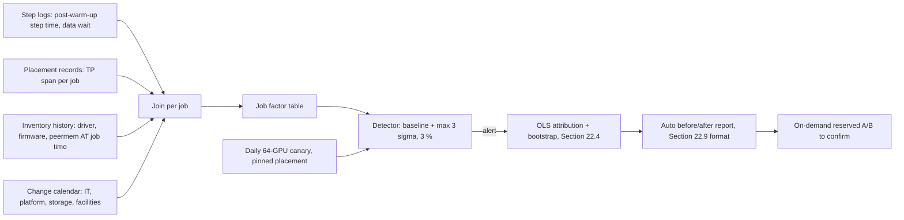

# D1 — Continuous regression detection for ORION (solution)

Accept well-argued alternatives; the reference answer is a hybrid. Values `[MODELED]` from
`[ILLUSTRATIVE]` inputs (σ = 0.11 s from the lab's before period; Section 22.6.1 MDE formula).

**Architecture sketch.**

**Options.**

| Option | Detection time | GPU cost | False positives | Causal strength |
|---|---|---|---|---|
| A. Daily dedicated canary (one 64-GPU W-TRAIN ablation, 1 h, pinned placement) | ≤ 24 h | 64 GPU-h/day of 256 × 24 = 6,144 → **1.04 %** | Low (controlled config) | Strong for the canary config; blind to placement and dataset effects the canary never exercises |
| B. Mine production jobs (natural-experiment pipeline) | Hours, once enough jobs per cell | ≈ 0 | Medium (confounding, small cells) | Moderate; covers real placements and datasets |
| C. Hybrid: B continuously, A daily, plus on-demand reserved A/B to confirm | ≤ 24 h | ≈ 1 % + occasional reservations | Low after confirmation | Strong |

**Canary arithmetic.** 64 GPUs × 1 h = 64 GPU-h per day; capacity 256 GPUs × 24 h = 6,144 GPU-h;
64 / 6,144 = 1.04 % of the cluster.

**Detectable effect.** A 3 % regression at 17.4 s is 0.522 s. Runs needed per arm to detect it at 5 %
two-sided and 80 % power: n = 2 × (2.8 × 0.11 / 0.522)² = 2 × 0.592² = 0.70, so one canary run per day
detects it in principle. Day-to-day drift (neighbour load, facility temperature) means each run should be
compared with a rolling 7-day baseline (n = 7): MDE = 2.8 × 0.11 × √(2/7) = 0.165 s ≈ 0.9 % of
17.4 s, comfortably below 3 %. Threshold: alert when the job-weighted median exceeds baseline +
max(3σ, 3 %) = 17.4 + max(0.33, 0.52) = 17.92 s across ≥ 3 jobs, matching runbook RB-PERF-03.

**False-positive cost.** Each false alarm costs an on-call investigation (hours) and erodes trust;
production mining alone produces more of them (confounded cells), which is why C confirms any mined alert
with the canary or an A/B before paging change owners.

**Recommendation: C.** It meets the one-day target at ≈ 1 % GPU cost, keeps B's coverage of real
placements and datasets, and borrows A's controlled measurement for causal strength. Attribution
reports are generated automatically in the Section 22.9 format, with the time-aware joins that the lab
showed are essential.

**Common wrong answers.** Using the current inventory instead of history; thresholds without σ; a canary
that never exercises cross-node placement.
