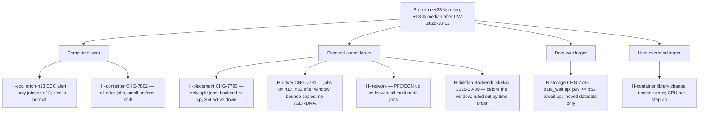

# O2 — Hypothesis tree and test ranking (solution)

**(a) Tree.** Manuscript Figure 22.2 (Section 22.3.2), rooted in the step-time terms, extended with the
two leaves the bundle adds:

**(b) Ranking (lab task 8).** `score = info / (cost_h × risk_mult)`, low 1, medium 2, high 5; ties by ID.

| Rank | Test | Info | Cost (h) | Risk | Env | Score |
|---|---|---|---|---|---|---|
| 1 | T3 data wait by tier | 0.8 | 0.25 | low | offline | 3.200 |
| 2 | *L-a: per-rank data-wait distribution for capacity-tier jobs, testing the slack model* | 0.5 | 0.25 | low | offline | 2.000 |
| 3 | T1 TP-span partition | 0.9 | 0.5 | low | offline | 1.800 |
| 4 | T2 NCCL channel lines / `nvidia_peermem` | 0.7 | 0.5 | low | offline | 1.400 |
| 5 | T4 orion-n13 partition | 0.3 | 0.25 | low | offline | 1.200 |
| 6 | *L-b: diff container image package lists, old vs new digest* | 0.4 | 0.5 | low | offline | 0.800 |
| 7 | T8 `fio` on capacity tier | 0.5 | 2 | low | lab | 0.250 |
| 8 | T6 `all_reduce_perf` R550 vs R570 | 0.7 | 3 | medium | lab | 0.117 |
| 9 | T7 placement A/B | 0.9 | 6 | medium | lab | 0.075 |

Learner tests (italic) are examples; justify info as "fraction of remaining uncertainty resolved". L-a
discriminates the storage leaf's mechanism *and* the interaction; L-b is the cheapest test of the
container leaf, the only candidate for the common shift.

**Rejected (not ranked):** T5 (roll back R570 on 16 production nodes) and T9 (restart all jobs with
`NCCL_DEBUG=INFO`), by the hard rule: a high-risk test in production is rejected.

**Re-score after results.** Once T3 shows the tier gap, T8 mostly reconfirms a known leaf: info ≈ 0.2 →
0.2 / 2 = 0.10, below T6. Once T1 shows the TP-span gap, T7 becomes confirmation only, justified before
a fleet-wide placement change.

**Common wrong answers.** Ranking T5 with a low score instead of rejecting it; a tree rooted in the change
log; omitting the "boring" container leaf.
