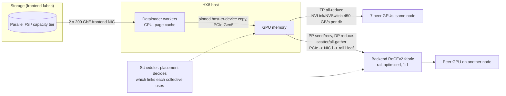
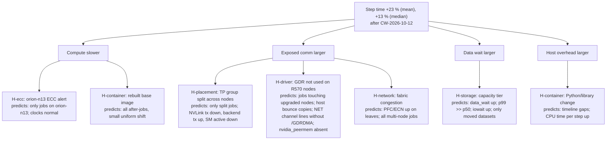

# Chapter 22 — Cross-Layer Performance Engineering

> A distributed training job is one synchronous machine built from GPUs, hosts, PCIe switches, NICs,
> a backend fabric, storage, a scheduler, and software. When its step time regresses, the cause can sit
> in any layer, and production rarely offers one clean change to blame: driver upgrades, placement
> policies, storage moves, and container rebuilds land in the same window while unrelated alerts fire.
> This chapter integrates the whole book into one discipline: turning a vague "training got slower" into a ranked hypothesis tree, choosing discriminating tests by information
> value, cost, and risk, attributing the regression in seconds per step with stated uncertainty,
> making one evidence-backed change at a time, and writing a before/after report that keeps measured
> facts, inferred causes, and remaining uncertainty apart. It is the chapter that turns the diagnostic
> loop from a slogan into a repeatable engineering method.

## Learning objectives

After working through this chapter, its exercises, and its lab you will be able to:

1. **Decompose** a training step into compute, exposed communication, pipeline bubble, data wait, and
   host overhead, and **name** the evidence source that measures each term on ORION.
2. **Define** a regression precisely (metric, population, statistic, window, noise floor) and
   **explain** why mean, median, and p99 can tell different stories about the same change.
3. **Build** a hypothesis tree for a cross-layer regression and **rank** candidate tests by
   information value, cost, and risk, rejecting tests that are unsafe for production.
4. **Design** discriminating tests whose predicted outcomes differ under competing hypotheses.
5. **Attribute** a regression to simultaneous changes using a natural experiment, **quantify**
   uncertainty, and **recognise** confounding, collinearity, and interaction.
6. **Calculate** weak- and strong-scaling efficiency and the minimum detectable effect of a benchmark,
   and **use** them to decide whether a claimed improvement is real.
7. **Write** a before/after report that separates measured facts, inferred causes, and remaining
   uncertainty, and **avoid** the common anti-patterns (many knobs at once, noisy shared fabric,
   survivorship bias, warm-up contamination).

## Prerequisites and connections

This chapter assumes the whole of Parts I–IV and most of Part V. In particular: host and PCIe
diagnosis ([Chapter 3](../../part-1-foundations/ch03-linux-host-systems-diagnostics/),
[Chapter 5](../../part-2-accelerated-compute/ch05-gpu-interconnects-host-topology/)), benchmark
discipline and roofline reasoning
([Chapter 6](../../part-2-accelerated-compute/ch06-gpu-performance-engineering/)), congestion
telemetry ([Chapter 9](../../part-3-networking/ch09-congestion-control-lossless-fabrics/)), the
parallelism and step-time models of
[Chapter 11](../../part-4-distributed-ai/ch11-distributed-training-architecture/), collective
bandwidth ([Chapter 12](../../part-4-distributed-ai/ch12-collective-communication-nccl/)),
GPUDirect RDMA ([Chapter 13](../../part-4-distributed-ai/ch13-gpu-data-movement/)), data pipelines
([Chapter 14](../../part-4-distributed-ai/ch14-storage-pipelines-checkpointing/)), driver lifecycle
([Chapter 16](../ch16-bare-metal-fleet-lifecycle/)), placement
([Chapter 17](../ch17-kubernetes-slurm-scheduling/)), telemetry and incident practice
([Chapter 18](../ch18-observability-slos-incident-response/)), and safe change
([Chapter 20](../ch20-automation-safe-change/)).

It is applied directly in [Chapter 23](../../part-6-applied-engineering/ch23-capstone-production-ai-cluster/)
(the capstone's benchmark evidence and performance report) and in the capstones, above all
[Capstone C — distributed training performance](../../../capstones/capstone-c-distributed-training-performance/),
[Capstone B — network telemetry and troubleshooting](../../../capstones/capstone-b-network-telemetry-troubleshooting/),
and [Capstone F — reliability game day](../../../capstones/capstone-f-reliability-game-day/).
[Chapter 24](../../part-6-applied-engineering/ch24-career-paths-engineering-practice/) shows how to turn
the before/after report you write here into a portfolio case study.

---

## 22.1 Why cross-layer regressions are hard

### 22.1.1 One synchronous machine

A training job that combines data parallelism (DP), tensor parallelism (TP), and pipeline parallelism
(PP) advances in lockstep. Every step ends
with collectives that cannot complete until the slowest participant arrives. That single fact explains
most of what makes cross-layer performance work hard:

- **The slowest component sets the pace.** One GPU throttled by heat, one NIC whose PCIe link trained at
  half width, or one rank waiting on a cold storage object stalls all 256 GPUs. Fleet averages hide
  this; per-job maxima reveal it.
- **Symptoms appear far from causes.** A storage stall on one rank shows up as *collective wait time*
  on every other rank — which looks like a network problem on a dashboard.
- **Changes compose.** Small regressions in different layers add, and sometimes interact.

### 22.1.2 The step-time equation

We reason about every training regression with an additive decomposition of the step:

```text
T_step = T_compute + T_comm,exposed + T_bubble + T_data,exposed + T_host + T_ckpt,amortized
```

*Table 22.1 — Step-time terms and their evidence.*

| Term | What it is | Primary evidence on ORION |
|---|---|---|
| `T_compute` | Matrix multiplies (GEMMs), attention, element-wise kernels while GPUs are busy | Nsight Systems timeline; NVIDIA Data Center GPU Manager (DCGM) `DCGM_FI_PROF_SM_ACTIVE`, `DCGM_FI_PROF_PIPE_TENSOR_ACTIVE`; SM clocks |
| `T_comm,exposed` | Collective/point-to-point time not hidden behind compute (TP all-reduce, PP send/recv, DP reduce-scatter/all-gather) | Nsight Systems ranges for NCCL (NVIDIA Collective Communications Library); framework comm timers; `DCGM_FI_PROF_NVLINK_TX_BYTES`; NIC counters |
| `T_bubble` | Pipeline fill/drain idle time: fraction ≈ (p − 1)/(m + p − 1) for p stages, m microbatches | Pipeline schedule; per-stage timeline |
| `T_data,exposed` | Time the training loop blocks waiting for the next batch | Loop timer around `next(iterator)`; dataloader worker stats; storage client latency; CPU iowait |
| `T_host` | Optimizer step, Python overhead, kernel-launch gaps, logging, garbage collection | CPU sampling (`perf`, `py-spy`); timeline gaps |
| `T_ckpt,amortized` | Checkpoint pause divided by steps between checkpoints | Checkpoint logs (Chapter 14) |

For the reference workload W-TRAIN (70 B parameters, TP = 8, PP = 4, DP = 8 on 256 GPUs), a
profiler-derived budget looks like Table 22.2.

*Table 22.2 — W-TRAIN step budget on ORION-256 `[ILLUSTRATIVE]` (TP comm term `[MODELED]`, Section 22.10).*

| Term | Seconds | Share |
|---|---|---|
| Compute | 13.90 | 77.7 % |
| TP all-reduce (NVLink, on critical path) | 3.34 | 18.7 % |
| Pipeline bubble (p = 4, m = 128 → 3/131 = 2.3 %) | 0.40 | 2.2 % |
| DP comm, exposed | 0.10 | 0.6 % |
| Data wait, exposed | 0.05 | 0.3 % |
| Host / optimizer / other | 0.11 | 0.6 % |
| **Total** | **17.90** | 100 % |

The reference model in [REFERENCE_CLUSTER.md](../../../docs/REFERENCE_CLUSTER.md) gives 17.4 s at
40 % model FLOP utilisation (MFU) `[MODELED]`; the 17.9 s here is the illustrative "as run" figure,
corresponding to 40 % × 17.4 / 17.9 ≈ 38.9 % MFU. Note what the table implies: with TP inside the
NVLink domain W-TRAIN is *not* backend-network bound (DP traffic is ≈ 7.7 GB per GPU per step, ≈ 0.17 s
on the wire, of which only ≈ 70 ms can be hidden, leaving ≈ 0.10 s exposed; Section 22.5), so anything that moves the 3.34 s TP term off NVLink, or adds seconds of data
wait, is large by comparison.



*Figure 22.1 — Anatomy of one W-TRAIN training step across layers. Each arrow is a place where a change
can add time; the scheduler decides which arrows a given collective uses.*

### 22.1.3 What makes production regressions different from benchmarks

In a benchmark you change one thing; in production one window holds several changes owned by
different teams, observed rather than randomised, with telemetry at mismatched grains and pressure to
roll back whatever changed last. The rest of this chapter is a method for working inside those
constraints without fooling yourself.

---

## 22.2 Evidence by layer: what you can actually observe

First know which evidence exists, at what grain, and what each signal can and cannot tell you.
Table 22.3 is the ORION checklist.

*Table 22.3 — Cross-layer evidence sources (tools and metric names are real; verify field names
against your exporter version `[VENDOR-SPEC, 2026-10]`).*

| Layer | Question | Signal / tool | Grain | Blind spot |
|---|---|---|---|---|
| Workload | Did step time change, for which jobs, which steps? | Training-loop timers (`step_time`, `data_wait`), tokens/s | per step | Says nothing about *where* |
| GPU | Is the GPU busy, and at what clock? | `nvidia-smi -q -d PERFORMANCE,CLOCK`, DCGM `DCGM_FI_PROF_SM_ACTIVE`, `DCGM_FI_DEV_SM_CLOCK`, throttle/clock-event reasons | 1 s–1 min | "Busy" includes spin-waiting in communication kernels |
| GPU errors | Is hardware healthy? | `nvidia-smi -q -d ECC`, Xid in `dmesg`, DCGM health | event | Correctable ECC is usually performance-neutral |
| Host CPU / memory | Is the input pipeline or launch path CPU-starved? | `mpstat -P ALL 1`, `pidstat -u -t 1`, `vmstat 1` (iowait), `numastat -p`, `perf top` | 1 s | Aggregates hide one pegged worker |
| PCIe | Is a device link degraded? | `lspci -vvv` `LnkSta` vs `LnkCap`; Advanced Error Reporting (AER) counters in `/sys/bus/pci/devices/*/aer_dev_correctable` | static/event | Bandwidth not visible without counters |
| Intra-node interconnect | Is TP traffic on NVLink? | `nvidia-smi topo -m`, `nvidia-smi nvlink -s`, DCGM `DCGM_FI_PROF_NVLINK_TX_BYTES` | 1 s | Doesn't show which collective |
| NIC / RDMA | Is GPUDirect RDMA (GDR) active; are there drops, congestion notification packets (CNPs)? | NCCL INFO channel lines (`via NET/IB/x/GDRDMA`); `lsmod \| grep nvidia_peermem`; `rdma statistic`; `ethtool -S` (`rx_prio3_pause`, `rx_discards_phy`); `/sys/class/infiniband/mlx5_*/ports/1/hw_counters/` (`np_cnp_sent`, `rp_cnp_handled`, `out_of_sequence`) | 1 s–1 min | Counter names are vendor-specific |
| Fabric | Is there congestion or loss on the path? | Switch explicit congestion notification (ECN) marks and priority flow control (PFC) pause counters per queue, drops, link flaps; telemetry (Chapter 9, 10) | 1 s–1 min | Equal-cost multipath (ECMP) path per flow not visible without tracing |
| Storage | Is the dataloader waiting on I/O? | Client latency histograms, `iostat -x 1` (`r_await`), filesystem client stats, object-store request latency | 1 s–1 min | Averages hide recall stalls |
| Scheduler | Where did the ranks actually land? | `scontrol show job -d <id>`, `sacct -j <id> --format=JobID,NodeList,State,Elapsed`, Kubernetes pod node bindings | per job | Logical rank order vs. physical placement needs a mapping |
| Change | What changed, where, when? | Change log, image/driver inventory with *timestamps*, Git history of config | event | Inventory shows *current* state, not state at job time |

Three habits separate effective investigators from dashboard readers.

**Use the workload's own clock first.** Step time and data wait from the training loop measure the
outcome; infrastructure metrics are *explanations* of it.

**Know the grain and the join key.** Step logs are per step and per job; DCGM is per GPU per sampling
interval; switch counters are per port per queue. Attribution requires joining them through placement:
`job → rank → (node, local GPU) → NIC → rail → leaf port`. Without that mapping
([Chapter 5](../../part-2-accelerated-compute/ch05-gpu-interconnects-host-topology/), Chapter 19)
you can only correlate time series, which invites coincidence.

**Ask "was this true when the job ran?"** Inventories show current state: a node upgraded on Sunday
shows the new driver for Friday's jobs unless you join on time. This one mistake causes many wrong
attributions.

> **Pitfall:** "GPU utilisation" (`DCGM_FI_DEV_GPU_UTIL`, the `nvidia-smi` "GPU-Util" column) reports
> the fraction of time *any* kernel was running. A GPU spinning in an NCCL kernel waiting for a slow
> peer reads as near 100 % utilised. Use SM activity and tensor-pipe activity, and read communication
> time from a timeline, before concluding that a GPU is "busy".

> **Vendor implementation note (NVIDIA):** The reliable evidence that NCCL uses GPUDirect RDMA is the
> `/GDRDMA` suffix on its NET channel lines (for example `Channel 00/0 : 0[0] -> 8[0] [send] via
> NET/IB/0/GDRDMA`); without it the path is host-staged. Check the peer-memory module with
> `lsmod | grep nvidia_peermem` as well, but remember that DMA-BUF can provide GPUDirect RDMA without
> that module, so "module absent" implies "no GDR" only where DMA-BUF is unavailable — as on the
> lab's R570 nodes. NCCL's topology lines about GDR report PCIe distance versus `NCCL_NET_GDR_LEVEL`, not
> module presence `[VENDOR-SPEC, 2026-10]`.

---

## 22.3 From symptom to a ranked hypothesis tree

### 22.3.1 Define the regression before you explain it

"Training got 23 % slower" is not yet a problem statement. Pin down five things:

*Table 22.4 — Defining a regression (lab values `[SIMULATED]`).*

| Element | Question | W-TRAIN sweep example |
|---|---|---|
| Metric | What exactly got worse? | Post-warm-up step time (s), from the loop timer |
| Population | Which jobs, nodes, users, datasets? | All 64-GPU W-TRAIN ablation jobs, both statuses |
| Statistic | Mean, median, p99, max? Job-weighted or step-weighted? | Job-weighted mean *and* median of per-job means; per-job p99 |
| Window | Before and after what, exactly? | 24 jobs before vs 24 after change window CW-2026-10-12 |
| Noise floor | How much does it vary when nothing changes? | Job-to-job σ of per-job means ≈ 0.11 s (before period) |

The **mean** across jobs drives cost (GPU-hours); the **median** is what a typical job experienced;
**per-job p99** exposes intermittent stalls (storage recalls, checkpoint pauses, a flapping link) that
averages dilute. A mean that moves much more than the median says a *minority* of jobs is badly hurt — a
placement or node-specific cause. In the Chapter 22 lab the mean rises 23 % but the median only 13 %.

### 22.3.2 Build the tree from the step-time equation

Start from the terms of the step equation, not from the change log. The change log tells you what
*might* have changed; the equation tells you where time *can* go. Then hang every change, alert, and
anomaly on the term it could affect, and write down the evidence each hypothesis predicts.



*Figure 22.2 — Hypothesis tree for the W-TRAIN sweep regression. Each leaf states the evidence it
predicts; a test is useful only if different leaves predict different outcomes for it.*

A good tree is **exhaustive at the top** (every second must land in some term), **specific at the
leaves** (a mechanism and its fingerprint), and **includes the boring leaves**: a container rebuild "with
no framework changes" deserves a leaf, because "no changes" is a claim, not evidence.

### 22.3.3 Discriminating tests

A test is *discriminating* when competing hypotheses predict different outcomes for it. "Check the
Grafana fabric dashboard" is rarely discriminating: almost every hypothesis predicts *something* odd
there. Compare:

*Table 22.5 — Predicted outcomes of four tests under each hypothesis (✓ = test result would support,
✗ = would contradict, – = test is silent).*

| Test | H-placement | H-driver | H-storage | H-ecc | H-network |
|---|---|---|---|---|---|
| Split jobs by whether any TP group spans two nodes | ✓ large gap | – | – | – | ✗ no gap expected |
| Split jobs by data wait per step and by dataset tier | – | – | ✓ data wait tracks tier | – | – |
| Split jobs by whether they include orion-n13, holding others fixed | – | – | – | ✓ gap only if causal | – |
| Per node: NCCL INFO channel lines ending `/GDRDMA`? `nvidia_peermem` loaded? | – | ✓ suffix and module absent only on R570 nodes | – | – | – |

The best tests here use **data you already have**: they partition the population along the line one
hypothesis cares about and check whether the outcome moves with it — the natural experiment of
Section 22.4.

### 22.3.4 Ranking tests by information value, cost, and risk

You will always have more possible tests than time. Rank them explicitly. A simple, defensible score:

```text
priority = information_value / (cost_hours × risk_multiplier)
risk_multiplier: low = 1, medium = 2, high = 5
hard rule: a high-risk test in production is rejected, not ranked
```

- **Information value** (0–1): how much of the remaining uncertainty the test resolves. A test that
  separates three of five leaves beats one that confirms a leaf you already believe. Write the estimate
  down *before* running the test, so you cannot rationalise afterwards.
- **Cost**: engineer plus machine hours, including reservation lead time.
- **Risk**: chance and size of harm — draining a busy partition, restarting live jobs, touching a shared
  fabric. Production rollbacks "to see what happens" are high-risk *and* low-information, because the
  rollback confounds the next measurement.

Applied to the lab's candidate list, the three offline log analyses (tier-split data wait, TP-span
partition, NCCL channel-line check) win by an order of magnitude over lab A/B tests — not because A/B tests are
less informative (they are often more), but because the offline tests cost minutes and risk nothing.
The A/B tests come next, to *confirm* what the offline evidence suggests. Rolling back the driver on
16 production nodes and restarting all jobs with debug logging are rejected outright.

The ranking is a snapshot. After each result, update the tree and **re-score the remaining tests**: once
the tier split shows the data-wait gap, the `fio` test (T8) mostly re-confirms a known leaf and its
information value falls; if the TP-span partition had shown no gap, the placement A/B (T7) would drop
out and the GDR tests would rise.

> **Key idea:** Rank tests before you run them. The cheapest, safest, most discriminating test is
> almost always a new partition of evidence you already hold.

> **Safety:** Every test that drains, restarts, re-images, or reconfigures shared capacity goes through
> the safe-change process of [Chapter 20](../ch20-automation-safe-change/): a reserved or drained
> scope, an abort condition, and a rollback. "Diagnostic" is not an exemption.

---

## 22.4 Natural experiments and attribution

### 22.4.1 The idea

A fleet that runs many similar jobs is constantly running experiments you did not design. After a
change window, some jobs land on upgraded nodes and some do not; some read a moved dataset and some do
not; some got the new placement and some did not. If the exposures vary *independently enough*, you can
estimate each factor's effect by comparing jobs that differ in that factor while holding the others
fixed. This is stratification, and its general form is a linear model:

```text
mean_step_time(job) = b0 + Σ_k  b_k · x_k(job) + ε(job)
```

where each `x_k` is a 0/1 exposure indicator (for example "at least one TP group spans two nodes") and
`b_k` is the effect of factor *k* in seconds per step. Ordinary least squares (OLS) gives the
estimates and their standard errors. Include a **period indicator** (`after = 1` for every job after the
window): it soaks up anything that changed for *everyone*, such as a container rebuild, and keeps that
shift from being misattributed to whichever factor happens to be most common.

### 22.4.2 From effects to attribution

The question management asks is "how much of the 23 % is each change?" Effect size alone does not
answer it; exposure does too. The contribution of factor *k* to the change in the population mean is

```text
contribution_k = b_k × (exposure_after_k − exposure_before_k)
share_k        = contribution_k / (mean_after − mean_before)
```

A factor with a huge effect on few jobs and a factor with a modest effect on every job can contribute
equally. With an intercept and a period indicator in the model, the OLS contributions sum *exactly* to
the observed change in job-weighted means (the residuals average to zero within each period), so the
attribution table always balances. The period indicator's share is the **common shift**: real, but not
attributable to any named change.

Three reporting rules keep the table honest. **Allocation:** an interaction term needs an explicit rule.
Either report it as its own row (this chapter's convention) or split it equally between its parents; never
drop it, or the named shares sum to more than 100 %. **Uncertainty:** report a standard error or interval
on every share, and compare intervals with intervals. Classical OLS standard errors assume equal residual
variance, but jobs with storage stalls are far noisier than the rest. For the event you observed, condition
on the actual exposures and use heteroskedasticity-robust (HC3) errors: in the lab the common shift is
8.3 % ± 1.7 pp (95 % ≈ 5–12 %; the classical interval is ≈ 4–13 %). A job-level bootstrap resamples the
exposures too, so its wider 4–14 % interval answers a different question — what a repeat sweep with a
different job mix would show. **Weighting:**
job-weighted means describe the typical job; step-weighted (GPU-hour) means describe cost and down-weight
short jobs such as failed ones. State which one you report; in the lab they differ by about 1 point
(+23.2 % versus +22.3 %).

### 22.4.3 Confounding: why simple before/after splits lie

Suppose you compute, within the after period only, "mean step time of jobs on the capacity tier minus
jobs on the hot tier". In the lab bundle that naive difference is about −0.5 s: the storage move looks
*beneficial*. The direct measurement says TP-packed capacity-tier jobs wait about 1.5 s more per step.
The contradiction is confounding: by chance, 40 % of hot-tier jobs but only 21 % of capacity-tier jobs
had their TP groups split, and the large placement effect swamps the storage effect in a one-factor
comparison. Fitting all factors together removes it. This is Simpson's paradox in a cluster, and the
most common way a correct hypothesis gets wrongly "ruled out".

### 22.4.4 When attribution is impossible

Three conditions defeat a natural experiment, and you must check for each:

1. **Collinearity.** If every job that got the new driver also got the new dataset tier, no arithmetic
   separates them. Cross-tabulate exposures before fitting; report near-identical indicators as one
   combined factor and design a controlled test.
2. **Interaction.** Effects need not add. A longer step gives a marginal dataloader more slack, so a
   placement regression can *hide* storage stalls (Section 22.10.4). Fit the interactions your
   mechanisms predict; if one is large relative to its standard error, keep it in the model.
3. **Selection.** If exposure was chosen (users moved away from slow nodes, failed jobs dropped from the
   dashboard), the comparison is biased (Section 22.8).

> **Key idea:** Observational attribution tells you *where to look* and *how big each suspect is*. It
> becomes a cause only when a mechanism explains it, a direct measurement agrees with it, and — for
> anything you will act on at scale — a controlled test reproduces it.

### 22.4.5 Corroboration: three kinds of agreement

For each factor you intend to name as a cause, look for agreement between:

*Table 22.6 — Three kinds of corroborating evidence (lab values `[SIMULATED]`).*

| Evidence type | Example for H-storage | Example for H-placement |
|---|---|---|
| Statistical (natural experiment) | Storage coefficient ≈ +1.4 s/step | TP-split coefficient ≈ +9.0 s/step |
| Direct measurement of the mechanism | Data wait per step +1.5 s (TP-packed jobs); CPU iowait 1.5 % → 6 % | Backend tx per node 6 → 38 GB/s; SM active 0.57 → 0.40 |
| Model of the mechanism | Producer/consumer slack model (Section 22.10.4) | TP all-reduce bytes ÷ inter-node bus bandwidth (Section 22.10.3) |

When all three agree to within their uncertainties, you have a strong inferred cause. When two agree
and one is silent, say so. When they disagree, you do not yet understand the system.

---

## 22.5 Scaling-efficiency analysis

The other common cross-layer question is "why don't we get N× from N× the GPUs?" The tools are the
same: decompose, measure, model, attribute.

### 22.5.1 Definitions

- **Strong scaling** keeps the problem fixed (same global batch) and adds GPUs. Efficiency
  `E_strong(N) = (T(N0) × N0) / (T(N) × N)`.
- **Weak scaling** grows the problem with the GPUs (same per-GPU work). Efficiency
  `E_weak(N) = throughput(N) / ((N / N0) × throughput(N0))`, with throughput in tokens/s.

Large-model training is mostly weak-scaled through data parallelism: global batch grows with DP. W-TRAIN
on 256 GPUs is four times the 64-GPU ablation configuration used in this chapter's lab (DP = 8 instead
of 2; 1,024 instead of 256 sequences per step), so weak scaling is the right lens.

### 22.5.2 Where efficiency goes

Moving from DP = 2 to DP = 8 changes three terms of the step equation:

1. **DP communication.** Gradient bytes per GPU stay the same (each GPU holds 70e9 / (TP × PP) =
   70e9 / 32 ≈ 2.19 × 10⁹ parameters, 4.38 GB of bfloat16 (BF16) gradients), but ring all-reduce traffic per GPU
   grows from 2 × (1/2) × 4.38 = 4.38 GB at DP = 2 to 2 × (7/8) × 4.38 ≈ 7.66 GB at DP = 8
   `[MODELED]`. At an achieved ≈ 45 GB/s per 400 Gb/s NIC `[ILLUSTRATIVE]` that is 0.10 s versus
   0.17 s. With pipeline parallelism only the last micro-batch's backward pass (≈ 70 ms on W-TRAIN) can
   hide it, so exposure is max(0, T_DP − 0.07 s): ≈ 0.03 s at DP = 2 and ≈ 0.10 s at DP = 8
   `[MODELED]`.
2. **Straggler exposure.** A synchronous step waits for the slowest participant. If per-node step-time
   jitter is roughly normal with standard deviation σ, the expected maximum over n nodes is about 1.42σ
   for n = 8 and 2.07σ for n = 32 (the expected maximum of n standard normal samples). More nodes, more
   waiting, even with identical hardware.
3. **Fabric path diversity.** More nodes mean more leaf-spine paths per collective and more chance of an
   ECMP collision or a degraded link on some path (Chapters 7, 9, 10). ORION's rail-optimised design
   keeps each rail's DP traffic on one rail leaf, because all 32 nodes' NIC *r* attach to leaf *r*;
   spines are crossed only by cross-rail traffic.

The worked example (Section 22.10.5) puts numbers on each.

### 22.5.3 Reading a scaling curve

Plot efficiency against N for at least three sizes (for example 64, 128, 256 GPUs), each the median of
≥ 5 runs with min/max bars. A gentle slope is the straggler and communication tax. A *cliff* means a
topology boundary was crossed: TP leaving the NVLink domain, traffic entering the spine layer, or a rack
with a different cooling envelope. Cliffs are placement problems; slopes are communication and variance
problems.

---

## 22.6 Benchmark design for cross-layer work

[Chapter 6](../../part-2-accelerated-compute/ch06-gpu-performance-engineering/) introduced benchmark
discipline for single-GPU kernels. Cross-layer benchmarks add two difficulties: the environment is
shared, and the effect you are chasing is often smaller than the noise of one run.

### 22.6.1 Noise floor and minimum detectable effect

Before claiming that a change helped, know the smallest effect your benchmark could detect. For two
groups of n runs each, with run-to-run standard deviation σ, the minimum detectable effect (MDE) at a
5 % two-sided significance level and 80 % power is approximately

```text
MDE ≈ (z_0.975 + z_0.80) × σ × sqrt(2 / n) = (1.96 + 0.84) × σ × sqrt(2 / n) ≈ 2.8 × σ × sqrt(2 / n)
```

With σ = 0.11 s per job mean (the lab's before-period spread) and n = 5 runs per arm,
MDE ≈ 2.8 × 0.11 × 0.632 ≈ 0.19 s `[MODELED]`. A 0.34 s common shift sits not far above that
floor: real enough to record, too close to call without more runs. With n = 3 per arm,
MDE ≈ 2.8 × 0.11 × 0.816 ≈ 0.25 s. The formula assumes roughly normal, independent runs; tail metrics
such as p99 need many more samples, and stall-dominated distributions are far from normal.

### 22.6.2 Controls for cross-layer benchmarks

*Table 22.7 — Controls for cross-layer benchmarks.*

| Control | Why it matters across layers | What to record |
|---|---|---|
| Same nodes, same placement map | Nodes differ in clocks, NIC firmware, cabling | Node list, rank → GPU → NIC map |
| Warm-up excluded | First steps include NCCL init, CUDA graph capture, compilation, cold page cache | Warm-up policy (for example, first 10 steps) |
| Repetitions and order | Thermal and cache state drift; alternate A/B/A/B rather than all A then all B | Run order, n per arm |
| Fabric isolation | Neighbour jobs share spines and storage | Concurrent jobs on the same leaves; fabric utilisation during run |
| Storage state | Caches warm up; tiers recall objects | Cache state, dataset location, client mount options |
| Software manifest | Driver, CUDA, NCCL, framework, container digest, firmware | Full manifest per run ([LAB_STANDARDS.md](../../../docs/LAB_STANDARDS.md) §3) |
| Statistic | Mean, median, and p99 answer different questions | Median, p95/p99, and spread |

### 22.6.3 Benchmarking on a noisy shared fabric

ORION's backend is non-blocking, but storage and the frontend (3:1 oversubscribed) are shared, and
backend spines are shared by any traffic that crosses rails. A benchmark that runs while another tenant
checkpoints 980 GB measures the neighbour as much as your change. In order of preference: reserve an
isolated block with no other tenants on the storage path under test; run in a quiet window with
neighbour activity recorded; interleave A and B runs; and always report what else ran.

---

## 22.7 Evidence-based tuning

Diagnosis ends in a change: justified by evidence, predicted in size, small in blast radius, and
validated against the prediction.

### 22.7.1 The tuning loop

1. **State the hypothesis and mechanism** (for example: one dataloader worker per rank has no slack,
   so capacity-tier recalls are exposed; Section 22.10.4).
2. **Predict the effect with a number and a range** (four workers: exposed data wait ≤ 0.2 s per step,
   step time 1.2–1.4 s faster on affected jobs).
3. **Change one thing** in a canary scope (one job, or one block of nodes).
4. **Measure with the design of Section 22.6**: same placement, warm-up excluded, ≥ 5 interleaved runs.
5. **Compare result to prediction.** If the effect is much smaller or larger than predicted, the
   mechanism is wrong or incomplete — even if the number improved. Do not ship what you cannot explain.
6. **Roll out progressively** with guardrails ([Chapter 20](../ch20-automation-safe-change/)) and keep
   the before/after evidence.

### 22.7.2 Knobs and what evidence justifies them

*Table 22.8 — Common cross-layer tuning knobs (names are real; defaults and semantics change between
versions — verify against current documentation `[VENDOR-SPEC, 2026-10]`).*

| Layer | Knob | Evidence that justifies touching it | Risk |
|---|---|---|---|
| Placement | Keep each TP group inside one node (Slurm `--ntasks-per-node=8` with block distribution, rank ordering, topology-aware scheduling) | TP group spans nodes in placement records | Low, if done per job |
| Driver / RDMA | Ensure a GPUDirect RDMA path exists: `nvidia_peermem` loaded, or DMA-BUF supported by kernel, driver, and RDMA stack | NET channel lines lack `/GDRDMA`; module absent and DMA-BUF unavailable; host bounce-copy traffic | Medium: module load or reboot on a drained node |
| NCCL | `NCCL_IB_HCA`, `NCCL_NET_GDR_LEVEL`, `NCCL_MIN_NCHANNELS`, `NCCL_ALGO`, `NCCL_PROTO` | Per-collective timeline and nccl-tests on the same placement show a gap versus the model | Medium: global env changes alter every job |
| Dataloader | PyTorch `DataLoader(num_workers=…, prefetch_factor=…, pin_memory=True, persistent_workers=True)` | `data_wait` > 0 with producer utilisation near 1 | Low: per job; watch host memory |
| Storage | Dataset tier placement, client cache size, read-ahead | Data wait tracks tier; latency p99 ≫ p50 | Medium: shared system |
| GPU | Power limits, application clocks | Clock-event reasons show power cap or thermal slowdown | High: affects facility envelope ([Chapter 21](../ch21-capacity-power-economics/)) |
| Fabric | ECN thresholds, PFC, buffer profiles | Switch queue/ECN/PFC counters correlate with collective slowdown on the same ports | High: shared fabric ([Chapter 9](../../part-3-networking/ch09-congestion-control-lossless-fabrics/)) |

> **Pitfall:** NCCL environment variables are the most over-tuned knobs in AI infrastructure. Setting
> `NCCL_ALGO` or `NCCL_PROTO` globally because they helped one benchmark can harm other message sizes
> and topologies. Tune NCCL only after the timeline shows that the collective itself — not placement,
> not GDR, not a straggler — is slower than its model.

---

## 22.8 Anti-patterns

These are the mistakes that produce confident, wrong performance reports.

*Table 22.9 — Cross-layer performance anti-patterns.*

| Anti-pattern | What it looks like | Why it misleads | Antidote |
|---|---|---|---|
| **Tuning many knobs at once** | "We set six NCCL variables, raised workers, and changed the tier; it's 9 % faster" | Effects can cancel or interact; you cannot keep the good change and drop the bad one | One change per experiment; a factorial design if several must vary |
| **Benchmarking on a noisy shared fabric** | A/B runs on whatever nodes were free, on different days | Neighbour load and node differences exceed the effect | Reserved, isolated nodes; interleaved runs; record neighbours |
| **Survivorship bias** | The dashboard averages only COMPLETED jobs | Jobs that failed — often the worst-hit — vanish; the regression looks smaller or a cause disappears | Population = every job launched; report failures separately *and* include their steps |
| **Warm-up contamination** | Averaging every step, including step 0 | Init and compilation add tens of seconds to the first steps; short jobs look slower | Fixed warm-up exclusion; same policy in both arms |
| **Duplicate or replayed telemetry** | Log shippers replay batches after a restart | Replayed rows are often the *interesting* ones (stall steps), inflating tails | Enforce a primary key (job, step); count what deduplication removed |
| **Averaging away bimodality** | One number for a population that is really two | A cause that hits 30 % of jobs hard looks like a mild fleet-wide drift | Compare mean with median; plot per-job distributions |
| **Last-change bias** | "The driver went in last, roll it back" | Recency is not evidence; rollbacks confound later measurement | Hypothesis tree from the step equation; discriminating tests first |
| **Alert-led diagnosis** | "orion-n13 has ECC alerts, it must be that" | Alerts measure what someone chose to alert on, not what slowed the job | Test the alert like any other leaf: partition by exposure |
| **Inventory-as-history** | Joining jobs to the configuration database's *current* driver version | Pre-change jobs inherit post-change labels | Time-aware joins on change timestamps |
| **Unlabelled numbers** | "~20 % faster" in a status update | Nobody can tell measured from modeled from hoped | Evidence labels; method and n beside every number |

> **Production note:** Survivorship bias bites placement regressions hardest: a job with split TP groups
> runs slowest *and* stresses the fabric most, so it is the likeliest to hit a collective timeout. Drop
> failed jobs and you drop the strongest evidence.

---

## 22.9 The before/after report

The report is the deliverable of performance work. It lets another engineer — a reviewer, an implicated
change owner, a future on-call — see what was observed, what you concluded, and what is still unknown.
Its key structural rule is to keep three kinds of statement apart.

*Table 22.10 — The three sections of a before/after report.*

| Section | Contains | Does not contain |
|---|---|---|
| **Measured facts** | Outcome numbers with method, n, statistic, window, evidence label; direct mechanism measurements | Causes, blame, adjectives |
| **Inferred causes** | Each cause with effect, uncertainty, share, and corroboration (Section 22.4.5); factors ruled out and why | Certainty beyond the evidence |
| **Remaining uncertainty** | Unattributed share; assumptions (additivity, no selection); what was not measured; ranked next tests | Hedging on things you did measure |

Add the scope (Section 22.3.1), the hygiene rules and what they removed, the recommended change with
its predicted effect and validation plan, and the manifest of any benchmark run.

A compact skeleton that fits on one page:

```markdown
# <workload> regression after <window> — before/after report
Scope: <population, metric, statistic, window>. Evidence class: <MEASURED | SIMULATED>.
Hygiene: <rows removed by dedupe; warm-up excluded; failed jobs included>.
## Measured facts            — outcome deltas (mean and median), mechanism measurements, factor table
## Inferred causes           — cause, share, corroboration; factors ruled out and why
## Remaining uncertainty     — unattributed share, assumptions, ranked next tests
## Recommended changes       — change, predicted range, canary scope, MDE, abort condition
```

> **Key idea:** A reader should be able to delete the "Inferred causes" section and still find every
> number they need to reach their own conclusion in "Measured facts".

---

## 22.10 Worked example: attributing and fixing a W-TRAIN regression on ORION

We now walk the whole loop on ORION with every step of arithmetic shown. Halcyon AI's W-TRAIN team runs
a sweep of 64-GPU ablation jobs (8 HX8 nodes each; TP = 8, PP = 4, DP = 2; 256 sequences × 4,096 tokens
per step). This is a stated variation of the reference W-TRAIN: per-GPU work is identical, so its
modeled step time is the same 17.4 s at 40 % MFU:

```text
tokens/step = 256 × 4,096 = 1,048,576
FLOP/step   = 6 × 70e9 × 1,048,576 ≈ 4.40e17
T_step      = 4.40e17 / (64 × 989e12 × 0.40) = 4.40e17 / 2.53e16 ≈ 17.4 s   [MODELED]
```

### 22.10.1 Observe and define

After a change window, the sweep dashboard shows mean step time up. We define the regression as the
change in the job-weighted mean of per-job post-warm-up mean step times, before versus after the
window, over every job launched. To keep the arithmetic visible, we use a deliberately small
illustrative sample of eight jobs (the lab does the same analysis on 48 jobs with simulated noise).

*Table 22.11 — Eight-job illustrative sample `[ILLUSTRATIVE]`. P = TP group spans two nodes; S = dataset
on capacity tier.*

| Job | Period | P | S | Mean step (s) |
|---|---|---|---|---|
| J1–J4 | before | 0 | 0 | 17.3, 17.5, 17.4, 17.4 |
| J5 | after | 0 | 1 | 18.9 |
| J6 | after | 1 | 0 | 25.9 |
| J7 | after | 0 | 0 | 17.5 |
| J8 | after | 1 | 1 | 27.3 |

```text
mean_before = (17.3 + 17.5 + 17.4 + 17.4) / 4 = 69.6 / 4 = 17.40 s
mean_after  = (18.9 + 25.9 + 17.5 + 27.3) / 4 = 89.6 / 4 = 22.40 s
Δ           = 22.40 − 17.40 = 5.00 s  → 5.00 / 17.40 = +28.7 %
median_after = (18.9 + 25.9) / 2 = 22.40 s  (four values: 17.5, 18.9, 25.9, 27.3)
```

### 22.10.2 Estimate effects and attribute

The after-period jobs form a complete 2 × 2 factorial in P and S, so effects are differences of means:

```text
effect_P = mean(P=1) − mean(P=0) = (25.9 + 27.3)/2 − (18.9 + 17.5)/2 = 26.60 − 18.20 = 8.40 s
effect_S = mean(S=1) − mean(S=0) = (18.9 + 27.3)/2 − (25.9 + 17.5)/2 = 23.10 − 21.70 = 1.40 s
interaction P×S = (27.3 − 25.9) − (18.9 − 17.5) = 1.40 − 1.40 = 0.00 s   → additive model holds
period shift = J7 − mean_before = 17.5 − 17.40 = 0.10 s
```

Check the additive model reproduces the after mean: 17.40 + 0.10 + 8.40 × 0.5 + 1.40 × 0.5 =
17.40 + 0.10 + 4.20 + 0.70 = 22.40 s ✓.

*Table 22.12 — Attribution of the illustrative regression `[ILLUSTRATIVE]`.*

| Factor | Effect (s/step) | Exposure after − before | Contribution (s) | Share of 5.00 s |
|---|---|---|---|---|
| P (TP split) | 8.40 | 0.50 − 0 | 4.20 | 84 % |
| S (capacity tier) | 1.40 | 0.50 − 0 | 0.70 | 14 % |
| Period shift | 0.10 | 1 − 0 | 0.10 | 2 % |
| **Total** | | | **5.00** | **100 %** |

### 22.10.3 Check the mechanism model for P

Is 8.4 s per step plausible for TP all-reduces leaving NVLink? Model the TP traffic of one GPU per step
(Megatron-style TP without sequence parallelism: two all-reduces in the forward and two in the backward
pass of each transformer layer):

```text
activation per microbatch = seq × hidden × 2 B = 4,096 × 8,192 × 2 = 67,108,864 B ≈ 67.1 MB
layers per pipeline stage  = 80 / PP = 80 / 4 = 20
microbatches per step      = 256 sequences / DP 2 = 128 (one sequence each)
TP all-reduces per GPU     = 128 × 20 × 4 = 10,240
ring bus bytes per op      = 2 × (8 − 1)/8 × 67.1 MB = 1.75 × 67.1 = 117.4 MB
total TP bus bytes         = 10,240 × 117.4 MB ≈ 1.202 × 10^12 B per GPU per step
```

Inside one node, NVLink all-reduce (ring, NVLS off) at an achieved bus bandwidth of ≈ 360 GB/s `[ILLUSTRATIVE]`
(450 GB/s per direction is the NVLink peak `[VENDOR-SPEC, 2026-10]`):

```text
T_TP,NVLink = 1.202e12 / 360e9 ≈ 3.34 s   [MODELED]
```

Split 4 + 4 across two nodes, the ring crosses the node boundary twice. Each half has its own
rail-local NICs (GPU *i* ↔ NIC *i*), so raw NIC bandwidth is not the limit; the trouble is that the
halves sit on *different* rails (GPUs 4–7 of one node, GPUs 0–3 of the next). A boundary hop from GPU 7
to a peer GPU 0 must either cross rails through the spine layer or be relayed over NVLink to the
rail-matched NIC (NCCL's PXN), and channel-to-NIC mapping then concentrates traffic on a few NICs shared
with the node's other split group. Bracket the achieved inter-node bus bandwidth at 90–150 GB/s
`[ILLUSTRATIVE]`:

```text
T_TP,split @150 GB/s = 1.202e12 / 150e9 = 8.01 s  → extra 8.01 − 3.34 = 4.67 s
T_TP,split @ 90 GB/s = 1.202e12 /  90e9 = 13.36 s → extra 13.36 − 3.34 = 10.02 s
observed extra 8.40 s ⇒ implied bandwidth = 1.202e12 / (3.34 + 8.40) s = 1.202e12 / 11.74 ≈ 102 GB/s
```

The observed effect sits inside the modeled range, and the implied 102 GB/s is a testable prediction:
`all_reduce_perf` with 8 ranks placed 4 + 4 on two reserved nodes should report ≈ 100 GB/s bus
bandwidth at 64 MiB, versus ≈ 360 GB/s inside one node with ring and NVLS off (lab L3 extension). The model also
predicts the direct evidence: backend transmit per node jumps (TP traffic now uses the NICs) and SM
activity falls (GPUs wait longer on communication).

### 22.10.4 Check the mechanism model for S, and design the fix

The dataloader of each rank runs one worker that produces a batch in t_p ≈ 16.0 s of CPU and I/O work
`[ILLUSTRATIVE]`, against a consumption interval of 17.4 s. On the hot tier, that is enough:

```text
producer utilisation ρ = 16.0 / 17.4 = 0.92 ; slack = 17.4 − 16.0 = 1.4 s per step
```

On the capacity tier, about 10 % of batches touch an uncached object and wait 10–18 s (mean 14 s) for a
recall `[ILLUSTRATIVE]`:

```text
mean extra production time = 0.10 × 14 s = 1.4 s per batch
effective production time  = 16.0 + 1.4 = 17.4 s  → ρ ≈ 1.0, no slack left
refill after one stall     = 14 s / 1.4 s per step = 10 steps; stalls arrive every 1/0.10 = 10 steps
```

The prefetch buffer never recovers, so nearly every stall second is exposed: expected exposed wait
≈ 0.10 × 14 = 1.4 s per step `[MODELED]`, matching the 1.4 s storage effect. Most steps are unaffected and
one in ten is ≈ 14 s slower, so per-job p99 jumps far more than the median: a latency-tail fingerprint,
not a bandwidth one. The model also predicts an **interaction**: on a TP-split job the step is ≈ 26 s,
slack is ≈ 10 s per step, the buffer refills within two steps of a recall, and stalls are mostly hidden.
The lab data show exactly this (data wait ≈ 0.3 s on TP-split capacity-tier jobs versus ≈ 1.5 s on
TP-packed ones), so its attribution model carries a `tp_split × storage_new` term.

**Fix and prediction.** Raise `num_workers` from 1 to 4 per rank with `prefetch_factor=2`:

```text
aggregate production interval = 16.0 s / 4 workers = 4.0 s per batch → ρ = 4.0 / 17.4 = 0.23
batches in flight             = 4 workers × prefetch_factor 2 = 8 batches
lead time for a batch         ≈ 8 × 17.4 s ≈ 139 s  >  16.0 + 18 s worst-case stall = 34 s
```

PyTorch's DataLoader yields batches in order, but a stalled batch was requested about eight steps
before it is needed, so even an 18 s recall is hidden. Predicted exposed data wait
≤ 0.2 s per step; predicted step-time gain ≈ 1.2–1.4 s on capacity-tier jobs. Cost: 4 workers ×
8 ranks = 32 worker processes per node out of 112 cores, and more pinned host memory — record both.

**Validation design.** With σ = 0.11 s and n = 5 interleaved runs per arm, MDE ≈ 0.19 s
(Section 22.6.1), far below the predicted 1.2–1.4 s, so 5 runs per arm suffice for the mean. Claiming the p99
recovery needs ≥ 1,000 post-warm-up steps per arm (≥ 10 steps in the 1 % tail).

### 22.10.5 Scaling efficiency from the ablation to full W-TRAIN

Before rolling the fixes to the full 256-GPU W-TRAIN run, check what the ablation predicts at scale.

```text
64-GPU throughput  = 1,048,576 tokens / 17.38 s = 60,332 tokens/s → 942.7 tokens/s per GPU
256-GPU throughput = 4,194,304 tokens / 17.90 s = 234,318 tokens/s → 915.3 tokens/s per GPU  [ILLUSTRATIVE]
E_weak(256 vs 64)  = 915.3 / 942.7 = 0.971  → 97.1 %
gap                = 17.90 − 17.38 = 0.52 s per step
```

Decompose the 0.52 s with the terms of Section 22.5.2:

```text
DP comm exposed: ring bytes 4.38 GB → 7.66 GB; at ≈ 45 GB/s, 0.10 s → 0.17 s wire time;
                 exposed = max(0, T_DP − 0.07 s): 0.03 s → 0.10 s        ≈ 0.07 s  [MODELED]
Stragglers:      per-node step jitter σ ≈ 0.5 s [ILLUSTRATIVE];
                 E[max] grows from 1.42σ (8 nodes) to 2.07σ (32 nodes):
                 (2.07 − 1.42) × 0.5 = 0.33 s                            ≈ 0.33 s  [MODELED]
Unexplained:     0.52 − 0.07 − 0.33                                      ≈ 0.12 s
```

The straggler term dominates, which says the cheapest efficiency gain at full scale is reducing
per-node jitter (clock stability, host noise, data-wait variance), not tuning collectives. It also
tells us what the TP-split and capacity-tier problems would cost at full scale: TP-split adds the same
per-GPU traffic regardless of DP, so ≈ 8.4 s per step on a 17.9 s step (+47 %); exposed data stalls
would add ≈ 1.4 s per step and *raise* per-node jitter, increasing the straggler term too.

### 22.10.6 Validate

On reserved nodes (TP-packed, peer-memory loaded, capacity-tier data), five interleaved runs per arm
give median per-job means of 18.86 s with one worker and 17.47 s with four `[ILLUSTRATIVE]`: a 1.39 s
gain, inside the prediction and far above the 0.19 s MDE; per-job p99 falls from ≈ 35 s to ≈ 18.2 s.
The mechanism stands, and the change proceeds to canary.

---

## 22.11 Hands-on lab overview

The [Chapter 22 lab](lab/README.md) (tier L1, < 10 s) gives you the full evidence bundle for the
W-TRAIN sweep regression — 48 jobs' step logs, placement, inventory, node metrics, alerts, change log,
and candidate tests — with a driver upgrade, a placement change, a storage-tier move, a container
rebuild, and an ECC alert all in play. You clean the data, derive time-aware exposures, estimate and
attribute per-factor effects, cross-check storage directly, rank the next tests, and generate the
before/after report. Planted flaws of the kinds in Section 22.8 are part of the work; L2/L3 extensions
confirm the placement and GDR mechanisms with `all_reduce_perf` on reserved nodes.

---

## 22.12 Troubleshooting scenario: "the network is slow" that wasn't

All evidence in this scenario is `[ILLUSTRATIVE]`; command output is abbreviated.

**Symptom (observe).** At 14:25 the Training Infra on-call engineer is paged: the full 256-GPU W-TRAIN
run's step time has risen from a median of 17.9 s to 19.7 s (+10 %) since about 14:10. Tokens/s are down
9 %. The training dashboard's "NCCL time per step" panel is up on most ranks, and the incident channel
quickly fills with "fabric problem?" messages. No IT change is open for ORION.

**Evidence (collect).** The engineer pulls four things in the first ten minutes, all read-only:

```text
$ grep -E 'step (1840|1841|1842)' train.log | tail -3
[2026-10-21 14:31:02] step 1840 | step_time 19.68 s | data_wait 0.04 s | tokens/s 213,130
[2026-10-21 14:31:22] step 1841 | step_time 19.74 s | data_wait 0.05 s | tokens/s 212,480
[2026-10-21 14:31:42] step 1842 | step_time 19.71 s | data_wait 0.04 s | tokens/s 212,800
```

Fabric: ECN marks and PFC pauses on the RoCE traffic class at baseline on all leaves and spines, zero
discards, no flaps. Storage: data wait unchanged. Scheduler: same 32 nodes, same placement as yesterday.

**Hypotheses (rank).** The team writes the tree from the step equation, not from the dashboard:

*Table 22.13 — Ranked hypotheses for the step-time regression `[ILLUSTRATIVE]`.*

| # | Hypothesis | Prior | Prediction for per-rank collective wait | Cheapest test |
|---|---|---|---|---|
| H1 | Fabric congestion or a degraded link | Medium (dashboard) | Uniform rise across ranks, or a rise concentrated on one rail | Per-rank wait distribution; switch counters per port |
| H2 | Straggler node(s): slow compute somewhere | Medium | **Bimodal**: slow ranks wait *least*; everyone else waits for them | Per-rank wait distribution |
| H3 | Storage/data stall | Low (data wait flat) | Rises on ranks whose loader stalls | Already contradicted by data wait |
| H4 | Software/config change | Low (no IT change) | Uniform | Change calendars, *including facilities* |

One test discriminates H1 from H2 and costs minutes: the framework already records, per rank, the time
spent blocked in collectives each step. The engineer exports the last 100 steps:

```text
Per-rank mean collective-wait per step, steps 1743–1842 (256 ranks):
  wait (s)   ranks
  0.0–0.4    ████ 32      ← ranks 160–191 → nodes orion-n21 .. orion-n24 (rack-06)
  0.4–1.6    0
  1.6–2.4    ████████████████████████████ 224
```

*Figure 22.3 — Bimodal per-rank collective wait: the slow ranks are the ones that wait least.*

This is the signature of a straggler. A congested fabric slows the collective for everyone, so wait
rises roughly uniformly (or on one rail's ranks). A slow *compute* participant arrives late at every
collective; its peers wait for it, while it never waits. H1 drops sharply; H2 rises; the 32 low-wait
ranks are exactly the four nodes of rack-06.

**Discriminating test 2 (localise).** On one rack-06 node, read-only:

```text
$ nvidia-smi --query-gpu=index,temperature.gpu,clocks.sm,power.draw --format=csv
index, temperature.gpu, clocks.sm [MHz], power.draw [W]
0, 87, 1620 MHz, 571.30 W
1, 88, 1620 MHz, 566.85 W
...
$ nvidia-smi -q -d PERFORMANCE -i 0
    Clocks Event Reasons
        Idle                              : Not Active
        SW Power Cap                      : Not Active
        HW Slowdown                       : Not Active
            HW Thermal Slowdown           : Not Active
            HW Power Brake Slowdown       : Not Active
        SW Thermal Slowdown               : Active
```

The block is abridged. Older drivers label it "Clocks Throttle Reasons"; the DCGM field is
`DCGM_FI_DEV_CLOCKS_EVENT_REASONS` (formerly `DCGM_FI_DEV_CLOCK_THROTTLE_REASONS`) `[VENDOR-SPEC, 2026-10]`.
Only the software thermal limit is active: the GPUs sit just above their maximum operating temperature,
below the higher hardware-slowdown trigger. Nodes outside rack-06
show 66–69 °C and 1,830 MHz SM clocks — the typical sustained clock under this load, not the ≈ 1,980 MHz
maximum boost (REFERENCE_CLUSTER.md) — with no slowdown reasons active.

**Quantify (does the cause explain the whole symptom?).** Compute is 13.9 s of the 17.9 s step
(Table 22.2). If rack-06's compute scales with SM clock:

```text
T_compute,rack06 = 13.9 s × 1,830 / 1,620 = 13.9 × 1.130 = 15.70 s   → +1.80 s
T_step        ≈ 17.9 + 1.8 = 19.7 s   ✓ matches the observed 19.7 s
```

The whole regression is accounted for; no residual needs a second cause.

**Root cause.** The Facilities calendar — not the IT change log — shows that at 13:30 coolant
distribution unit (CDU) 3, which feeds
rack-06's cold plates, had its secondary supply-temperature setpoint raised by 8 °C and its pump speed
lowered for an energy-efficiency trial (Chapter 2, Chapter 21). GPU temperature is supply temperature plus
the coolant's rise along the loop plus cold-plate resistance × power. Lower flow roughly doubles the
coolant rise for the last rack on the loop, so GPUs rose ≈ 20 °C for an 8 °C setpoint change and crossed
the software thermal limit about 40 minutes later as the loop settled.

**Fix (safe change).** The training team does not touch the facility. Incident command asks Facilities
to revert the setpoint under their emergency change procedure; ORION-256 has no spare nodes, so
restarting at 224 GPUs from checkpoint with a different layout is held as plan B. Facilities reverts at
15:05.

**Validate.** By 15:20, rack-06 GPUs read 67–70 °C at 1,830 MHz with no slowdown reasons. Five consecutive
100-step windows give median step times of 17.88–17.95 s, per-rank wait is unimodal again (all ranks 0.3–0.5 s), and tokens/s return to ≈ 234,000. Postmortem actions
([Chapter 18](../ch18-observability-slos-incident-response/)): mirror facility changes affecting GPU
racks into the IT change calendar; alert on any GPU thermal slowdown reason active > 5 minutes; add a
per-job collective-wait skew detector.

> **Key idea:** In a synchronous job, the rank that waits least is the prime suspect. Check the
> distribution of wait across ranks before you look at the network.

---

## Trade-offs and design decisions

How you investigate is itself a design decision, trading speed, cost, risk, and the strength of the
causal claim.

*Table 22.14 — Investigation approaches compared `[ILLUSTRATIVE]` costs.*

| Approach | Time to first answer | Cost | Risk to production | Causal strength | Confounding exposure | Best when |
|---|---|---|---|---|---|---|
| Dashboard correlation | Minutes | Very low | None | Weak | High | Generating hypotheses only |
| Natural experiment on existing logs (stratify/regress) | 30 min – 2 h | Low | None | Moderate | Medium (controlled by fitting all factors) | Many similar jobs with varied exposure |
| Single-job deep profile (Nsight Systems, per-rank timers) | 1–4 h | Medium | Low (one job, sampled) | Strong for mechanism, weak for prevalence | Low | Mechanism unknown; one job reproduces |
| Controlled A/B on reserved nodes | 4 h – 2 days (reservation lead time) | High (idle GPUs) | Low if isolated | Strong | Low | Confirming a cause before fleet-wide action |
| Canary rollback / rollout | 1–3 days | Medium | Medium | Strong for the change, slow | Medium (time-varying load) | Final validation of a fix |
| Production-wide rollback "to see" | Hours | High | High | Weak (confounds) | High | Never as a diagnostic; only as mitigation of a confirmed cause |

Start with the natural experiment, profile when you know *where* but not *how*, and spend A/B time
only to confirm a specific prediction. A rollback mitigates a confirmed cause; it is not an experiment.

A second trade-off is **mean versus tail**. Cost follows the mean; synchronous straggling follows the
tail. A change that improves mean step time by 2 % but doubles p99 can still lengthen a 256-GPU job.
Report both, and say which one the change was meant to move.

---

## Production operations notes / runbook excerpt

**Runbook RB-PERF-03 — Training throughput regression triage** `[ILLUSTRATIVE thresholds]`

*Signals.*

- Job-level: median step time over the last 100 post-warm-up steps > baseline × 1.05 for ≥ 15 minutes,
  or tokens/s below 95 % of the job's own trailing 24-hour median.
- Fleet-level: job-weighted median step time of a workload family > baseline + max(3σ, 3 %) across
  ≥ 3 jobs.
- Supporting: per-rank collective-wait skew (max − median) > 1 s; data wait > 0.2 s per step; any GPU
  thermal or power slowdown reason active > 5 minutes; NCCL NET channel lines without `/GDRDMA` on a
  node that should use GDR.

*First 15 minutes (read-only).*

1. Confirm the symptom from the workload's own clock (step log), not from infrastructure dashboards.
   Record metric, statistic, window, population.
2. Pull the change calendars for the window — IT, platform, storage, **and facilities**.
3. Export per-rank collective wait and data wait for the last 100 steps; look for bimodality.
4. Check placement: does any TP group span nodes (`scontrol show job -d <id>`, rank map)?
5. Check node state *at job time*: driver/firmware versions, peer-memory module, clocks and slowdown
   reasons (`nvidia-smi -q -d PERFORMANCE`), PCIe link status (`lspci -vvv | grep -E 'LnkCap|LnkSta'`).
6. Build the hypothesis tree; rank tests by information value / (cost × risk).

*Safe actions (on-call may take).*

- Annotate the job and dashboards; preserve logs and counters (do not restart jobs to "clear" state).
- Cordon or drain a single node with a confirmed hardware cause, through the standard drain workflow
  ([Chapter 16](../ch16-bare-metal-fleet-lifecycle/)), if the job can be restarted from checkpoint
  without it.
- Revert a single job's placement to TP-packed at its next restart.

*Not without change approval:* driver, firmware, or kernel-module changes; NCCL environment changes
for more than one job; fabric quality-of-service, ECN, or PFC changes; storage tier moves; facility setpoints.

*Escalation.*

- Fabric counters abnormal on specific ports → Fabric on-call with port list and time window.
- Storage latency p99 above its service-level objective → Storage on-call with client-side histograms.
- Thermal or power slowdown on a rack → Facilities via incident command (never act on facility
  equipment directly).
- Regression > 10 % on a production run for > 1 hour with no localised cause → raise to SEV2.

*Closure.* A regression is closed only with a before/after report (Section 22.9) whose validation runs
show the step time back within the noise floor of baseline, with n and MDE stated.

---

## Realism boundaries

> **Realism boundary:** The lab's bundle is `[SIMULATED]`: effect sizes, noise, and stall distributions
> were chosen by a generator whose structure (five factors, one interaction) the model matches. Real
> fleets have more interactions, drifting baselines, and more correlated exposures. The lab cannot
> reproduce NCCL, GDR, PCIe or NVLink bandwidth, storage recalls, or thermal throttling; it teaches the
> reasoning that turns such evidence into an attribution.

- The modeled TP all-reduce and dataloader numbers in Section 22.10 rest on illustrative bandwidths and
  production times. They are useful for checking whether an observed effect is *plausible*, not for
  predicting it to better than a factor of about 1.5.
- The MDE formula assumes independent, roughly normal run means; stall-dominated or bimodal metrics need
  larger samples or non-parametric (bootstrap) comparisons.
- Observational attribution never proves causation on its own. Confirm causes you will act on with a
  controlled test on reserved nodes (L3), and label those results `[MEASURED]` with a manifest.
- The thermal scenario scales all compute with SM clock; memory-bound kernels slow less, so real
  slowdown is usually somewhat smaller than the clock ratio.

---

## Summary

- A training job is one synchronous machine; the slowest component sets the pace, and symptoms appear
  far from causes.
- Decompose every step into compute, exposed communication, bubble, data wait, host overhead, and
  amortised checkpoint time; attach evidence sources to each term.
- Define a regression by metric, population, statistic, window, and noise floor. A mean that moves much
  more than the median means a minority of jobs is hurt badly.
- Build the hypothesis tree from the step equation, include the boring leaves, and write down each
  leaf's predicted fingerprint.
- Rank tests by information value ÷ (cost × risk); reject high-risk tests in production. The best first
  test is usually a new partition of data you already have.
- Natural experiments estimate per-factor effects; contributions = effect × change in exposure. Fit all
  factors together to avoid confounding, and check collinearity, interaction, and selection.
- Name a cause only when statistical, direct, and model evidence agree; say which are missing.
- Weak-scaling efficiency losses come mostly from straggler exposure and exposed communication; cliffs
  signal topology boundaries.
- Know your MDE before claiming an improvement; tune one knob at a time, predict its effect first,
  and do not ship a change whose measured effect you cannot explain.
- The before/after report separates measured facts, inferred causes, and remaining uncertainty.

---

## Review questions

Full exercises are in [exercises.md](exercises.md). Quick self-check:

1. The mean step time of a workload family rises 20 % while the median of per-job means rises 4 %. What
   does that suggest about the cause, and what partition of the data would you try first?
2. Why does including an "after period" indicator in the attribution model protect the other factors'
   estimates?
3. A per-rank collective-wait histogram shows 8 ranks near zero and 248 ranks at +1.2 s. Which layer do
   you examine first, and on which nodes?

---

## Further reading

- Brendan Gregg, *Systems Performance: Enterprise and the Cloud*, 2nd ed., Addison-Wesley, 2020 — the
  USE method and per-resource checklists behind Table 22.3.
- Raj Jain, *The Art of Computer Systems Performance Analysis*, Wiley, 1991 — factorial experimental
  design and allocation of variation, the basis of Section 22.4.
- Torsten Hoefler and Roberto Belli, "Scientific Benchmarking of Parallel Computing Systems: Twelve Ways
  to Tell the Masses When Reporting Performance Results," SC15, 2015 — honest reporting of parallel
  performance, variance, and speedup.
- Jeffrey Dean and Luiz André Barroso, "The Tail at Scale," *Communications of the ACM*, 56(2), 2013 —
  why component tails dominate large fan-out systems.
- Deepak Narayanan et al., "Efficient Large-Scale Language Model Training on GPU Clusters Using
  Megatron-LM," SC21, 2021 — the TP/PP/DP communication patterns and the pipeline-bubble formula used in
  the step budget.
- Ziheng Jiang et al., "MegaScale: Scaling Large Language Model Training to More Than 10,000 GPUs,"
  NSDI 2024 — production straggler detection and performance diagnosis at scale.
- Ron Kohavi, Diane Tang, and Ya Xu, *Trustworthy Online Controlled Experiments*, Cambridge University
  Press, 2020 — sample size, power, and A/B-testing pitfalls that transfer directly to benchmarks.
- NVIDIA, *NCCL User Guide* (environment variables and troubleshooting sections) and *nccl-tests*
  README — authoritative meanings of `busbw`, `algbw`, and the NCCL variables in Table 22.8; check the
  version you run.
