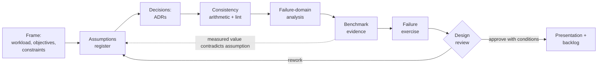
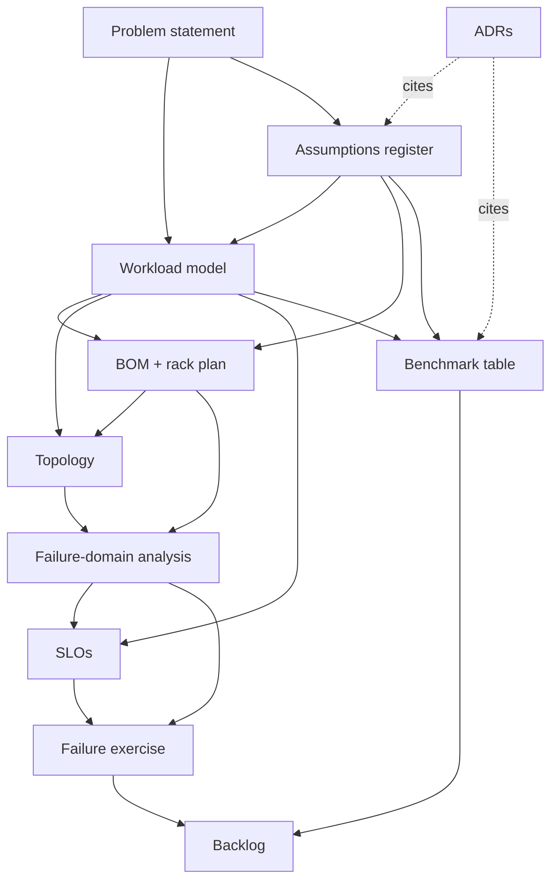
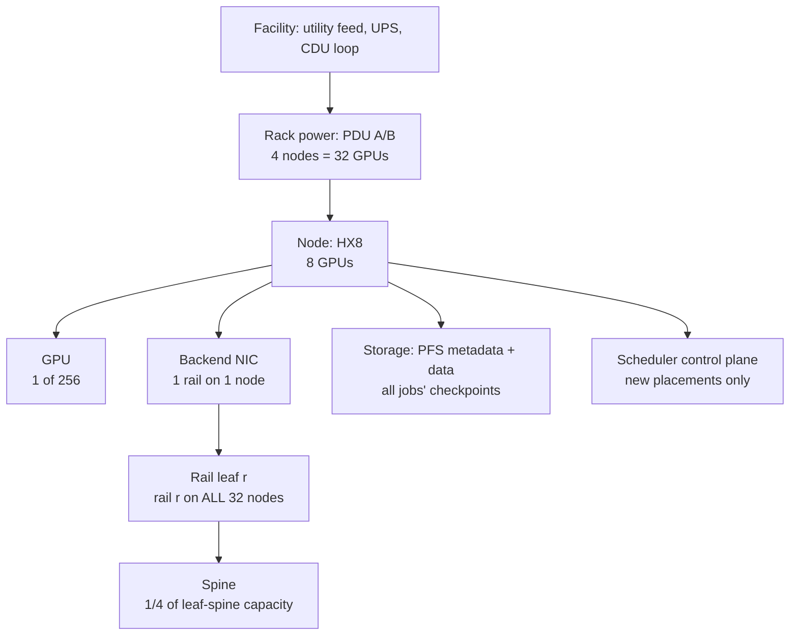
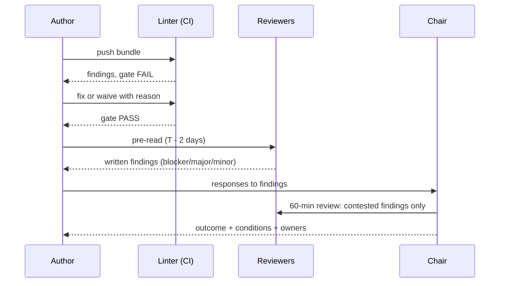
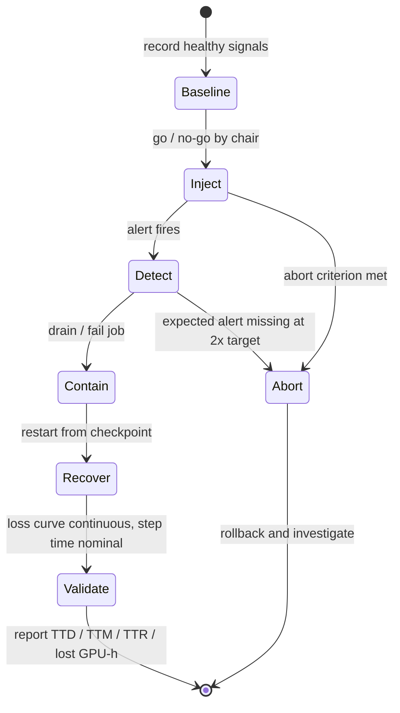
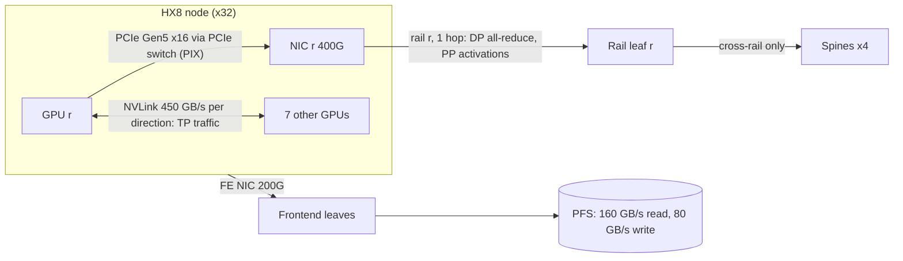

# Chapter 23 — Capstone: Design and Operate a Production-Scale AI Cluster

> Twenty-two chapters have taught the layers one at a time. Real work arrives as "design the next
> cluster", "prove this one is ready", or "tell us why it is slower than the plan said". This
> chapter is a practitioner's guide to running that kind of project end to end: frame the problem
> and its assumptions, record decisions, check the design's internal arithmetic, analyse failure
> domains, assemble benchmark evidence that is honest about what was measured and what was modeled,
> run a failure exercise safely, survive a design review, and leave behind a prioritised backlog. A fully worked mini-capstone on the ORION reference cluster ties
> Chapters 1–22 together, and the lab builds the design-review linter that catches the mistakes a
> script should catch before six senior engineers spend an hour on them.

## Learning objectives

After working through this chapter you will be able to:

1. **Frame** an AI-cluster design problem as a workload model, objectives, constraints and an
   assumptions register in which every load-bearing number has a label, an owner and a validation
   plan.
2. **Record** architecture decisions as Architecture Decision Records (ADRs) that state the options
   considered, the evidence used and the condition that would reopen the decision.
3. **Verify** a design's internal consistency (counts, port budgets, oversubscription, cables, rack
   power, checkpoint bandwidth) by explicit arithmetic and with an automated linter.
4. **Analyse** failure domains from GPU to facility and estimate the goodput cost of failures with
   the Young/Daly checkpoint model.
5. **Run** a design review using a structured checklist, classify findings by severity and reach an
   explicit outcome.
6. **Assemble** benchmark evidence that separates measured, modeled, simulated and illustrative
   values, with manifests, repetitions and spread.
7. **Design** and execute a safe failure exercise (tabletop or isolated lab) and report detection
   time, recovery time and lost GPU-hours.
8. **Present** the capstone and a prioritised next-step backlog to a technical audience.

## Prerequisites and connections

This chapter assumes the whole book. Table 23.1 maps earlier chapters to the artifacts they feed.

**Acronyms used here.** ADR architecture decision record; BOM bill of materials; BMC baseboard
management controller; CDU coolant distribution unit; DCGM Data Center GPU Manager; DP/PP/TP data,
pipeline and tensor parallelism; ECN explicit congestion notification; FEC forward error correction;
HBM high-bandwidth memory; MFU model FLOPs utilisation; MoE mixture of experts; MTBF mean time
between failures; PDU power distribution unit; PFC priority flow control; PFS parallel file system;
PXN NCCL's PCIe-and-NVLink cross-rail path; RMA return merchandise authorisation; SLO/SLI
service-level objective/indicator; SPOF single point of failure; UPS uninterruptible power supply;
DSCP differentiated services code point.

*Table 23.1 — Where each capstone artifact comes from.*

| Capstone artifact | Primary chapters |
|---|---|
| Workload model, scale, cost assumptions | [Ch 1](../../part-1-foundations/ch01-ai-infrastructure-landscape/), [Ch 2](../../part-1-foundations/ch02-anatomy-of-an-ai-data-center/), [Ch 21](../../part-5-production-operations/ch21-capacity-power-economics/) |
| Host and GPU topology, data paths | [Ch 3](../../part-1-foundations/ch03-linux-host-systems-diagnostics/), [Ch 4](../../part-2-accelerated-compute/ch04-gpu-architecture-cuda-execution/), [Ch 5](../../part-2-accelerated-compute/ch05-gpu-interconnects-host-topology/), [Ch 13](../../part-4-distributed-ai/ch13-gpu-data-movement/) |
| Benchmark discipline | [Ch 6](../../part-2-accelerated-compute/ch06-gpu-performance-engineering/), [Ch 12](../../part-4-distributed-ai/ch12-collective-communication-nccl/), [Ch 22](../../part-5-production-operations/ch22-cross-layer-performance-engineering/) |
| Fabric design, routing, RDMA, congestion, physical layer | [Ch 7](../../part-3-networking/ch07-ethernet-datacenter-network-foundations/), [Ch 8](../../part-3-networking/ch08-rdma-rocev2-infiniband/), [Ch 9](../../part-3-networking/ch09-congestion-control-lossless-fabrics/), [Ch 10](../../part-3-networking/ch10-switches-optics-physical-layer/) |
| Parallelism plan and communication model | [Ch 11](../../part-4-distributed-ai/ch11-distributed-training-architecture/), [Ch 12](../../part-4-distributed-ai/ch12-collective-communication-nccl/) |
| Storage, checkpoint, recovery economics | [Ch 14](../../part-4-distributed-ai/ch14-storage-pipelines-checkpointing/) |
| Serving capacity and SLOs | [Ch 15](../../part-4-distributed-ai/ch15-llm-inference-serving/) |
| Acceptance, lifecycle, compatibility matrix | [Ch 16](../../part-5-production-operations/ch16-bare-metal-fleet-lifecycle/) |
| Scheduling and placement | [Ch 17](../../part-5-production-operations/ch17-kubernetes-slurm-scheduling/) |
| Telemetry, SLOs, incidents, postmortem | [Ch 18](../../part-5-production-operations/ch18-observability-slos-incident-response/) |
| Failure domains, fault isolation, tenancy | [Ch 19](../../part-5-production-operations/ch19-reliability-security-multitenancy/) |
| Safe change, rollout, automation | [Ch 20](../../part-5-production-operations/ch20-automation-safe-change/) |
| Power, cooling, capacity | [Ch 2](../../part-1-foundations/ch02-anatomy-of-an-ai-data-center/), [Ch 21](../../part-5-production-operations/ch21-capacity-power-economics/) |
| Root-cause and before/after reporting | [Ch 22](../../part-5-production-operations/ch22-cross-layer-performance-engineering/) |
| Portfolio, interview presentation | [Ch 24](../ch24-career-paths-engineering-practice/) |

The capstone briefs themselves live in [`capstones/`](../../../capstones/) and are scored with
[`capstones/RUBRIC.md`](../../../capstones/RUBRIC.md). This chapter teaches the method; the briefs
define each track's required artifacts.

## 23.1 What a capstone is for

A capstone rehearses the most consequential thing an infrastructure engineer does: commit an
organisation to a design (or a diagnosis) on incomplete evidence, and make that commitment
*reviewable*. What matters is the chain of reasoning another engineer can audit: what you assumed,
computed, measured and decided, what could break, and what you would do next.

That framing explains three properties every good capstone shares.

- **It is falsifiable.** Every claim is either labelled as an assumption with a validation plan, or
  backed by a computation a reviewer can redo, or backed by a measurement with an environment
  manifest. "The fabric is non-blocking" is not a claim; "8 rail leaves × (32 down + 32 up) at
  400 Gb/s gives 12.8 Tb/s each way per leaf, 1:1 `[MODELED]`" is.
- **It is honest about tier.** Most capstones run at Level 1 (L1, laptop and simulation). That is
  fine. What is not fine is a laptop result presented as a fabric measurement. The book's evidence
  labels (`[MEASURED]`, `[MODELED]`, `[SIMULATED]`, `[ILLUSTRATIVE]`, `[VENDOR-SPEC, YYYY-MM]`) exist so
  that a reader can tell in one glance which numbers are physical.
- **It includes operations.** A design that is never upgraded, never loses a leaf switch and never
  runs out of rack power is a drawing, not a production design. The operational artifacts
  (acceptance plan, failure-domain analysis, failure exercise, runbook, backlog) are half the work.

### The eight tracks

*Table 23.2 — Capstone tracks. Briefs are in [`capstones/`](../../../capstones/).*

| Track | Brief | Primary audience | Centre of gravity |
|---|---|---|---|
| A | [256-GPU training cluster](../../../capstones/capstone-a-256-gpu-training-cluster/) | Architect, cluster/network engineer | BOM, topology, capacity and power, acceptance, failure analysis, cost/performance memo |
| B | [Network telemetry and troubleshooting](../../../capstones/capstone-b-network-telemetry-troubleshooting/) | AI network / NetOps engineer | Telemetry schema, collector, alerts, injected faults, false positives, incident report |
| C | [Distributed training performance](../../../capstones/capstone-c-distributed-training-performance/) | GPU/HPC, performance engineer | Benchmark harness, manifests, baseline vs optimised, scaling efficiency, profiler evidence |
| D | [LLM inference platform](../../../capstones/capstone-d-llm-inference-platform/) | Platform / inference engineer | Capacity model, SLOs, load-test plan, TTFT/TPOT results, rollout, cost |
| E | [Fleet lifecycle automation](../../../capstones/capstone-e-fleet-lifecycle-automation/) | Cluster platform engineer, SRE | State machine, acceptance tests, compatibility matrix, canary/rollback, audit trail |
| F | [Reliability game day](../../../capstones/capstone-f-reliability-game-day/) | SRE, production engineer | Fault-injection plan, telemetry, timeline, recovery evidence, postmortem, backlog |
| G | [Fault-tolerant 512-node training](../../../capstones/capstone-g-fault-tolerant-512-node-training/) | Training infra, SRE | Rank-to-device inventory, correlation, quarantine, checkpoint/restore, RTO/RPO |
| H | [Disaggregated LLM serving](../../../capstones/capstone-h-disaggregated-llm-serving/) | Inference / performance engineer | Prefill/decode pools, KV-cache transfer model, RDMA vs TCP, phase SLOs |

Choose by the job you want next (Chapter 24 maps roles to tracks) and by the evidence you can
actually produce: a GPU-less Track C capstone is legitimate at L1 if it analyses supplied traces
honestly; a Track A capstone claiming measured fabric bandwidth from a laptop fails measurement.
The pass threshold in the course rubric is 70/100 with no score below 50 % in technical correctness or measurement; distinction is
90/100 with reproducible evidence ([RUBRIC.md](../../../capstones/RUBRIC.md)).

### The capstone workflow



*Figure 23.1 — The capstone workflow. Two loops matter: review findings send you back to the
assumptions, and every measurement that contradicts an assumption must update the register (and
every decision that depended on it).*

## 23.2 Framing the problem and the assumptions register

### The problem statement

A good problem statement fits in a paragraph and contains five things: the **workload** (what runs,
at what scale), the **objective** (what "good" means, as a number), the **constraints** (power,
space, budget, schedule, existing estate, policy), the **scope boundary** (what you are *not*
designing) and the **evidence tier** (what you can measure versus model). Compare:

> *Weak:* "Design a GPU cluster for LLM training."
>
> *Strong:* "Design a 256-GPU H100-class cluster in an existing 8-rack GPU row (45 kW usable per
> rack) to pretrain a 70B dense model (W-TRAIN) on 2 × 10¹² tokens within 120 calendar days, with a
> training goodput SLO of 0.90 over 30 days. Frontend networking and the object store are existing
> services and out of scope. Evidence: L1 models plus one 2-node L3 measurement."

Every phrase in the strong version generates checkable consequences: days and tokens imply a
throughput, 45 kW bounds nodes per rack, and the tier says which numbers can be `[MEASURED]`.

### The workload model

The workload model converts the problem statement into the numbers every other artifact consumes.
For a training cluster it contains: parameters, tokens per step, precision, training-state bytes per
parameter, parallelism layout, per-step FLOPs, assumed Model FLOPs Utilisation (MFU), step time,
total tokens and therefore wall-clock duration. For a serving platform it contains request mix
(prompt and output length distributions), concurrency, KV-cache bytes per token, SLOs on
time-to-first-token (TTFT) and time per output token (TPOT), and peak-to-mean load ratio. Section
23.10 builds the training version for ORION with every step shown.

### The assumptions register

An assumption is a number or statement you are relying on but have not proven in this environment.
The register makes each one explicit and gives it an owner. Its columns:

*Table 23.3 — Assumptions register fields.*

| Field | Why it exists |
|---|---|
| `id` | Stable handle (A-01…) so documents, ADRs and benchmarks can cite it |
| `statement` | What is assumed, in one sentence |
| `value`, `unit` | The number, with units stated (Gb/s vs GB/s, kW, h) |
| `label` | `[VENDOR-SPEC, YYYY-MM]`, `[MODELED]`, `[ILLUSTRATIVE]`, `[MEASURED]` (once validated) |
| `owner` | The team that will validate it and be paged if it is wrong |
| `validation` | The procedure, tier and acceptance criterion that would turn it into a measurement |
| `sensitivity` (optional) | Which decisions change if the value moves by a stated amount |

Three practices separate useful registers from bureaucratic ones.

**Rank by decision value, not by uncertainty.** An assumption deserves validation effort in
proportion to how much a plausible error would change a decision. MFU is both uncertain and
decision-critical: in the worked example, moving MFU from 0.40 to 0.35 adds about 14 days to a
96-day run (Section 23.10). The HBM capacity per GPU is a vendor specification that is almost never
wrong and changes nothing if it is; it needs a one-line acceptance check, not a project.

**Give each assumption a half-life.** Vendor specifications are stable for a product generation;
driver and NCCL behaviour changes quarterly. Mark which assumptions to re-verify at each milestone.

**Never let an assumption silently become a fact.** The commonest capstone defect is a number that
starts in the register as `[ILLUSTRATIVE]`, is copied into the architecture section without a label,
and arrives in the benchmark table as if it had been measured. The lab's linter (Section 23.11)
catches the mechanical version of this: a number with a unit and neither a label nor an ID reference.

> **Pitfall:** "Validation: TBD" is not a validation plan. If you cannot say how you would measure
> it, at which tier, and what result would make you change the design, the assumption is a belief.

## 23.3 Architecture as a set of decisions

Architecture diagrams show *what* was chosen. Reviewers and successors need to know *why*, what else
was considered, and when the choice should be reopened. The lightweight tool for this is the
Architecture Decision Record (ADR), introduced by Michael Nygard in 2011 and now common in
infrastructure teams. An ADR is one page, numbered, immutable once accepted (you supersede it with a
new ADR rather than editing it), and stored next to the design.

*Table 23.4 — ADR template used in this book.*

| Section | Content |
|---|---|
| Title, number, status | "ADR-003: Backend fabric transport", Proposed / Accepted / Superseded by ADR-0NN |
| Context | The forces: workload, constraints, team skills, existing estate, timeline |
| Options considered | At least two real alternatives with their consequences |
| Decision | What we chose, in one sentence |
| Evidence | Assumption IDs, model outputs, measurements (with labels), vendor references |
| Consequences | What becomes easier, harder, more expensive, or newly risky |
| Revisit trigger | The observable condition that reopens this decision |

### Example ADR-003: backend fabric transport for ORION

- **Context.** 256 GPUs; W-TRAIN uses TP = 8 inside the NVLink domain, so the backend carries
  data-parallel (DP) gradient collectives and pipeline-parallel (PP) activations. The Fabric team
  operates BGP leaf-spine Ethernet today and has no InfiniBand (IB) operational experience. The
  same backend may later carry disaggregated-inference KV-cache transfers (Chapter 15).
- **Options.** (1) Rail-optimised 400 GbE RoCEv2 leaf-spine, lossless class for RoCE with ECN and
  PFC (Chapters 8–9). (2) InfiniBand NDR rail-optimised fat tree with a subnet manager.
- **Decision.** Option 1.
- **Evidence.** Both options deliver 400 Gb/s per GPU and a 1:1 two-tier design at this scale
  `[MODELED]`; communication is about 1 % of step time in the model (Section 23.10), so a modest
  transport efficiency difference does not change the step time materially; existing BGP automation
  and telemetry pipelines are reusable (Chapter 20).
- **Consequences.** We own lossless-Ethernet tuning and pause-storm protection (Chapter 9);
  NIC-firmware/switch-OS interoperability becomes an acceptance gate.
- **Revisit trigger.** Measured busbw at 32 nodes below 80 % of the 2-node value, or sustained PFC
  pause propagation beyond one hop in production telemetry, or a workload whose communication
  fraction exceeds 15 % of step time.

### Example ADR-005: tensor parallelism inside the NVLink domain

- **Context.** TP exchanges activations every layer (two all-reduces per layer per forward pass in
  the Megatron-LM scheme) and is latency-sensitive; NVLink provides 450 GB/s per direction per GPU
  versus 50 GB/s line rate for one 400 Gb/s NIC `[VENDOR-SPEC, 2026-10]`.
- **Options.** TP = 8 (one node), TP = 16 (two nodes), TP = 4 with PP = 8.
- **Decision.** TP = 8, PP = 4, DP = 8.
- **Evidence.** The NVLink-to-NIC bandwidth ratio is 450 / 50 = 9×; crossing nodes with TP would put
  per-layer collectives on the slower path (Chapter 11). PP = 4 gives a pipeline bubble of
  (p − 1)/m = 3/128 ≈ 2.3 % with 128 micro-batches `[MODELED]`.
- **Revisit trigger.** A model whose per-GPU memory footprint at TP = 8, PP = 4 exceeds 80 GB, or a
  scheduler placement change that can split a TP group across nodes (the Chapter 22 incident is
  exactly this).

> **Key idea:** An ADR's most valuable line is the revisit trigger: it says how we will know we
> were wrong.

### How the artifacts depend on each other



*Figure 23.2 — Artifact dependency graph. Each arrow points from a producer to the artifact that
consumes its numbers. When an upstream
value changes (for example the node count in the BOM), every downstream artifact must be re-checked;
the lab's linter automates the arithmetic part of that re-check.*

## 23.4 Consistency arithmetic: the checks a reviewer always runs

Experienced reviewers do not start by debating the architecture. They spend the first ten minutes
re-deriving a handful of numbers, because an inconsistent design cannot be debated: two of its
documents disagree about what is being built. Table 23.5 lists the invariants. Each one is cheap to
check, and each one has, in practice, sunk a real design review.

*Table 23.5 — Design invariants with ORION-256 values `[MODELED]` from
[REFERENCE_CLUSTER.md](../../../docs/REFERENCE_CLUSTER.md).*

| # | Invariant | Formula | ORION-256 check |
|---|---|---|---|
| 1 | GPU count | (nodes − declared spares) × GPUs/node = training GPUs | (32 − 0) × 8 = 256 ✓ (a full-size W-TRAIN borrows the 8 inference nodes, per REFERENCE_CLUSTER) |
| 2 | Parallelism product | TP × PP × DP = GPUs used by the job | 8 × 4 × 8 = 256 ✓ |
| 3 | Memory fit | 16 B/param × N ÷ (TP × PP) + activations ≤ HBM | 1.12 TB ÷ 32 = 35 GB, leaving 45 GB of 80 GB ✓ |
| 4 | Leaf port budget | downlinks + uplinks ≤ leaf radix | 32 + 32 = 64 ≤ 64 ✓ (zero free ports) |
| 5 | Oversubscription | downlinks ÷ uplinks (same speed) | 32 ÷ 32 = 1:1 ✓ |
| 6 | Spine port budget | leaves × uplinks per spine ≤ spine radix | 8 × 8 = 64 ≤ 64 ✓ |
| 7 | Rail coverage | rail-leaf downlinks = nodes (one NIC per node per rail) | 32 = 32 ✓ |
| 8 | Uplink fan-out | uplinks = spines × uplinks per spine | 4 × 8 = 32 ✓ |
| 9 | Backend links | leaves × (downlinks + uplinks) | 8 × 64 = 512 (256 host–leaf + 256 leaf–spine) |
| 10 | Transceivers | 2 per optical link + spares | 2 × 512 = 1,024 + spares |
| 11 | Rack power | nodes per rack × node **max** power ≤ usable rack budget | 4 × 10.2 = 40.8 kW ≤ 45 kW ✓ |
| 12 | Checkpoint floor | checkpoint bytes ÷ aggregate write bandwidth | 980 GB ÷ 80 GB/s = 12.25 s (lower bound) |
| 13 | Addressing | /31 per host link fits the rail prefix | 32 × 2 = 64 addresses ≤ 256 in `10.100.r.0/24` ✓ |

Four lessons hide in this table.

**Derive, do not copy.** A BOM that says "total GPUs: 256" next to "nodes: 34" is inconsistent
even if each number was right in some earlier draft. Two numbers that agree because one was pasted
from the other are not a check.

**Zero free ports is a decision, not an accident.** Invariant 4 leaves no port for an in-service
test, a monitoring tap or a 33rd node. That may be acceptable (ORION is sized exactly), but the
design should say so and the BOM should carry spare optics and a spare leaf instead.

**Use maximum power for budgets.** Invariant 11 uses the 10.2 kW node maximum, not the ≈ 8–9 kW
sustained training draw `[ILLUSTRATIVE]`. Rack and branch-circuit budgets must survive the worst
case: synchronized step-start power spikes, burn-in, or a firmware change to power capping
(Chapter 21). Sizing to sustained power is a common way to trip a breaker during acceptance.

**Check the arithmetic that is *not* a bottleneck too.** Invariant 12 says a full checkpoint cannot
finish in under 12.25 s on ORION's parallel file system. Similarly, W-TRAIN's dataloader needs
roughly 241,000 tokens/s × 4 B/token ≈ 1 MB/s of token data `[MODELED]` (4-byte token IDs), five
orders of magnitude below the 160 GB/s aggregate read capability. That tells a reviewer the storage
risk for this workload is metadata and tail latency on shard opens (Chapter 14), not bandwidth, and
the design should say which.

> **Production note:** Mature teams enforce these invariants in CI and generate BOM, cabling and IP
> plans from one source of truth (Chapter 20); the lab builds a small version.

### What a spine is for in a rail-optimised fabric

Invariant 7 has a consequence that surprises many first-time reviewers. On ORION every rail leaf
connects NIC *r* of *all 32 nodes*. A data-parallel all-reduce among GPU *r* of each node therefore
traverses exactly one switch: rail leaf *r*. With rank placement aligned to rails, and with NCCL's
PXN mechanism moving cross-rail data over NVLink to a GPU on the right rail before it leaves the node
(Chapters 12–13), W-TRAIN's backend traffic barely touches the spines `[MODELED]`. The 256
leaf–spine links exist for traffic that is *not* rail-aligned: misplaced jobs, all-to-all in
mixture-of-experts models, KV-cache transfer between serving pools, and growth beyond 32 nodes per
rail. A good design review asks the author to justify those links in an ADR, because they are
roughly half the backend optics budget. "Because the reference design has them" is not a reason;
"because we expect cross-rail all-to-all from a future MoE workload and do not want to recable" is.

## 23.5 Failure-domain analysis

A failure domain is the set of things that fail together because they share a component. For
every component class the analysis asks: blast radius, detection, containment, recovery, cost. At
scale every class *will* fail: Meta's Llama 3 paper reports 419 unexpected interruptions over a
54-day snapshot on 16,384 GPUs.



*Figure 23.3 — ORION failure domains. Physical containment (facility → rack → node → GPU) and
logical containment differ: a rail leaf is one switch, but its blast radius is one rail of every
node in the cluster.*

### Blast radius is a logical, not a physical, property

The most important lesson of Figure 23.3 is that the physical hierarchy and the logical blast radius
do not match. A rack power failure removes 32 GPUs (12.5 % of capacity) but leaves jobs on other
racks untouched. A rail-leaf failure removes *no* GPUs, yet every multi-node job loses one of its
eight rails on every node. Whether a running job survives that depends on the communication
library's fault handling; at the time of writing, plan for it to be job-fatal (an NCCL timeout or
hang), detect it fast, and restart (verify current NCCL fault-tolerance features against its
documentation). Conversely, a spine failure removes a quarter of the leaf-spine capacity (each
leaf's uplinks drop from 32 to 24, so 32:24 ≈ 1.33:1) yet, per Section 23.4, rail-aligned W-TRAIN
traffic barely notices.

*Table 23.6 — ORION failure-domain analysis. Blast radius is `[MODELED]`; detection and recovery
times are `[ILLUSTRATIVE]` targets.*

| Class | Blast radius | Detection | Containment | Recovery | Redundancy |
|---|---|---|---|---|---|
| GPU | 1 GPU; the whole synchronous job stalls | Xid / ECC events via DCGM; NCCL watchdog | Drain node (stops new placement; does not move the job), preserve logs | Checkpoint → wait for repair, or restart at DP = 7 (224 GPUs; needs a batch adjustment, since 1,024 is not divisible by 7); restart R ≈ 15 min = 900 s | None (no spares, as in the reference cluster) |
| Node | 8 GPUs (3.1 %) | Health check, BMC Redfish events | Slurm drain (does not move the running job) | Checkpoint → wait for repair, or restart at DP = 7 (224 GPUs; needs a batch adjustment, since 1,024 is not divisible by 7); restart R ≈ 15 min = 900 s; RMA | None (no spares, as in the reference cluster) |
| Backend NIC | 1 rail on 1 node | RDMA link down, port error counters | Drain node | Replace NIC; re-run acceptance | None in node |
| Rail leaf | Rail *r* on all 32 nodes | Link-down on 32 host ports; spines lose BGP sessions to the leaf | Fail jobs fast | Swap pre-staged spare leaf (hours) | None; spare on shelf |
| Spine | 25 % of leaf–spine capacity | BGP loss, ECMP change | ECMP removes it | RMA; no job impact if rail-aligned | N−1: 3 of 4 spines → 1.33:1 |
| Rack power | 32 GPUs (12.5 %) | PDU and BMC alarms | Automatic; spread DP replicas | Restart affected jobs | Dual A/B feeds |
| Storage | Checkpoints and data reads for all jobs | PFS probes, I/O latency SLI | Pause checkpoint triggers | Metadata failover | Active/standby metadata |
| Scheduler | No new placements; running jobs continue | Synthetic submission probe | n/a | Fail over controller | Primary/backup |
| Facility cooling loop | Every rack on the loop | CDU alarms, GPU thermal throttling | Power-cap affected racks | Facilities runbook | Per facility design |

### Scoring and prioritising: FMEA-lite

Failure Mode and Effects Analysis (FMEA, standardised in IEC 60812) scores each failure mode on
severity (S), occurrence (O) and detectability (D), each 1–10, and multiplies them into a risk
priority number, RPN = S × O × D. The numbers are subjective; the value is in comparing modes on
one scale and exposing poorly detected ones. For ORION, a silent
NIC-firmware mismatch after a partial upgrade might score S = 6, O = 4, D = 8 (it only shows as
slower collectives), RPN = 192, while a rack power loss scores S = 7, O = 2, D = 1 (impossible to
miss), RPN = 14 `[ILLUSTRATIVE]`. The high-RPN mode gets the backlog item: an acceptance check that
compares firmware versions across all nodes before a job starts (Chapter 16). Because a high D
means *poor* detectability, RPN pushes quiet failures up the list, and quiet failures are the
expensive ones.

### The goodput cost of failures

Failures cost goodput through checkpoint time and through work lost since the last checkpoint plus
restart. With blocking checkpoint cost δ, mean time between job-interrupting failures M and restart
cost R, Young's first-order optimum interval and the waste fraction are:

```text
tau_opt ≈ sqrt(2 · δ · M)                           (Young 1974; Daly 2006 refines it)
waste   ≈ δ / tau  +  (tau / 2 + R) / M
```

The first term is checkpoint overhead; the second is expected lost work per failure (on average half
an interval) plus restart, multiplied by the failure rate. Section 23.10 evaluates both for ORION and
shows why the blocking cost δ, not the storage bandwidth, is usually the lever worth pulling.

## 23.6 Running a design review

A design review is a meeting whose output is a decision, not a discussion. Reviews fail in two
predictable ways: they become a presentation with polite questions, or they become an unstructured
argument about the reviewer's favourite topic. Structure prevents both.

### Roles and preparation

- **Author** owns the bundle and answers questions; does not chair.
- **Chair / decider** keeps time and states the outcome. Usually a senior engineer not on the
  project.
- **Layer reviewers**: one each for compute/host, network, storage, orchestration and operations;
  at minimum two people who did not write the design.
- **Scribe** records findings in the agreed format during the meeting.

The bundle goes out at least two working days ahead, after the author has run the linter
(Section 23.11) and fixed or explicitly waived every finding. Reviewers file written findings
before the meeting, which spends its time only on contested ones.



*Figure 23.4 — Design-review flow. Mechanical findings never reach the meeting.*

### Finding severities and outcomes

Use the same severities as this book's editorial process: **blocker** (the design as written cannot
work or is unsafe: a GPU count that does not add up, a rack over its power budget), **major** (a
significant gap that must be fixed before build: an unanalysed failure domain, an unlabelled
performance claim on a decision path), **minor** (clarity, style). The meeting ends with one of
three outcomes: **approved**, **approved with conditions** (each condition has an owner and a date)
or **rework** (another review required). "We'll take it offline" is not an outcome.

### The design-review checklist

This book's capstones are reviewed against the checklist below. A good bundle answers most items
in its documents so the meeting does not have to.

*Table 23.7 — Design-review checklist (40 items).*

| Area | Items |
|---|---|
| Framing and evidence | 1 Problem statement has workload, numeric objective, constraints, scope, tier. 2 Every load-bearing number is in the register with label, owner, validation. 3 Three decision-critical assumptions named with sensitivity. 4 Measured values cite a manifest; modeled values show the formula. 5 No number in prose without a label or ID. |
| Compute and host | 6 GPU, node, spare and parallelism counts agree. 7 Per-GPU memory fit shown with headroom. 8 GPU↔NIC affinity mapped and used for rank placement. 9 Driver/CUDA/NCCL/firmware/kernel pinned in a compatibility matrix. 10 Acceptance and burn-in criteria defined (Ch 16). |
| Network | 11 Leaf/spine port budgets close; free ports stated. 12 Oversubscription computed, backend and frontend. 13 Cables and optics derived from topology, with spares. 14 Addressing, ASNs and MTU (switch, IP, RDMA path) consistent. 15 PFC/ECN/DSCP and pause-storm protection specified, or lossy justified (Ch 9). 16 Optical power and FEC/symbol-error thresholds in acceptance (Ch 10). 17 Purpose of leaf–spine capacity justified. |
| Storage and data | 18 Checkpoint size, floor and realistic write time computed. 19 Checkpoint strategy and restore validation defined. 20 Dataloader demand computed; binding constraint named. |
| Orchestration | 21 Scheduler, partitions and quotas defined. 22 Placement keeps TP in the NVLink domain and DP on rails. 23 Gang scheduling and partial-health behaviour defined. |
| Reliability and operations | 24 Every required failure-domain class analysed. 25 No SPOF lacks both redundancy and mitigation. 26 Checkpoint interval justified against failure rate. 27 SLOs have SLI, numeric target, window, source. 28 Alerts map to runbooks and named on-call owners. 29 Failure exercise has abort criteria and a safety boundary. 30 Upgrade path with canary and rollback (Ch 20). |
| Facility, capacity, cost | 31 Rack power at max node draw vs derated budget, transient margin stated. 32 Cooling capacity confirmed with Facilities (Ch 21). 33 Cost per useful unit of work, unit costs as assumptions. 34 Next capacity increment and its prerequisites. |
| Security and tenancy | 35 Management, frontend, backend separated; BMC access restricted. 36 Tenant isolation boundaries defined if multi-tenant. 37 Automation secrets in a managed store. |
| Communication | 38 Captioned diagrams with critical data paths. 39 Each ADR has options, evidence, revisit trigger. 40 Backlog prioritised with stated criteria. |

> **Pitfall:** A checklist is a floor, not a ceiling. The worst reviews tick every box and miss the
> one question specific to this design. Reserve the last ten minutes of the meeting for "what
> would make this design fail that the checklist did not ask?"

## 23.7 Benchmark evidence

The benchmark table is where capstones most often lose credibility. Its job is to show, for each
performance claim, *what kind of evidence it is* and *how to reproduce it*.

### The benchmark table format

Every row carries: an ID, the metric with its workload definition (message size, node count,
concurrency), the value and unit, the evidence label, the tier, and either an environment manifest
path (for `[MEASURED]`) or the model formula (for `[MODELED]`). Table 23.8 is the ORION reference
bundle's table, slightly abridged.

*Table 23.8 — ORION reference benchmark evidence. Labels as shown per row.*

| ID | Metric | Value | Label | Tier | Manifest / formula |
|---|---|---|---|---|---|
| B-01 | W-TRAIN step time at 40 % MFU | 17.4 s | `[MODELED]` | L1 | 6·N·tokens ÷ (256 × 989 × 10¹² × 0.40) |
| B-02 | `all_reduce_perf` busbw, 8 GiB, 2 nodes × 8 GPUs over 8 rails, median of 5 | 356 GB/s (44.5 GB/s per rail) | `[MEASURED]` | L3 | `manifests/l3-2node-2026-10-12.yaml` |
| B-03 | Checkpoint write lower bound | 12.3 s | `[MODELED]` | L1 | 980 GB ÷ 80 GB/s |
| B-04 | DP gradient all-reduce per step | 0.19 s | `[MODELED]` | L1 | 2 × (7/8) × 4.375 GB ÷ 40 GB/s per rail |
| B-05 | Checkpoint overhead at Young interval | 2.6 % | `[MODELED]` | L1 | δ/τ + τ/(2M), δ = 60 s, M = 48 h |

B-02's 356 GB/s is the node-level bus bandwidth with all 8 rails in use; the per-rail figure is
busbw ÷ 8 = 44.5 GB/s, about 89 % of the 50 GB/s line rate (per-rail convention
`[VENDOR-SPEC, 2026-10]`). It is *not* a 32-node measurement, which adds latency terms, congestion and stragglers
(Chapter 12); hence the design uses A-06 = 40 GB/s per rail (≈ 320 GB/s node busbw) `[MODELED]`
rather than extrapolating B-02.

### Benchmark discipline, condensed

Every `[MEASURED]` row follows Chapter 6 and [LAB_STANDARDS.md](../../../docs/LAB_STANDARDS.md):
a manifest (hardware, firmware, driver and library versions, topology, MTU, node list); warm-up
discarded (`-w` iterations in nccl-tests); at least 5 repetitions with median and spread (p95/p99
for latency); one variable changed at a time; and a statement of whether the fabric was shared,
because a benchmark on a busy shared fabric measures the neighbours too (Chapter 22).

### Scaling efficiency

Capstones C, G and H are judged heavily on scaling analysis. Report strong-scaling efficiency as

```text
E(n) = T(n_base) · n_base / (T(n) · n)
```

where T is time per step (or per unit of work) and n the GPU count, always relative to a stated
baseline and with the global batch held fixed (strong scaling) or explicitly scaled with n (weak
scaling). For example, if W-TRAIN at a fixed global batch took 66.0 s per step on 64 GPUs and
18.6 s on 256 GPUs `[ILLUSTRATIVE]`, then E(256) = (66.0 × 64) / (18.6 × 256) = 4,224 / 4,761.6 =
0.887. Compare the measured E with the efficiency your communication model predicts; the gap is the
thing to explain. If you only have two points, say so: a line through two points is an assumption,
not a trend.

> **Realism boundary:** At L1 you can produce `[MODELED]` and `[SIMULATED]` rows and `[MEASURED]`
> rows for things a laptop really measures (parser runtime, model evaluation time). You cannot
> produce `[MEASURED]` rows for GPU, NIC, NVLink or fabric performance. The lab's EVID-004 rule
> exists because this mistake is common and fatal to a capstone's measurement score. It is a
> heuristic: it trusts the declared tier and a fixed unit list, so a MEASURED fabric number with a
> derived unit (%, ratio) or a falsely declared L3 tier passes it. A reviewer still reads the
> manifest.

## 23.8 The failure exercise

Every capstone must inject or simulate at least one failure and show detection and recovery. The
point is to test *your design's claims about failure*: does the alert fire, does the scheduler drain
the right node, does the job restart from a valid checkpoint, and how long does each stage take?

### Choosing the exercise and its form

Pick the failure mode with the highest RPN that your environment can exercise safely. Three forms
exist, in increasing realism and risk:

1. **Tabletop.** Walk the team through a scripted scenario with prepared evidence (log lines,
   counters, scheduler output). Cheap, safe, and effective at exposing runbook and ownership gaps.
2. **Simulated injection.** Inject the fault into a simulator or a synthetic telemetry stream and
   check that detection and automation logic respond correctly (Capstones B, F, G at L1).
3. **Lab injection.** On dedicated non-production hardware: administratively disable a port, kill a
   training rank, fill a scratch file system, stop a scheduler daemon. L2/L3 only.

> **Safety:** Never inject faults into production systems or shared fabrics as part of a capstone.
> Lab injection requires a dedicated environment, an explicit rollback, a named person who can stop
> the exercise, and written abort criteria. Disabling a port on a shared switch can affect other
> tenants through PFC pause propagation even if "your" job is the only one you can see.

### The exercise plan

A failure-exercise plan is one page:

- **Hypothesis**: "When rail leaf 3 (`orion-be-leaf-r3`) fails during a 256-GPU W-TRAIN run, the job is detected as hung
  within 2 min, terminated, and restarted from the last checkpoint once the spare leaf is in
  service; lost work is at most one checkpoint interval plus restart."
- **Expected signals** (in order): link-down on the 32 host ports of `orion-be-leaf-r3`
  (NIC 3 / `mlx5_3` on `orion-n01`…`orion-n32`); BGP session drops to `orion-be-spine-1`…`-4`; NCCL watchdog
  timeout on all ranks; job exit; scheduler requeue; alert to Fabric on-call.
- **Measurements**: time to detect (TTD), time to mitigate (TTM), time to resume (TTR), lost
  GPU-hours, checkpoint selected and its validation result.
- **Abort criteria**: any effect outside the exercise scope; any alert that should have fired and did
  not within twice its target (stop and investigate rather than continue).
- **Rollback**: how the environment is returned to its initial state, and the check that proves it.



*Figure 23.5 — Failure-exercise state machine. "Validate" is the step most often skipped: a job that
restarted is not a job that resumed correctly. Check that the loss curve continues from the
checkpointed step and that step time returns to baseline.*

### Reporting results

Report each measurement against its target, label it (`[MEASURED]` for a lab exercise, `[SIMULATED]`
for an injected synthetic stream, and for a tabletop, the *estimated* times as `[ILLUSTRATIVE]`), and
write the gaps as backlog items. The postmortem format is the blameless one from Chapter 18.

## 23.9 Presentation and the next-step backlog

### The 20-minute review talk

Technical audiences forgive plain slides, not unclear claims.

*Table 23.9 — A 20-minute review talk.*

| Minutes | Content |
|---|---|
| 2 | Problem statement and the one number that defines success |
| 3 | Architecture: one diagram, data paths for the critical flows |
| 3 | The three decision-critical assumptions and their sensitivity |
| 3 | Key ADRs: what was chosen over what, and the revisit triggers |
| 3 | Failure domains: the largest blast radius and how it is contained |
| 3 | Evidence: benchmark table with labels; what is measured vs modeled |
| 2 | Failure exercise: TTD/TTM/TTR, what surprised you |
| 1 | Backlog: top three items and why |

One claim per slide, with its evidence label visible on the slide. If a reviewer asks "is that
measured?" and the answer is not on the slide, the slide is wrong.

### Prioritising the backlog

The backlog is the bridge from a capstone to the next quarter of real work. Score each item by the
risk it retires or the value it unlocks, the confidence that the item will achieve it, and the
effort. A simple, defensible ordering is (impact × confidence) ÷ effort, with impact and effort on
1–5 scales and confidence as a fraction, plus a rule that safety and blocker-class risks go first
regardless of score.

*Table 23.10 — Example ORION backlog, scored `[ILLUSTRATIVE]`.*

| Item | Impact | Confidence | Effort | Score | Rationale |
|---|---|---|---|---|---|
| Measure MFU (A-04) on a 64-GPU slice | 5 | 0.9 | 2 | 2.25 | Largest schedule sensitivity |
| Measure sync δ (A-08) and validate async save at 32 nodes | 4 | 0.8 | 2 | 1.60 | Cuts goodput loss by > half if δ ≈ 5 s |
| Pre-stage and pre-configure a spare rail leaf | 4 | 0.9 | 3 | 1.20 | Largest logical blast radius |
| Fleet-wide firmware consistency gate before job start | 3 | 0.8 | 2 | 1.20 | Highest-RPN silent failure |
| 32-node `all_reduce_perf` sweep, 5 runs | 3 | 0.9 | 3 | 0.90 | Replaces modeled A-06 |
| ADR for leaf–spine capacity in rail-optimised design | 2 | 1.0 | 1 | 2.00 | Cheap; may save ≈ half of backend optics |

The leaf–spine ADR ranks second because it is cheap, not because it is a large risk; that is why
the rationale column is mandatory: reviewers must be able to disagree with your weights.

## 23.10 Worked example: a mini-capstone on ORION

This section runs a compressed Track A capstone on ORION-256 end to end, citing the chapter where
each step's method was taught. All values are from
[REFERENCE_CLUSTER.md](../../../docs/REFERENCE_CLUSTER.md) unless stated; all results are `[MODELED]`
unless labelled otherwise.

### Step 1 — Frame (Chapters 1, 2, 21)

Problem: pretrain W-TRAIN (70 × 10⁹ parameters) on D = 2 × 10¹² tokens on ORION-256; objective: finish
within 120 days with training goodput ≥ 0.90; constraints: 8 GPU racks at 45 kW usable each (A-09,
`[ILLUSTRATIVE]`); evidence: L1 models plus one 2-node L3 measurement.

### Step 2 — Workload model (Chapters 6, 11)

Tokens per step:

```text
tokens/step = 4,096 tokens × 1,024 sequences = 4,194,304 ≈ 4.19 × 10^6
```

FLOPs per step (the 6·N·tokens approximation for a dense transformer's forward and backward pass):

```text
FLOP/step = 6 × 70 × 10^9 × 4,194,304 = 1.7616 × 10^18
```

Step time at MFU = 0.40 (A-04) on 256 GPUs at 989 TFLOP/s dense BF16 (A-01):

```text
T_step = 1.7616e18 / (256 × 989e12 × 0.40)
       = 1.7616e18 / 1.0127e17
       = 17.39 s   (17.394 s unrounded)
```

Throughput and duration:

```text
throughput = 4,194,304 / 17.394 = 241,100 tokens/s
steps      = 2e12 / 4,194,304   = 476,837
wall time  = 476,837 × 17.394 s = 8.294e6 s = 96.00 days   (at 100 % goodput)
at goodput 0.90: 96.00 / 0.90   = 106.7 days                 → meets 120 days, 13.3 days margin
```

Sensitivity to MFU (the decision-critical assumption): at MFU = 0.35, T_step = 17.394 × 0.40 / 0.35 =
19.88 s, wall time = 476,837 × 19.88 / 86,400 = 109.7 days at 100 % goodput and 121.9 days at 0.90.
The plan *fails* at MFU 0.35 and goodput 0.90, so measuring MFU heads the backlog.

### Step 3 — Parallelism and memory (Chapters 11, 12)

TP × PP × DP = 8 × 4 × 8 = 256 ✓ (invariant 2). Training state = 16 B/param × 70 × 10⁹ = 1.12 × 10¹²
B. Each model replica spans TP × PP = 32 GPUs, so without optimizer sharding:

```text
state per GPU = 1.12e12 B / 32 = 3.5e10 B = 35 GB   → 45 GB of 80 GB left for activations,
                                                       communication buffers and fragmentation
```

With a distributed optimizer sharding the 12 B/param of FP32 state across the DP = 8 replicas, the
state per GPU falls to (4 × 70e9 / 32) + (12 × 70e9 / 32 / 8) = 8.75 GB + 3.28 GB = 12.0 GB. Either
fits; the design keeps the sharded optimizer as an option, not a requirement.

Pipeline bubble with the 1F1B schedule: each DP replica processes 1,024 / 8 = 128 sequences per
step; with micro-batch size 1, m = 128 micro-batches and

```text
bubble fraction ≈ (p − 1) / m = 3 / 128 = 2.3 %
```

### Step 4 — Communication model (Chapters 12, 13)

The data-parallel gradient all-reduce moves BF16 gradients of the GPU's shard. Per GPU:

```text
S = 2 B × 70e9 / 32 = 4.375e9 B = 4.375 GB
ring all-reduce bytes per GPU = 2 × (n − 1)/n × S = 2 × 7/8 × 4.375 GB = 7.656 GB    (n = DP = 8)
time at 40 GB/s per rail (A-06) = 7.656 / 40 = 0.191 s   → 1.1 % of 17.39 s
exposed = max(0, 0.191 − 0.07 s window) ≈ 0.12 s         → 0.7 % of 17.39 s (only the last
                                                           micro-batch's backward pass can hide DP)
```

Each DP group consists of GPU *r* on 8 different nodes, so with rail-aligned placement its traffic
stays on rail leaf *r* (Section 23.4). Pipeline traffic between stages is smaller still: an
activation tensor per micro-batch is 4,096 × 8,192 × 2 B = 67.1 MB; with the Megatron-LM
scatter/gather optimisation each of the 8 TP ranks sends 1/8 of it over its own rail, so per NIC per
stage boundary per step: 128 micro-batches × 2 (forward + backward) × 8.39 MB = 2.15 GB, or 0.054 s at
40 GB/s. The backend fabric is not this workload's bottleneck `[MODELED]`; the design should say so,
and say that the conclusion depends on rail-aligned placement (ADR-005's revisit trigger).

### Step 5 — Fabric and BOM (Chapters 7, 8, 10)

```text
rail leaves     8 × radix 64: 32 down + 32 up = 64 ports            ✓ (0 free)
spines          4 × radix 64: 8 leaves × 8 uplinks = 64 ports       ✓ (0 free)
backend links   8 × (32 + 32) = 512  (256 host–leaf + 256 leaf–spine)
transceivers    2 × 512 = 1,024 if all links optical; + 2–5 % spares → 1,045–1,076 [ILLUSTRATIVE spare ratio]
bisection       per leaf 32 × 400 Gb/s = 12.8 Tb/s up = 12.8 Tb/s down → 1:1
```

### Step 6 — Power (Chapters 2, 21)

```text
per rack (max)       4 × 10.2 kW = 40.8 kW ≤ 45 kW budget   → 4.2 kW (9.3 %) headroom
per rack (sustained) 4 × 8.5 kW  = 34.0 kW                    [ILLUSTRATIVE sustained draw]
GPU nodes total      32 × 10.2 kW = 326.4 kW (max), excluding network, storage, management racks
5 nodes in a rack    5 × 10.2 kW = 51.0 kW > 45 kW            → not allowed
```

### Step 7 — Checkpoint and goodput (Chapters 14, 19)

Checkpoint size 980 GB (14 B/param `[MODELED]`). The write lower bound at the PFS's 80 GB/s is
980 / 80 = 12.25 s. At an assumed 50 % achieved efficiency, 24.5 s; adding metadata commit, a global
barrier and a 2× allowance for contention with dataloader reads gives the conservative blocking cost
δ = 60 s used in A-08, which is therefore a *synchronous save to the PFS*. Asynchronous saving
(snapshot to host memory, then drain to local NVMe and the PFS in the background) can cut δ to
seconds, but only a measurement can show it, which is why measuring A-08 and validating the async
path are on the backlog.

Mean time between job-interrupting failures. The planning value is A-07 = 48 h `[ILLUSTRATIVE]`. As
a sanity check, Meta's 419 unexpected interruptions in 54 days on 16,384 GPUs give
54 × 24 / 419 = 3.09 h per interruption; if interruptions scale linearly with GPU count, a 256-GPU
job would see one every 3.09 × 16,384 / 256 = 198 h `[MODELED]`. We plan with 48 h because a new
cluster suffers infant-mortality failures and immature operations; the register schedules a
re-estimate from 90 days of incident data.

Young's interval and the waste:

```text
M   = 1,536 node-h / 32 nodes = 48 h = 172,800 s   (REFERENCE_CLUSTER reliability)
δ   = 60 s;  R (detect + reschedule + restore + warm-up) = 900 s  [ILLUSTRATIVE, canonical]
tau = sqrt(2 × 60 × 172,800) = sqrt(20,736,000) = 4,554 s ≈ 76 min
checkpoint overhead   δ / tau        = 60 / 4,554            = 1.32 %
lost work + restart   (tau/2 + R)/M  = (2,277 + 900)/172,800 = 1.84 %
total failure-related waste                                   ≈ 3.16 %
```

(With the first-order model the two terms involving τ are equal at the optimum, 1.32 % each, which
is a useful arithmetic check; B-05 = 2.6 % is their sum, excluding R.)

Per failure, lost work is (τ/2 + R) × 256 GPUs = 3,177 s × 256 / 3,600 = 225.9 GPU-hours. Over the
≈ 107-day run (106.7 days, Step 2) that is about 106.7 × 24 / 48 ≈ 53 failures and
53.3 × 225.9 ≈ 12,000 GPU-hours.

The goodput budget is now explicit: failures and checkpoints consume ≈ 3 points, so the 0.90 SLO
leaves ≈ 7 points for scheduler gaps, maintenance drains, data stalls and stragglers. And the
sensitivity is instructive: if asynchronous saving achieves δ = 5 s, then τ = sqrt(2 × 5 × 172,800) =
1,315 s, overhead = 5 / 1,315 + 1,315 / 345,600 = 0.38 % + 0.38 % = 0.76 %, plus R/M =
900 / 172,800 = 0.52 %: total waste falls from 3.16 % to about 1.28 %. Shrinking δ is worth more than doubling the PFS bandwidth,
which would only shorten the 12.25 s floor.

### Step 8 — Failure domains, SLOs, exercise (Chapters 18, 19)

Table 23.6 is the failure-domain analysis. The SLOs are goodput ≥ 0.90 over 30 days (SLI: productive
step-seconds ÷ allocated GPU-seconds), checkpoint durability ≥ 0.99 of checkpoints durable within
10 min over 7 days, and p95 job-start latency ≤ 15 min over 7 days. The failure exercise is a
tabletop of the rail-leaf failure with prepared evidence, because rail leaf has the largest logical
blast radius and ORION's lab cannot safely remove one.

### Step 9 — Lint, review, backlog

The bundle lints clean (Section 23.11). The review raises two majors no linter can find: the
leaf–spine capacity has no ADR, and the tabletop showed no runbook names who decides between "wait
for the spare leaf" and "restart on a smaller job shape". Both become conditions on an "approved
with conditions" outcome and join the backlog (Table 23.10).



*Figure 23.6 — Where the worked example's bytes travel. TP stays on NVLink, DP and PP stay on one
rail leaf, checkpoints and data go over the frontend to the parallel file system. The spines carry
almost nothing for this workload when placement is rail-aligned.*

## 23.11 Hands-on lab overview

The lab ([lab/README.md](lab/README.md), tier L1) has you implement `design_lint.py`: twenty rules
covering Table 23.5's invariants, register and SLO completeness, failure-domain coverage, and the
evidence rules of Section 23.7 (labels, manifests, no `[MEASURED]` fabric numbers at L1, no
unlabelled numbers, no dangling IDs). It must report zero findings on a consistent ORION reference
bundle and exactly the planted findings on a flawed submission from a fictional team: a linter that
cries wolf is soon switched off. You then lint your own capstone bundle before its review.

## 23.12 Troubleshooting scenario: the benchmark that contradicted the design

**Symptom.** Two days before Team Kestrel's design review, their one L3 measurement (B-02: 2 nodes ×
8 GPUs, `all_reduce_perf`, 8 GiB) comes back at a median of 177 GB/s bus bandwidth over 5 runs
(22.1 GB/s per rail) `[ILLUSTRATIVE]`, half the ≈ 356 GB/s reference result. Their design assumes
40 GB/s per rail at 32 nodes (A-06). The tempting responses are to drop the row or to lower A-06 and move on.
Either would hide whatever is wrong in the lab, which is the same image they plan to deploy.

**Evidence (diagnostic loop: observe → collect evidence).** The team collects, before forming any
theory, the run manifest and four cheap artifacts from both nodes `[ILLUSTRATIVE]` output:

```text
$ nvidia-smi topo -m        # nodeA and nodeB identical: GPU0-NIC0 PIX ... GPU7-NIC7 PIX
$ ibv_devinfo -d mlx5_0 | grep -E "fw_ver|active_mtu|state"
        fw_ver:                 28.39.1002          (both nodes)
                        state:                  PORT_ACTIVE (4)
                        active_mtu:             4096 (5)
$ sudo lspci -s 17:00.0 -vv | grep LnkSta:     # GPU0 on nodeB
        LnkSta: Speed 32GT/s, Width x16
$ lsmod | grep -E "nvidia_peermem"
nodeA: nvidia_peermem          16384  0
nodeB: (no output)
```

And the channel lines from the `NCCL_DEBUG=INFO` log (abridged; format `[VENDOR-SPEC, 2026-10]`,
verify for your NCCL version):

```text
nodeA: NCCL INFO Channel 00/0 : 0[0] -> 8[0] [send] via NET/IB/0/GDRDMA
nodeB: NCCL INFO Channel 00/0 : 8[0] -> 0[0] [send] via NET/IB/0
```

A channel that ends in `/GDRDMA` moves GPU memory directly to the NIC; one without it is staged
through host memory.

**Hypotheses, ranked (trace across layers).** Following Chapter 22's method, rank by prior
probability, information value and test cost.

*Table 23.11 — Ranked hypotheses for the B-02 shortfall `[ILLUSTRATIVE]`.*

| # | Hypothesis | Prior | Discriminating test | Cost |
|---|---|---|---|---|
| H1 | GPUDirect RDMA inactive on one node: transfers bounce through host memory | High (nodeB channels lack `/GDRDMA`; no `nvidia_peermem`) | `lsmod`, NCCL transport string per channel | Minutes |
| H2 | GPU–NIC affinity wrong (cross-socket path) | Medium | `nvidia-smi topo -m`, NCCL topology dump | Minutes |
| H3 | PCIe link downtrained (Gen/width) | Low–medium | `lspci -vv` LnkSta on GPU and NIC | Minutes |
| H4 | MTU or RoCE QoS misconfiguration, congestion | Low (isolated 2-node lab) | `ibv_devinfo` active_mtu; switch PFC/ECN counters | Tens of minutes |
| H5 | NIC firmware mismatch | Low | `ibv_devinfo` fw_ver | Minutes |

The evidence already collected refutes H2, H3 and H5 (PIX affinity, Gen5 x16, identical firmware)
and supports H1 directly: nodeB's channels lack the `/GDRDMA` suffix, so NCCL is staging GPU data
through host memory on that node, and nodeB has no peer-memory module loaded. The `lsmod` result is
only conclusive because this stack does not use DMA-BUF, which can provide GPUDirect RDMA without
`nvidia_peermem` `[VENDOR-SPEC, 2026-10]`.

**Root cause.** NodeB had been re-imaged from an older image whose module-load configuration omitted
`nvidia_peermem`. The two lab nodes were not running the same image, and no acceptance check
compared them.

**Safe change and validation.** The fix goes into the image, not into a hand-run `modprobe`:
rebuild nodeB from the current image, add a node-acceptance check that fails a node whose NCCL
smoke test lacks `GDRDMA` on its network channels (Chapter 16), and re-run B-02 with 1 warm-up and 5
measured runs. The median returns to 356 GB/s (min 353, max 359) `[ILLUSTRATIVE]`, the manifest
records both nodes' image IDs, and the 177 GB/s result is kept in the evidence appendix with its
root cause, because it is the best evidence the acceptance check is needed.

**Lesson for the review.** The measurement falsified an implicit assumption ("all nodes are
configured identically") that the design depends on at 32-node scale. The register gains A-11
("every node passes the GDRDMA smoke test before scheduling") with an owner.

## Trade-offs and design decisions

*Table 23.12 — Capstone execution choices.*

| Decision | Option A | Option B | Choose A when | Choose B when |
|---|---|---|---|---|
| Scope | Breadth: all layers at moderate depth (Track A) | Depth: one layer to the metal (Tracks B, C) | Target role is architect or platform lead | Target role is specialist (network, performance) |
| Evidence tier | L1 models, honestly labelled | L2/L3 measurements | No hardware access; method is the deliverable | Hardware is available and isolated |
| Failure exercise | Tabletop | Lab injection | Shared or no hardware; ownership gaps are the risk | Dedicated lab; automation is the thing under test |
| Review format | Synchronous meeting | Asynchronous written review | Contested decisions; cross-team trade-offs | Mostly mechanical checks; distributed reviewers |
| Consistency checks | Manual checklist | Linter in CI | One-off design | Design will be revised many times |
| Spares | Spare nodes in pool | Spare components on shelf | Restart speed dominates | Capital is constrained, RMA turnaround is fast |


## Production operations notes / runbook excerpt

**Runbook: running a capstone failure exercise (tabletop or isolated lab).**

1. **T − 2 days**: circulate the one-page plan (hypothesis, expected signals, measurements, abort
   criteria, rollback). Confirm the environment is isolated; for a lab injection, confirm in writing
   that no shared switch, shared storage or production tenant is in scope.
2. **T − 30 min**: capture the healthy baseline: job step time (median of last 20 steps), relevant
   alert states, switch port and NIC counters, scheduler state. Chair gives go/no-go.
3. **T₀**: inject (or reveal the first tabletop evidence card). Scribe timestamps every event.
4. **Detection**: expected alert within its target (2 min for the rail-leaf case). If not fired at
   2× target, *abort* and investigate the detection gap; it is now the main finding.
5. **Containment**: confirm the scheduler drained or failed the right resources and nothing else.
   Any effect outside scope → abort and roll back.
6. **Recovery**: restart from the newest *validated* checkpoint; record which checkpoint and how it
   was validated.
7. **Validation**: loss continues from the checkpointed step; step time within 5 % of baseline over
   20 steps `[ILLUSTRATIVE threshold]`.
8. **Report** TTD, TTM, TTR, lost GPU-hours, surprises; file backlog items within 24 h.

**Escalation**: any unexpected effect on another tenant or shared component stops the exercise
immediately and is reported to the owning team's on-call.

## Realism boundaries

> **Realism boundary:** The lab's linter checks that a design is internally consistent and that its
> evidence is labelled; it cannot judge whether the design is wise, and it cannot validate any
> physical number. The worked example is `[MODELED]`: MFU, failure rate, checkpoint and restart
> cost are assumptions until measured. Young's model assumes independent, exponentially distributed
> failures; real failures cluster (infant mortality, correlated firmware events), so tune its
> interval with incident data. A tabletop exposes ownership gaps, not automation timing.

## Summary

- A capstone is a reviewable, traceable chain of reasoning, not a drawing.
- Frame the problem with workload, numeric objective, constraints, scope and evidence tier; keep
  every load-bearing number in an assumptions register with label, owner and validation plan.
- Rank assumptions by decision value: on ORION, MFU moving from 0.40 to 0.35 turns a 106.7-day plan
  into a 121.9-day one that misses its objective.
- Record decisions as ADRs with options, evidence and a revisit trigger.
- Run the consistency arithmetic before any debate: GPU count, parallelism product, port budgets,
  oversubscription, cables, rack power at *maximum* node draw, checkpoint floor.
- In a rail-optimised fabric, rail-aligned traffic stays on one leaf; spines must be justified by
  cross-rail demand, and a rail leaf has a cluster-wide logical blast radius.
- Quantify failure cost with Young/Daly: on ORION, δ = 60 s and M = 48 h waste ≈ 3 % of goodput;
  cutting δ to 5 s matters more than doubling storage bandwidth.
- Run design reviews with a pre-read, a linter gate, severities and an explicit outcome.
- Label every benchmark row; never present L1 results as fabric or GPU measurements.
- Failure exercises test your claims about failure; validate resumption, not restart.
- End with a prioritised backlog whose scoring rationale reviewers can challenge.

## Review questions

The full exercise set is in [exercises.md](exercises.md). Quick self-check:

1. A BOM lists 34 nodes, 8 GPUs per node, 256 total GPUs and no spares. Which invariant fails, and
   what are the two possible corrections?
2. Why does a rack power budget use maximum rather than sustained node power?
3. Why can a spine failure have almost no effect on W-TRAIN while a rail-leaf failure stops it?

## Further reading

- Nygard, M., "Documenting Architecture Decisions" (Cognitect blog, 2011). The original short essay
  defining ADRs; read it for why decision records must be small and immutable.
- Beyer, B., Jones, C., Petoff, J., Murphy, N. R. (eds.), *Site Reliability Engineering* (O'Reilly,
  2016). The chapters on SLOs, postmortems and launch reviews underpin Sections 23.6–23.8.
- Barroso, L. A., Hölzle, U., Ranganathan, P., *The Datacenter as a Computer*, 3rd ed. (Morgan &
  Claypool, 2018). Warehouse-scale cost, power and failure arithmetic at the level a capstone needs.
- Young, J. W., "A first order approximation to the optimum checkpoint interval" (*Communications of
  the ACM*, 1974) and Daly, J. T., "A higher order estimate of the optimum checkpoint interval for
  restart dumps" (*Future Generation Computer Systems*, 2006). The sources of Section 23.5's model.
- Narayanan, D. et al., "Efficient Large-Scale Language Model Training on GPU Clusters Using
  Megatron-LM" (SC '21, 2021). Parallelism layout, pipeline bubbles and scatter/gather used in the
  worked example.
- Llama Team, AI @ Meta, "The Llama 3 Herd of Models" (2024). Rare public data on interruption
  rates and root causes for a 16,384-GPU training run.
- IEC 60812, *Failure modes and effects analysis (FMEA and FMECA)* (IEC, 2018). Formal basis of
  Section 23.5's scoring.
- Lapukhov, P., Premji, A., Mitchell, J. (eds.), RFC 7938, *Use of BGP for Routing in Large-Scale
  Data Centers* (IETF, 2016), <https://www.rfc-editor.org/rfc/rfc7938>. The routing design ORION's
  backend follows; re-read it before defending your autonomous-system-number (ASN) plan in review.
