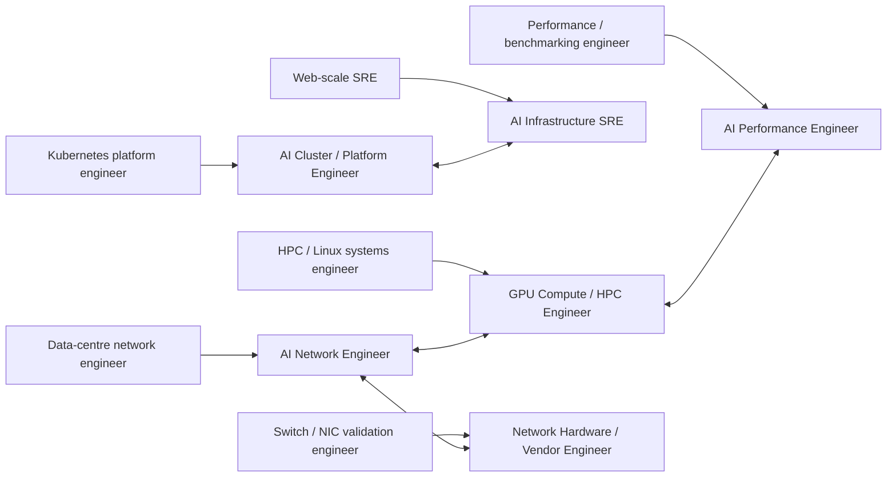
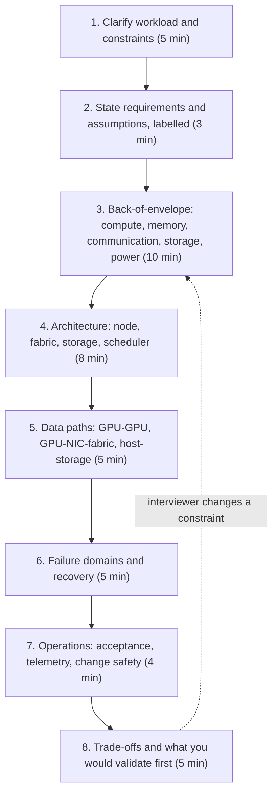
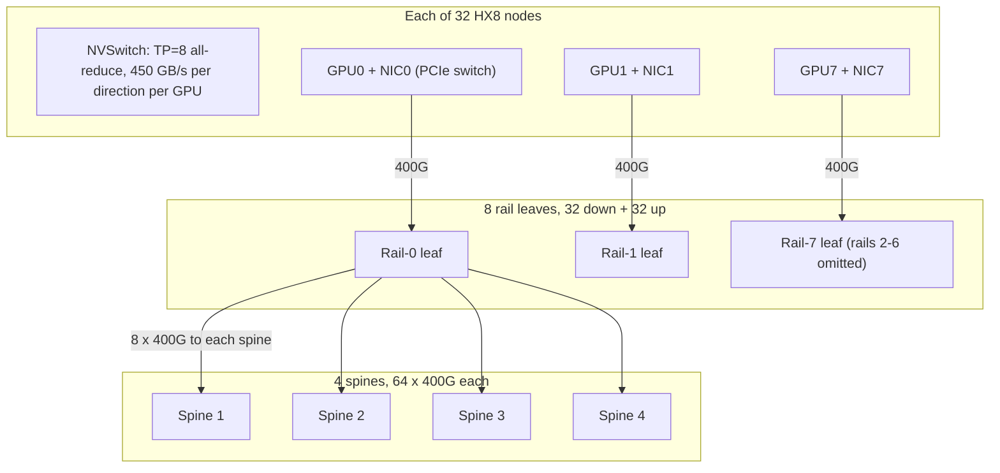
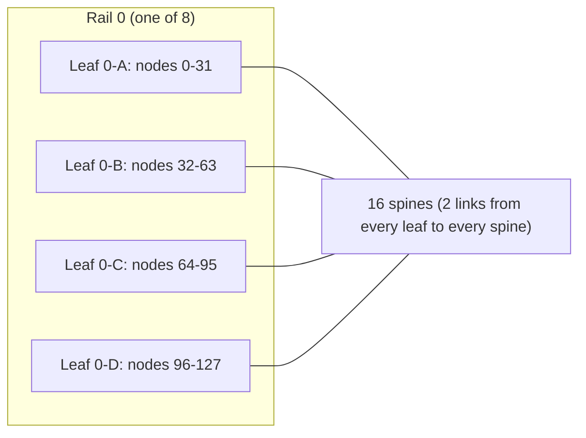

# Chapter 24 — Career Paths and Engineering Practice

> Twenty-three chapters taught you how GPUs, fabrics, collectives, storage, schedulers and operations
> fit together. This chapter turns that knowledge into a career you can *prove*. AI infrastructure
> hiring is unusual: the roles are new, the titles are inconsistent, and the interviews probe across
> layers — a network engineer is asked about NCCL rings, a platform engineer about RoCE congestion.
> We map six roles to concrete competencies, define junior-to-principal levels by *observable
> behaviour* rather than years, show how to read the employer landscape without fooling yourself with
> undated job-board anecdotes, and work two complete system-design interviews on the ORION reference
> cluster with every number derived. We close with the engineering practices — design docs, reviews,
> case studies, on-call hygiene and safety — that separate an engineer who knows the stack from one
> whom others trust to run it. The lab builds two tools: a role-readiness scorer that refuses to count
> weak evidence as strong, and a validator for a dated, deduplicated job-posting register.

## Learning objectives

After this chapter you will be able to:

1. **Map** your current skills to the competency matrix of a target AI-infrastructure role and
   **identify** the three highest-priority gaps with a dated plan to close them.
2. **Distinguish** junior, mid, senior, staff and principal performance by observable behaviours in
   scope, ambiguity, technical judgement, operational ownership and influence.
3. **Evaluate** claims about the job market by demanding a dated, deduplicated register, and
   **validate** such a register programmatically.
4. **Conduct** a 45-minute system-design interview for an AI training cluster or AI network: clarify
   requirements, derive capacity numbers, draw data paths, analyse failure domains and defend
   trade-offs.
5. **Write** an incident or performance case study that separates measured facts, inferred causes
   and remaining uncertainty, and states impact in units a reader can check.
6. **Assemble** a portfolio from the book's capstones in which every claim is labelled measured,
   modeled, simulated or illustrative.
7. **Apply** professional engineering practice — design documents, design reviews, on-call hygiene
   and change safety — to your own work.

## Prerequisites and connections

This chapter assumes the whole book, but leans most on: the role landscape in
[Chapter 1](../../part-1-foundations/ch01-ai-infrastructure-landscape/); capacity arithmetic in
[Chapter 2](../../part-1-foundations/ch02-anatomy-of-an-ai-data-center/) and
[Chapter 21](../../part-5-production-operations/ch21-capacity-power-economics/); fabric design in
[Chapter 7](../../part-3-networking/ch07-ethernet-datacenter-network-foundations/) and
[Chapter 8](../../part-3-networking/ch08-rdma-rocev2-infiniband/); parallelism and collectives in
[Chapter 11](../../part-4-distributed-ai/ch11-distributed-training-architecture/) and
[Chapter 12](../../part-4-distributed-ai/ch12-collective-communication-nccl/); checkpointing in
[Chapter 14](../../part-4-distributed-ai/ch14-storage-pipelines-checkpointing/); incident practice in
[Chapter 18](../../part-5-production-operations/ch18-observability-slos-incident-response/); safe
change in [Chapter 20](../../part-5-production-operations/ch20-automation-safe-change/); the
cross-layer method of [Chapter 22](../../part-5-production-operations/ch22-cross-layer-performance-engineering/);
and the design-review discipline of
[Chapter 23](../ch23-capstone-production-ai-cluster/).

The portfolio you build here is made of capstones. Each brief lives under `capstones/`:
[A — 256-GPU training cluster](../../../capstones/capstone-a-256-gpu-training-cluster/),
[B — network telemetry and troubleshooting](../../../capstones/capstone-b-network-telemetry-troubleshooting/),
[C — distributed training performance](../../../capstones/capstone-c-distributed-training-performance/),
[D — LLM inference platform](../../../capstones/capstone-d-llm-inference-platform/),
[E — fleet lifecycle automation](../../../capstones/capstone-e-fleet-lifecycle-automation/),
[F — reliability game day](../../../capstones/capstone-f-reliability-game-day/),
[G — fault-tolerant 512-node training](../../../capstones/capstone-g-fault-tolerant-512-node-training/),
[H — disaggregated LLM serving](../../../capstones/capstone-h-disaggregated-llm-serving/), scored with
the [capstone rubric](../../../capstones/RUBRIC.md).

Acronyms: GPU (graphics processing unit), NIC (network interface card), RDMA (remote direct memory
access), RoCEv2 (RDMA over Converged Ethernet v2), NCCL (NVIDIA Collective Communications Library),
NUMA (non-uniform memory access), PCIe (PCI Express), ECMP (equal-cost multipath), BGP (Border Gateway
Protocol), ECN (explicit congestion notification), PFC (priority flow control), DCQCN (Data Center
Quantized Congestion Notification), CNP (congestion notification packet), DSCP (differentiated services
code point), FEC (forward error correction), CRC (cyclic redundancy check), SLO (service-level
objective), MFU (model FLOP utilisation), TP/PP/DP (tensor/pipeline/data parallelism), MTBF (mean time
between failures), RPO (recovery point objective), ADR (architecture decision record), ASIC
(application-specific integrated circuit), DCGM (NVIDIA Data Center GPU Manager).

## 24.1 What the job actually is

Every AI-infrastructure role keeps an expensive, tightly coupled machine producing useful work. A 256-GPU cluster like
ORION draws ≈ 256–288 kW of GPU-node IT power sustained under training (32 nodes × 8–9 kW), up to
≈ 326 kW at maximum node power (32 × 10.2 kW) `[MODELED]`,
and, in the W-TRAIN configuration, *all 256 GPUs wait for the slowest one every step*. That coupling is why the field rewards cross-layer engineers.
A 2 % rise in step time can come from a firmware change, a hash-polarised ECMP group, a dataloader
stall or a scheduler that split a tensor-parallel group across nodes — and the person who finds it is
the person who can read evidence from all four layers.

Three properties distinguish this work from adjacent careers:

- **Synchronous blast radius.** In web services, one bad host degrades 1/N of traffic. In
  synchronous training, one bad GPU, NIC or optic can stall the whole job (Chapter 19). Engineers are
  judged on how fast they shrink a failure to its smallest defensible domain.
- **Utilisation is the product.** An idle H100-class GPU-hour is lost value. At an illustrative
  $2.50 per GPU-hour `[ILLUSTRATIVE]`, ORION idling for one hour costs 256 × $2.50 = $640; a 5 %
  throughput regression running unnoticed for a 30-day month costs 0.05 × 256 × 720 h × $2.50 =
  $23,040 `[MODELED]`. Performance work has a dollar figure attached, and good candidates quote it.
- **Evidence over intuition.** The diagnostic loop — observe a symptom, collect evidence, trace the
  bottleneck across compute, network, storage and orchestration, identify root cause, make a safe
  change, validate with repeatable measurements — is the job description. Interviews test it directly.

> **Key idea:** In AI infrastructure, seniority is measured by the size and ambiguity of the problems
> you can take from "something is slow or broken" to "here is the proven cause, the safe fix, and the
> measurement that shows it worked."

## 24.2 Competency maps for six roles

The course outline defines six role families. The table below reproduces the outline's role
emphasis and electives, then adds what each role *owns* and what it is *paged for*, because those two
columns predict interview content better than any title.

| Role | Primary emphasis (outline) | Advanced electives (outline) | Owns | Typically paged for |
|---|---|---|---|---|
| AI Network Engineer | BGP, Ethernet, RoCEv2, InfiniBand, RDMA, congestion, optics and switch telemetry | Advanced fabric design; RDMA tuning; network operations | Backend and frontend fabrics, addressing, QoS, switch OS lifecycle | Link flaps, PFC storms, ECN/CNP spikes, all-reduce bandwidth drops |
| GPU Compute / HPC Engineer | CUDA, GPU architecture, PCIe, NVLink/NVSwitch, NUMA and NCCL | GPU profiling; distributed collectives; accelerator topology | Node topology, driver/CUDA/NCCL stack, collective performance | Xid errors, NCCL hangs, GPU-to-NIC misaffinity, slow ranks |
| AI Cluster / Platform Engineer | Bare metal, fleet lifecycle, Kubernetes, Slurm, scheduling and tenant operations | Fleet automation; scheduler internals; cluster capacity | Provisioning, acceptance, schedulers, tenant onboarding | Jobs pending with free GPUs, failed node returns, upgrade regressions |
| AI Performance Engineer | Workload characterization, profiling, benchmarking and optimization | Roofline analysis; distributed scaling; inference performance | Benchmarks, baselines, regression triage, tuning | Rarely paged; owns regression investigations and launch readiness |
| AI Infrastructure SRE / Operations | Observability, SLOs, incidents, reliability, remediation and safe change | Incident simulation; fault injection; automated recovery | SLOs, alerting, incident command, postmortems, remediation automation | Everything first; escalates to the owning team |
| Network Hardware / Vendor Engineer | Switch ASICs, buffers, queues, optics, NICs, validation and interoperability | Hardware validation; congestion characterization; interoperability | Qualification, interoperability matrices, customer escalations | Customer escalations on buffers, optics, firmware defects |

*Table 24.1 — Role families (emphasis and electives from the course outline; ownership and paging
columns are the author's synthesis) `[ILLUSTRATIVE]`.*

### The proficiency scale

"Knows RoCE" must mean the same thing to candidate, interviewer and promotion committee, so we tie
each point of a five-point scale to evidence:

| Level | Name | Observable behaviour | Typical evidence |
|---|---|---|---|
| 0 | None | Cannot explain the concept | — |
| 1 | Aware | Explains vocabulary and the mechanism at whiteboard level | Course, reading notes, self-assessment |
| 2 | Working | Completes defined tasks with guidance; reproduces a lab result | Level-1 lab report, guided ticket work |
| 3 | Independent | Designs, diagnoses and defends decisions without guidance | Capstone, hardware lab, published case study |
| 4 | Expert | Owns it in production, sets direction, teaches others | Verified production ownership, design authority |

*Table 24.2 — The 0–4 proficiency scale used in this chapter and its lab.*

The key design choice is that *evidence type caps the level*: a course demonstrates level 1, a
Level-1 lab level 2, a capstone, hardware lab or published case study level 3, and only verified
production ownership level 4. Calibrated interviewers think the same way: they discount what you *say*
you know toward what you can *show* you have done.

### A competency matrix

Each role becomes a weighted list of competencies with a target level per seniority. Here is the AI
Network Engineer matrix used in the lab (weights 1–3; targets on the 0–4 scale):

| Competency | Weight | Junior | Mid | Senior | Staff/Principal | Chapters | Capstones |
|---|---|---|---|---|---|---|---|
| Ethernet, BGP/ECMP, leaf-spine | 3 | 2 | 3 | 3 | 4 | 7 | A, B |
| RDMA, RoCEv2, InfiniBand, multi-rail | 3 | 1 | 2 | 3 | 4 | 8, 13 | A, B |
| Congestion control, ECN/PFC, telemetry | 3 | 1 | 2 | 3 | 4 | 9 | B |
| Switch ASICs, optics, cabling | 2 | 1 | 2 | 3 | 3 | 10 | B |
| GPU/NIC topology, GPUDirect RDMA | 2 | 1 | 2 | 3 | 3 | 5, 13 | A, C |
| Observability, SLOs, incidents | 2 | 1 | 2 | 3 | 3 | 18 | B, F |
| Automation and safe change | 1 | 1 | 2 | 2 | 3 | 20 | E |
| Design docs, reviews, case studies | 1 | 1 | 2 | 3 | 4 | 23, 24 | A, F |

*Table 24.3 — AI Network Engineer competency matrix (teaching matrix) `[ILLUSTRATIVE]`. The other five
matrices are in `lab/data/competency_matrices.yaml`.*

The other five matrices weight differently; their highest-weight competencies are:

| Role | Weight-3 competencies | Weight-2 competencies |
|---|---|---|
| GPU Compute / HPC | GPU compute and profiling; GPU/NIC topology; collectives | Linux host/NUMA/PCIe; performance method |
| AI Cluster / Platform | Fleet lifecycle; scheduling; automation and safe change | Linux host; reliability and security |
| AI Performance | Performance method; collectives | GPU compute; inference; GPU/NIC topology |
| AI Infrastructure SRE | Observability and incidents; reliability and security | Automation; scheduling; Linux host; communication |
| Network Hardware / Vendor | Physical layer and optics; hardware validation | Congestion; RDMA fabrics |

*Table 24.4 — Highest-weight competencies of the other five teaching matrices (from
`competency_matrices.yaml`) `[ILLUSTRATIVE]`.*

Note that a senior network engineer must be *independent* (3) on GPU/NIC topology: rail misalignment
is a network-visible problem whose cause is in the host (Chapter 5).

The readiness score for a role at a level is the weight-averaged fraction of each target achieved:

```text
readiness = 100 × Σ_i w_i · min(d_i, t_i) / t_i  /  Σ_i w_i
```

where *d* is the demonstrated level and *t* the target. Capping at the target means over-qualification
in one competency cannot hide a hole in another. A second rule matters more than the score: **a gap of
two levels in any competency blocks "ready"**, however high the average. A candidate with expert BGP
and no RDMA understanding is not a senior AI network engineer; averaging would say otherwise.

### A worked readiness calculation

The lab's sample learner — a fictional data-centre network engineer with six years of experience —
has demonstrated levels (after evidence rules, Section 24.9) of: BGP/ECMP 4, RDMA 3, congestion 2,
physical layer 2, host topology 2, observability 1, automation 3, communication 3. Against the
*senior* targets (3, 3, 3, 3, 3, 3, 2, 3) with weights (3, 3, 3, 2, 2, 2, 1, 1), Σw = 17:

| Competency | w | d | t | min(d,t)/t | w × fraction |
|---|---|---|---|---|---|
| BGP/ECMP | 3 | 4 | 3 | 1.000 | 3.000 |
| RDMA | 3 | 3 | 3 | 1.000 | 3.000 |
| Congestion | 3 | 2 | 3 | 0.667 | 2.000 |
| Physical layer | 2 | 2 | 3 | 0.667 | 1.333 |
| Host topology | 2 | 2 | 3 | 0.667 | 1.333 |
| Observability | 2 | 1 | 3 | 0.333 | 0.667 |
| Automation | 1 | 3 | 2 | 1.000 | 1.000 |
| Communication | 1 | 3 | 3 | 1.000 | 1.000 |
| **Total** | **17** | | | | **13.333** |

*Table 24.5 — Readiness for AI Network Engineer (senior) `[MODELED]`.*

Readiness = 100 × 13.333 / 17 = **78.4 %**. The largest gap is observability (1 → 3, gap 2), so the
learner is "near", not "ready", at senior — but scores 94.1 % and "ready" at mid. The gap plan ranks by
weight × gap: observability (2 × 2 = 4), congestion (3 × 1 = 3), then host topology and physical layer
(2 × 1 = 2 each). The prescription follows directly: Capstone B (telemetry and troubleshooting) closes
the two top gaps at once.

> **Pitfall:** Self-assessments without evidence rules inflate. For the eight AI-network
> competencies, the sample learner's highest *claimed* levels average 25 / 8 = 3.1; after evidence
> rules the demonstrated levels average 20 / 8 = 2.5 `[MODELED]`. That 0.6-level difference is
> exactly what an interviewer discovers in the first deep-dive question.

## 24.3 Levels: junior to principal by observable behaviour

Companies name levels differently, and years of experience are a weak proxy. What transfers across
employers is *behaviour*: the scope of problem you own, how much ambiguity you absorb, the quality of
your technical judgement, how you operate production, and how far your influence reaches.

| Dimension | Junior | Mid | Senior | Staff | Principal |
|---|---|---|---|---|---|
| Scope | A task | A feature or component | A system (e.g., the backend fabric) | Several systems or a cross-team problem | An organisation's technical direction |
| Ambiguity | Problem and approach given | Problem given, approach chosen | Problem framed from symptoms | Finds the problems nobody has named | Decides which problems matter for years |
| Technical judgement | Follows runbooks correctly | Chooses between known options | Designs with explicit trade-offs and failure domains | Sets standards others design to | Changes the industry's or company's approach |
| Operations | Executes on-call steps; escalates well | Resolves common incidents alone | Incident commander; writes postmortems that change systems | Removes classes of incidents | Shapes reliability strategy and investment |
| Influence | Own work | Immediate team | Team and neighbours | Multiple teams; mentors seniors | Organisation and external community |
| Evidence in a packet | Tickets closed, runbooks followed | Components shipped, lab-quality analyses | Design docs, postmortems, measured improvements | ADRs adopted across teams, standards, multi-quarter outcomes | Strategy documents, industry contributions |

*Table 24.6 — Level expectations by observable behaviour (synthesis; calibrate to your employer's
published ladder).*

The same incident shows the difference. ORION's all-reduce bus bandwidth drops 20 % on some jobs that
use rail 3:

- **Junior:** follows the runbook, collects `ethtool -S` and switch counters, escalates with the
  evidence attached and the time window stated.
- **Mid:** finds the rail-3 link with rising FEC-uncorrectable codewords, drains it through the
  change process, confirms bandwidth recovers.
- **Senior:** runs the incident, proves causation with a discriminating test (Section 24.12), and
  writes the postmortem with the detection gap ("we alert on link down, not on degraded links").
- **Staff:** notices this is the third optics-related degradation this quarter, builds the case for
  pre-failure optics telemetry and a drain-on-threshold policy across both fabrics, and gets two teams
  to adopt it.
- **Principal:** asks whether the optics vendor strategy, the spares policy and the fabric's
  path-diversity design should change for the next generation, and writes the document that decides it.

> **Production note:** Staff and principal engineers are evaluated on outcomes they *caused other
> people to achieve*. If your packet lists only things you personally typed, you are describing a
> strong senior engineer.

### Role transitions

Most people enter from an adjacent field, crossing one layer boundary at a time:



*Figure 24.1 — Common entry paths (left) and the lateral moves between AI-infrastructure roles that
share the most competencies (two-headed arrows).*

The cheapest gap is the adjacent layer you already touch (network engineers: Chapters 5 and 12;
platform engineers: Chapters 7–8; SREs: Chapter 19). The most expensive is level 4 anywhere, because
it requires production ownership you cannot simulate.

## 24.4 The employer landscape — and how not to fool yourself about it

The course outline groups employers into four categories by the *recurring engineering problems* they
hire for. The organisations named are **representative examples, not a claim that any of them
currently has an open role with a particular title**; hiring changes month to month.

| Employer group | Representative organisations (outline) | Recurring engineering problems (outline) | What interviews tend to probe `[ILLUSTRATIVE]` |
|---|---|---|---|
| Hyperscalers / CSPs | Meta, Microsoft Azure, AWS, Google Cloud, Oracle OCI | Large-scale network/compute architecture, GPU fleet operations, reliability, capacity and automation | Scale arithmetic, failure domains at thousands of nodes, automation, operational rigour |
| AI cloud / neocloud | CoreWeave, Lambda, Crusoe, Hut 8, Highrise AI, Together AI | Rapid GPU cluster deployment, bare-metal lifecycle, tenant provisioning, utilisation and network performance | Bring-up speed, acceptance testing, tenant isolation, utilisation economics |
| Frontier AI labs | OpenAI, Anthropic, ByteDance/TikTok, xAI | Training-cluster scale, high-performance networking, distributed compute, inference and reliability | Collective performance, fault tolerance of very large jobs, cross-layer debugging |
| Hardware / networking vendors | NVIDIA, Broadcom, Arista Networks, AMD, Cisco | GPU/NIC/switch architecture, ASIC and buffer behaviour, optics, interoperability and validation | Mechanism depth (buffers, PFC, SerDes, firmware), test methodology, customer escalation |

*Table 24.7 — Employer ecosystem and role alignment. Groups, organisations and recurring problems are
from the course outline (checked against the outline, 2026-10); organisations are representative, not
a statement of current openings. The last column is the author's illustrative synthesis.*

The groups differ mainly in *where the pain concentrates* — a neocloud's in turning delivered racks
into accepted, tenant-isolated capacity within days; a frontier lab's in keeping one enormous job
productive through daily failures; a vendor's in explaining buffer or firmware behaviour to the bit.
Lean your portfolio toward the pain of the group you target.

### Scope note: job-posting claims need a register

The course outline is explicit that its role and skill map is a *curriculum synthesis*, not an
independently verified census of currently active job postings. It sets the bar for any such claim:
a statement like "we analysed 35+ postings" must be supported by **a dated, deduplicated register**
recording, for each posting, the employer, exact title, job ID, location, seniority, URL, date checked,
required and preferred skills, and active/archived status. Without that register, statements about
"what the market wants" are anecdotes — and this chapter makes no such census claim.

This is the same evidence discipline the book applies to benchmarks, for the same reasons:

| Failure mode | What it does to your conclusion | Register field that prevents it |
|---|---|---|
| One posting cross-listed on three boards counted three times | Inflates the frequency of that employer's skills | `employer` + `job_id` key; canonical `url` |
| Re-posted requisition with a new ID | Same inflation, harder to see | Canonical `url` match (tracking queries stripped) |
| Postings closed months ago still counted | Describes last year's market | `date_checked`, `status`, staleness rule |
| "Senior", "Sr." and blank treated differently | Breaks seniority breakdowns | Controlled vocabulary for `seniority` |
| "Preferred" skills counted as requirements | Overstates the bar | Separate `required_skills` and `preferred_skills` |
| No date at all | Unfalsifiable | `date_checked` mandatory, ISO-8601 |

*Table 24.8 — Why each register field exists.*

The lab's synthetic register shows how large these effects are on even a small set. Of 61 rows, 10 are
duplicates (exact copies, case and whitespace variants, re-posts under new IDs, and a three-row chain
where one copy shares the job ID and another shares the URL), leaving 51 postings. Eleven of those 51
have missing or invalid fields, leaving 40 complete postings; six of those are archived and three are
"active" but were last checked more than 30 days before the register's as-of date, leaving **31 active,
fresh postings you can actually cite** — about half the rows you started with `[ILLUSTRATIVE — synthetic data]`. Any skill-frequency chart drawn on the raw 61 rows would be wrong in ways
the reader cannot detect.

Frequency is not importance: "python" appears in 27 of 31 clean synthetic postings and "traffic
generators" in 7, yet the rarer skill is the one that discriminates for hardware-validation roles. Read
each posting for the system you would own ("operate a multi-thousand-GPU RoCE fabric") — it tells you
which capstone to put first.

## 24.5 System-design interviews for AI clusters and networks

AI-infrastructure design interviews differ from web-service design interviews in one way that changes
everything: **the numbers are physical and the coupling is synchronous.** A web design can hide a slow
component behind a queue; a training cluster cannot hide a slow NIC behind anything. The interviewer is
looking for whether you derive numbers, follow bytes along a data path, find the failure domains, and
say how you would *know* the design works.



*Figure 24.2 — A 45-minute design-interview arc. The dashed edge is the most common follow-up: a
changed constraint that forces you to redo the arithmetic, which is where weak answers collapse.*

Rules that hold across every walk-through:

1. **Label assumptions.** "Assume 40 % MFU `[ILLUSTRATIVE]`" is a strength; an unlabelled number is a
   liability.
2. **Derive, don't recite.** The traffic pattern first, then "therefore rail-optimised".
3. **Bound before you optimise.** Find the dominant term before polishing any of them.
4. **Every box has a failure story:** what happens to the job, and how you detect it.
5. **End with validation:** the first three day-one measurements and what would change the design.

In the walk-throughs below, `[ILLUSTRATIVE]` marks a planning assumption the candidate states aloud
and invites the interviewer to change.

## 24.6 Worked example: interview walk-through 1 — design the W-TRAIN cluster

> **Prompt:** "We want to pretrain a 70-billion-parameter dense transformer. Global batch is about four
> million tokens per step and we need a step time under 20 seconds. We have H100-class 8-GPU servers.
> Design the cluster."

### Clarify

The candidate's questions establish: 4,096-token sequences × 1,024 per step; BF16 mixed precision with
Adam; 80 layers, hidden size 8,192; one dominant job; racks limited to about 45 kW; a parallel file
system that writes about 80 GB/s.

### Requirements and assumptions

| Item | Value | Label |
|---|---|---|
| Tokens per step | 4,194,304 | Given |
| Step-time target | ≤ 20 s | Given |
| Dense BF16 peak per GPU | 989 TFLOP/s | `[VENDOR-SPEC, 2026-10]` class value |
| Achievable MFU | 40 % | `[ILLUSTRATIVE]` — common planning value for well-tuned dense training |
| Training state | 16 B/param | `[MODELED]` (2 weights + 2 grads + 12 fp32 master/m/v) |
| Achievable per-NIC bus bandwidth | 40 GB/s (80 % of 50 GB/s line rate) | `[ILLUSTRATIVE]` |
| Achievable NVLink bandwidth | 360 GB/s per direction (80 % of 450) | `[ILLUSTRATIVE]` |

*Table 24.9 — Walk-through 1 inputs.*

### Compute → GPU count

```text
FLOP/step   = 6 × N × T = 6 × 70e9 × 4,194,304 = 1.76 × 10^18 FLOP           [MODELED]
GPUs (20 s) = FLOP / (t × peak × MFU) = 1.76e18 / (20 s × 989e12 × 0.40)
            = 1.76e18 / 7.91e15 = 222.6  → at least 223 GPUs
```

Round up to a layout that fits the parallelism: **256 GPUs = 32 HX8 nodes**, giving

```text
step time = 1.76e18 / (256 × 989e12 × 0.40) = 1.76e18 / 1.013e17 = 17.4 s    [MODELED]
```

— a 13 % margin under the 20 s target, which you state is your buffer for MFU being lower than assumed.

### Memory → parallelism

Training state is 16 × 70e9 = 1.12 TB. One 80 GB GPU cannot hold it; even one node (640 GB) cannot.
Budgeting roughly 40 GB per GPU for state (the rest for activations and framework), we need at least
1.12 TB / 40 GB = 28 GPUs per model replica, so **TP × PP = 32**:

- **TP = 8** inside each node, because tensor-parallel all-reduces sit on the critical path of every
  layer. Quantify it: with one 4,096-token sequence per micro-batch, each TP all-reduce moves an
  activation of 4,096 × 8,192 × 2 B = 67.1 MB; a ring over 8 GPUs sends 2 × 7/8 × 67.1 = 117 MB per
  GPU. Four such all-reduces per layer (two forward, two backward), 20 layers per pipeline stage, and
  1,024 / 8 = 128 micro-batches per replica per step give 117 MB × 4 × 20 × 128 ≈ 1.20 TB per GPU per
  step `[MODELED]`. Over NVLink at 360 GB/s that is ≈ 3.3 s, on the critical path; over a 40 GB/s NIC
  it would be ≈ 30 s — *longer than the entire step budget*. That one calculation is the whole argument
  for keeping TP inside the NVLink domain.
- **PP = 4** across nodes: 80 / 4 = 20 layers per stage; per-GPU state 1.12 TB / 32 = 35 GB, leaving
  headroom for activations with selective recomputation.
- **DP = 256 / 32 = 8** replicas.

Pipeline bubble with one-forward-one-backward (1F1B) scheduling:
(p − 1)/(m + p − 1) = 3 / (128 + 3) = **2.3 %** `[MODELED]`.

### Communication across the fabric

- **DP gradient all-reduce:** each GPU holds 70e9 / 32 = 2.19 × 10⁹ parameters → 4.38 GB of BF16
  gradients. A ring over 8 replicas sends 2 × 7/8 × 4.38 = 7.66 GB per GPU, i.e. 7.66 / 40 =
  **0.19 s** per step on its own rail NIC — about 1.1 % of the step. With pipeline parallelism only the
  last micro-batch's backward pass (≈ 70 ms) can hide it, so ≈ 0.19 − 0.07 ≈ 0.12 s (0.7 %) is exposed.
- **PP activations:** 67.1 MB per micro-batch per stage boundary in each direction. With
  Megatron-style scatter/gather across the 8 TP ranks, each NIC carries 1/8 of it:
  128 × 2 × 67.1 MB / 8 = 2.15 GB per step per NIC → ≈ 54 ms. Negligible.

The fabric therefore needs *bandwidth per rail*, not exotic latency. Choose ORION's design: eight rail
leaves (one per GPU index), 64 × 400G ports each, 32 down and 32 up, four spines, 1:1.



*Figure 24.3 — W-TRAIN on ORION-256: TP stays on NVSwitch; DP and PP traffic for local rank r uses NIC r
and rail leaf r. Only rail 0's uplinks are drawn; every leaf has the same 4 × 8 uplinks.*

The insight that earns credit: in ORION-256 all 32 nodes sit under *one* leaf per rail, and DP and PP
peers are the same local rank on different nodes — so **W-TRAIN's fabric traffic stays inside a single
rail leaf and never touches a spine**, provided the job's rank mapping is rail-aligned. The spines carry
cross-rail traffic, which NCCL largely avoids by first moving data over NVLink to the GPU whose NIC is on
the destination rail (the PXN mechanism, Chapter 13). A sharp interviewer will ask, "Then why buy
non-blocking spines?" Good answers: growth beyond 32 nodes per rail; other jobs with other placements;
failure tolerance; and the fact that tapering saves only spine-layer switches and optics while
constraining every future scheduling decision. A 2:1 tapered spine layer is a defensible alternative
*if* the scheduler guarantees rail-aligned placement — a trade-off to name, not to hide.

### Storage, checkpoints and failure rate

Checkpoint size is ≈ 14 B/param × 70e9 = 980 GB `[MODELED]`. A synchronous write at 80 GB/s takes
980 / 80 = **12.25 s**. Choose the interval with Young's first-order approximation, τ ≈ √(2 C M), using
ORION's canonical reliability assumptions `[ILLUSTRATIVE]` (node MTBF 1,536 h; restart ≈ 900 s):

```text
M (job MTBF)  = 1,536 node-hours / 32 nodes = 48 h = 172,800 s
τ             = sqrt(2 × 12.25 s × 172,800 s) = sqrt(4,233,600 s²) ≈ 2,058 s ≈ 34 min   [MODELED]
checkpoint overhead = 12.25 / 2,058                  = 0.60 %
expected rework     = (τ / 2) / M = 1,029 / 172,800  = 0.60 %
restart cost        = 900 s / 172,800 s              = 0.52 %
total               ≈ 1.7 % of cluster time                                               [MODELED]
```

Asynchronous checkpointing (Chapter 14) shrinks the 12.25 s stall to the device-to-host copy, which
lets you checkpoint more often and cut the rework term. Data ingest, by contrast, is trivial: 4.19 M
tokens per 17.4 s ≈ 241,000 tokens/s; at 4 B per pre-tokenised token that is ≈ 0.96 MB/s `[MODELED]`.
Saying so — and moving on — shows judgement.

### Power and racks

Four nodes × 10.2 kW = 40.8 kW per rack, inside the 45 kW limit with 9 % headroom `[MODELED]`;
synchronous jobs swing power together, so size for the transient, not the average (Chapter 21).

### Failure domains

| Component fails | Effect on W-TRAIN | Detection | Recovery |
|---|---|---|---|
| One GPU (uncorrectable ECC, Xid) | Whole job stops (that node is one PP stage of one replica) | Xid in kernel log, DCGM health check, NCCL timeout | Quarantine node; restart from checkpoint without the node: wait for repair, or DP = 7 / 224 GPUs with a batch/LR adjustment (ORION has no spares) |
| One NIC or host link | Rank r on that node loses its rail → job hangs or fails | NCCL timeout, link-down event, `rdma link show` state | Drain node (stops new placement; does not move the job); restart from checkpoint without the node: wait for repair, or DP = 7 / 224 GPUs with a batch/LR adjustment (ORION has no spares) |
| One rail leaf | All 32 nodes lose rail r → job cannot run at full width | 32 simultaneous host link-downs on one rail | Repair leaf; no in-job workaround |
| One spine | 25 % of cross-rail capacity lost; rail-aligned W-TRAIN largely unaffected | BGP session loss, ECMP next-hop group shrinks | ECMP reconverges; schedule repair |
| Storage write path | Checkpoint fails; RPO grows | Checkpoint-duration SLO alert | Retry; stage to local NVMe |

*Table 24.10 — W-TRAIN failure domains on ORION-256 `[ILLUSTRATIVE]`.*

As an explicit design proposal (a variation from the reference cluster, which has none), recommend two
hot-spare nodes (2/32 ≈ 6 %), acceptance tests before any node returns to service
(Chapter 16), and a scheduler rule that never splits a TP group across nodes (Chapter 17).

### Day-one validation and follow-ups

Close with what you would measure first: (1) `all_reduce_perf` per rail at 2, 4, 8, 16 and 32 nodes,
compared with the 40 GB/s model; (2) a 100-step W-TRAIN run reporting MFU and step-time p50/p95 over at
least five runs; (3) a timed checkpoint write and restore. Typical follow-ups are answerable from the
arithmetic above. "MFU turns out to be 32 %" → step time 17.4 × 40/32 = 21.75 s, over target.
Recovering MFU (profile first, Chapter 22) is the better first move. If hardware must grow, it grows in
lumps: DP must divide the 1,024-sequence global batch, so DP = 9 does not work. The cheaper next layout
deepens the pipeline instead — **TP = 8, PP = 5, DP = 8 = 320 GPUs (40 nodes)**: 80 / 5 = 16 layers per
stage, 1.12 TB / (TP × PP = 40) = 28 GB of state per GPU, bubble 4 / (128 + 4) = 3.0 %, and step time
1.76e18 / (320 × 989e12 × 0.32) ≈ 17.4 s `[MODELED]`. Its cost is the fabric: 40 nodes exceed the 32
host ports of one rail leaf, so each rail needs a second leaf and PP/DP traffic between the two groups
now crosses spines. The alternative, DP = 16 (512 GPUs), keeps the stage layout but doubles the
cluster. Changing the global batch is an ML decision, not yours alone. A candidate who spots the
divisibility constraint and the leaf-boundary cost scores well. "Double
the sequence length" → per-micro-batch activations and TP volume double; check memory first. "One rail
leaf is lost for a week" → no in-job workaround; run jobs that fit on the remaining capacity or wait.

> **What the interviewer is scoring:** labelled assumptions; the TP-must-stay-in-node calculation;
> recognising that rail-aligned W-TRAIN traffic never leaves the rail leaf; a checkpoint interval
> derived from a failure model; failure domains with detection; a validation plan. Naming
> "rail-optimised" without the traffic argument scores little.

## 24.7 Interview walk-through 2 — design a 1,024-GPU RoCEv2 backend fabric

> **Prompt:** "Halcyon AI is growing ORION to 1,024 GPUs — 128 HX8 nodes with eight 400G NICs each.
> Design the backend network. Then tell me how you would know it is healthy."

### Clarify

The candidate establishes: RoCEv2 on Ethernet (the team runs Ethernet today); switches with
64 × 400G ports, as on ORION (a 25.6 Tb/s-class ASIC, or a 51.2 Tb/s-class ASIC with 64 × 800G cages
run at 400G); non-blocking unless justified; mostly W-TRAIN-like jobs of 256–1,024 GPUs; possible
growth to 2,048 GPUs within 18 months.

### Sizing the Clos

A rail-optimised two-tier Clos keeps the property that made ORION-256 work: GPU *i* of every node
attaches to rail *i*. Each rail now has 128 NICs.

```text
host ports per rail          = 128 nodes × 1 NIC         = 128
leaves per rail (32 down)    = 128 / 32                  = 4
total leaves                 = 8 rails × 4               = 32
leaf uplinks (1:1)           = 32 leaves × 32 up         = 1,024
spines (64 ports each)       = 1,024 / 64                = 16
links per leaf-spine pair    = 32 uplinks / 16 spines    = 2
host links + fabric links    = 1,024 + 1,024             = 2,048 links (4,096 400G ports)
switches                     = 32 leaves + 16 spines     = 48                       [MODELED]
```

The two-tier ceiling with radix *k* = 64 at 1:1 is k²/2 = 2,048 host ports, so the requested growth to
2,048 GPUs is *exactly* the limit: 64 leaves, 32 spines, one link per leaf-spine pair. Say this out
loud: the design is at half its two-tier capacity, growth means doubling the spines and re-cabling from
two links per pair to one, and beyond 2,048 GPUs you need a third tier or a larger radix. The
breakout case is that larger radix: a 51.2 Tb/s ASIC normally exposes **128 × 400G** (800G cages split
2 × 400G), so k = 128 and the two-tier ceiling becomes 128²/2 = **8,192 hosts**; 1,024 GPUs then need
2 leaves per rail (64 down, 64 up), 16 leaves and 1,024 / 128 = 8 spines, at the cost of breakout
cabling and twice the hosts per leaf failure. Pre-plan the cable plant either way, so growth is a
re-patch, not a rebuild.

### What changed versus ORION-256

At 256 GPUs, rail *r* fit on one leaf, so rail-aligned DP traffic never crossed a spine. At 1,024 GPUs
rail *r* spans four leaves, each serving a 32-node *block*. A DP all-reduce across 128 nodes now crosses
spines between blocks. Two consequences follow:

1. **Placement matters again.** The scheduler should pack jobs of ≤ 32 nodes inside one block, and
   larger jobs so that pipeline stages that talk most stay inside a block (Chapter 17).
2. **ECMP entropy matters.** RoCEv2 traffic is a small number of long, fat flows, and ECMP hashes each
   flow (by its UDP source port and addresses) onto one uplink. Take 32 equal flows leaving a leaf over
   32 uplinks at random — a lower bound on flow count, since NCCL opens several channels and queue pairs
   per peer (and can split data across QPs, `NCCL_IB_SPLIT_DATA_ON_QPS`), but the useful worst case:

```text
expected idle uplinks       = 32 × (31/32)^32 = 32 × 0.362 = 11.6   (36 % of capacity unused)
P(flow shares its uplink)   = 1 − (31/32)^31  = 1 − 0.374  = 0.63                       [MODELED]
```

Those colliding flows run at half rate or worse, and in a synchronous collective the slowest flow sets
the pace. Mitigations to name, with their trade-offs: more queue pairs per connection so each logical
connection becomes several hashed flows (NCCL exposes `NCCL_IB_QPS_PER_CONNECTION`
`[VENDOR-SPEC, 2026-10]` — verify against your NCCL version); switch adaptive routing or packet
spraying where the ASIC and NIC support out-of-order delivery; or scheduling that keeps traffic inside
blocks.

### Congestion, QoS and addressing

Keep ORION's QoS plan `[ILLUSTRATIVE]`: RoCE data in DSCP 26 → traffic class 3, lossless with PFC on
priority 3 as a backstop, ECN marking driving DCQCN as the primary control loop; congestion
notification packets (CNPs) in DSCP 48 → traffic class 6 strict priority; everything else lossy.
Enable a PFC watchdog so a stuck receiver cannot pause the fabric indefinitely (Chapter 9).
Addressing scales cleanly: rail *r* host links stay `10.100.r.(2n)/31` for n = 0…127, which fills
exactly one /24 per rail. ORION's loopback plan (spines `.1–.4`, leaves `.11–.18`) does *not* scale —
leaves `.11–.42` would collide with spines `.1–.16` if extended naively — so propose spines `.1–.16`
and leaves `.101–.132` in `10.255.0.0/24`, with spines in AS 65100 and each leaf in its own AS
65101–65132 (RFC 7938 style). Calling out that an inherited plan breaks at the new scale is exactly the
kind of detail interviewers remember.



*Figure 24.4 — One rail of the 1,024-GPU fabric: four 32-node blocks joined through the spine layer.
The other seven rails are identical and share the same 16 spines.*

### Failure domains

| Failure | Capacity effect | Job effect |
|---|---|---|
| One leaf-spine link | 1/32 of that leaf's uplinks | Flows rehash; brief loss, then slightly higher collision odds |
| One spine | 1/16 = 6.25 % of fabric capacity; each leaf loses 2 of 32 uplinks | Usually tolerated; ECMP reconverges in BGP time |
| One leaf | 32 nodes lose one rail | Jobs on those nodes fail; scheduler must stop placing there |
| A degraded (not failed) link | Silent loss and retransmission | Worst case: no alarm, all-reduce slows (Section 24.12) |

*Table 24.11 — Failure domains of the 1,024-GPU fabric `[MODELED]`.*

### "How would you know it is healthy?"

This half separates operators from diagram-drawers. A strong answer has three layers:

1. **Acceptance before use.** Per link: optics diagnostics in range, zero FEC-uncorrectable codewords
   and CRC errors over a soak. Per node pair: `ib_write_bw` per rail. Per scale step:
   `all_reduce_perf` at 2–128 nodes against a model; any rail or block > ~10 % below peers is
   investigated before handover.
2. **Continuous signals.** Port utilisation, ECN marks, CNPs, PFC pauses per priority, buffer
   watermarks, FEC counts, link flaps; per job, step time and collective bus bandwidth.
3. **Alert on degradation, not just failure.** Link-down alarms miss the expensive case — a link that is
   up but dropping. Alert on FEC-uncorrectable rate, RoCE out-of-sequence rate, and per-rail
   bus-bandwidth deviation within a job.

> **Vendor implementation note (NVIDIA / Broadcom / Arista / Cisco …):** adaptive routing, packet
> spraying, telemetry streaming and PFC watchdogs differ per switch OS and NIC firmware. Describe the
> capability and its prerequisites; verify specifics against current vendor documentation.

**Follow-up: "Why not InfiniBand?"** Compare, don't advocate: credit-based flow control and a subnet
manager give InfiniBand losslessness and central routing with less tuning; RoCEv2 reuses Ethernet
operations, tooling and supply but demands well-engineered ECN/PFC/DCQCN (Chapter 8).

## 24.8 Writing incident and performance case studies

A case study is the most persuasive portfolio artifact because it shows the diagnostic loop under real
constraints — and where candidates most often lose credibility, with impact lacking units, causes
lacking evidence, or results lacking baselines.

### Structure

| Section | Content | Common failure |
|---|---|---|
| Context | System, scale, workload, your role | Hiding your actual role ("we") |
| Symptom and impact | What was observed, by whom, since when; impact in GPU-hours, step time, SLO minutes | "Performance was bad" |
| Evidence | Counters, logs, traces, with times and sources | Screenshots without units or time |
| Hypotheses | Ranked by likelihood, cost to test, risk | Only the hypothesis that turned out true |
| Discriminating tests | The test that separated hypotheses, and its result | Tests that could not have disproved anything |
| Root cause | Mechanism, not component ("FEC-uncorrectable errors on one optic caused RoCE retransmits", not "bad optic") | Stopping at the first correlated signal |
| Change and validation | What changed, how safely, measured before/after with repetitions | A single after-run |
| Remaining uncertainty | What is still inferred, what you could not measure | Omitted entirely |
| What changed systemically | Alert, acceptance test, runbook, design | "Be more careful" |

*Table 24.12 — Case-study structure.*

### A short exemplar

> **Rail misalignment after a motherboard replacement** `[ILLUSTRATIVE — fictional, numbers chosen for
> teaching]`
>
> *Context.* ORION-256, a 16-node (128-GPU) fully sharded data-parallel fine-tuning job whose
> per-layer all-gathers sit on the critical path. I was the on-call GPU cluster engineer.
>
> *Symptom and impact.* Step time p50 rose from 2.10 s to 2.29 s (+9.0 %) on 3 March and stayed there
> for six days before a training engineer raised it. Throughput fell by 1 − 2.10/2.29 = 8.3 %, so the
> impact was 0.083 × 128 GPUs × 144 h ≈ 1,530 GPU-hours of lost work, ≈ $3,800 at the internal rate of
> $2.50 per GPU-hour.
>
> *Evidence.* Per-rank NCCL timing showed all slow collectives involved node `orion-n17`. On that node,
> `nvidia-smi topo -m` reported GPU0↔mlx5_0 as `SYS` instead of `PIX`. The fleet ticket system showed a
> motherboard replacement on `orion-n17` on 2 March.
>
> *Hypotheses.* (1) NIC enumeration changed after the repair, so GPU *i* used a NIC on the other socket
> — cheap to test, high likelihood given the timing; (2) a degraded rail-0 host link — cheap to test;
> (3) a GPU clock or thermal issue — possible, cheap to test.
>
> *Discriminating test.* `ib_write_bw` from GPU0's memory through each NIC on the node: the
> `PIX`-adjacent NIC sustained 46 GB/s, the NIC the job was actually using reached 27 GB/s through the
> inter-socket path. Link counters were clean; clocks were nominal. Hypotheses 2 and 3 were rejected.
>
> *Root cause.* After the replacement, PCIe enumeration order changed and NIC device names shifted. The
> job's static GPU→NIC map, written for the original order, now routed every rank on that node through
> the inter-socket link.
>
> *Change and validation.* Drained the node, regenerated the map from topology rather than names,
> re-ran acceptance (including a topology check), and returned it. Over five runs, step-time p50 was
> 2.10 s (range 2.09–2.12 s).
>
> *Remaining uncertainty.* We have not proven why enumeration changed; the replacement board's firmware
> version differed, which is the leading suspicion.
>
> *Systemic change.* The node acceptance test now fails any node whose GPU *i* is not `PIX`-adjacent to
> the NIC on rail *i*; per-rank collective timing alerts at > 5 % deviation from the job median.

> **Pitfall:** Confidentiality. Never publish internal hostnames, real cost rates, customer names or
> unreleased hardware details. Rewrite a real case on ORION with scaled numbers, say so, and get
> approval where your agreement requires it.

## 24.9 Building a portfolio from the capstones

A portfolio is a set of artifacts that let a stranger verify your competence without taking your word
for it. The capstones are designed to be those artifacts.

| Capstone | Strongest evidence for | Competencies it can raise to level 3 |
|---|---|---|
| [A — 256-GPU training cluster](../../../capstones/capstone-a-256-gpu-training-cluster/) | AI Network, GPU/HPC, architect tracks | Data-centre architecture, fabric design, host topology |
| [B — network telemetry and troubleshooting](../../../capstones/capstone-b-network-telemetry-troubleshooting/) | AI Network, Network Hardware/Vendor | Congestion, RDMA fabrics, observability, physical layer |
| [C — distributed training performance](../../../capstones/capstone-c-distributed-training-performance/) | GPU/HPC, AI Performance | Collectives, performance method, GPU compute |
| [D — LLM inference platform](../../../capstones/capstone-d-llm-inference-platform/) | AI Platform, Inference, Performance | Inference serving, SLOs, capacity |
| [E — fleet lifecycle automation](../../../capstones/capstone-e-fleet-lifecycle-automation/) | Cluster/Platform, SRE | Fleet lifecycle, automation, scheduling |
| [F — reliability game day](../../../capstones/capstone-f-reliability-game-day/) | SRE/Operations | Observability, incident response, reliability |
| [G — fault-tolerant 512-node training](../../../capstones/capstone-g-fault-tolerant-512-node-training/) | SRE, Platform, GPU/HPC | Reliability, checkpointing, scheduling |
| [H — disaggregated LLM serving](../../../capstones/capstone-h-disaggregated-llm-serving/) | Performance, Inference, AI Network | Inference, RDMA transfer modelling, capacity |

*Table 24.13 — Capstone-to-role map. Scoring follows the [capstone rubric](../../../capstones/RUBRIC.md).*

### The evidence ladder

Evidence strength is not uniform. The lab encodes the ladder as caps on the level a piece of evidence
can demonstrate:

```text
 level 4 ─ verified production ownership (named verifier, e.g. a reference)
 level 3 ─ capstone · hardware-backed lab (L2/L3) · published case study
 level 2 ─ Level-1 lab report with your analysis
 level 1 ─ course completion · reading · self-assessment
 ── any evidence with no artifact               → capped at 1
 ── simulation presented as a measurement       → capped at 1 (an integrity problem, not a style issue)
 ── production claim with no verifier           → capped at 3
 ── older than 3 years or undated               → minus 1 level
```

*Figure 24.5 — The evidence ladder and its discount rules, as implemented in the lab
(`evidence_rules` in `competency_matrices.yaml`).*

The harshest rule is about simulation: a Level-1 lab reporting "measured 38 GB/s" from a model is worse
than no evidence, because an interviewer who notices discounts everything else. Label every number in your portfolio exactly as this book does —
`[MEASURED]`, `[MODELED]`, `[SIMULATED]`, `[ILLUSTRATIVE]` — and carry the environment manifest with
any measurement.

### Portfolio structure

```text
portfolio/
├── README.md                 ← one-page narrative: target role, three strongest artifacts, gaps you are closing
├── readiness/                ← this chapter's lab output: matrix, gap plan, dated
├── capstone-<x>/             ← brief, design doc, ADRs, results with manifests, postmortem
├── case-studies/             ← 1–3 incident or performance case studies (Section 24.8 structure)
├── design-docs/              ← one design doc with the review comments you received and how you resolved them
└── code/                     ← small, tested tools (validators, parsers, models) with check scripts
```

The **portfolio narrative** is the deliverable most people skip. In under a page: the role you are
targeting and why; the problem each of your three strongest artifacts solved; what you would do
differently; and your current gaps with dates. Reviewers read it first and decide from it whether to
open anything else.

## 24.10 Engineering practice

Technical depth gets you hired; engineering practice is why production stays up and why people trust
you with it. Interview loops test it in "past project" rounds and implicitly in every design round.

### Design documents and ADRs

A design document makes a decision reviewable *before* it is expensive to change; an architecture
decision record (ADR) keeps each significant decision dated and immutable. Use the design-review
checklist and ADR practice in
[Chapter 23](../ch23-capstone-production-ai-cluster/) for your capstone.

### Reviews: giving and receiving

Good reviewers ask for evidence and failure stories, not their preferred design ("What happens to a
running job when this leaf reboots?", "Which number here is measured?"). Good authors separate blocking
concerns from preferences, answer every comment in writing, and record what changed.

### On-call hygiene

On-call in AI infrastructure is unusually costly because a single page can represent hundreds of
GPU-hours per hour. Practices that keep it sustainable:

- **Every alert is actionable and owned.** If the response to an alert is "watch it", delete or demote
  the alert.
- **Handoffs are written.** Ongoing incidents, drained nodes, changes in flight, and suppressed alerts
  are listed at every shift change.
- **Runbooks are updated by whoever used them**, the same day, when a step was wrong or missing.
- **Toil is measured.** Count pages and manual remediations per shift and treat a rising trend as a
  reliability bug (Chapter 18).
- **Escalation is a skill, not a failure.** Juniors are evaluated on escalating early with evidence
  attached.

### Safety

Every chapter of this book carries the same boundary: no production changes, disruptive fault
injection, or changes to shared fabrics without authorisation and a controlled environment. In
practice that means changes go through the safe-change process of Chapter 20 (prechecks, canary,
abort criteria, rollback, audit); experiments run in dedicated labs; and benchmarks that saturate a
fabric are scheduled and announced. In interviews, volunteering how you would test a risky idea
*safely* is a strong senior signal; proposing to "just try it in prod" is a strong negative one.

## 24.11 Hands-on lab overview

The [lab](lab/README.md) (Level 1, MODELED, seconds to run) builds two tools. **Part A** scores a
fictional learner's evidence against the six role matrices using the evidence ladder (Section 24.9) and
emits readiness per role and level plus a gap plan. **Part B** validates a synthetic 61-row job-posting
register — required fields, vocabularies, staleness, transitive deduplication — and computes skill
frequencies over surviving postings. Both datasets carry planted flaws. You finish by scoring your own
evidence.

## 24.12 Troubleshooting scenario: the interview troubleshooting round

Many loops include a round where the interviewer hands you evidence and watches you reason. Here is
one, worked with the diagnostic loop. Everything below is `[ILLUSTRATIVE]`.

**Symptom.** "A 16-node job on ORION-256 reports all-reduce bus bandwidth well below last week's. Nothing
was changed, according to the job owner. Go."

**Collect evidence — ask before you guess.** The candidate asks for the benchmark, a per-rail breakdown,
and the change log. The interviewer supplies:

```text
# nccl-tests all_reduce_perf, 16 nodes x 8 GPUs, out-of-place columns (abridged)
#       size      count      type  redop root   time(us)  algbw(GB/s)  busbw(GB/s)
  1073741824  536870912  bfloat16  sum  -1     5918     181.44       360.04     <- last week
  1073741824  536870912  bfloat16  sum  -1    10355     103.69       205.76     <- today
```

```text
per-rail ib_write_bw, node orion-n03 -> node orion-n11 (Gb/s, 5 runs, median)
rail:   0     1     2     3     4     5     6     7
       371   372   370   212   371   370   372   371
```

| Signal (rail 3 leaf ↔ hosts, last 24 h) | orion-n03 port | orion-n11 port | Other 30 rail-3 host ports |
|---|---|---|---|
| FEC uncorrectable codewords | 0 | 18,422 | 0 |
| FEC corrected codewords (rate) | normal | 40× peers | normal |
| CRC errors | 0 | 9,870 | 0 |
| PFC pause frames received (priority 3) | low | low | low |
| Optic Rx power | −1.9 dBm | −9.8 dBm | −1.5 to −2.4 dBm |

*Table 24.14 — Evidence supplied in the troubleshooting round `[ILLUSTRATIVE]`.*

On `orion-n11`, `/sys/class/infiniband/mlx5_3/ports/1/hw_counters/out_of_sequence` is rising at about
1,200 per second during the benchmark, against near zero on other NICs. The change log shows a cabling
audit on `rack-03` two days ago.

**Trace across layers and rank hypotheses.** Bus bandwidth fell 43 % (205.76 / 360.04 = 0.571; for
128 ranks busbw = algbw × 2 × 127/128 = algbw × 1.984). One rail on one pair is at 57 % of its peers
(212 / 371 = 0.571). Because NCCL's ring channels advance in lock-step, the slowest rail sets the pace of
the whole collective, so the drop matches the rail ratio almost exactly. The candidate ranks:

| Hypothesis | Prior | Cost to test | Risk of test | Discriminating evidence |
|---|---|---|---|---|
| Physical-layer degradation on orion-n11 rail-3 link (dirty/damaged connector after audit) | High: FEC/CRC, low Rx power, timing | Low | None (read-only) | Counters isolated to one port; Rx power 8 dB below peers |
| Congestion / PFC storm on rail 3 | Low: pause counters normal | Low | None | Would show pauses and ECN/CNP on many ports |
| Rank-to-NIC misalignment on orion-n11 | Low: a GPU using a cross-socket NIC loses bandwidth on the PCIe/inter-socket path, but cannot cause FEC/CRC errors or low Rx power on one link, and this NIC-to-NIC `ib_write_bw` does not touch GPU memory | Low | None | `nvidia-smi topo -m` vs the job's GPU→NIC map |
| Software change (NCCL/driver) | Low: owner says none; check | Low | None | Package versions vs last week |

**Root cause.** Uncorrectable FEC errors on one host link drop RoCE packets; the NIC sees gaps
(out-of-sequence counter) and retransmits, so that queue pair's goodput collapses and the whole ring
waits. Low Rx power localises it to the optic or connector on the `orion-n11` rail-3 link; the `rack-03`
audit is the probable trigger — *correlated, not yet proven*.

**Safe change.** Drain `orion-n11` through the scheduler (Chapter 17), so no new jobs land on it; do not
disturb the running job beyond what its owner approves. In the maintenance window, a technician
inspects, cleans or replaces the connector or optic per the physical-layer runbook (Chapter 10).

**Validate.** Rx power back within the peer range; FEC uncorrectable count flat over a soak; `ib_write_bw`
on rail 3 at peer level over five runs; `all_reduce_perf` back to ≈ 360 GB/s bus bandwidth; then return
the node through acceptance (Chapter 16). Close the loop systemically: alert on FEC-uncorrectable rate
and on per-rail deviation, and add a post-audit link check to the cabling procedure.

> **What the interviewer is scoring:** evidence before hypotheses, ranked tests, proven cause versus
> correlated trigger, a safe change and a repeated validation. "Replace the cable" in minute one scores
> little.

## Trade-offs and design decisions

| Decision | Option | Strongest when | Cost / risk |
|---|---|---|---|
| Career shape | Deep specialist (e.g., RoCE congestion, NCCL) | Targeting vendors, frontier labs, staff+ technical roles | Narrower market; skills tied to one technology generation |
| | Cross-layer generalist | Neoclouds, SRE, platform, early-stage teams | Must still show level 3 somewhere; "jack of all trades" risk |
| Employer group | Operator (hyperscaler, neocloud, lab) | You want production ownership and on-call experience | On-call load; less mechanism depth |
| | Vendor | You want mechanism depth and broad customer exposure | Less ownership of end-to-end outcomes |
| Evidence investment | Capstone (≈ 20–40 h) | Closing a level-3 gap in 1–2 competencies | Time; modeled results only at L1 |
| | Hardware lab (L2/L3) | Proving measurement skill | Access and cost; safety discipline required |
| | Case study from work | Strongest single artifact | Confidentiality review; needs a real incident |

*Table 24.15 — Career and practice trade-offs (author's synthesis; time estimates `[ILLUSTRATIVE]`).*

## Production operations notes / runbook excerpt

**Runbook excerpt — on-call shift handoff and the first 15 minutes of a page** `[ILLUSTRATIVE
thresholds; calibrate to your SLOs]`

| Step | Action | Signal / threshold | Escalate when |
|---|---|---|---|
| Handoff | Read the outgoing handoff: open incidents, drained nodes, changes in flight, silenced alerts with expiry | Any silence without an expiry or owner | Immediately, to the shift lead |
| 0–2 min | Acknowledge; state in the incident channel what you see and what you will check first | Page acknowledged within the SLO (e.g., 5 min) | — |
| 2–5 min | Establish blast radius: one job, one rail, one rack, one tenant, or fleet-wide | > 1 job or > 1 rack affected | SEV2 or higher: page the incident commander |
| 5–10 min | Check the change log for the last 48 h on implicated components | A change overlaps the symptom window | Page the change owner; prepare rollback |
| 10–15 min | Contain with the smallest safe action: drain a node, stop new placements; never reconfigure a shared fabric without the owning team | Containment not possible with read-only or drain actions | Escalate to owning team (Fabric, Fleet, Platform) |
| End of shift | Write the handoff; update any runbook step that was wrong | Pages per shift > 5, or the same alert > 3 times | File a toil/reliability ticket |

## Realism boundaries

The lab's scores are a transparent rubric applied to self-reported evidence; they are not a hiring
prediction, and the matrices are teaching matrices, not any employer's ladder. The job register is
synthetic and says nothing about real hiring; a real register is only as good as its collection window
and dates. The interview walk-throughs use ORION's illustrative numbers and planning assumptions (40 %
MFU, 80 % of line rate); a real interviewer may hand you different numbers, and the point is the method.
Nothing in a Level-1 lab demonstrates hardware skills — only L2/L3 evidence with a manifest does.

## Summary

- Every AI-infrastructure role keeps a synchronous, expensive machine productive; the diagnostic loop is
  the competency every role is tested on.
- Six role families (AI network, GPU/HPC, cluster/platform, performance, SRE/operations, network
  hardware/vendor) differ in what they own and are paged for; read postings for those, not for titles.
- Use a 0–4 proficiency scale where evidence *type* caps the level; block "ready" on any two-level gap.
- Levels differ by scope, ambiguity, judgement, operational ownership and influence — not years.
- Employer groups are representative, not a statement of openings; any job-market claim needs a dated,
  deduplicated register with the fields Section 24.4 lists.
- Design interviews reward labelled assumptions, derived numbers, data paths, failure domains and a
  validation plan; the TP-in-node and ECMP-collision calculations are typical deciding moments.
- Case studies persuade with baseline, magnitude, cost arithmetic, a discriminating test and stated
  uncertainty.
- Build the portfolio from capstones; label every number; never present simulation as measurement.
- Design docs, ADRs, reviews, on-call hygiene and change safety are what make senior engineers trusted.

## Review questions

The full set is in [exercises.md](exercises.md). Quick self-check:

1. Why does the readiness model cap each competency at its target and also block "ready" on a gap of
   two, rather than just averaging?
2. In walk-through 1, which single calculation justifies keeping TP = 8 inside the node, and what are its
   two key numbers?
3. Give three ways the same job posting can appear more than once in a register, and the field that
   catches each.

## Further reading

- *Site Reliability Engineering* (Beyer, Jones, Petoff and Murphy, eds., O'Reilly, 2016) — the source of
  much of the on-call, postmortem and toil vocabulary used in Sections 24.8–24.10.
- *Staff Engineer: Leadership Beyond the Management Track* (Will Larson, 2021) — the clearest account of
  what staff-level scope and influence look like in practice.
- *The Staff Engineer's Path* (Tanya Reilly, O'Reilly, 2022) — how to write design documents and steer
  technical direction without authority.
- *Systems Performance*, 2nd ed. (Brendan Gregg, Addison-Wesley, 2020) — the methodology behind
  evidence-based performance case studies.
- "Efficient Large-Scale Language Model Training on GPU Clusters Using Megatron-LM" (Narayanan et al.,
  SC 2021) — the parallelism arithmetic behind walk-through 1.
- "A First Order Approximation to the Optimum Checkpoint Interval" (J. W. Young, *Communications of the
  ACM*, 1974) — the formula used for the checkpoint interval.
- RFC 7938, "Use of BGP for Routing in Large-Scale Data Centers" (Lapukhov, Premji, Mitchell, 2016),
  https://www.rfc-editor.org/rfc/rfc7938 — the routing design pattern assumed in walk-through 2.
- "Congestion Control for Large-Scale RDMA Deployments" (Zhu et al., SIGCOMM 2015) — DCQCN, the
  congestion control assumed for RoCEv2 in walk-through 2.
- RFC 2606, "Reserved Top Level DNS Names" (Eastlake and Panitz, 1999) — why the lab's synthetic URLs use
  `example.com`.
