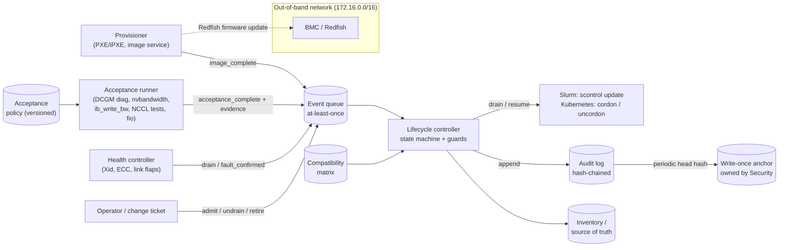

# Capstone E — Bare-Metal GPU Fleet Lifecycle Automation

Build the automation that decides, with evidence, whether a GPU server may carry production work.
You will design the node lifecycle state machine, write the acceptance test that gates admission,
own the firmware/driver compatibility matrix, plan a canary rollout with automatic abort and
rollback, and leave a tamper-evident audit trail behind every transition. The work is set on
Halcyon AI's ORION cluster during a week where eight new nodes arrive, two nodes come back from
repair, and a new software bundle is waiting for its canary. The Level 1 (L1) starter kit gives you
a deterministic fleet dataset with planted faults; the advanced extension wires the same logic to
a real lab provisioning system and real hardware health checks.

| | |
|---|---|
| **Audience** | Cluster Platform Engineer, Infrastructure SRE (outline Section 16). Also useful for Fleet/Datacenter Operations engineers moving into automation. |
| **Prerequisites** | Chapters [3](../../book/part-1-foundations/ch03-linux-host-systems-diagnostics/), [16](../../book/part-5-production-operations/ch16-bare-metal-fleet-lifecycle/), [17](../../book/part-5-production-operations/ch17-kubernetes-slurm-scheduling/), [20](../../book/part-5-production-operations/ch20-automation-safe-change/); skim [5](../../book/part-2-accelerated-compute/ch05-gpu-interconnects-host-topology/), [8](../../book/part-3-networking/ch08-rdma-rocev2-infiniband/), [18](../../book/part-5-production-operations/ch18-observability-slos-incident-response/), [19](../../book/part-5-production-operations/ch19-reliability-security-multitenancy/) |
| **Time budget** | 30–40 h at L1 (starter kit ≈ 10 h, design artifacts ≈ 15 h, review and write-up ≈ 8 h); add 15–25 h for the advanced extension |
| **Tiers** | L1 required (laptop, Python 3.10+); L2 optional (one GPU host); L3 advanced extension (lab provisioning system plus at least two multi-GPU RDMA nodes) |
| **Grading** | [../RUBRIC.md](../RUBRIC.md) plus the capstone-specific criteria in [Section 10](#10-grading) |

Acronyms used throughout: BMC (baseboard management controller), BDF (PCIe bus:device.function),
DCGM (NVIDIA Data Center GPU Manager), ECC (error-correcting code), PXE (preboot execution
environment), RDMA (remote direct memory access), VBIOS (GPU video BIOS/firmware image), Xid (NVIDIA
driver error event identifier), SLO (service-level objective), RTO (recovery time objective).

---

## 1. Why this capstone matters

A GPU fleet is never "installed"; it is continuously re-admitted. Every reimage, firmware flash,
GPU swap, DIMM replacement, or optic change produces a node that *might* be healthy. On ORION, one
node that silently trains at 200 Gb/s on rail 5 instead of 400 Gb/s drags every collective in a
256-GPU job down to its pace (Chapter 12); one node with a hand-upgraded driver that breaks
GPUDirect RDMA forces NCCL onto host-staged copies (Chapter 13). Neither fault crashes anything.
Both are found only if the platform refuses to schedule onto a node until it has *proved* itself,
and keeps proving it after every change. That refusal, encoded as a state machine with guards,
evidence, and an audit trail, is what this capstone builds.

> **Key idea:** A node earns `schedulable` by presenting fresh evidence against a versioned policy.
> Anything that changes the node (image, firmware, hardware) revokes that status until new evidence
> is produced.

## 2. Scenario: bring-up week on ORION

Halcyon AI's **Fleet** team owns bare-metal lifecycle for ORION-256 (32 × HX8 nodes, 256 GPUs; see
[REFERENCE_CLUSTER.md](../../docs/REFERENCE_CLUSTER.md)). This capstone *varies* the reference
cluster in one stated way: two expansion racks (`rack-09`, `rack-10`, four HX8 nodes each) have just been
racked, cabled and powered, taking the fleet to 40 nodes / 320 GPUs if every new node passes.
Admitted expansion nodes join the **training** partition. Otherwise the default ORION split
applies: training on `orion-n01`–`n24` (`rack-01`–`rack-06`, Slurm) and W-INFER inference on
`orion-n25`–`n32` (`rack-07`–`rack-08`, Kubernetes). There are no spare nodes.

Monday morning, 2026-10-19 [ILLUSTRATIVE]:

- **Expansion.** Eight new nodes (`orion-n33` … `orion-n40`) are in `discovered`. The provisioner
  will image them today; acceptance runs overnight.
- **Returns from repair.** `orion-n10` had a GPU replaced from the spares pool; `orion-n23` had
  a DIMM replaced. Both will be reimaged and re-accepted.
- **An open investigation.** Platform drained `orion-n20` last week after NCCL fell back to
  host-staged transfers on that node. Nobody has explained why.
- **A pending upgrade.** Bundle `B-2026.10` (new OS image, kernel, GPU driver, NIC firmware, RDMA
  stack, BMC firmware) passed lab validation and is approved for **canary only**. `rack-07`
  (inference) is still on the deprecated bundle `B-2026.04`, which expires 2026-12-31.
- **A compliance request.** Security asks for proof that lifecycle records have not been edited
  after the fact; they have heard that someone "fixed" an audit entry by hand.
- **Capacity constraints (per partition).** On 24 training nodes W-TRAIN runs at TP 8 × PP 4 × DP 6
  with a global batch of 768 sequences (128 per replica; the reference 1,024 is not divisible by 6).
  During maintenance Training Infra accepts DP = 4 (16 nodes, batch 512, same 128 per replica), so
  **at least 16 training nodes** must stay schedulable. Inference needs **at least 6 of its 8 nodes**
  to hold its SLO. A node that is about to be drained for remediation does not count toward either
  floor [ILLUSTRATIVE agreements]. **This week** only 21 training nodes are schedulable
  (`orion-n10` and `orion-n23` in repair, `orion-n20` drained), so W-TRAIN is already at DP = 5
  (20 nodes) with a batch of 640 (768 / 5 is not an integer; 640 keeps 128 per replica). Dropping
  to DP = 4 during the rollout waves costs another 20 % of training throughput (4 / 5 of the
  sequences per step at the same step time) for the duration of the waves `[MODELED]`.

Your manager's ask: *"By Friday I want a lifecycle controller we can trust: nothing gets scheduled
that hasn't proved itself, every change is staged and reversible, and every decision is on the
record."*

## 3. Problem statement

Design, prototype and justify a fleet lifecycle automation system for ORION that:

1. Models every node with the seven outline states — **discovered, imaged, validated, schedulable,
   drained, repair, retired** — and enforces legal transitions with guards (Chapter 16).
2. Admits a node only after an **acceptance test** covering accelerator discovery, memory health,
   PCIe and NIC link validation, RDMA and NVLink bandwidth, storage, thermals and burn-in, with
   evidence that is newer than the node's current image.
3. Classifies every node against a versioned **compatibility matrix** (OS image, kernel, GPU driver,
   GPU VBIOS, NIC firmware, RDMA stack, BIOS, BMC firmware) and refuses blocked or unknown stacks.
4. Rolls out a new bundle in **canary-then-waves** form that respects failure domains (rack),
   capacity agreements, and an explicit abort/rollback gate (Chapter 20).
5. Records every decision in an **append-only, tamper-evident audit trail** that Security can
   verify independently.
6. Is operable by an on-call engineer at 03:00 through a **runbook** with signals, thresholds, safe
   actions and escalation.

**Constraints.** No production change is made by this capstone: L1 works on the supplied dataset,
L3 works on a dedicated lab. Automation must be idempotent (re-running it changes nothing that is
already correct) and must fail closed (missing evidence means *not* admitted).

**Success criteria.** (a) No node reaches `schedulable` without passing `validated` with fresh
evidence and a golden bundle; (b) every planted fault in the dataset is caught with a
machine-readable reason; (c) the rollout plan never violates the rack or capacity constraints and
the canary gate aborts on the worst canary, not the average; (d) the audit verifier pinpoints the
tampered record; (e) another engineer can reproduce every result from your repository with one
command.

## 4. Required artifacts

Every submission contains the seven outline artifacts **and** the nine common sections required of
every capstone (outline Section 16). Templates are in [templates/](templates/).

| # | Artifact | Template | Evidence expected |
|---|---|---|---|
| 1 | **Lifecycle state machine** — states, events, guards, side effects (scheduler drain/resume, ticketing), invariants, Mermaid diagram | [state-machine-spec.md](templates/state-machine-spec.md) | Spec + `lifecycle_spec()` passing T1 checks |
| 2 | **Node acceptance test plan** — every test, command, threshold, rationale with arithmetic, duration, failure action | [acceptance-test-plan.md](templates/acceptance-test-plan.md) | Thresholds labelled [ILLUSTRATIVE]/[VENDOR-SPEC]/[MEASURED]; T2 checks |
| 3 | **Compatibility matrix** — bundles with status (golden/canary/deprecated/blocked), validation date, expiry, evidence link | [compatibility-matrix.csv](templates/compatibility-matrix.csv) | Matrix + `check_compatibility()`; T3 checks |
| 4 | **Automation prototype** — the `fleet.py` module, CLI or service wrapper, tests, and the reconciliation (remediation) plan | [starter-kit/](starter-kit/) | `python check.py` all PASS; idempotency demonstrated |
| 5 | **Canary/rollback design** — wave plan, soak gate, abort conditions, rollback bundle, maintenance windows, capacity cost | [canary-rollback-plan.md](templates/canary-rollback-plan.md) | Wave table + canary decisions for S1–S4 with reasons; [MODELED] capacity cost |
| 6 | **Audit trail** — record schema, hash chain, anchoring, retention, verification procedure | [audit-trail-spec.md](templates/audit-trail-spec.md) | Verifier output on the supplied log; threat model |
| 7 | **Operational runbook** — admission, drain, repair return, rollout abort, audit failure | [runbook.md](templates/runbook.md) | Signals, thresholds, commands (tier-labelled), escalation |
| 8 | Problem statement, architecture, assumptions, implementation/simulation boundary, test plan, results, failure analysis, security considerations, final engineering review | [design-document.md](templates/design-document.md) | One document, ≤ 15 pages, every number labelled |
| 9 | Results table (what was measured, modeled, simulated) | [results-table.md](templates/results-table.md) | Every row carries an evidence class |

> **Pitfall:** Treating the checker as the deliverable. `check.py` proves your prototype handles the
> planted cases; the grade comes from the *design* — guards you can defend, thresholds with
> rationale, a rollout a change-advisory board would approve, and an audit design that survives a
> hostile reviewer.

### Reference architecture (what you are designing)



*Figure E.1 — Fleet lifecycle control plane. Every producer emits events; only the lifecycle
controller changes node state, and it does so only through guarded transitions that are written to
the audit log before the scheduler is told.*

## 5. Milestones

| Milestone | Week | Exit criterion |
|---|---|---|
| M0 Choose capstone | 8 | Track selected; starter kit runs (`python check.py` prints 1/17 PASS) |
| M1 Proposal and assumptions | 10 | State machine diagram and guard table reviewed; assumptions register (≥ 10 entries) |
| M2 Prototype mid-point | 12 | T1–T4 checks PASS; acceptance test plan drafted with every threshold justified |
| M3 Draft results | 13 | All 17 checks PASS; canary/rollback design and wave table; audit verifier run; runbook draft |
| M4 Final submission and review | 14 | All artifacts; 15-minute design review presenting the bring-up week outcome and one failure you would still worry about |

## 6. Tier options and the advanced extension

| Tier | What you do | What it proves |
|---|---|---|
| **L1 (required)** | Complete [starter-kit/](starter-kit/) and all design artifacts against the supplied dataset | Lifecycle logic, gating, rollout safety and audit design — all `[SIMULATED]` on synthetic evidence |
| **L2 (optional)** | Run the acceptance tests on one real GPU host; feed the real outputs into `evaluate_acceptance()` | That your parsers and thresholds work on real tool output for one platform `[MEASURED]` |
| **L3 / Advanced extension** | **Integrate a lab provisioning system and real hardware health checks** (outline wording): drive state transitions from a lab instance of OpenStack Ironic, MAAS, or Metal3 and gate admission on real DCGM, NVLink, RDMA, NCCL and storage tests on ≥ 2 RDMA-connected GPU nodes | End-to-end admission on real hardware, including cross-node RDMA and NCCL evidence `[MEASURED]` |

The extension procedure, exact commands and the manifest fields to record are in
[starter-kit/README.md §8](starter-kit/README.md#8-l2l3-extension-real-provisioning-and-health-checks).

> **Realism boundary:** The L1 dataset is synthetic. It can show that your *decisions* are correct
> given evidence; it cannot show that a 370 Gb/s `ib_write_bw` threshold is right for your NICs,
> that DCGM level-3 diagnostics catch a particular HBM defect, or that a firmware flash is safe on
> your BMC. Thresholds must be calibrated on known-good nodes of your own platform, and every
> firmware procedure must follow the vendor's documented update path.

> **Safety:** Run L2/L3 work only on hosts you own or are explicitly authorised to disrupt, in a
> dedicated lab. Never point the controller, Redfish calls, `scontrol`, or `kubectl drain` at a
> shared or production cluster. Firmware updates can brick hardware; keep a vendor-supported
> recovery path (and a spare) before flashing anything.

## 7. Realism and simulation boundary (what to state in your report)

| Claim type | L1 can support | Needs L2/L3 |
|---|---|---|
| State machine safety (no bypass of validation, terminal states) | Yes — exhaustively, by graph analysis | — |
| Acceptance decision logic, freshness, policy versioning | Yes — on synthetic evidence `[SIMULATED]` | Parsers against real tool output |
| Threshold *values* (bandwidths, temperatures, burn-in hours) | Only as `[ILLUSTRATIVE]` derived from line rates | Calibration on golden nodes `[MEASURED]` |
| Canary gate correctness | Yes — on supplied soak metrics | Real soak with production-like jobs |
| Firmware flash safety, BMC behaviour, reimage time | No | Lab provisioning system |
| Audit tamper evidence | Yes — cryptographic property of the design | Anchoring and access control in a real deployment |

## 8. Chapter map

| Chapter | What this capstone uses from it | Artifact(s) |
|---|---|---|
| [3 — Linux, Host Systems, and Performance Diagnostics](../../book/part-1-foundations/ch03-linux-host-systems-diagnostics/) | Host inventory, `lspci`, `dmesg`, NUMA checks | 2, 7 |
| [5 — GPU Interconnects and Host Topology](../../book/part-2-accelerated-compute/ch05-gpu-interconnects-host-topology/) | PCIe link gen/width, GPU–NIC locality, NVLink checks | 2 |
| [8 — RDMA, RoCEv2, and InfiniBand](../../book/part-3-networking/ch08-rdma-rocev2-infiniband/) | RDMA readiness, `ib_write_bw`, firmware/driver pairing | 2, 3 |
| [10 — Switches, Optics, Cabling, and Physical-Layer Operations](../../book/part-3-networking/ch10-switches-optics-physical-layer/) | Link speed/FEC checks, why a 200G link on a 400G port is a fault | 2 |
| [12 — Collective Communication and NCCL](../../book/part-4-distributed-ai/ch12-collective-communication-nccl/) | `all_reduce_perf` bus bandwidth as a canary metric | 2, 5 |
| [14 — Storage, Data Pipelines, and Checkpointing](../../book/part-4-distributed-ai/ch14-storage-pipelines-checkpointing/) | Per-node storage path test; checkpoint before drain | 2, 5 |
| [16 — Bare-Metal GPU Fleet Lifecycle](../../book/part-5-production-operations/ch16-bare-metal-fleet-lifecycle/) | State machine, acceptance, compatibility matrix, burn-in, repair loop | 1, 2, 3, 7 |
| [17 — Kubernetes, Slurm, and Workload Scheduling](../../book/part-5-production-operations/ch17-kubernetes-slurm-scheduling/) | Drain/resume semantics in Slurm and Kubernetes; capacity agreement | 1, 5, 7 |
| [18 — Observability, SLOs, and Incident Response](../../book/part-5-production-operations/ch18-observability-slos-incident-response/) | Lifecycle SLIs, alerting on stuck states, postmortem of a bad admission | 6, 7 |
| [19 — Reliability, Security, and Multi-Tenancy](../../book/part-5-production-operations/ch19-reliability-security-multitenancy/) | BMC/OOB security, firmware supply chain, least privilege | 6, 8 |
| [20 — Infrastructure Automation and Safe Change](../../book/part-5-production-operations/ch20-automation-safe-change/) | Idempotency, canary, abort conditions, rollback, audit evidence | 4, 5, 6 |
| [21 — Capacity, Power, and Infrastructure Economics](../../book/part-5-production-operations/ch21-capacity-power-economics/) | Maintenance reserve; GPU-hours lost to burn-in and rollout | 5, 8 |

## 9. Worked numbers you will reuse

All values `[MODELED]` from the stated assumptions unless labelled otherwise.

**Acceptance thresholds as fractions of the physical ceiling** (see the acceptance plan template):

| Test | Ceiling | Threshold in policy | Fraction |
|---|---|---|---|
| RDMA write per NIC | 400 Gb/s line rate | 370 Gb/s `[ILLUSTRATIVE]` | 370 / 400 = 92.5 % |
| Host-to-device copy per GPU | PCIe Gen5 x16 ≈ 63 GB/s per direction theoretical | 45 GB/s `[ILLUSTRATIVE]` | 45 / 63 ≈ 71 % |
| NVLink GPU-to-GPU copy | 450 GB/s per direction | 340 GB/s `[ILLUSTRATIVE]` | 340 / 450 ≈ 76 % |
| Storage read, one node | 2 × 200 Gb/s = 400 Gb/s = 50 GB/s frontend line rate | 10 GB/s `[ILLUSTRATIVE]` | 10 / 50 = 20 % (path check, not a fleet claim) |

The storage test is deliberately a *path* check: if all 40 nodes read at once the parallel file
system's ≈ 160 GB/s aggregate gives 160 / 40 = 4 GB/s per node, so a per-node figure above that only
proves the node's own path is healthy.

**Canary bus bandwidth assumes NVLS.** The soak metric `nccl_busbw_GBps` ≈ 455 GB/s is an
intra-node 8-GPU `all_reduce_perf` result `[ILLUSTRATIVE]`. A ring all-reduce cannot exceed
≈ 450 / 1.75 ≈ 257 GB/s algorithm bandwidth on NVLink4, so bus bandwidth above ≈ 400 GB/s implies
NVLink SHARP (NVLS) is active `[VENDOR-SPEC, 2026-10]`. State in your acceptance plan whether your
floor assumes NVLS; a driver or fabric-manager change that silently disables NVLS shows up as a
large busbw drop, not a crash.

**Cost of burn-in.** 12 h × 8 GPUs = 96 GPU-hours per node; for the 10 nodes tested this week,
10 × 96 = 960 GPU-hours. That is the price of catching infant-mortality failures before a 256-GPU
job does; your design review should defend (or shorten) it.

**Cost of the B-2026.10 rollout.** 28 eligible nodes, each out of service for ≈ 4 h (drain at a
checkpoint boundary, reimage ≈ 0.75 h, short-form re-acceptance ≈ 3 h `[ILLUSTRATIVE]`):
28 × 4 h × 8 GPUs = 896 GPU-hours of planned unavailability. Headroom per wave is computed per
partition: training has 21 compliant schedulable nodes (n10 and n23 in repair, n20 drained), so
21 − 16 = 5 per wave; inference has 7 that stay (n30 is on a blocked stack and will be drained),
so 7 − 6 = 1 per wave. With 7 eligible inference nodes and one per wave, **7 waves (canary + 6) is
the minimum**; the last two waves carry one inference node each because of that floor, not
because of a planning gap. Expiring-bundle nodes (`rack-07`) go first.

## 10. Grading

Scored with the shared capstone rubric in [../RUBRIC.md](../RUBRIC.md): pass ≥ 70/100 with no
score below 50 % in *Architecture and technical correctness* or *Measurement and analysis*;
distinction ≥ 90/100 with reproducible evidence. What excellent (9–10) looks like **for this
capstone**:

| Dimension (weight) | Excellent evidence for Capstone E |
|---|---|
| Problem framing and assumptions (10 %) | Scope, per-partition capacity floors (training ≥ 16, inference ≥ 6), bundle policy and evidence freshness rule stated as testable assumptions; the ORION variation (40 nodes) declared |
| Architecture and technical correctness (20 %) | State machine with guards whose safety is *proved* (no path to `schedulable` bypasses `validated`; jobs drained before repair/retire); correct handling of noop vs reject; compatibility checked per component *and* per-GPU uniformity |
| Implementation / reproducibility (15 %) | One command runs all checks and reproduces every result; pure, idempotent functions; converged fleet yields an empty plan; manifest filled |
| Measurement and analysis (20 %) | Every acceptance threshold justified against a physical ceiling with arithmetic; canary gate uses each canary vs its own partition's baseline (step time for training, serving TPOT for inference) and the worst canary, never the mean; rollout capacity cost computed; measured/modeled/simulated separated in the results table |
| Reliability, security and operations (15 %) | Abort and rollback paths tested; blocked-stack node drained before reimage; audit chain anchored outside the controller; BMC/OOB, firmware signing and least-privilege identities addressed; runbook usable at 03:00 |
| Troubleshooting and engineering judgment (10 %) | Explains *why* each planted fault matters downstream (200G rail → collective slowdown; blocked driver → GDR fallback; stale evidence → admitted without proof), and what the checker would still miss |
| Communication and portfolio quality (10 %) | Diagrams captioned, guard table readable by a change-advisory board, runbook steps numbered with expected output, results table complete |

## 11. Submission checklist

- [ ] `python starter-kit/check.py` → 17/17 PASS (paste the output into results)
- [ ] All templates filled; no `<fill: …>` prompts remain
- [ ] Every number carries an evidence label; ORION variation declared
- [ ] Mermaid state diagram renders; every figure captioned
- [ ] Manifest (`starter-kit/manifest.yaml`) copied and filled for any L2/L3 run
- [ ] Final engineering review lists at least three residual risks with owners

## 12. File map

```text
capstone-e-fleet-lifecycle-automation/
├── README.md                    this brief
├── templates/                   fill-in deliverable templates
├── starter-kit/
│   ├── README.md                tasks T1–T8, checker, L2/L3 extension
│   ├── manifest.yaml            environment manifest
│   ├── check.py                 17 automated checks
│   ├── data/                    synthetic fleet dataset (generated)
│   ├── tools/                     generator: instructor copy only (removed from the student release)
│   └── starter/fleet.py         your implementation
├── instructor/                  grading guide, exemplar, reference solution (not in student release)
└── review/REVIEW.md             editorial self-review log
```

## 13. Further reading

- *Site Reliability Engineering*, Beyer, Jones, Petoff and Murphy (eds.), O'Reilly, 2016 —
  chapters on release engineering and automation explain why automation must be idempotent and
  fail closed.
- *The Site Reliability Workbook*, Beyer et al., O'Reilly, 2018 — the canarying-releases chapter
  is the clearest treatment of canary metrics, baselines and the dangers of averaging.
- DMTF, *Redfish Specification* (DSP0266) and *Redfish Resource and Schema Guide* (DSP2046) — the
  standard out-of-band API for inventory, power and firmware update on modern BMCs.
- NIST SP 800-193, *Platform Firmware Resiliency Guidelines*, 2018 — the protect/detect/recover
  model for firmware, which your compatibility matrix and rollback plan should reflect.
- NIST SP 800-92, *Guide to Computer Security Log Management*, 2006 — retention, integrity and
  review of logs; the baseline for your audit-trail design.
- S. A. Crosby and D. S. Wallach, "Efficient Data Structures for Tamper-Evident Logging," USENIX
  Security, 2009 — why a hash chain needs an external anchor and how to make verification cheap.
- NVIDIA, *DCGM User Guide* (diagnostics section) and *NVIDIA GPU Deployment and Management*
  documentation on Xid errors and row remapping — the vendor sources for GPU health semantics; verify
  against the release matching your driver.
- OpenStack Ironic, Canonical MAAS, and Metal3 project documentation — three open lab provisioning
  systems whose node states you will map onto yours in the advanced extension.
