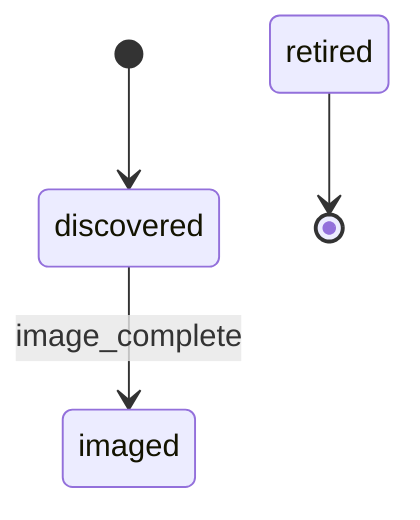

# Node Lifecycle State Machine Specification

> Template for Capstone E artifact 1. Replace every `<fill: …>` prompt. Keep the tables; add rows.

**Spec version:** `<fill: e.g. lifecycle-v1.0>` · **Owner:** `<fill: team>` · **Reviewed by:** `<fill: CAB / peer>`

## 1. States

| State | Meaning (one sentence) | Scheduler view | Who may move a node *into* it | Max dwell before alert |
|---|---|---|---|---|
| discovered | `<fill>` | not registered | provisioner (inventory import) | `<fill: e.g. 24 h>` |
| imaged | `<fill>` | not registered | provisioner | `<fill>` |
| validated | `<fill>` | registered, drained | acceptance runner | `<fill>` |
| schedulable | `<fill>` | available | controller (guarded `admit` / `undrain`) | n/a |
| drained | `<fill>` | drained / cordoned | health controller, operator | `<fill>` |
| repair | `<fill>` | drained, excluded | controller, operator | `<fill>` |
| retired | `<fill>` | removed | operator with approval | terminal |

## 2. Events and transitions

| From | Event | To | Guard (must be true) | Side effects (in order) | Rejected when |
|---|---|---|---|---|---|
| discovered | image_complete | imaged | `<fill>` | `<fill: audit append; inventory update>` | `<fill>` |
| imaged | acceptance_complete | validated / repair | `<fill: evidence fresh, policy version>` | `<fill>` | `<fill>` |
| validated | admit | schedulable | `<fill: acceptance passed AND compat golden>` | `<fill: audit append → scontrol RESUME / kubectl uncordon>` | `<fill>` |
| `<fill>` | `<fill>` | `<fill>` | `<fill>` | `<fill>` | `<fill>` |

Rule for repeated requests: `<fill: when is an event a no-op rather than an error, and why does that matter for an at-least-once queue?>`

## 3. Diagram

*Figure E.x — `<fill: caption>`.*

## 4. Invariants (each must be testable)

| ID | Invariant | How it is enforced | How it is tested |
|---|---|---|---|
| INV-1 | No node reaches `schedulable` without passing `validated` since its last image | `<fill>` | graph check (T1) + replay (T4) |
| INV-2 | A node running jobs is drained before `repair` or `retired` | `<fill>` | `<fill>` |
| INV-3 | `retired` is terminal | `<fill>` | `<fill>` |
| INV-4 | Every state change is in the audit log *before* the scheduler acts on it | `<fill>` | `<fill>` |
| INV-5 | `<fill>` | `<fill>` | `<fill>` |

## 5. Event delivery assumptions

- Delivery semantics of the queue: `<fill: at-least-once / exactly-once; consequence>`
- Ordering: `<fill: how out-of-order events are handled (sort key, staleness window)>`
- Concurrency: `<fill: one writer per node? optimistic locking on state version?>`
- Controller crash between "audit append" and "scheduler call": `<fill: recovery behaviour>`

## 6. Mapping to scheduler and provisioner

| Lifecycle state | Slurm node state | Kubernetes node condition | Provisioner state (lab system: `<fill>`) |
|---|---|---|---|
| schedulable | `<fill: IDLE/ALLOCATED/MIXED>` | `<fill: Ready, schedulable>` | `<fill>` |
| drained | `<fill>` | `<fill>` | `<fill>` |
| `<fill>` | `<fill>` | `<fill>` | `<fill>` |

## 7. Open questions and decisions

| Decision | Options considered | Choice | Rationale |
|---|---|---|---|
| Can `validated` go straight to `drained`? | `<fill>` | `<fill>` | `<fill>` |
| Does a firmware-only change require reimage + full acceptance? | `<fill>` | `<fill>` | `<fill>` |
