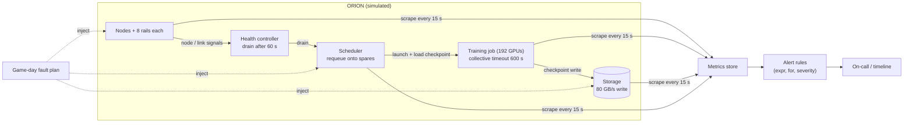

# Capstone F — AI Infrastructure Reliability Game Day

Plan, run and learn from a reliability game day on a GPU cluster — without putting anything real at
risk. You will write a fault-injection plan with hypotheses stated *before* the run, design the
alerts that should catch each fault, execute the faults against a seeded discrete-event simulation
of ORION, reconstruct the incident timeline from the evidence, measure detection time, recovery
time and lost GPU-hours, and turn what surprised you into a blameless postmortem and a prioritized
reliability backlog. The starter kit ships the simulator and the recording of Halcyon AI's first,
imperfect game day; the advanced extension repeats the exercise in a dedicated non-production lab.

| | |
|---|---|
| **Audience** | AI Infrastructure SRE, Production Engineer (outline Section 16). Also useful for Platform and Training Infra engineers who own recovery paths. |
| **Prerequisites** | Chapters [11](../../book/part-4-distributed-ai/ch11-distributed-training-architecture/), [14](../../book/part-4-distributed-ai/ch14-storage-pipelines-checkpointing/), [17](../../book/part-5-production-operations/ch17-kubernetes-slurm-scheduling/), [18](../../book/part-5-production-operations/ch18-observability-slos-incident-response/), [19](../../book/part-5-production-operations/ch19-reliability-security-multitenancy/); skim [12](../../book/part-4-distributed-ai/ch12-collective-communication-nccl/), [20](../../book/part-5-production-operations/ch20-automation-safe-change/) |
| **Time budget** | 30–40 h at L1 (starter kit ≈ 10 h, game-day design and analysis ≈ 15 h, postmortem and backlog ≈ 8 h); add 15–25 h for the lab extension |
| **Tiers** | L1 required (laptop simulation); L2 optional (single-host fault drills); L3 advanced extension (dedicated multi-node lab) |
| **Grading** | [../RUBRIC.md](../RUBRIC.md) plus the capstone-specific criteria in [Section 10](#10-grading) |

Acronyms: MTTR (mean time to recover), MTTD (mean time to detect), RPO (recovery point objective —
how much work can be lost), RTO (recovery time objective — how long recovery may take), NCCL (NVIDIA
Collective Communications Library), SLO (service-level objective), SEV (incident severity), PFS
(parallel file system).

> **Safety:** This capstone injects faults **only** into the supplied simulator (L1) or into a
> dedicated, isolated, non-production lab that you are explicitly authorised to disrupt (L2/L3).
> Never run any fault command in this capstone against a shared or production cluster, a shared
> fabric, or shared storage. Every L2/L3 fault must have a written abort condition and a rollback
> step that you have rehearsed *before* the game day.

---

## 1. Why this capstone matters

Reliability claims about AI clusters are usually untested until a real incident tests them. A
"self-healing" training platform has many moving parts — health checks, drains, collective
timeouts, requeue logic, spare capacity, checkpoint durability, alerting — and their interactions
fail in ways no single component test reveals. A game day is a controlled experiment on those
interactions: you write down what you expect, inject the fault, and compare. The value is in the
*refuted* hypotheses. Halcyon's first game day (supplied as data) refutes three:

- the scheduler can be down for 20 minutes and **nobody is paged**;
- a checkpoint that *started* is not a checkpoint you can restore: losing a node while storage is
  slow aborts the in-flight write and roughly doubles the lost work;
- after two node failures the spare pool is empty and the 192-GPU training job **cannot restart**
  for the rest of the day, although every failed component has already recovered.

## 2. Scenario on ORION

Halcyon AI's **SRE** team runs a quarterly game day. ORION-256 ([REFERENCE_CLUSTER.md](../../docs/REFERENCE_CLUSTER.md))
is modelled as follows `[SIMULATED]`:

| Partition | Nodes | GPUs | Workload |
|---|---|---|---|
| Training | rack-01–rack-06 (24 nodes) | 192 | W-TRAIN at TP 8 × PP 4 × DP 6, global batch 768 (128 sequences per replica); step ≈ 17.4 s `[MODELED]`; checkpoint every 30 min, 980 GB `[MODELED]`, 20 s synchronous snapshot then asynchronous write |
| Fine-tune | orion-n25, orion-n26 | 16 | step 2.0 s, checkpoint every 10 min, 28 GB `[ILLUSTRATIVE]` |
| Spares | orion-n27, orion-n28 | 16 | idle, used by requeue |
| Inference | rack-08 (4 nodes) | 32 | W-INFER replicas — **protected: out of scope for fault injection** |

> **Variation from REFERENCE_CLUSTER:** ORION's default split is 24 training nodes (`orion-n01`–`n24`)
> plus 8 inference nodes (`orion-n25`–`n32`), with no spares. For this game day the inference
> partition is carved up: `orion-n25`–`n26` run a 2-node fine-tune job, `orion-n27`–`n28` are held
> as requeue spares, and only `rack-08` (`orion-n29`–`n32`) serves W-INFER. W-TRAIN runs on the
> 24 training nodes at DP = 6, so its global batch is 768 rather than the reference 1,024 (which is
> not divisible by 6).

**Step time on 192 GPUs** `[MODELED]`: 768 × 4,096 = 3.146 × 10⁶ tokens; 6 × 70 × 10⁹ × 3.146 × 10⁶
= 1.321 × 10¹⁸ FLOP; 192 × 989 × 10¹² × 0.40 = 7.596 × 10¹⁶ FLOP/s; 1.321 × 10¹⁸ / 7.596 × 10¹⁶
≈ 17.4 s. This is the same as the 256-GPU reference because the per-replica batch (128) is unchanged.
With the reference batch of 1,024 on 192 GPUs the step would be ≈ 23.2 s.

Storage: ≈ 80 GB/s aggregate write, ≈ 160 GB/s read `[ILLUSTRATIVE]`. A health controller drains a
node 60 s after its node or link signal goes bad; the collective (NCCL/PyTorch watchdog) timeout is
600 s `[ILLUSTRATIVE]`; a requeued job takes 280 s to launch, initialise communicators and warm up, plus the checkpoint load time. Together these reproduce the book's canonical restart overhead of ≈ 15 min, and the canonical failure rate (per-node MTBF ≈ 1,536 node-hours, [REFERENCE_CLUSTER.md](../../docs/REFERENCE_CLUSTER.md) reliability assumptions) sets how often the training job meets these faults in a year `[ILLUSTRATIVE]`.

The first game day (2026-11-05, 14:00 UTC) ran five faults with the default alert rules; the
recording is in `starter-kit/data/gameday1_*`. Platform has asked SRE for three things: a better
game-day plan, alerts that would have caught everything, and a backlog that tells them what to
fix first.

## 3. Problem statement

Design and run a safe reliability game day for ORION that:

1. States a **fault-injection plan** — scenarios, targets, timing, blast radius, abort conditions,
   rollback — and a written **hypothesis with expected numbers** for every fault before it runs.
2. Defines **telemetry and alert rules** that detect each fault class within its target (node loss
   and link loss ≤ 120 s, scheduler outage ≤ 120 s, storage degradation ≤ 300 s) with **zero false
   alerts** on a fault-free run.
3. Produces, from evidence, an **incident timeline**, **recovery evidence** (detection, mitigation
   and recovery times; lost GPU-hours; checkpoint restore point), and a comparison of expected
   versus observed behaviour.
4. Writes a **blameless postmortem** and a **prioritized reliability backlog** whose ranking is
   justified by measured (simulated) impact and whose top items are validated by re-running the
   simulator with the fix applied where the simulator can represent it.

**Success criteria.** All checker tests pass; every refuted hypothesis is explained by a mechanism;
the backlog's top three items each cite the game-day evidence that motivates them; nothing in the
plan touches the protected inference partition or any real system.

## 4. Required artifacts

| # | Artifact | Template | Evidence expected |
|---|---|---|---|
| 1 | **Fault-injection plan** — scenarios, targets, start/duration, blast radius, abort conditions, rollback, safety sign-off | [fault-injection-plan.md](templates/fault-injection-plan.md) | `fault_plan()` passing T1; ≥ 5 scenarios incl. ≥ 1 overlapping pair |
| 2 | **Expected behaviour** — per fault: hypothesis, expected detection, mitigation, recovery and lost GPU-hours with arithmetic | [expected-behaviour.md](templates/expected-behaviour.md) | Predictions written before the run; `[MODELED]` |
| 3 | **Telemetry and alerts** — signal inventory, rule table (expression, `for`, severity, detects), real-world mapping, false-positive analysis | [alert-rules-spec.md](templates/alert-rules-spec.md) | `alert_rules()` passing T2 |
| 4 | **Incident timeline** — for the recorded game day and for your own run | [incident-timeline.md](templates/incident-timeline.md) | `build_timeline()` output, annotated |
| 5 | **Recovery evidence** — detection/mitigation/recovery times, lost GPU-hours, restore points, hypothesis verdicts | [recovery-evidence.md](templates/recovery-evidence.md) | `recovery_metrics()` and `evaluate_hypotheses()` tables `[SIMULATED]` |
| 6 | **Blameless postmortem** | [postmortem.md](templates/postmortem.md) | Contributing factors, not culprits; action items with owners |
| 7 | **Prioritized reliability backlog** | [reliability-backlog.csv](templates/reliability-backlog.csv) | Ranked with scores; top items re-simulated where possible |
| 8 | Problem statement, architecture, assumptions, implementation/simulation boundary, test plan, results, failure analysis, security considerations, final engineering review | [design-document.md](templates/design-document.md) | ≤ 15 pages; every number labelled |
| 9 | Results table | [results-table.md](templates/results-table.md) | Evidence class per row |

### The system under test



*Figure F.1 — What the game day exercises. Faults enter through nodes, links, storage and the
scheduler; recovery depends on the health controller, the scheduler, spare capacity and checkpoint
durability; detection depends on the alert rules evaluated over scraped signals.*

```mermaid
sequenceDiagram
  participant F as Fault (node loss)
  participant J as Training job
  participant H as Health controller
  participant S as Scheduler
  participant C as Checkpoint store
  F->>J: member node lost at t0 (collective hangs)
  Note over J: progress stops; in-flight checkpoint write aborted
  H->>S: drain node at t0 + 60 s
  J->>S: collective timeout at t0 + 600 s → job failed
  S->>J: requeue onto spare, launch + warm-up 280 s
  J->>C: load last DURABLE checkpoint (980 GB at read bandwidth)
  J-->>J: first step completes → recovered
```

*Figure F.2 — Recovery path for a node loss in the training job. Detection can be fast while
recovery is still bounded by the collective timeout — the gap that backlog item "fast-fail" closes.*

## 5. Milestones

| Milestone | Week | Exit criterion |
|---|---|---|
| M0 Choose capstone | 8 | Starter kit runs (`python check.py` → 2/11 PASS) |
| M1 Plan and hypotheses | 10 | Fault plan and expected-behaviour sheet reviewed by a peer *before* any run; safety sign-off |
| M2 Telemetry | 12 | Alert rules pass T2; recorded game day analysed (T3–T5) |
| M3 Game day and analysis | 13 | Own plan executed; recovery evidence and timeline; draft postmortem |
| M4 Final submission and review | 14 | Postmortem, backlog with re-simulated top items, 15-minute review: "what we believed, what happened, what we fix first" |

## 6. Tier options and the advanced extension

| Tier | What you do | What it proves |
|---|---|---|
| **L1 (required)** | Starter kit + all artifacts against the simulator | Reasoning about detection, recovery and lost work under stated assumptions `[SIMULATED]` |
| **L2 (optional)** | Single-host drills in a lab: kill and restart a training process, stop a lab scheduler, add storage latency with `tc netem`; measure detection and recovery with your real monitoring | That your real alerts and runbooks fire and work `[MEASURED]` for one host |
| **L3 / Advanced extension** | **Conduct safe fault injection in a dedicated non-production lab with explicit rollback and isolation** (outline wording): ≥ 2 RDMA-connected GPU nodes running a real multi-node job with checkpointing | Real collective-timeout behaviour, real requeue and checkpoint restore `[MEASURED]` |

Procedures, commands and what to record are in
[starter-kit/README.md §8](starter-kit/README.md#8-l2l3-extension-safe-fault-injection-in-a-dedicated-lab).

> **Realism boundary:** The simulator models *control flow and timing* — hangs, timeouts, drains,
> requeues, checkpoint durability, scrape-and-rule alerting. It does not model congestion, partial
> link degradation, NCCL algorithms, stragglers, GPU errors, scheduler policy, exporter staleness,
> or human response time, and its parameters are illustrative. A result such as "node loss costs
> 110 GPU-hours" is `[SIMULATED]` for the stated parameters and must not be quoted as a property of
> any real cluster.

## 7. Real-world mapping of simulator signals

The simulator's series are prefixed `sim_` because they are not the names of real exporters. In a
real deployment the equivalent evidence comes from:

| Simulator series | Real-world source (verify names against your exporters' current docs) |
|---|---|
| `sim_node_up` | Prometheus `up` for the node's exporter target; BMC power state via Redfish |
| `sim_nic_link_up` | node_exporter `node_network_up` for Ethernet interfaces; RDMA port state from `rdma link show` or `ibstat` |
| `sim_job_progress_age_seconds` | A last-step timestamp your training harness exports (custom metric) — the most valuable signal you can add |
| `sim_checkpoint_age_seconds` | Time since the checkpoint manager last *committed* a checkpoint (custom metric) |
| `sim_storage_write_GBps` | Parallel-file-system server or client throughput statistics (vendor-specific) |
| `sim_scheduler_heartbeat` | Prometheus `up` for a Slurm exporter, or a probe running `scontrol ping`; alert with PromQL `absent()` |
| `sim_inference_ready_replicas` | Kubernetes Deployment ready replicas (e.g. kube-state-metrics) |

## 8. Chapter map

| Chapter | What this capstone uses from it | Artifact(s) |
|---|---|---|
| [11 — Distributed Training Architecture](../../book/part-4-distributed-ai/ch11-distributed-training-architecture/) | Why one rank's failure stalls all ranks; restart and lost-work model | 2, 5 |
| [12 — Collective Communication and NCCL](../../book/part-4-distributed-ai/ch12-collective-communication-nccl/) | Collective hangs and timeouts as the failure detector of last resort | 2, 3 |
| [14 — Storage, Data Pipelines, and Checkpointing](../../book/part-4-distributed-ai/ch14-storage-pipelines-checkpointing/) | Checkpoint durability, async writes, RPO, restore bandwidth | 2, 5, 6 |
| [16 — Bare-Metal GPU Fleet Lifecycle](../../book/part-5-production-operations/ch16-bare-metal-fleet-lifecycle/) | Drain, repair, return-to-service; spare pool | 6, 7 |
| [17 — Kubernetes, Slurm, and Workload Scheduling](../../book/part-5-production-operations/ch17-kubernetes-slurm-scheduling/) | Requeue, drain semantics, controller availability | 1, 3 |
| [18 — Observability, SLOs, and Incident Response](../../book/part-5-production-operations/ch18-observability-slos-incident-response/) | Alert design, `for` durations, absence alerts, timelines, blameless postmortems | 3, 4, 6 |
| [19 — Reliability, Security, and Multi-Tenancy](../../book/part-5-production-operations/ch19-reliability-security-multitenancy/) | Failure-mode analysis, fault containment, recovery tests | 1, 7 |
| [20 — Infrastructure Automation and Safe Change](../../book/part-5-production-operations/ch20-automation-safe-change/) | Abort conditions, rollback, blast radius | 1 |
| [21 — Capacity, Power, and Infrastructure Economics](../../book/part-5-production-operations/ch21-capacity-power-economics/) | Spare-capacity cost versus lost GPU-hours | 7 |

## 9. Worked numbers you will reuse

All `[MODELED]` from the Section 2 parameters.

- **Checkpoint write time:** 980 GB / 80 GB/s = 12.25 s. With storage at 2 % (1.6 GB/s):
  980 / 1.6 = 612.5 s ≈ 10.2 min — long enough for a second fault to land inside the write.
- **Checkpoint load on restart:** 980 GB / 160 GB/s = 6.1 s; at 2 % (3.2 GB/s): 306 s.
- **Expected lost GPU-hours for one training-node loss:** GPUs × (time since last durable checkpoint
  + time to resume). With a 30-min interval the expected time since checkpoint is 15 min = 0.25 h;
  time to resume ≈ 600 s timeout + 280 s launch and warm-up + 6 s load + one 17.4 s step ≈ 903 s
  ≈ 0.251 h — the canonical ≈ 15-min restart overhead. 192 × (0.25 + 0.251) ≈ 96 GPU-h. The recorded
  F1 lost 94.4 GPU-h `[SIMULATED]`.
- **How often:** with a per-node MTBF of ≈ 1,536 node-hours `[ILLUSTRATIVE, REFERENCE_CLUSTER]`, the
  24-node training job is interrupted every 1,536 / 24 = 64 h on average, ≈ 8,760 / 64 ≈ 137 times a
  year, costing ≈ 137 × 96 ≈ 13,000 GPU-h per year before any game-day improvement.
- **Value of fast-fail:** failing the job when the health controller confirms the fault (60 s)
  instead of at the 600 s collective timeout saves (600 − 60) s × 192 GPUs / 3600 = 28.8 GPU-h per
  event.
- **How many spares?** Training-partition failures arrive at 24 × 24 / 1,536 = 0.375 per day; with
  the canonical 5-day repair turnaround about 0.375 × 5 ≈ 1.9 nodes are in repair at any time
  (Poisson), and P(≤ 2 in repair) ≈ 0.71. Two spares therefore run out on roughly 29 % of days
  `[MODELED]` — the game day's F5 is not bad luck.
- **Cost of spares:** two idle spare nodes reserve 2 × 8 × 8,760 h = 140,160 GPU-h per year. Any
  backlog item that "adds spares" must be weighed against that, or against using spares for
  preemptible work.

## 10. Grading

Scored with [../RUBRIC.md](../RUBRIC.md): pass ≥ 70/100 with no score below 50 % in *Architecture
and technical correctness* or *Measurement and analysis*; distinction ≥ 90/100 with reproducible
evidence. What excellent (9–10) looks like **for this capstone**:

| Dimension (weight) | Excellent evidence for Capstone F |
|---|---|
| Problem framing and assumptions (10 %) | Hypotheses written before runs, with numbers; simulator parameters and their sources listed as assumptions; safety scope (protected partition, simulation only) explicit |
| Architecture and technical correctness (20 %) | Correct causal model of each recovery path (collective timeout, drain, requeue, durable checkpoint); alert rules that detect causes and symptoms without flapping; absence alerting for silent components |
| Implementation / reproducibility (15 %) | 11/11 checks; every number in the report regenerates from one command; fixes validated by re-running the simulator with changed config/rules |
| Measurement and analysis (20 %) | Detection/mitigation/recovery and lost GPU-hours per fault; durable-vs-started checkpoint distinction; unrecovered faults reported as lower bounds; expected vs observed table with explanations |
| Reliability, security and operations (15 %) | Abort conditions and rollbacks that would work in a real lab; runbook changes from findings; security of fault-injection tooling (who may inject, audit of injections) |
| Troubleshooting and engineering judgment (10 %) | Explains each refuted hypothesis by mechanism; challenges the backlog formula (spare cost, toil, uncertainty) rather than accepting its ranking blindly |
| Communication and portfolio quality (10 %) | Blameless, readable postmortem; timeline a non-participant can follow; backlog a manager can fund |

## 11. Submission checklist

- [ ] `python starter-kit/check.py` → 11/11 PASS (output pasted into results)
- [ ] Hypotheses dated before the run (commit history is acceptable evidence)
- [ ] Every number labelled; every simulator result says what the simulator does not capture
- [ ] Postmortem contains no blame and names systemic contributing factors
- [ ] Backlog top three re-simulated where the simulator can represent the fix (for example `fast_fail=True`, an extra spare, new rules)

## 12. File map

```text
capstone-f-reliability-game-day/
├── README.md                     this brief
├── templates/                    fill-in deliverable templates
├── starter-kit/
│   ├── README.md                 tasks T1–T7, simulator guide, L2/L3 extension
│   ├── manifest.yaml
│   ├── check.py                  11 automated checks
│   ├── sim/cluster_sim.py        the simulator (given, fully implemented)
│   ├── data/                     default rules, constraints, recorded game day 1, backlog candidates
│   ├── tools/                     generator: instructor copy only (removed from the student release)
│   └── starter/gameday.py        your implementation
├── instructor/                   grading guide, exemplar, reference solution (not in student release)
└── review/REVIEW.md              editorial self-review log
```

## 13. Further reading

- *Site Reliability Engineering*, Beyer, Jones, Petoff and Murphy (eds.), O'Reilly, 2016 — chapters
  on monitoring distributed systems, emergency response and postmortem culture.
- *The Site Reliability Workbook*, Beyer et al., O'Reilly, 2018 — practical alerting on SLOs and
  the incident-response and postmortem chapters.
- C. Rosenthal and N. Jones, *Chaos Engineering: System Resiliency in Practice*, O'Reilly, 2020 —
  how to design hypotheses, limit blast radius and run game days safely.
- J. Allspaw, "Blameless PostMortems and a Just Culture," Etsy Code as Craft, 2012 — the origin of
  the blameless postmortem practice used in the template.
- Prometheus documentation, "Alerting rules" and the `absent()` function — the semantics of `for`
  and absence alerting that the simulator's rules imitate.
- Meta AI, "The Llama 3 Herd of Models," 2024 — the infrastructure section reports interruption
  causes and their frequency over a long large-scale training run; useful calibration for which
  faults deserve game-day time.
- Chapter 14 sources on PyTorch Distributed Checkpoint (DCP) and asynchronous checkpointing — why
  "started" and "committed" checkpoints differ.
