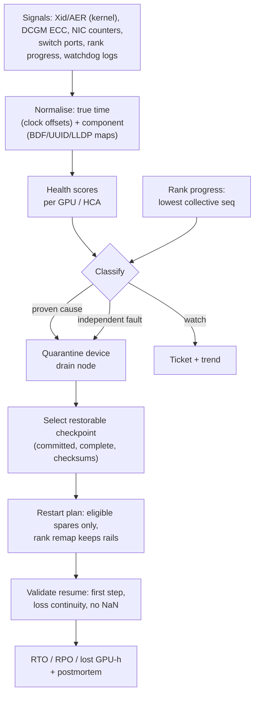

# Capstone G — Fault-Tolerant 512-Node Distributed Training Operations

At 512 nodes, faults stop being rare: the canonical failure rate in this book gives a full-cluster
job an interruption roughly every three hours. This capstone builds the operations workflow that
turns one of those interruptions into a short, evidence-backed recovery instead of an all-night
war room. Working from a synthetic incident on ORION-XL — GPU ECC events, PCIe AER errors, a
degraded NIC/HCA link, switch-port errors, a stalled rank and hundreds of collective timeouts — you
will build the rank-to-device inventory, correlate the telemetry on a common clock, score component
health, separate the proven cause from correlated noise, quarantine the smallest defensible failure
domain, choose a checkpoint that is actually restorable, plan the restart onto healthy spares, and
prove the job resumed correctly.

| | |
|---|---|
| **Audience** | AI Infrastructure SRE, Training Infrastructure Engineer, Cluster Platform Engineer (outline Section 22, Capstone G) |
| **Prerequisites** | Chapters [11](../../book/part-4-distributed-ai/ch11-distributed-training-architecture/), [12](../../book/part-4-distributed-ai/ch12-collective-communication-nccl/), [14](../../book/part-4-distributed-ai/ch14-storage-pipelines-checkpointing/), [16](../../book/part-5-production-operations/ch16-bare-metal-fleet-lifecycle/), [18](../../book/part-5-production-operations/ch18-observability-slos-incident-response/), [19](../../book/part-5-production-operations/ch19-reliability-security-multitenancy/); skim [5](../../book/part-2-accelerated-compute/ch05-gpu-interconnects-host-topology/), [10](../../book/part-3-networking/ch10-switches-optics-physical-layer/), [13](../../book/part-4-distributed-ai/ch13-gpu-data-movement/) |
| **Time budget** | 35–45 h at L1 (starter kit ≈ 12 h, design artifacts ≈ 18 h, postmortem and review ≈ 8 h); add 20 h for the lab extension |
| **Tiers** | L1 required (synthetic incident dataset); L2 optional (single-host evidence collection); L3 advanced (controlled fault drill on ≥ 2 RDMA-connected GPU nodes) |
| **Grading** | [../RUBRIC.md](../RUBRIC.md) plus [Section 10](#10-grading) |

> **Realism boundary — read first:** The L1 environment is **simulated**. Every log line, counter
> and timestamp in `starter-kit/data/` was produced by a seeded generator; log formats imitate the
> shape of real kernel, DCGM, NIC, switch and PyTorch messages but are not captures. Results from it
> are `[SIMULATED]`, and your report must say so on its first page (outline success criterion).

Acronyms: AER (PCIe Advanced Error Reporting), BDF (PCIe bus:device.function), DBE/SBE (double-/
single-bit ECC error), DCGM (NVIDIA Data Center GPU Manager), DCIM (data-centre infrastructure
management), DCP (PyTorch Distributed Checkpoint), HCA (host channel adapter, the RDMA NIC), LLDP
(Link Layer Discovery Protocol), RPO/RTO (recovery point/time objective), Xid (NVIDIA driver error
event identifier).

---

## 1. Why this capstone matters

In a synchronous job every rank waits for every other rank at each collective. When one GPU dies,
3,839 healthy ranks stop making progress, and after the collective watchdog timeout hundreds of
them log errors that all look like the root cause. Meanwhile a NIC on another node has been
flapping for forty minutes, a switch port shows errors that the cabling database attributes to the
wrong server, one host's clock is three minutes behind, and the newest checkpoint was never
finished. The operator who restarts from "the latest checkpoint" onto "any idle node" can turn one
interruption into three. The skills here — correlation on true time, proven cause versus
correlation, smallest failure domain, restorable-checkpoint selection, healthy placement and
resume validation — are what Section 20.1 of the course outline calls *distributed-training fault
tolerance at scale*.

## 2. Scenario: ORION-XL, 03:14 UTC

**ORION-XL** ([REFERENCE_CLUSTER.md](../../docs/REFERENCE_CLUSTER.md) §4): 512 HX8 nodes
(`orionxl-n001` … `orionxl-n512`), rail-optimized RoCEv2 backend.

> **Variations from REFERENCE_CLUSTER (all deliberate, all `[ILLUSTRATIVE]`):**
> 1. **Job size and spares.** The job runs on 480 nodes and 32 nodes (`orionxl-n481`–`n512`) form a
>    spare/maintenance pool, so the restart has healthy capacity to move to. Job MTBF is therefore
>    1,536 / 480 = 3.2 h rather than the reference cluster's 3 h for all 512 nodes.
>    **Sizing the pool (Poisson).** Failures arrive at 480 × 24 / 1,536 = 7.5 nodes/day. With the
>    canonical 5-day repair turnaround, 7.5 × 5 = 37.5 nodes are in repair on average, and
>    P(≤ 32) ≈ 0.21 — the pool would run dry on ≈ 79 % of days (P95 needs 48 spares, P99 52). This
>    capstone therefore declares a **split turnaround** `[ILLUSTRATIVE]`: 70 % of interruptions are
>    reset-and-return faults (GPU reset after a contained ECC error, reseated optic, re-acceptance)
>    back in service within 1 day, and 30 % need the 5-day repair path. Mean in repair =
>    7.5 × (0.7 × 1 + 0.3 × 5) = 16.5 nodes; P95 = 23, P99 = 27, so 32 spares cover > P99.
>    **Elastic fallback** when spares run out: one DP replica is TP 8 × PP 8 = 64 GPUs = 8 nodes, so
>    the job shrinks in 8-node steps, and DP must still divide the global batch. 3,840 is divisible
>    by 60, 48 and 40 (not 59): without a batch/LR change the next size down is DP 48 (384 nodes,
>    −20 %); keeping 64 sequences per replica at DP 59 means a batch of 3,776 and a learning-rate
>    review.
> 2. **Parallelism and batch.** TP 8 × **PP 8** × DP 60 = 3,840 GPUs; the global batch is 3,840
>    sequences = **1 sequence per GPU** (64 per DP replica). W-TRAIN on ORION-256 runs 1,024
>    sequences on 256 GPUs = **4 per GPU**, so each GPU here does a quarter of the work per step:
>    4.35 s against W-TRAIN's 17.4 s (17.4 / 4 = 4.35). The shorter step makes the
>    checkpoint-interval and lost-work arithmetic in this capstone different from W-TRAIN's; do not
>    reuse W-TRAIN step counts here.
> 3. **Checkpoint upload cap.** Uploads are rate-limited to 2.5 GB/s for the whole job. This is a
>    *deliberate stress choice*: a real ORION-XL file system would sustain far more, but a low cap
>    makes the durability lag (§9) long enough to see and reason about. Real deployments throttle
>    checkpoint uploads for the same reason (protecting data-loader reads), only less severely.
> 4. **Fabric naming.** Rail leaves are grouped into 16 pods of 32 nodes and named
>    `orionxl-be-leaf-pPP-rR`: pod `PP` = `p00`–`p15` (0-indexed; pod = (node − 1) // 32), rail
>    `R` = 0–7, leaf port = (node − 1) mod 32 + 1 (1-indexed). This extends the ORION
>    `orion-be-leaf-rR` pattern. Pod spines are `orionxl-be-spine-pPP-SS` and the third tier is
>    `orionxl-be-core-CC` (canonical names in REFERENCE_CLUSTER.md; not used in the dataset).

| Item | Value |
|---|---|
| Job `w-train-xl` | W-TRAIN 70B on 480 nodes = 3,840 GPUs, TP 8 × PP 8 × DP 60 `[ILLUSTRATIVE]` |
| Spare / maintenance pool | 32 nodes (`orionxl-n481`–`n512`) = 6.25 % reserve; sized for a split 1-day/5-day repair turnaround (variation 1) `[ILLUSTRATIVE]` |
| Step | 3,840 sequences × 4,096 tokens ≈ 15.7 M tokens; 6 × 70 × 10⁹ × 15.7 × 10⁶ ≈ 6.61 × 10¹⁸ FLOP; at 40 % MFU: 6.61 × 10¹⁸ / (3,840 × 989 × 10¹² × 0.40) ≈ **4.35 s** `[MODELED]` |
| Checkpoint | Async, sharded (one shard per node), 980 GB, every 138 steps ≈ 600 s; upload rate-limited to 2.5 GB/s so it does not disturb training I/O → durable ≈ 392 s after it starts `[ILLUSTRATIVE]` |
| Collective watchdog timeout | 600 s (PyTorch process-group timeout) `[ILLUSTRATIVE]` |
| Failure rate | Node MTBF ≈ 1,536 h → job MTBF ≈ 1,536 / 480 = **3.2 h** `[ILLUSTRATIVE, REFERENCE_CLUSTER]` |
| Restart overhead | ≈ 15 min (900 s) `[ILLUSTRATIVE, REFERENCE_CLUSTER]` |
| Targets | detect ≤ 120 s; isolate ≤ 600 s; RTO ≤ 1,800 s; RPO ≤ 2 checkpoint intervals (276 steps) |

At 03:14:07 UTC on 2026-11-12 the job stops making progress at step 51,797. Ten minutes later
watchdog timeouts arrive from all over the cluster. The **Training Infra**, **Fleet**, **Fabric**
and **SRE** teams join the incident; the recovery automation has already acted (its log is in the
dataset). Your job: reconstruct what happened, decide whether the automation was right, and build
the workflow that makes the next one routine.

## 3. Problem statement

Design a training-operations workflow for ORION-XL and demonstrate it on the incident dataset:

1. **Rank-to-device topology inventory** — every rank to node, GPU index, GPU UUID, BDF, NUMA node,
   HCA, rail, leaf and leaf port, from *observed* topology (LLDP), with discrepancies against the
   DCIM cabling plan reported.
2. **Telemetry correlation logic** — normalise kernel, DCGM, NIC, switch, job and scheduler events
   onto true time and onto components.
3. **Failure classification and health scoring** — a written scoring policy; proven cause separated
   from correlated and independent faults and from watch items.
4. **Quarantine policy** — smallest defensible repair domain, scheduling consequences, evidence
   preserved, return-to-service conditions.
5. **Asynchronous checkpoint and restore plan** — how checkpoints become durable, how a restorable
   checkpoint is chosen, how restore is validated.
6. **Restart orchestration** — healthy replacements only; rank remap preserving rails; retry policy.
7. **RTO/RPO measures** and lost GPU-hours, against targets.
8. **Recovery runbook** and **blameless postmortem**.

**Success criteria** (outline Section 22, verbatim intent): detect and isolate the injected fault
within the defined targets (detect ≤ 120 s, isolate ≤ 600 s); **never reschedule onto the unhealthy
device**; restore from a **validated** checkpoint; show **evidence that the job resumes correctly**;
and **state clearly that the environment is simulated**.

## 4. Required artifacts

| # | Artifact (outline Section 22) | Template | Evidence expected |
|---|---|---|---|
| 1 | Rank-to-device topology inventory | [topology-inventory.md](templates/topology-inventory.md) | `build_maps()`, `cabling_discrepancies()`; T1 checks |
| 2 | Telemetry correlation logic | [correlation-design.md](templates/correlation-design.md) | `normalize_events()`; clock-offset handling; T2 |
| 3 | Failure classification (+ health scoring) | [failure-classification.md](templates/failure-classification.md) | `health_scores()`, `classify()`; proven vs correlated table; T3–T4 |
| 4 | Quarantine policy | [quarantine-policy.md](templates/quarantine-policy.md) | `quarantine_plan()`; domain table; return-to-service rule; T5 |
| 5 | Asynchronous checkpoint and restore plan | [checkpoint-restore-plan.md](templates/checkpoint-restore-plan.md) | `select_checkpoint()`, `validate_resume()`; interval derivation; T6, T9 |
| 6 | RTO/RPO measures | [recovery-metrics.md](templates/recovery-metrics.md) | `recovery_metrics()` vs targets; T8 |
| 7 | Recovery runbook | [recovery-runbook.md](templates/recovery-runbook.md) | Numbered steps, signals, commands (tier-labelled), escalation |
| 8 | Blameless postmortem | [postmortem.md](templates/postmortem.md) | Timeline on true time; proven cause vs correlation |
| 9 | Restart orchestration (implementation) | starter kit | `restart_plan()`; T7 |
| 10 | Problem statement, architecture, assumptions, implementation/simulation boundary, test plan, results, failure analysis, security considerations, final engineering review | [design-document.md](templates/design-document.md) | ≤ 15 pages; first page states SIMULATED |
| 11 | Results table | [results-table.md](templates/results-table.md) | Evidence class per row |

### Workflow



*Figure G.1 — Incident workflow. Time correlation and component mapping come before any judgment;
classification uses rank progress, not timestamps; recovery is not "done" until the resumed job is
validated.*

```text
 rank 3013 ──► orionxl-n377 ─ GPU5 (UUID GPU-…, BDF 0000:ab:00.0, NUMA 1)
                     │            └─ PCIe switch ─ HCA mlx5_5 (0000:ac:00.0) ─ rail 5
                     │                                   └─ orionxl-be-leaf-p11-r5 port 25 (LLDP)
                     └─ 7 other GPUs / HCAs on rails 0–4, 6, 7
```

*Figure G.2 — The correlation chain for one rank. Every signal in the dataset attaches to one link
of this chain; an Xid names a PCI address, DCGM names a UUID, a switch names a port, a watchdog
names a rank.*

## 5. Milestones

| Milestone | Week | Exit criterion |
|---|---|---|
| M0 Choose capstone | 8 | Starter kit runs (`python check.py` → 1/11 PASS) |
| M1 Proposal | 10 | Scoring policy, quarantine domain table and targets reviewed; assumptions register |
| M2 Correlation | 12 | T1–T4 PASS; draft failure-classification table with proven vs correlated evidence |
| M3 Recovery | 13 | All 11 checks PASS; checkpoint/restore plan; RTO/RPO table; runbook draft |
| M4 Final | 14 | Postmortem and design review: "what happened at 03:14, what we proved, what we only suspect" |

## 6. Tier options and the advanced extension

| Tier | What you do | What it proves |
|---|---|---|
| **L1 (required)** | Starter kit + all artifacts on the synthetic incident | Correlation, classification and recovery *logic* `[SIMULATED]` |
| **L2 (optional)** | Collect real evidence on one GPU host (`nvidia-smi -q -d ECC`, Xid/AER from `journalctl -k`, `ethtool -S`, LLDP, `chronyc tracking`) and run it through your parsers | Parsers and mappings on real output for one platform `[MEASURED]` |
| **L3 (advanced)** | On a dedicated lab of ≥ 2 RDMA-connected GPU nodes, run a small multi-node job with async sharded checkpoints, inject a *safe* fault (kill one rank's process; take one backend interface down), and execute your workflow end to end | Real watchdog timing, real restore and resume validation `[MEASURED]` |

Commands and recording requirements: [starter-kit/README.md §8](starter-kit/README.md#8-l2l3-extension).

> **Safety:** Never inject faults on shared or production systems. Do not try to provoke real ECC
> errors. In a lab, "GPU fault" means killing the rank's process or draining the node; "link
> fault" means `ip link set dev <if> down` on a dedicated lab interface, with rollback rehearsed.

## 7. Facts you must get right

| Topic | What to state |
|---|---|
| Xid 94 vs 95 | 94 = contained ECC error: the affected process is terminated; drain when convenient, then reset the GPU. 95 = uncontained: drain immediately `[VENDOR-SPEC, 2026-10]`. In this incident the contained error killed rank 3013, so the job is already down and draining now *is* convenient. |
| Row remapping | A pending remap takes effect after a GPU reset; a remap *failure* means the GPU should not return to service `[VENDOR-SPEC, 2026-10]` — verify against the NVIDIA documentation for your driver. |
| Correctable ECC | Trend it; do not quarantine on small counts. |
| Collective timeouts | The 600 s here is the PyTorch process-group watchdog. It is a different layer from `NCCL_IB_TIMEOUT`, which sets the InfiniBand/RoCE transport retry interval (default 18 up to NCCL 2.22, about 1.07 s; 20 from 2.23 onward, about 4.3 s) `[VENDOR-SPEC, 2026-10]`. |
| "First error" | The first rank to *log* an error is rarely the cause. Use the rank that never entered the collective (lowest sequence number), and put events on true time with clock offsets first. |

## 8. Chapter map

| Chapter | Used for | Artifact(s) |
|---|---|---|
| [5 — GPU Interconnects and Host Topology](../../book/part-2-accelerated-compute/ch05-gpu-interconnects-host-topology/) | GPU/HCA/NUMA/BDF mapping, rail alignment | 1 |
| [10 — Switches, Optics, Cabling, and Physical-Layer Operations](../../book/part-3-networking/ch10-switches-optics-physical-layer/) | Link flaps, CRC/FEC counters, cabling records | 2, 3 |
| [11 — Distributed Training Architecture](../../book/part-4-distributed-ai/ch11-distributed-training-architecture/) | Parallelism, placement unit, restart model | 4, 6 |
| [12 — Collective Communication and NCCL](../../book/part-4-distributed-ai/ch12-collective-communication-nccl/) | Hangs, watchdogs, collective sequence numbers | 3 |
| [13 — GPU-to-GPU and GPU-to-NIC Data Movement](../../book/part-4-distributed-ai/ch13-gpu-data-movement/) | Why a degraded rail slows every step (stragglers) | 3 |
| [14 — Storage, Data Pipelines, and Checkpointing](../../book/part-4-distributed-ai/ch14-storage-pipelines-checkpointing/) | DCP, async checkpointing, metadata durability, restore validation | 5 |
| [16 — Bare-Metal GPU Fleet Lifecycle](../../book/part-5-production-operations/ch16-bare-metal-fleet-lifecycle/) | Quarantine, repair, re-acceptance (Capstone E) | 4 |
| [17 — Kubernetes, Slurm, and Workload Scheduling](../../book/part-5-production-operations/ch17-kubernetes-slurm-scheduling/) | Drain, spares, requeue | 6, 9 |
| [18 — Observability, SLOs, and Incident Response](../../book/part-5-production-operations/ch18-observability-slos-incident-response/) | Timelines, postmortem | 7, 8 |
| [19 — Reliability, Security, and Multi-Tenancy](../../book/part-5-production-operations/ch19-reliability-security-multitenancy/) | Fault isolation, failure domains | 3, 4 |

## 9. Worked numbers

All `[MODELED]` from Section 2 unless labelled.

- **Checkpoint interval.** Young's approximation τ ≈ √(2 δ M) with blocking snapshot cost
  δ = 10 s `[ILLUSTRATIVE]` and job MTBF M = 3.2 h = 11,520 s: √(2 × 10 × 11,520) = √230,400 = 480 s.
  The job uses 600 s (138 steps); the optimum is flat near its minimum, so 480–600 s costs little.
- **Durability lag.** 980 GB / 2.5 GB/s = 392 s: for 392 / 600 ≈ 65 % of the time the newest
  *started* checkpoint is not yet restorable.
- **Expected loss per interruption.** Time since last durable checkpoint ≈ τ/2 + 392 s = 300 + 392
  = 692 s; plus 900 s restart = 1,592 s; × 3,840 GPUs / 3,600 ≈ **1,700 GPU-h**. At 24 / 3.2 = 7.5
  interruptions per day: ≈ 12,700 GPU-h/day, ≈ 14 % of the job's 3,840 × 24 = 92,160 GPU-h/day.
- **This incident** `[SIMULATED]`: restore from step 51,474 after two newer checkpoints were rejected;
  RPO = 51,797 − 51,474 = 323 steps × 4.35 s = 1,405 s (target 276 steps — **missed**);
  RTO = 912 s; lost = 3,840 × (1,405 + 912) / 3,600 ≈ 2,471.5 GPU-h.

## 10. Grading

Scored with [../RUBRIC.md](../RUBRIC.md): pass ≥ 70/100 with no score below 50 % in *Architecture
and technical correctness* or *Measurement and analysis*; distinction ≥ 90/100 with reproducible
evidence.

| Dimension (weight) | Excellent evidence for Capstone G |
|---|---|
| Problem framing and assumptions (10 %) | States SIMULATED up front; parallelism, MTBF, restart overhead, checkpoint cadence and targets as testable assumptions; ORION-XL naming variation declared |
| Architecture and technical correctness (20 %) | Correct correlation chain (BDF/UUID/LLDP), Xid 94/95 handling, smallest repair domain versus placement unit, restorable-checkpoint criteria |
| Implementation / reproducibility (15 %) | 11/11; one command reproduces every table; pure functions; inputs never mutated |
| Measurement and analysis (20 %) | RTO/RPO/lost GPU-hours with arithmetic; interval derivation; durability-lag analysis; RPO miss explained |
| Reliability, security and operations (15 %) | Never-reschedule guarantee shown; return-to-service through re-acceptance; runbook; evidence preservation; access control for quarantine actions |
| Troubleshooting and engineering judgment (10 %) | Proven cause separated from correlation with the discriminating evidence named; red herrings (skewed clock, stale cabling, background ECC) explicitly rejected |
| Communication and portfolio quality (10 %) | Postmortem on true time; figures captioned; a reviewer can follow rank → device → port |

## 11. Submission checklist

- [ ] First page: "All results are SIMULATED on a synthetic dataset" (or the tier you ran)
- [ ] `python starter-kit/check.py` → 11/11 PASS (output in results)
- [ ] Proven-cause table names the discriminating evidence for each claim
- [ ] Every number labelled; Xid semantics marked `[VENDOR-SPEC, 2026-10]`
- [ ] Runbook commands tier-labelled; safety callouts on every state-changing step

## 12. File map

```text
capstone-g-fault-tolerant-512-node-training/
├── README.md
├── templates/                     10 deliverable templates
├── starter-kit/
│   ├── README.md                  tasks T1–T9, data dictionary, L2/L3 extension
│   ├── manifest.yaml
│   ├── check.py                   11 checks
│   ├── data/                      synthetic incident (generated, 1.2 MB)
│   ├── tools/                     generator: instructor copy only (removed from the student release)
│   └── starter/ftops.py           your implementation
├── instructor/                    grading guide, exemplar, reference (not in student release)
└── review/REVIEW.md
```

## 13. Further reading

- Meta AI, "The Llama 3 Herd of Models," 2024 — the infrastructure section quantifies interruption
  causes over a 54-day, ~16k-GPU training run; the best public calibration for this capstone.
- J. W. Young, "A first order approximation to the optimum checkpoint interval," *Communications of
  the ACM*, 1974; and J. T. Daly, "A higher order estimate of the optimum checkpoint interval for
  restart dumps," *Future Generation Computer Systems*, 2006 — the interval models used in §9.
- PyTorch documentation, *Distributed Checkpoint (DCP)* and asynchronous save — sharded state,
  metadata, and why a checkpoint is only restorable once its metadata is committed.
- NVIDIA, *Xid Errors* and *GPU Memory Error Management* (row remapping) documentation — the
  authoritative semantics for Xid 63/64/79/94/95; verify against your driver branch.
- NVIDIA, *DCGM User Guide* — field identifiers such as `DCGM_FI_DEV_ECC_DBE_VOL_TOTAL` and
  `DCGM_FI_DEV_ROW_REMAP_PENDING`.
- D. Narayanan et al., "Efficient Large-Scale Language Model Training on GPU Clusters Using
  Megatron-LM," SC 2021 — the TP/PP/DP layout behind the placement unit argument.
- PCI-SIG, *PCI Express Base Specification* (AER chapter) — correctable versus uncorrectable
  (non-fatal/fatal) error classes.
