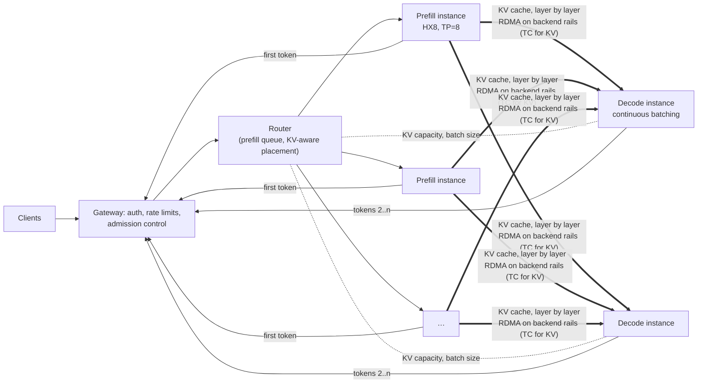

# Capstone H — Disaggregated LLM Serving Across Prefill and Decode Pools

Design a two-pool serving architecture for Halcyon AI's 70B chat model, in which prefill and decode
run on separate instances and the KV cache crosses the network between them. You will size each
pool, model KV-cache bytes and transfer time over RDMA and TCP, design network QoS and isolation for
KV traffic on a fabric shared with training, add admission control, evaluate speculative decoding
and heterogeneous accelerators, and decide — with reproducible, clearly labelled evidence — when
disaggregation helps and when it hurts. The starter kit ships a seeded request trace and a
discrete-event serving simulator. Every number you produce is `[MODELED]` or `[SIMULATED]`, and the
brief says which.

| | |
|---|---|
| **Audience** | AI Platform Engineer, Inference Infrastructure Engineer, AI Performance Engineer (outline Section 22, Capstone H) |
| **Prerequisites** | Chapters [15](../../book/part-4-distributed-ai/ch15-llm-inference-serving/), [8](../../book/part-3-networking/ch08-rdma-rocev2-infiniband/), [9](../../book/part-3-networking/ch09-congestion-control-lossless-fabrics/), [13](../../book/part-4-distributed-ai/ch13-gpu-data-movement/); skim [6](../../book/part-2-accelerated-compute/ch06-gpu-performance-engineering/), [18](../../book/part-5-production-operations/ch18-observability-slos-incident-response/), [19](../../book/part-5-production-operations/ch19-reliability-security-multitenancy/), [21](../../book/part-5-production-operations/ch21-capacity-power-economics/) |
| **Time budget** | 35–45 h at L1 (starter kit ≈ 12 h, design artifacts ≈ 18 h, review ≈ 8 h); add 20 h for the L2/L3 extension |
| **Tiers** | L1 required (model + simulator); L2 optional (one GPU host with a real serving stack); L3 advanced (two GPU nodes, real KV transfer over RDMA and TCP) |
| **Grading** | [../RUBRIC.md](../RUBRIC.md) plus [Section 10](#10-grading) |

Acronyms: TTFT (time to first token), TPOT/ITL (time per output token / inter-token latency), KV
(key/value attention cache), GQA (grouped-query attention), MFU (model FLOP utilisation), QoS
(quality of service), DSCP (Differentiated Services Code Point), TC (traffic class), PFC
(priority flow control), ECN (explicit congestion notification), CNP (congestion notification
packet), xPyD (x prefill instances, y decode instances).

---

## 1. Why this capstone matters

Prefill is compute-bound and bursty: a 2,048-token prompt runs about 290 TFLOP through the model at
once. Decode is memory-bound and steady: each step reads all 140 GB of weights plus every running
sequence's KV cache to produce one token per sequence. Put both on the same GPUs and every long
prefill stalls the decode batch — the TPOT tail grows with prompt length, not with load.
Separating the phases fixes that interference, but creates a new data path: 320 KiB of KV cache per
prompt token must reach a decode instance before the second token. The network, its QoS and its
failure behaviour become part of the serving SLO. This capstone makes you quantify that trade-off
instead of following a trend.

## 2. Scenario on ORION

W-INFER ([REFERENCE_CLUSTER.md](../../docs/REFERENCE_CLUSTER.md) §3): 70B decoder, 80 layers,
8 KV heads × 128 dim (GQA), BF16 weights ≈ 140 GB, TP = 8 per HX8 instance. SLOs `[ILLUSTRATIVE]`:
TTFT p95 ≤ 800 ms for prompts ≤ 4,096 tokens (≤ 3 s above that), TPOT p95 ≤ 50 ms (per-request
mean), ITL p99 ≤ 100 ms (per-token gap), **second-token gap p95 ≤ 100 ms** (a separate SLI: the gap
between the first token from prefill and the first token from decode, which carries the exposed KV
transfer and the wait for a decode slot; it occurs once per request, so a per-token ITL p99 dilutes
it — with Chapter 15's TCP profile ITL p99 is 18.7 ms while this gap's p95 is 162 ms), availability
99.9 %, at a target of **30 requests/s**, with at most 10 % of requests shed during bursts.

ORION's default split gives inference the eight nodes `orion-n25`–`orion-n32` (`rack-07`–`rack-08`,
Kubernetes) and training `orion-n01`–`n24` (`rack-01`–`rack-06`, Slurm). Every candidate in this
capstone fits inside the inference partition: 5P2D uses 7 of its 8 nodes (one left for N+1 or
canary), 5P1D uses 6 and colocated × 7 uses 7. The only stated variation is that the whole partition
serves this one model `[ILLUSTRATIVE]`; the colocated × 10 comparison point exceeds the partition and
is a thought experiment. Inference traffic shares the rail-optimized RoCEv2 backend with W-TRAIN on
`rack-01`–`rack-06`; the **Fabric** team has proposed a QoS mapping for KV transfer
(in the dataset) and wants your review. **Platform** asks for a recommendation and a cost per
million output tokens.

## 3. Problem statement

Produce a design and a recommendation for serving W-INFER at the target load:

1. A **service architecture** with separate prefill and decode pools, routing, KV hand-off and
   failure handling.
2. A **KV-cache size and transfer model** and an **RDMA/TCP comparison** (bandwidth, exposed latency,
   CPU and fabric cost, failure behaviour).
3. A **network QoS/isolation design** for KV traffic on a fabric shared with training.
4. A **capacity model** that sizes both pools and identifies the **bottleneck at target
   concurrency**.
5. **TTFT/ITL/throughput targets** per phase, **admission control** for bursts, **speculative
   decoding** and **heterogeneous accelerator** options.
6. **Failure scenarios** and a **cost/performance recommendation** that says when disaggregation
   helps and when it hurts.

**Success criteria** (outline Section 22): identify the bottleneck at target concurrency; explain
when disaggregation helps or hurts; support the recommendation with reproducible measurements or
explicitly labelled modeling.

## 4. Required artifacts

| # | Artifact | Template | Evidence expected |
|---|---|---|---|
| 1 | Service architecture | [service-architecture.md](templates/service-architecture.md) | Diagram, request path, ownership, failure handling |
| 2 | KV-cache size and transfer model | [kv-transfer-model.md](templates/kv-transfer-model.md) | `kv_cache_bytes`, `kv_transfer_exposed_s`; arithmetic `[MODELED]` |
| 3 | RDMA/TCP comparison | [rdma-tcp-comparison.md](templates/rdma-tcp-comparison.md) | `link_capacity`; simulator runs with both links, pipelined and not `[SIMULATED]` |
| 4 | Network QoS/isolation design | [qos-isolation-design.md](templates/qos-isolation-design.md) | `audit_qos` findings and corrected mapping |
| 5 | Capacity model | [capacity-model.md](templates/capacity-model.md) | `size_pools`, `utilizations`; bottleneck named |
| 6 | TTFT/ITL/throughput targets (phase SLOs) | [phase-slos.md](templates/phase-slos.md) | Per-phase budgets that add up to the end-to-end SLO |
| 7 | Failure scenarios | [failure-scenarios.md](templates/failure-scenarios.md) | Prefill/decode instance loss, KV transfer failure, link loss, congestion |
| 8 | Cost/performance recommendation | [cost-performance-memo.md](templates/cost-performance-memo.md) | `cost_per_million_tokens`; when disaggregation helps/hurts; speculative decoding; heterogeneous option |
| 9 | Problem statement, architecture, assumptions, implementation/simulation boundary, test plan, results, failure analysis, security considerations, final engineering review | [design-document.md](templates/design-document.md) | ≤ 15 pages; every number labelled |
| 10 | Results table | [results-table.md](templates/results-table.md) | Evidence class per row |

### Reference architecture



*Figure H.1 — Disaggregated serving. The first token comes from the prefill instance; the KV
cache streams to a decode instance chosen by free KV capacity; later tokens come from decode.
Thick arrows are the new data path this capstone sizes and protects.*

```text
 Prefill instance (orion-nA)                         Decode instance (orion-nB)
 GPU i HBM ─PCIe switch─ NIC i ══ rail i leaf ══ NIC i ─PCIe switch─ GPU i HBM      (i = 0..7)
   layer ℓ KV written ─► RDMA WRITE (GPUDirect) ─────────────────► KV pages for layer ℓ
   TCP alternative:  GPU ─► host memory ─► kernel socket ─► frontend NIC ─► … ─► host ─► GPU
```

*Figure H.2 — KV transfer data path. With GPUDirect RDMA on rail-aligned NICs each GPU's KV shard
moves NIC-to-NIC on its own rail; the TCP path adds two host copies and crosses the oversubscribed
frontend.*

## 5. Milestones

| Milestone | Week | Exit criterion |
|---|---|---|
| M0 Choose capstone | 8 | Starter kit runs (`python check.py` → 1/11 PASS) |
| M1 Model | 10 | KV size, roofline prefill/decode, link normalisation done; assumptions register |
| M2 Capacity | 12 | Pool sizing, bottleneck analysis, first simulator comparison of colocated vs disaggregated |
| M3 Robustness | 13 | Admission control, QoS audit, failure scenarios, speculative and heterogeneous options |
| M4 Final | 14 | Recommendation memo and 15-minute review: "when does disaggregation pay for itself here?" |

## 6. Tier options

| Tier | What you do | What it proves |
|---|---|---|
| **L1 (required)** | Starter kit + all artifacts | Capacity, transfer and SLO reasoning `[MODELED]` / `[SIMULATED]` |
| **L2 (optional)** | On one GPU host, run a supported open model and serving stack; measure prefill time vs prompt length and decode step time vs batch; calibrate MFU and HBM efficiency | Calibrated model parameters `[MEASURED]` for one platform |
| **L3 (advanced)** | On two RDMA-connected GPU nodes, measure GPU-to-GPU transfer bandwidth per rail (RDMA with GPU memory) and TCP throughput; run a disaggregated serving configuration if your stack supports it | Real KV-path bandwidth, exposed latency and CPU cost `[MEASURED]` |

Procedures: [starter-kit/README.md §8](starter-kit/README.md#8-l2l3-extension).

> **Realism boundary:** The simulator models roofline physics, queueing, continuous batching, KV
> capacity and layer-pipelined transfer. It does not model kernel efficiency curves, paged-KV
> details, TP communication beyond a fixed per-step overhead, congestion or incast on the fabric,
> prefix caching, preemption, or failures. The two non-H100 accelerator classes are hypothetical.
> Conclusions transfer as *mechanisms and orders of magnitude*, not as numbers for real products.

> **Safety:** L3 transfer tests run on a dedicated lab fabric. Do not run bandwidth floods or QoS
> changes on the shared ORION backend: KV traffic in the wrong lossless class can pause training
> traffic across the fabric.

## 7. Facts you must get right

| Topic | What to state |
|---|---|
| KV size | 2 × 80 × 8 × 128 × 2 B = 327,680 B ≈ 320 KiB per token (BF16); 2,048 tokens = 0.671 GB; 32,768 tokens = 10.7 GB `[MODELED]` |
| Line rate vs payload | 400 Gb/s = 50 GB/s line rate; assume ≈ 90 % achievable for RDMA writes `[ILLUSTRATIVE]`; one HX8 has 8 rails = 360 GB/s achievable |
| RoCE packet size | Set by the RDMA path MTU (4096 on ORION), not the host IP MTU; a larger host MTU does not change RoCE packets but can black-hole TCP if it exceeds the switch MTU `[VENDOR-SPEC, 2026-10]` |
| GPUDirect RDMA evidence | NCCL/transport logs showing `/GDRDMA` on the channel, `ib_write_bw --use_cuda` per rail, and ACS/IOMMU settings — not merely a loaded `nvidia_peermem` module `[VENDOR-SPEC, 2026-10]` |
| Frontend | 2 × 200 Gb/s per node, 3:1 oversubscribed by port count and 1.5:1 by bandwidth — shared with storage and ingress |
| Network sizing side | Gate on decode-side fan-in (KV GB/s ÷ D), not only prefill-side egress (KV GB/s ÷ P) |
| ITL vs TPOT | TPOT is a per-request mean; ITL is the per-token gap distribution (report p95/p99). Prefill stalls and second-token gaps hide inside mean TPOT `[VENDOR-SPEC, 2026-10]` (docs/VERIFIED_FACTS.md) |
| Decode MFU | Verification runs B × (k + 1) ≈ 2,500 rows per GEMM; we assume MFU 0.6 for it against 0.5 for prefill (whose long-sequence attention is less efficient) `[ILLUSTRATIVE]`. At 0.5 the k = 4 speedup falls from 1.25× to 1.08× — report both |
| Speculative decoding at large batch | Verification of B × (k + 1) tokens is compute-bound at B ≈ 500: the memory-bound "verification is nearly free" assumption fails; report the speedup at the operating batch |

## 8. Chapter map

| Chapter | Used for | Artifact(s) |
|---|---|---|
| [6 — GPU Performance Engineering](../../book/part-2-accelerated-compute/ch06-gpu-performance-engineering/) | Roofline, compute- vs memory-bound phases | 2, 5 |
| [8 — RDMA, RoCEv2, and InfiniBand](../../book/part-3-networking/ch08-rdma-rocev2-infiniband/) | RDMA WRITE path, path MTU, GPUDirect RDMA | 2, 3 |
| [9 — Congestion Control and Lossless-Fabric Engineering](../../book/part-3-networking/ch09-congestion-control-lossless-fabrics/) | Traffic classes, PFC, ECN/DCQCN, CNP priority | 4 |
| [13 — GPU-to-GPU and GPU-to-NIC Data Movement](../../book/part-4-distributed-ai/ch13-gpu-data-movement/) | Rail-aligned GPU↔NIC paths, host-staged copies | 2, 3 |
| [15 — LLM Inference and Serving Infrastructure](../../book/part-4-distributed-ai/ch15-llm-inference-serving/) | Prefill/decode, continuous batching, KV cache, TTFT/TPOT, speculative decoding, disaggregation | all |
| [18 — Observability, SLOs, and Incident Response](../../book/part-5-production-operations/ch18-observability-slos-incident-response/) | Phase SLIs, burn rates | 6 |
| [19 — Reliability, Security, and Multi-Tenancy](../../book/part-5-production-operations/ch19-reliability-security-multitenancy/) | Tenant isolation, encryption boundaries, failure domains | 4, 7 |
| [21 — Capacity, Power, and Infrastructure Economics](../../book/part-5-production-operations/ch21-capacity-power-economics/) | Cost per token, utilisation, headroom | 5, 8 |

## 9. Worked numbers

`[MODELED]` with the simulator's stated efficiencies (MFU 0.5 for prefill, 70 % HBM efficiency,
4 ms per-step overhead, 10 % HBM reserve — all `[ILLUSTRATIVE]`).

- **Prefill, 2,048 tokens:** 2 × 70 × 10⁹ × 2,048 = 2.867 × 10¹⁴ FLOP + causal attention
  2 × 80 × 8,192 × 2,048² = 5.50 × 10¹² → 2.922 × 10¹⁴ / (8 × 989 × 10¹² × 0.5 = 3.956 × 10¹⁵ FLOP/s)
  = **73.9 ms**. At 32,768 tokens attention grows to 1.41 × 10¹⁵ FLOP (≈ 23 % of the total): **1.52 s**.
- **Decode step, batch 256 at 2,600-token context:** bytes read per step = 140 GB of weights +
  256 × 2,600 × 327,680 B = 218 GB of KV = **358 GB in total**; 358 GB / (8 × 3.35 TB/s × 0.7 =
  18.76 TB/s) = 19.1 ms + 4 ms = **23.1 ms** per token for 256 sequences.
- **KV capacity per instance:** 8 × 80 GB × 0.9 − 140 GB = 436 GB → 1,330,566 tokens.
- **KV transfer, 2,048 tokens (0.671 GB):** 8 rails at 360 GB/s → 1.86 ms; one rail at 45 GB/s →
  14.9 ms; TCP over the frontend at 30 GB/s → 22.4 ms. Layer-pipelined, all three hide inside the
  73.9 ms prefill except one layer's share (1/80).
- **The network demand is bounded by prefill compute.** One prefill instance can process at most
  3.956 × 10¹⁵ / (2 × 70 × 10⁹) ≈ 28,300 tokens/s, so it can emit at most 28,300 × 327,680 B ≈
  9.3 GB/s ≈ 74 Gb/s of KV — 2.3 % of one node's 8 × 400 Gb/s backend line rate, but 31 % of the
  30 GB/s achievable on the frontend pair. At 30 req/s × 2,422 mean prompt tokens the whole service
  emits 23.8 GB/s.
- **Size the network on the receiving side.** With P > D the decode instances are the fan-in
  point: each receives 23.8 / D GB/s. At 5P2D that is 11.9 GB/s ≈ 95 Gb/s per decode instance —
  3 % of RDMA's 360 GB/s but **40 %** of the 30 GB/s TCP pair; at 5P1D or 4P1D it is 23.8 GB/s ≈
  190 Gb/s, **79 %** of TCP. With Chapter 15's TCP profile (one 200 Gb/s port at 50 % → 12.5 GB/s)
  even 5P2D needs 95 % of the link: infeasible. The simulator gives every transfer the full link,
  so link saturation shows up only in this model, never in the simulated latencies.

> **Relation to Chapter 15 (§15.10–15.12).** The chapter sizes W-INFER for 40 req/s with *fixed*
> 2,048-token prompts on **TP = 4 FP8** replicas (two per HX8; 6P + 2D = 8 replicas = 32 GPUs) and a
> TCP path of one 200 Gb/s port at 50 % (100 Gb/s), which makes TCP infeasible at 107 % of a decode
> replica's link. This capstone uses 30 req/s on **TP = 8 BF16** whole-node instances, a long-tailed
> prompt mix (mean 2,422 tokens, 1 % at 32k) with a 2.5× burst, and two frontend ports at 60 %.
> Fewer, larger decode instances receive more fan-in each, and the burst and 32k tail make
> admission control and head-of-line blocking first-order concerns that the chapter's steady-state
> example does not need. Re-running this capstone's model with the chapter's TCP profile reproduces
> the chapter's verdict (fan-in ≥ 95 % → TCP infeasible). Both agree that RDMA in its own traffic
> class is required for disaggregation at this scale, and both treat chunked-prefill colocation as a
> serious alternative.

## 10. Grading

Scored with [../RUBRIC.md](../RUBRIC.md): pass ≥ 70/100 with no score below 50 % in *Architecture
and technical correctness* or *Measurement and analysis*; distinction ≥ 90/100 with reproducible
evidence.

| Dimension (weight) | Excellent evidence for Capstone H |
|---|---|
| Problem framing and assumptions (10 %) | Load, prompt distribution (including the long tail and burst), SLOs and efficiencies stated as testable assumptions; ORION variation declared |
| Architecture and technical correctness (20 %) | Correct KV arithmetic; roofline reasoning per phase; transfer exposure with and without pipelining; QoS that cannot pause training; GDR prerequisites |
| Implementation / reproducibility (15 %) | 11/11; every table regenerates from one command; simulator configurations listed |
| Measurement and analysis (20 %) | Bottleneck named with utilisations; model vs simulation agreement quantified; colocated vs disaggregated at two loads; RDMA vs TCP by exposed-latency distribution, not means; MODELED/SIMULATED labels everywhere |
| Reliability, security and operations (15 %) | Failure scenarios with detection and degradation modes; N+1 for decode; KV encryption/isolation at trust boundaries; admission control and shedding policy |
| Troubleshooting and engineering judgment (10 %) | Says clearly when disaggregation hurts (small deployments, short prompts, low load) and why; challenges hypothetical hardware numbers |
| Communication and portfolio quality (10 %) | Memo a platform lead can approve; figures captioned; results table complete |

## 11. Submission checklist

- [ ] `python starter-kit/check.py` → 11/11 PASS (output in results)
- [ ] Every number labelled MODELED or SIMULATED (or MEASURED with a filled manifest)
- [ ] Bottleneck at 30 req/s named, with the utilisation of every resource
- [ ] A section titled "When disaggregation hurts" with simulator evidence
- [ ] Corrected QoS mapping and the reason each finding matters

## 12. File map

```text
capstone-h-disaggregated-llm-serving/
├── README.md
├── templates/                     10 deliverable templates
├── starter-kit/
│   ├── README.md                  tasks T1–T8, simulator guide, L2/L3 extension
│   ├── manifest.yaml
│   ├── check.py                   11 checks
│   ├── sim/serving_sim.py         serving simulator (given)
│   ├── data/                      trace, hardware, links, QoS proposal, SLOs, config
│   ├── tools/                     generator: instructor copy only (removed from the student release)
│   └── starter/serve.py           your implementation
├── instructor/                    grading guide, exemplar, reference (not in student release)
└── review/REVIEW.md
```

## 13. Further reading

- Y. Zhong et al., "DistServe: Disaggregating Prefill and Decoding for Goodput-optimized Large
  Language Model Serving," OSDI 2024 — the case for phase-specific resource allocation and goodput.
- P. Patel et al., "Splitwise: Efficient Generative LLM Inference Using Phase Splitting," ISCA 2024
  — heterogeneous hardware per phase and KV transfer cost.
- R. Qin et al., "Mooncake: A KVCache-centric Disaggregated Architecture for LLM Serving," 2024 —
  KV-cache-centric scheduling and transfer at production scale.
- W. Kwon et al., "Efficient Memory Management for Large Language Model Serving with
  PagedAttention," SOSP 2023 — paged KV cache and continuous batching (vLLM).
- A. Agrawal et al., "Taming Throughput-Latency Tradeoff in LLM Inference with Sarathi-Serve," OSDI
  2024 — chunked prefill, the colocated alternative to disaggregation.
- Y. Leviathan, M. Kalman and Y. Matias, "Fast Inference from Transformers via Speculative
  Decoding," ICML 2023 — the acceptance-rate model used in T6.
- Y. Zhu et al., "Congestion Control for Large-Scale RDMA Deployments" (DCQCN), SIGCOMM 2015 — why a
  new bulk RDMA flow needs its own class and ECN.
